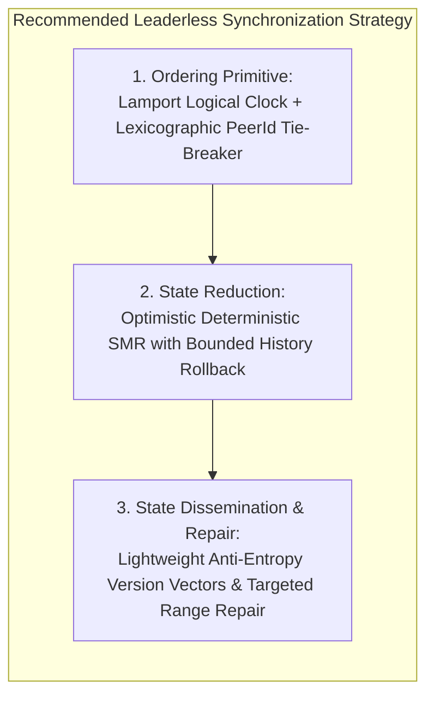

# Phase 7.1 — Distributed Synchronization Algorithm Evaluation

> **Document Version:** 1.0.0  
> **Status:** COMPLETED & VERIFIED (Milestone P7.1)  
> **Context:** SyncPlay Protocol — Phase 7 Leaderless Distributed Synchronization Engine  

---

## 1. Overview & Evaluation Methodology

The primary architectural mandate for SyncPlay Phase 7 is:
**"Build the simplest correct leaderless synchronization architecture that satisfies SyncPlay's requirements. Do not sacrifice architectural correctness merely to reach an implementation milestone faster."**

To ensure a scientifically rigorous choice, eight distributed algorithms and coordination paradigms were evaluated against the constraints of small-room browser peer-to-peer WebRTC environments.

---

## 2. Multi-Dimensional Evaluation Matrix

| Criteria | 1. Lamport Clocks + Tie-Break | 2. Vector Clocks | 3. Hybrid Logical Clocks | 4. CRDTs (Op/State) | 5. Deterministic SMR (Rollback) | 6. Total-Order Broadcast | 7. Temporary Sequencer Lease | 8. Raft / Paxos Consensus |
| :--- | :---: | :---: | :---: | :---: | :---: | :---: | :---: | :---: |
| **Correctness** | High | Very High | High | High | Very High | Very High | High | Very High |
| **Convergence** | Deterministic | Deterministic | Deterministic | Mathematical | Deterministic | Strong | Conditional | Linearizable |
| **Causality** | Partial (order only) | Full ($a \to b$ vs $a \parallel b$) | Partial | Inherent | Full | Full | Order only | Full |
| **Interaction Latency** | Instant ($0\text{ ms}$) | Instant ($0\text{ ms}$) | Instant ($0\text{ ms}$) | Instant ($0\text{ ms}$) | Instant (Optimistic) | Delayed ($1\text{ RTT}$) | Delayed ($1\text{ RTT}$) | Delayed ($1-2\text{ RTT}$) |
| **Message Overhead** | Minimal ($+8\text{ B}$) | Moderate ($O(N)$) | Minimal ($+16\text{ B}$) | Moderate | Minimal | High ($2\text{ rounds}$) | Low | Very High |
| **Memory Overhead** | Low ($O(K)$) | Moderate ($O(N \cdot K)$) | Low ($O(K)$) | Moderate to High | Low ($O(K)$) | Moderate | Low | High |
| **Complexity** | Low | High (dynamic peers) | Medium | Very High (media state) | Medium | Very High | High (failover) | Extreme |
| **Peer Churn Resilience** | Excellent | Poor (roster resize) | Good | Excellent | Good | Poor | Poor (re-elect) | Terrible in 2-peer |
| **Partition Behavior** | AP (Optimistic) | AP (Optimistic) | AP (Optimistic) | AP (Mergeable) | AP (Optimistic) | Stalls | Stalls/Split | Stalls (CP) |
| **Browser Suitability** | Excellent | Fair | Good | Moderate | Excellent | Poor | Poor | Incompatible |
| **Leader Dependency** | **Zero (Pure Leaderless)** | **Zero (Pure Leaderless)** | **Zero (Pure Leaderless)** | **Zero (Pure Leaderless)** | **Zero (Pure Leaderless)** | Weak leader | **Temporary Leader** | **Permanent Leader** |

---

## 3. In-Depth Evaluation of Candidate Technologies

---

### Candidate 1: Lamport Logical Clocks with Deterministic Tie-Breaking
- **Mechanism:** Each peer maintains a scalar integer counter $L$. When creating an operation, $L_{\text{local}} = L_{\text{local}} + 1$. When receiving an operation with timestamp $L_{\text{remote}}$, $L_{\text{local}} = \max(L_{\text{local}}, L_{\text{remote}}) + 1$. Ties between concurrent operations are broken deterministically using an ASCII lexicographic comparison of `senderPeerId`:
  $$\text{Key}(e) = \langle L(e), \text{senderPeerId}(e), \text{logicalEventId}(e) \rangle$$
- **Strengths:**
  - Utterly minimal wire overhead: exactly one 64-bit unsigned integer per control event.
  - Zero coupling to room membership rosters: peers can join and leave without re-dimensioning vector arrays.
  - Establishes a mathematically irreflexive, antisymmetric, transitive total order across all operations.
  - Trivially implemented and audited in TypeScript.
- **Weaknesses:**
  - Lamport clocks do not distinguish concurrent operations ($a \parallel b$) from causally dependent operations ($a \to b$). If $L(e_1) < L(e_2)$, $e_1$ might have caused $e_2$, or they might have been created concurrently in isolation.
- **Verdict for SyncPlay:** **HIGHLY SUITABLE.** The lack of full causality differentiation is harmless for media controls because concurrent operations (`SEEK`, `PAUSE`, `PLAY`) require a deterministic winner, not complex semantic branch-merging.

---

### Candidate 2: Vector Clocks
- **Mechanism:** Each peer maintains an array of counters $V = \langle v_1, v_2, \dots, v_N \rangle$, where $v_i$ is the number of operations generated by Peer $i$.
- **Strengths:**
  - Precise causality tracking: an operation $e_1$ strictly precedes $e_2$ iff $V(e_1) \le V(e_2)$ and $\exists k, V(e_1)[k] < V(e_2)[k]$.
  - Identifies concurrent operations ($e_1 \parallel e_2$) with 100% precision.
- **Weaknesses:**
  - **Dynamic Membership Friction:** In a browser watch party, peers join, leave, reload tabs, and reconnect with new peer IDs. Vector clocks require dynamic resizing, mapping peer IDs to array indices, and complex garbage-collection of deceased peer dimensions.
  - Wire overhead scales as $O(N)$ on every single message.
- **Verdict for SyncPlay:** **EXCESSIVE FOR REAL-TIME CONTROL EVENTS.** However, a simplified variant (Version Vectors) is **ideally suited for background Anti-Entropy digests** (Milestone P7.4).

---

### Candidate 3: Hybrid Logical Clocks (HLC)
- **Mechanism:** Kulkarni et al. (2014) combines physical clock readings (`performance.now()` / NTP) with Lamport logical counters to bound logical time within an $\epsilon$-window of physical wall-clock time.
- **Strengths:**
  - Logical timestamps remain close to physical time, simplifying human debugging and log inspection.
- **Weaknesses:**
  - Relies on physical clocks having bounded skew. In browser environments, device clocks can differ by seconds, jump unpredictably, or freeze during tab suspension.
  - Does not provide stronger ordering guarantees than Lamport clocks for media conflict resolution.
- **Verdict for SyncPlay:** **UNNECESSARY COMPLEXITY.** Plain Lamport clocks provide identical ordering guarantees without physical clock dependencies.

---

### Candidate 4: Conflict-Free Replicated Data Types (CRDTs)
- **Mechanism:** Data structures (State-based or Operation-based) whose operations commute ($A \circ B = B \circ A$) forming a join-semilattice (Shapiro et al., 2011).
- **Strengths:**
  - Replicas converge automatically upon receiving operations in any order without rollback or consensus.
  - Highly resilient to arbitrary network delays and partitions.
- **Weaknesses:**
  - **Media Playback is Non-Commutative:** A `SEEK(45s)` followed by `PAUSE` yields a paused video at 45s. A `PAUSE` followed by `SEEK(45s)` yields a video at 45s (potentially playing or paused depending on seek semantics). A `PLAY` and a `PAUSE` are direct antagonists.
  - Forcing media playback into a pure CRDT requires treating the entire playback state as a Last-Write-Wins Register (LWW-Register). But an LWW-Register requires a total-order tie-breaker—which is mathematically equivalent to Lamport Total Order!
- **Verdict for SyncPlay:** **NOT A FIT FOR CORE REDUCER.** The non-commutative nature of media controls negates the primary benefit of CRDTs.

---

### Candidate 5: Deterministic State-Machine Replication (SMR) with Bounded Rollback
- **Mechanism:** Every peer maintains an identical deterministic reducer (`reduceState`). Operations are executed optimistically upon receipt. If a late-arriving concurrent operation arrives with an older logical timestamp, the engine rewinds its state to the anchor preceding that operation and re-applies all subsequent operations in strict total order.
- **Strengths:**
  - Instant local responsiveness ($0\text{ ms}$ interaction latency).
  - 100% deterministic state convergence across all non-faulty replicas.
  - Clean separation: reducer remains pure functional code.
- **Weaknesses:**
  - Requires maintaining a bounded historical buffer of recent operations ($K = 256$) and periodic base snapshots.
- **Verdict for SyncPlay:** **THE OPTIMAL ARCHITECTURAL MODEL.** Perfectly aligns with the Phase 6 `BaselineSyncEngine` pure reducer.

---

### Candidate 6: Total-Order Broadcast (Atomic Broadcast)
- **Mechanism:** A two-phase dissemination protocol (e.g., Skeen's algorithm or Chandra-Toueg) where peers propose timestamps, collect proposals, and commit operations only after all peers agree on the sequence number.
- **Weaknesses:**
  - Incurs at least $1$ to $2$ network round-trips ($100\text{ ms} - 400\text{ ms}$) before any user action can take effect.
  - A single unresponsive or lagging peer stalls the entire room.
- **Verdict for SyncPlay:** **REJECTED.** Violates the interactive latency requirements of media playback controls.

---

### Candidate 7: Temporary Sequencer Lease (Coordinator-Based)
- **Mechanism:** The peer with the lowest `peerId` acts as a temporary coordinator, sequencing all events under an auto-expiring 2-second lease.
- **Weaknesses:**
  - If the coordinator closes their browser tab or suffers packet loss, the room stalls until the lease expires.
  - High risk of split-brain under network partitions (two coordinators elected in separate islands).
  - Violates the pure leaderless architecture principle.
- **Verdict for SyncPlay:** **REJECTED.** Fragile in dynamic browser environments with peer churn.

---

### Candidate 8: Raft / Paxos Classical Consensus
- **Mechanism:** Linearizable consensus via leader election and majority log replication ($\lfloor N/2 \rfloor + 1$).
- **Weaknesses:**
  - **Fatal in 2-Peer Rooms:** In a 2-peer room, majority is 2. If one peer drops, the remaining peer cannot form a quorum and cannot even pause or seek their local video.
  - Complex leader election and heartbeats consume excessive browser resources.
  - Completely violates Non-Negotiable Principle 1 (No Permanent Leader) and Principle 2 (Server-Minimized).
- **Verdict for SyncPlay:** **COMPLETELY INAPPROPRIATE.**

---

## 4. Evaluation Conclusion & Selected Strategy

### Architectural Verdict
1. **Event Ordering:** **Lamport Logical Clocks with Deterministic Tie-Breaking** ($\langle L, \text{peerId}, \text{eventId} \rangle$) provides the exact total ordering required without vector resizing overhead or leader election fragility.
2. **State Convergence:** **Optimistic State Machine Replication with Bounded Rollback** preserves $0\text{ ms}$ local UI responsiveness while ensuring identical converged states upon quiescence.
3. **Replication & Repair:** **Version-Vector Anti-Entropy** is adopted specifically for background digest exchange and missing event repair.

