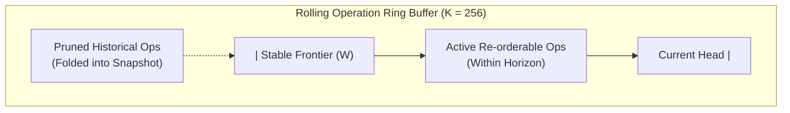

# Phase 7.1 — Bounded History, Anti-Entropy & State Reconciliation Research

> **Document Version:** 1.0.0  
> **Status:** COMPLETED & VERIFIED (Milestone P7.1)  
> **Context:** SyncPlay Protocol — Phase 7 Leaderless Distributed Synchronization Engine  

---

## 1. The Multi-Origin Event Reconciliation Problem

In a leaderless multi-peer system, operations originate concurrently from different nodes. A major architectural question is: **How can peers discover exactly which operations they are missing without broadcasting their entire history?**

### 1.1. Why Scalar Sequence Digests Fail (The Multi-Origin Flaw)
Consider a 4-peer room (Peers A, B, C, D):
1. Peer A generates operations: $A_1, A_2$.
2. Peer B generates operations: $B_1, B_2$.
3. Due to transient network drops:
   - **Peer C** receives: $\{A_1, B_1, B_2\}$ (Total operations = 3).
   - **Peer D** receives: $\{A_1, A_2, B_2\}$ (Total operations = 3, misses $B_1$).

```text
Peer C's Log:  [ A1, B1, B2 ]  ➔ Total count: 3
Peer D's Log:  [ A1, A2, B2 ]  ➔ Total count: 3

If peers only exchange a single scalar sequence counter or total count:
Peer C announces: Count = 3, Max Lamport = 4
Peer D announces: Count = 3, Max Lamport = 4
➔ Result: Peer C and Peer D believe they are fully synchronized!
➔ Reality: Peer C is missing A2, Peer D is missing B1. DIVERGENCE REMAINS UNNOTICED!
```

**Conclusion:** In a multi-origin leaderless mesh, a single scalar sequence number or total operation count is mathematically incapable of detecting missing operations.

---

## 2. Evaluation of Anti-Entropy & Reconciliation Mechanisms

| Mechanism | State Representation | Missing Detection | Bandwidth Overhead | Complexity | Browser Suitability |
| :--- | :--- | :--- | :---: | :---: | :---: |
| **A. Scalar Sequence / Version** | Single integer per session | Fails completely for multi-origin | Very Low ($4\text{ B}$) | Trivial | **Inadequate (Flawed)** |
| **B. Version Vectors (Per-Origin)** | Map of $\text{PeerId} \to \text{SeqNum}$ | Exact: discovers per-peer gaps | Low ($\approx 16\text{ B} \times N$) | Low | **IDEAL FOR SMALL ROOMS** |
| **C. Explicit LogicalEventId Sets** | Bounded list of active event IDs | Exact set-difference ($S_C \setminus S_D$) | Medium ($32\text{ B} \times K$) | Low | Good for small histories |
| **D. Merkle Trees** | Hierarchical hash tree of log | Logarithmic range hashes | High tree overhead | Very High | Excessive for $< 8$ peers |
| **E. Invertible Bloom Lookup Tables** | Probabilistic cell array | Constant size set reconciliation | Moderate | High | Academic overkill |
| **F. Snapshot-Only Reconciliation** | Entire `StateSnapshotPayload` | Replaces state blindly | High if frequent | Very Low | **Ideal Fallback for Large Gaps** |

---

## 3. The Recommended Solution: Per-Origin Version Vector Digests

For small-room browser sessions ($N \le 8$), the simplest correct mechanism is a **Per-Origin Version Vector Digest** coupled with **Targeted Range Repair**.

### 3.1. Per-Origin Sequence Numbering
Each peer maintains an independent, strictly incrementing integer sequence number $S_p$ for the operations it originates:
- Peer A originates: $(A, 1), (A, 2), (A, 3)\dots$
- Peer B originates: $(B, 1), (B, 2)\dots$

### 3.2. Compact State Digest (`STATE_DIGEST`)
Peers periodically (e.g., at 0.2 Hz) or reactively emit a compact digest representing the frontier of operations they have received from each origin:
```json
{
  "type": "STATE_DIGEST",
  "sessionId": "room-xyz",
  "versionVector": {
    "peerA": 2,
    "peerB": 1,
    "peerC": 4
  },
  "baseStateVersion": 12
}
```
For a 4-peer room, this entire JSON payload is under **120 bytes**.

### 3.3. Gap Detection & Targeted Repair Handshake
1. Peer D receives Peer C's digest: $V_C = \{A: 1, B: 2\}$.
2. Peer D checks its local vector: $V_D = \{A: 2, B: 1\}$.
3. Peer D immediately detects:
   - Peer D is missing $B$ from sequence $2$ to $2$ (Peer D only has $B: 1$).
   - Peer C is missing $A$ from sequence $2$ to $2$ (Peer C only has $A: 1$).
4. Peer D sends a targeted `REPAIR_REQUEST` to Peer C:
   $$\text{REPAIR\_REQUEST} = \{ \text{targetPeerId}: \text{"peerB"}, \text{fromSeq}: 2, \text{toSeq}: 2 \}$$
5. Peer C responds with an `OPERATION_BATCH` containing exactly $[B_2]$.
6. Both peers insert missing operations into their ring buffers and re-apply the total-order reducer.

---

## 4. The Bounded History Problem ($K = 256$) & Safe Compaction

In an interactive video session, thousands of seeks and rate adjustments may be executed over hours. Storing an append-only log indefinitely causes memory exhaustion (OOM).

### 4.1. The Safe Compaction Dilemma in Leaderless Systems
If Peer A unilaterally truncates its log beyond $K = 256$ operations:
- What if Peer B was temporarily disconnected or lagged, and still needs operation 150?
- If Peer A has already discarded operation 150, Peer A cannot fulfill Peer B's repair request.
- If Peer B then receives operation 151, Peer B has a permanent "hole" in its history and cannot deterministically reconstruct the state.

### 4.2. Leaderless Compaction: The Acknowledged Stable Frontier
To safely prune history without a leader, the engine tracks the **Stable Frontier**:
$$W_{\text{stable}} = \min_{p \in \text{ActivePeers}} (V_p)$$
Where $V_p$ is the latest acknowledged sequence vector reported by active peer $p$ in its `STATE_DIGEST`.



1. **Operations Older than $W_{\text{stable}}$:** Every connected active peer has proven receipt of these operations. They can never be superseded or rolled back. They are safely compacted into the **Base Snapshot** and evicted from the ring buffer.
2. **Operations Between $W_{\text{stable}}$ and Head:** Kept in memory to permit total-order re-evaluation if a late-arriving concurrent operation arrives.

### 4.3. Failure Mode: The Zombie / Deeply Partitioned Peer
- **Scenario:** Peer C disconnects or suspends their laptop for 30 minutes.
- **The Threat:** If Peer C never reports its vector, $W_{\text{stable}}$ freezes, causing Peers A and B to accumulate unbounded history.
- **Mitigation: Hard Horizon Cap ($K = 256$):**
  - If a peer falls further behind than the maximum ring buffer capacity ($K = 256$), the active peers **evict the lagging peer from the stable frontier calculation**.
  - Peers A and B compact their logs regardless of Peer C.
  - When Peer C eventually reconnects, its gap ($> 256$) cannot be repaired via operation replay. Peer C is served an authoritative `StateSnapshotPayload` (`importSnapshot`), fast-forwarding it cleanly to the current room base state.

