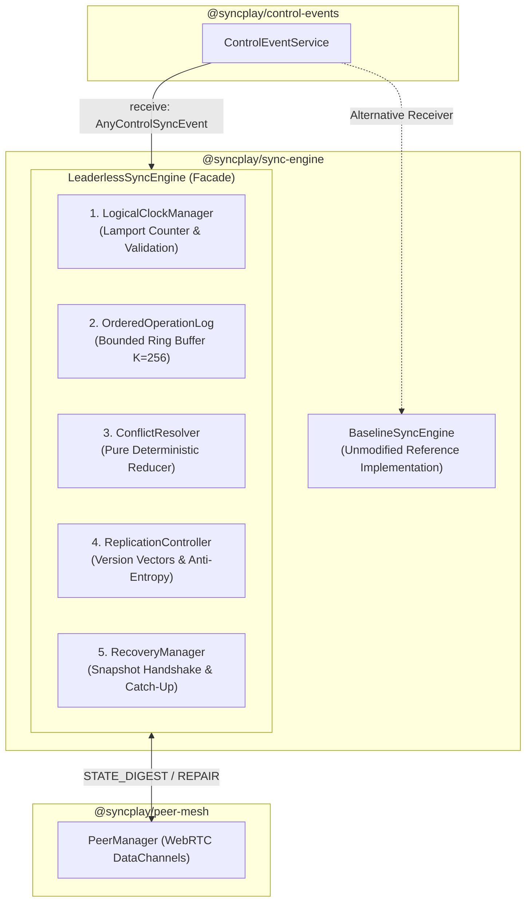

# Phase 7.1 — Leaderless Synchronization Architecture Recommendation

> **Document Version:** 1.0.0  
> **Status:** COMPLETED & VERIFIED (Milestone P7.1)  
> **Context:** SyncPlay Protocol — Phase 7 Leaderless Distributed Synchronization Engine  

---

## 1. Architectural Overview & Boundaries

The proposed architecture introduces the **Leaderless Distributed Synchronization Engine** (`LeaderlessSyncEngine`) within the `@syncplay/sync-engine` package while keeping the existing `BaselineSyncEngine` 100% intact as a tested reference baseline.

The engine strictly implements the approved `SyncEngine` interface and extends the Phase 5 `SyncEventReceiver` boundary:



---

## 2. Modular Component Decomposition

To avoid monolithic complexity and maintain testability, the engine is decomposed into five focused modules:

---

### 2.1. Module 1: `LogicalClockManager`
- **Responsibility:** Manages the monotonic Lamport logical clock.
- **Key Methods:**
  - `tickLocal(): number`: Increments local counter $L = L + 1$ and returns timestamp for outbound event.
  - `updateRemote(remoteClock: number): number`: Validates skew and advances $L = \max(L, \text{remoteClock}) + 1$.
  - `reseed(maxObservedClock: number): void`: Reseeds clock after reconnect or reload.
  - `validateTimestamp(ts: number): boolean`: Enforces `Number.isSafeInteger(ts)` and prevents malicious inflation.

---

### 2.2. Module 2: `OrderedOperationLog`
- **Responsibility:** Maintains an immutable historical buffer of operations sorted by total-order key $\langle L, \text{peerId}, \text{eventId} \rangle$.
- **Key Characteristics:**
  - **Bounded Capacity:** Enforces $K = 256$ operations maximum.
  - **Deduplicated Insertion:** Fast $O(1)$ lookup by `logicalEventId` via internal Map index.
  - **Total-Order Sorted Array:** Maintains sorted order using binary search insertion ($O(K)$ worst case, where $K \le 256$ is trivial in JS).
  - **Pruning:** Prunes operations older than the acknowledged stable frontier $W_{\text{stable}}$.

---

### 2.3. Module 3: `ConflictResolver`
- **Responsibility:** Pure functional state reducer implementing the operation-specific conflict semantics defined in `docs/PHASE7_1_CONFLICT_SEMANTICS.md`.
- **Inputs:** `currentState: PlaybackState`, `newOperation: ControlOperation`, `monotonicNow: number`.
- **Outputs:** `ReducerResult { nextState: PlaybackState, decision: EngineDecision }`.
- **Rollback Re-evaluation:**
  When a late-arriving operation $e_{\text{late}}$ is inserted into the log prior to the current head:
  $$\text{State}_{\text{new}} = \text{reduceState}^*(\text{BaseSnapshot}, [e_1, e_2, \dots, e_{\text{late}}, \dots, e_{\text{head}}])$$
  Because the reducer is pure functional and $K \le 256$, replaying 20 operations takes $< 0.5\text{ ms}$ in browser V8.

---

### 2.4. Module 4: `ReplicationController`
- **Responsibility:** Drives anti-entropy state digest exchange and targeted operation repair.
- **Mechanics:**
  - Maintains local Version Vector $V = \text{Map}\langle \text{PeerId}, \text{SeqNum} \rangle$.
  - Generates compact `STATE_DIGEST` messages transmitted periodically ($0.2\text{ Hz}$) or upon room membership changes.
  - Compares inbound digests: if a gap is detected, dispatches a `REPAIR_REQUEST` to fetch missing operation slices.
  - Answers inbound `REPAIR_REQUEST` by reading the requested range from `OrderedOperationLog` and replying with an `OPERATION_BATCH`.

---

### 2.5. Module 5: `RecoveryManager`
- **Responsibility:** Orchestrates peer reconnect catch-up and snapshot handshakes.
- **Mechanics:**
  - Placed in `RECOVERING` status upon peer rejoining with generation $G \ge 2$.
  - If log gap is within ring buffer ($< 256$ operations), executes rapid anti-entropy catch-up.
  - If log gap exceeds horizon ($> 256$ operations), requests an authoritative `StateSnapshotPayload` from an active peer, initializes base anchor, and fast-forwards to active state.

---

## 3. Component Responsibility Matrix

| Subsystem Component | Owns Logical Time | Owns Log Pruning | Owns State Reduction | Owns Anti-Entropy Wire | Owns Reconnect Gating |
| :--- | :---: | :---: | :---: | :---: | :---: |
| **`LogicalClockManager`** | **YES** | No | No | No | No |
| **`OrderedOperationLog`** | No | **YES** | No | No | No |
| **`ConflictResolver`** | No | No | **YES** | No | No |
| **`ReplicationController`** | No | No | No | **YES** | No |
| **`RecoveryManager`** | No | No | No | No | **YES** |
| **`LeaderlessSyncEngine`** | Facade | Facade | Facade | Facade | Facade |

---

## 4. Preservation of Stable Interface Contracts

The proposed architecture requires **zero breaking changes** to existing public interfaces:

1. **`SyncEventReceiver` Contract Preserved:**
   ```ts
   export interface SyncEventReceiver {
     receive(event: AnyControlSyncEvent): void;
   }
   ```
   `LeaderlessSyncEngine` implements this exact signature. Local semantic validation failures throw typed `SyncEngineError` (allowing `ControlEventService` to abort broadcasting), while remote errors are safely isolated.
2. **`SyncEngine` Public Methods Preserved:**
   - `getState(): Readonly<PlaybackState>`
   - `getCurrentPositionMs(atTimestamp?: number): number`
   - `onStateChange(listener): Unsubscribe`
   - `onDecision(listener): Unsubscribe`
   - `exportSnapshot()` / `importSnapshot()`
   - `dispose(): void`
3. **Reference Implementation Untouched:**
   `BaselineSyncEngine` remains completely intact in `packages/sync-engine/src/baseline-sync-engine.ts`, guaranteeing backwards compatibility, safety fallbacks, and benchmark comparisons.

