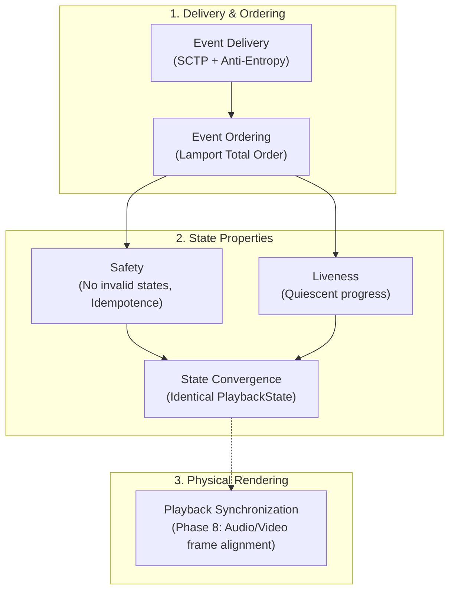

# Phase 7.1 — Consistency Model & Failure Specifications

> **Document Version:** 1.0.0  
> **Status:** COMPLETED & VERIFIED (Milestone P7.1)  
> **Context:** SyncPlay Protocol — Phase 7 Leaderless Distributed Synchronization Engine  

---

## 1. System & Network Model

To make mathematically sound guarantees, SyncPlay must formally specify the environment in which it operates.

### 1.1. Network Timing Model: Partial Synchrony
SyncPlay assumes a **Partially Synchronous Network** (Dwork, Lynch, Stockmeyer, 1988):
- For an initial period, message transmission delays may be arbitrary, unconstrained, or subject to network partitions.
- There exists an unknown Global Stabilization Time ($GST$) after which all message transmission delays between non-faulty connected peers are bounded by an upper bound $\Delta$.
- **Why this model?** Pure synchrony (assuming a known, fixed latency bound at all times) is unrealistic for public WebRTC connections over the internet. Pure asynchrony (assuming unconstrained delays forever) makes distributed consensus impossible in the presence of crash failures (Fischer, Lynch, Paterson, 1985). Partial synchrony accurately captures real-world internet behavior: periods of transient congestion/disconnection followed by stable communication.

### 1.2. Failure Model: Crash-Recovery (Non-Byzantine)
- **Crash-Recovery:** Peers may crash, disconnect, close their browser tab, or experience network drops at any instant. A crashed peer may later recover and rejoin the session.
- **Monotonic Generations:** A recovering peer is assigned a strictly increasing `ConnectionGeneration` ($G_{\text{new}} > G_{\text{old}}$) by the Bootstrap Server.
- **Non-Byzantine:** All participating peers are assumed to follow the protocol faithfully. Peers do not intentionally forge messages, alter cryptographic digests, fabricate timestamps, or send conflicting equivocal messages to different peers.

### 1.3. Transport Properties: Per-Pair SCTP vs. Mesh Absence of Total Order
- **Per-Pair Reliable In-Order Delivery:** WebRTC DataChannels configured with `ordered: true` and `maxRetransmits: null` use SCTP (RFC 8831). For any directed pair of peers $(A, B)$, messages sent from $A$ to $B$ are delivered reliably and in FIFO order without duplication.
- **Absence of Cross-Sender Total Order:** If Peer A sends $m_1$ to B, and Peer C sends $m_2$ to B, SCTP provides **no guarantees** regarding whether $m_1$ or $m_2$ arrives first at B. Multi-sender interleaving is arbitrary.

---

## 2. Deconstruction of Distributed System Guarantees

In distributed systems literature, terms like "consistency" and "synchronization" are frequently conflated. SyncPlay rigorously delineates six separate properties:



### 2.1. Safety
**Invariant:** At no point shall a valid operation cause the engine to enter an invalid, undefined, or unrecoverable state.
- Duplicate operations (matching `senderPeerId + logicalEventId`) have zero repeated state mutation.
- Malformed payloads (negative seek, infinite rate) are rejected without crashing the event loop.
- No peer accepts state from an unverified or stale connection generation.

### 2.2. Liveness
**Guarantee:** If non-faulty peers generate operations and the network stabilizes ($t > GST$), all valid operations are eventually processed by all connected non-faulty peers.
- Progress is never indefinitely blocked waiting for an offline or unresponsive peer.

### 2.3. Event Delivery
**Guarantee:** Delivery is guaranteed point-to-point by SCTP. For the multi-peer mesh, delivery of operations to all non-faulty peers is guaranteed via **Anti-Entropy Gossip**, even if the original author crashes immediately after partial transmission.

### 2.4. Event Ordering
**Guarantee:** All peers establish a **Strict Weak Total Order** over all known operations:
$$\text{Key}(e) = \langle \text{logicalTimestamp}(e), \text{senderPeerId}(e), \text{logicalEventId}(e) \rangle$$
Every replica evaluates conflicting operations in the exact same logical order regardless of physical arrival sequence.

### 2.5. State Convergence
**Guarantee:** If a set of operations $\mathcal{E}$ has been delivered to two peers $P_i$ and $P_j$, and no new operations are generated for duration $\tau > 2\Delta$ (quiescence), then:
$$\text{State}(P_i) \equiv \text{State}(P_j)$$
Both peers hold identical `status`, `anchorPositionMs`, `playbackRate`, and `stateVersion`.

### 2.6. Media Playback Synchronization (Phase 8 Boundary)
**Distinction:** State Convergence is an agreement on **logical parameters**. Playback Synchronization is the physical alignment of browser `<video>` elements, compensating for decoding jitter, hardware audio clock drift, and local render latency. Phase 7 guarantees State Convergence; Phase 8 achieves Playback Synchronization.

---

## 3. Rigorous CAP Theorem Analysis for SyncPlay

Eric Brewer’s CAP Theorem (formally proven by Gilbert & Lynch, 2002) states that an asynchronous network subject to partitions ($P$) cannot simultaneously achieve Consistency ($C$, linearizability) and Availability ($A$, every non-faulty node returns a non-error response).

```text
               Consistency (Linearizability)
                     ▲
                    / \
                   /   \
                  /     \
                 /       \
  Raft / Paxos  /         \
  (CP Systems) /           \
              /             \
             /   SyncPlay    \
            /      (AP)       \
           ▼───────────────────▼
Availability                  Partition Tolerance
(Interactive Media UX)         (WebRTC Peer Drops)
```

### 3.1. Why CP (Consistency over Availability) Fails for SyncPlay
If SyncPlay chose CP (e.g., Raft or Paxos requiring a majority quorum $\lfloor N/2 \rfloor + 1$ to accept an operation):
- In a 2-peer room (the most common watch-party setup), quorum is 2. If one peer's connection drops, quorum is lost ($1 < 2$).
- The remaining user would be **forbidden from pausing or seeking their own video**. Every click would fail or stall indefinitely.
- In browser media playback, blocking local user interaction is an unacceptable UX disaster.

### 3.2. Why AP (Availability with Eventual Consistency) is Mandatory
SyncPlay chooses **AP with Strong Eventual Consistency (SEC)**:
- **High Availability:** A user clicking `PAUSE` or `SEEK` must experience instantaneous local response ($< 5\text{ ms}$). The engine must never block on remote network round-trips or quorum votes.
- **Partition Tolerance:** If a network partition occurs, both sides continue operating locally.
- **Deterministic Reconciliation:** When the partition heals, the engine uses deterministic total ordering and anti-entropy to reconcile differences without server arbitration.

---

## 4. Formal Definition of the SyncPlay Consistency Model

SyncPlay implements **Strong Eventual Consistency (SEC) with Causal Precedence** (Shapiro et al., 2011).

### Definition: Strong Eventual Consistency for Media State
A distributed state system achieves Strong Eventual Consistency if:
1. **Eventual Delivery:** Every operation submitted to a non-faulty peer is eventually delivered to all non-faulty peers.
2. **Strong Convergence:** Any two peers that have processed the same bag of operations $\mathcal{E}$ have identical state:
   $$\text{History}(P_i) = \text{History}(P_j) \implies \text{State}(P_i) = \text{State}(P_j)$$
3. **Monotonic Progress:** Operations causally dependent on an earlier operation ($e_1 \to e_2$) are never applied in reverse order ($e_2$ before $e_1$) without triggering deterministic state re-evaluation.

### Mathematical Formulation of Convergence Condition

Let $\mathcal{O}$ be the universal set of operations generated across all peers in session $\mathcal{S}$.  
Let $\mathcal{O}_i(t)$ be the set of operations received and processed by Peer $i$ at physical time $t$.  
Let $T_{\text{last}}$ be the physical timestamp of the latest operation generated in $\mathcal{S}$.

**Convergence Theorem:**  
If the network is partially synchronous with bound $\Delta$, the peer mesh remains connected, and no new operations are generated after $T_{\text{last}}$:
$$\forall t > T_{\text{last}} + 2\Delta, \quad \mathcal{O}_i(t) = \mathcal{O}_j(t) = \mathcal{O}$$
$$\text{and} \quad \text{reduceState}^*(\text{InitState}, \text{sort}_{\text{total}}(\mathcal{O}))_i = \text{reduceState}^*(\text{InitState}, \text{sort}_{\text{total}}(\mathcal{O}))_j$$
Where $\text{sort}_{\text{total}}$ is the deterministic total-order comparator:
$$\text{sort}_{\text{total}}(\mathcal{O}) = \text{sorted by } \langle \text{logicalTimestamp}, \text{senderPeerId}, \text{logicalEventId} \rangle$$

---

## 5. Explicit Limitations & Boundaries

The guarantees defined above hold **strictly** under the stated assumptions. Convergence is **NOT** guaranteed under the following conditions:
1. **Permanent Network Partition:** If two peers remain permanently disconnected and never exchange anti-entropy digests, their states will remain divergent.
2. **Continuous Conflicting Inputs (Lack of Quiescence):** If two users continuously scrub the seek bar without pause, the system is in active conflict and convergence is deferred until input ceases for $\tau > 2\Delta$.
3. **Byzantine Faults:** If a compromised client intentionally fabricates conflicting Lamport timestamps or emits invalid data designed to exploit parser vulnerabilities, consistency guarantees are voided. (Protection against Byzantine peers is an explicit non-goal for MVP).
