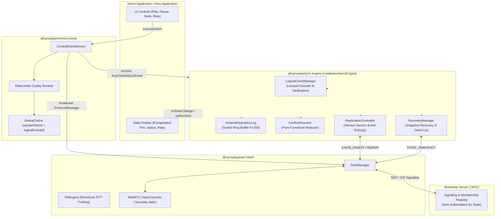
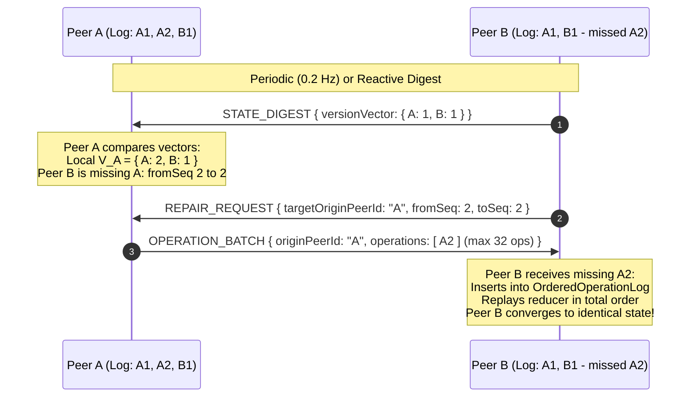
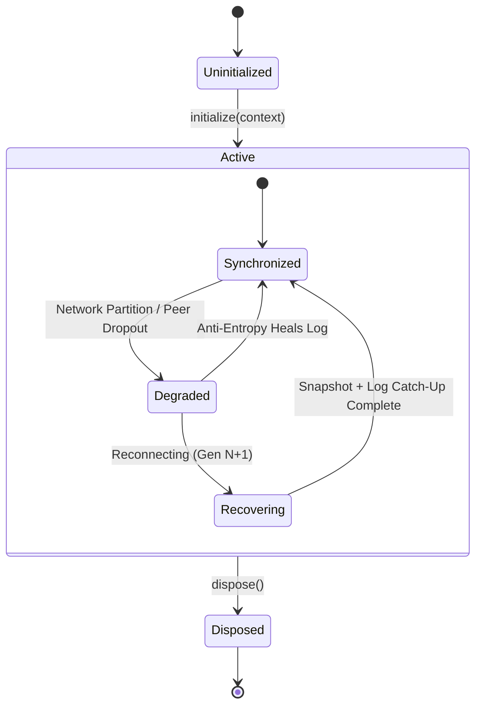

# Phase 7.2 — Leaderless Distributed Synchronization Engine: High-Level Design (HLD)

> **Document Version:** 1.0.0  
> **Status:** SPECIFICATION ONLY — NO IMPLEMENTATION AUTHORIZED  
> **Parent Milestone:** Phase 7.2 (Architecture & Interface Design)  
> **Baseline Commit:** `926c575`  
> **Reference Packages:** `@syncplay/sync-engine`, `@syncplay/protocol`, `@syncplay/control-events`, `@syncplay/peer-mesh`  

---

## 1. System Overview & Problem Statement

Phase 6 delivered the `BaselineSyncEngine`, proving pure functional state reduction and continuous position extrapolation. However, `BaselineSyncEngine` evaluates events strictly in **local arrival order**. Because WebRTC DataChannels provide FIFO ordering per peer-pair but **no global total order across multiple senders**, concurrent playback operations from different peers arrive in different sequences, causing permanent playback state divergence.

Phase 7 introduces the **Leaderless Distributed Synchronization Engine** (`LeaderlessSyncEngine`), extending the `@syncplay/sync-engine` package. The system guarantees that all connected browser peers reach identical, deterministically convergent playback states without relying on a centralized playback server or a permanent peer leader.

---

## 2. Non-Negotiable Architecture Principles

1. **No Permanent Playback Leader:** No peer possesses permanent authority over playback state. All peers participate symmetrically in event creation, ordering, and state reconciliation.
2. **Server-Minimized (Bootstrap Non-Authoritative):** The Bootstrap Server manages room lifecycle, access tokens, and WebRTC signaling only. It never receives, sequences, stores, or arbitrates playback events.
3. **Peer-to-Peer Full-Mesh Transport:** All playback control events, logical clock metadata, anti-entropy digests, and repair batches travel directly over WebRTC DataChannels (`'syncplay-data'`).
4. **Replaceable Engine Interface:** The leaderless engine implements the stable `SyncEngine` contract and extends the Phase 5 `SyncEventReceiver` boundary. The Phase 6 `BaselineSyncEngine` remains completely intact as an unmodified reference baseline.
5. **Decoupling State Agreement from Media Rendering:** Phase 7 achieves **distributed state convergence** (consensus on status, anchor position, playback rate, and timeline revision). Phase 8 will bind this state to the DOM `<video>` / `<audio>` element and perform clock drift compensation.

---

## 3. High-Level Component Architecture



---

## 4. Module Responsibilities & Trust Boundaries

### 4.1. Component Responsibility Breakdown

| Component | Layer | Primary Responsibility | Explicit Non-Responsibilities |
| :--- | :--- | :--- | :--- |
| **`ControlEventService`** | `@syncplay/control-events` | Validates intents, generates `messageId` and `logicalEventId`, enforces rate limits, suppresses duplicate transmissions. | Does not order events; does not resolve conflicts; does not track logical clocks. |
| **`LogicalClockManager`** | `@syncplay/sync-engine` | Tracks local Lamport clock, validates remote timestamps, updates clock on receive ($\max(L_l, L_r)$ without $+1$). | Does not persist operations; does not reduce playback state. |
| **`OrderedOperationLog`** | `@syncplay/sync-engine` | Stores recent operations in deterministic total order $\langle L, \text{peerId}, \text{eventId} \rangle$, manages circular horizon $K=256$, prunes at stable frontier. | Does not transmit wire packets; does not make playback decisions. |
| **`ConflictResolver`** | `@syncplay/sync-engine` | Pure functional state reducer evaluating operation-specific conflict policies (`SEEK`, `PLAY`, `PAUSE`, `RATE_CHANGE`). | Holds no internal state; completely deterministic given $(S, e, t)$. |
| **`ReplicationController`** | `@syncplay/sync-engine` | Tracks per-origin version vectors, generates `STATE_DIGEST`, detects log gaps, requests `REPAIR_REQUEST`, fulfills `OPERATION_BATCH`. | Does not manage WebRTC peer lifecycle; does not parse SDP/ICE. |
| **`RecoveryManager`** | `@syncplay/sync-engine` | Orchestrates peer catch-up upon rejoining, manages snapshot export/import fallback, gates reconnecting peers. | Does not choose room membership; does not bypass connection generation checks. |
| **`PeerManager`** | `@syncplay/peer-mesh` | Manages WebRTC connection lifecycle, DTLS transport, SCTP DataChannels, ICE candidate queues, generation tracking. | Oblivious to playback state, clocks, digests, and control payloads. |
| **`BootstrapServer`** | `services/bootstrap-server`| Issues membership tokens, tracks room rosters, assigns monotonic `ConnectionGeneration`, relays SDP/ICE signals. | Strictly non-authoritative for playback state; never inspects control messages. |

### 4.2. Trust Boundaries, Identity & Causality Invariants

1. **Strictly Delineated 7-Part Identity Model:**
   - `originPeerId`: Logical author identity within the session/epoch (assigned by Bootstrap during room creation/join).
   - `originSequence`: Monotonically increasing positive integer per origin ($1, 2, 3\dots$).
   - `logicalEventId`: Unique identifier (UUID/NanoID) identifying the logical user operation, preserved across transmission retries.
   - `logicalTimestamp`: Lamport clock counter (scalar integer) used for the deterministic total-order key $\langle L, \text{originPeerId}, \text{logicalEventId} \rangle$.
   - `fromPeerId`: Transport-verified peer identity of the immediate WebRTC hop (derived from PeerMesh DataChannel context).
   - `connectionGeneration`: Monotonic integer from Bootstrap tracking the WebRTC connection lifecycle between `fromPeerId` and receiver.
   - `membershipEpoch`: Monotonic integer tracking the room membership roster configuration from the Bootstrap Server.

2. **Strict No-Forwarding Policy for Live Operations & Historical Trust Model (MVP):**
   - **Live Broadcasts:** In the direct full-mesh architecture ($N \le 8$), every live control operation (`PLAY`, `PAUSE`, `SEEK`, `RATE_CHANGE`) must be sent directly by its author:
     $$\text{originPeerId} \equiv \text{senderPeerId} \equiv \text{fromPeerId}$$
     Relaying or rebroadcasting another peer's live control event is strictly forbidden. Any live control message where $\text{originPeerId} \neq \text{fromPeerId}$ is immediately rejected at the transport boundary with `REJECTED_UNAUTHORIZED_ORIGIN`.
   - **Historical Repair Batches (`OPERATION_BATCH`):** Handled via anti-entropy repair, where `supplierPeerId` (immediate transport sender) is decoupled from `originPeerId` (historical author).
   - **Cooperative Non-Byzantine Trust Model (MVP):**
     - Historical event authorship is **not cryptographically verified** (asymmetric signatures deferred to post-MVP).
     - Transport identity (`supplierPeerId`) certifies who delivered the batch, **not that `originPeerId` genuinely authored the event**.
     - A malicious room participant fabricating historical events is explicitly **out of scope** for the MVP.
     - **Mandatory Receiver Validation:** Before admitting any repaired operation, the receiver strictly verifies schema conformance, recognized origin identity, origin sequence continuity, collision absence (`SEQUENCE_COLLISION_DETECTED`), causal context integrity, Lamport causality ($L(e) > \max \text{deps}$), and safe integer bounds ($L < 2^{53}-1$).
     - Repaired operations bypass ONLY the wall-clock rate limiter; if any check fails, the operation is rejected and the local Lamport clock never advances.

3. **Causal Context vs. Replication Vector Separation:**
   - **Event Causal Context (`causalContext: Record<originPeerId, number>`):** Immutable vector stamped by the author at event creation, recording the highest consecutive sequence observed from each origin prior to generating the event. Used for exact concurrency detection ($e_1 \parallel e_2$).
   - **Local Replication Vector (`replicationVector: Record<originPeerId, number>`):** Locally maintained vector tracking the highest **consecutive** sequence received, validated, and reduced into the engine state from each origin. Out-of-order arrivals do **not** advance `replicationVector`; they are held in `PendingDependencyQueue` and tracked via `SparseGapTracker`.

4. **Strict Membership Epoch Fencing & Offline Partition Policy (MVP):**
   - **Authority:** The Bootstrap Server coordinates room membership rosters and increments `membershipEpoch` monotonically on membership changes (`peer-joined`, `peer-left`, `peer-timeout`).
   - **Non-Authoritative Playback Invariant:** The Bootstrap Server **never** inspects playback state, sequences control events, or resolves playback conflicts. Connected peers continue synchronized playback over WebRTC DataChannels even if Bootstrap becomes temporarily unavailable.
   - **Strict Fencing Policy:** Control operations carry the author's active `membershipEpoch`. Operations generated by a partitioned peer under an obsolete epoch ($e.\text{membershipEpoch} < \text{activeEpoch}$) are **FENCED AND REJECTED** upon reconnection with `REJECTED_OBSOLETE_EPOCH`.
   - **Explicit Architectural Trade-Off:** Offline operations generated during network isolation are discarded. In collaborative media playback, replaying minutes-old seeks over active playback causes intolerable UX disruption and prevents bounded history compaction ($K=256$). The rejoining peer purges speculative intents and catches up via `StateSnapshotPayloadV2`.

5. **Browser Reload & Ephemeral Identity Policy:**
   In a browser runtime without durable IndexedDB sequence persistence, a page reload (F5) wipes in-memory sequence numbers. A reloading peer **MUST obtain a fresh `peerId` from the Bootstrap Server upon rejoining**. It starts sequence numbers at $1$ under the new identity. Its old `peerId` is marked departed via Bootstrap `session:peer-left`. This prevents sequence collisions without requiring complex disk persistence.

6. **Snapshot Acceptance, Integrity & Semantic Boundaries:**
   - **5 Disambiguated Snapshot Properties:**
     1. *Byte Integrity:* RFC 8785 canonical serialization hashed with SHA-256 (`stateDigestSha256`) guarantees that the payload was received without network corruption.
     2. *Supplier Identity:* Verified WebRTC DTLS transport identity (`fromPeerId` / `supplierPeerId`) certifies who delivered the wire message.
     3. *Claimed Authorship:* `snapshotAuthorPeerId` declares who generated the snapshot. In the cooperative trust model, this claim is trusted.
     4. *Frontier Completeness:* Component-wise domination ($V_{\text{snap}} \ge V_{\text{local}}$) proves that the snapshot causally encompasses all historical events known to the local receiver.
     5. *Semantic Correctness:* **CANNOT be verified independently without the complete event history from Genesis.** Vector dominance and SHA-256 do NOT prove that the computed playback position or rate truthfully reflect the underlying operations.
   - **Cooperative Model Reliance:** Snapshot installation relies on the cooperative non-Byzantine trust model. The author is trusted to have correctly executed the pure functional reducer on genuine room history.
   - **Incomparable Snapshot Handling:** If frontiers are incomparable ($V_{\text{snap}} \parallel V_{\text{local}}$) and missing operations are compacted beyond the horizon ($K = 256$), the engine **never applies arbitrary tie-breakers** ($\max(\text{epoch}) \to \max(L) \to \max_{\text{lex}}$). It transitions to `DEGRADED_OUT_OF_SYNC` and halts state mutations until resolved via explicit Host Re-Seek or Room Reload.
   - **Non-Authority Invariant:** A snapshot supplier or author never becomes a permanent playback authority. Local operations newer than the snapshot frontier are immediately replayed upon installation.

7. **MVP Threat Model & Out-of-Scope Security Register:**
   - *In-Scope (Defended):* Crash-stop failures, network loss/jitter/reordering, temporary partitions, ephemeral reload resets, client runaway loops/jitter (token-bucket throttled), live sender impersonation (strict no-forwarding).
   - *Out-of-Scope (Not Defended in MVP):* Byzantine fabrication of historical events in repair batches, deliberate fabrication of false snapshot playback states, or compromised clients modifying open-source JS code. Private cooperative small rooms ($N \le 8$) are assumed.

8. **Connection Generation Isolation:** Stale packets arriving from previous connection generations ($G < G_{\text{active}}$) are discarded at the transport boundary before reaching the synchronization engine.

---

## 5. End-to-End Data & Event Flows

### 5.1. Outbound Local Control Flow (Optimistic Dispatch)
```text
User Action (e.g. Seek)
   │
   ▼
UI / Controls ➔ ControlEventService.executeIntent({ type: 'SEEK', targetPositionMs: 45000 })
   │
   ├─► 1. RateLimiter checks token bucket (passes)
   ├─► 2. ReplicationController.nextLocalSequence() ➔ originSequence = S_local + 1
   ├─► 3. LogicalClockManager.tickLocal() ➔ L_local = 1 + max(L_local, max_deps L)
   ├─► 4. ReplicationController.getCausalContext() ➔ causalContext = snapshot of replicationVector
   ├─► 5. EventFactory creates SyncEvent & ProtocolMessage with L_local, originSequence, causalContext, membershipEpoch
   ├─► 6. SyncEngine.receive(SyncEvent) [Local Dispatch]:
   │        • ConflictResolver applies operation optimistically to PlaybackState
   │        • OrderedOperationLog inserts operation at head
   │        • ReplicationController updates replicationVector[localPeerId] = originSequence
   │        • Engine notifications emitted to UI (0 ms latency)
   │
   └─► 7. ControlEventService broadcasts ProtocolMessage to all open DataChannels in PeerMesh
```

### 5.2. Inbound Remote Control Flow (Deterministic Total Order & Re-evaluation)
```text
Inbound WebRTC DataChannel Message
   │
   ▼
PeerManager.onMessage ➔ InboundMessage { fromPeerId, senderGeneration, message }
   │
   ▼
ControlEventService
   ├─► 1. Validate envelope schema, session ID, and membershipEpoch (fences obsolete epochs)
   ├─► 2. Validate senderGeneration matches active connection generation
   ├─► 3. DedupCache checks originPeerId + originSequence (drops duplicates)
   │
   ▼
SyncEngine.receive(SyncEvent) [Remote Dispatch]:
   ├─► 4. Check causal dependencies in message.causalContext against replicationVector:
   │        • If any dependency exceeds replicationVector[p]:
   │            Buffer event in PendingDependencyQueue (capacity <= K=256)
   │            Record gap in SparseGapTracker
   │            Emit targeted REPAIR_REQUEST for missing sequence range
   │            (Do not apply or advance replicationVector until dependencies are resolved)
   │        • If all dependencies satisfied (causalContext[p] <= replicationVector[p]):
   │            Proceed to clock validation and total ordering
   │
   ├─► 5. LogicalClockManager.validateAndAdvanceRemote(originPeerId, message.logicalTimestamp)
   ├─► 6. Compare Key(e_remote) against current engine state:
   │        • If Key(e_remote) > Key(current_head):
   │            Apply cleanly via ConflictResolver (fast path)
   │            OrderedOperationLog appends e_remote
   │        • If Key(e_remote) < Key(current_head):
   │            LATE ARRIVAL DETECTED (Out-of-order delivery across mesh)
   │            OrderedOperationLog inserts e_remote into sorted position
   │            ConflictResolver rewinds to base snapshot and replays log forward
   │            State atomically updated to re-evaluated total-order state
   │
   └─► 7. ReplicationController advances contiguous replicationVector[originPeerId]
            (Cascades to release any dependent events in PendingDependencyQueue)
```

### 5.3. Anti-Entropy Digest & Repair Flow


---

## 6. Lifecycle & Recovery Architecture



1. **Active / Synchronized:** Normal operation. Peers exchange control events over WebRTC DataChannels and maintain identical states.
2. **Degraded (Partitioned / Churn):** Communication lost to a subset of peers. The engine continues operating optimistically (preserving Availability), flagging degraded state in `EngineStatus`.
3. **Recovering (Reconnection Handshake):** Reconnecting peer enters `RECOVERING` state under new `ConnectionGeneration`. It is gated from publishing new operations until anti-entropy or snapshot recovery fast-forwards its state to the active room timeline.
4. **Disposed:** Terminal teardown. Background timers cleared, event subscriptions removed, ring buffers dropped.

---

## 7. Formal Conditional Eventual Convergence Statement

SyncPlay's synchronization model is structured into four distinct consistency layers:
1. **Eventual Delivery:** Transport-level property that all messages sent between non-faulty peers are eventually received or repaired.
2. **Complete Accepted Event Sets:** Protocol-level property where all participating replicas admit the identical set of non-fenced operations for epoch $E$.
3. **Deterministic Replay:** Engine-level property where executing the identical ordered operations against the base snapshot produces the exact same playback state.
4. **Eventual State Convergence:** System-level convergence of all active replicas to byte-for-byte identical state.

**Theorem (Conditional Eventual State Convergence):**  
Let $\mathcal{P}$ be the set of non-faulty, connected browser peers in session $\mathcal{S}$ within an active membership epoch $E$. All peers in $\mathcal{P}$ will eventually converge to byte-for-byte identical `PlaybackState` **under the following explicit conditions**:
1. **Connected Communication Graph:** Direct WebRTC DataChannels or active anti-entropy repair paths exist between all peers in $\mathcal{P}$.
2. **Consistent Membership Epoch & Fencing:** Replicas agree on the active `membershipEpoch` issued by Bootstrap; operations generated under obsolete epochs are strictly fenced and discarded upon reconnect.
3. **Identical Accepted Event Sets:** Every replica in $\mathcal{P}$ admits into its log the complete set of valid, non-fenced control operations originated in epoch $E$.
4. **Causal Dependency Ordering:** No operation is evaluated by the reducer until all operations declared in its `causalContext` have been applied via `PendingDependencyQueue`.
5. **Deterministic Pure Reducer:** Every peer executes the identical pure functional reducer over the accepted operation set sorted by the total-order key $\langle L, \text{originPeerId}, \text{logicalEventId} \rangle$.
6. **Successful History Recovery:** Any peer with missing history either repairs gaps within the retained horizon $K = 256$ or successfully imports an authoritative snapshot dominating its local history.
7. **Eventual Quiescence:** Replicas enter a period where no new control intents are generated, allowing anti-entropy digests and repair requests to settle.

> **Engineering Design Assumption:**  
> The duration $\tau_{\text{quiesce}} \ge 2\Delta + \text{digestInterval} + \text{repairRTT}$ represents an **engineering design target and test parameter**, under which all in-flight messages and repair handshakes are expected to resolve in practice. It is not an intrinsic mathematical proof of convergence.

> [!NOTE]
> **Independence from Physical Clock Drift:**  
> Bounded physical clock drift is intentionally **omitted** from the logical convergence preconditions. Discrete event ordering and state reduction depend solely on Lamport integer counters and discrete string identifiers ($\langle L, \text{originPeerId}, \text{logicalEventId} \rangle$). Physical clock drift affects continuous media position extrapolation and token-bucket wall-clock replenishment, but has zero effect on discrete state convergence.

*Limitation:* If network partitions persist permanently, or if users continuously scrub controls without quiescence, convergence is conditionally deferred until communication, snapshot recovery, and quiescence are restored.

