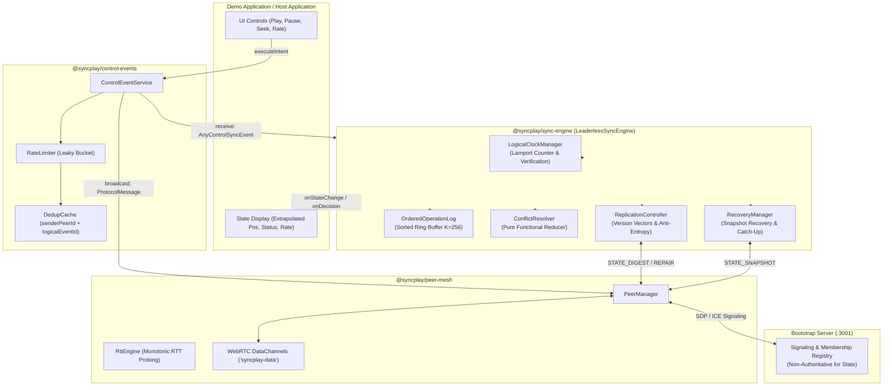
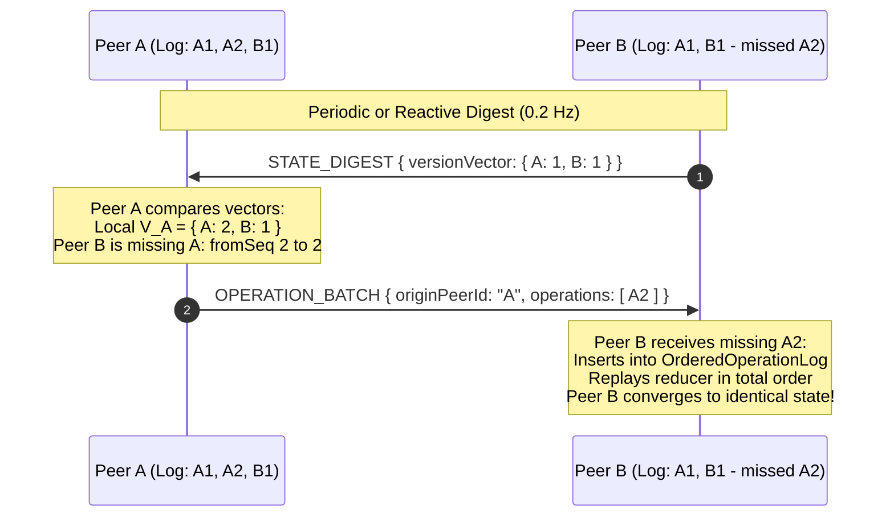
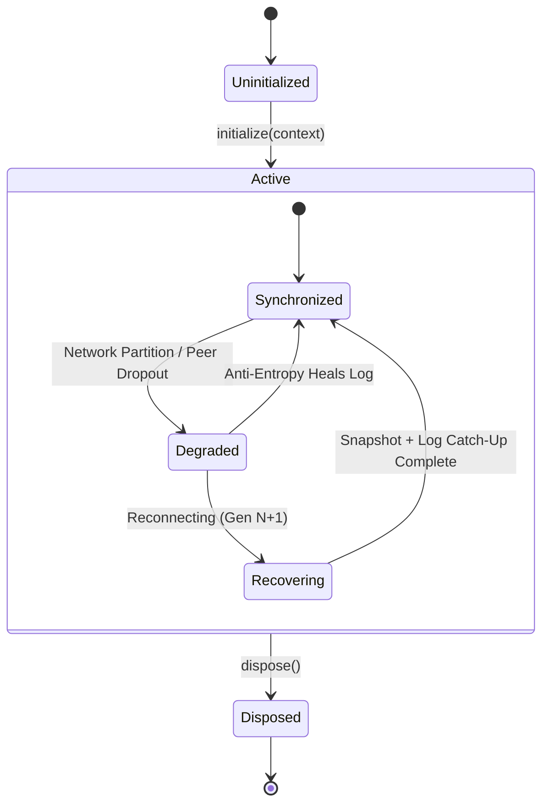

# Phase 7.2 — Leaderless Distributed Synchronization Engine: High-Level Design (HLD)

> **Document Version:** 1.0.0  
> **Status:** SPECIFICATION ONLY — NO IMPLEMENTATION AUTHORIZED  
> **Parent Milestone:** Phase 7.2 (Architecture & Interface Design)  
> **Baseline Commit:** `926c575`  
> **Reference Packages:** `@syncplay/sync-engine`, `@syncplay/protocol`, `@syncplay/control-events`, `@syncplay/peer-mesh`  

---

## 1. System Overview & Problem Statement

Phase 6 delivered the `BaselineSyncEngine`, proving pure functional state reduction and continuous position extrapolation. However, `BaselineSyncEngine` evaluates events strictly in **local arrival order**. Because WebRTC DataChannels provide FIFO ordering per peer-pair but **no global total order across multiple senders**, concurrent playback operations from different peers arrive in different sequences, causing permanent playback state divergence.

Phase 7 introduces the **Leaderless Distributed Synchronization Engine** (`LeaderlessSyncEngine`), extending the `@syncplay/sync-engine` package. The system guarantees that all connected browser peers reach identical, deterministically convergent playback states without relying on a centralized playback server or a permanent peer leader.

---

## 2. Non-Negotiable Architecture Principles

1. **No Permanent Playback Leader:** No peer possesses permanent authority over playback state. All peers participate symmetrically in event creation, ordering, and state reconciliation.
2. **Server-Minimized (Bootstrap Non-Authoritative):** The Bootstrap Server manages room lifecycle, access tokens, and WebRTC signaling only. It never receives, sequences, stores, or arbitrates playback events.
3. **Peer-to-Peer Full-Mesh Transport:** All playback control events, logical clock metadata, anti-entropy digests, and repair batches travel directly over WebRTC DataChannels (`'syncplay-data'`).
4. **Replaceable Engine Interface:** The leaderless engine implements the stable `SyncEngine` contract and extends the Phase 5 `SyncEventReceiver` boundary. The Phase 6 `BaselineSyncEngine` remains completely intact as an unmodified reference baseline.
5. **Decoupling State Agreement from Media Rendering:** Phase 7 achieves **distributed state convergence** (consensus on status, anchor position, playback rate, and timeline revision). Phase 8 will bind this state to the DOM `<video>` / `<audio>` element and perform clock drift compensation.

---

## 3. High-Level Component Architecture



---

## 4. Module Responsibilities & Trust Boundaries

### 4.1. Component Responsibility Breakdown

| Component | Layer | Primary Responsibility | Explicit Non-Responsibilities |
| :--- | :--- | :--- | :--- |
| **`ControlEventService`** | `@syncplay/control-events` | Validates intents, generates `messageId` and `logicalEventId`, enforces rate limits, suppresses duplicate transmissions. | Does not order events; does not resolve conflicts; does not track logical clocks. |
| **`LogicalClockManager`** | `@syncplay/sync-engine` | Tracks local Lamport clock, validates remote timestamps, advances clock on receive ($\max(L_l, L_r) + 1$). | Does not persist operations; does not reduce playback state. |
| **`OrderedOperationLog`** | `@syncplay/sync-engine` | Stores recent operations in deterministic total order $\langle L, \text{peerId}, \text{eventId} \rangle$, manages circular horizon $K=256$, prunes at stable frontier. | Does not transmit wire packets; does not make playback decisions. |
| **`ConflictResolver`** | `@syncplay/sync-engine` | Pure functional state reducer evaluating operation-specific conflict policies (`SEEK`, `PLAY`, `PAUSE`, `RATE_CHANGE`). | Holds no internal state; completely deterministic given $(S, e, t)$. |
| **`ReplicationController`** | `@syncplay/sync-engine` | Tracks per-origin version vectors, generates `STATE_DIGEST`, detects log gaps, requests `REPAIR_REQUEST`, fulfills `OPERATION_BATCH`. | Does not manage WebRTC peer lifecycle; does not parse SDP/ICE. |
| **`RecoveryManager`** | `@syncplay/sync-engine` | Orchestrates peer catch-up upon rejoining, manages snapshot export/import fallback, gates reconnecting peers. | Does not choose room membership; does not bypass connection generation checks. |
| **`PeerManager`** | `@syncplay/peer-mesh` | Manages WebRTC connection lifecycle, DTLS transport, SCTP DataChannels, ICE candidate queues, generation tracking. | Oblivious to playback state, clocks, digests, and control payloads. |
| **`BootstrapServer`** | `services/bootstrap-server`| Issues membership tokens, tracks room rosters, assigns monotonic `ConnectionGeneration`, relays SDP/ICE signals. | Strictly non-authoritative for playback state; never inspects control messages. |

### 4.2. Trust Boundaries & Identity Invariants

1. **Transport-Derived Sender Identity:** The `senderPeerId` used in ordering keys and deduplication is derived strictly from the verified WebRTC connection context (`InboundMessage.fromPeerId`), which is authenticated via Bootstrap membership tokens and DTLS certificate exchange. A peer cannot forge authorship by modifying payload strings.
2. **Untrusted Snapshot Provenance:** A snapshot received over the wire (`StateSnapshotPayload`) is marked with `isImportedProvenance = true`. The receiving engine validates all fields against strict bounds before installation and never treats the offering peer as a permanent authority.
3. **Connection Generation Isolation:** Stale packets arriving from previous connection generations ($G < G_{\text{active}}$) are discarded at the transport boundary before reaching the synchronization engine.

---

## 5. End-to-End Data & Event Flows

### 5.1. Outbound Local Control Flow (Optimistic Dispatch)
```text
User Action (e.g. Seek)
   │
   ▼
UI / Controls ➔ ControlEventService.executeIntent({ type: 'SEEK', targetPositionMs: 45000 })
   │
   ├─► 1. RateLimiter checks token bucket (passes)
   ├─► 2. LogicalClockManager.tickLocal() ➔ L_local = L_local + 1
   ├─► 3. EventFactory creates SyncEvent & ProtocolMessage with L_local
   ├─► 4. SyncEngine.receive(SyncEvent) [Local Dispatch]:
   │        • ConflictResolver applies operation optimistically to PlaybackState
   │        • OrderedOperationLog inserts operation at head
   │        • Engine notifications emitted to UI (0 ms latency)
   │
   └─► 5. ControlEventService broadcasts ProtocolMessage to all open DataChannels in PeerMesh
```

### 5.2. Inbound Remote Control Flow (Deterministic Total Order & Re-evaluation)
```text
Inbound WebRTC DataChannel Message
   │
   ▼
PeerManager.onMessage ➔ InboundMessage { fromPeerId, senderGeneration, message }
   │
   ▼
ControlEventService
   ├─► 1. Validate envelope schema and session ID
   ├─► 2. Validate senderGeneration matches active connection generation
   ├─► 3. DedupCache checks senderPeerId + logicalEventId (drops duplicates)
   │
   ▼
SyncEngine.receive(SyncEvent) [Remote Dispatch]:
   ├─► 4. LogicalClockManager.updateRemote(message.logicalTimestamp)
   ├─► 5. Compare Key(e_remote) against current engine state:
   │        • If Key(e_remote) > Key(current_head):
   │            Apply cleanly to current state via ConflictResolver (fast path)
   │            OrderedOperationLog appends e_remote
   │        • If Key(e_remote) < Key(current_head):
   │            LATE ARRIVAL DETECTED (Out-of-order delivery across mesh)
   │            OrderedOperationLog inserts e_remote into sorted position
   │            ConflictResolver rewinds to base snapshot and replays log forward
   │            State atomically updated to re-evaluated total-order state
   │
   └─► 6. ReplicationController updates local VersionVector for fromPeerId
```

### 5.3. Anti-Entropy Digest & Repair Flow


---

## 6. Lifecycle & Recovery Architecture



1. **Active / Synchronized:** Normal operation. Peers exchange control events over WebRTC DataChannels and maintain identical states.
2. **Degraded (Partitioned / Churn):** Communication lost to a subset of peers. The engine continues operating optimistically (preserving Availability), flagging degraded state in `EngineStatus`.
3. **Recovering (Reconnection Handshake):** Reconnecting peer enters `RECOVERING` state under new `ConnectionGeneration`. It is gated from publishing new operations until anti-entropy or snapshot recovery fast-forwards its state to the active room timeline.
4. **Disposed:** Terminal teardown. Background timers cleared, event subscriptions removed, ring buffers dropped.
