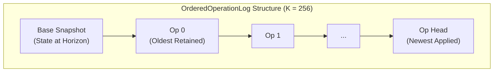
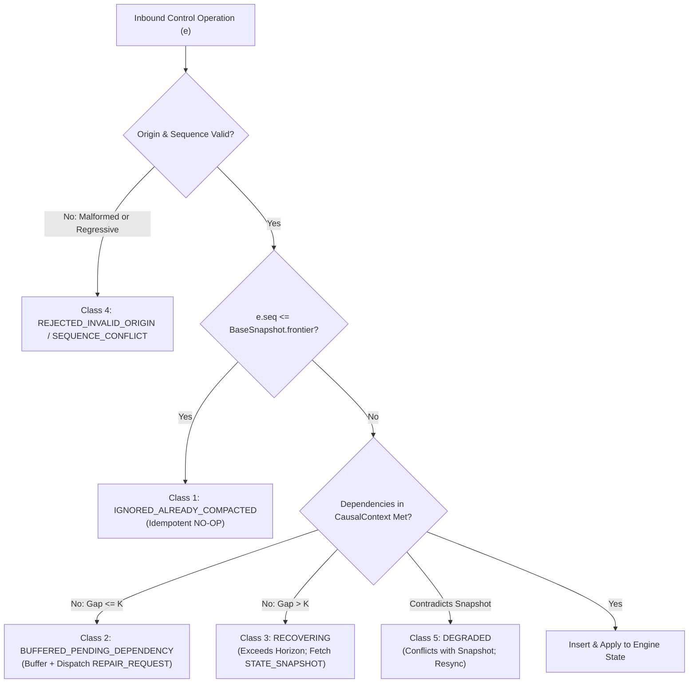
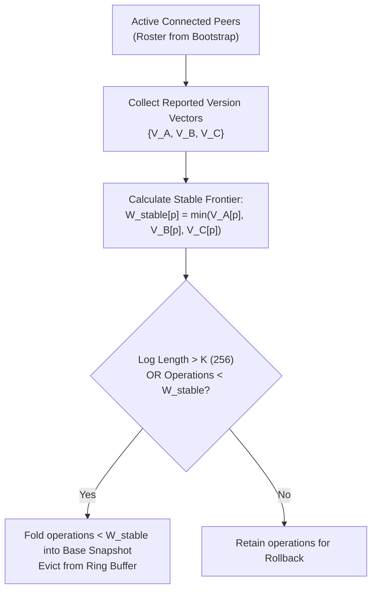
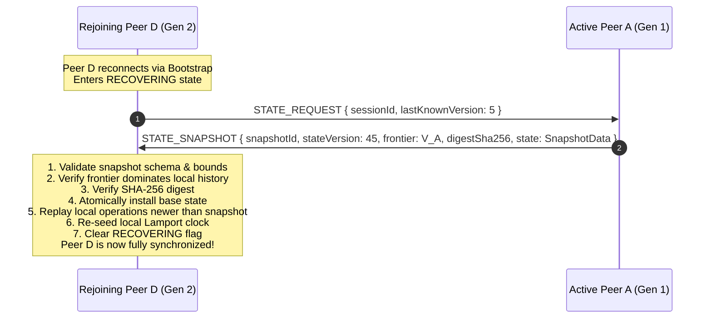

# Phase 7.2 — Leaderless Distributed Synchronization Engine: Low-Level Design (LLD)

> **Document Version:** 1.0.0  
> **Status:** SPECIFICATION ONLY — NO IMPLEMENTATION AUTHORIZED  
> **Parent Milestone:** Phase 7.2 (Architecture & Interface Design)  
> **Baseline Commit:** `926c575`  
> **Reference Packages:** `@syncplay/sync-engine`, `@syncplay/protocol`, `@syncplay/control-events`, `@syncplay/peer-mesh`  

---

## 1. Mathematical Formalism & Logical Clock Ordering

### 1.1. Ordering Key Definition
Every control operation $e$ is uniquely and deterministically ordered across the distributed mesh by the composite key:
$$\text{Key}(e) = \langle \text{logicalTimestamp}(e), \text{originPeerId}(e), \text{logicalEventId}(e) \rangle$$

- `logicalTimestamp(e)`: Non-negative integer ($0 \le L \le \text{Number.MAX\_SAFE\_INTEGER}$).
- `originPeerId(e)`: Non-empty ASCII string representing the authoring peer identity within the session/epoch.
- `logicalEventId(e)`: Non-empty ASCII string uniquely identifying the logical user operation.

### 1.2. Total-Order Comparator Specification
Let $e_1, e_2$ be two control operations. The strict weak total-order relation $e_1 < e_2$ is defined by:
```ts
function compareOperations(e1: ControlOperation, e2: ControlOperation): number {
  // 1. Primary order: Lamport logical timestamp
  if (e1.logicalTimestamp !== e2.logicalTimestamp) {
    return e1.logicalTimestamp - e2.logicalTimestamp;
  }
  // 2. Secondary order: Deterministic lexicographic origin peer tie-breaker
  if (e1.originPeerId !== e2.originPeerId) {
    return e1.originPeerId < e2.originPeerId ? -1 : 1;
  }
  // 3. Tertiary order: Stable logical event ID (breaks rare same-tick same-peer collisions)
  if (e1.logicalEventId !== e2.logicalEventId) {
    return e1.logicalEventId < e2.logicalEventId ? -1 : 1;
  }
  return 0; // Identical operation
}
```

### 1.3. Concurrency Detection vs. Lamport Limitation

#### The Theoretical Limit of Scalar Clocks
A scalar Lamport clock guarantees $a \to b \implies L(a) < L(b)$. However, $L(a) < L(b)$ does **not** imply $a \to b$. Two events with different scalar timestamps may still be causally concurrent ($a \parallel b$).

#### Defect of the Single Predecessor Pointer
An earlier revision attempted to capture causality using a single predecessor pointer (`predecessorEventId = lastAppliedOperation.logicalEventId`). However, in a distributed mesh where concurrent branches merge, a single predecessor cannot represent multiple concurrent dependencies. If Peer C observes concurrent operations $A_1$ and $B_1$ before generating $C_1$, a single predecessor pointer to $B_1$ loses the causal dependency $A_1 \to C_1$. Any peer receiving $A_1$ and $C_1$ without $B_1$ would erroneously classify $C_1$ as concurrent with $A_1$.

#### The SyncPlay Solution: Explicit Causal Context Vector
Every control operation $e$ carries an explicit **Causal Context Vector** snapshot observed by the authoring peer at creation:
$$\text{causalContext}(e) = \text{Record}\langle \text{originPeerId}, \text{originSequenceNumber} \rangle$$

- **Formal Causality Test ($e_1 \to e_2$):**
  Operation $e_1$ causally precedes operation $e_2$ if and only if $e_2$'s causal context reflects $e_1$'s origin sequence:
  $$e_1 \to e_2 \iff e_1.\text{originSequence} \le (e_2.\text{causalContext}[e_1.\text{originPeerId}] \ ?? \ 0)$$

- **Formal Concurrency Test ($e_1 \parallel e_2$):**
  Operations $e_1$ and $e_2$ are causally concurrent if and only if neither causally precedes the other:
  $$e_1 \parallel e_2 \iff (e_1 \not\to e_2) \land (e_2 \not\to e_1)$$

- **Pending Dependency Queue:**
  If an operation $e_2$ arrives with causal context entries exceeding the local version vector ($e_2.\text{causalContext}[p] > V_{\text{local}}[p]$ for some origin $p \neq e_2.\text{originPeerId}$), $e_2$ has causal dependencies that the local engine has not yet received. Rather than evaluating $e_2$ with missing context, $e_2$ is held in a `PendingDependencyQueue` and a `REPAIR_REQUEST` is dispatched to fetch the missing dependency. Once the missing operation arrives and is applied, $e_2$ is released for reduction.

### 1.4. Clock Update & Multi-Factor Monotonicity Validation Rules

#### Eliminating Flawed Scalar Clock Skew Limits
Prior designs imposed a scalar limit `remoteClock <= localClock + MAX_CLOCK_SKEW (10,000)`. In a distributed media room, this rule was fundamentally flawed: if Peer A and Peer B exchange 10,001 operations during an active session while Peer C is silent or playing continuously without generating events, Peer C's Lamport clock legitimately lags by $> 10,000$. Imposing a scalar distance check falsely rejected valid operations.

#### Correct Multi-Factor Validation
Lamport clocks are validated against three mathematically rigorous invariants:
1. **Per-Origin Sequence Monotonicity:** Operations from a given `originPeerId` must advance strictly sequentially: $\text{originSequence}_{k+1} = \text{originSequence}_k + 1$. Any regression or non-consecutive jump triggers sequence conflict or buffering.
2. **Per-Origin Lamport Monotonicity:** Successive operations from a single origin must have strictly increasing Lamport timestamps: $L(e_{k+1}) > L(e_k)$.
3. **Safe Integer Bounds:** All timestamps must remain non-negative safe integers: $0 \le L \le \text{Number.MAX\_SAFE\_INTEGER} - 1$.

```ts
class LogicalClockManager {
  private currentClock: number = 0;
  private readonly maxObservedByOrigin: Map<string, number> = new Map();

  public tickLocal(): number {
    if (this.currentClock >= Number.MAX_SAFE_INTEGER - 1) {
      throw new SyncEngineError('CLOCK_OVERFLOW', 'Lamport clock exceeded MAX_SAFE_INTEGER');
    }
    this.currentClock += 1;
    return this.currentClock;
  }

  public validateAndAdvanceRemote(originPeerId: string, remoteClock: number): number {
    if (!Number.isSafeInteger(remoteClock) || remoteClock < 0) {
      throw new SyncEngineError('INVALID_CLOCK', `Malformed remote timestamp: ${remoteClock}`);
    }

    // Verify per-origin Lamport monotonicity
    const lastOriginClock = this.maxObservedByOrigin.get(originPeerId) ?? 0;
    if (remoteClock <= lastOriginClock) {
      throw new SyncEngineError(
        'CLOCK_REGRESSION',
        `Remote timestamp ${remoteClock} from origin ${originPeerId} does not exceed previous ${lastOriginClock}`
      );
    }

    this.maxObservedByOrigin.set(originPeerId, remoteClock);
    this.currentClock = Math.max(this.currentClock, remoteClock) + 1;
    return this.currentClock;
  }

  public reseed(maxObservedClock: number): void {
    if (!Number.isSafeInteger(maxObservedClock) || maxObservedClock < 0) {
      throw new SyncEngineError('INVALID_CLOCK', `Malformed reseed timestamp: ${maxObservedClock}`);
    }
    this.currentClock = Math.max(this.currentClock, Math.floor(maxObservedClock)) + 1;
  }
}
```

---

## 2. Operation-Specific Conflict Resolution Engine

The `ConflictResolver` is a pure functional reducer applying deterministic policies to operations.

```mermaid
flowchart TD
    Op["Incoming Control Operation (e)"] --> TypeCheck{Operation Type?}
    
    TypeCheck -->|SEEK| SeekPolicy["Deterministic Total-Order LWW<br/>Winner = max(Key(e), Key(head))"]
    TypeCheck -->|RATE_CHANGE| RatePolicy["Scalar Total-Order LWW<br/>Clamp to [0.25, 4.0]"]
    TypeCheck -->|PLAY / PAUSE| PlayPause{Concurrent or Causal?}
    
    PlayPause -->|Causal: e2 depends on e1| CausalApply["Apply e2 (Intentional user follow-up)"]
    PlayPause -->|Concurrent: e1 || e2| PausePriority["Intent-Preserving Pause Priority<br/>State = PAUSED (Audio Safety)"]
```

### 2.1. Detailed Pairwise Conflict Rules

#### Rule 1: `SEEK` vs. `SEEK`
- **Policy:** Highest Total-Order Key Wins ($\max_{\text{Key}}$).
- **Semantics:** If Peer A seeks to $30\text{ s}$ and Peer B seeks to $60\text{ s}$ concurrently, the operation with the higher key establishes the new `anchorPositionMs`. The lower-key seek is resolved with code `'SUPERSEDED'`.

#### Rule 2: `PLAY` vs. `PAUSE` (Concurrency-Aware Intent-Preserving Pause Priority)
- **Policy:**
  1. **Causally Concurrent ($e_{\text{pause}} \parallel e_{\text{play}}$ via Causal Context):** Peer A and Peer B acted concurrently without knowledge of each other. **PAUSE takes priority**. Playback transitions to `'paused'` and halts at the pause anchor position.
     - *Rationale:* An uncommanded audio blast when a user intended silence is a severe defect. Pause priority guarantees a safe, predictable resting state from which any participant can resume.
  2. **Causally Sequential ($e_{\text{pause}} \to e_{\text{play}}$):** Peer B observed Peer A's pause, and intentionally pressed play. **PLAY succeeds**; state transitions to `'playing'`.
  3. **Causally Sequential ($e_{\text{play}} \to e_{\text{pause}}$):** Peer B observed Peer A's play, and intentionally pressed pause. **PAUSE succeeds**; state transitions to `'paused'`.
- **Media Hardware Isolation Boundary:**
  The `SyncEngine` is a pure state machine producing deterministic `PlaybackState` decisions. Actual media audio muting, buffer adjustments, and HTML5 `<video>` / `<audio>` element controls remain strictly isolated in Phase 8 (`MediaAdapter`). The core engine never manipulates hardware or DOM elements.

#### Rule 3: `PLAY` vs. `SEEK` and `PAUSE` vs. `SEEK`
- **Policy:** Orthogonal Composition.
  - `PLAY` concurrent with `SEEK`: State transitions to target seek position and status becomes `'playing'`.
  - `PAUSE` concurrent with `SEEK`: State transitions to target seek position and status becomes `'paused'`.

#### Rule 4: `RATE_CHANGE` vs. `RATE_CHANGE`
- **Policy:** Total-Order Scalar LWW.
  - The operation with the highest key establishes the new `playbackRate`.
  - Enforces strict bounds: $\text{playbackRate} \in [0.25, 4.0]$.
  - Position is extrapolated to the rate-change instant and re-anchored.

#### Rule 5: Identical Operations & Epsilon Filtering
- **Policy:** If an incoming operation matches the current state within $\epsilon = 5.0\text{ ms}$ (for seeks/pauses) or $10^{-4}$ (for playback rates), it is resolved as `NO_OP`. `stateVersion` is NOT incremented, preventing false UI redraw cascades.

---

## 3. Ordered Operation Log & Rollback Architecture

### 3.1. Data Structure: `OrderedOperationLog`
- **Internal Storage:**
  - `ringBuffer: Array<StoredOperation>` of maximum length $K = 256$.
  - `idIndex: Map<LogicalEventId, StoredOperation>` for $O(1)$ duplicate lookups.
  - `baseSnapshot: BasePlaybackSnapshot` representing the compacted state immediately prior to the oldest retained operation in `ringBuffer`.



### 3.2. Binary Search Insertion & Total-Order Maintenance
When a new operation $e$ arrives:
1. **Deduplication Check:** If `idIndex.has(e.logicalEventId)`, resolve immediately as `IGNORED_DUPLICATE`.
2. **Causal Dependency Check:** If $e$ depends on operations not yet applied ($e.\text{causalContext}[p] > V_{\text{local}}[p]$ for some $p \neq e.\text{originPeerId}$), buffer in `PendingDependencyQueue` and emit `REPAIR_REQUEST`.
3. **Fast Append (Head Path):** If `ringBuffer.length == 0` or `compareOperations(e, ringBuffer[last]) > 0`:
   - Append to end of `ringBuffer`.
   - Apply operation to current state via `ConflictResolver`.
   - Update `idIndex` and version vector: $V_{\text{local}}[e.\text{originPeerId}] = e.\text{originSequenceNumber}$.
4. **Speculative Rollback & Replay (Late-Arrival Path):** If `compareOperations(e, ringBuffer[last]) < 0`:
   - Classify arrival relative to the retained horizon (Section 3.4).
   - If within horizon, locate insertion index $i$ via binary search: $O(\log K)$.
   - Insert $e$ at index $i$: array splice.
   - **Replay forward:** Re-evaluate state starting from `baseSnapshot` across all operations in `ringBuffer[0 \dots \text{new\_head}]`.
   - Atomically commit the newly converged `PlaybackState`.
   - Release any buffered operations in `PendingDependencyQueue` whose dependencies are now satisfied.

### 3.3. Deterministic Replay Performance Bounds & Unverified Target

> [!NOTE]
> **Performance Target (Hypothesis):**
> In-memory replay of 256 operations through pure functional reducer targeted to execute in **$< 2.0\text{ ms}$** on modern browser engines (V8, JavaScriptCore, SpiderMonkey).
> This figure represents an architectural performance goal rather than an empirically verified metric. The formal benchmarking harness and methodology are specified in `PHASE7_2_SIMULATION_TEST_STRATEGY.md` and will be empirically evaluated during Milestone P7.7.

- The operation log commits state atomically; if an exception occurs during replay, the previous valid state is restored without corruption.
- In-memory pure reduction creates zero DOM mutations or network traffic during replay loops.

### 3.4. 5-Way Exhaustive Event Horizon Classification

When an operation $e$ arrives from a remote peer, the engine classifies it against the bounded history horizon:



1. **Class 1 (Subsumed by Base Snapshot):**
   - Condition: $e.\text{originSequenceNumber} \le V_{\text{baseSnap}}[e.\text{originPeerId}]$.
   - Resolution: `IGNORED_ALREADY_COMPACTED`. Idempotent NO-OP; zero state mutation, zero error log.
2. **Class 2 (Missing Dependency within Retained Horizon):**
   - Condition: $e$ references missing predecessor sequences that fall within the recent log window ($e.\text{originSequenceNumber} - V_{\text{local}}[e.\text{originPeerId}] \le K$).
   - Resolution: Operation buffered in `PendingDependencyQueue`; triggers targeted `REPAIR_REQUEST` to the origin peer.
3. **Class 3 (Compacted by Peers & Recoverable via Snapshot):**
   - Condition: The missing sequence gap exceeds the retained history horizon of connected peers ($> K$).
   - Resolution: Engine enters `RECOVERING` status, dispatches `STATE_REQUEST`, and resets state via `StateSnapshotPayloadV2`.
4. **Class 4 (Invalid / Malformed / Conflicting Origin):**
   - Condition: Operation violates schema, carries non-safe integers, or exhibits an invalid sequence transition.
   - Resolution: Rejected with `REJECTED_INVALID_ORIGIN` or `REJECTED_SEQUENCE_CONFLICT`. Isolated at boundary without state contamination.
5. **Class 5 (Conflicts with Installed Snapshot Frontier):**
   - Condition: Operation predates installed snapshot but contradicts its state.
   - Resolution: Engine logs diagnostic alert, marks `isDegraded = true`, and requests authoritative snapshot resynchronization.

---

## 4. Anti-Entropy Protocol & Version Vectors

### 4.1. The Multi-Origin Version Vector Representation
Every peer maintains a local Version Vector:
$$V = \text{Map}\langle \text{PeerId}, \text{OriginSequenceNumber} \rangle$$
- Each peer assigns an integer sequence number $S_p \in \{1, 2, 3, \dots\}$ to the operations it originates.
- $V[p] = k$ means the local peer has received, validated, and applied all operations originated by peer $p$ up to sequence $k$.

### 4.2. Message Protocol Specifications

#### Message 1: `STATE_DIGEST`
Emitted periodically ($0.2\text{ Hz}$) or reactively when peer membership changes.
```ts
interface StateDigestPayload {
  readonly sessionId: string;
  readonly senderPeerId: string;
  readonly connectionGeneration: number;
  readonly membershipEpoch: number;
  readonly versionVector: Record<string, number>;
  readonly snapshotFrontier: Record<string, number>;
  readonly baseSnapshotId: string;
  readonly baseStateVersion: number;
}
```

#### Message 2: `REPAIR_REQUEST`
Emitted by a peer that discovers it is missing operations from an origin peer.
```ts
interface RepairRequestPayload {
  readonly sessionId: string;
  readonly requesterPeerId: string;
  readonly targetOriginPeerId: string;
  readonly fromSequence: number;
  readonly toSequence: number;
}
```

#### Message 3: `OPERATION_BATCH`
Response fulfilling a `REPAIR_REQUEST`.
```ts
interface SerializedControlOperation {
  readonly logicalEventId: string;
  readonly originPeerId: string;
  readonly senderPeerId: string;
  readonly messageType: 'PLAY' | 'PAUSE' | 'SEEK' | 'RATE_CHANGE';
  readonly logicalTimestamp: number;
  readonly originSequenceNumber: number;
  readonly causalContext: Record<string, number>;
  readonly payload: unknown;
}

interface OperationBatchPayload {
  readonly sessionId: string;
  readonly originPeerId: string;
  readonly fromSequence: number;
  readonly toSequence: number;
  readonly operations: ReadonlyArray<SerializedControlOperation>;
}
```
- **Batch Size Limit:** An `OPERATION_BATCH` contains a maximum of $32$ operations. If more operations are required, multiple batches are paged to prevent WebRTC DataChannel buffer overflows.

---

## 5. Safe History Compaction & Membership Epochs



### 5.1. The Stable Frontier Algorithm
To safely delete operations without risk of deleting data a peer still needs:
$$W_{\text{stable}}[p] = \min_{i \in \text{ActivePeers}} (V_i[p])$$

- **Meaning of Acknowledgment:** An acknowledgment in `STATE_DIGEST` means the peer has **received, validated, and applied** the operation into its in-memory engine and operation log.
- An operation $(p, s)$ is part of the stable frontier if $s \le W_{\text{stable}}[p]$.
- **Safety Invariant:** Because every active connected peer has confirmed receipt of sequence $s \le W_{\text{stable}}[p]$, no connected peer will ever request $(p, s)$ via `REPAIR_REQUEST`, and no valid operation with timestamp smaller than $W_{\text{stable}}$ can be generated by active peers.
- Operations older than $W_{\text{stable}}$ are folded into `baseSnapshot` and deleted from `ringBuffer`.

### 5.2. Handling Long-Term Offline / Zombie Peers
- If Peer D disconnects, $V_D$ freezes, which would normally stall $W_{\text{stable}}$ indefinitely.
- **The Roster Eviction Rule:**
  - Bootstrap Server tracks active room membership. When Peer D leaves or times out, Bootstrap broadcasts `session:peer-left`.
  - Surviving peers advance the `membershipEpoch` and **remove Peer D from the stable frontier calculation**.
  - Compaction resumes immediately over the surviving peers.
- **When Peer D Returns:**
  - Peer D rejoins with a new `ConnectionGeneration` and fresh `peerId` (Section 5.3).
  - If a peer re-uses an identity and its missing history exceeds $K=256$, it is served an authoritative `StateSnapshotPayloadV2` (`importSnapshot`), fast-forwarding it cleanly to the current room baseline.

### 5.3. Browser Reload & Ephemeral Identity Lifecycle
In a browser runtime without durable IndexedDB storage, page reload (F5) purges in-memory sequence numbers. A reloading peer **MUST obtain a fresh `peerId` from the Bootstrap Server upon rejoining**. It initializes sequence numbers at $1$ under the new identity. Its previous `peerId` is marked departed via `session:peer-left`. This guarantees zero sequence collisions without disk storage.

---

## 6. Snapshot & Reconnection Protocol



### 6.1. Atomic Snapshot Installation Contract
When `RecoveryManager.installSnapshot(payload)` is called:
1. Validates that `payload.sessionId == this.config.sessionId`.
2. Validates that `payload.state.anchorPositionMs` is non-negative and finite.
3. Validates that `payload.state.playbackRate` is within configured $[minRate, maxRate]$.
4. **Frontier Verification:** Verifies that `payload.snapshotFrontier` dominates or matches known history ($V_{\text{snap}} \ge V_{\text{local}}$). Rejects stale snapshots ($V_{\text{snap}} < V_{\text{local}}$).
5. **Integrity Verification:** Validates payload integrity against `payload.stateDigestSha256`.
6. Re-seeds local `LogicalClockManager` to $\max(L_{\text{local}}, \text{payload.maxLogicalTimestamp}) + 1$.
7. Installs base state atomically:
   $$v_{\text{local}} = v_{\text{current}} + 1$$
   *(Never copies remote version as local version; maintains local engine monotonicity).*
8. **Preserves Newer Operations:** Replays any locally held operations that are strictly newer than the snapshot frontier ($V > V_{\text{snap}}$).
9. Clears older operations from log and initializes `baseSnapshot` to the imported state.
10. Sets `isImportedProvenance = true` on `lastAppliedEvent`.
11. Transitions engine status from `'recovering'` to `'active'`.

