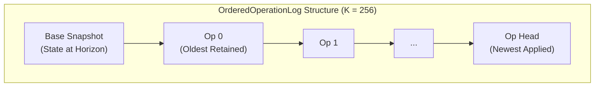
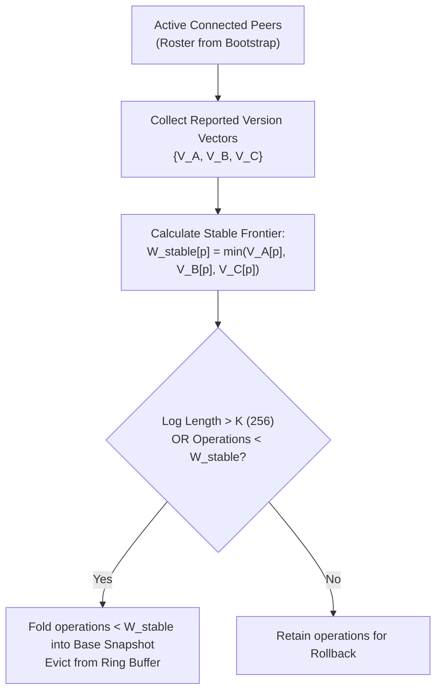
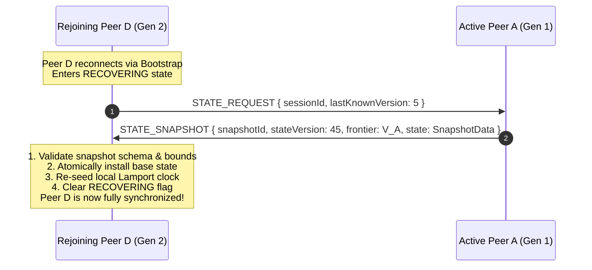

# Phase 7.2 — Leaderless Distributed Synchronization Engine: Low-Level Design (LLD)

> **Document Version:** 1.0.0  
> **Status:** SPECIFICATION ONLY — NO IMPLEMENTATION AUTHORIZED  
> **Parent Milestone:** Phase 7.2 (Architecture & Interface Design)  
> **Baseline Commit:** `926c575`  
> **Reference Packages:** `@syncplay/sync-engine`, `@syncplay/protocol`, `@syncplay/control-events`, `@syncplay/peer-mesh`  

---

## 1. Mathematical Formalism & Logical Clock Ordering

### 1.1. Ordering Key Definition
Every control operation $e$ is uniquely and deterministically ordered across the distributed mesh by the composite key:
$$\text{Key}(e) = \langle \text{logicalTimestamp}(e), \text{senderPeerId}(e), \text{logicalEventId}(e) \rangle$$

- `logicalTimestamp(e)`: Non-negative integer ($0 \le L \le \text{Number.MAX\_SAFE\_INTEGER}$).
- `senderPeerId(e)`: Non-empty ASCII string derived from verified transport connection context.
- `logicalEventId(e)`: Non-empty ASCII string uniquely identifying the logical user operation.

### 1.2. Total-Order Comparator Specification
Let $e_1, e_2$ be two control operations. The strict weak total-order relation $e_1 < e_2$ is defined by:
```ts
function compareOperations(e1: ControlOperation, e2: ControlOperation): number {
  // 1. Primary order: Lamport logical timestamp
  if (e1.logicalTimestamp !== e2.logicalTimestamp) {
    return e1.logicalTimestamp - e2.logicalTimestamp;
  }
  // 2. Secondary order: Deterministic lexicographic peer tie-breaker
  if (e1.senderPeerId !== e2.senderPeerId) {
    return e1.senderPeerId < e2.senderPeerId ? -1 : 1;
  }
  // 3. Tertiary order: Stable logical event ID (breaks rare same-tick same-peer collisions)
  if (e1.logicalEventId !== e2.logicalEventId) {
    return e1.logicalEventId < e2.logicalEventId ? -1 : 1;
  }
  return 0; // Identical operation
}
```

### 1.3. Concurrency Detection vs. Lamport Limitation
**The Theoretical Limit:** A scalar Lamport clock guarantees $a \to b \implies L(a) < L(b)$. However, $L(a) < L(b)$ does **not** imply $a \to b$. Two events with different scalar timestamps may still be causally concurrent ($a \parallel b$).

**The SyncPlay Solution:**
1. **Identical Timestamp Concurrency Theorem:**
   $$L(e_1) == L(e_2) \implies e_1 \parallel e_2 \quad (\text{Mathematically Guaranteed})$$
   Whenever two operations carry the exact same logical timestamp, they are guaranteed to have been generated concurrently without causal knowledge of each other.
2. **Predecessor Reference (`predecessorEventId`):**
   To detect concurrency when $L(e_1) \neq L(e_2)$, every outgoing control event records:
   $$\text{predecessorEventId} = \text{lastAppliedOperation.logicalEventId} \quad (\text{or null if initial})$$
   - If $e_2.\text{predecessorEventId} == e_1.\text{logicalEventId}$ (or exists in $e_2$'s ancestral log), then $e_1 \to e_2$ (Causally Dependent).
   - If neither operation references the other as predecessor or ancestor, they are **Causally Concurrent** ($e_1 \parallel e_2$).

### 1.4. Clock Update & Validation Rules
```ts
class LogicalClockManager {
  private currentClock: number = 0;
  private readonly MAX_CLOCK_SKEW: number = 10000;

  public tickLocal(): number {
    if (this.currentClock >= Number.MAX_SAFE_INTEGER - 1) {
      throw new SyncEngineError('CLOCK_OVERFLOW', 'Lamport clock exceeded MAX_SAFE_INTEGER');
    }
    this.currentClock += 1;
    return this.currentClock;
  }

  public updateRemote(remoteClock: number): number {
    if (!Number.isSafeInteger(remoteClock) || remoteClock < 0) {
      throw new SyncEngineError('INVALID_CLOCK', `Malformed remote timestamp: ${remoteClock}`);
    }
    if (remoteClock > this.currentClock + this.MAX_CLOCK_SKEW) {
      throw new SyncEngineError(
        'CLOCK_SKEW_EXCEEDED',
        `Remote timestamp ${remoteClock} exceeds local ${this.currentClock} by more than ${this.MAX_CLOCK_SKEW}`
      );
    }
    this.currentClock = Math.max(this.currentClock, remoteClock) + 1;
    return this.currentClock;
  }

  public reseed(maxObservedClock: number): void {
    this.currentClock = Math.max(this.currentClock, Math.floor(maxObservedClock)) + 1;
  }
}
```

---

## 2. Operation-Specific Conflict Resolution Engine

The `ConflictResolver` is a pure functional reducer applying deterministic policies to operations.

```mermaid
flowchart TD
    Op["Incoming Control Operation (e)"] --> TypeCheck{Operation Type?}
    
    TypeCheck -->|SEEK| SeekPolicy["Deterministic Total-Order LWW<br/>Winner = max(Key(e), Key(head))"]
    TypeCheck -->|RATE_CHANGE| RatePolicy["Scalar Total-Order LWW<br/>Clamp to [0.25, 4.0]"]
    TypeCheck -->|PLAY / PAUSE| PlayPause{Concurrent or Causal?}
    
    PlayPause -->|Causal: e2 depends on e1| CausalApply["Apply e2 (Intentional user follow-up)"]
    PlayPause -->|Concurrent: e1 || e2| PausePriority["Intent-Preserving Pause Priority<br/>State = PAUSED (Audio Safety)"]
```

### 2.1. Detailed Pairwise Conflict Rules

#### Rule 1: `SEEK` vs. `SEEK`
- **Policy:** Highest Total-Order Key Wins ($\max_{\text{Key}}$).
- **Semantics:** If Peer A seeks to $30\text{ s}$ and Peer B seeks to $60\text{ s}$ concurrently, the operation with the higher key establishes the new `anchorPositionMs`. The lower-key seek is resolved with code `'SUPERSEDED'`.

#### Rule 2: `PLAY` vs. `PAUSE` (Intent-Preserving Pause Priority)
- **Policy:**
  1. **Causally Sequential ($e_{\text{pause}} \to e_{\text{play}}$):** Peer B observed Peer A's pause, and intentionally pressed play. **PLAY succeeds**; state transitions to `'playing'`.
  2. **Causally Concurrent ($e_{\text{pause}} \parallel e_{\text{play}}$):** Peer A and Peer B acted concurrently without knowledge of each other. **PAUSE takes priority**. Playback halts at the pause anchor position; audio is silenced.
  - *Rationale:* An uncommanded audio blast when a user intended silence is a severe defect. Pause priority guarantees a safe, predictable resting state from which any participant can resume.

#### Rule 3: `PLAY` vs. `SEEK` and `PAUSE` vs. `SEEK`
- **Policy:** Orthogonal Composition.
  - `PLAY` concurrent with `SEEK`: State transitions to target seek position and status becomes `'playing'`.
  - `PAUSE` concurrent with `SEEK`: State transitions to target seek position and status becomes `'paused'`.

#### Rule 4: `RATE_CHANGE` vs. `RATE_CHANGE`
- **Policy:** Total-Order Scalar LWW.
  - The operation with the highest key establishes the new `playbackRate`.
  - Enforces strict bounds: $\text{playbackRate} \in [0.25, 4.0]$.
  - Position is extrapolated to the rate-change instant and re-anchored.

#### Rule 5: Identical Operations & Epsilon Filtering
- **Policy:** If an incoming operation matches the current state within $\epsilon = 5.0\text{ ms}$ (for seeks/pauses) or $10^{-4}$ (for playback rates), it is resolved as `NO_OP`. `stateVersion` is NOT incremented, preventing false UI redraw cascades.

---

## 3. Ordered Operation Log & Rollback Architecture

### 3.1. Data Structure: `OrderedOperationLog`
- **Internal Storage:**
  - `ringBuffer: Array<StoredOperation>` of maximum length $K = 256$.
  - `idIndex: Map<LogicalEventId, StoredOperation>` for $O(1)$ duplicate lookups.
  - `baseSnapshot: BasePlaybackSnapshot` representing the compacted state immediately prior to the oldest retained operation in `ringBuffer`.



### 3.2. Binary Search Insertion & Total-Order Maintenance
When a new operation $e$ arrives:
1. **Deduplication Check:** If `idIndex.has(e.logicalEventId)`, reject immediately as `IGNORED_DUPLICATE`.
2. **Fast Append (Head Path):** If `ringBuffer.length == 0` or `compareOperations(e, ringBuffer[last]) > 0`:
   - Append to end of `ringBuffer`.
   - Apply operation to current state via `ConflictResolver`.
   - Update `idIndex`.
3. **Speculative Rollback & Replay (Late-Arrival Path):** If `compareOperations(e, ringBuffer[last]) < 0`:
   - Locate insertion index $i$ via binary search: $O(\log K)$.
   - Check horizon: If $e$ has timestamp older than `baseSnapshot.logicalTimestamp`, trigger **Outside Horizon Recovery** (Section 3.4).
   - Insert $e$ at index $i$: array splice ($K \le 256$ takes $< 0.05\text{ ms}$ in V8).
   - **Replay forward:** Re-evaluate state starting from `baseSnapshot` across all operations in `ringBuffer[0 \dots \text{new\_head}]`.
   - Atomically commit the newly converged `PlaybackState`.

### 3.3. Deterministic Replay Performance Bounds
- In JavaScript V8, executing a pure functional reducer 256 times against an in-memory object takes **$0.3\text{ ms} - 0.7\text{ ms}$** (well within the $16.6\text{ ms}$ single-frame rendering budget).
- The operation log commits state atomically; if an exception occurs during replay, the previous valid state is restored without corruption.

### 3.4. Handling Operations Outside the Retained Horizon
If a delayed operation arrives with a timestamp older than the oldest retained operation in the log ($e < \text{ringBuffer}[0]$):
1. The engine cannot re-evaluate state from the base snapshot.
2. The event is rejected with code `REJECTED_OUTSIDE_HORIZON`.
3. The engine logs a warning and marks `isDegraded = true` in `EngineStatus`.
4. The engine initiates a snapshot reconciliation request (`STATE_REQUEST`) to an active peer to obtain an updated base snapshot.

---

## 4. Anti-Entropy Protocol & Version Vectors

### 4.1. The Multi-Origin Version Vector Representation
Every peer maintains a local Version Vector:
$$V = \text{Map}\langle \text{PeerId}, \text{OriginSequenceNumber} \rangle$$
- Each peer assigns an integer sequence number $S_p \in \{1, 2, 3, \dots\}$ to the operations it originates.
- $V[p] = k$ means the local peer has received and applied all operations originated by peer $p$ up to sequence $k$.

### 4.2. Message Protocol Specifications

#### Message 1: `STATE_DIGEST`
Emitted periodically ($0.2\text{ Hz}$) or reactively when peer membership changes.
```ts
interface StateDigestPayload {
  readonly sessionId: string;
  readonly senderPeerId: string;
  readonly connectionGeneration: number;
  readonly membershipEpoch: number;
  readonly versionVector: Record<string, number>;
  readonly baseSnapshotId: string;
  readonly baseStateVersion: number;
}
```

#### Message 2: `REPAIR_REQUEST`
Emitted by a peer that discovers it is missing operations from an origin peer.
```ts
interface RepairRequestPayload {
  readonly sessionId: string;
  readonly requesterPeerId: string;
  readonly targetOriginPeerId: string;
  readonly fromSequence: number;
  readonly toSequence: number;
}
```

#### Message 3: `OPERATION_BATCH`
Response fulfilling a `REPAIR_REQUEST`.
```ts
interface OperationBatchPayload {
  readonly sessionId: string;
  readonly originPeerId: string;
  readonly fromSequence: number;
  readonly toSequence: number;
  readonly operations: ReadonlyArray<SerializedControlOperation>;
}
```
- **Batch Size Limit:** An `OPERATION_BATCH` contains a maximum of $32$ operations. If more operations are required, multiple batches are paged to prevent WebRTC DataChannel buffer overflows.

---

## 5. Safe History Compaction & Membership Epochs



### 5.1. The Stable Frontier Algorithm
To safely delete operations without risk of deleting data a peer still needs:
$$W_{\text{stable}}[p] = \min_{i \in \text{ActivePeers}} (V_i[p])$$
- An operation $(p, s)$ is part of the stable frontier if $s \le W_{\text{stable}}[p]$.
- **Safety Invariant:** Because every active connected peer has confirmed receipt of sequence $s \le W_{\text{stable}}[p]$, no connected peer will ever request $(p, s)$ via `REPAIR_REQUEST`, and no valid operation with timestamp smaller than $W_{\text{stable}}$ can be generated by active peers.
- Operations older than $W_{\text{stable}}$ are folded into `baseSnapshot` and deleted from `ringBuffer`.

### 5.2. Handling Long-Term Offline / Zombie Peers
- If Peer D disconnects, $V_D$ freezes, which would normally stall $W_{\text{stable}}$ indefinitely.
- **The Roster Eviction Rule:**
  - Bootstrap Server tracks active room membership. When Peer D leaves or times out, Bootstrap broadcasts `session:peer-left`.
  - Surviving peers advance the `membershipEpoch` and **remove Peer D from the stable frontier calculation**.
  - Compaction resumes immediately over the surviving peers.
- **When Peer D Returns:**
  - Peer D rejoins with a new `ConnectionGeneration`.
  - Peer D's missing history exceeds $K=256$.
  - Peer D is served an authoritative `StateSnapshotPayload` (`importSnapshot`), fast-forwarding it cleanly to the current room baseline.

---

## 6. Snapshot & Reconnection Protocol



### 6.1. Atomic Snapshot Installation Contract
When `RecoveryManager.installSnapshot(payload)` is called:
1. Validates that `payload.state.sessionId == this.config.sessionId`.
2. Validates that `payload.state.anchorPositionMs` is non-negative and finite.
3. Validates that `payload.state.playbackRate` is within configured $[minRate, maxRate]$.
4. Re-seeds local `LogicalClockManager` to $\max(L_{\text{local}}, \text{payload.state.logicalTimestamp}) + 1$.
5. Installs state atomically:
   $$v_{\text{local}} = v_{\text{current}} + 1$$
   *(Never copies remote version as local version; maintains local engine monotonicity).*
6. Clears operation log and initializes `baseSnapshot` to the imported state.
7. Sets `isImportedProvenance = true` on `lastAppliedEvent`.
8. Transitions engine status from `'recovering'` to `'active'`.
