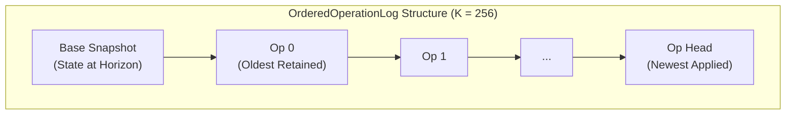
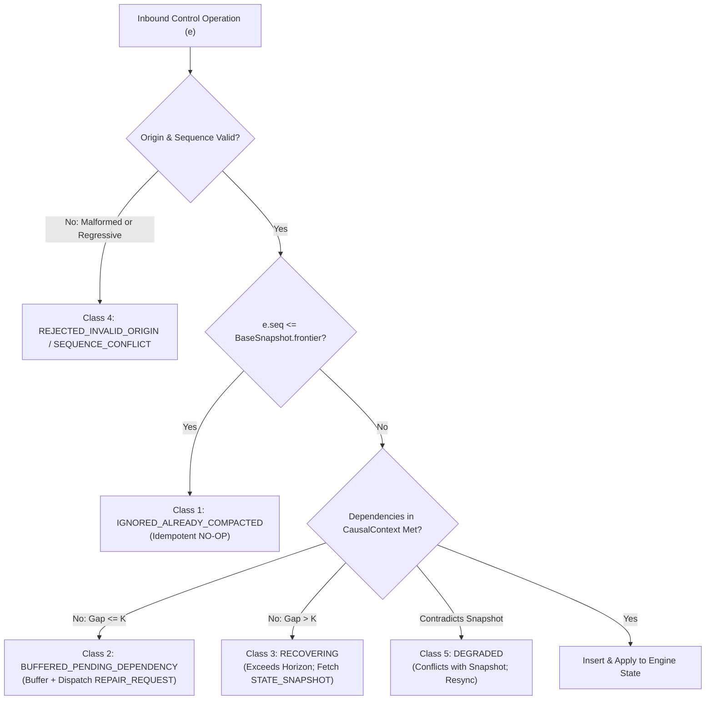
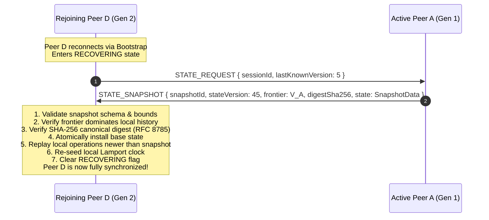

# Phase 7.2 — Leaderless Distributed Synchronization Engine: Low-Level Design (LLD)

> **Document Version:** 1.0.0  
> **Status:** SPECIFICATION ONLY — NO IMPLEMENTATION AUTHORIZED  
> **Parent Milestone:** Phase 7.2 (Architecture & Interface Design)  
> **Baseline Commit:** `926c575`  
> **Reference Packages:** `@syncplay/sync-engine`, `@syncplay/protocol`, `@syncplay/control-events`, `@syncplay/peer-mesh`  

---

## 1. Mathematical Formalism & Logical Clock Ordering

### 1.1. Ordering Key Definition
Every control operation $e$ is uniquely and deterministically ordered across the distributed mesh by the composite key:
$$\text{Key}(e) = \langle \text{logicalTimestamp}(e), \text{originPeerId}(e), \text{logicalEventId}(e) \rangle$$

- `logicalTimestamp(e)`: Non-negative integer ($0 \le L \le \text{Number.MAX\_SAFE\_INTEGER}$).
- `originPeerId(e)`: Non-empty ASCII string representing the authoring peer identity within the session/epoch.
- `logicalEventId(e)`: Non-empty ASCII string uniquely identifying the logical user operation.

### 1.2. Total-Order Comparator Specification
Let $e_1, e_2$ be two control operations. The strict weak total-order relation $e_1 < e_2$ is defined by:
```ts
function compareOperations(e1: ControlOperation, e2: ControlOperation): number {
  // 1. Primary order: Lamport logical timestamp
  if (e1.logicalTimestamp !== e2.logicalTimestamp) {
    return e1.logicalTimestamp - e2.logicalTimestamp;
  }
  // 2. Secondary order: Deterministic lexicographic origin peer tie-breaker
  if (e1.originPeerId !== e2.originPeerId) {
    return e1.originPeerId < e2.originPeerId ? -1 : 1;
  }
  // 3. Tertiary order: Stable logical event ID (breaks rare same-tick same-peer collisions)
  if (e1.logicalEventId !== e2.logicalEventId) {
    return e1.logicalEventId < e2.logicalEventId ? -1 : 1;
  }
  return 0; // Identical operation
}
```

### 1.3. Concurrency Detection & State Vector Separation

#### 1. Independent Semantic Definitions
To eliminate ambiguity between what an author observed and what a receiver has processed:

1. **Event Causal Context (`causalContext: Record<originPeerId, number>`):**
   - Stamped by the author at the moment of event creation; **immutable**.
   - Records the highest consecutive sequence number from each origin that the author had processed before creating the event:
     $$\text{causalContext}(e) = \text{Record}\langle \text{originPeerId}, \text{highestConsecutiveObservedSequence} \rangle$$
   - **Formal Causality Test ($e_1 \to e_2$):**
     $$e_1 \to e_2 \iff e_1.\text{originSequence} \le (e_2.\text{causalContext}[e_1.\text{originPeerId}] \ ?? \ 0)$$
   - **Formal Concurrency Test ($e_1 \parallel e_2$):**
     $$e_1 \parallel e_2 \iff (e_1 \not\to e_2) \land (e_2 \not\to e_1)$$

2. **Local Replication Vector (`replicationVector: Record<originPeerId, number>`):**
   - Maintained locally by each node; **mutable**.
   - Records the highest **consecutive** sequence number from each origin that has been:
     1. Received over transport,
     2. Structurally and cryptographically validated,
     3. Causally unblocked (all operations in its `causalContext` already reduced), AND
     4. Reduced into the local engine state and operation log.
   - **Contiguous Advancement Invariant:**
     Out-of-order events do **NOT** advance `replicationVector`. If a node receives $A_1$ and $A_3$ without $A_2$, `replicationVector[A]` remains $1$. Advertising $A_3$ is strictly prohibited because it would falsely report to peers that $A_2$ is safely held, corrupting compaction.

3. **Bounded Gap Tracking (`PendingDependencyQueue` & `SparseGapTracker`):**
   - Out-of-order operations ($A_3$) are buffered in the bounded `PendingDependencyQueue` (capacity $K = 256$).
   - Sequence gaps are tracked in `SparseGapTracker`: recording missing slices $[\text{replicationVector}[p] + 1, \text{highestBufferedSeq}]$.
   - Missing dependencies trigger an immediate targeted `REPAIR_REQUEST`. When $A_2$ arrives and is applied, `replicationVector[A]` cascades forward to $3$.

4. **Compacted History Representation:**
   - Below the oldest retained operation in the log lies `baseSnapshot.snapshotFrontier: Record<originPeerId, number>`.
   - **Invariant:** $V_{\text{baseSnap}}[p] \le \text{replicationVector}[p]$ for all active origins $p$.
   - Any dependency with sequence $s \le V_{\text{baseSnap}}[p]$ is satisfied by the base snapshot.

### 1.4. Exact Lamport Clock Rules & Multi-Factor Validation

#### 1. Universal Event Creation Rule
When originating any local control operation $e$:
$$L(e) = 1 + \max\left(L_{\text{local}}, \max_{d \in \text{dependencies}} L(d)\right)$$

- **First Event from Origin:** $L(e) = 1 + L_{\text{local}}$, sequence $= 1$.
- **Normal Local Event Creation:** $L(e) = 1 + L_{\text{local}}$, sequence $= \text{seq}_{\text{local}} + 1$.
- **Remote Event Reception:**
  $$L_{\text{local}} \leftarrow 1 + \max(L_{\text{local}}, L(e))$$

#### 2. Rigorous Multi-Factor Clock & Monotonicity Validation
Incoming remote operations are verified against five strict mathematical invariants:
1. **Per-Origin Monotonicity:** Successive operations from origin $p$ must satisfy:
   $$L(e_{k+1}) > L(e_k) \quad \land \quad \text{originSequence}_{k+1} = \text{originSequence}_k + 1$$
   If $L(e) \le L_{\text{prev}}(p)$, rejected with `CLOCK_REGRESSION`.
2. **Causal Timestamp Integrity & 3-Tier Dependency Lookup:**
   For every dependency entry $(p, s) \in e.\text{causalContext}$, the receiver resolves $L(d)$ across three storage tiers:
   - *Tier 1 (Missing Dependency: $s > \text{replicationVector}[p]$):* Operation $s$ has not yet arrived. The event $e$ **CANNOT be verified or evaluated yet**. It is buffered in `PendingDependencyQueue`, and a `REPAIR_REQUEST` is dispatched. **The local Lamport clock and replication vector DO NOT advance.**
   - *Tier 2 (Retained in Log: $s \in \text{OrderedOperationLog}$):* Direct lookup from log: $L(d) = \text{log.get}(p, s).\text{logicalTimestamp}$.
   - *Tier 3 (Compacted in Base Snapshot: $s \le W_{\text{stable}}[p]$):* Operation was folded into base state during safe compaction. $L(d)$ is bounded by `originFrontierTimestamps[p]` (or `baseSnapshot.maxLogicalTimestamp`).
   - *Tier 4 (Unverifiable Pre-Horizon):* If $s$ predates the retained log horizon and base snapshot metadata, $e$ is rejected with `REJECTED_OUTSIDE_HORIZON`.
   - *Integrity Condition:* The operation must satisfy:
     $$L(e) > \max_{(p, s) \in e.\text{causalContext}} L(p, s)$$
     If $L(e) \le L(d)$, the operation violates causal precedence and is rejected with `INVALID_CAUSAL_TIMESTAMP`.
3. **Collision Detection & Duplicate Handling:** If $e.\text{originSequence} \le \text{replicationVector}[e.\text{originPeerId}]$:
   - If $e.\text{logicalEventId} == \text{storedOperation}.\text{logicalEventId}$ AND canonical payloads match: resolve as `IGNORED_DUPLICATE` (idempotent NO-OP; clock does not advance).
   - If $e.\text{logicalEventId} \neq \text{storedOperation}.\text{logicalEventId}$ OR payloads differ: reject with `SEQUENCE_COLLISION_DETECTED` (critical origin defect; peer quarantined). Duplicate detection **never** masks a sequence collision.
4. **Token-Bucket Arrival Throttling & Validation Contexts:**
   - Incoming events are classified into 5 strict validation contexts:
     1. *Exact Duplicate:* $e.\text{logicalEventId}$ in log/index. Fast-path NO-OP; clock does not tick.
     2. *Unchanged Retransmission:* Identical wire event already reduced. Ignored; clock does not tick.
     3. *Newly Received Repair Batch (`context === 'REPAIR_BATCH'`):* Bypasses ONLY the physical wall-clock rate limit. Must pass all schema, recognized origin, sequence continuity, collision check, causal context, Lamport timestamp ($L(e) > \max \text{deps}$), and safe integer bounds ($L < 2^{53}-1$).
     4. *Local Snapshot Replay (`context === 'LOCAL_REPLAY'`):* Trusted internal replay of locally retained operations newer than snapshot. Applies strictly and exclusively to immutable operations already accepted and retained in `OrderedOperationLog`. Cannot introduce new origins, sequences, or timestamps.
     5. *Newly Received Live Broadcast (`context === 'LIVE_BROADCAST'`):* Must pass Strict No-Forwarding ($\text{originPeerId} \equiv \text{fromPeerId}$) AND the token-bucket rate limiter.
   - Evaluated per `(originPeerId, membershipEpoch)` using a local token bucket:
     - Token refill rate: $10\text{ tokens/sec}$ ($0.01\text{ tokens/ms}$).
     - Burst capacity: $50\text{ tokens}$.
     - When receiving a live event with clock jump $\Delta L = L(e) - L_{\text{prev}}(p)$, if $\Delta L > \text{tokens}$, the event is classified as `CLOCK_INFLATION` and rejected with `REJECTED_CLOCK_INFLATION`.
   - **Crucial Clarification:** The token bucket restricts event arrival rate / frequency over wall-clock time; it does **not** bound scalar timestamp magnitude. Scalar magnitude is bounded by causal dependency propagation and safe integer limits.
   - **Critical Clock Safety Invariant:** Rejected or quarantined events **MUST NEVER advance the local Lamport clock or replication vector**.
5. **Safe Integer Limits:** $0 \le L \le \text{Number.MAX\_SAFE\_INTEGER} - 1$ ($2^{53} - 1$). If remote clock reaches or exceeds this threshold, the engine throws `CLOCK_OVERFLOW`, enters `DEGRADED_OUT_OF_SYNC` mode, and halts event generation until a room snapshot resets the baseline.

#### 3. Classification of Anomalous Timestamp Jumps

| Scenario | Condition | Diagnostic Outcome | State Action | Clock & Frontier Effect |
| :--- | :--- | :--- | :--- | :---: |
| **Valid Advance** | $L(e) > \max(L_{\text{prev}}, L_{\text{max\_dep}})$ and $L < 2^{53}-1$ | `VALID_OPERATION` | Store in log; reduce to state | **Advance** $L_{\text{local}}$ and $V_{\text{rep}}$ |
| **Missing Dependencies** | $\exists p: e.\text{causalContext}[p] > V_{\text{rep}}[p]$ | `BUFFERED_PENDING_DEPENDENCY` | Hold in buffer; send `REPAIR_REQUEST` | **HELD (No advance)** |
| **Causal Inconsistency** | $L(e) \le L_{\text{max\_dep}}$ OR $L(e) \le L_{\text{prev}}(p)$ | `INVALID_CAUSAL_TIMESTAMP` or `CLOCK_REGRESSION` | Reject and discard; isolate sender | **REJECTED (No advance)** |
| **Integer Overflow** | $L(e) \ge \text{Number.MAX\_SAFE\_INTEGER} - 1$ | `CLOCK_OVERFLOW` | Reject; transition to `DEGRADED_OUT_OF_SYNC` | **REJECTED (No advance)** |
| **Unverifiable Pre-Horizon** | $e$ predates compaction horizon ($> K=256$) | `REJECTED_OUTSIDE_HORIZON` | Reject; if unbridgeable, `DEGRADED_OUT_OF_SYNC` | **REJECTED (No advance)** |

```ts
interface OriginRateState {
  lastMonotonicMs: number;
  tokens: number;
  lastClock: number;
}

class LogicalClockManager {
  private currentClock: number = 0;
  private readonly maxObservedByOrigin: Map<string, number> = new Map();
  private readonly originRateStates: Map<string, OriginRateState> = new Map();

  public tickLocal(dependencies?: ReadonlyArray<{ logicalTimestamp: number }>): number {
    let maxDepClock = 0;
    if (dependencies && dependencies.length > 0) {
      for (const dep of dependencies) {
        if (dep.logicalTimestamp > maxDepClock) {
          maxDepClock = dep.logicalTimestamp;
        }
      }
    }
    const next = 1 + Math.max(this.currentClock, maxDepClock);
    if (next >= Number.MAX_SAFE_INTEGER - 1) {
      throw new SyncEngineError('CLOCK_OVERFLOW', 'Lamport clock exceeded MAX_SAFE_INTEGER');
    }
    this.currentClock = next;
    return this.currentClock;
  }

  public validateAndAdvanceRemote(
    originPeerId: string,
    membershipEpoch: number,
    remoteClock: number,
    dependencyClocks: ReadonlyArray<number>,
    monotonicNow: number,
    context: 'LIVE_BROADCAST' | 'REPAIR_BATCH' | 'LOCAL_REPLAY' = 'LIVE_BROADCAST'
  ): number {
    if (context === 'LOCAL_REPLAY') {
      return this.currentClock; // Trusted internal replay; clock already advanced on ingestion
    }

    if (!Number.isSafeInteger(remoteClock) || remoteClock < 0) {
      throw new SyncEngineError('INVALID_CLOCK', `Malformed remote timestamp: ${remoteClock}`);
    }

    // 1. Per-origin Lamport monotonicity
    const lastOriginClock = this.maxObservedByOrigin.get(originPeerId) ?? 0;
    if (remoteClock <= lastOriginClock) {
      throw new SyncEngineError(
        'CLOCK_REGRESSION',
        `Remote timestamp ${remoteClock} from origin ${originPeerId} does not exceed previous ${lastOriginClock}`
      );
    }

    // 2. Causal timestamp integrity check
    for (const depClock of dependencyClocks) {
      if (remoteClock <= depClock) {
        throw new SyncEngineError(
          'INVALID_CAUSAL_TIMESTAMP',
          `Remote timestamp ${remoteClock} does not exceed declared dependency timestamp ${depClock}`
        );
      }
    }

    // 3. Token-bucket rate check (LIVE_BROADCAST only; REPAIR_BATCH is exempt)
    if (context === 'LIVE_BROADCAST') {
      const rateKey = `${originPeerId}:${membershipEpoch}`;
      let rate = this.originRateStates.get(rateKey);
      if (!rate) {
        rate = { lastMonotonicMs: monotonicNow, tokens: 50, lastClock: remoteClock };
        this.originRateStates.set(rateKey, rate);
      } else {
        const deltaMs = Math.max(0, monotonicNow - rate.lastMonotonicMs);
        rate.tokens = Math.min(50, rate.tokens + (deltaMs * 0.01));
        rate.lastMonotonicMs = monotonicNow;

        const deltaClock = remoteClock - rate.lastClock;
        if (deltaClock > rate.tokens) {
          // REJECTED: Do NOT advance local clock or record maxObservedByOrigin!
          throw new SyncEngineError(
            'REJECTED_CLOCK_INFLATION',
            `Clock advance ${deltaClock} from origin ${originPeerId} exceeds token allowance (${rate.tokens.toFixed(1)})`
          );
        }
        rate.tokens -= deltaClock;
        rate.lastClock = remoteClock;
      }
    }

    // All validation passed: safely advance local clock
    this.maxObservedByOrigin.set(originPeerId, remoteClock);
    this.currentClock = Math.max(this.currentClock, remoteClock) + 1;
    return this.currentClock;
  }

  public reseed(maxObservedClock: number): void {
    if (!Number.isSafeInteger(maxObservedClock) || maxObservedClock < 0) {
      throw new SyncEngineError('INVALID_CLOCK', `Malformed reseed timestamp: ${maxObservedClock}`);
    }
    this.currentClock = Math.max(this.currentClock, Math.floor(maxObservedClock)) + 1;
    this.originRateStates.clear();
  }
}
```

---

## 2. Operation-Specific Conflict Resolution Engine

The `ConflictResolver` is a pure functional reducer applying deterministic policies to operations.

```mermaid
flowchart TD
    Op["Incoming Control Operation (e)"] --> TypeCheck{Operation Type?}
    
    TypeCheck -->|SEEK| SeekPolicy["Deterministic Total-Order LWW<br/>Winner = max(Key(e), Key(head))"]
    TypeCheck -->|RATE_CHANGE| RatePolicy["Scalar Total-Order LWW<br/>Clamp to [0.25, 4.0]"]
    TypeCheck -->|PLAY / PAUSE| PlayPause{Concurrent or Causal?}
    
    PlayPause -->|Causal: e2 depends on e1| CausalApply["Apply e2 (Intentional user follow-up)"]
    PlayPause -->|Concurrent: e1 || e2| PausePriority["Intent-Preserving Pause Priority<br/>State = PAUSED (Audio Safety)"]
```

### 2.1. Detailed Pairwise Conflict Rules

#### Rule 1: `SEEK` vs. `SEEK`
- **Policy:** Highest Total-Order Key Wins ($\max_{\text{Key}}$).
- **Semantics:** If Peer A seeks to $30\text{ s}$ and Peer B seeks to $60\text{ s}$ concurrently, the operation with the higher key establishes the new `anchorPositionMs`. The lower-key seek is resolved with code `'SUPERSEDED'`.

#### Rule 2: `PLAY` vs. `PAUSE` (Concurrency-Aware Intent-Preserving Pause Priority)
- **Policy:**
  1. **Causally Concurrent ($e_{\text{pause}} \parallel e_{\text{play}}$ via Causal Context):** Peer A and Peer B acted concurrently without knowledge of each other. **PAUSE takes priority**. Playback transitions to `'paused'` and halts at the pause anchor position.
     - *Rationale:* An uncommanded audio blast when a user intended silence is a severe defect. Pause priority guarantees a safe, predictable resting state from which any participant can resume.
  2. **Causally Sequential ($e_{\text{pause}} \to e_{\text{play}}$):** Peer B observed Peer A's pause, and intentionally pressed play. **PLAY succeeds**; state transitions to `'playing'`.
  3. **Causally Sequential ($e_{\text{play}} \to e_{\text{pause}}$):** Peer B observed Peer A's play, and intentionally pressed pause. **PAUSE succeeds**; state transitions to `'paused'`.
- **Media Hardware Isolation Boundary:**
  The `SyncEngine` is a pure state machine producing deterministic `PlaybackState` decisions. Actual media audio muting, buffer adjustments, and HTML5 `<video>` / `<audio>` element controls remain strictly isolated in Phase 8 (`MediaAdapter`). The core engine never manipulates hardware or DOM elements.

#### Rule 3: `PLAY` vs. `SEEK` and `PAUSE` vs. `SEEK`
- **Policy:** Orthogonal Composition.
  - `PLAY` concurrent with `SEEK`: State transitions to target seek position and status becomes `'playing'`.
  - `PAUSE` concurrent with `SEEK`: State transitions to target seek position and status becomes `'paused'`.

#### Rule 4: `RATE_CHANGE` vs. `RATE_CHANGE`
- **Policy:** Total-Order Scalar LWW.
  - The operation with the highest key establishes the new `playbackRate`.
  - Enforces strict bounds: $\text{playbackRate} \in [0.25, 4.0]$.
  - Position is extrapolated to the rate-change instant and re-anchored.

#### Rule 5: Identical Operations & Epsilon Filtering
- **Policy:** If an incoming operation matches the current state within $\epsilon = 5.0\text{ ms}$ (for seeks/pauses) or $10^{-4}$ (for playback rates), it is resolved as `NO_OP`. `stateVersion` is NOT incremented, preventing false UI redraw cascades.

---

## 3. Ordered Operation Log & Rollback Architecture

### 3.1. Data Structure: `OrderedOperationLog`
- **Internal Storage:**
  - `ringBuffer: Array<StoredOperation>` of maximum length $K = 256$.
  - `idIndex: Map<LogicalEventId, StoredOperation>` for $O(1)$ duplicate lookups.
  - `baseSnapshot: BasePlaybackSnapshot` representing the compacted state immediately prior to the oldest retained operation in `ringBuffer`.



### 3.2. Binary Search Insertion & Total-Order Maintenance
When a new operation $e$ arrives:
1. **Deduplication Check:** If `idIndex.has(e.logicalEventId)`, resolve immediately as `IGNORED_DUPLICATE`.
2. **Causal Dependency Check:** If $e$ depends on operations not yet applied ($e.\text{causalContext}[p] > V_{\text{local}}[p]$ for some $p \neq e.\text{originPeerId}$), buffer in `PendingDependencyQueue` and emit `REPAIR_REQUEST`.
3. **Fast Append (Head Path):** If `ringBuffer.length == 0` or `compareOperations(e, ringBuffer[last]) > 0`:
   - Append to end of `ringBuffer`.
   - Apply operation to current state via `ConflictResolver`.
   - Update `idIndex` and version vector: $V_{\text{local}}[e.\text{originPeerId}] = e.\text{originSequenceNumber}$.
4. **Speculative Rollback & Replay (Late-Arrival Path):** If `compareOperations(e, ringBuffer[last]) < 0`:
   - Classify arrival relative to the retained horizon (Section 3.4).
   - If within horizon, locate insertion index $i$ via binary search: $O(\log K)$.
   - Insert $e$ at index $i$: array splice.
   - **Replay forward:** Re-evaluate state starting from `baseSnapshot` across all operations in `ringBuffer[0 \dots \text{new\_head}]`.
   - Atomically commit the newly converged `PlaybackState`.
   - Release any buffered operations in `PendingDependencyQueue` whose dependencies are now satisfied.

### 3.3. Deterministic Replay Performance Bounds & Unverified Target

> [!NOTE]
> **Performance Target (Hypothesis):**
> In-memory replay of 256 operations through pure functional reducer targeted to execute in **$< 2.0\text{ ms}$** on modern browser engines (V8, JavaScriptCore, SpiderMonkey).
> This figure represents an architectural performance goal rather than an empirically verified metric. The formal benchmarking harness and methodology are specified in `PHASE7_2_SIMULATION_TEST_STRATEGY.md` and will be empirically evaluated during Milestone P7.7.

- The operation log commits state atomically; if an exception occurs during replay, the previous valid state is restored without corruption.
- In-memory pure reduction creates zero DOM mutations or network traffic during replay loops.

### 3.4. 5-Way Exhaustive Event Horizon Classification

When an operation $e$ arrives from a remote peer, the engine classifies it against the bounded history horizon:



1. **Class 1 (Subsumed by Base Snapshot):**
   - Condition: $e.\text{originSequenceNumber} \le V_{\text{baseSnap}}[e.\text{originPeerId}]$.
   - Resolution: `IGNORED_ALREADY_COMPACTED`. Idempotent NO-OP; zero state mutation, zero error log.
2. **Class 2 (Missing Dependency within Retained Horizon):**
   - Condition: $e$ references missing predecessor sequences that fall within the recent log window ($e.\text{originSequenceNumber} - V_{\text{local}}[e.\text{originPeerId}] \le K$).
   - Resolution: Operation buffered in `PendingDependencyQueue`; triggers targeted `REPAIR_REQUEST` to the origin peer.
3. **Class 3 (Compacted by Peers & Recoverable via Snapshot):**
   - Condition: The missing sequence gap exceeds the retained history horizon of connected peers ($> K$).
   - Resolution: Engine enters `RECOVERING` status, dispatches `STATE_REQUEST`, and resets state via `StateSnapshotPayloadV2`.
4. **Class 4 (Invalid / Malformed / Conflicting Origin):**
   - Condition: Operation violates schema, carries non-safe integers, or exhibits an invalid sequence transition.
   - Resolution: Rejected with `REJECTED_INVALID_ORIGIN` or `REJECTED_SEQUENCE_CONFLICT`. Isolated at boundary without state contamination.
5. **Class 5 (Conflicts with Installed Snapshot Frontier):**
   - Condition: Operation predates installed snapshot but contradicts its state.
   - Resolution: Engine logs diagnostic alert, marks `isDegraded = true`, and requests authoritative snapshot resynchronization.

---

## 4. Anti-Entropy Protocol & Replication Vectors

### 4.1. The Multi-Origin Replication Vector Representation
Every peer maintains a local Replication Vector:
$$V_{\text{rep}} = \text{Map}\langle \text{PeerId}, \text{HighestConsecutiveSequenceNumber} \rangle$$
- Each peer assigns an integer sequence number $S_p \in \{1, 2, 3, \dots\}$ to the operations it originates.
- $V_{\text{rep}}[p] = k$ means the local peer has received, validated, causally unblocked, and reduced all operations originated by peer $p$ up to sequence $k$.
- **Strict Contiguous Progression:** Out-of-order operations do **not** advance $V_{\text{rep}}$. Gaps are held in `PendingDependencyQueue` and tracked in `SparseGapTracker`.

### 4.2. Message Protocol Specifications

#### Message 1: `STATE_DIGEST`
Emitted periodically ($0.2\text{ Hz}$) or reactively when peer membership changes.
```ts
interface StateDigestPayload {
  readonly sessionId: string;
  readonly senderPeerId: string;
  readonly connectionGeneration: number;
  readonly membershipEpoch: number;
  readonly replicationVector: Record<string, number>;
  readonly snapshotFrontier: Record<string, number>;
  readonly baseSnapshotId: string;
  readonly baseStateVersion: number;
}
```

#### Message 2: `REPAIR_REQUEST`
Emitted by a peer that discovers it is missing operations from an origin peer.
```ts
interface RepairRequestPayload {
  readonly sessionId: string;
  readonly requesterPeerId: string;
  readonly targetOriginPeerId: string;
  readonly fromSequence: number;
  readonly toSequence: number;
}
```

#### Message 3: `OPERATION_BATCH`
Response fulfilling a `REPAIR_REQUEST`.
```ts
interface SerializedControlOperation {
  readonly logicalEventId: string;
  readonly originPeerId: string;
  readonly senderPeerId: string;
  readonly membershipEpoch: number;
  readonly messageType: 'PLAY' | 'PAUSE' | 'SEEK' | 'RATE_CHANGE';
  readonly logicalTimestamp: number;
  readonly originSequenceNumber: number;
  readonly causalContext: Record<string, number>;
  readonly payload: unknown;
}

interface OperationBatchPayload {
  readonly sessionId: string;
  readonly supplierPeerId: string; // Immediate transport peer supplying the batch
  readonly originPeerId: string;   // Original author of the operations
  readonly fromSequence: number;
  readonly toSequence: number;
  readonly operations: ReadonlyArray<SerializedControlOperation>;
}
```
- **Batch Size Limit:** An `OPERATION_BATCH` contains a maximum of $32$ operations. If more operations are required, multiple batches are paged to prevent WebRTC DataChannel buffer overflows.
- **Strict No-Forwarding Invariant:** For live broadcasts, $\text{originPeerId} \equiv \text{senderPeerId} \equiv \text{fromPeerId}$. Rebroadcasting live events is rejected. In repair batches, `supplierPeerId` is decoupled from `originPeerId`.

---

## 5. Safe History Compaction & Membership Epochs


### 5.1. The Stable Frontier Algorithm
To safely delete operations without risk of deleting data a peer still needs:
$$W_{\text{stable}}[p] = \min_{i \in \text{ActivePeers}} (V_{\text{rep}, i}[p])$$

- **Meaning of Acknowledgment:** An acknowledgment in `STATE_DIGEST` means the peer has **received, validated, and applied** the operation into its in-memory engine and operation log.
- An operation $(p, s)$ is part of the stable frontier if $s \le W_{\text{stable}}[p]$.
- **Safety Invariant:** Because every active connected peer has confirmed receipt and reduction of sequence $s \le W_{\text{stable}}[p]$, no connected peer will ever request $(p, s)$ via `REPAIR_REQUEST`, and no valid operation with timestamp smaller than $W_{\text{stable}}$ can be generated by active peers.
- Operations older than $W_{\text{stable}}$ are folded into `baseSnapshot` and deleted from `ringBuffer`.

### 5.2. Handling Long-Term Offline / Zombie Peers
- If Peer D disconnects, $V_{\text{rep}, D}$ freezes, which would normally stall $W_{\text{stable}}$ indefinitely.
- **The Roster Eviction Rule:**
  - Bootstrap Server tracks active room membership. When Peer D leaves or times out, Bootstrap broadcasts `session:peer-left`.
  - Surviving peers advance the `membershipEpoch` and **remove Peer D from the stable frontier calculation**.
  - Compaction resumes immediately over the surviving peers.
- **When Peer D Returns:**
  - Peer D rejoins with a new `ConnectionGeneration` and fresh `peerId` (Section 5.3).
  - If a peer re-uses an identity and its missing history exceeds $K=256$, it is served an authoritative `StateSnapshotPayloadV2` (`importSnapshot`), fast-forwarding it cleanly to the current room baseline.

### 5.3. Browser Reload & Ephemeral Identity Lifecycle
In a browser runtime without durable IndexedDB storage, page reload (F5) purges in-memory sequence numbers. A reloading peer **MUST obtain a fresh `peerId` from the Bootstrap Server upon rejoining**. It initializes sequence numbers at $1$ under the new identity. Its previous `peerId` is marked departed via `session:peer-left`. This guarantees zero sequence collisions without disk storage.

### 5.4. Strict Epoch Fencing for Offline Partitions (MVP Policy)
When network partitions occur, the mesh enforces **Strict Epoch Fencing**:
- **Offline Operations Discarded:** Operations originated by a partitioned peer under an obsolete epoch ($e.\text{membershipEpoch} < \text{currentEpoch}$) are rejected with `REJECTED_OBSOLETE_EPOCH`.
- **Trade-Off Justification:** In collaborative media playback, accepting obsolete offline seeks after active peers have progressed causes severe UX disruptions (video jumping back) and violates the $K=256$ bounded history invariant.
- **Recovery:** The rejoining peer detects its obsolete epoch upon contacting Bootstrap or active peers, purges uncommitted local speculative intents, transitions to `'recovering'`, and recovers via `StateSnapshotPayloadV2`.
- **Bootstrap Independence:** Bootstrap coordinates room membership rosters and increments epochs, but is strictly non-authoritative for playback. If Bootstrap is unavailable, connected peers continue synchronized playback over WebRTC DataChannels.

---

## 6. Snapshot & Reconnection Protocol



### 6.1. Atomic Snapshot Installation & Verification Contract
When `RecoveryManager.installSnapshot(payload)` is called:
1. Validates that `payload.sessionId == this.config.sessionId`.
2. Validates that `payload.membershipEpoch >= this.currentMembershipEpoch`.
3. Validates that `payload.state.anchorPositionMs` is non-negative and finite, and `payload.state.playbackRate` is within $[minRate, maxRate]$.
4. **Byte-Level Integrity Verification (RFC 8785):** Recomputes SHA-256 over the canonical JSON serialization of the digest input binding `{ formatVersion: 2, sessionId, membershipEpoch, snapshotAuthorPeerId, snapshotFrontier, maxLogicalTimestamp, state }`.
   - *Guarantee:* Proves bytes were not corrupted in transit.
   - *Limitation:* Does **NOT** prove semantic correctness of the state; receiver relies on the Cooperative Non-Byzantine Trust Model for the truthfulness of the author's state computation.
5. **Frontier Monotonicity Verification:** Verifies that `payload.snapshotFrontier` dominates or matches known history ($V_{\text{snap}} \ge V_{\text{rep, local}}$). Rejects stale snapshots ($V_{\text{snap}} < V_{\text{rep, local}}$) with `SNAPSHOT_STALE`.
6. **Handling Incomparable Version Vectors ($V_A \not\ge V_B \land V_B \not\ge V_A$):**
   - Comparing vector sums ($\sum V[p]$) or scalar tie-breakers ($\max(\text{epoch})$, $\max(L)$, $\max_{\text{lex}}(\text{peerId})$) is **strictly forbidden**. A higher Lamport clock or peer ID does not prove event-set completeness.
   - If missing history is available in peer logs ($\le K=256$), the engine requests the missing operations via `REPAIR_REQUEST` and merges/replays them in total order.
   - If required history has been compacted beyond the log horizon and no verifiable common recovery point exists, the engine **must not silently choose a winner**. It transitions immediately to `DEGRADED_OUT_OF_SYNC`, sets `EngineStatus.isDegraded = true` and `degradedReason = 'INCOMPARABLE_SNAPSHOT_DIVERGENCE'`, and prompts the user/host to perform an explicit recovery action:
     - *Host Re-Seek:* Host issues an explicit seek to establish a new agreed baseline.
     - *Room Reload:* Client reloads session and obtains a fresh identity and snapshot from Bootstrap.
7. **No Permanent Authority:** The snapshot author or supplier never becomes a permanent playback authority; snapshot installation is strictly an atomic catch-up re-anchor.
8. Re-seeds local `LogicalClockManager` to $\max(L_{\text{local}}, \text{payload.maxLogicalTimestamp}) + 1$.
9. Installs base state atomically:
   $$v_{\text{local}} = v_{\text{current}} + 1$$
   *(Never copies remote version as local version; maintains local engine monotonicity).*
10. **Preserves Newer Operations:** Replays any locally held operations that are strictly newer than the snapshot frontier ($V > V_{\text{snap}}$) using `context: 'LOCAL_REPLAY'`.
11. Clears older operations from log and initializes `baseSnapshot` to the imported state.
12. Sets `isImportedProvenance = true` on `lastAppliedEvent`.
13. Transitions engine status from `'recovering'` to `'active'`.

