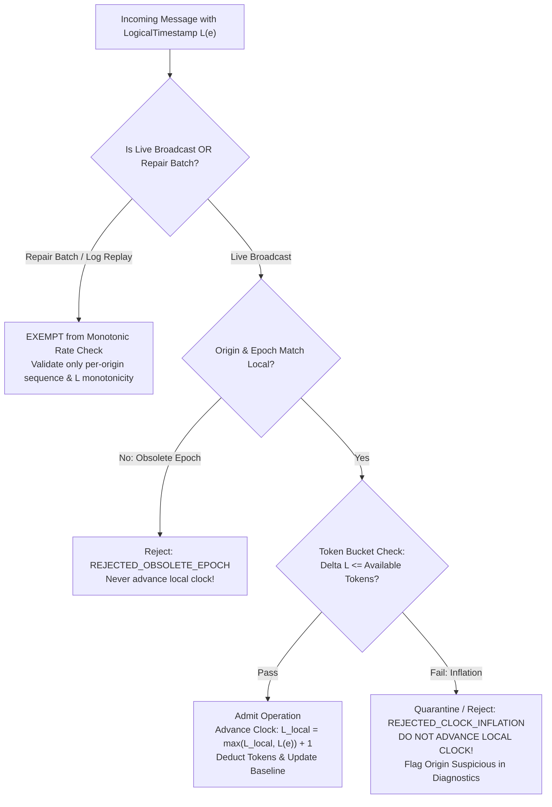

# Phase 7.2-R3 — Snapshot Safety, Identity & Convergence Corrections

> **Document Version:** 1.0.0  
> **Status:** AUTHORITATIVE ARCHITECTURAL SPECIFICATION (Revision P7.2-R3)  
> **Baseline Commit:** `a809612`  
> **Mode:** Specification & Architecture Only — Strict Stop Condition Observed  
> **Target Subsystems:** `@syncplay/sync-engine`, `@syncplay/protocol`, `@syncplay/control-events`, `@syncplay/peer-mesh`  

---

## 1. Executive Summary & Purpose

Following the review of Revision P7.2-R2 (`a809612`), four critical correctness and architectural soundness issues were identified:
1. **Unsafe Snapshot Tie-Breaking:** The R2 fallback tie-breaker ($\max(\text{epoch}) \to \max(L) \to \max_{\text{lex}}(\text{peerId})$) for incomparable snapshots was mathematically flawed. A larger Lamport clock or lexicographic peer ID does not prove event completeness. This tie-breaker is removed and replaced with an explicit `DEGRADED_OUT_OF_SYNC` recovery path.
2. **Conflation of Transport Identity and Event Authorship:** WebRTC DTLS proves the immediate sending peer, but not the original author of forwarded messages. For the MVP, a **Strict No-Forwarding Policy** is adopted for live events, and snapshot/repair supplier identities are formally decoupled from event authorship.
3. **Unimplementable Lamport Inflation Rules:** Monotonic rate checks lacked precise baselines, burst allowances, and repair distinctions. An implementable token-bucket specification is defined, clarifying that rejected events never advance clocks, repair batches are exempt, and heuristic limits are not cryptographic guarantees.
4. **Unqualified Convergence Claims:** The phrase "if and only if" and the standalone timing equation were mathematically overreaching. A rigorous **Conditional Eventual Convergence Statement** is formalized, clearly distinguishing transport delivery, accepted event sets, deterministic replay, and state convergence.

This document serves as the authoritative final correction record for **Revision P7.2-R3**, detailing replaced R2 policies and active invariants.

---

## 2. Comprehensive Correction Register (P7.2-R3)

---

### Correction 1: Removal of Unsafe Snapshot Tie-Breaking & Formal Divergence Handling

#### 1. Identification of Defect in R2
In P7.2-R2, Section 6.1 specified that if two peers offered incomparable snapshot frontiers ($V_A \not\ge V_B \land V_B \not\ge V_A$) and missing history was unavailable, the engine applied a tie-breaker:
$$\text{Winner} = \max(\text{membershipEpoch}) \to \max(\text{maxLogicalTimestamp}) \to \max_{\text{lex}}(\text{snapshotAuthorPeerId})$$
*Why this was flawed:* A higher scalar Lamport timestamp ($L$) or lexicographical peer ID has zero mathematical correlation with event-set completeness or correctness. Silently picking one divergent snapshot drops valid operations from the other branch, permanently fragmenting the room state without user or host awareness.

#### 2. Replaced Policy: Strict Domination or Degraded Transition
The arbitrary tie-breaker is **completely removed** from all engine specifications, algorithms, and simulation suites. The recovery policy is formalized as follows:

```mermaid
flowchart TD
    Snap["Incoming State Snapshot (V_snap)"] --> CheckDom{V_snap dominates V_local?<br/>(Component-wise V_snap >= V_local)}
    
    CheckDom -->|Yes| VerifyTrust["Evaluate Completeness, Epoch & RFC 8785 Digest"]
    VerifyTrust -->|Valid| Install["Atomically Install Snapshot & Replay Newer Local Ops"]
    VerifyTrust -->|Invalid| Reject["Reject Snapshot (SNAPSHOT_STALE / DIGEST_MISMATCH)"]
    
    CheckDom -->|No: Incomparable| CheckLog{Are Missing History Ops<br/>Available in Peer Logs?}
    CheckLog -->|Yes| Repair["Request Missing Slices via REPAIR_REQUEST<br/>Merge & Replay in Total Order"]
    CheckLog -->|No: History Compacted| Degraded["Transition to DEGRADED_OUT_OF_SYNC<br/>Flag EngineStatus.isDegraded = true<br/>Do NOT silently choose a winner!"]
    
    Degraded --> Action["Explicit Recovery Action:<br/>Host Re-Seek OR Room Reload"]
```

1. **Component-Wise Domination Evaluation:**
   A snapshot with frontier $V_{\text{snap}}$ is eligible for installation if and only if it component-wise dominates the local replication vector:
   $$V_{\text{snap}}[p] \ge V_{\text{rep, local}}[p] \quad \forall p \in \text{keys}(V_{\text{rep, local}})$$
   If eligible, the engine evaluates byte-level integrity (RFC 8785 canonical SHA-256 digest), membership epoch validity, and state bounds before atomic installation.
2. **Incomparable Frontiers with Available History:**
   If vectors are incomparable ($V_{\text{snap}} \not\ge V_{\text{local}} \land V_{\text{local}} \not\ge V_{\text{snap}}$) and the missing operations are within the retained log horizon of connected peers ($\le K = 256$), the engine **must not guess a winner**. It initiates targeted `REPAIR_REQUEST` handshakes to retrieve the missing sequence ranges from both branches, merging them deterministically in total order.
3. **Incomparable Frontiers with Compacted History:**
   If the required operations have already been compacted by all peers and no verifiable common recovery point exists, the engine **MUST NOT silently select one divergent snapshot**. The engine transitions to `DEGRADED_OUT_OF_SYNC`:
   - Sets `EngineStatus.isDegraded = true`.
   - Sets `EngineStatus.degradedReason = 'INCOMPARABLE_SNAPSHOT_DIVERGENCE'`.
   - Halts speculative local state advance.
4. **Explicit Recovery Action from Degraded State:**
   Recovery from `DEGRADED_OUT_OF_SYNC` cannot be automated safely without risking data loss. It requires an explicit authoritative application-level action:
   - **Host-Driven Re-Anchor:** The room creator or designated session host performs an explicit manual seek or playback command in the UI, generating a new authoritative control operation stamped with the active epoch that re-anchors the timeline for all participants; OR
   - **Room Re-Sync / Reload:** The client reloads its session via Bootstrap, obtaining a fresh ephemeral identity and importing the current host baseline state.

---

### Correction 2: Separation of Transport Identity from Event Authorship

#### 1. Identity Layers & Transport Limitations
In WebRTC full mesh, DTLS transport identity cryptographically authenticates the immediate peer on the DataChannel (`fromPeerId`). However, transport authentication **only proves who transmitted the wire message**, not who originally authored the contained event.

#### 2. MVP Policy: Strict No-Forwarding for Live Events
To prevent origin impersonation without requiring complex asymmetric cryptographic signatures (WebCrypto / Ed25519) on every interactive control operation:
1. **Strict No-Forwarding Rule:**
   For all live broadcast control events (`PLAY`, `PAUSE`, `SEEK`, `RATE_CHANGE`), the declared logical author **MUST** match the authenticated immediate transport peer:
   $$\text{originPeerId} \equiv \text{senderPeerId} \equiv \text{fromPeerId}$$
2. **Rejection of Relayed Live Events:**
   A peer is strictly forbidden from relaying or rebroadcasting another peer's live control event. Any incoming live message where $\text{originPeerId} \neq \text{fromPeerId}$ is immediately rejected at the transport boundary with error code `REJECTED_UNAUTHORIZED_ORIGIN`.
3. **Direct Full-Mesh Requirement:**
   Because SyncPlay targets small rooms ($N \le 8$), every peer maintains direct WebRTC DataChannels to every other active peer. Multi-hop event relaying is not supported in Phase 7.

#### 3. Identity Model for Anti-Entropy Repair & Snapshots
Historical repair and snapshot recovery necessarily involve transferring operations originally authored by third parties:
- **Repair Batches (`OPERATION_BATCH`):**
  - Wire messages explicitly separate `supplierPeerId` (the transport peer fulfilling the repair) from `originPeerId` (the author of the historical operations).
  - *Direct Repair Preference:* A node first attempts `REPAIR_REQUEST` directly to the `targetOriginPeerId` if connected.
  - *Third-Party Repair Fallback:* If the origin peer is offline, another peer holding the log may act as a `supplierPeerId`. In the MVP, third-party repair operates under the cooperative (non-byzantine) trust model; the receiver validates that operations match the requested sequence range and maintain per-origin sequence monotonicity.
- **Snapshot Supplier vs. Snapshot Author:**
  - A snapshot carries `snapshotAuthorPeerId` (the peer that reduced state and computed `stateDigestSha256`) and `supplierPeerId` (the transport peer delivering the snapshot over WebRTC).
  - A snapshot supplier is **not** automatically trusted as the author of every historical operation folded into that snapshot.
  - Installed snapshots are marked `isImportedProvenance = true`.

---

### Correction 3: Implementable Lamport Clock Rate & Inflation Validation

#### 1. Defect in Previous Specification
P7.2-R2 proposed a physical rate check: $\Delta L \le (\Delta t_{\text{monotonic}} \times \text{MAX\_INTENT\_HZ}) + \text{BURST\_TOLERANCE}$. This was unimplementable because:
- Receiver monotonic time (`performance.now()`) is independent of sender time.
- Network queuing, cellular handovers, and OS thread pauses cause legitimate real-time events to arrive in rapid bursts.
- Historical operations arriving in `OPERATION_BATCH` naturally arrive with hundreds of clock increments in a single millisecond.

#### 2. Implementable Rate & Inflation Specification



1. **Scope of Validation:**
   - Monotonic rate checks apply **ONLY to live real-time broadcasts**.
   - Operations arriving via `OPERATION_BATCH` (anti-entropy repair) or local log replays are **STRICTLY EXEMPT** from rate checks.
2. **Per-Origin & Per-Epoch Tracking State:**
   Every node maintains a tracking entry per $(p, E) \in (\text{originPeerId}, \text{membershipEpoch})$:
   ```ts
   interface OriginClockRateState {
     lastAdmittedMonotonicMs: number;
     tokens: number; // Token bucket capacity (default: 50)
   }
   ```
   - Tracking state is initialized when a peer first originates an operation in epoch $E$.
   - When a peer reconnects with a fresh identity after reload, it begins with fresh state.
3. **Token Bucket Algorithm:**
   - Tokens replenish at $\text{REFILL\_RATE} = 10\text{ tokens/sec}$ ($0.01\text{ tokens/ms}$) up to $\text{BURST\_CAPACITY} = 50\text{ tokens}$.
   - Upon receiving a live operation $e$ with jump $\Delta L = L(e) - L_{\text{prev}}(p)$:
     $$\text{tokens} \leftarrow \min(\text{BURST\_CAPACITY}, \text{tokens} + (\Delta t_{\text{local\_monotonic}} \times \text{REFILL\_RATE}))$$
   - If $\Delta L \le \text{tokens}$: tokens are decremented by $\Delta L$; operation is admitted.
   - If $\Delta L > \text{tokens}$: operation is classified as `CLOCK_INFLATION`.
4. **Handling Suspicious Events:**
   - Suspicious operations are **rejected** with `REJECTED_CLOCK_INFLATION`.
   - **Critical Safety Invariant:** Rejected or quarantined operations **MUST NEVER advance the local Lamport clock**.
   - The origin peer is flagged as degraded/suspicious in diagnostic statistics, but connection is maintained unless spam persists.
5. **Safe Behavior at `Number.MAX_SAFE_INTEGER`:**
   - If local clock reaches $\text{Number.MAX\_SAFE\_INTEGER} - 10,000$ ($2^{53} - 10,001$), the engine logs a high-priority warning.
   - If $L \ge \text{Number.MAX\_SAFE\_INTEGER} - 1$, local engine throws `CLOCK_OVERFLOW`, enters degraded mode, and rejects local intents until a snapshot re-anchor resets the clock baseline to 0.
6. **Explicit Security Limitation:**
   - *Limitation:* The rate check is a heuristic safeguard against client software bugs and runaway loops. It does **not** constitute a cryptographic security guarantee against sophisticated Byzantine peers.

---

### Correction 4: Rigorous Conditional Eventual Convergence Statement

#### 1. Removal of "If and Only If" and Standalone Equation Claims
Previous drafts claimed:
*"Replicas are guaranteed to converge if and only if... $\tau \ge 2\Delta + \text{digestInterval} + \text{repairRTT}$."*
- The phrase "if and only if" was mathematically unjustified because necessity was never formally established.
- The timing inequality was erroneously presented as a formal proof rather than an engineering/test assumption.

#### 2. The Four Distinct Consistency Layers
To eliminate theoretical ambiguity, the protocol strictly separates four layers:

| Layer | System Domain | Definition | Verification Mechanism |
| :--- | :--- | :--- | :--- |
| **1. Eventual Delivery** | Network Transport | Every generated message is eventually delivered to connected non-faulty peers or made available via log repair. | WebRTC DataChannel delivery + Anti-Entropy `REPAIR_REQUEST`. |
| **2. Complete Accepted Event Sets** | Protocol Admission | Every non-faulty peer admits into its log the identical set of valid, non-fenced operations for a given epoch. | Epoch fencing (`membershipEpoch`), sequence monotonicity, and deduplication. |
| **3. Deterministic Replay** | State Reducer | Applying the identical sequence of operations to the identical base state yields the exact same playback state. | Pure functional reducer (`reduce(S, e, t)`) sorted by $\langle L, \text{originPeerId}, \text{logicalEventId} \rangle$. |
| **4. Eventual State Convergence** | Distributed State | Replicas reach identical values for `status`, `anchorPositionMs`, `playbackRate`, and `timelineRevision`. | Emerges from layers 1, 2, and 3 under quiescence. |

#### 3. Formal Conditional Eventual Convergence Statement

> **Theorem (Conditional Eventual State Convergence):**  
> Let $\mathcal{R}$ be a set of non-faulty SyncPlay replicas participating in session $\mathcal{S}$ within active membership epoch $E$.  
> Replicas in $\mathcal{R}$ will eventually converge to identical `PlaybackState` **under the following explicit conditions**:
> 1. **Connected Communication Graph:** Between any two replicas in $\mathcal{R}$, there exists an open direct WebRTC DataChannel or an active anti-entropy repair path.
> 2. **Consistent Membership Epoch & Fencing:** Replicas agree on the active `membershipEpoch` issued by Bootstrap; operations generated under obsolete epochs are strictly fenced and discarded.
> 3. **Identical Accepted Event Sets:** Every replica in $\mathcal{R}$ eventually receives and admits into its log the complete set of non-fenced operations originated in epoch $E$.
> 4. **Causal Dependency Admissibility:** No replica applies an operation until all operations declared in its `causalContext` have been received and applied.
> 5. **Deterministic Total Ordering & Reduction:** Replicas order accepted operations using the deterministic key $\langle L(e), \text{originPeerId}(e), \text{logicalEventId}(e) \rangle$ and reduce them via the pure functional reducer.
> 6. **Successful History Recovery:** Any replica with missing history either repairs gaps within the retained horizon $K = 256$ or successfully imports an authoritative snapshot dominating its local history.
> 7. **Eventual Quiescence:** Replicas enter a period of quiescence where no new control operations are generated, allowing anti-entropy digests and pending repair requests to settle.

> **Engineering Design Assumption:**  
> The duration $\tau_{\text{quiesce}} \ge 2\Delta + \text{digestInterval} + \text{repairRTT}$ represents an **engineering design target and simulation test parameter**, under which all in-flight messages and repair handshakes are expected to resolve in practice. It is not an intrinsic mathematical proof of convergence.

---

## 3. Impact Analysis & Document Traceability Matrix (P7.2-R3)

| Document | Revisions Applied in P7.2-R3 |
| :--- | :--- |
| `docs/PHASE7_2_R2_FINAL_CORRECTIONS.md` | Annotated replaced sections: removed incomparable vector tie-breaker, updated identity model to no-forwarding, refined inflation check, corrected convergence theorem. |
| `docs/PHASE7_2_ARCHITECTURAL_CORRECTIONS.md` | Cross-referenced P7.2-R3 and updated master correction register. |
| `docs/PHASE7_2_HLD.md` | Added Strict No-Forwarding policy; updated trust boundaries; refined conditional convergence theorem. |
| `docs/PHASE7_2_LLD.md` | Removed snapshot tie-breaker; added DEGRADED_OUT_OF_SYNC transition; specified token-bucket Lamport check; distinguished repair batches. |
| `docs/PHASE7_2_PROTOCOL_EVOLUTION_RFC.md` | Clarified `originPeerId === senderPeerId` for live events; decoupled snapshot supplier from author. |
| `docs/design/PHASE7_INTERFACE_CONTRACTS.md` | Updated `ILogicalClockManager` (token bucket parameters), `IRecoveryManager` (removal of tie-breaker, degraded return), and error codes. |
| `docs/PHASE7_2_SIMULATION_TEST_STRATEGY.md` | Updated Suite 9 to assert transition to `DEGRADED_OUT_OF_SYNC` instead of tie-breaking; updated Suite 10 to test token-bucket inflation. |
| `docs/PHASE7_2_COMPATIBILITY_AND_MIGRATION.md` | Documented strict no-forwarding limitation; documented explicit recovery from `DEGRADED_OUT_OF_SYNC`. |
| `docs/PHASE7_2_FINAL_DESIGN_REVIEW.md` | Updated architectural decisions AD-701, AD-709; updated AC-7.2.1–7.2.5 assessments. |
| `docs/design/README.md` | Added `PHASE7_2_R3_FINAL_CORRECTIONS.md` to design index. |
