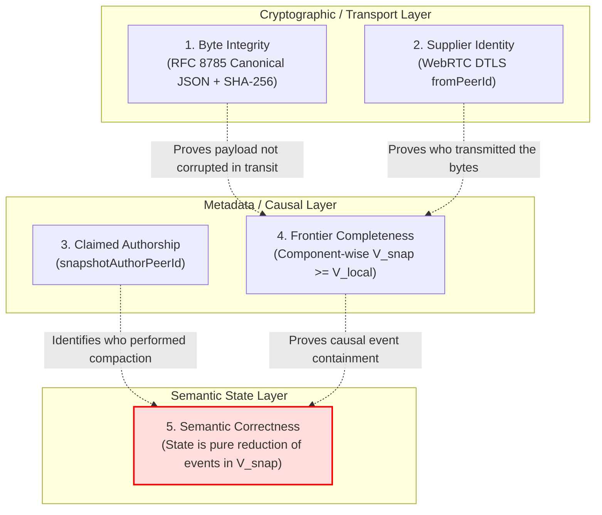

# Phase 7.2-R4 — Historical Event Trust & Snapshot Acceptance Corrections

> **Document Version:** 1.1.0  
> **Status:** AMENDED & REFINED IN PART BY REVISION P7.2-R5 (See [`PHASE7_2_R5_FINAL_CORRECTIONS.md`](file:///c:/Users/tejde/OneDrive/Desktop/SyncPlay_Protocol/SyncPlay_Protocol/docs/PHASE7_2_R5_FINAL_CORRECTIONS.md))  
> **Baseline Commit:** `c7188fc` (Amended in `16dfe7a`, Refined in P7.2-R5)  
> **Mode:** Specification & Architecture Only — Strict Stop Condition Observed  
> **Target Subsystems:** `@syncplay/sync-engine`, `@syncplay/protocol`, `@syncplay/control-events`, `@syncplay/peer-mesh`  

> [!NOTE]
> Revision P7.2-R5 provides the final mathematical freezing of:
> 1. **Exact Logical Timestamp Validation:** 3-tier lookup of dependency timestamps ($L_{\text{max\_dep}}$) via in-memory log, compacted base snapshots (`originFrontierTimestamps`), and buffering of missing dependencies.
> 2. **Anomalous Timestamp Jumps:** Precise classification across Valid, Missing Dependency, Causal Inconsistency, Safe Integer Overflow, and Unverifiable Compacted History.
> 3. **Tightened Replay Boundaries:** Formally restricting `LOCAL_REPLAY` exclusively to already accepted immutable operations, and asserting that duplicate detection cannot mask sequence collisions.  

---

## 1. Executive Summary & Purpose

Following the architectural sign-off of Revision P7.2-R3 (`c7188fc`), an in-depth security and convergence analysis identified three remaining architectural gaps:
1. **Historical Event Authorship Trust Gap:** In live broadcasts, direct WebRTC transport authenticates the author ($\text{originPeerId} \equiv \text{senderPeerId} \equiv \text{fromPeerId}$). However, anti-entropy repair batches decouple the transport peer (`supplierPeerId`) from the historical author (`originPeerId`). Without asymmetric cryptography, the receiver cannot cryptographically verify historical event authorship.
2. **Snapshot Acceptance vs. Semantic Correctness:** While R3 established RFC 8785 canonical SHA-256 byte integrity and component-wise frontier dominance ($V_{\text{snap}} \ge V_{\text{local}}$), vector dominance and hashing do **not** prove the semantic correctness of the encapsulated playback state. The receiver cannot independently verify that the state accurately reflects the reduced history without replaying all compacted events from Genesis.
3. **Over-Broad Token-Bucket Exemptions:** The R3 specification introduced a generic `isRepairOrReplay` bypass flag. If unconstrained, this could permit unvalidated historical events to bypass critical schema, causal, sequence, and integer bounds checks.

This document establishes the definitive architectural specifications for **Revision P7.2-R4**, formalizing the MVP cooperative trust model, snapshot acceptance criteria, refined event validation classifications, and mathematically rigorous convergence preconditions.

---

## 2. Comprehensive Correction Register (P7.2-R4)

---

### Correction 1: Historical Event Trust Model & Supplier Semantics

#### 1. Analysis of Historical Authorship Approaches

| Approach | Description | Complexity & Overhead | Security Property | MVP Assessment |
| :--- | :--- | :--- | :--- | :--- |
| **A. Author-Signed Records** | Authors sign an RFC 8785 canonical representation of each event using WebCrypto Ed25519; signatures distributed with events. | **High:** Key generation on join, public key distribution via Bootstrap, signature verification CPU cost in browser JS. | Non-repudiation and cryptographic proof of authorship across third-party relays. | **Deferred to Post-MVP:** Over-engineered for small cooperative rooms ($N \le 8$) where participants know each other. |
| **B. Authenticated Hash Chain** | Per-origin cryptographic hash chain or Merkle DAG tying each sequence number to author genesis. | **Medium-High:** Structural hash validation; requires trusted genesis signatures to prevent full branch forgery. | Detects sequence tampering; does not prove origin without root keys. | **Rejected:** Adds graph verification complexity without solving origin authentication. |
| **C. Cooperative Non-Byzantine Trust Model** | Transport authenticates immediate supplier (`supplierPeerId`); historical authorship is accepted under cooperative room assumptions. | **Minimal:** Zero cryptographic overhead beyond DTLS transport; standard schema and sequence checks. | Protects against network corruption, packet reordering, and client bugs; does not defend against malicious peers. | **SELECTED FOR MVP:** Simplest, cleanest approach perfectly aligned with SyncPlay's small-room browser scope. |

#### 2. Formal MVP Trust Statements (Option C)

Under the selected MVP cooperative trust model:
1. **Historical Authorship Is NOT Cryptographically Verified:** The receiver cannot mathematically prove that a historical operation in a repair batch was genuinely authored by `originPeerId`.
2. **Fabrication Is Outside the MVP Threat Model:** A malicious, modified, or compromised peer client could theoretically fabricate historical operations under another participant's `originPeerId` within a repair batch. Defense against malicious room participants is explicitly **out of scope** for the MVP.
3. **`supplierPeerId` Does NOT Prove `originPeerId`:** The verified WebRTC transport identity (`supplierPeerId`) certifies only the identity of the immediate peer providing the `OPERATION_BATCH`. It provides zero cryptographic proof of original authorship.
4. **Cooperative Supplier Assumption:** Connected room peers are assumed to be cooperative participants running non-malicious client software. A repair supplier is trusted to honestly forward stored operations from its local `OrderedOperationLog`.

#### 3. Mandatory Receiver Validation for Repaired Events

Even under cooperative trust, the receiver **never blindly trusts** incoming repair operations. Every repaired operation must pass rigorous defensive validations:
1. **Schema & Byte Conformance:** Event conforms strictly to `ControlSyncEventSchema`; payload conforms to typed payload schema; total serialized size $\le 4,096\text{ bytes}$.
2. **Recognized Origin Identity:** `originPeerId` must belong to a known room participant (active in the current session or listed in historical session rosters).
3. **Origin Sequence Continuity:** `originSequenceNumber` must fall within the requested sequence range $[fromSeq, toSeq]$ and cleanly fill an identified gap in `replicationVector[originPeerId]`.
4. **Collision Detection:** If an operation for $(originPeerId, originSequenceNumber)$ has already been accepted, incoming $e$ is checked:
   - If $e.\text{logicalEventId}$ matches: ignored as duplicate (`IGNORED_DUPLICATE`).
   - If $e.\text{logicalEventId}$ differs: rejected with `SEQUENCE_COLLISION_DETECTED` (flagged as non-cooperative divergence; origin quarantined).
5. **Causal Context Integrity:** All sequence numbers in $e.\text{causalContext}$ must be valid non-negative safe integers. If $e$ references missing predecessors, it is buffered in `PendingDependencyQueue`.
6. **Lamport Timestamp Causality:** $L(e)$ must strictly exceed the maximum timestamp of declared dependencies:
   $$L(e) > \max_{d \in \text{deps}(e)} L(d)$$
7. **Safe Integer Limits:** $L(e) < \text{Number.MAX\_SAFE\_INTEGER} - 1$.
8. **Epoch Validity:** $e.\text{membershipEpoch}$ must match or predate the active epoch. Obsolete operations predating the compacted horizon are rejected (`REJECTED_OBSOLETE_EPOCH`).

#### 4. Distinction Between Live and Repair Transport Semantics

```
Live Control Broadcast (Real-Time Interaction):
+--------------------+                                +--------------------+
|  Author (Peer A)   | ===== Direct WebRTC DataChannel ====> | Receiver (Peer B)  |
| originPeerId: A    |   [senderPeerId === originPeerId]   | Validates:         |
| senderPeerId: A    |   Strict No-Forwarding Enforced     | sender === origin  |
+--------------------+                                +--------------------+

Anti-Entropy Repair Batch (Historical Catch-Up):
+--------------------+                                +--------------------+
| Supplier (Peer C)  | ===== Direct WebRTC DataChannel ====> | Receiver (Peer B)  |
| supplierPeerId: C  |   [supplierPeerId !== originPeerId] | Validates:         |
| holds A's past ops |   Cooperative Non-Byzantine Model   | Schema, Sequences, |
+--------------------+                                | Dependencies, Hash |
                                                      +--------------------+
```

- **Live Broadcasts:** Enforce the **Strict No-Forwarding Policy** ($\text{originPeerId} \equiv \text{senderPeerId} \equiv \text{fromPeerId}$). Relayed live events are rejected with `REJECTED_UNAUTHORIZED_ORIGIN`. Direct author broadcast is feasible because $N \le 8$ in full mesh.
- **Repair Batches:** Decouple `supplierPeerId` from historical `originPeerId`. This decoupling is essential for anti-entropy availability: if author Peer A disconnects, surviving Peer B must still be able to retrieve Peer A's historical events from Peer C.

#### 5. Post-MVP Security Extension (Documented Roadmap)
For public or untrusted multi-tenant environments (Phase 9+), author cryptographic signing (WebCrypto Ed25519) will be introduced as an optional security profile. In that profile, the envelope will carry `signature: string`, validated against a public key announced during Bootstrap signaling.

---

### Correction 2: Snapshot Acceptance, Integrity & Trust Boundaries

#### 1. Disambiguation of Snapshot Properties

To prevent false claims of cryptographic or mathematical proof, the architecture formally separates five distinct snapshot properties:



1. **Byte Integrity:** RFC 8785 canonical serialization hashed with SHA-256 proves that the payload received matches exactly what was authored, without transmission corruption or bit-rot.
2. **Supplier Identity:** Verified DTLS transport connection proves which connected peer transmitted the snapshot.
3. **Claimed Snapshot Authorship:** `snapshotAuthorPeerId` identifies the peer that performed the state reduction and produced the snapshot. In the cooperative model, this authorship is trusted.
4. **Frontier Completeness:** Component-wise vector domination ($V_{\text{snap}} \ge V_{\text{local}}$) proves that the snapshot causally encompasses every event sequence known to the local receiver.
5. **Semantic Correctness:** **CANNOT be verified independently without the underlying event history.** Vector dominance and SHA-256 do **NOT** prove that `positionMs`, `playbackRate`, or `status` truthfully represent the operations in $V_{\text{snap}}$. Verifying semantic correctness would require full re-execution from Genesis ($t=0$).

#### 2. Exact Fields Covered by Canonical Serialization and SHA-256

The `stateDigestSha256` covers the exact canonical byte stream defined by RFC 8785 (JSON Canonicalization Scheme) across the interior snapshot payload:

```ts
export interface CanonicalSnapshotDigestInput {
  readonly formatVersion: 2;
  readonly sessionId: string;
  readonly membershipEpoch: number;
  readonly snapshotAuthorPeerId: string;
  readonly snapshotFrontier: Record<string, number>;
  readonly maxLogicalTimestamp: number;
  readonly state: {
    readonly playbackState: {
      readonly status: 'playing' | 'paused' | 'buffering';
      readonly positionMs: number;
      readonly playbackRate: number;
      readonly anchorTimestamp: number;
      readonly anchorLocalTime: number;
      readonly lastAppliedOperation: {
        readonly logicalEventId: string;
        readonly originPeerId: string;
        readonly messageType: 'PLAY' | 'PAUSE' | 'SEEK' | 'RATE_CHANGE';
        readonly logicalTimestamp: number;
        readonly originSequenceNumber: number;
      } | null;
    };
  };
}
```

- **Binding Guarantee:** Hashing these fields together immutably binds the `sessionId`, `membershipEpoch`, `snapshotAuthorPeerId`, `snapshotFrontier`, and `playbackState`. A peer cannot alter the frontier without invalidating the digest.
- **Excluded Fields:** The top-level `snapshotId` (unique transport transmission ID) and the `stateDigestSha256` itself are excluded from the hash preimage.

#### 3. Receiver Verification Pipeline

Before installing an imported snapshot, the receiver independently validates:
1. **Format Version:** `formatVersion === 2`.
2. **Session Scope:** `sessionId === localSessionId`.
3. **Epoch Validity:** `membershipEpoch >= localMembershipEpoch`. Obsolete snapshots are rejected.
4. **Digest Verification:** Recomputes SHA-256 over RFC 8785 canonical serialization of the input structure; must match `stateDigestSha256` exactly (`DIGEST_MISMATCH`).
5. **Component-Wise Domination:**
   $$\forall p \in \text{keys}(V_{\text{local}}), \quad V_{\text{snap}}[p] \ge V_{\text{local}}[p]$$
   If $V_{\text{snap}} < V_{\text{local}}$, rejected with `SNAPSHOT_STALE`.
6. **State Invariant Bounds:**
   - `status` is one of `'playing'`, `'paused'`, `'buffering'`.
   - `playbackRate` $\in [\text{minPlaybackRate}, \text{maxPlaybackRate}]$ ($0.5$ to $2.0$).
   - `positionMs` is a non-negative finite safe number.
   - `anchorTimestamp` and `anchorLocalTime` are finite safe numbers.

#### 4. Handling Inconsistent or Incomparable Snapshots

- **Byte Corruption (`DIGEST_MISMATCH`):** Snapshot is discarded; receiver requests a fresh snapshot from an alternate peer.
- **Stale Snapshot (`SNAPSHOT_STALE`):** Discarded without state modification.
- **Incomparable Frontier ($V_{\text{snap}} \parallel V_{\text{local}}$):**
  - If missing sequence gaps are within peer log horizons ($\le K = 256$), receiver dispatches `REPAIR_REQUEST` to retrieve the missing operations.
  - If compacted beyond horizon, **no tie-breaker is applied**. The receiver rejects the snapshot, transitions to `DEGRADED_OUT_OF_SYNC`, sets `isDegraded = true`, and raises an alert.
- **No Acceptable Snapshot Available:**
  - If all peers fail to provide a dominating, valid snapshot, the engine remains in `RECOVERING` or `DEGRADED_OUT_OF_SYNC`.
  - The local player is paused and locked to prevent uncontrolled divergence.
  - Recovery requires an explicit **Host Re-Seek** (host originates an authoritative seek in the active epoch) or **Room Reload** (user reloads page to reset identity).

#### 5. Non-Authority Invariant
- A snapshot supplier or author **never** becomes a permanent playback authority.
- Snapshot installation is an atomic state re-anchor.
- Once installed, the receiver immediately replays any locally retained operations newer than the snapshot frontier:
  $$e \in \text{LocalLog} \quad \text{where} \quad e.\text{originSequenceNumber} > V_{\text{snap}}[e.\text{originPeerId}]$$

---

### Correction 3: Tightened Token-Bucket & Event Validation Rules

#### 1. Five Distinct Event Ingestion Categories

To eliminate the over-broad `isRepairOrReplay` bypass, incoming operations are classified into five strict categories:

| Category | Ingestion Context | Validation Work Required | Token Bucket Check | Lamport Clock Advancement |
| :--- | :--- | :--- | :--- | :--- |
| **1. Exact Duplicate** | $e.\text{logicalEventId}$ already in log/index. | Zero (fast path). | Bypassed. | **NO (Clock does not tick).** |
| **2. Unchanged Retransmission** | Redundant wire delivery of already reduced event. | Zero (fast path). | Bypassed. | **NO (Clock does not tick).** |
| **3. Newly Received Historical (Repair)** | Operation in `OPERATION_BATCH` during anti-entropy. | **Full structural, schema, sequence, causal, and safe integer checks.** | **EXEMPT (Wall-clock rate limit bypassed).** | **YES (Advances $L = \max(L, L(e)) + 1$ upon admission).** |
| **4. Local Snapshot Replay** | Locally authored/validated ops newer than snapshot. | Zero (already validated on entry; pure reducer replay). | Bypassed. | **NO (Clock already advanced on entry).** |
| **5. Newly Received Live Broadcast** | Real-time interactive playback control. | **Full checks + Strict No-Forwarding + Token Bucket Rate Limit.** | **MANDATORY ($10\text{ ops/sec}$, burst $50$).** | **YES (Advances $L = \max(L, L(e)) + 1$ upon admission).** |

#### 2. Mandatory Validation Matrix for Category 3 (Repaired Operations)

Repaired operations bypass **ONLY** the physical wall-clock rate limit. All of the following checks remain mandatory:

```
+-----------------------------------------------------------------------------+
|               CATEGORY 3: NEWLY RECEIVED REPAIR OPERATION                   |
+-----------------------------------------------------------------------------+
| [MANDATORY] Schema validation (Zod schema & payload types)                  |
| [MANDATORY] Size limit validation (<= 4,096 bytes)                          |
| [MANDATORY] Origin identity check (recognized participant in room)          |
| [MANDATORY] Membership epoch check (epoch <= activeEpoch)                   |
| [MANDATORY] Sequence continuity check (fills identified replication gap)    |
| [MANDATORY] Sequence collision check (reject conflicting logicalEventId)    |
| [MANDATORY] Causal context verification (non-negative integer vector)       |
| [MANDATORY] Lamport causality check (L(e) > max(dependencies L))            |
| [MANDATORY] Safe integer range check (L(e) < MAX_SAFE_INTEGER - 1)          |
|-----------------------------------------------------------------------------|
| [EXEMPT]    Physical Monotonic Token Bucket Rate Limit                      |
|             (Permits rapid arrival of catch-up batches)                     |
+-----------------------------------------------------------------------------+
```

#### 3. Formal Invariants on Validation Failure
- **Rejection Safety:** If any repaired or live operation fails ANY mandatory validation check, it is immediately rejected.
- **Clock Isolation:** **A rejected or quarantined operation MUST NEVER advance the local Lamport clock.**
- **Frontier Isolation:** **A rejected operation MUST NEVER advance the replication vector ($V_{\text{rep}}$).**
- **Rate Limit Classification:** The token-bucket rate limiter is an **empirical sanity heuristic** designed to prevent client software bugs or infinite event loops from exhausting resources. It is **not** a mathematical proof of timestamp validity and does not defend against Byzantine adversaries.

#### 4. Interface Signature Refinement
The generic `isRepairOrReplay?: boolean` parameter is replaced with an explicit `ValidationContext` enum:

```ts
export type ValidationContext = 'LIVE_BROADCAST' | 'REPAIR_BATCH' | 'LOCAL_REPLAY';

export interface ILogicalClockManager {
  readonly clock: number;

  tickLocal(dependencies?: ReadonlyArray<{ logicalTimestamp: number }>): number;

  validateAndAdvanceRemote(
    originPeerId: string,
    remoteClock: number,
    dependencyClocks: ReadonlyArray<number>,
    monotonicNow: number,
    membershipEpoch: number,
    context: ValidationContext
  ): number;

  reseed(maxObservedClock: number): void;
}
```

---

## 3. Consistency Review & Architectural Refinements

### 1. Removal of Bounded Physical Clock Drift from Convergence Preconditions
- **Review Finding:** Revision P7.2-R3 included *"Bounded clock drift: Local monotonic clocks advance without backward regression"* as a precondition for the Conditional Eventual State Convergence Theorem.
- **Architectural Analysis:** In the SyncPlay architecture, logical total ordering is governed strictly by the discrete tuple $\langle L(e), \text{originPeerId}(e), \text{logicalEventId}(e) \rangle$. Lamport logical clocks and version vectors are completely decoupled from physical time. Deterministic replay and eventual state equality ($S_A = S_B$) depend solely on identical event sets and deterministic ordering. Physical clock drift affects only:
  1. Real-time media position extrapolation: $p(t) = p_0 + r \cdot (t - t_0)$.
  2. Wall-clock token-bucket replenishment.
- **Correction:** Physical clock drift is **removed** from the logical state convergence theorem. Physical clock drift is documented strictly under the Phase 8 Media Player synchronization domain.

### 2. Revised Conditional Eventual State Convergence Theorem

> **Theorem (Conditional Eventual State Convergence — Revised P7.2-R4):**  
> Let $\mathcal{R}$ be a set of non-faulty SyncPlay replicas participating in session $\mathcal{S}$ within active membership epoch $E$.  
> All replicas in $\mathcal{R}$ are guaranteed to converge to identical `PlaybackState` **if the following conditions are satisfied**:
> 1. **Connected Communication Graph:** Between any two replicas in $\mathcal{R}$, there exists an active direct WebRTC DataChannel or an indirect anti-entropy repair path.
> 2. **Consistent Membership Epoch & Strict Fencing:** Replicas agree on active epoch $E$ issued by Bootstrap; operations originated under obsolete epochs are fenced and discarded.
> 3. **Identical Accepted Event Sets ($E_A = E_B$):** Through live direct broadcast and anti-entropy repair, every replica in $\mathcal{R}$ eventually admits the identical set of non-fenced operations.
> 4. **Causal Dependency Ordering:** No replica applies an operation until all operations declared in its `causalContext` have been received and reduced.
> 5. **Deterministic Total Ordering & Reduction:** Replicas sort admitted operations by $\langle L(e), \text{originPeerId}(e), \text{logicalEventId}(e) \rangle$ and evaluate them through the identical pure functional reducer.
> 6. **Frontier-Dominating Snapshot Recovery:** Any replica missing compacted history ($\Delta > K=256$) successfully imports a snapshot whose frontier component-wise dominates its local history ($V_{\text{snap}} \ge V_{\text{local}}$).
> 7. **Eventual Quiescence:** Replicas enter a period where no new operations are generated, permitting anti-entropy digests and repair batches to complete delivery.

### 3. MVP Trust Model & Out-of-Scope Threat Register

| Threat Classification | In-Scope / Out-of-Scope | Architectural Defense / Status |
| :--- | :---: | :--- |
| **Crash-Stop Node Failures** | **IN-SCOPE** | Bootstrap detects disconnect, advances `membershipEpoch`, survivors evict node from stable frontier. |
| **Network Packet Loss / Duplication** | **IN-SCOPE** | WebRTC reliable/ordered SCTP channels + anti-entropy `STATE_DIGEST` / `REPAIR_REQUEST` + deduplication. |
| **Out-of-Order Delivery & Causal Gaps**| **IN-SCOPE** | `PendingDependencyQueue` buffers events until causal dependencies arrive. |
| **Split-Brain / Temporary Partitions** | **IN-SCOPE** | Strict Epoch Fencing discards obsolete partition branches; rejoining nodes recover via dominating snapshot. |
| **Runaway Loops / Accidental Flooding** | **IN-SCOPE** | Per-origin token bucket rate limiter ($10\text{ ops/sec}$, burst $50$). |
| **Safe Integer Overflow** | **IN-SCOPE** | Warning at $2^{53}-10,000$; `CLOCK_OVERFLOW` exception and re-anchor at $2^{53}-1$. |
| **Live Origin Impersonation** | **IN-SCOPE** | Strict No-Forwarding Policy ($\text{originPeerId} \equiv \text{senderPeerId} \equiv \text{fromPeerId}$). |
| **Malicious Historical Forgery in Repair**| **OUT-OF-SCOPE** | Deferred to Post-MVP. Room participants assumed cooperative. Validated by schema and sequence continuity only. |
| **Malicious Fabricated Snapshots** | **OUT-OF-SCOPE** | Deferred to Post-MVP. Authorship trusted cooperatively; validated by SHA-256 byte integrity and vector dominance. |
| **Byzantine Consensus Attacks** | **OUT-OF-SCOPE** | Architecture assumes $N \le 8$ private cooperative rooms. No BFT consensus algorithm implemented. |

---

## 4. Document Traceability & Supersession Matrix

| Document | Revision Action in P7.2-R4 | Status |
| :--- | :--- | :--- |
| `docs/PHASE7_2_R3_FINAL_CORRECTIONS.md` | Annotated Section 2.2 and Section 2.3 with R4 refinements (cooperative trust model, token-bucket categories, convergence preconditions). | Superseded where amended |
| `docs/PHASE7_2_R2_FINAL_CORRECTIONS.md` | Preserved as historical record; references updated to R4. | Superseded |
| `docs/PHASE7_2_ARCHITECTURAL_CORRECTIONS.md` | Master correction register updated to include P7.2-R4. | Active reference |
| `docs/PHASE7_2_HLD.md` | Trust boundaries updated with MVP Cooperative Non-Byzantine Trust Model and out-of-scope threat register; physical clock drift removed from convergence theorem. | Updated |
| `docs/PHASE7_2_LLD.md` | Section 1.4 updated with 5 event validation categories and `ValidationContext`; Section 6.1 updated with 5 snapshot properties and canonical digest preimage. | Updated |
| `docs/PHASE7_2_PROTOCOL_EVOLUTION_RFC.md` | `StateSnapshotPayloadV2` updated with exact canonical digest binding fields; repair batch transport semantics documented. | Updated |
| `docs/design/PHASE7_INTERFACE_CONTRACTS.md` | `ILogicalClockManager` updated with `ValidationContext` enum (`LIVE_BROADCAST`, `REPAIR_BATCH`, `LOCAL_REPLAY`); snapshot documentation updated. | Updated |
| `docs/PHASE7_2_SIMULATION_TEST_STRATEGY.md` | Suite 5 updated to assert failure on incomparable snapshots without tie-breaker; Suite 10 updated to test all 5 event validation categories. | Updated |
| `docs/PHASE7_2_COMPATIBILITY_AND_MIGRATION.md` | Sections 3.4 and 3.5 updated to articulate the cooperative trust model and explicit out-of-scope threats. | Updated |
| `docs/PHASE7_2_FINAL_DESIGN_REVIEW.md` | AD-701, AD-706, AD-709 updated with R4 specifications; Section 4 updated with explicit MVP Trust Model and Out-of-Scope Threat Register. | Updated |
| `docs/design/README.md` | Index updated to feature `PHASE7_2_R4_FINAL_CORRECTIONS.md`. | Updated |

