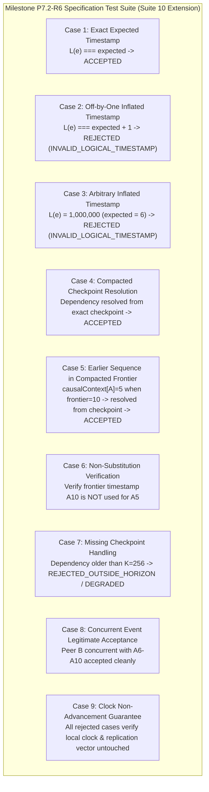

# Phase 7.2-R6 — Exact Lamport Validation & Compacted Dependency Checkpoints

> **Document Version:** 1.0.0  
> **Status:** AUTHORITATIVE ARCHITECTURAL SPECIFICATION (Revision P7.2-R6)  
> **Baseline Commit:** `990b3f4`  
> **Preceding Baselines:** `a809612` (P7.2-R2), `c7188fc` (P7.2-R3), `16dfe7a` (P7.2-R4), `990b3f4` (P7.2-R5)  
> **Mode:** Specification & Architecture Only — Strict Stop Condition Observed  
> **Target Subsystems:** `@syncplay/sync-engine`, `@syncplay/protocol`, `@syncplay/control-events`, `@syncplay/peer-mesh`  

---

## 1. Executive Summary & Purpose

Following Revision P7.2-R5 (`990b3f4`), this final architectural correction review resolves two critical correctness issues concerning **exact logical timestamp validation** and **compacted dependency timestamp resolution**:

1. **Exact Lamport Creation Invariant Enforcement:** In R5, receiver validation was described as a lower-bound inequality ($L(e) > \max L(d)$ and $L(e) > L_{\text{prev}}$). An event with an inflated timestamp could satisfy this lower bound while violating the approved event creation rule:
   $$L(e) = 1 + \max\left(L_{\text{local}}, \max_{d \in \text{dependencies}} L(d)\right)$$
   Under the MVP deterministic model, an author's logical clock advances **only** through accepted events represented in its observed dependency frontier (`causalContext`), which includes the author's own prior event. Therefore, the receiver can and must calculate the **exact expected timestamp**:
   $$\text{expectedTimestamp}(e) = 1 + \max_{(p, s) \in e.\text{causalContext}} L(p, s)$$
   Any mismatch ($L(e) \neq \text{expectedTimestamp}(e)$) constitutes a protocol violation and is rejected (`INVALID_LOGICAL_TIMESTAMP`).
2. **Exact Arbitrary-Sequence Timestamp Lookup via Bounded Compacted Checkpoints:** R5 used `originFrontierTimestamps` (the timestamp of the latest compacted sequence $W_{\text{stable}}[p]$) and `maxLogicalTimestamp`. When an incoming concurrent event references an earlier sequence $s < W_{\text{stable}}[p]$, substituting the frontier timestamp artificially inflates the expected timestamp, causing legitimate concurrent events to be rejected. P7.2-R6 establishes **Bounded Sequence-Indexed Checkpoints**: retaining the exact timestamps for the last $K = 256$ compacted operations. If an event references a sequence older than the retained checkpoints, it is treated as unbridgeable (`REJECTED_OUTSIDE_HORIZON` / `DEGRADED_OUT_OF_SYNC`) rather than guessing or substituting later timestamps.
3. **Disambiguation of Global Maximum Timestamp (`maxLogicalTimestamp`):** Defines `maxLogicalTimestamp` strictly as a global snapshot ceiling for re-seeding clocks upon reconnect and diagnostics. It is **never** substituted as the timestamp of an individual origin dependency.
4. **Comprehensive Simulation Requirements:** Formalizes nine explicit specification test cases in `PHASE7_2_SIMULATION_TEST_STRATEGY.md` verifying exact equality, rejection of $L(e) = \text{expected} + 1$, rejection of large inflated timestamps, exact checkpoint resolution, and non-advancement of clocks on rejection.

This document serves as the definitive specification freeze for Phase 7.2.

---

## 2. Comprehensive Correction Register (P7.2-R6)

---

### Correction 1: Exact Lamport Creation Invariant Enforcement

#### 1. Identification of the Lower-Bound Flaw in R5
In P7.2-R5, receiver validation was specified as:
$$L(e) > \max_{(p, s) \in e.\text{causalContext}} L(p, s) \quad \land \quad L(e) > L_{\text{prev}}(e.\text{originPeerId})$$
*Why this was incomplete:* This check enforces causal precedence (a lower bound), but fails to enforce the exactness of the creation rule. A buggy or non-compliant client could emit an operation with $L(e) = 1,000,000$ when the maximum dependency timestamp was only $5$. The lower-bound check would accept this inflated timestamp, polluting the room's total-order lattice and artificially skewing Last-Write-Wins (LWW) conflict resolution.

#### 2. Deterministic Clock Advancement Invariant (MVP)
Under SyncPlay's deterministic architecture:
1. **Clock Advances Only on Accepted Events:** An author's local logical clock advances **exclusively** upon admitting and reducing operations. Clocks do **not** tick spontaneously, do not advance via physical wall-clock timers, and do not advance out-of-band.
2. **Causal Context Completeness:** When origin $A$ emits sequence $k$, its own previous operation $(A, k-1)$ is included in $e.\text{causalContext}[A] = k-1$ (with $L(A, k-1) = L_{\text{prev}}(A)$). All remote operations observed and reduced by $A$ prior to emitting $e$ are reflected in $e.\text{causalContext}$.
3. **Identity of Local and Dependency Clocks:** Because the author's local clock was established by the latest event it reduced, the maximum timestamp in the author's observed dependency frontier equals its current clock:
   $$\max_{(p, s) \in e.\text{causalContext}} L(p, s) \equiv \max\left(L_{\text{local}}, \max_{d \in \text{dependencies}} L(d)\right)$$

#### 3. Exact Expected Timestamp Calculation
For any incoming operation $e$ whose dependencies are present in local history, the receiver computes:
$$\text{expectedTimestamp}(e) = \begin{cases} 
1 & \text{if } e.\text{causalContext} \text{ is empty (Genesis)} \\
1 + \max_{(p, s) \in e.\text{causalContext}} L(p, s) & \text{otherwise}
\end{cases}$$

#### 4. Mandatory Exact Equality Assertion
The receiver strictly validates:
$$L(e) \equiv \text{expectedTimestamp}(e)$$

- **If $L(e) < \text{expectedTimestamp}(e)$:** Rejected with `INVALID_CAUSAL_TIMESTAMP` (violates causal precedence).
- **If $L(e) > \text{expectedTimestamp}(e)$:** Rejected with `INVALID_LOGICAL_TIMESTAMP` (unwarranted scalar clock inflation; violates the exact Lamport creation invariant).
- **If $L(e) === \text{expectedTimestamp}(e)$:** Accepted. Local clock advances:
  $$L_{\text{local}} \leftarrow \max(L_{\text{local}}, L(e)) + 1$$
- **Rejection Safety:** If $L(e) \neq \text{expectedTimestamp}(e)$, the event is immediately discarded. **The local Lamport clock and replication vector NEVER advance.**

#### 5. Handling Unavailable Dependency History
If any dependency $(p, s) \in e.\text{causalContext}$ cannot be resolved:
- **Missing Dependency in Flight ($s > \text{replicationVector}[p]$):** The receiver cannot compute $\text{expectedTimestamp}(e)$. The operation $e$ is **BUFFERED in `PendingDependencyQueue`**. It is neither accepted nor rejected. The clock does not advance.
- **Compacted Past Horizon ($s$ predates retained checkpoints):** The receiver cannot compute the exact dependency timestamp. The operation is rejected with `REJECTED_OUTSIDE_HORIZON`.
- **Strict Invariant:** The architecture **never silently weakens exact validation to a lower-bound check** when dependency metadata is incomplete.

---

### Correction 2: Arbitrary-Sequence Timestamp Lookup via Bounded Compacted Checkpoints

#### 1. The Compaction Lookup Problem
Consider the following concrete scenario:
1. Origin A emits operations $A_1 \dots A_{10}$, with timestamps $L(A_1)=1, L(A_5)=5, L(A_{10})=10$.
2. The mesh compacts history up to sequence 10 ($W_{\text{stable}}[A] = 10$).
3. Peer B was partitioned after observing $A_5$, and originates operation $B_1$ with $B_1.\text{causalContext}[A] = 5$.
4. $B_1$'s expected timestamp is $1 + L(A_5) = 1 + 5 = 6$.
5. If the receiver retains only $A_{10}$'s timestamp ($L=10$), substituting $L(A_{10})$ yields $\text{expectedTimestamp} = 1 + 10 = 11$.
6. $B_1$ (claiming $L=6$) would be falsely rejected as `INVALID_CAUSAL_TIMESTAMP`, breaking convergence for legitimate concurrent operations!

#### 2. Evaluated Approaches & Bounded Checkpoint Selection

| Approach | Description | Storage & Complexity | Semantic Correctness | Decision |
| :--- | :--- | :--- | :--- | :--- |
| **Scalar Frontier Timestamp** | Retain only $L(W_{\text{stable}}[p])$ per origin. | $O(N)$ scalars ($\approx 64\text{ B}$). | **Incorrect:** Substitutes later sequence timestamps for earlier dependencies; rejects valid concurrent ops. | **REJECTED (Flawed in R5)** |
| **Unbounded Checkpoints** | Retain every historical $(p, s) \to L(p, s)$ forever. | $O(\text{total operations})$; unbounded memory growth in browser. | Exact, but violates bounded memory invariant ($K=256$). | **REJECTED (Memory Leak)** |
| **Bounded Sequence Checkpoints (Option A - Selected)** | Retain exact $(p, s) \to L(p, s)$ for the last $K=256$ compacted operations across all origins. | Strictly bounded to $K=256$ entries ($\approx 6\text{ KB}$ RAM); $O(1)$ lookup. | **100% Exact** for all operations within the system's capacity horizon. | **SELECTED FOR MVP** |

#### 3. Bounded Sequence Checkpoint Architecture
Every SyncPlay engine maintains a bounded FIFO/LRU index of compacted sequence timestamps:
```ts
export interface CompactedCheckpointMap {
  /** Map of "originPeerId:sequenceNumber" -> exact Lamport timestamp */
  readonly checkpoints: Map<string, number>;
  /** Oldest sequence number retained per origin */
  readonly minRetainedSequence: Record<string, number>;
}
```
- **Capacity Horizon:** Exactly $K = 256$ entries total.
- **Compaction Process:** When safe compaction prunes operations up to $W_{\text{stable}}$:
  - For each pruned operation $d$, the engine inserts `checkpoints.set(`${d.originPeerId}:${d.originSequenceNumber}`, d.logicalTimestamp)`.
  - When total entries exceed $K=256$, entries for the oldest sequences are evicted.
- **Lookup Process for Dependency $(p, s)$:**
  1. *Check Uncompacted Log:* If $s > W_{\text{stable}}[p]$: read from `OrderedOperationLog.get(p, s).logicalTimestamp`.
  2. *Check Compacted Checkpoints:* If $s \le W_{\text{stable}}[p]$:
     - Query `checkpoints.get(`${p}:${s}`)`.
     - If found: returns the exact, authentic Lamport timestamp $L(p, s)$.
     - If absent ($s < \text{minRetainedSequence}[p]$): the dependency is **UNAVAILABLE** (predates the compaction horizon $K$).
       - The receiver **NEVER** substitutes $W_{\text{stable}}[p]$ or `maxLogicalTimestamp`.
       - The event is rejected with `REJECTED_OUTSIDE_HORIZON`. If local engine cannot reconcile, it transitions to `DEGRADED_OUT_OF_SYNC`.

#### 4. Snapshot Checkpoint Binding (RFC 8785)
In `StateSnapshotPayloadV2`, the snapshot author serializes the active compacted sequence checkpoints:
```ts
export interface StateSnapshotPayloadV2 {
  // ... top-level fields ...
  readonly snapshotFrontier: Record<string, number>;
  readonly maxLogicalTimestamp: number;
  readonly originFrontierTimestamps: Record<string, number>;
  /** Bounded list of exact checkpoints for recently compacted operations (max 256) */
  readonly compactedCheckpoints: ReadonlyArray<{
    readonly originPeerId: string;
    readonly sequenceNumber: number;
    readonly logicalTimestamp: number;
  }>;
  readonly stateDigestSha256: string;
  readonly state: EngineSnapshotDataV2;
}
```
All fields, including `compactedCheckpoints`, are included in the RFC 8785 canonical JSON preimage for `stateDigestSha256`, guaranteeing byte-level integrity.

---

### Correction 3: Disambiguation of Global Maximum Timestamp (`maxLogicalTimestamp`)

To prevent semantic conflation, the architecture establishes strict boundaries for `maxLogicalTimestamp`:

1. **Definition:**
   `maxLogicalTimestamp` is the scalar global maximum of all Lamport timestamps across all operations reduced and compacted into the base state up to snapshot creation:
   $$\text{maxLogicalTimestamp} = \max_{e \in \text{CompactedHistory}} L(e)$$
2. **Permitted Usages:**
   - **Clock Reseeding on Snapshot Import:** When a reconnecting or reloading peer imports a snapshot, it reseeds its local clock to:
     $$L_{\text{local}} \leftarrow 1 + \max(L_{\text{local}}, \text{snapshot.maxLogicalTimestamp})$$
     This guarantees that any subsequent locally generated operation will strictly exceed all historical operations.
   - **Diagnostic Bounds:** Used in logging, health checks, and telemetry to track overall causal progression.
3. **STRICT PROHIBITION:**
   - `maxLogicalTimestamp` **MUST NEVER be used as the timestamp of an individual origin sequence dependency $(p, s)$**.
   - Individual sequence timestamps must be retrieved exclusively from `OrderedOperationLog` or `compactedCheckpoints`.
   - Substituting `maxLogicalTimestamp` for an individual sequence is an architectural violation that causes false rejections.

---

### Correction 4: Comprehensive Simulation Test Requirements

`docs/PHASE7_2_SIMULATION_TEST_STRATEGY.md` is updated with formal specification test cases covering all nine required scenarios:



---

## 3. Consistency Review & Invariants Verification

1. **Causal Context vs. Replication Vector:**
   - `causalContext`: Stamped by author at event creation; sparse map of direct dependencies; defines the exact dependency frontier used to compute $\text{expectedTimestamp}(e)$.
   - `replicationVector`: Maintained locally by receiver; contiguous frontier of consecutive events reduced into state; used for anti-entropy gap detection.
2. **Per-Origin Monotonicity:**
   - Origin sequence numbers strictly advance by $+1$.
   - Logical timestamps for origin $p$ strictly increase: $L(p, s) > L(p, s-1)$.
3. **Safe Integer Limits:**
   - All logical timestamps strictly bounded by $\text{Number.MAX\_SAFE\_INTEGER} - 1$ ($2^{53} - 1$).
4. **Snapshot Integrity & Cooperative Trust:**
   - Checkpoints immutably bound into `stateDigestSha256` via RFC 8785 canonical serialization.
   - Snapshot author trusted under Cooperative Non-Byzantine Trust Model (Option C).
5. **Conditional Eventual Convergence:**
   - Replicas converge under identical accepted event sets ($E_A = E_B$) and deterministic total-order reduction, completely independent of physical clock drift.

---

## 4. Document Traceability & Supersession Matrix (P7.2-R6)

| Document | Primary Revisions Applied in P7.2-R6 | Status |
| :--- | :--- | :--- |
| `docs/PHASE7_2_R5_FINAL_CORRECTIONS.md` | Annotated header indicating supersession of lower-bound validation by exact expected equality, and introduction of bounded checkpoints. | Superseded where amended |
| `docs/PHASE7_2_LLD.md` | Section 1.4 updated with exact expected timestamp equation, bounded checkpoint index, and non-substitution rules; Section 6.1 updated with checkpoint snapshot binding. | Updated |
| `docs/PHASE7_2_PROTOCOL_EVOLUTION_RFC.md` | Section 2.2 and `StateSnapshotPayloadV2` updated with `compactedCheckpoints` array in RFC 8785 pre-image. | Updated |
| `docs/design/PHASE7_INTERFACE_CONTRACTS.md` | `ILogicalClockManager` and `IOrderedOperationLog` updated to require exact expected timestamp matching and bounded checkpoint lookups. | Updated |
| `docs/PHASE7_2_SIMULATION_TEST_STRATEGY.md` | Suite 10 updated with 9 explicit test cases for exact equality, off-by-one rejection, and checkpoint lookups. | Updated |
| `docs/PHASE7_2_FINAL_DESIGN_REVIEW.md` | AD-701, AD-706, AD-709 updated with exact equality validation, bounded checkpoint retention, and specification freeze status. | Updated |
| `docs/design/README.md` | Index updated to feature `PHASE7_2_R6_FINAL_CORRECTIONS.md` as the authoritative final architecture specification freeze. | Updated |
