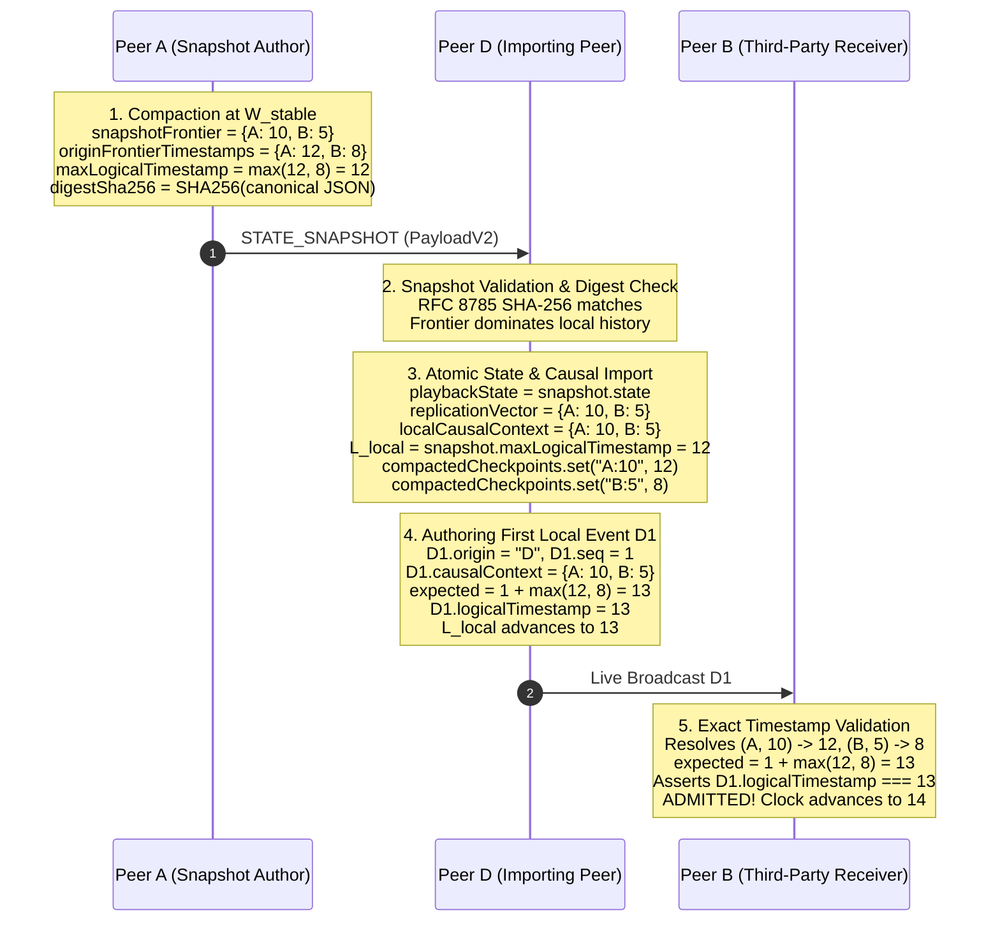

# Phase 7.2-R7 — Snapshot Import and Exact Lamport Causal Consistency

> **Document Version:** 1.0.0  
> **Status:** AUTHORITATIVE ARCHITECTURAL SPECIFICATION (Revision P7.2-R7)  
> **Baseline Commit:** `c420cae`  
> **Preceding Baselines:** `a809612` (P7.2-R2), `c7188fc` (P7.2-R3), `16dfe7a` (P7.2-R4), `990b3f4` (P7.2-R5), `c420cae` (P7.2-R6)  
> **Mode:** Specification & Architecture Only — Strict Stop Condition Observed  
> **Target Subsystems:** `@syncplay/sync-engine`, `@syncplay/protocol`, `@syncplay/control-events`, `@syncplay/peer-mesh`  

---

## 1. Executive Summary & Purpose

Revision P7.2-R6 (`c420cae`) established that every control event must satisfy exact Lamport timestamp equality:
$$L(e) = 1 + \max_{(p, s) \in e.\text{causalContext}} L(p, s)$$
and that `maxLogicalTimestamp` is a global snapshot ceiling that must never be substituted for individual sequence dependencies.

However, an apparent tension remained between:
1. The exact event validation equation, which requires all timestamps to be derived strictly from dependencies declared in `causalContext`; and
2. The snapshot import reseeding rule: $L_{\text{local}} = 1 + \max(L_{\text{local}}, \text{maxLogicalTimestamp})$.

If a peer's local clock were incremented by $+1$ during snapshot import and then incremented by $+1$ again when creating its first local event, the event's timestamp would be $2 + \text{maxLogicalTimestamp}$, failing exact receiver validation ($L \neq 1 + \max L(d)$). Furthermore, if the imported snapshot frontier were not formally incorporated into the peer's causal context, the event's dependencies would not reflect the snapshot state.

This specification (Revision P7.2-R7) resolves this reconciliation by:
1. **Tracing the Complete Snapshot Import Lifecycle:** Establishing that snapshot import transfers a complete causal frontier (`snapshotFrontier`), which initializes the importing peer's causal context.
2. **Reconciling the Reseeding Rule:** Correcting the reseeding equation to $L_{\text{local}} \leftarrow \text{snapshot.maxLogicalTimestamp}$ (without an extra $+1$). The subsequent locally authored event ticks to $1 + L_{\text{local}} = 1 + \text{maxLogicalTimestamp}$, exactly matching the maximum dependency in its causal context.
3. **Defining Frontier Metadata Sufficiency:** Establishing that `originFrontierTimestamps` provides the exact timestamp for each origin's frontier sequence, and proving that $\text{maxLogicalTimestamp} \equiv \max_p \text{originFrontierTimestamps}[p]$.
4. **Providing a Concrete Worked Example:** Tracing two origins ($A_{10} \to 12, B_5 \to 8$) through snapshot creation, import by peer D, event authoring ($D_1 \to 13$), and independent receiver validation.

---

## 2. Comprehensive Correction Register (P7.2-R7)

---

### Correction 1: Complete Snapshot Import Lifecycle & Causal Representation

#### 1. Snapshot as a First-Class Causal Frontier
A state snapshot is not an arbitrary state injection; it is the compressed, deterministic evaluation of all operations in its frontier:
$$\text{snapshotFrontier}: \text{Record}\langle \text{originPeerId}, \text{sequenceNumber} \rangle$$
For every origin $p \in \text{keys}(\text{snapshotFrontier})$, all operations from sequence $1$ up to sequence $s_p = \text{snapshotFrontier}[p]$ have been executed into `playbackState`.

#### 2. Exact Lifecycle Steps

1. **Snapshot Creation & Serialization (Peer A):**
   - Author records `snapshotFrontier: Record<string, number>`.
   - Author records `originFrontierTimestamps: Record<string, number>` where each entry is the exact timestamp of that origin's frontier sequence:
     $$\text{originFrontierTimestamps}[p] = L(p, \text{snapshotFrontier}[p])$$
   - Author records `maxLogicalTimestamp`, which is mathematically defined as:
     $$\text{maxLogicalTimestamp} \equiv \max_{p \in \text{keys}(\text{snapshotFrontier})} \text{originFrontierTimestamps}[p]$$
   - Author includes the last $K=256$ compacted sequence checkpoints in `compactedCheckpoints`.
   - Computes RFC 8785 canonical JSON SHA-256 digest over the bound pre-image.
2. **Snapshot Import (Peer D):**
   - Validates session, format version, epoch, and SHA-256 digest.
   - Verifies frontier dominance ($V_{\text{snap}} \ge V_{\text{local}}$).
   - Installs base state: $v_{\text{local}} = v_{\text{current}} + 1$.
   - **Causal Knowledge Initialization:**
     - Sets local replication vector: $V_{\text{rep}} \leftarrow \text{snapshotFrontier}$.
     - Sets authoring causal context: $\text{localCausalContext} \leftarrow \text{snapshotFrontier}$.
     - Ingests `originFrontierTimestamps` and `compactedCheckpoints` into local checkpoint index:
       $$\forall p \in \text{keys}(\text{snapshotFrontier}), \quad \text{compactedCheckpoints.set}(`${p}:${s_p}`, \text{originFrontierTimestamps}[p])$$
   - **Clock Reseeding (Corrected Invariant):**
     $$L_{\text{local}} \leftarrow \text{snapshot.maxLogicalTimestamp}$$
     *(The local clock is set to the maximum timestamp of the observed history, NOT incremented by $+1$).*
3. **Constructing the Next Locally Authored Event ($D_1$):**
   - Peer D emits sequence $1$ under identity D.
   - $D_1.\text{causalContext}$ is populated from $\text{localCausalContext}$:
     $$D_1.\text{causalContext} = \text{snapshotFrontier}$$
   - Peer D computes its own event timestamp:
     $$L(D_1) = 1 + \max_{(p, s) \in D_1.\text{causalContext}} L(p, s) = 1 + \text{maxLogicalTimestamp}$$
   - Peer D advances its clock to $L(D_1)$ ($13$).
4. **Receiver Validation (Peer B):**
   - Peer B receives $D_1$.
   - B resolves dependencies in $D_1.\text{causalContext}$:
     - $(A, 10) \implies L(A, 10) = 12$ (from B's log or compacted checkpoint).
     - $(B, 5) \implies L(B, 5) = 8$ (from B's log or compacted checkpoint).
   - B computes:
     $$\text{expectedTimestamp}(D_1) = 1 + \max(12, 8) = 13$$
   - B asserts $L(D_1) === 13 \implies \mathbf{PASS}$. Exact equality holds 100%!

---

### Correction 2: Reconciling the Timestamp Reseeding Equation

#### 1. Identification of the Double-Increment Bug
In previous revisions, the reseeding rule was written as:
$$L_{\text{local}} \leftarrow 1 + \max(L_{\text{local}}, \text{maxLogicalTimestamp}) \quad \text{[INCORRECT]}$$
If this rule were applied:
1. $L_{\text{local}}$ would become $1 + 12 = 13$.
2. When Peer D created event $D_1$, the engine would execute $L(D_1) = 1 + L_{\text{local}} = 1 + 13 = 14$.
3. But the maximum dependency timestamp in $D_1.\text{causalContext}$ was $12$.
4. Receiver B would calculate $\text{expectedTimestamp}(D_1) = 1 + 12 = 13$.
5. B would reject $D_1$ with `INVALID_LOGICAL_TIMESTAMP` because $14 \neq 13$!

#### 2. The Corrected Reseeding Rule
The local Lamport clock counter represents the **highest logical timestamp observed and reduced so far**.
When importing a snapshot, the highest logical timestamp observed in that snapshot is $\text{maxLogicalTimestamp}$.
Therefore:
$$\mathbf{L_{\text{local}} \leftarrow \text{snapshot.maxLogicalTimestamp}}$$

- **Derivation Invariant:** Because all operations in `snapshotFrontier` are antecedent to the imported state, $\text{maxLogicalTimestamp}$ is strictly equal to:
  $$\text{snapshot.maxLogicalTimestamp} \equiv \max_{p \in \text{keys}(\text{snapshotFrontier})} \text{snapshot.originFrontierTimestamps}[p]$$
- **Subsequent Event Creation:** When the peer authors a new event $e$:
  $$L(e) = 1 + \max_{(p, s) \in e.\text{causalContext}} L(p, s) \equiv 1 + L_{\text{local}} = 1 + \text{maxLogicalTimestamp}$$
- Zero hidden clock increments. Zero unrepresented causal jumps. 100% mathematical consistency.

---

### Correction 3: Exact Semantics of `originFrontierTimestamps`

#### 1. Exact Field Definition
`originFrontierTimestamps` is an authoritative mapping from each origin peer ID in `snapshotFrontier` to the exact integer Lamport timestamp of that origin's frontier sequence:
$$\text{originFrontierTimestamps}: \text{Record}\langle \text{originPeerId}, \text{logicalTimestamp} \rangle$$
- **Precondition:** For every $p \in \text{keys}(\text{snapshotFrontier})$, there exists exactly one entry $\text{originFrontierTimestamps}[p] \in \mathbb{N}^+$.
- **Relation to Compacted Checkpoints:**
  `originFrontierTimestamps[p]` is the exact checkpoint for $(p, \text{snapshotFrontier}[p])$.
  `compactedCheckpoints` contains checkpoints for sequences preceding the frontier: $(p, s)$ where $s < \text{snapshotFrontier}[p]$.
- **Digest Coverage:** `originFrontierTimestamps` is an immutable element of the RFC 8785 canonical JSON pre-image hashed into `stateDigestSha256`.

#### 2. Receiver Validation Rules on Import
When `RecoveryManager.installSnapshot(payload)` runs:
1. **Key Equivalence:** $\text{keys}(\text{payload.originFrontierTimestamps}) \equiv \text{keys}(\text{payload.snapshotFrontier})$.
2. **Global Maximum Consistency:**
   $$\max_{p \in \text{keys}(\text{payload.snapshotFrontier})} \text{payload.originFrontierTimestamps}[p] \equiv \text{payload.maxLogicalTimestamp}$$
   If `maxLogicalTimestamp` does not exactly equal the maximum value in `originFrontierTimestamps`, the snapshot is rejected with `INVALID_SNAPSHOT_METADATA`.
3. **Safe Integer Bounds:** Every timestamp in `originFrontierTimestamps` is a positive safe integer $< \text{Number.MAX\_SAFE\_INTEGER} - 1$.

---

## 3. Concrete Worked Example

### Scenario Specification
A room consists of active peers A and B. Safe compaction occurs at stable frontier $W_{\text{stable}}$. Peer D joins as a fresh peer, imports the snapshot, and authors its first operation $D_1$. Peer B receives $D_1$.

#### Step 1: Snapshot Frontier & Metadata
- **Origin A:** emitted sequences $1 \dots 10$; sequence $A_{10}$ has Lamport timestamp $12$.
- **Origin B:** emitted sequences $1 \dots 5$; sequence $B_5$ has Lamport timestamp $8$.
- **Compacted Metadata in Snapshot:**
  - `snapshotFrontier`: `{ "A": 10, "B": 5 }`
  - `originFrontierTimestamps`: `{ "A": 12, "B": 8 }`
  - `maxLogicalTimestamp`: $\max(12, 8) = 12$
  - `compactedCheckpoints`: `[{ originPeerId: "A", sequenceNumber: 10, logicalTimestamp: 12 }, { originPeerId: "B", sequenceNumber: 5, logicalTimestamp: 8 }, ...]`
  - `stateDigestSha256`: `SHA256(canonicalJsonPreimage)`

#### Step 2: Peer D Imports Snapshot
- Peer D validates SHA-256 digest $\implies \mathbf{MATCH}$.
- Peer D initializes local state:
  - `replicationVector`: `{ "A": 10, "B": 5 }`
  - `localCausalContext`: `{ "A": 10, "B": 5 }`
  - `compactedCheckpoints`: indexed with `"A:10" -> 12`, `"B:5" -> 8`.
  - Local clock reseeding:
    $$L_{\text{local}} = \text{payload.maxLogicalTimestamp} = 12$$

#### Step 3: Peer D Authors Operation $D_1$
- Operation type: `PLAY`.
- `originPeerId`: `"D"`.
- `originSequenceNumber`: $1$.
- `causalContext`: Copied from `localCausalContext`:
  $$D_1.\text{causalContext} = \{ \text{"A"}: 10, \text{"B"}: 5 \}$$
- Peer D computes exact expected timestamp:
  - Dependency $(A, 10) \implies L = 12$
  - Dependency $(B, 5) \implies L = 8$
  $$\text{expectedTimestamp}(D_1) = 1 + \max(12, 8) = 1 + 12 = 13$$
- Peer D assigns $D_1.\text{logicalTimestamp} = 13$.
- Peer D advances local clock: $L_{\text{local}} = 13$.

#### Step 4: Peer B Validates $D_1$
- Peer B receives wire message $D_1$ from Peer D.
- Peer B extracts $D_1.\text{causalContext} = \{ \text{"A"}: 10, \text{"B"}: 5 \}$.
- Peer B resolves dependency timestamps:
  - Sequence $10$ from origin A $\implies L = 12$ (verified in B's log/checkpoint).
  - Sequence $5$ from origin B $\implies L = 8$ (verified in B's log/checkpoint).
- Peer B calculates:
  $$\text{expectedTimestamp}(D_1) = 1 + \max(12, 8) = 13$$
- Peer B compares claimed against expected:
  $$D_1.\text{logicalTimestamp} === 13 \equiv \text{expectedTimestamp}(D_1) \implies \mathbf{EXACT\ MATCH\ (PASS)}$$
- Peer B admits $D_1$ into `OrderedOperationLog`.
- Peer B advances local Lamport clock: $\max(L_{\text{local}}, 13) + 1$.
- Peer B updates `replicationVector["D"] = 1`.

---

## 4. Simulation Test Requirements (Suite 11 Extension)

`docs/PHASE7_2_SIMULATION_TEST_STRATEGY.md` is updated with formal specification test cases in a dedicated **Suite 11: Snapshot Import & Post-Import Causal Consistency**:

1. **Test 11.1 (First Post-Import Event Exact Equality):** Peer D imports snapshot with frontier $\{A: 10, B: 5\}$ ($L=12, 8$) and authors $D_1$. Assert $D_1.\text{causalContext} \equiv \{A: 10, B: 5\}$ and $D_1.\text{logicalTimestamp} === 13$.
2. **Test 11.2 (Receiver Independent Validation via Snapshot Frontier):** Peer B receives $D_1$, resolves $A_{10} \to 12, B_5 \to 8$, asserts $\text{expected} === 13$, and admits $D_1$.
3. **Test 11.3 (Multi-Origin Distinct Timestamps):** Snapshot has 4 origins with timestamps $\{A: 20, B: 15, C: 45, D: 30\}$. Assert $\text{maxLogicalTimestamp} === 45$. Next event includes all 4 in `causalContext` and has $L = 46$.
4. **Test 11.4 (Global Maximum Non-Substitution):** Verify receiver does not substitute $45$ for $B$'s dependency ($15$). An event depending only on $B_5$ must have $L = 16$, not $46$.
5. **Test 11.5 (Missing Pre-Compaction Checkpoint Recovery):** Event references sequence $s < W_{\text{stable}}[p] - 256$ (older than checkpoint capacity). Assert receiver rejects with `REJECTED_OUTSIDE_HORIZON` and transitions to `DEGRADED_OUT_OF_SYNC`.
6. **Test 11.6 (Chained Post-Import Progression):** Peer D authors $D_1$ ($L=13$), then $D_2$. Assert $D_2.\text{causalContext} \equiv \{A: 10, B: 5, D: 1\}$ and $D_2.\text{logicalTimestamp} === 14$.
7. **Test 11.7 (No Silent Reseeding Advancement):** Assert that snapshot import does not advance $L_{\text{local}}$ to $\text{maxLogicalTimestamp} + 1$, preventing the double-increment defect.
8. **Test 11.8 (Rejection Isolation on Post-Import Violation):** Inject post-import event with $L = 14$ (when expected is $13$). Assert receiver rejects with `INVALID_LOGICAL_TIMESTAMP` and verifies local clocks and vectors do not advance.

---

## 5. Document Traceability & Invariants Verification

| Document | Primary Revisions Applied in P7.2-R7 | Status |
| :--- | :--- | :--- |
| `docs/PHASE7_2_R6_FINAL_CORRECTIONS.md` | Annotated header indicating refinement of reseeding equation and post-import causal representation by R7. | Active reference |
| `docs/PHASE7_2_LLD.md` | Section 1.4 updated with post-import event creation rule; Section 6.1 updated with corrected reseeding rule ($L_{\text{local}} = \text{maxLogicalTimestamp}$) and causal context initialization. | Updated |
| `docs/PHASE7_2_PROTOCOL_EVOLUTION_RFC.md` | Section 3.4 updated: `maxLogicalTimestamp` derivation from `originFrontierTimestamps`, and post-import causal context propagation. | Updated |
| `docs/design/PHASE7_INTERFACE_CONTRACTS.md` | `IRecoveryManager.installSnapshot` and `ILogicalClockManager.reseed` updated with exact reseeding contract without double increment. | Updated |
| `docs/PHASE7_2_SIMULATION_TEST_STRATEGY.md` | Added dedicated Suite 11 covering snapshot import causal consistency and post-import event creation. | Updated |
| `docs/PHASE7_2_FINAL_DESIGN_REVIEW.md` | AD-701, AD-708, and AD-709 updated with exact post-import causal consistency proofs. | Updated |
| `docs/design/README.md` | Index updated to feature `PHASE7_2_R7_FINAL_CORRECTIONS.md`. | Updated |
