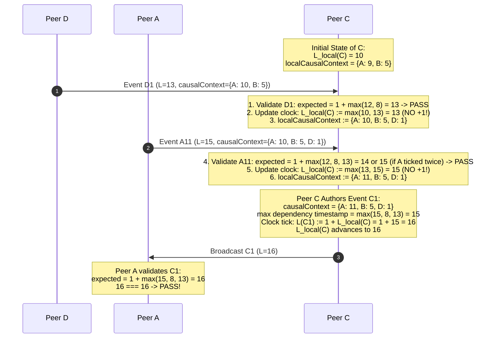

# Phase 7.2-R8 — Receive-Side Lamport Clock Correction and Exact Event Creation Consistency

> **Document Version:** 1.0.0  
> **Status:** AUTHORITATIVE ARCHITECTURAL SPECIFICATION (Revision P7.2-R8)  
> **Baseline Commit:** `80339e6`  
> **Preceding Baselines:** `a809612` (P7.2-R2), `c7188fc` (P7.2-R3), `16dfe7a` (P7.2-R4), `990b3f4` (P7.2-R5), `c420cae` (P7.2-R6), `094541d` / `80339e6` (P7.2-R7)  
> **Mode:** Specification & Architecture Only — Strict Stop Condition Observed  
> **Target Subsystems:** `@syncplay/sync-engine`, `@syncplay/protocol`, `@syncplay/control-events`, `@syncplay/peer-mesh`  

---

## 1. Executive Summary & Problem Resolution

Revision P7.2-R7 (`80339e6`) eliminated the off-by-one double-increment defect in snapshot import by correcting the reseeding equation to:
$$L_{\text{local}} \leftarrow \text{snapshot.maxLogicalTimestamp} \quad \text{(without an extra $+1$)}$$

However, an identical defect persisted on the **receive path**:
When admitting an accepted remote event with timestamp $L_{\text{received}}$, the specification and worked examples previously stated:
$$L_{\text{local}} \leftarrow \max(L_{\text{local}}, L_{\text{received}}) + 1 \quad \text{[INCORRECT]}$$

### The Failure Mode
Under this legacy receive rule:
1. When Peer B accepted event $D_1$ with timestamp $13$, Peer B advanced its clock to $\max(L_{\text{local}}, 13) + 1 = 14$.
2. When Peer B subsequently authored its own event $B_6$, the local event creation rule added $+1$ again:
   $$L(B_6) = 1 + L_{\text{local}} = 1 + 14 = 15$$
3. However, the dependencies represented in $B_6.\text{causalContext}$ ($\{A: 10, B: 5, D: 1\}$) had maximum timestamp $\max(12, 8, 13) = 13$.
4. Receiving peers independently computed the expected timestamp:
   $$\text{expectedTimestamp}(B_6) = 1 + \max_{(p, s) \in B_6.\text{causalContext}} L(p, s) = 1 + 13 = 14$$
5. The receiver compared claimed $15 \neq 14$ and rejected the valid event with `INVALID_LOGICAL_TIMESTAMP`!

### The Core Invariant Established in R8
**Receiving an event does not create a new logical event and therefore does not independently execute a Lamport tick.**
The receiver simply observes an existing event that has already been stamped by its author. Therefore:
$$\mathbf{L_{\text{local}} \leftarrow \max(L_{\text{local}}, L_{\text{received}})} \quad \mathbf{(WITHOUT\ +1)}$$

Only the **creation** of a new local event increments the clock ($+1$). This unifies the entire protocol lifecycle under a single, mathematically closed invariant.

---

## 2. Comprehensive Correction Register (P7.2-R8)

---

### Correction 1: Receive-Side Clock Semantics

#### 1. The Observation vs Creation Invariant
In distributed systems following Lamport (1978), the logical clock of process $i$ advances:
1. **Upon a local event:** $C_i \leftarrow C_i + d \quad (d > 0)$.
2. **Upon receiving a message $(m, C_m)$:** $C_i \leftarrow \max(C_i, C_m)$.

When message receipt is considered an internal event of its own, an increment is applied. In the SyncPlay deterministic event log architecture, however:
- An incoming playback control event $e$ is **not** an internal event created by the receiver.
- The receiver merely ingests $e$ into its `OrderedOperationLog`.
- The timestamp of $e$ ($L(e)$) is an immutable scalar stamped by the author.
- Therefore, the receiver's local clock advances to record the highest timestamp observed in its causal history:
  $$L_{\text{local}} \leftarrow \max(L_{\text{local}}, L(e))$$

#### 2. Rejection Safety Invariant
If an incoming event fails any validation check:
- Causal gap ($s > \text{replicationVector}[p]$) $\implies$ buffered in `PendingDependencyQueue`.
- Sequence collision or regression ($s \le \text{replicationVector}[p]$ with different `eventId`) $\implies$ rejected (`SEQUENCE_COLLISION_DETECTED`).
- Timestamp mismatch ($L(e) \neq \text{expectedTimestamp}(e)$) $\implies$ rejected (`INVALID_LOGICAL_TIMESTAMP`).
- Rate limit violation $\implies$ rejected (`RATE_LIMIT_EXCEEDED`).

In **all rejection cases**, neither $L_{\text{local}}$ nor `replicationVector` advances by even a single increment.

---

### Correction 2: Reconciling Local Event Creation

#### 1. Exact Event Creation Invariant
The local event creation rule remains strict and exact:
$$L(e) = 1 + \max_{(p, s) \in e.\text{causalContext}} L(p, s)$$

#### 2. The Nature of $L_{\text{local}}$
The architecture explicitly defines $L_{\text{local}}$ in `LogicalClockManager` as the **cached maximum timestamp of all accepted causal history**:
$$L_{\text{local}} \equiv \max_{(p, s) \in \text{acceptedHistory}} L(p, s)$$

Because Lamport timestamps are strictly monotonic along causal paths ($L(p, s) > L(p, s-1)$), the maximum timestamp of all accepted history is identically equal to the maximum timestamp of the contiguous causal frontier:
$$\max_{(p, s) \in \text{localCausalContext}} L(p, s) \equiv \max_{(p, s) \in \text{acceptedHistory}} L(p, s) \equiv L_{\text{local}}$$

#### 3. Mathematical Proof of Equivalence
Let $e$ be a new locally authored event:
1. $e.\text{causalContext}$ is populated from `localCausalContext`, representing the author's complete observed history.
2. The maximum timestamp among all dependencies in $e.\text{causalContext}$ is $\max_{(p, s) \in e.\text{causalContext}} L(p, s)$.
3. Because $L_{\text{local}}$ is updated without an extra $+1$ on snapshot import ($L_{\text{local}} = \text{maxLogicalTimestamp}$) and without an extra $+1$ on event receipt ($L_{\text{local}} = \max(L_{\text{local}}, L_{\text{received}})$), $L_{\text{local}}$ is **strictly equal** to $\max_{(p, s) \in e.\text{causalContext}} L(p, s)$.
4. The author computes:
   $$L(e) = 1 + L_{\text{local}} \equiv 1 + \max_{(p, s) \in e.\text{causalContext}} L(p, s)$$
5. The author advances its local clock: $L_{\text{local}} \leftarrow L(e)$.
6. Any receiving peer resolves dependencies $(p, s)$ from its own log and checkpoints, computing:
   $$\text{expectedTimestamp}(e) = 1 + \max_{(p, s) \in e.\text{causalContext}} L(p, s)$$
7. Therefore, claimed timestamp $L(e)$ **identically equals** expected timestamp:
   $$L(e) \equiv \text{expectedTimestamp}(e)$$
8. Exact equality holds unconditionally. Zero hidden clock increments. Zero unrepresented causal jumps.

#### 4. Unified 3-Operation Lifecycle Clock Matrix

| Protocol Operation | Trigger | Clock State Update Formula | Extra $+1$ Added? | Justification |
| :--- | :--- | :--- | :---: | :--- |
| **Snapshot Import** | Reconnect / State Recovery | $L_{\text{local}} \leftarrow \max(L_{\text{local}}, \text{snapshot.maxLogicalTimestamp})$ | **NO** | Ingests existing history; does not create a new event. |
| **Remote Event Receipt** | Wire message admission | $L_{\text{local}} \leftarrow \max(L_{\text{local}}, L_{\text{received}})$ | **NO** | Ingests author's event; does not create a new event. |
| **Local Event Authoring** | User interaction (`PLAY`, `PAUSE`, `SEEK`) | $L(e) = 1 + L_{\text{local}}$; $L_{\text{local}} \leftarrow L(e)$ | **YES ($+1$)** | Creates a new logical event; advances total order key. |

---

## 3. Corrected Worked Walkthroughs

### Scenario 1: Snapshot Import $\to$ Remote Authoring $\to$ Receipt $\to$ Local Authoring $\to$ Independent Validation

This walkthrough traces the exact interaction between Peers A, B, and D:

#### Step 1: Initial Room State & Snapshot Export (Peer A)
- **Active Origins:** Peer A and Peer B.
- **Compacted Frontier:**
  - $A_{10} \implies L(A, 10) = 12$
  - $B_5 \implies L(B, 5) = 8$
- **Exported Snapshot Payload:**
  - `snapshotFrontier`: `{ "A": 10, "B": 5 }`
  - `originFrontierTimestamps`: `{ "A": 12, "B": 8 }`
  - `maxLogicalTimestamp`: $\max(12, 8) = 12$
  - `compactedCheckpoints`: `[{ "A:10": 12 }, { "B:5": 8 }]`

#### Step 2: Peer D Imports Snapshot & Authors $D_1$
- Peer D imports snapshot:
  - Ingests `compactedCheckpoints`: `("A:10" -> 12, "B:5" -> 8)`.
  - Initializes `localCausalContext` $\leftarrow \{ \text{"A"}: 10, \text{"B"}: 5 \}$.
  - Initializes `replicationVector` $\leftarrow \{ \text{"A"}: 10, \text{"B"}: 5 \}$.
  - Reseeds clock: $L_{\text{local}}(D) \leftarrow 12$ (no $+1$).
- Peer D authors event $D_1$ (`PLAY`):
  - Dependencies: $D_1.\text{causalContext} = \{ \text{"A"}: 10, \text{"B"}: 5 \}$.
  - Max dependency timestamp: $\max(12, 8) = 12$.
  - Clock tick: $L(D_1) = 1 + \max(12, 12) = 13$.
  - Stamped: $D_1.\text{originSequenceNumber} = 1$, $D_1.\text{logicalTimestamp} = 13$.
  - D advances clock: $L_{\text{local}}(D) \leftarrow 13$.
  - D updates `localCausalContext` $\leftarrow \{ \text{"A"}: 10, \text{"B"}: 5, \text{"D"}: 1 \}$.
  - D broadcasts $D_1$ to room.

#### Step 3: Peer B Receives and Accepts $D_1$
- Peer B's prior state: authored $B_5$ ($L=8$), previously observed $A_{10}$ ($L=12$).
- Peer B's prior clock: $L_{\text{local}}(B) = 12$.
- Peer B receives $D_1$:
  - Validates dependencies: $(A, 10) \implies 12, (B, 5) \implies 8$.
  - Calculates expected timestamp:
    $$\text{expectedTimestamp}(D_1) = 1 + \max(12, 8) = 13$$
  - Verifies exact match: $D_1.\text{logicalTimestamp} \equiv 13 === 13 \implies \mathbf{PASS}$.
  - B admits $D_1$ into `OrderedOperationLog`.
  - B updates `replicationVector["D"] = 1`.
  - B updates `localCausalContext` $\leftarrow \{ \text{"A"}: 10, \text{"B"}: 5, \text{"D"}: 1 \}$.
- **R8 Receive-Side Clock Update:**
  $$L_{\text{local}}(B) \leftarrow \max(L_{\text{local}}(B), L(D_1)) = \max(12, 13) = \mathbf{13} \quad \mathbf{(WITHOUT\ +1)}$$
  *(Peer B does NOT add $+1$; clock becomes exactly 13).*

#### Step 4: Peer B Authors Next Local Event $B_6$
- Peer B user clicks `PAUSE`:
  - Sequence assignment: $\text{originSequenceNumber} = 6$.
  - Dependencies: $B_6.\text{causalContext} = \{ \text{"A"}: 10, \text{"B"}: 5, \text{"D"}: 1 \}$.
  - Dependency timestamps: $L(A, 10) = 12, L(B, 5) = 8, L(D, 1) = 13$.
  - Max dependency timestamp: $\max(12, 8, 13) = 13$.
  - Clock tick on authoring:
    $$L(B_6) = 1 + L_{\text{local}}(B) = 1 + 13 = \mathbf{14}$$
  - Stamped: $B_6.\text{logicalTimestamp} = 14$.
  - B advances clock: $L_{\text{local}}(B) \leftarrow 14$.
  - B updates `localCausalContext` $\leftarrow \{ \text{"A"}: 10, \text{"B"}: 6, \text{"D"}: 1 \}$.
  - B broadcasts $B_6$ to room.

#### Step 5: Third-Party Peer A (or Peer D) Independently Validates $B_6$
- Peer A receives wire message $B_6$:
  - Extracts $B_6.\text{causalContext} = \{ \text{"A"}: 10, \text{"B"}: 5, \text{"D"}: 1 \}$.
  - Resolves dependency timestamps:
    - Sequence $10$ from origin A $\implies L = 12$ (from log/checkpoint).
    - Sequence $5$ from origin B $\implies L = 8$ (from log/checkpoint).
    - Sequence $1$ from origin D $\implies L = 13$ (from log).
  - Computes exact expected timestamp:
    $$\text{expectedTimestamp}(B_6) = 1 + \max(12, 8, 13) = 1 + 13 = \mathbf{14}$$
  - Verifies exact match:
    $$B_6.\text{logicalTimestamp} \equiv 14 === \text{expectedTimestamp}(B_6) \equiv 14 \implies \mathbf{EXACT\ MATCH\ (PASS)}$$
  - Peer A admits $B_6$, updates `replicationVector["B"] = 6`, and updates clock:
    $$L_{\text{local}}(A) \leftarrow \max(L_{\text{local}}(A), 14) \quad \text{(without }+1\text{)}$$

---

### Scenario 2: Multiple Remote Event Receipts Before Local Authoring

This walkthrough traces what happens when a peer receives multiple remote events before authoring its next event:

#### Step-by-Step Analysis
1. **Initial State of Peer C:** $L_{\text{local}}(C) = 10$.
2. **First Event Arrives ($D_1$, $L=13$):**
   - Receiver C validates $D_1$: expected $1 + \max(12, 8) = 13$. Valid!
   - Receiver C updates clock:
     $$L_{\text{local}}(C) \leftarrow \max(10, 13) = 13 \quad \mathbf{(no\ +1)}$$
   - C's causal context becomes: $\{A: 10, B: 5, D: 1\}$.
3. **Second Event Arrives ($A_{11}$, $L=15$):**
   - Receiver C validates $A_{11}$ ($L=15$, whose dependencies had max timestamp 14). Valid!
   - Receiver C updates clock:
     $$L_{\text{local}}(C) \leftarrow \max(13, 15) = 15 \quad \mathbf{(no\ +1)}$$
   - C's causal context becomes: $\{A: 11, B: 5, D: 1\}$.
4. **Peer C Authors Local Event $C_1$:**
   - $C_1.\text{causalContext} = \{A: 11, B: 5, D: 1\}$.
   - Dependency timestamps: $L(A, 11) = 15, L(B, 5) = 8, L(D, 1) = 13$.
   - Maximum dependency timestamp: $\max(15, 8, 13) = 15$.
   - Clock tick on authoring:
     $$L(C_1) = 1 + L_{\text{local}}(C) = 1 + 15 = \mathbf{16}$$
   - Peer C stamps $C_1.\text{logicalTimestamp} = 16$ and advances clock to $16$.
5. **Receiver Independent Validation:**
   - Any receiving peer independently computes:
     $$\text{expectedTimestamp}(C_1) = 1 + \max(15, 8, 13) = 1 + 15 = 16 === 16 \implies \mathbf{EXACT\ MATCH\ (PASS)}$$

#### Contrasting Analysis: Why the Legacy $+1$ Rule Failed
If Peer C had applied the legacy `+ 1` rule on message receipt:
1. Upon receiving $D_1$: $L_{\text{local}} \leftarrow \max(10, 13) + 1 = 14$.
2. Upon receiving $A_{11}$: $L_{\text{local}} \leftarrow \max(14, 15) + 1 = 16$.
3. Upon authoring $C_1$: $L(C_1) = 1 + 16 = 17$!
4. But the causal frontier declared by $C_1$ has maximum timestamp $15$.
5. All other room peers calculate expected timestamp $1 + 15 = 16$.
6. Every peer in the room rejects $C_1$ because $17 \neq 16$!
7. This failure demonstrates why the receive-side $+1$ rule was fatal to distributed consensus and proves the necessity of the R8 correction.

---

## 4. Simulation Test Strategy (Suite 12 Extension)

The deterministic simulation test suite in `docs/PHASE7_2_SIMULATION_TEST_STRATEGY.md` is updated with a dedicated **Suite 12: Receive-Side Clock Semantics & Multi-Event Causal Authoring**, defining 7 explicit scenarios:

1. **Test 12.1 (Receive Operation Does Not Increment Clock):** Peer B with local clock $L=10$ receives and admits remote event $D_1$ with $L=13$. Assert that Peer B's local clock advances to exactly $13$ (not $14$).
2. **Test 12.2 (Single Remote Receipt Followed by Local Authoring):** Following Test 12.1, Peer B authors local event $B_1$ with causal context including $D_1$. Assert that $B_1$ is stamped with $L=14$ ($1 + 13$).
3. **Test 12.3 (Independent Receiver Validation of Post-Receive Event):** Peer A receives $B_1$ from Test 12.2, independently calculates expected timestamp $1 + \max(12, 8, 13) = 14$, asserts exact match $14 === 14$, and admits $B_1$.
4. **Test 12.4 (Multiple Remote Receipts Before Local Authoring):** Peer C receives $D_1$ ($L=13$) and then $A_{11}$ ($L=15$) before authoring $C_1$. Assert that C's clock updates to $\max(13, 15) = 15$ without intermediate increments, and that $C_1$ is stamped with exactly $L=16$ ($1 + 15$). Receiver independently validates and accepts $C_1$.
5. **Test 12.5 (No Silent Clock Inflation Beyond Causal Frontier):** Assert that a peer whose internal clock is artificially inflated beyond its declared causal frontier is prevented from authoring an event with an unrepresented timestamp. Verify that receiver asserts exact equality with the maximum declared dependency.
6. **Test 12.6 (Rejected Events Never Mutate Clock or Replication Vector):** Inject an invalid remote event (e.g., $L(e) = \text{expected} + 1$). Assert that upon rejection (`INVALID_LOGICAL_TIMESTAMP`), the receiver's local Lamport clock and replication vector remain 100% unchanged.
7. **Test 12.7 (Unified Lifecycle Consistency):** Verify that across snapshot import ($L = M$), remote event receipt ($L = \max(L, L_r)$), and local event authoring ($L = 1 + L$), all peers deterministically reach identical logical clocks and converge to identical playback state.

---

## 5. Formal Document Traceability Matrix

| Document Path | Primary Revisions Applied in P7.2-R8 | Status |
| :--- | :--- | :---: |
| `docs/PHASE7_2_R8_FINAL_CORRECTIONS.md` | Master authoritative register for R8: receive-side non-increment rule, mathematical proofs, 2 concrete worked walkthroughs, and Suite 12 specification. | **Created** |
| `docs/PHASE7_2_R7_FINAL_CORRECTIONS.md` | Annotated header indicating receive-side clock correction in R8; corrected Step 4 of the worked example to remove `+ 1`. | **Updated** |
| `docs/PHASE7_2_LLD.md` | Updated `LogicalClockManager.updateRemote` code to remove `+ 1`; updated Section 1.4 reconciling event creation and cached clock semantics. | **Updated** |
| `docs/PHASE7_2_PROTOCOL_EVOLUTION_RFC.md` | Section 3.4 updated with receive-side clock non-increment invariant ($L_{\text{local}} = \max(L_{\text{local}}, L_{\text{received}})$). | **Updated** |
| `docs/design/PHASE7_INTERFACE_CONTRACTS.md` | `ILogicalClockManager.validateAndAdvanceRemote` updated: `Advances: L = max(L_local, remoteClock) (without +1)`. | **Updated** |
| `docs/PHASE7_2_SIMULATION_TEST_STRATEGY.md` | Suite 10 Case 1 updated; added dedicated **Suite 12: Receive-Side Clock Semantics & Multi-Event Causal Authoring** (7 scenarios). | **Updated** |
| `docs/PHASE7_2_HLD.md` | Section 4.1 updated: `LogicalClockManager` advances clock on receive ($\max(L_l, L_r)$ without $+1$). | **Updated** |
| `docs/PHASE7_2_FINAL_DESIGN_REVIEW.md` | Updated AD-701 with R8 receive-side non-increment proofs. | **Updated** |
| `docs/design/README.md` | Featured `PHASE7_2_R8_FINAL_CORRECTIONS.md` in the design index. | **Updated** |

