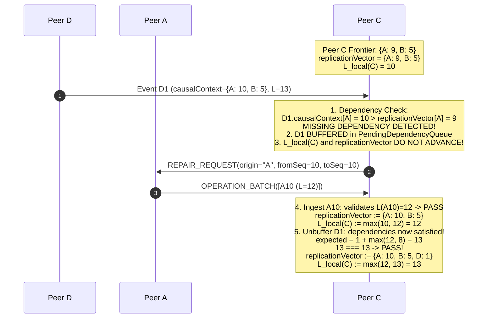

# Phase 7.2-R9 — Multi-Event Lamport Validation and Causal Frontier Correction

> **Document Version:** 1.0.0  
> **Status:** AUTHORITATIVE ARCHITECTURAL SPECIFICATION (Revision P7.2-R9)  
> **Baseline Commit:** `8d6f675`  
> **Preceding Baselines:** `a809612` (P7.2-R2), `c7188fc` (P7.2-R3), `16dfe7a` (P7.2-R4), `990b3f4` (P7.2-R5), `c420cae` (P7.2-R6), `094541d` / `80339e6` (P7.2-R7), `8d6f675` (P7.2-R8)  
> **Mode:** Specification & Architecture Only — Strict Stop Condition Observed  
> **Target Subsystems:** `@syncplay/sync-engine`, `@syncplay/protocol`, `@syncplay/control-events`, `@syncplay/peer-mesh`  

---

## 1. Executive Summary & Defect Resolutions

Revision P7.2-R8 (`8d6f675`) successfully corrected receive-side clock semantics to $L_{\text{local}} \leftarrow \max(L_{\text{local}}, L_{\text{received}})$ without an extra $+1$.

However, architectural review identified two correctness defects in the multi-event progression example:

### Defect 1: Arithmetic Inconsistency in $A_{11}$ and $C_1$ Timestamps
In P7.2-R8 Walkthrough 2, operation $A_{11}$ had dependencies:
- $L(A, 10) = 12$
- $L(B, 5) = 8$
- $L(D, 1) = 13$

The exact event creation rule dictates:
$$\text{expectedTimestamp}(A_{11}) = 1 + \max(12, 8, 13) = \mathbf{14}$$

The R8 walkthrough erroneously claimed that $A_{11}$ carried timestamp $15$ (or "14 or 15"). Under exact Lamport validation, timestamp $15$ violates exact equality and **must be rejected** with `INVALID_LOGICAL_TIMESTAMP`.
Consequently, when Peer C authors subsequent event $C_1$, its dependencies are $\{ A_{11} \to 14, B_5 \to 8, D_1 \to 13 \}$, yielding:
$$L(C_1) = 1 + \max(14, 8, 13) = \mathbf{15}$$
(not $16$).

### Defect 2: Missing Causal Dependency at Peer C
In P7.2-R8 Walkthrough 2, Peer C was initialized with:
$$\text{localCausalContext} = \{ A: 9, B: 5 \}$$
However, incoming event $D_1$ declared dependencies:
$$D_1.\text{causalContext} = \{ A: 10, B: 5 \}$$
Because $D_1.\text{causalContext}[A] = 10 > \text{replicationVector}[A] = 9$, Peer C did not possess sequence $A_{10}$. Under the SyncPlay protocol, Peer C **cannot admit $D_1$ immediately**. Peer C must buffer $D_1$ in `PendingDependencyQueue` and emit `REPAIR_REQUEST` for $A_{10}$.

This revision (P7.2-R9) corrects the multi-event walkthrough with a fully consistent initial state ($\{ A: 10, B: 5 \}$), formalizes component-wise causal frontier merging, defines the boundary between author causal context and receiver concurrent observations, and provides an explicit negative test verifying missing-dependency buffering.

---

## 2. Comprehensive Correction Register (P7.2-R9)

---

### Correction 1: Component-Wise Causal Frontier Merging

#### 1. The Merge Invariant
When an engine admits an accepted operation $e$, it updates its local causal frontier by **component-wise merging** the accepted event's origin sequence into its existing frontier:
$$\text{localCausalContext}[p] \leftarrow \begin{cases}
e.\text{originSequenceNumber} & \text{if } p = e.\text{originPeerId} \\
\text{localCausalContext}[p] & \text{for all } p \neq e.\text{originPeerId}
\end{cases}$$
$$\text{replicationVector}[p] \leftarrow e.\text{originSequenceNumber} \quad \text{for } p = e.\text{originPeerId}$$

#### 2. Preservation of Unrelated Origin Dependencies
Admitting an event from origin $D$ strictly updates entry $D$. It **never overwrites, zeroes, or discards** entries for origins $A$, $B$, or other active peers.
For example, if Peer C's frontier is $\{ A: 10, B: 5 \}$ and C admits $D_1$, C's frontier becomes:
$$\{ A: 10, B: 5, D: 1 \}$$
When C subsequently admits $A_{11}$, C's frontier becomes:
$$\{ A: 11, B: 5, D: 1 \}$$
Entries for origins $B$ and $D$ remain completely intact.

---

### Correction 2: Three-Way Causal Separation & Receiver Observation Isolation

To ensure mathematical precision, the protocol strictly delineates three distinct causal concepts:

```text
┌────────────────────────────────────────────────────────────────────────┐
│ 1. Event Immutable Causal Context (e.causalContext)                    │
│    - Author-supplied dependency frontier stamped into wire message.   │
│    - Immutable; never mutated by receivers.                            │
│    - Represents author's complete observed history at creation time.   │
└───────────────────────────────────┬────────────────────────────────────┘
                                    │ Evaluated against
                                    ▼
┌────────────────────────────────────────────────────────────────────────┐
│ 2. Receiver Local Causal Frontier (localCausalContext)                 │
│    - Cumulative, component-wise merged frontier of accepted events.    │
│    - Populated by snapshot import and successively admitted events.    │
└───────────────────────────────────┬────────────────────────────────────┘
                                    │ Tracks maximum timestamp of
                                    ▼
┌────────────────────────────────────────────────────────────────────────┐
│ 3. Receiver Observed Logical Clock (L_local)                           │
│    - Scalar integer counter in LogicalClockManager.                    │
│    - L_local = max_{(p, s) in acceptedHistory} L(p, s).                │
│    - Updated to max(L_local, L_received) without +1 on receipt.        │
└────────────────────────────────────────────────────────────────────────┘
```

#### The Isolation Invariant (No Receiver Substitution)
A receiver may possess concurrent events from other origins (e.g., origin $E$) that were not observed by the author of an incoming event $e$.
**Receiver-only concurrent observations must NEVER be substituted into the incoming event's timestamp validation.**
The receiver validates $e$ **strictly and exclusively** against the dependencies declared in $e.\text{causalContext}$:
$$\text{expectedTimestamp}(e) = \begin{cases}
1 & \text{if } e.\text{causalContext} \text{ is empty (Genesis)} \\
1 + \max_{(p, s) \in e.\text{causalContext}} L(p, s) & \text{otherwise}
\end{cases}$$

The receiver's higher local clock $L_{\text{local}}$ is ignored during validation of $e$; only the timestamps of the dependencies declared in $e.\text{causalContext}$ determine $\text{expectedTimestamp}(e)$.

---

### Correction 3: Missing-Dependency Buffering & Repair Handshake

If an incoming event $e$ references a dependency sequence beyond the receiver's contiguous replication vector:
$$\exists p \in \text{keys}(e.\text{causalContext}) : e.\text{causalContext}[p] > \text{replicationVector}[p]$$

1. **Immediate Buffering:** The event is placed into `PendingDependencyQueue`.
2. **Clock and Frontier Isolation:** The receiver's `LogicalClockManager` and `replicationVector` **do NOT advance**. No state transition occurs.
3. **Targeted Repair Request:** The receiver emits `REPAIR_REQUEST` for missing sequences:
   $$\text{missingRange} = [ \text{replicationVector}[p] + 1 \dots e.\text{causalContext}[p] ]$$
4. **Post-Repair Re-Evaluation:** When missing dependencies arrive, pass validation, and are admitted into `OrderedOperationLog`, the receiver unbuffers $e$ and executes exact timestamp validation.

---

## 3. Corrected Worked Walkthroughs

### Walkthrough 2A: Corrected Multi-Event Progression (Consistent Initial State)

This walkthrough traces Peer C receiving multiple remote events before authoring its own event, demonstrating exact Lamport validation and component-wise frontier merging:

```mermaid
sequenceDiagram
    autonumber
    participant D as Peer D
    participant A as Peer A
    participant C as Peer C

    Note over C: Initial State of Peer C:<br/>replicationVector = {A: 10, B: 5}<br/>localCausalContext = {A: 10, B: 5}<br/>L(A10) = 12, L(B5) = 8<br/>L_local(C) = 12

    Note over D: Peer D Authors D1:<br/>causalContext = {A: 10, B: 5}<br/>expected = 1 + max(12, 8) = 13<br/>L(D1) = 13
    D->>C: Event D1 (L=13, causalContext={A: 10, B: 5})

    Note over C: 1. Validate D1: expected = 1 + max(12, 8) = 13 -> EXACT MATCH (PASS)<br/>2. Update clock: L_local(C) := max(12, 13) = 13 (NO +1!)<br/>3. Component-wise merge: localCausalContext := {A: 10, B: 5, D: 1}

    Note over A: Peer A Authors A11 after observing D1:<br/>causalContext = {A: 10, B: 5, D: 1}<br/>expected = 1 + max(12, 8, 13) = 14<br/>L(A11) = 14 (STRICTLY 14; NOT 15!)
    A->>C: Event A11 (L=14, causalContext={A: 10, B: 5, D: 1})

    Note over C: 4. Validate A11: expected = 1 + max(12, 8, 13) = 14 -> EXACT MATCH (PASS)<br/>5. Update clock: L_local(C) := max(13, 14) = 14 (NO +1!)<br/>6. Component-wise merge: localCausalContext := {A: 11, B: 5, D: 1}

    Note over C: Peer C Authors Event C1:<br/>causalContext = {A: 11, B: 5, D: 1}<br/>max dependency = max(14, 8, 13) = 14<br/>Clock tick: L(C1) := 1 + L_local(C) = 1 + 14 = 15<br/>L_local(C) advances to 15
    C->>A: Broadcast C1 (L=15)

    Note over A: Peer A validates C1:<br/>expected = 1 + max(14, 8, 13) = 15<br/>15 === 15 -> PASS!
```

#### Step-by-Step Execution Trace

1. **Consistent Initial State (Peer C):**
   - Active room peers: A, B, C, D.
   - Contiguous history possessed by C: $A_1 \dots A_{10}$ and $B_1 \dots B_5$.
   - Frontier timestamps: $L(A, 10) = 12$, $L(B, 5) = 8$.
   - C's state: $\text{localCausalContext} = \{ A: 10, B: 5 \}$, $\text{replicationVector} = \{ A: 10, B: 5 \}$.
   - C's logical clock: $L_{\text{local}}(C) = 12$.

2. **First Event Arrives ($D_1$ from Peer D):**
   - Event: $D_1$, $\text{originPeerId} = \text{"D"}$, $\text{originSequenceNumber} = 1$.
   - $D_1.\text{causalContext} = \{ A: 10, B: 5 \}$, $D_1.\text{logicalTimestamp} = 13$.
   - **Validation at Peer C:**
     - Dependency check: $D_1.\text{causalContext}[A] = 10 \le \text{replicationVector}[A] = 10$ and $D_1.\text{causalContext}[B] = 5 \le \text{replicationVector}[B] = 5$. All dependencies present!
     - Expected timestamp calculation:
       $$\text{expectedTimestamp}(D_1) = 1 + \max(L(A, 10), L(B, 5)) = 1 + \max(12, 8) = \mathbf{13}$$
     - Exact match verification: $D_1.\text{logicalTimestamp} \equiv 13 === 13 \implies \mathbf{PASS}$.
   - **Admission at Peer C:**
     - $D_1$ inserted into `OrderedOperationLog`.
     - Clock updated: $L_{\text{local}}(C) \leftarrow \max(12, 13) = \mathbf{13}$ (WITHOUT $+1$).
     - Component-wise merge: $\text{localCausalContext} \leftarrow \{ A: 10, B: 5, D: 1 \}$.
     - Replication vector: $\text{replicationVector} \leftarrow \{ A: 10, B: 5, D: 1 \}$.

3. **Second Event Arrives ($A_{11}$ from Peer A):**
   - Peer A authored $A_{11}$ after observing $D_1$.
   - $A_{11}.\text{causalContext} = \{ A: 10, B: 5, D: 1 \}$.
   - **Exact Timestamp Assignment by Peer A:**
     $$L(A_{11}) = 1 + \max(L(A, 10), L(B, 5), L(D, 1)) = 1 + \max(12, 8, 13) = 1 + 13 = \mathbf{14}$$
     *(Note: $A_{11}$ carries timestamp 14. Timestamp 15 is mathematically illegal and rejected).*
   - **Validation at Peer C:**
     - Dependency check: $(A, 10), (B, 5), (D, 1)$ all satisfied by C's replication vector $\{ A: 10, B: 5, D: 1 \}$.
     - Expected timestamp calculation:
       $$\text{expectedTimestamp}(A_{11}) = 1 + \max(12, 8, 13) = \mathbf{14}$$
     - Exact match verification: $A_{11}.\text{logicalTimestamp} \equiv 14 === 14 \implies \mathbf{PASS}$.
   - **Admission at Peer C:**
     - $A_{11}$ inserted into `OrderedOperationLog`.
     - Clock updated: $L_{\text{local}}(C) \leftarrow \max(13, 14) = \mathbf{14}$ (WITHOUT $+1$).
     - Component-wise merge: advances origin $A$ from $10 \to 11$, preserving $B: 5$ and $D: 1$:
       $$\text{localCausalContext} \leftarrow \{ A: 11, B: 5, D: 1 \}$$
       $$\text{replicationVector} \leftarrow \{ A: 11, B: 5, D: 1 \}$$

4. **Peer C Authors Local Event $C_1$:**
   - Author: Peer C, sequence: $1$.
   - $C_1.\text{causalContext}$ copied from `localCausalContext`: $\{ A: 11, B: 5, D: 1 \}$.
   - Dependency timestamps: $L(A, 11) = 14, L(B, 5) = 8, L(D, 1) = 13$.
   - Maximum dependency timestamp: $\max(14, 8, 13) = 14$.
   - **Exact Clock Tick on Authoring:**
     $$L(C_1) = 1 + L_{\text{local}}(C) = 1 + 14 = \mathbf{15}$$
   - Peer C stamps $C_1.\text{logicalTimestamp} = 15$ and advances clock: $L_{\text{local}}(C) \leftarrow 15$.
   - C updates frontier: $\text{localCausalContext} \leftarrow \{ A: 11, B: 5, C: 1, D: 1 \}$.

5. **Receiver Independent Validation by Peer A (or any room peer):**
   - Receiver inspects $C_1.\text{causalContext} = \{ A: 11, B: 5, D: 1 \}$.
   - Resolves dependencies: $L(A, 11) = 14, L(B, 5) = 8, L(D, 1) = 13$.
   - Computes expected timestamp:
     $$\text{expectedTimestamp}(C_1) = 1 + \max(14, 8, 13) = 1 + 14 = \mathbf{15}$$
   - Compares: $C_1.\text{logicalTimestamp} \equiv 15 === 15 \implies \mathbf{EXACT\ MATCH\ (PASS)}$.

---

### Walkthrough 2B: Negative Test — Missing Causal Dependency Handling

This walkthrough demonstrates the protocol behavior when Peer C has frontier $\{ A: 9, B: 5 \}$ and receives $D_1$ requiring $A_{10}$:



1. **State:** Peer C has $\text{replicationVector} = \{ A: 9, B: 5 \}$.
2. **Event $D_1$ Arrives:** $D_1.\text{causalContext} = \{ A: 10, B: 5 \}$.
3. **Dependency Check:** $10 > 9 \implies$ missing dependency on origin $A$.
4. **Buffering Action:** $D_1$ is **not admitted**. It is placed in `PendingDependencyQueue`.
   - $L_{\text{local}}(C)$ remains $10$.
   - $\text{replicationVector}$ remains $\{ A: 9, B: 5 \}$.
5. **Repair Handshake:** Peer C sends `REPAIR_REQUEST` for $A_{10}$.
6. **Repair Ingestion:** Peer A responds with `OPERATION_BATCH` containing $A_{10}$ ($L=12$).
   - Peer C validates $A_{10}$ ($12 === 12$).
   - C admits $A_{10}$: $\text{replicationVector}[A] \leftarrow 10$, $L_{\text{local}}(C) \leftarrow \max(10, 12) = 12$.
7. **Unbuffering & Admission:**
   - Peer C re-evaluates buffered event $D_1$.
   - All dependencies $(\{ A: 10, B: 5 \})$ are now present in $\text{replicationVector}$.
   - Expected timestamp: $1 + \max(12, 8) = 13 === 13 \implies \mathbf{PASS}$.
   - Peer C admits $D_1$, updates clock to $13$, and advances replication vector to $\{ A: 10, B: 5, D: 1 \}$.

---

## 4. Formal Simulation Test Strategy (Suite 13 Extension)

The deterministic simulation test strategy in `docs/PHASE7_2_SIMULATION_TEST_STRATEGY.md` is updated with **Suite 13: Multi-Event Causal Progression & Frontier Merging**, defining 9 explicit test cases:

1. **Test 13.1 ($A_{11}$ Timestamp 14 Accepted):** Author emits $A_{11}$ with causal context $\{ A: 10, B: 5, D: 1 \}$ ($L=12, 8, 13$) and timestamp $14$. Assert receiver calculates expected timestamp $1 + \max(12, 8, 13) = 14$, asserts exact match $14 === 14$, and admits $A_{11}$.
2. **Test 13.2 ($A_{11}$ Timestamp 15 Rejected):** Author emits $A_{11}$ with causal context $\{ A: 10, B: 5, D: 1 \}$ but artificially stamps $L=15$. Assert receiver rejects with `INVALID_LOGICAL_TIMESTAMP`. Verify local clock and replication vector do not advance.
3. **Test 13.3 ($C_1$ Authored Post-$A_{11}$ Stamped with 15):** Peer C admits $D_1$ ($L=13$) and $A_{11}$ ($L=14$). Peer C authors local event $C_1$. Assert $C_1$ is stamped with $L=15$ ($1 + \max(14, 8, 13)$) and local clock advances to $15$.
4. **Test 13.4 (Independent Validation of $C_1$):** Third-party peer receives $C_1$ ($L=15$), independently calculates expected timestamp $1 + \max(14, 8, 13) = 15$, asserts exact match $15 === 15$, and admits $C_1$.
5. **Test 13.5 (Buffering on Missing Causal Dependency):** Peer C with frontier $\{ A: 9, B: 5 \}$ receives $D_1$ requiring $A_{10}$. Assert $D_1$ is placed in `PendingDependencyQueue`, and receiver's clock and replication vector do NOT advance.
6. **Test 13.6 (Admission After Causal Repair):** Following Test 13.5, Peer C receives repair batch containing $A_{10}$ ($L=12$). Assert C admits $A_{10}$, unbuffers $D_1$, validates exact expected timestamp $13$, and admits $D_1$.
7. **Test 13.7 (Component-Wise Causal Frontier Merge):** Peer C with frontier $\{ A: 10, B: 5 \}$ admits $D_1$. Assert C's frontier updates to $\{ A: 10, B: 5, D: 1 \}$, strictly preserving unrelated origin $B$'s entry.
8. **Test 13.8 (Receiver-Only Concurrent Observations Isolated):** Peer C observes concurrent event $E_1$ ($L=20$) from origin $E$ not present in incoming event $X_1$'s `causalContext`. Assert receiver calculates expected timestamp for $X_1$ strictly from $X_1.\text{causalContext}$ dependencies, ignoring $E_1$ and $L_{\text{local}} = 20$.
9. **Test 13.9 (Invalid/Pending Events Never Advance State):** Assert that in all failure and buffering cases (Tests 13.2, 13.5), the receiver's local clock ($L_{\text{local}}$) and replication vector remain completely untouched.

---

## 5. Formal Document Traceability Matrix

| Document Path | Primary Revisions Applied in P7.2-R9 | Status |
| :--- | :--- | :---: |
| `docs/PHASE7_2_R9_FINAL_CORRECTIONS.md` | Master authoritative register for R9: $A_{11} \to 14, C_1 \to 15$ correction, component-wise frontier merge, receiver-only isolation, negative buffering walkthrough, Suite 13 specification. | **Created** |
| `docs/PHASE7_2_R8_FINAL_CORRECTIONS.md` | Annotated header indicating R9 corrections; corrected Walkthrough 2 ($A_{11} \to 14, C_1 \to 15, \{A: 10, B: 5\}$ initial state) and Suite 12 Case 4. | **Updated** |
| `docs/PHASE7_2_LLD.md` | Section 1.4 updated: component-wise causal frontier merge rules, receiver-only observation isolation invariant, and missing dependency buffering contract. | **Updated** |
| `docs/PHASE7_2_PROTOCOL_EVOLUTION_RFC.md` | Section 3.4 updated: component-wise merge rule and receiver-only concurrent observation isolation. | **Updated** |
| `docs/design/PHASE7_INTERFACE_CONTRACTS.md` | `ILogicalClockManager` and `IOrderedOperationLog` contracts updated with component-wise merge and dependency buffering invariants. | **Updated** |
| `docs/PHASE7_2_SIMULATION_TEST_STRATEGY.md` | Corrected Suite 12 Case 4 ($A_{11} \to 14, C_1 \to 15$); added dedicated **Suite 13: Multi-Event Causal Progression & Frontier Merging** (9 scenarios). | **Updated** |
| `docs/PHASE7_2_FINAL_DESIGN_REVIEW.md` | Updated AD-701, AD-702, and AD-706 with R9 multi-event exact validation and causal buffering proofs. | **Updated** |
| `docs/design/README.md` | Featured `PHASE7_2_R9_FINAL_CORRECTIONS.md` in the design index. | **Updated** |
