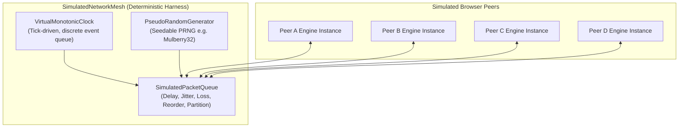

# Phase 7.2 — Deterministic Simulation Test Strategy & Harness Specification

> **Document Version:** 1.0.0  
> **Status:** SPECIFICATION ONLY — NO IMPLEMENTATION AUTHORIZED  
> **Parent Milestone:** Phase 7.2 (Architecture & Interface Design)  
> **Baseline Commit:** `926c575`  
> **Target Subsystem:** Test infrastructure for `@syncplay/sync-engine` (P7.3+)  

---

## 1. Overview & Verification Philosophy

Testing distributed systems exclusively in real browsers is slow, flaky, and unable to reliably reproduce rare race conditions (e.g., a packet arriving exactly $1\text{ ms}$ before another). 

To ensure mathematical correctness before browser deployment, Phase 7 introduces a **Headless Deterministic Simulation Test Harness** (`SimulatedNetworkMesh`). The harness executes entirely in Node.js (Vitest), runs without real WebRTC sockets, uses a discrete virtual clock, and enables reproducible adversarial permutation testing via seeded pseudo-random number generation.

---

## 2. Simulation Harness Architecture



### 2.1. Discrete Virtual Clock
- Replaces `performance.now()` with an injectable virtual clock `VirtualClock`.
- Time advances only when the simulator ticks or pops the next scheduled event from the priority queue:
  $$T_{\text{next}} = \min_{e \in \text{Queue}} (e.\text{deliveryTime})$$
- Zero reliance on Node.js `setTimeout` or OS system timers; runs thousands of virtual seconds in hundreds of milliseconds.

### 2.2. Seeded Pseudo-Random Number Generator (PRNG)
- Uses a deterministic 32-bit generator (e.g., Mulberry32):
  ```ts
  class SeededPRNG {
    constructor(private seed: number) {}
    next(): number {
      let t = (this.seed += 0x6d2b79f5);
      t = Math.imul(t ^ (t >>> 15), t | 1);
      t ^= t + Math.imul(t ^ (t >>> 7), t | 61);
      return ((t ^ (t >>> 14)) >>> 0) / 4294967296;
    }
  }
  ```
- Every randomized test run prints its `TEST_SEED`. If a randomized run discovers a convergence failure, the exact failure can be reproduced deterministically by supplying `SEED=<number>`.

---

## 3. Simulated Network Impairment Capabilities

The `SimulatedNetworkMesh` routes packets between simulated peer engines with configurable impairment knobs:

```ts
interface NetworkImpairmentConfig {
  /** Minimum network one-way latency in virtual ms (e.g., 20 ms). */
  minLatencyMs: number;
  /** Maximum network one-way latency in virtual ms (e.g., 150 ms). */
  maxLatencyMs: number;
  /** Probability of packet drop [0.0, 1.0] (e.g., 0.15 = 15% loss). */
  dropRate: number;
  /** Probability of duplicating a packet [0.0, 1.0] (e.g., 0.05 = 5%). */
  duplicateRate: number;
  /** Probability of out-of-order reordering [0.0, 1.0]. */
  reorderRate: number;
  /** Active partition topology (pairs forbidden from communicating). */
  partitions: Array<[PeerId, PeerId]>;
}
```

### Supported Failure Injections:
1. **Asymmetric Network Delays:** Packet from A to B takes $20\text{ ms}$, but packet from C to B takes $180\text{ ms}$.
2. **Packet Loss with Anti-Entropy Recovery:** 20% of broadcast control events are dropped; tests verify that `ReplicationController` detects the missing sequences via `STATE_DIGEST` and repairs them via `REPAIR_REQUEST`.
3. **Network Partitions & Healing:** Partition $\{A, B\}$ from $\{C, D\}$. Drive concurrent playback controls in both islands. Heal the partition after 10 virtual seconds. Verify that both islands converge to the identical state.
4. **Peer Crash & Restart (Churn):** Simulate tab close by destroying Peer C's engine. Advance the room by 50 operations. Recreate Peer C with Generation 2. Verify state catch-up via snapshot handshake.

---

## 4. Test Suite Scenarios & Assertions

### Suite 1: Randomized Permutation Testing ($N = 3, 4$ Peers)
- **Execution:** Generate $M = 20$ concurrent playback operations (`PLAY`, `PAUSE`, `SEEK`, `RATE_CHANGE`) across 3 peers simultaneously.
- **Permutation:** Deliver the messages to the 3 peers in 100 randomized arrival orders.
- **Assertion:** Once all queues are empty, all 3 peers must hold:
  1. `stateA.status === stateB.status === stateC.status`
  2. `stateA.anchorPositionMs === stateB.anchorPositionMs === stateC.anchorPositionMs`
  3. `stateA.playbackRate === stateB.playbackRate === stateC.playbackRate`
  4. `stateA.stateVersion === stateB.stateVersion === stateC.stateVersion`
  - **Pass Threshold:** 100 / 100 runs pass with 0 divergence.

### Suite 2: Bounded History Compaction Stress Test
- **Execution:** Run a simulated session emitting 1,000 sequential operations.
- **Constraint:** Operation log limit is $K = 256$.
- **Assertion:**
  1. Engine memory never exceeds 256 stored operations.
  2. `OrderedOperationLog.size <= 256` throughout the entire 1,000-operation run.
  3. Stable frontier $W_{\text{stable}}$ advances continuously.
  4. At virtual end, all active peers are fully converged.

### Suite 3: Anti-Entropy Packet Loss Soak Test
- **Execution:** Set `dropRate = 0.25` (25% packet loss on all channels).
- **Activity:** Emit 50 control operations across 4 peers.
- **Assertion:**
  1. Periodic anti-entropy detects all gaps.
  2. All `REPAIR_REQUEST` calls are fulfilled within $< 2000$ virtual ms.
  3. Final state is identical across all 4 peers.
