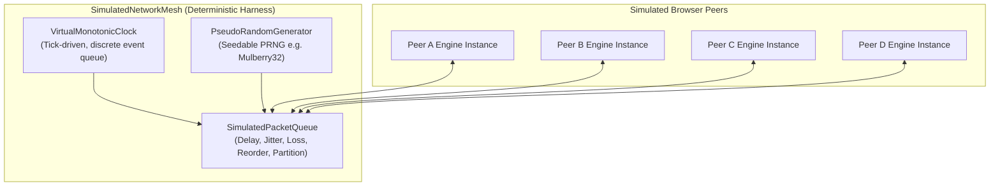

# Phase 7.2 — Deterministic Simulation Test Strategy & Harness Specification

> **Document Version:** 1.0.0  
> **Status:** SPECIFICATION ONLY — NO IMPLEMENTATION AUTHORIZED  
> **Parent Milestone:** Phase 7.2 (Architecture & Interface Design)  
> **Baseline Commit:** `926c575`  
> **Target Subsystem:** Test infrastructure for `@syncplay/sync-engine` (P7.3+)  

---

## 1. Overview & Verification Philosophy

Testing distributed systems exclusively in real browsers is slow, flaky, and unable to reliably reproduce rare race conditions (e.g., a packet arriving exactly $1\text{ ms}$ before another). 

To ensure mathematical correctness before browser deployment, Phase 7 introduces a **Headless Deterministic Simulation Test Harness** (`SimulatedNetworkMesh`). The harness executes entirely in Node.js (Vitest), runs without real WebRTC sockets, uses a discrete virtual clock, and enables reproducible adversarial permutation testing via seeded pseudo-random number generation.

---

## 2. Simulation Harness Architecture



### 2.1. Discrete Virtual Clock
- Replaces `performance.now()` with an injectable virtual clock `VirtualClock`.
- Time advances only when the simulator ticks or pops the next scheduled event from the priority queue:
  $$T_{\text{next}} = \min_{e \in \text{Queue}} (e.\text{deliveryTime})$$
- Zero reliance on Node.js `setTimeout` or OS system timers; runs thousands of virtual seconds in hundreds of milliseconds.

### 2.2. Seeded Pseudo-Random Number Generator (PRNG)
- Uses a deterministic 32-bit generator (e.g., Mulberry32):
  ```ts
  class SeededPRNG {
    constructor(private seed: number) {}
    next(): number {
      let t = (this.seed += 0x6d2b79f5);
      t = Math.imul(t ^ (t >>> 15), t | 1);
      t ^= t + Math.imul(t ^ (t >>> 7), t | 61);
      return ((t ^ (t >>> 14)) >>> 0) / 4294967296;
    }
  }
  ```
- Every randomized test run prints its `TEST_SEED`. If a randomized run discovers a convergence failure, the exact failure can be reproduced deterministically by supplying `SEED=<number>`.

---

## 3. Simulated Network Impairment Capabilities

The `SimulatedNetworkMesh` routes packets between simulated peer engines with configurable impairment knobs:

```ts
interface NetworkImpairmentConfig {
  /** Minimum network one-way latency in virtual ms (e.g., 20 ms). */
  minLatencyMs: number;
  /** Maximum network one-way latency in virtual ms (e.g., 150 ms). */
  maxLatencyMs: number;
  /** Probability of packet drop [0.0, 1.0] (e.g., 0.15 = 15% loss). */
  dropRate: number;
  /** Probability of duplicating a packet [0.0, 1.0] (e.g., 0.05 = 5%). */
  duplicateRate: number;
  /** Probability of out-of-order reordering [0.0, 1.0]. */
  reorderRate: number;
  /** Active partition topology (pairs forbidden from communicating). */
  partitions: Array<[PeerId, PeerId]>;
}
```

### Supported Failure Injections:
1. **Asymmetric Network Delays:** Packet from A to B takes $20\text{ ms}$, but packet from C to B takes $180\text{ ms}$.
2. **Packet Loss with Anti-Entropy Recovery:** 20% of broadcast control events are dropped; tests verify that `ReplicationController` detects the missing sequences via `STATE_DIGEST` and repairs them via `REPAIR_REQUEST`.
3. **Network Partitions & Healing:** Partition $\{A, B\}$ from $\{C, D\}$. Drive concurrent playback controls in both islands. Heal the partition after 10 virtual seconds. Verify that both islands converge to the identical state.
4. **Peer Crash & Restart (Churn):** Simulate tab close by destroying Peer C's engine. Advance the room by 50 operations. Recreate Peer C with Generation 2. Verify state catch-up via snapshot handshake.

---

## 4. Test Suite Scenarios & Assertions

### Suite 1: Randomized Permutation Testing ($N = 3, 4$ Peers)
- **Execution:** Generate $M = 20$ concurrent playback operations (`PLAY`, `PAUSE`, `SEEK`, `RATE_CHANGE`) across 3 peers simultaneously.
- **Permutation:** Deliver the messages to the 3 peers in 100 randomized arrival orders.
- **Assertion:** Once all queues are empty, all 3 peers must hold:
  1. `stateA.status === stateB.status === stateC.status`
  2. `stateA.anchorPositionMs === stateB.anchorPositionMs === stateC.anchorPositionMs`
  3. `stateA.playbackRate === stateB.playbackRate === stateC.playbackRate`
  4. `stateA.stateVersion === stateB.stateVersion === stateC.stateVersion`
  - **Pass Threshold:** 100 / 100 runs pass with 0 divergence.

### Suite 2: Bounded History Compaction Stress Test
- **Execution:** Run a simulated session emitting 1,000 sequential operations.
- **Constraint:** Operation log limit is $K = 256$.
- **Assertion:**
  1. Engine memory never exceeds 256 stored operations.
  2. `OrderedOperationLog.size <= 256` throughout the entire 1,000-operation run.
  3. Stable frontier $W_{\text{stable}}$ advances continuously.
  4. At virtual end, all active peers are fully converged.

### Suite 3: Anti-Entropy Packet Loss Soak Test
- **Execution:** Set `dropRate = 0.25` (25% packet loss on all channels).
- **Activity:** Emit 50 control operations across 4 peers.
- **Assertion:**
  1. Periodic anti-entropy detects all gaps.
  2. All `REPAIR_REQUEST` calls are fulfilled within $< 2000$ virtual ms.
  3. Final state is identical across all 4 peers.

### Suite 4: Causal Context & True Concurrency Verification
- **Execution:**
  1. Generate concurrent operations $A_1$ (`PAUSE`) and $B_1$ (`PLAY`) such that $A_1 \parallel B_1$ ($A_1.\text{originSequence} > B_1.\text{causalContext}[A]$ and vice versa).
  2. Verify that all peers resolve state to `'paused'` (intent-preserving pause priority).
  3. Peer B observes $A_1$ and subsequently generates $B_2$ (`PLAY`) with $A_1.\text{originSequence} \le B_2.\text{causalContext}[A]$.
  4. Verify that all peers resolve state to `'playing'` (intentional sequential resumption).
  5. **Multi-Branch Dependency Merge:** Peer C observes concurrent operations $A_2$ and $B_3$ and generates $C_1$. Peer D is injected with $A_2$ and $C_1$ while $B_3$ is delayed.
  6. Assert that Peer D holds $C_1$ in `PendingDependencyQueue`, dispatches `REPAIR_REQUEST` for $B_3$, and only applies $C_1$ once $B_3$ arrives.

### Suite 5: Snapshot Frontier & Reconnect Recovery Verification
- **Execution:**
  1. Peer D rejoins after missing $> 256$ operations (Class 3 horizon gap).
  2. Peer D requests `STATE_SNAPSHOT` from Peer A.
  3. **Stale Snapshot Test:** Peer C (slow peer) attempts to offer an outdated snapshot ($V_{\text{snap}} < V_{\text{local}}$). Assert Peer D rejects with `SNAPSHOT_STALE`.
  4. **Corrupt Digest Test:** Inject a snapshot where `stateDigestSha256` does not match the computed hash of the bound canonical preimage `{ formatVersion: 2, sessionId, membershipEpoch, snapshotAuthorPeerId, snapshotFrontier, maxLogicalTimestamp, state }`. Assert rejection with `DIGEST_MISMATCH`.
  5. **Atomic Installation & Local Replay:** Peer D holds 2 locally generated pending operations created during reconnect. Peer D receives valid snapshot from Peer A, atomically installs base state, and successfully replays the 2 local operations (`context: 'LOCAL_REPLAY'`).
  6. **No Supplier Available Test:** If all peers provide stale or corrupt snapshots, assert Peer D remains in `RECOVERING` without state corruption or speculative advances.
  7. Assert Peer D transitions from `'recovering'` to `'active'` upon valid install and converges with Peer A.

### Suite 6: Empirical Replay Latency & Performance Benchmark Harness
- **Objective:** Empirically evaluate the unverified performance target hypothesis: *"In-memory replay of 256 operations through pure functional reducer executes in $< 2.0\text{ ms}$."*
- **Harness Specification:**
  - Dedicated benchmark file: `packages/sync-engine/test/benchmark/replay-performance.bench.ts`.
  - Runs in clean Node.js / V8 environment using `performance.now()` with high-resolution timers.
  - Generates 1,000 iterations of 256 mixed operations (`PLAY`, `PAUSE`, `SEEK`, `RATE_CHANGE`).
  - Simulates late-arrival speculative rollback where an operation arrives at index 0, forcing a full 256-operation replay loop from base snapshot.
  - Measures execution time per replay loop.
- **Reporting Metrics:**
  - $p50$ (median latency), $p95$, and $p99$ tail latency.
  - Garbage collection overhead and heap allocation per replay.
- **Pass / Fail Threshold:** $p99 < 2.0\text{ ms}$ on baseline testing machines. Results will be published in the Milestone P7.7 Performance Evaluation Report.

### Suite 7: Strict Membership Epoch Fencing & Partition Recovery
- **Execution:**
  1. Initialize mesh with Peers A, B, and C in `membershipEpoch: 5`.
  2. Partition Peer C.
  3. Bootstrap advances room to `membershipEpoch: 6` (Peer C marked departed).
  4. Peers A and B emit 30 operations in epoch 6 and compact history past the old frontier.
  5. Peer C generates 5 local playback operations (`SEEK`, `PLAY`) under `membershipEpoch: 5`.
  6. Heal partition between C and {A, B}.
- **Assertions:**
  1. Peers A and B reject C's epoch-5 operations with code `REJECTED_OBSOLETE_EPOCH`.
  2. Peer C detects epoch mismatch, purges speculative intents, and transitions to `'recovering'`.
  3. Peer C requests `STATE_SNAPSHOT` from Peer A (epoch 6) and installs it cleanly.
  4. Final state across all 3 peers is 100% identical.

### Suite 8: Out-of-Order Gap Tracking & Non-Advancement of Replication Vector
- **Execution:**
  1. Peer A emits sequential operations $A_1$, $A_2$, and $A_3$.
  2. Network delivers $A_1$ and $A_3$ to Peer B, while dropping $A_2$.
- **Assertions:**
  1. Peer B applies $A_1$; `replicationVector[A] === 1`.
  2. Peer B receives $A_3$; verifies $A_3$ depends on $A_2$ ($A_3.\text{causalContext}[A] === 2$).
  3. Peer B buffers $A_3$ in `PendingDependencyQueue`; `replicationVector[A]` remains $1$ (does NOT advance to 3).
  4. Peer B emits `REPAIR_REQUEST` for sequence range $[2, 2]$.
  5. Network delivers $A_2$; Peer B applies $A_2$, cascades to unblock $A_3$, and advances `replicationVector[A]` to $3$.

### Suite 9: Incomparable Snapshot Frontiers & Degraded State Handling
- **Execution:**
  1. Simulate temporary split-brain partition creating incomparable snapshots between sub-meshes.
  2. Sub-mesh 1 produces Snapshot 1 with frontier $\{A: 10, B: 5\}$ at epoch 6.
  3. Sub-mesh 2 produces Snapshot 2 with frontier $\{A: 5, B: 10\}$ at epoch 6.
- **Assertions:**
  1. Verifies receiver never chooses a snapshot by comparing entry sums ($\sum V$).
  2. Receiver attempts log repair to bridge the causal gap if missing operations are retained in log history.
  3. If log history is compacted beyond horizon ($K = 256$), receiver **strictly avoids arbitrary tie-breaking** (no $\max(\text{epoch}) \to \max(L) \to \max_{\text{lex}}$ selection).
  4. Receiver transitions engine to `'DEGRADED_OUT_OF_SYNC'` lifecycle state.
  5. Assert explicit host re-seek or room reload recovers synchrony and returns engine to active state.

### Suite 10: Exact Lamport Validation, Compacted Checkpoints & Replay Boundaries
- **Objective:** Formally verify the exact Lamport creation invariant, bounded checkpoint lookups, and replay boundaries across 9 explicit specification scenarios:
- **Execution & Assertions:**
  1. **Case 1 (Exact Expected Timestamp Accepted):** Peer B emits operation where $L(e) \equiv \text{expectedTimestamp}(e) = 1 + \max_{(p, s) \in e.\text{causalContext}} L(p, s)$. Assert receiver accepts operation, local Lamport clock advances to $\max(L_{\text{local}}, L(e)) + 1$, and replication vector advances.
  2. **Case 2 (Off-by-One Inflated Timestamp Rejected):** Peer B emits operation where $L(e) = \text{expectedTimestamp}(e) + 1$. Assert receiver rejects with `INVALID_LOGICAL_TIMESTAMP`. Verify local Lamport clock and replication vector do NOT advance.
  3. **Case 3 (Arbitrary Inflated Timestamp Rejected):** Peer B emits operation with $L(e) = 1,000,000$ where $\text{expectedTimestamp}(e) = 6$. Although $L(e) > \max L(d)$ (satisfying lower bound), assert receiver rejects with `INVALID_LOGICAL_TIMESTAMP`. Verify zero clock advancement.
  4. **Case 4 (Compacted Checkpoint Resolution):** History is compacted up to sequence $W_{\text{stable}}[A] = 10$. Incoming event $B_1$ references $B_1.\text{causalContext}[A] = 10$. Receiver looks up $L(A, 10)$ in `compactedCheckpoints` ($L=10$), computes expected timestamp $11$, and accepts $B_1$.
  5. **Case 5 (Earlier Sequence in Compacted Frontier):** Receiver has compacted $A_1 \dots A_{10}$. Peer C (delayed branch) emits $C_1$ with $C_1.\text{causalContext}[A] = 5$. Receiver queries `compactedCheckpoints.get("A:5")`, resolves exact $L(A, 5) = 5$, and computes expected timestamp $6$. Assert $C_1$ is accepted.
  6. **Case 6 (Non-Substitution Invariant):** In Case 5, verify receiver **never** substitutes frontier timestamp $L(A, 10) = 10$ or `maxLogicalTimestamp` for $A_5$. Assert that substituting $L(A, 10)$ would have erroneously expected $11$ and rejected valid event $C_1$.
  7. **Case 7 (Missing Checkpoint / Pre-Horizon Recovery):** Peer D emits operation referencing dependency sequence $s$ older than the retained checkpoint horizon ($K=256$). Checkpoint is absent. Receiver rejects with `REJECTED_OUTSIDE_HORIZON`. Assert receiver enters `DEGRADED_OUT_OF_SYNC` without clock advancement.
  8. **Case 8 (Concurrent Event Validity):** Peer B emits event concurrent with $A_6 \dots A_{10}$ ($B_1.\text{causalContext}[A] = 5$). Receiver has already observed and reduced $A_6 \dots A_{10}$. Assert receiver accepts $B_1$, successfully executes speculative rollback/replay, and converges.
  9. **Case 9 (Universal Clock & Vector Non-Advancement):** In all rejection cases (Cases 2, 3, 7, causal regressions, and sequence collisions), assert receiver's local Lamport clock ($L_{\text{local}}$) and `replicationVector` remain 100% untouched.

### Suite 11: Snapshot Import & Post-Import Causal Consistency
- **Objective:** Formally verify the exact Lamport causal lifecycle across snapshot creation, canonical digest validation, snapshot import reseeding ($L_{\text{local}} = \text{maxLogicalTimestamp}$ without $+1$), causal context initialization, post-import event authoring, and receiver exact validation across 9 scenarios:
- **Execution & Assertions:**
  1. **Case 1 (First Post-Import Event Exact Equality):** Peer D imports snapshot with frontier $\{A: 10, B: 5\}$ where $L(A, 10) = 12$ and $L(B, 5) = 8$ ($\text{maxLogicalTimestamp} = 12$). Peer D authors its first post-import event $D_1$. Assert $D_1.\text{causalContext} \equiv \{A: 10, B: 5\}$ and $D_1.\text{logicalTimestamp} === 13$ ($1 + \max(12, 8)$).
  2. **Case 2 (Receiver Independent Validation via Snapshot Frontier):** Peer B receives $D_1$ from Case 1. Peer B resolves dependency timestamps $L(A, 10) = 12$ and $L(B, 5) = 8$, independently calculates $\text{expectedTimestamp} = 1 + \max(12, 8) = 13$, asserts $13 === 13$, and admits $D_1$ into its log.
  3. **Case 3 (Multi-Origin Distinct Timestamps):** Snapshot contains 4 origins with frontier timestamps $\{A_{20} \to 20, B_{15} \to 15, C_{40} \to 45, D_{30} \to 30\}$. Assert $\text{maxLogicalTimestamp} \equiv 45 \equiv \max_p \text{originFrontierTimestamps}[p]$. Peer E imports snapshot and authors $E_1$. Assert $E_1.\text{causalContext} \equiv \{A: 20, B: 15, C: 40, D: 30\}$ and $E_1.\text{logicalTimestamp} === 46$.
  4. **Case 4 (Global Maximum Non-Substitution):** Receiver processes concurrent event $X_1$ that depends solely on $\{B: 15\}$. Receiver queries `compactedCheckpoints.get("B:15")` and resolves $L(B, 15) = 15$. Assert receiver calculates expected timestamp $16$, and strictly avoids substituting $\text{maxLogicalTimestamp} = 45$ (which would have erroneously expected $46$ and rejected $X_1$).
  5. **Case 5 (Missing Pre-Compaction Checkpoint Recovery):** Peer emits event referencing sequence $s < W_{\text{stable}}[p] - 256$ (older than the retained checkpoint capacity). Checkpoint lookup fails. Assert receiver rejects with `REJECTED_OUTSIDE_HORIZON`, does not advance local clock, and transitions to `DEGRADED_OUT_OF_SYNC`.
  6. **Case 6 (Chained Post-Import Progression):** Following Case 1, Peer D authors sequential event $D_2$. Assert $D_2.\text{causalContext} \equiv \{A: 10, B: 5, D: 1\}$ and $D_2.\text{logicalTimestamp} === 14$ ($1 + \max(12, 8, 13)$). Receiver validates exact equality and advances replication vector to $\{A: 10, B: 5, D: 2\}$.
  7. **Case 7 (No Silent Reseeding Advancement):** Assert that snapshot import sets $L_{\text{local}} = \text{maxLogicalTimestamp}$ directly (WITHOUT $+1$). Verify that an implementation adding $+1$ upon import would produce $L(D_1) = 14$, triggering `INVALID_LOGICAL_TIMESTAMP` rejection at receiver expecting $13$.
  8. **Case 8 (Rejection Isolation on Post-Import Violation):** Peer D artificially authors $D_1$ with $L = 14$ (inflated by $+1$). Receiver computes expected $13$, rejects $D_1$ with `INVALID_LOGICAL_TIMESTAMP`, and asserts its local Lamport clock ($L_{\text{local}}$) and replication vector remain completely unchanged.
  9. **Case 9 (Concurrent Post-Import Branch Convergence):** Peers D and E both import identical snapshot $\{A: 10, B: 5\}$ ($L=12$). Peer D emits $D_1$ ($L=13$) and Peer E emits $E_1$ ($L=13$). Both peers exchange events. Deterministic tie-breaker selects winning operation ($13 \to D$ vs $13 \to E$), and both peers converge to identical playback position and playback state.


