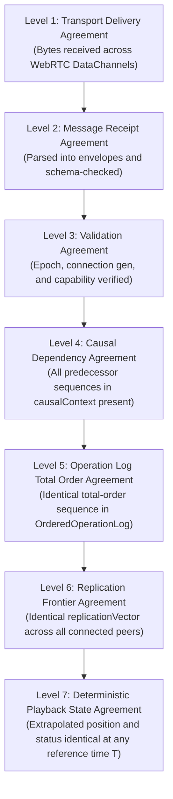

# Phase 7.4: Acceptance Criteria & Convergence Verification Plan

**Milestone:** Phase 7.4 (State Replication & Anti-Entropy Acceptance Framework)  
**Status:** SPECIFICATION ONLY — IMPLEMENTATION NOT AUTHORIZED  
**Approved Baseline:** Phase 7.2-R9 (`1825de1`), Phase 7.3-R5-H (`e49b81a` / docs `30e6d0d`)  
**Date:** 2026-11-17  

---

## 1. Formal Convergence Definition

In an interactive distributed media player, "eventual consistency" must be defined with mathematical precision. Passing unit tests alone does not prove convergence.

### 1.1. The Seven Levels of State Agreement

### 1.2. The Phase 7.4 Convergence Guarantee

Let $\mathcal{P} = \{P_1, P_2, \dots, P_N\}$ be the set of connected, authorized peers in an active session with stable membership epoch $E$. 

Let $\mathcal{O}$ be the set of all valid operations originated by peers in $\mathcal{P}$ whose sequence numbers fall within the retained history horizon ($s \le K=256$).

Under the assumptions of:
1. **Network Connectivity:** The underlying WebRTC mesh remains weakly connected (every peer can reach every other peer directly or transitively).
2. **Cooperative Non-Byzantine Peers:** Peers accurately report log contents and do not forge conflicting histories.
3. **Quiescence Period:** There exists a finite duration $T_{\text{quiet}} \ge 3 \times \text{RTT}_{\max} + \text{Interval}_{\text{digest}}$ during which no new live operations are created.

**The Phase 7.4 convergence theorem guarantees:**
$$\lim_{t \to \infty} V_{\text{rep}, i}[p] = V_{\text{rep}, j}[p] = \max_{k \in \mathcal{P}} (V_{\text{rep}, k}[p]) \quad \forall P_i, P_j \in \mathcal{P}, \forall p \in \text{Origins}$$

And for any reference evaluation time $T_{\text{eval}}$:
$$\text{State}_i(T_{\text{eval}}) \equiv \text{State}_j(T_{\text{eval}}) \quad \forall P_i, P_j \in \mathcal{P}$$

---

## 2. Mandatory Acceptance Criteria (AC-1 through AC-10)

### AC-1: Bounded Vector & Digest Exchange
- **Description:** Peers periodically and reactively exchange `StateDigestPayload`.
- **Pass Criteria:**
  1. Digest size is strictly bounded: $\le 8\text{ KB}$ for 64 peers.
  2. Rate limiter strictly drops outbound or inbound digests exceeding 1 per second per peer.
  3. Deserialization strictly rejects non-safe integers, missing epochs, or negative sequence numbers.
  4. Digest generation executes in $< 1.0\text{ms}$ on standard CPU.

### AC-2: Exact Missing Range Detection & Extraction
- **Description:** Comparing two digests or inspecting `PendingDependencyQueue` extracts the exact minimal missing sequence ranges.
- **Pass Criteria:**
  1. If $V_A[P] = 3$ and $V_B[P] = 7$, extracted range is exactly $[4, 7]$ for origin $P$.
  2. If multiple origins have deficits, distinct missing ranges are generated per origin.
  3. If $V_A \ge V_B$, extracted missing range is empty.
  4. If tail fingerprints mismatch with equal vectors ($V_A[P] == V_B[P]$ but $H_A[P] \ne H_B[P]$), a fork alert is raised and repair is not attempted via simple range request.

### AC-3: Out-of-Order Delivery & Unbuffered Cascade
- **Description:** When an event arrives out of sequence ($s > V_{\text{rep}} + 1$), it buffers until predecessor arrives, then automatically cascades.
- **Pass Criteria:**
  1. Arrival of $A_2$ before $A_1$ causes $A_2$ to buffer in `PendingDependencyQueue` with `BUFFERED_PENDING_DEPENDENCY`.
  2. $V_{\text{rep}}[A]$ remains $0$. Lamport clock does NOT advance.
  3. When $A_1$ arrives (via live or repair), $A_1$ is admitted $\to V_{\text{rep}}[A]$ becomes $1$.
  4. `drainSatisfied()` automatically unblocks $A_2 \to V_{\text{rep}}[A]$ becomes $2$ in the same tick.

### AC-4: Multi-Origin Concurrent Gap Reconciliation
- **Description:** Multiple origins have missing operations simultaneously across multiple peers.
- **Pass Criteria:**
  1. Peer A is missing $B:[3..5]$ and $C:[1..2]$.
  2. Dispatches distinct `REPAIR_REQUEST`s to appropriate suppliers.
  3. As batches return, operations are admitted and inserted in total order $\langle L, origin, eventId \rangle$.
  4. Both origin frontiers advance independently to their correct values.

### AC-5: Supplier Failure & Automatic Failover
- **Description:** A repair request to an unresponsive or departing peer fails over cleanly.
- **Pass Criteria:**
  1. Peer A issues `REPAIR_REQUEST` to Peer B.
  2. Peer B disconnects before responding.
  3. Transport emits `peer-left` or timeout ($1500\text{ms}$) expires.
  4. Peer A cancels request to B and re-routes to Peer C (which also advertised that origin).
  5. Repair completes successfully from Peer C without hanging.

### AC-6: Duplicate Request / Response Idempotence
- **Description:** Duplicate repair requests and duplicate repair batches are safely handled.
- **Pass Criteria:**
  1. Submitting identical `REPAIR_REQUEST` while one is pending is deduplicated (not sent twice).
  2. Receiving a duplicate `OPERATION_BATCH` results in `IGNORED_DUPLICATE` or `IGNORED_ALREADY_COMPACTED`.
  3. Zero error throws, zero state mutations, zero clock regressions.

### AC-7: Outside Retained Horizon Safe Rejection & Handoff
- **Description:** Handling requests for history that has been compacted into the base snapshot.
- **Pass Criteria:**
  1. Requester asks for sequence $10$, but supplier's oldest retained sequence in log is $20$.
  2. Supplier responds with `REPAIR_REJECTED` (`reason: 'OUTSIDE_HORIZON'`, `retainedHorizon: 20`).
  3. Requester triggers `onHistoryExhausted`.
  4. Requester marks `isDegraded = true` with reason `'HISTORY_HORIZON_EXCEEDED'`.
  5. Proves that Phase 7.4 does NOT attempt an unsafe partial repair.

### AC-8: Bounded Queue, Batch & Retry Overhead
- **Description:** Memory and network boundaries prevent resource exhaustion under denial-of-service or extreme lag.
- **Pass Criteria:**
  1. `PendingDependencyQueue` rejects the 257th event with `REJECTED_CAPACITY`.
  2. `OPERATION_BATCH` payload size never exceeds $32$ operations or $64\text{ KB}$.
  3. In-flight requests per peer never exceed $2$.
  4. Exponential retry backoff ($1\text{s}, 2\text{s}, 4\text{s}$) aborts after exactly $3$ retries.

### AC-9: Three-Peer & Four-Peer Asymmetric Partition Healing
- **Description:** End-to-end multi-peer network simulation under packet loss and partitions.
- **Pass Criteria:**
  1. **3-Peer Lossy Mesh:** 3 peers concurrently produce 10 operations each under 20% random packet loss. All 3 peers converge to identical $V_{\text{rep}} = \{A:10, B:10, C:10\}$ within $2000\text{ms}$ of quiescence.
  2. **4-Peer Partition:** Partition $\{A, B\}$ and $\{C, D\}$ heals. Anti-entropy exchanges digests, fetches missing ranges, and merges histories in total order. All 4 peers reach identical `PlaybackState`.

### AC-10: Zero Regression of Phase 7.3 Invariants
- **Description:** Existing Phase 7.3 engine invariants remain completely unbroken.
- **Pass Criteria:**
  1. All 241 existing `@syncplay/sync-engine` tests pass.
  2. All 623 existing monorepo tests pass.
  3. Exact Lamport creation ($L = 1 + \max deps$) and validation ($L == \text{expected}$) verified.
  4. R5-H capability-gated transport context verification remains enforced for all repair batches.
  5. `peerGenerations` exact match without `?? 1` fallback remains enforced.

---

## 3. Quantitative Performance Benchmarks

| Metric | Target Threshold | Hard Failure Limit |
|---|---|---|
| **Convergence Latency (3 peers, 20% loss)** | $\le 1200\text{ms}$ | $> 2500\text{ms}$ |
| **Digest Processing Overhead** | $\le 0.5\text{ms}$ per digest | $> 2.0\text{ms}$ |
| **Batch Ingestion Rate** | $\ge 500\text{ ops/sec}$ | $< 100\text{ ops/sec}$ |
| **Steady-State Bandwidth (per peer)** | $\le 0.3\text{ KB/sec}$ | $> 1.0\text{ KB/sec}$ |
| **Peak Memory Footprint (Engine)** | $\le 10\text{ MB}$ | $> 25\text{ MB}$ |

---

## 4. Test Verification Matrix

| Test Suite | File Path | Focus Area | Target Test Count |
|---|---|---|---|
| **Protocol Schema Tests** | `packages/protocol/src/__tests__/payloads.test.ts` | Zod validation of digests, repair requests, and rejections | $\ge 20$ tests |
| **Comparator Tests** | `packages/sync-engine/src/__tests__/replication-comparator.test.ts` | Vector math, gap extraction, tail fingerprint checking | $\ge 25$ tests |
| **Repair Serving Tests** | `packages/sync-engine/src/__tests__/repair-fulfillment.test.ts` | Supplier log querying, batch slicing, outside horizon | $\ge 20$ tests |
| **Manager Scheduling Tests** | `packages/sync-engine/src/__tests__/anti-entropy-manager.test.ts` | Timers, jitter, throttling, retries, backoff, failover | $\ge 25$ tests |
| **Multi-Peer Simulation** | `packages/sync-engine/src/__tests__/anti-entropy-simulation.test.ts` | 3-peer lossy mesh, 4-peer partition healing, convergence | $\ge 20$ tests |
| **Regression Suite** | Existing 36 monorepo test files | Complete backwards compatibility with Phase 7.3 | 623 tests |
| **Total Monorepo Target** | Entire workspace | Full end-to-end verification | **$\ge 733$ tests** |

---

**Phase 7.4 is in planning state. Implementation has not started and remains subject to separate authorization.**
