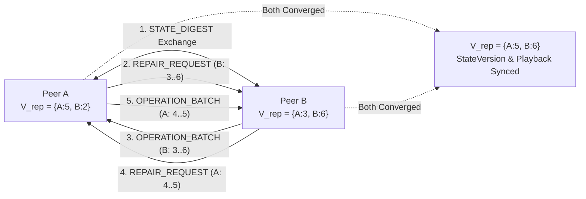
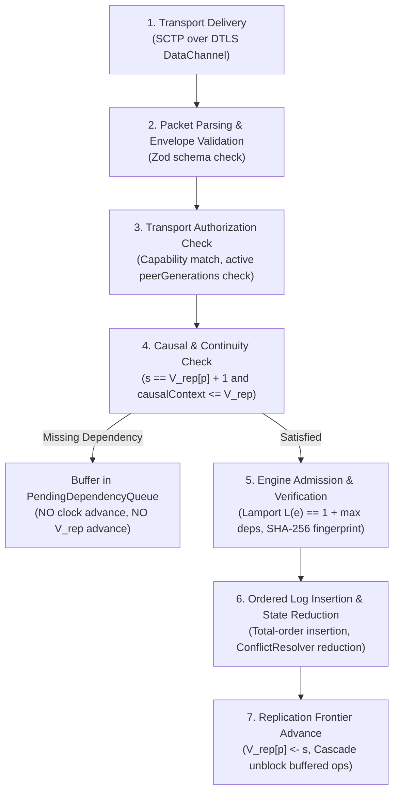
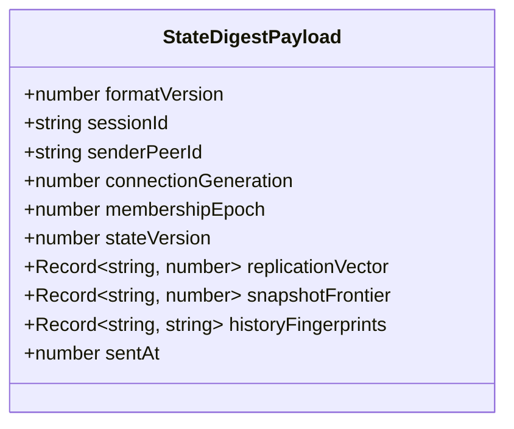
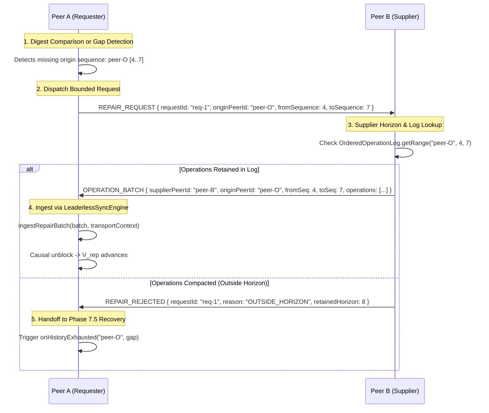
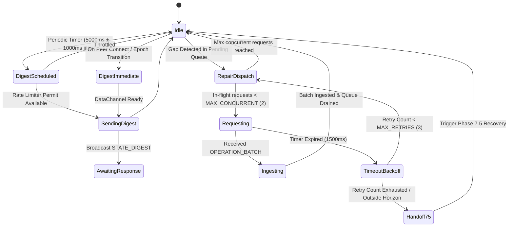
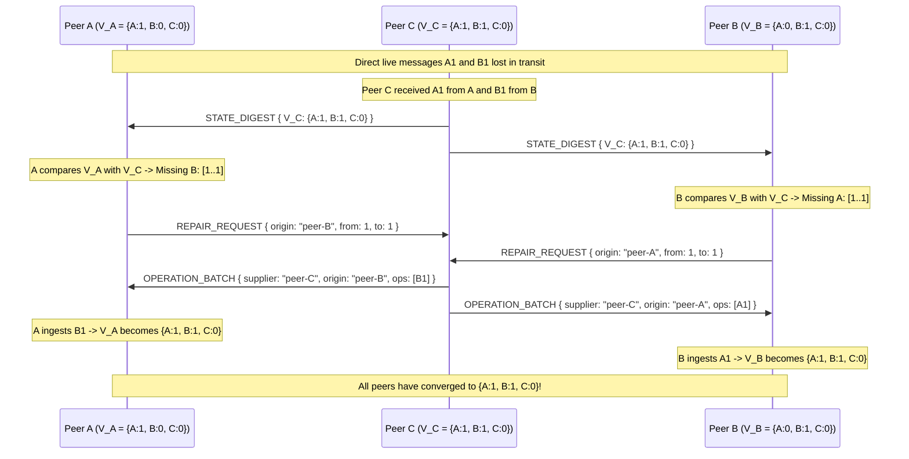
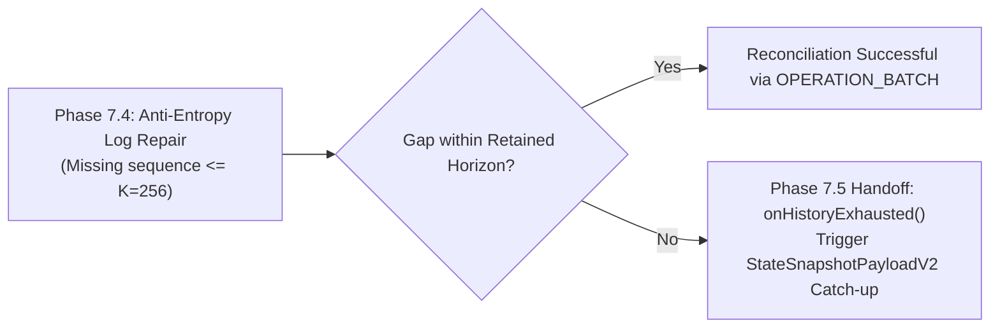

# Phase 7.4: State Replication & Anti-Entropy Architecture Specification

**Milestone:** Phase 7.4 (State Replication & Anti-Entropy)  
**Status:** ARCHITECTURE DESIGN & PLANNING ONLY — IMPLEMENTATION NOT AUTHORIZED  
**Approved Baseline:** Phase 7.2-R9 (`1825de1`)  
**Previous Implementation Baseline:** Phase 7.3-R5-H (`e49b81a` / docs `30e6d0d`)  
**Date:** 2026-11-17  

---

## Executive Summary

Phase 7.4 designs the decentralized state replication and anti-entropy subsystem for the SyncPlay Protocol. 

In Phase 7.3, the engine implemented deterministic event ordering, immutable operation fingerprinting, capability-gated transport context verification, exact Lamport timestamp validation, and bounded in-memory dependency queues. However, Phase 7.3 relied on incoming live broadcasts or manually provided repair batches. 

Phase 7.4 solves the fundamental replication problem: **In an asynchronous, lossy, and partitioned WebRTC peer-to-peer network, different peers accumulate divergent subsets of operation history. The protocol must autonomously discover divergence, identify missing sequence ranges, fetch missing operations from peer logs, validate them through the immutable Phase 7.3 admission pipeline, and converge all eligible peers to identical playback states without introducing a centralized coordinator or playback server.**



---

## 1. Frozen Architectural Invariants

Phase 7.4 strictly adheres to the frozen Phase 7.2-R9 and Phase 7.3 architectural invariants:

1. **Server-Minimized, Leaderless Decentralization:** The Bootstrap Server provides discovery, authentication, signaling, and room membership rosters only. It has zero awareness of playback state, logical clocks, operation logs, or anti-entropy repair.
2. **Authorship vs Transport Provenance Decoupling:** `originPeerId` immutably identifies the logical operation author. `supplierPeerId` identifies the immediate transport peer delivering the repair payload. Historical event authorship is never conflated with supplier transport identity.
3. **Exact Lamport Event Creation & Validation:**
   $$L(e) = 1 + \max_{(p, s) \in \text{causalContext}} L(p, s)$$
   Validation enforces exact equality. Receiving an event updates the receiver's local clock using $\max(L_{\text{local}}, L_{\text{received}})$ without $+1$.
4. **Contiguous Replication Frontier Invariant:** `replicationVector[p] = k` guarantees that the local peer has received, schema-validated, causally unblocked, admitted, inserted into the ordered operation log, and reduced all operations originated by peer $p$ from sequence $1$ through $k$. Out-of-order or pending events **never** advance `replicationVector`.
5. **Phase 7.3 Capability-Gated Transport Boundary:** Ingestion of repair batches strictly requires an `AuthenticatedSupplierContext` minted via `TransportRegistrationCapability` reference equality (`===`) and validated against `peerGenerations` (exact active generation match, no `?? 1` fallback).
6. **Immutable Content Verification:** Deduplication and collision detection enforce RFC 8785 canonical JSON serialization and SHA-256 fingerprint verification (`computeOperationFingerprint`).
7. **Strict Resource Bounds:** Memory capacity ($K = 256$), batch sizes ($\le 32$ ops), frame sizes ($\le 64\text{ KB}$), request concurrency, and backoff limits are hard invariants.

---

## 2. Replication Knowledge Model

### 2.1 Formal Meaning of the Replication Vector

The local replication vector $V_{\text{rep}} \in \mathbb{N}^{\text{Peers}}$ represents strictly contiguous, verified, and applied operation history:

$$V_{\text{rep}}[p] = k \iff \forall s \in \{1, \dots, k\}, \text{op}(p, s) \in \text{CommittedHistory}$$

An operation $\text{op}(p, s)$ is considered part of `CommittedHistory` if and only if it has passed all seven stages of the operation lifecycle:



| Stage | Subsystem | Action | Effect on $V_{\text{rep}}$ |
|---|---|---|---|
| **1. Transport Delivery** | `webrtc-transport` | Raw packet received over SCTP/DTLS DataChannel. | None. |
| **2. Envelope Validation** | `control-event-service` | Validates session ID, wire schema, and timestamp types. | None. |
| **3. Transport Authorization** | `leaderless-sync-engine` | Verifies `AuthenticatedSupplierContext` capability and generation. | None. |
| **4. Causal & Continuity** | `leaderless-sync-engine` | Verifies $s = V_{\text{rep}}[p] + 1$ and all causal dependencies are satisfied. | If unsatisfied, buffered in `PendingDependencyQueue`. $V_{\text{rep}}$ **does not advance**. |
| **5. Engine Admission** | `logical-clock-manager` | Verifies exact Lamport formula, absence of sequence/identity collisions. | Advances logical clock without $+1$. $V_{\text{rep}}$ does not advance yet. |
| **6. Ordered Reduction** | `ordered-operation-log` & `conflict-resolver` | Inserts into ring buffer in total order; reduces or deterministically replays. | State version increments. |
| **7. Frontier Advance** | `leaderless-sync-engine` | Updates $V_{\text{rep}}[p] \leftarrow s$. Triggers `PendingDependencyQueue.drainSatisfied()`. | **$V_{\text{rep}}$ advances.** |

> [!IMPORTANT] Non-Advance Invariant
> An operation can **never** be advertised as replicated in a `STATE_DIGEST` or supplied to another peer in an `OPERATION_BATCH` until it has completed Stage 7. Advertising unreduced or buffered operations would violate causal monotonicity across the mesh.

### 2.2 Sparse Gap Representation

When a peer observes an out-of-order operation ($s > V_{\text{rep}}[p] + 1$) or an operation whose `causalContext` references an unknown sequence ($reqSeq > V_{\text{rep}}[q]$):
1. The operation is buffered in `PendingDependencyQueue` (bounded to capacity $K = 256$).
2. The sequence gap is defined as the discrete interval:
   $$\text{Gap}(p) = [V_{\text{rep}}[p] + 1, \dots, s - 1]$$
3. `PendingDependencyQueue.getMissingRanges(V_{\text{rep}})` extracts all discrete missing ranges across all buffered events:
   $$\text{MissingRanges} = \left\{ (origin, fromSeq, toSeq) \mid fromSeq \le toSeq \right\}$$
4. These missing ranges form the input to the Anti-Entropy Repair scheduler.

---

## 3. Decentralized State & History Comparison

### 3.1 Limitations of Scalar State Hashes

A naive distributed systems approach compares a single scalar checksum (e.g. SHA-256 of current playback state). In an interactive leaderless media player, scalar state hashing is fatally flawed:
- **No Diagnostic Value:** A hash mismatch indicates that states differ, but provides zero information about *which* peer or sequence is missing.
- **Continuous Extrapolation:** In playback state, `anchorLocalTimestamp` and extrapolated position drift with wall-clock time; scalar hashes fail to match even when peers are causally synchronized.
- **Premature Convergence False Positives:** Two peers might coincidentally match a coarse state hash while holding divergent causal logs.

### 3.2 The Hybrid Anti-Entropy Digest Model

SyncPlay Phase 7.4 implements a multi-component state digest carrying explicit protocol versioning:



1. **`formatVersion` (Version Discriminator):** Constant literal `2`. Distinguishes Phase 7.4 digests from legacy Phase 2 digests (`{ digestId, stateVersion, digest }`) and future protocol formats.
2. **`replicationVector` ($V_{\text{rep}}$):** Contiguous highest applied sequence per origin. Directly pinpoints missing sequence ranges.
3. **`snapshotFrontier` ($V_{\text{baseSnap}}$):** Oldest retained sequence per origin below which operations have been folded into the base snapshot.
4. **`historyFingerprints` ($H_{\text{origin}}$):** SHA-256 tail fingerprint of the highest applied operation for each origin ($H[p] = \text{fingerprint}(\text{op}(p, V_{\text{rep}}[p]))$). Detects sequence collisions or conflicting histories where two peers claim the same sequence count but possess different operation content.

### 3.3 Vector Comparison, Divergence Classification & Completeness Analysis

When Peer A receives `StateDigestPayload` from Peer B ($V_B$):

```mermaid
flowchart TD
    Compare["Compare V_A[p] with V_B[p] for each origin p"] --> Check{V_A[p] vs V_B[p]}
    Check -->|V_A[p] < V_B[p]| Missing["Peer A is missing range [V_A[p] + 1, V_B[p]]<br/>-> Check B's snapshotFrontier & Issue REPAIR_REQUEST"]
    Check -->|V_A[p] > V_B[p]| Ahead["Peer B is lagging on origin p<br/>-> Awaits REPAIR_REQUEST from B"]
    Check -->|V_A[p] == V_B[p]| FPCheck{"Check Tail Fingerprint<br/>H_A[p] == H_B[p]?"}
    FPCheck -->|Match| Identical["Contiguous sequence count & tail operation agree<br/>(Retained horizon valid)"]
    FPCheck -->|Mismatch| Fork["Sequence Collision / Fork Detected!<br/>Trigger IDENTITY_CONFLICT diagnostic"]
```

#### Vector Relationship Formalism:
- **Domination ($V_A \ge V_B$):** $\forall p, V_A[p] \ge V_B[p]$. Peer A has observed a superset of Peer B's operations. No repair needed by Peer A.
- **Lagging ($V_A < V_B$):** $\forall p, V_A[p] \le V_B[p]$ and $\exists p, V_A[p] < V_B[p]$. Peer A issues `REPAIR_REQUEST` for missing sequences if within horizon.
- **Incomparable Concurrent Progress ($V_A \not\le V_B \land V_B \not\le V_A$):** Peer A is missing operations from origins where $V_A[p] < V_B[p]$; Peer B is missing operations from origins where $V_B[q] < V_A[q]$. Both peers issue independent, non-conflicting repair requests for their respective deficits.
- **Horizon Boundary Verification:** If $V_A[p] < V_B.\text{snapshotFrontier}[p]$, the operations Peer A needs have already been compacted by Peer B. Peer B cannot fulfill an operation repair; this triggers a handoff to Phase 7.5 Snapshot Recovery.

#### Digest Completeness & Boundary Limitations:

It is vital to state precisely what the hybrid digest can and cannot prove:

1. **What the Hybrid Digest CAN Detect:**
   - **Missing Retained Operations:** $V_A[p] < V_B[p]$ directly identifies missing contiguous sequence intervals $[V_A[p] + 1, \dots, V_B[p]]$ within the retained log horizon.
   - **Conflicting Retained Operations:** If $V_A[p] = V_B[p]$ but $H_A[p] \ne H_B[p]$, the digest immediately proves an active fork or sequence collision at the frontier. When repaired operations arrive, Phase 7.3 `originSeqIndex` and canonical SHA-256 fingerprint checks detect collisions across all retained sequences.
   - **Compacted Historical Divergence within Retained Horizon:** For compacted operations within the bounded checkpoint window ($K=256$ checkpoints in `compactedCheckpoints`), divergence in historical metadata or Lamport timestamps is detected during validation against retained checkpoints upon repair or replay.

2. **What the Hybrid Digest CANNOT Detect:**
   - **Differences Outside the Retained Horizon:** If two peers compacted operations prior to their retained logs ($s \le \text{snapshotFrontier}$) and do NOT possess the corresponding operations or checkpoints (e.g. divergence that occurred beyond the horizon $K=256$), matching replication vectors and tail fingerprints **cannot prove historical equality of that ancient history**.
   - **Non-Guarantee of Universal Byzantine Identity:** The tail fingerprint $H_{\text{origin}}$ only attests to the single latest operation at sequence $V_{\text{rep}}[p]$; it is not a recursive cryptographic Merkle root of the arbitrary pre-horizon past. Matching replication vectors and tail fingerprints establish contiguous sequence equality and latest-retained operation agreement, **not** unconditional Byzantine historical identity across compacted pre-horizon history.

3. **Safe Behavior When Compacted History Cannot Be Compared:**
   - If a peer requires operations below a candidate supplier's retained horizon ($fromSeq \le \text{snapshotFrontier}$), operation-level repair cannot proceed.
   - The candidate supplier responds with `REPAIR_REJECTED` (`reason: 'OUTSIDE_HORIZON'`).
   - The requester cannot compare or verify ancient compacted history; it marks `isDegraded = true` with reason `'HISTORY_HORIZON_EXCEEDED'` and emits `onHistoryExhausted()`, escalating to Phase 7.5 snapshot catch-up / snapshot reset to replace local state with an authoritative snapshot rather than attempting an unverified or partial log merge.

---

## 4. Missing-Range Detection & Repair Protocol

### 4.1 Repair Workflow Sequence



### 4.2 Supplier Selection Algorithm (Revised D-7.4-3)

When a missing range $(origin, fromSeq, toSeq)$ is identified:

#### 1. Mandatory Eligibility Filter (Precondition):
RTT ranking must **never** be applied to arbitrary peers. A candidate peer $S$ is eligible to serve range $(origin, fromSeq, toSeq)$ if and only if all three criteria are satisfied:
1. **Active Authorized Connection:** $S \in \text{peerGenerations}$ with an active, authorized connection generation established by the local transport adapter.
2. **Sufficient Replication Frontier:** $S$'s latest advertised replication vector satisfies $V_S[origin] \ge toSeq$.
3. **Uncompacted Range (Within Retained Horizon):** The start of the requested range is strictly greater than $S$'s advertised snapshot frontier: $fromSeq > V_{S.\text{snapshotFrontier}}[origin]$ (i.e. the requested operations have not been compacted into $S$'s base snapshot).

#### 2. RTT-Weighted Ranking of Eligible Candidates:
Let $\mathcal{S}_{\text{eligible}}$ be the set of peers meeting all three eligibility criteria above:
- **Author Preference:** If the original author $origin \in \mathcal{S}_{\text{eligible}}$, direct the request to $origin$ first (minimizes reliance on intermediate relay peers).
- **Secondary Ranking:** If the author is absent from $\mathcal{S}_{\text{eligible}}$, rank the candidates strictly by smoothed round-trip time ($\text{SRTT}$) calculated by `@syncplay/peer-mesh` RTT engine:
  $$S^* = \arg\min_{S \in \mathcal{S}_{\text{eligible}}} \text{SRTT}(S)$$

#### 3. Deterministic Behavior Under Network and Horizon Edge Cases:
- **Author Unavailable:** If the author is disconnected, unannounced, or lacks an active connection generation, any eligible non-author peer in $\mathcal{S}_{\text{eligible}}$ serves the repair directly from its retained log. The protocol remains fully decentralized; **no permanent coordinator is introduced or required**.
- **Candidate Supplier Lacks History:** If a selected candidate unexpectedly compacted the range before the request arrived or lacks log entries, it responds immediately with `REPAIR_REJECTED` (`reason: 'OUTSIDE_HORIZON'` or `'ORIGIN_UNKNOWN'`). The requester blacklists that candidate for that range and immediately selects the next eligible peer.
- **Selected Supplier Disconnects Before Completion:** If the selected supplier disconnects before completing the repair (detected via `peer-left` transport event) or the request times out ($1500\text{ms}$), the requester blacklists that supplier for that range, increments the retry count, and re-dispatches to the next eligible supplier with the lowest SRTT.
- **Partial Batch Response:** If the supplier returns a partial contiguous subset $[fromSeq, fromSeq + M - 1]$ (where $M < toSeq - fromSeq + 1$), the requester ingests the $M$ operations via `ingestRepairBatch()`, advances $V_{\text{rep}}[origin]$ to $fromSeq + M - 1$, and immediately re-evaluates supplier eligibility for the remaining sequence range $[fromSeq + M, toSeq]$, dispatching the next request.
- **Multiple Eligible Peers:** If multiple peers are eligible, the requester selects the lowest SRTT peer for the primary request; concurrent gaps across different origins can be distributed across multiple distinct eligible suppliers in parallel (bounded by concurrency limits).
- **No Eligible Supplier:** If $\mathcal{S}_{\text{eligible}} = \emptyset$ (e.g. all connected peers have $V[origin] < toSeq$ or have compacted the range $fromSeq \le \text{snapshotFrontier}$), the requester cannot resolve the gap via peer log repair. The engine marks `isDegraded = true` with reason `'NO_ELIGIBLE_REPAIR_SUPPLIER'`, triggers `onHistoryExhausted()`, and hands off to Phase 7.5 full snapshot catch-up.

### 4.3 Pagination and Transport Framing Constraints

- **Operation Limit per Batch:** Maximum 32 operations per `OPERATION_BATCH`.
- **Payload Size Cap (64 KB):** Maximum $65,536$ bytes per serialized message. 
  > [!NOTE] WebRTC DataChannel Interoperable Limit
  > The 64 KB limit ($65,536$ bytes) is the **WebRTC DataChannel maximum interoperable message size** defined by RFC 8831 / RFC 8841 and W3C WebRTC specifications across major browser engines. It is **not** an SCTP MTU (which is 1200–1280 bytes on the wire). 
- **Pre-Send Serialized Size Enforcement (Sender):**
  Before passing `OPERATION_BATCH` to the DataChannel, the supplier serializes the frame and measures its UTF-8 byte length. If the serialized length exceeds $\min(65536, \text{negotiated } \text{sctp.maxMessageSize})$, the supplier slices the batch into a smaller contiguous sub-range (e.g. 16 or 8 operations) so that the payload strictly complies with the size limit.
- **Post-Receive Frame Size Enforcement (Receiver):**
  Before invoking `JSON.parse()` or schema validation, the receiver inspects the byte length of the incoming buffer. If `rawPayload.byteLength > 65536` (or negotiated `sctp.maxMessageSize`), the frame is **immediately dropped without parsing**, and `antiEntropyFrameOversized` diagnostic counter is incremented, preventing memory exhaustion and JSON parsing denial-of-service.
- **Contiguous Slicing:** The supplier always serves a strictly contiguous sub-range $[fromSeq, fromSeq + M - 1]$. The requester ingests the partial batch, advances $V_{\text{rep}}$, and automatically dispatches a subsequent request for the remainder $[fromSeq + M, toSeq]$.

### 4.4 Repair Lifecycle Semantics

The complete anti-entropy repair lifecycle adheres to the following explicit operational rules:

1. **Request Correlation (`requestId`):**
   Every `REPAIR_REQUEST` carries a UUID v4 string `requestId`. The supplier must echo this exact `requestId` in the fulfilling `OPERATION_BATCH` (`requestId?: string`) or `REPAIR_REJECTED` (`requestId: string`). The requester matches incoming batches against active in-flight request records to cancel pending timeouts and track round-trip metrics.
2. **Partial Batch Ingestion & Progress:**
   When an `OPERATION_BATCH` fulfills a partial range $[fromSeq, fromSeq + M - 1]$, the requester ingests the batch via `ingestRepairBatch()`. As operations are admitted, $V_{\text{rep}}[origin]$ advances monotonically. If $V_{\text{rep}}[origin] < toSeq$, the remaining missing range $[V_{\text{rep}}[origin] + 1, toSeq]$ is re-queued and dispatched to the best currently eligible supplier.
3. **Completion Indication:**
   A repair task for range $(origin, fromSeq, toSeq)$ is marked **fulfilled and complete** if and only if:
   $$V_{\text{rep}}[origin] \ge toSeq$$
   Once fulfilled, the missing range is removed from the pending gap tracker, any dependent operations in `PendingDependencyQueue` unblock via `drainSatisfied()`, and the repair task is retired.
4. **Duplicate Request & Response Handling:**
   - *Duplicate Request:* If a supplier receives a duplicate `REPAIR_REQUEST` for a range it already served, it is idempotent: the supplier re-serves the batch from `OrderedOperationLog.getRange()`, or drops it if rate-limited.
   - *Duplicate Response:* If an `OPERATION_BATCH` arrives whose operations are already admitted ($s \le V_{\text{rep}}[origin]$), `LeaderlessSyncEngine` deduplicates each operation via existing Phase 7.3 logic (`IGNORED_DUPLICATE` or `IGNORED_ALREADY_COMPACTED`), resulting in zero state mutations and zero clock jumps.
5. **Supplier Failover:**
   If a supplier fails to respond within `REPAIR_REQUEST_TIMEOUT` ($1500\text{ms}$) or disconnects, the requester increments the retry counter. If `retryCount < MAX_RETRIES` (3), the requester fails over to the next eligible supplier with lowest SRTT. If `retryCount >= MAX_RETRIES`, the engine triggers `onHistoryExhausted()`.
6. **Epoch Cancellation on `transitionEpoch()`:**
   When `LeaderlessSyncEngine.transitionEpoch(newEpoch, capability)` is executed:
   - All active in-flight repair requests and associated timeout timers initiated under older epochs ($epoch < newEpoch$) are immediately cancelled.
   - Any inbound `OPERATION_BATCH` or `REPAIR_REQUEST` arriving with an older membership epoch is rejected at the transport or engine boundary (`REJECTED_INVALID: Obsolete membership epoch`).
   - Unreconciled gaps are re-evaluated under the new epoch context and re-dispatched if still relevant.
7. **Sequence Collision and Identity Conflict Handling:**
   If an operation in a repair batch has the same $(originPeerId, originSequenceNumber)$ as an existing operation in the log or compacted checkpoints, but has:
   - A different `logicalEventId`: rejected as `REJECTED_SEQUENCE_CONFLICT`.
   - The same `logicalEventId` but a different SHA-256 fingerprint: rejected as `REJECTED_IDENTITY_CONFLICT`.
   In either conflict case, repair batch ingestion halts immediately, replication progress for that origin is frozen, the engine marks `isDegraded = true` with reason `'SEQUENCE_COLLISION_DETECTED'` or `'IDENTITY_CONFLICT_DETECTED'`, and a diagnostic conflict alert is triggered.

---

## 5. Repair Validation and Ingestion Pipeline

Repaired operations arrive over the WebRTC DataChannel and are passed directly to `LeaderlessSyncEngine.ingestRepairBatch()`. 

> [!CAUTION] Zero-Bypass Security Invariant
> Repaired operations are **never** trusted implicitly. They must pass through the identical validation gauntlet as live operations, ensuring that a compromised or buggy peer cannot inject invalid operations via repair batches.

```mermaid
flowchart TD
    Wire["Inbound OPERATION_BATCH over DataChannel"] --> V1{1. Valid Transport Context?<br/>(WeakSet & capability check)}
    V1 -->|No| R1["REJECTED_INVALID: Fabricated transport context"]
    V1 -->|Yes| V2{2. Supplier Gen Match?<br/>(active == transportGen, no ?? 1)}
    V2 -->|No: Stale or Future| R2["REJECTED_INVALID: Stale/unannounced supplier generation"]
    V2 -->|Yes| V3{3. Origin Match?<br/>(batch.originPeerId == op.originPeerId)}
    V3 -->|No| R3["REJECTED_INVALID: Origin rewriting attempt"]
    V3 -->|Yes| V4{4. Duplicate / Fingerprint Collision?<br/>(Check idIndex & originSeqIndex)}
    V4 -->|Duplicate with identical hash| D1["IGNORED_DUPLICATE: Safe Idempotency"]
    V4 -->|Duplicate with altered hash| R4["REJECTED_IDENTITY_CONFLICT: Fingerprint mismatch"]
    V4 -->|Sequence collision| R5["REJECTED_SEQUENCE_CONFLICT: Conflicting event"]
    V4 -->|New Operation| V5{5. Exact Lamport Validation?<br/>L(e) == 1 + max(causalContext)}
    V5 -->|Mismatch| R6["REJECTED_INVALID: Lamport timestamp invalid"]
    V5 -->|Exact Match| V6["6. Advance Logical Clock (without +1)"]
    V6 --> V7["7. Insert to OrderedOperationLog in Total Order"]
    V7 --> V8["8. ConflictResolver: Deterministic Reduce or Replay"]
    V8 --> V9["9. Advance V_rep[p] <- s & Drain Pending Queue"]
```

### Complete Validation Matrix:
1. **Schema Check:** Conforms to `OperationBatchPayloadSchema` (zod).
2. **Provenance Check:** `validSupplierContexts.has(transportContext)` proves local transport adapter registration.
3. **Generation Check:** `peerGenerations.get(supplierPeerId)` exists and equals `transportContext.connectionGeneration`.
4. **Anti-Spoofing Check:** `rawOp.originPeerId === batch.originPeerId`.
5. **Fingerprint Verification:** `computeOperationFingerprint(rawOp) === existing.fingerprint`.
6. **Compacted Checkpoint Verification:** If already compacted, confirms immutable metadata matches.
7. **Lamport Invariant:** $L(e) = 1 + \max_{(q, d) \in \text{context}} L(q, d)$ validated using exact timestamps from the log or compacted checkpoints.
8. **Deterministic State Mutation:** Executed by `ConflictResolver.reduce()` or `ConflictResolver.replay()`.

---

## 6. Anti-Entropy Scheduling & Flow Control

To prevent network congestion, DataChannel buffer saturation, and CPU thrashing, anti-entropy execution is bounded by strict scheduling policies:



### 6.1 Concrete Scheduling Parameters

| Parameter | Value | Justification |
|---|---|---|
| **Periodic Digest Interval** | $5000\text{ms}$ | Low background overhead ($0.2\text{ Hz}$). |
| **Periodic Digest Jitter** | $\pm 1000\text{ms}$ | Prevents synchronization spikes across the mesh. |
| **Digest Rate Limit** | $1\text{ digest/sec}$ per peer (burst 2) | Protects transport from runaway digest floods. |
| **Repair Request Timeout** | $1500\text{ms}$ | Accommodates typical P2P WAN latencies ($100-300\text{ms}$) + batch creation. |
| **Max Concurrent Requests per Peer** | $2$ | Prevents overwhelming a single supplier. |
| **Max Room Concurrent Requests** | $16$ | Global engine budget to bound memory allocation. |
| **Max Repair Retries** | $3$ | Exponential backoff ($1\text{s}, 2\text{s}, 4\text{s}$) before concluding failure. |
| **Max Missing Ranges per Request** | $1$ | Atomic range scoping simplifies tracking and failure isolation. |

### 6.2 Convergence Timing Reconciliation

A critical distinction must be drawn between **reactive repair** (which operates immediately on live gap detection) and **periodic anti-entropy** (which operates in the background to catch silent packet loss). 

```mermaid
flowchart TD
    Divergence["Network Divergence Occurs"] --> Type{How is gap discovered?}
    Type -->|Reactive: Out-of-order live packet arrives| Reactive["1. Reactive Gap Trigger<br/>Delay: 0ms (immediate)<br/>Target: <= 1200ms under 20% loss"]
    Type -->|Periodic: Silent loss (sender quiescent)| Periodic["2. Periodic Anti-Entropy Digest<br/>Interval: 5000ms ± 1000ms<br/>Target: <= 7200ms total convergence"]
    Type -->|Failover: Supplier disconnects or times out| Failover["3. Supplier Failover Repair<br/>Timeout: 1500ms + 1 retry<br/>Target: <= 3000ms convergence"]
```

#### 1. Reactive Repair ($\le 1200\text{ms}$ under 20% loss):
- **Trigger:** Immediate arrival of an out-of-order event (e.g. sequence 5 arrives when $V_{\text{rep}} = 3$).
- **Timeline:** Discovery occurs in $0\text{ms}$. A `REPAIR_REQUEST` for $[4..4]$ is dispatched immediately.
- **Latency Budget:**
  - One-way transmission: $50\text{ms} \pm 10\text{ms}$.
  - Supplier log query & batch framing: $< 10\text{ms}$.
  - Batch return transmission: $50\text{ms} \pm 10\text{ms}$.
  - Admittance & reduction: $< 5\text{ms}$.
  - Under 20% packet loss, up to one retry may occur (backoff $1000\text{ms}$).
  - **Total Bound:** $\le 1200\text{ms}$.

#### 2. Periodic Repair after Silent Divergence ($\le 7200\text{ms}$):
- **Trigger:** A broadcast event is dropped entirely, and the author creates no further live events (mesh goes quiescent).
- **Timeline:** The receiver remains unaware of the drop until the next periodic digest broadcast.
- **Latency Budget:**
  - Periodic digest interval: $5000\text{ms} \pm 1000\text{ms}$ (max $6000\text{ms}$).
  - Digest transit & comparison: $60\text{ms}$.
  - Reactive repair execution: $\le 1140\text{ms}$ (including one retry under loss).
  - **Total Bound:** $\le 6000\text{ms} + 1200\text{ms} = 7200\text{ms}$.

#### 3. Repair After Supplier Failure / Failover ($\le 3000\text{ms}$):
- **Trigger:** The selected supplier disconnects or silently drops the repair request.
- **Timeline:** The requester awaits response until `REPAIR_REQUEST_TIMEOUT` ($1500\text{ms}$) expires or a `peer-left` event fires.
- **Latency Budget:**
  - Primary request timeout: $1500\text{ms}$.
  - Candidate re-ranking and failover dispatch: $< 5\text{ms}$.
  - Secondary supplier response & ingestion: $100\text{ms} - 250\text{ms}$ (or up to $1400\text{ms}$ if secondary supplier experiences a single loss retry).
  - **Total Bound:** $\le 3000\text{ms}$.

### 6.3 Synthetic Network Test Model & Conditional Convergence Bounds

Automated verification of the convergence bounds is conducted in simulation under the following standardized synthetic network conditions:
- **Topology:** 3-peer full mesh ($A \leftrightarrow B \leftrightarrow C \leftrightarrow A$).
- **Packet Loss:** 20% random independent frame drop probability on each WebRTC DataChannel.
- **Latency:** $50\text{ms}$ one-way transmission latency ($100\text{ms}$ base RTT).
- **Jitter:** $\pm 10\text{ms}$ uniform random variance ($40\text{ms} - 60\text{ms}$ one-way).

#### Boundaries of the Convergence Guarantee:
> [!IMPORTANT] Conditional Convergence Preconditions
> SyncPlay guarantees convergence **if and only if**:
> 1. The mesh is weakly connected (no permanent partition).
> 2. The membership epoch remains stable for $T \ge T_{\text{quiet}}$.
> 3. All peers are cooperative and non-Byzantine.
> 4. All missing operations fall within the retained history horizon ($s \le K=256$).
> 
> The protocol does **not** promise universal unconditional convergence in the presence of permanent network partitions, Byzantine malicious peers fabricating conflicting signed forks, or operations compacted beyond the log horizon (which explicitly hand off to Phase 7.5 snapshot reset).

---

## 7. Multi-Peer Topology & Convergence Dynamics

### 7.1 Three-Peer Triangle Convergence Example

Consider three peers $A$, $B$, and $C$. Peer $A$ produces operation $A_1$, Peer $B$ produces $B_1$, and network drops prevent direct $A \leftrightarrow B$ delivery, but $C$ receives both:



In this scenario:
- Neither $A$ nor $B$ acts as a central server.
- Peer $C$ acts as an opportunistic anti-entropy supplier for operations it did not author ($originPeerId \ne supplierPeerId$).
- Deterministic conflict resolution on $A$ and $B$ ensures identical state execution regardless of the order in which $A_1$ and $B_1$ were admitted.

### 7.2 Network Partitions and Reconnection

When a partition separates the mesh into $\{A, B\}$ and $\{C, D\}$:
1. Within partition $\{A, B\}$, $A$ and $B$ exchange digests and stay synchronized.
2. Within partition $\{C, D\}$, $C$ and $D$ exchange digests and stay synchronized.
3. Operations originating in the opposite partition are buffered if referenced, or missing from $V_{\text{rep}}$.
4. **Partition Healing:** When a connection between $B$ and $C$ is established:
   - $B$ and $C$ exchange `STATE_DIGEST`.
   - Both detect significant sequence gaps in the other partition's origins.
   - Paged `REPAIR_REQUEST`s fetch missing operations in batches of 32.
   - Operations are ingested, total orders are computed via binary insertion into `OrderedOperationLog`, and the state is replayed from the base snapshot if necessary.
   - Full convergence is restored across all 4 peers.

---

## 8. Explicit Boundary with Phase 7.5 (Snapshot Recovery)

Phase 7.4 is strictly operation-history replication. It intentionally does not implement snapshot transfer.



### Handoff Contract:
1. **Trigger Condition:** A missing sequence range cannot be fulfilled because all connected suppliers report `REPAIR_REJECTED` (`OUTSIDE_HORIZON`), or a newly joined peer has a gap exceeding $K = 256$.
2. **Engine Action:** `LeaderlessSyncEngine` transitions status to `EngineStatus.isDegraded = true` with reason `'HISTORY_HORIZON_EXCEEDED'`.
3. **Notification:** The engine emits an event `onHistoryExhausted({ originPeerId, missingSequence, supplierPeerId })`.
4. **Phase 7.5 Responsibility:** Phase 7.5's `RecoveryManager` subscribes to this notification and initiates the atomic snapshot recovery protocol (`STATE_REQUEST` $\to$ `STATE_SNAPSHOT` $\to$ `importSnapshotV2`).

---

## 9. Security, Trust Model, Protocol Versioning & Abuse Boundaries

SyncPlay operates under a **Cooperative, Non-Byzantine Trust Model**:
- Peers are presumed to run standard software and not deliberately tamper with internal memory structures.
- However, network boundaries are treated as untrusted: malformed, corrupted, delayed, replayed, or spliced packets are actively defended against.

### 9.1 Protocol Version Compatibility & Discrimination

To ensure interoperability during rolling updates and prevent crashes from outdated wire formats, all Phase 7.4 anti-entropy messages implement explicit format versioning:

1. **`formatVersion: 2` Discriminator:**
   The `StateDigestPayloadSchema` carries `formatVersion: z.literal(2)` as a required discriminator field. This strictly differentiates Phase 7.4 multi-vector digests from legacy Phase 2 digests (`{ digestId, stateVersion, digest }`).
2. **Handling Legacy Formats (Phase 2):**
   When an incoming digest frame lacks `formatVersion` or matches the legacy Phase 2 schema:
   - The engine safely drops the frame without updating any vector or triggering repairs.
   - Emits a debug-level diagnostic log (`"Ignoring legacy Phase 2 state digest: incompatible format"`).
   - Prevents engine crashes or malformed vector calculations.
3. **Handling Future Unsupported Formats (`formatVersion > 2`):**
   If an incoming digest specifies a format version greater than 2:
   - The receiver safely discards the frame without parsing further.
   - Emits a warning-level diagnostic log (`"Ignoring unsupported future state digest formatVersion: ${formatVersion}"`).
4. **Mixed-Version Peer Meshes:**
   Peers in a heterogeneous mesh process digests only from peers advertising matching format versions. Live playback continues via standard control events, while anti-entropy operates strictly between version-compatible peers.

### 9.2 Threat Analysis & Defenses:

| Threat Vector | Severity | Mechanism of Defense in Phase 7.4 |
|---|---|---|
| **Forged Transport Context** | Critical | Capability boundary (R5-H): contexts must be registered by trusted adapter with unforgeable capability reference. |
| **Stale Supplier Replay** | High | Supplier connection generation fencing: rejected if $gen < active$. |
| **Unannounced Supplier Spoofing** | High | Supplier connection generation fencing: rejected if $gen > active$. |
| **Origin Rewriting** | High | `rawOp.originPeerId === batch.originPeerId` check prevents supplier from re-attributing events. |
| **Immutable Content Mutation** | High | Canonical JSON (RFC 8785) + SHA-256 fingerprint verification rejects altered operations as `REJECTED_IDENTITY_CONFLICT`. |
| **Sequence Collision Injection** | High | `originSeqIndex` check rejects duplicate sequence with different event ID as `REJECTED_SEQUENCE_CONFLICT`. |
| **Repair Request Flood (DoS)** | Medium | Token bucket rate limiting (1/sec) and per-peer concurrency cap (2 active requests). |
| **DataChannel Memory Exhaustion** | High | Maximum 32 ops / 64 KB per batch (RFC 8831 / RFC 8841 WebRTC DataChannel limit); pre-send length check and post-receive drop without parsing if $> 64\text{ KB}$ (or negotiated `sctp.maxMessageSize`); pending queue capped at $K = 256$ with explicit `REJECTED_CAPACITY`. |
| **Byzantine Malicious Author** | High | *Limitation:* Protocol detects collisions if contradictory events reach the same peer, but cannot prevent an author from sending divergent signed events to different peers without cryptographic signatures (deferred to post-MVP). |

---

## 10. Summary of Architectural Decisions

| Decision | Selected Approach | Alternatives Considered | Rationale |
|---|---|---|---|
| **D-7.4-1: State Comparison** | Hybrid Digest (Version 2, $V_{\text{rep}}$ + $V_{\text{baseSnap}}$ + Tail Fingerprint) | Single scalar state hash, Vector clock only, Full log exchange | Scalar hash lacks diagnostic locality; full log is bandwidth prohibitive; hybrid digest pinpoints exact missing ranges in $O(\text{origins})$ time. Proves latest retained operation agreement; compacted pre-horizon history safely hands off to Phase 7.5. |
| **D-7.4-2: Repair Granularity & Transport Limits** | Bounded contiguous sequence ranges ($[from, to] \le 32$ ops, $\le 64\text{ KB}$ WebRTC DataChannel limit) | Individual event fetch, Entire log transfer | 64 KB is WebRTC DataChannel maximum interoperable message size (RFC 8831 / RFC 8841). Pre-send length check slices batches exceeding size cap; post-receive drops frames $> 64\text{ KB}$ without parsing. |
| **D-7.4-3: Supplier Selection** | Strict eligibility filter (active gen, $V \ge toSeq$, uncompacted range), then author preference and min SRTT ranking | Always author, Random peer, Flood request to all | Eligibility filtering prevents requesting compacted/unsupported ranges; author preference minimizes relay distortion; SRTT minimizes latency. No central coordinator introduced. |
| **D-7.4-4: Repair Ingestion** | Full reuse of Phase 7.3 `admitOperation()` | Separate fast-path repair ingestion | A secondary ingestion path creates subtle security/causal bypass bugs. Reusing `admitOperation()` guarantees uniform invariants. |
| **D-7.4-5: Scheduling & Convergence Model** | Dual-Trigger: Reactive on gap ($\le 1200\text{ms}$) + Periodic ($5\text{s}$ jittered, silent convergence $\le 7200\text{ms}$, failover $\le 3000\text{ms}$) | Pure periodic, Pure reactive | Pure reactive misses silent drops; pure periodic introduces high reconciliation latency. Dual-trigger achieves sub-second reactive recovery while guaranteeing periodic convergence. |

---

**Phase 7.4 is in planning state. Implementation has not started and remains subject to separate authorization.**

