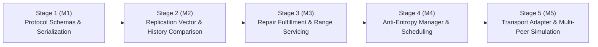

# Phase 7.4: Staged Implementation Roadmap

**Milestone:** Phase 7.4 (State Replication & Anti-Entropy Implementation Plan)  
**Status:** PLANNING ONLY — IMPLEMENTATION NOT AUTHORIZED  
**Approved Baseline:** Phase 7.2-R9 (`1825de1`)  
**Previous Implementation Baseline:** Phase 7.3-R5-H (`e49b81a` / docs `30e6d0d`)  
**Date:** 2026-11-17  

---

## 1. Executive Implementation Strategy

Phase 7.4 introduces the distributed anti-entropy and replication layer on top of the frozen Phase 7.3 engine. To minimize risk, eliminate regressions, and guarantee strict conformance with frozen architectural invariants, implementation is divided into five incremental, independently verifiable stages:

Each stage terminates at a hard verification gate requiring 100% automated test passage and zero regressions across the existing 623 monorepo tests.

---

## 2. Stage Breakdown & Deliverables

### Stage 1 (M1): Protocol Schemas & Wire Contracts (`@syncplay/protocol`)

**Objective:** Define the complete wire message schemas, type exports, validation rules, and serialization helpers for anti-entropy messaging.

#### Deliverables & File Changes:
1. `packages/protocol/src/payloads/repair.ts`:
   - Export `StateDigestPayloadSchema` and `StateDigestPayload` with `formatVersion: z.literal(2)` discriminator.
   - Export `RepairRejectedPayloadSchema` and `RepairRejectedPayload` with correlation `requestId`.
   - Update `OperationBatchPayloadSchema` with optional correlation `requestId: z.string().min(1).max(128).optional()`.
   - Update `RepairRequestPayloadSchema` with `.refine()` boundary constraints (max 32 ops range).
2. `packages/protocol/src/message-types.ts`:
   - Add `STATE_DIGEST`, `REPAIR_REQUEST`, `REPAIR_REJECTED` to message type constants.
3. `packages/protocol/src/index.ts`:
   - Export all new payload types and schemas.
4. `packages/protocol/src/__tests__/payloads.test.ts`:
   - Add comprehensive unit tests validating valid payloads, boundary limits, invalid ranges, and schema rejections.
   - Test `formatVersion: 2` discrimination: verify that digests without `formatVersion` or with legacy Phase 2 structures are rejected by schema.
   - Test maximum 32-operation range validation in `RepairRequestPayloadSchema`.

#### Verification Gate (M1):
- All `@syncplay/protocol` tests pass.
- Monorepo test count increases from 623 to $\ge 640$.
- Zero runtime modifications to `sync-engine` or `control-events`.

---

### Stage 2 (M2): Replication Vector & History Comparison (`@syncplay/sync-engine`)

**Objective:** Implement replication vector comparison, divergence detection, eligibility filtering, and tail fingerprint checking in the SyncEngine.

#### Deliverables & File Changes:
1. `packages/sync-engine/src/replication/replication-comparator.ts` (New File):
   - Compare two replication vectors: determine domination, lag, or incomparable progress.
   - Extract exact missing sequence ranges per origin.
   - Detect sequence collisions / forks via tail fingerprint comparison ($H_A[p] \ne H_B[p]$).
   - Implement supplier eligibility filtering: verify active connection generation, $V_S[origin] \ge toSeq$, and $fromSeq > \text{snapshotFrontier}[origin]$ before SRTT evaluation.
   - Detect compacted horizon boundaries ($fromSeq \le \text{snapshotFrontier}[origin]$) and flag handoff to Phase 7.5.
2. `packages/sync-engine/src/log/ordered-operation-log.ts`:
   - Add `getTailFingerprint(originPeerId: string): string | undefined`.
   - Add `getReplicationFrontier(): Readonly<Record<string, number>>`.
3. `packages/sync-engine/src/engine/leaderless-sync-engine.ts`:
   - Add `createLocalDigest(): StateDigestPayload` with `formatVersion: 2`.
   - Add `compareRemoteDigest(remoteDigest: StateDigestPayload): DigestComparisonResult` with legacy Phase 2 drop logic and future version drop logic.
4. `packages/sync-engine/src/__tests__/replication-comparator.test.ts` (New File):
   - Test vector domination ($V_A \ge V_B$).
   - Test vector lag ($V_A < V_B$) with exact missing range computation.
   - Test concurrent incomparable vectors ($V_A \not\le V_B \land V_B \not\le V_A$).
   - Test horizon boundary detection ($V_A < V_B.\text{snapshotFrontier}$) triggering handoff.
   - Test tail fingerprint mismatch / fork detection.
   - Test eligibility filter rejecting candidates with stale generations or compacted ranges.

#### Verification Gate (M2):
- All replication comparator unit tests pass.
- Full `@syncplay/sync-engine` suite passes.
- Monorepo tests $\ge 665$.

---

### Stage 3 (M3): Repair Fulfillment & Range Servicing (`@syncplay/sync-engine`)

**Objective:** Enable a peer to act as an anti-entropy supplier, servicing inbound repair requests from its retained operation log with strict size and boundary constraints.

#### Deliverables & File Changes:
1. `packages/sync-engine/src/engine/leaderless-sync-engine.ts`:
   - Implement `serveRepairRequest(request: RepairRequestPayload): OperationBatchPayload | RepairRejectedPayload`.
   - Echo request's `requestId` in response payload.
   - Query `OrderedOperationLog.getRange(origin, fromSeq, toSeq)`.
   - Enforce 64 KB WebRTC DataChannel message size limit: measure serialized JSON length against $\min(65536, \text{sctp.maxMessageSize})$; slice batch into smaller contiguous sub-range if cap is exceeded.
   - If operations are present: construct `OperationBatchPayload` (max 32 ops, supplierPeerId = localPeerId).
   - If operations predated retained horizon: return `RepairRejectedPayload` (`OUTSIDE_HORIZON`, retainedHorizon).
   - If origin unknown: return `RepairRejectedPayload` (`ORIGIN_UNKNOWN`).
2. `packages/sync-engine/src/log/ordered-operation-log.ts`:
   - Enhance `getRange` with boundary checks and safe slice sizing.
3. `packages/sync-engine/src/__tests__/repair-fulfillment.test.ts` (New File):
   - Test serving exact range from middle of log.
   - Test serving range extending to current head.
   - Test pre-send serialization length verification and slicing to $\le 64\text{ KB}$.
   - Test requesting range partially compacted $\to$ returns retained subset or outside horizon.
   - Test requesting range completely compacted $\to$ returns `REPAIR_REJECTED` (`OUTSIDE_HORIZON`).
   - Test unknown origin $\to$ returns `REPAIR_REJECTED` (`ORIGIN_UNKNOWN`).
   - Verify `requestId` correlation echoing.
   - Verify zero state mutation on supplier when serving repairs.

#### Verification Gate (M3):
- All repair fulfillment tests pass.
- Ingestion of served batches into another `LeaderlessSyncEngine` succeeds via `ingestRepairBatch()`.
- Monorepo tests $\ge 685$.

---

### Stage 4 (M4): Anti-Entropy Manager & Scheduling (`@syncplay/sync-engine`)

**Objective:** Implement automated anti-entropy scheduling, periodic digest broadcasts, reactive gap repair dispatch, supplier selection, failover, epoch cancellation, and retry backoff.

#### Deliverables & File Changes:
1. `packages/sync-engine/src/replication/anti-entropy-manager.ts` (New File):
   - Periodic digest timer ($5000\text{ms} \pm 1000\text{ms}$ jitter).
   - Reactive gap repair dispatch when `PendingDependencyQueue` buffers events (targeting $\le 1200\text{ms}$ convergence).
   - Supplier selection algorithm (eligibility filter $\to$ author preferred $\to$ min SRTT fallback).
   - In-flight request tracker with correlation `requestId`, timeout ($1500\text{ms}$), failover, and retry count ($\le 3$).
   - Partial batch tracking: advance $V_{\text{rep}}$, re-dispatch remainder $[from+M, to]$ until fulfilled ($V_{\text{rep}} \ge toSeq$).
   - Epoch transition hook: cancel all active repair requests and timers from older epochs on `transitionEpoch(newEpoch)`.
   - Conflict handling: halt origin repair and set `isDegraded = true` upon `REJECTED_SEQUENCE_CONFLICT` or `REJECTED_IDENTITY_CONFLICT`.
   - Per-peer and room-wide concurrency limits (2 per peer, 16 room).
   - Token bucket rate limiter for inbound and outbound digests.
2. `packages/sync-engine/src/engine/leaderless-sync-engine.ts`:
   - Integrate `AntiEntropyManager` into engine lifecycle (`receive()`, `transitionEpoch()`, `dispose()`).
3. `packages/sync-engine/src/__tests__/anti-entropy-manager.test.ts` (New File):
   - Test periodic timer firing with jitter.
   - Test rate limiting drops excessive digest requests.
   - Test reactive repair dispatch on gap.
   - Test timeout triggers retry with exponential backoff and failover to next eligible supplier.
   - Test max retries exceeded triggers `onHistoryExhausted`.
   - Test supplier disconnect immediately re-routes pending requests to alternate eligible peer.
   - Test epoch transition cancels older-epoch requests and clears pending timers.
   - Test duplicate request/response idempotence.

#### Verification Gate (M4):
- All scheduling and flow control tests pass.
- Monorepo tests $\ge 710$.

---

### Stage 5 (M5): Transport Adapter & End-to-End Simulation Testing

**Objective:** Wire anti-entropy to the WebRTC DataChannel transport and run multi-peer network simulations under standardized synthetic network conditions.

#### Deliverables & File Changes:
1. `packages/peer-mesh/src/anti-entropy-transport-adapter.ts` (New File):
   - Connect DataChannel message listeners to `AntiEntropyManager`.
   - Enforce 64 KB message size limit: drop frames $> 65536$ bytes before JSON parsing.
   - Bind `AuthenticatedSupplierContext` using `TrustedTransportAdapter` and capability (R5-H).
2. `packages/control-events/src/control-event-service.ts`:
   - Route `sync:state-digest`, `sync:repair-request`, `sync:operation-batch`, and `sync:repair-rejected`.
3. `packages/sync-engine/src/__tests__/anti-entropy-simulation.test.ts` (New File):
   - 3-peer full mesh simulation under synthetic network conditions: 20% packet loss, 50ms one-way latency (100ms RTT), 10ms jitter.
   - Verify reactive convergence $\le 1200\text{ms}$ upon immediate gap detection.
   - Verify silent divergence convergence $\le 7200\text{ms}$ after unannounced packet loss.
   - Verify supplier failover convergence $\le 3000\text{ms}$ upon supplier disconnect.
   - 4-peer asymmetric partition simulation ($\{A, B\}$ and $\{C, D\}$ healing to full mesh).
   - Verify that all peers achieve identical `replicationVector` and identical `PlaybackState` at a common evaluation time.
   - Verify bounded queue behavior and memory footprint under heavy concurrent traffic.

#### Verification Gate (M5):
- 100% test passage across entire monorepo.
- Monorepo test count $\ge 730$.
- Production TypeScript build (`tsc`) and client demo bundle (`vite build`) succeed with 0 errors.

---

## 3. Detailed File Modification Plan

| File Path | Action | Scope of Modifications |
|---|---|---|
| `packages/protocol/src/payloads/repair.ts` | Edit | Add `StateDigestPayloadSchema`, `RepairRejectedPayloadSchema`. |
| `packages/protocol/src/message-types.ts` | Edit | Add anti-entropy wire constants. |
| `packages/protocol/src/index.ts` | Edit | Export new payload types. |
| `packages/sync-engine/src/replication/replication-comparator.ts` | **Create** | Vector comparison and gap detection logic. |
| `packages/sync-engine/src/replication/anti-entropy-manager.ts` | **Create** | Background scheduling, timers, request tracking. |
| `packages/sync-engine/src/replication/types.ts` | **Create** | Internal replication interfaces. |
| `packages/sync-engine/src/log/ordered-operation-log.ts` | Edit | Tail fingerprint retrieval and horizon verification. |
| `packages/sync-engine/src/engine/leaderless-sync-engine.ts` | Edit | Wire anti-entropy manager and repair serving. |
| `packages/sync-engine/src/index.ts` | Edit | Export anti-entropy interfaces. |
| `packages/peer-mesh/src/anti-entropy-transport-adapter.ts` | **Create** | Transport DataChannel binding. |
| `packages/control-events/src/control-event-service.ts` | Edit | Route anti-entropy message types. |

---

## 4. Non-Regression Safeguards

During Phase 7.4 execution, automated checks must verify:
1. **Clock Formula Untouched:** $L(e) = 1 + \max(deps)$ creation and exact equality validation.
2. **Capability Security Untouched:** `TransportRegistrationCapability` reference identity and `WeakSet` enforcement (R5-H).
3. **No Generation Defaulting:** `peerGenerations.get(supplier) ?? 1` must never be re-introduced.
4. **Log Retention Invariant:** Checkpoint horizon ($K=256$) and base snapshot folding remain strictly bounded.
5. **Phase 7.5 Isolation:** No snapshot transfer code or dynamic snapshot creation added in Phase 7.4.

---

**Phase 7.4 is in planning state. Implementation has not started and remains subject to separate authorization.**

