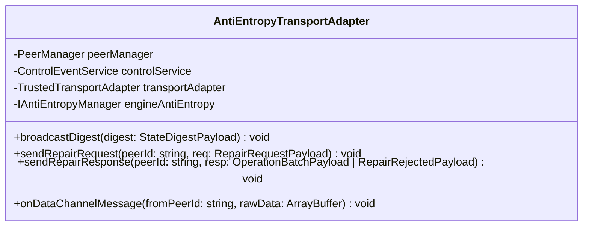

# Phase 7.4: Interface Specification & Message Contracts

**Milestone:** Phase 7.4 (State Replication & Anti-Entropy)  
**Status:** SPECIFICATION ONLY — IMPLEMENTATION NOT AUTHORIZED  
**Approved Baseline:** Phase 7.2-R9 (`1825de1`), Phase 7.3-R5-H (`e49b81a` / docs `30e6d0d`)  
**Date:** 2026-11-17  

---

## 1. Protocol Package Message Contracts (`@syncplay/protocol`)

All wire messages are encoded using JSON over WebRTC DataChannels (SCTP over DTLS). Schemas are defined using Zod and enforced strictly before reaching internal engine components.

### 1.1. Message Type Enumeration Extension

In `@syncplay/protocol/src/message-types.ts`, the following message types govern Phase 7.4 operations:

```ts
export const SYNC_MESSAGE_TYPES = {
  // Existing Phase 7.3 types
  CONTROL_EVENT: 'control:event',
  OPERATION_BATCH: 'sync:operation-batch',
  
  // Phase 7.4 Anti-Entropy Extensions
  STATE_DIGEST: 'sync:state-digest',
  REPAIR_REQUEST: 'sync:repair-request',
  REPAIR_REJECTED: 'sync:repair-rejected',
} as const;

export type SyncMessageType = (typeof SYNC_MESSAGE_TYPES)[keyof typeof SYNC_MESSAGE_TYPES];
```

---

### 1.2. `STATE_DIGEST` (`sync:state-digest`)

Periodic or event-triggered message broadcasting a peer's contiguous replication knowledge and frontier metadata.

#### Schema Definition:
```ts
import { z } from 'zod';

export const StateDigestPayloadSchema = z.object({
  /**
   * Protocol format version discriminator.
   * Literal 2 strictly differentiates Phase 7.4 multi-vector digests from
   * Phase 2 legacy digests ({ digestId, stateVersion, digest }).
   */
  formatVersion: z.literal(2),

  /** Session identifier to ensure messages belong to active room. */
  sessionId: z.string().min(1).max(128),

  /** The peer transmitting this digest. */
  senderPeerId: z.string().min(1).max(128),

  /** Active connection generation of the sender at dispatch time. */
  connectionGeneration: z.number().int().positive().max(Number.MAX_SAFE_INTEGER),

  /** Current membership epoch acknowledged by the sender. */
  membershipEpoch: z.number().int().positive().max(Number.MAX_SAFE_INTEGER),

  /** Monotonically increasing engine state version. */
  stateVersion: z.number().int().nonnegative().max(Number.MAX_SAFE_INTEGER),

  /**
   * Contiguous highest applied sequence numbers per origin.
   * V_rep[p] = k guarantees sequences 1..k have been reduced.
   */
  replicationVector: z.record(
    z.string().min(1).max(128),
    z.number().int().nonnegative().max(Number.MAX_SAFE_INTEGER),
  ),

  /**
   * Base snapshot frontier: oldest retained sequence per origin.
   * Sequences below this have been compacted out of the log.
   */
  snapshotFrontier: z.record(
    z.string().min(1).max(128),
    z.number().int().nonnegative().max(Number.MAX_SAFE_INTEGER),
  ),

  /**
   * Tail operation fingerprints for each origin (SHA-256 hash prefix).
   * Used to detect sequence collisions or silent historical divergence.
   */
  historyFingerprints: z.record(
    z.string().min(1).max(128),
    z.string().regex(/^[0-9a-f]{16,64}$/),
  ),

  /** Monotonic local timestamp (ms) when digest was generated. */
  sentAt: z.number().nonnegative(),
});

export type StateDigestPayload = z.infer<typeof StateDigestPayloadSchema>;
```

#### Operational Characteristics:
- **Direction:** P2P Broadcast (sent to all active mesh peers).
- **Semantics:** Idempotent state announcement (unacknowledged).
- **Rate Limit:** Maximum 1 per peer per 2 seconds (token bucket refill rate 0.5/sec, burst 2).
- **Maximum Size:** $\le 8\text{ KB}$ for rooms with up to 64 peers.
- **Delivery Requirements:** Reliable, unordered SCTP stream (out-of-order digests are superseded by newer `stateVersion` or `sentAt`).

#### Protocol Version Compatibility & Discrimination:
- **Discriminator Enforcement:** Inbound frames are evaluated against `formatVersion === 2`.
- **Legacy Phase 2 Digests:** Packets lacking `formatVersion` or containing legacy Phase 2 fields (`digestId`, `digest`) are safely ignored and dropped with a debug-level log (`"Ignoring legacy Phase 2 state digest: incompatible format"`), producing zero mutation on local replication vectors or clocks.
- **Future Unsupported Versions:** Packets advertising `formatVersion > 2` are safely dropped with a warning-level diagnostic log, preventing engine crashes.
- **Heterogeneous Networks:** Version-compatible peers exchange digests and execute anti-entropy; mixed-version peers continue baseline live playback without anti-entropy corruption.

---

### 1.3. `REPAIR_REQUEST` (`sync:repair-request`)

Targeted request dispatched by a lagging peer to a specific supplier to fetch a contiguous range of missing operations.

#### Schema Definition:
```ts
export const RepairRequestPayloadSchema = z.object({
  /** Globally unique request identifier for correlation and timeout tracking. */
  requestId: z.string().min(1).max(128),

  /** Session identifier. */
  sessionId: z.string().min(1).max(128),

  /** The peer requesting the missing operations. */
  requesterPeerId: z.string().min(1).max(128),

  /** The origin peer whose historical operations are being requested. */
  targetOriginPeerId: z.string().min(1).max(128),

  /** First missing sequence number (inclusive). */
  fromSequence: z.number().int().positive().max(Number.MAX_SAFE_INTEGER),

  /** Last missing sequence number (inclusive). */
  toSequence: z.number().int().positive().max(Number.MAX_SAFE_INTEGER),

  /** Membership epoch under which this request is authorized. */
  membershipEpoch: z.number().int().positive().max(Number.MAX_SAFE_INTEGER),
}).refine(
  (data) => data.toSequence >= data.fromSequence,
  { message: 'toSequence must be greater than or equal to fromSequence' },
).refine(
  (data) => (data.toSequence - data.fromSequence + 1) <= 32,
  { message: 'Requested range cannot exceed 32 operations per request' },
);

export type RepairRequestPayload = z.infer<typeof RepairRequestPayloadSchema>;
```

#### Operational Characteristics:
- **Direction:** P2P Unicast (sent to selected supplier peer).
- **Semantics:** Request-response (expects `OPERATION_BATCH` or `REPAIR_REJECTED`).
- **Timeout:** $1500\text{ms}$ before initiating retry or failover.
- **Maximum Range:** 32 operations per request.
- **Delivery Requirements:** Reliable, ordered SCTP stream.

---

### 1.4. `OPERATION_BATCH` (`sync:operation-batch`)

Payload fulfilling a `REPAIR_REQUEST`, delivering a verified batch of historical operations. (Already approved in Phase 7.3).

#### Schema Definition:
```ts
export const SerializedControlOperationSchema = z.object({
  logicalEventId: z.string().min(1).max(128),
  originPeerId: z.string().min(1).max(128),
  membershipEpoch: z.number().int().nonnegative(),
  messageType: z.enum(['PLAY', 'PAUSE', 'SEEK', 'RATE_CHANGE']),
  logicalTimestamp: z.number().int().nonnegative().max(Number.MAX_SAFE_INTEGER),
  originSequenceNumber: z.number().int().positive().max(Number.MAX_SAFE_INTEGER),
  causalContext: z.record(
    z.string().min(1).max(128),
    z.number().int().nonnegative().max(Number.MAX_SAFE_INTEGER),
  ),
  payload: z.unknown(),
});

export type SerializedControlOperation = z.infer<typeof SerializedControlOperationSchema>;

export const OperationBatchPayloadSchema = z.object({
  /** Correlation identifier echoing the RepairRequestPayload.requestId when fulfilling a repair. */
  requestId: z.string().min(1).max(128).optional(),
  sessionId: z.string().min(1).max(128),
  supplierPeerId: z.string().min(1).max(128),
  originPeerId: z.string().min(1).max(128),
  fromSequence: z.number().int().positive().max(Number.MAX_SAFE_INTEGER),
  toSequence: z.number().int().positive().max(Number.MAX_SAFE_INTEGER),
  operations: z.array(SerializedControlOperationSchema).max(32),
});

export type OperationBatchPayload = z.infer<typeof OperationBatchPayloadSchema>;
```

#### Operational Characteristics:
- **Direction:** P2P Unicast (supplier to requester).
- **Maximum Operations:** 32 operations per batch.
- **Maximum Frame Size (64 KB):** Maximum $65,536$ bytes serialized.
  > [!NOTE] WebRTC DataChannel Limit vs SCTP MTU
  > The 64 KB limit ($65,536$ bytes) is the **WebRTC DataChannel maximum interoperable message size** defined by RFC 8831 / RFC 8841 and W3C WebRTC specifications across standard browsers (Chrome, Firefox, Safari). It is **not** an SCTP MTU (which is 1200–1280 bytes on the wire).
- **Pre-Send Serialized Size Verification (Sender):** The supplier serializes the batch to UTF-8 JSON. If byte length exceeds $\min(65536, \text{negotiated } \text{sctp.maxMessageSize})$, the batch is sliced into fewer operations (e.g. 16 or 8) so that the serialized frame strictly complies with the size cap.
- **Post-Receive Frame Size Verification (Receiver):** The receiver checks incoming raw buffer length before calling `JSON.parse()`. If `rawPayload.byteLength > 65536` (or negotiated `sctp.maxMessageSize`), the frame is **dropped immediately without parsing** to prevent buffer allocation exhaustion / DoS.
- **Delivery Requirements:** Reliable, ordered SCTP stream.

---

### 1.5. `REPAIR_REJECTED` (`sync:repair-rejected`)

Explicit response when a supplier cannot satisfy a `REPAIR_REQUEST`.

#### Schema Definition:
```ts
export const REPAIR_REJECTION_REASONS = [
  'OUTSIDE_HORIZON',     // Requested operations have been compacted to base snapshot
  'ORIGIN_UNKNOWN',      // Supplier has never observed this origin peer
  'RATE_LIMITED',       // Supplier is receiving too many repair requests
  'EPOCH_MISMATCH',      // Supplier is operating on a different membership epoch
  'BUSY',                // Supplier queue full or undergoing re-sync
] as const;

export type RepairRejectionReason = (typeof REPAIR_REJECTION_REASONS)[number];

export const RepairRejectedPayloadSchema = z.object({
  /** Correlation ID matching the original RepairRequestPayload.requestId. */
  requestId: z.string().min(1).max(128),

  /** Session identifier. */
  sessionId: z.string().min(1).max(128),

  /** The supplier rejecting the request. */
  supplierPeerId: z.string().min(1).max(128),

  /** The requested origin peer. */
  targetOriginPeerId: z.string().min(1).max(128),

  /** The requested sequence boundaries. */
  fromSequence: z.number().int().positive().max(Number.MAX_SAFE_INTEGER),
  toSequence: z.number().int().positive().max(Number.MAX_SAFE_INTEGER),

  /** Machine-readable reason for the rejection. */
  reason: z.enum(REPAIR_REJECTION_REASONS),

  /**
   * If reason is 'OUTSIDE_HORIZON', provides the oldest sequence currently
   * retained in the supplier's log for this origin.
   */
  retainedHorizonSequence: z.number().int().positive().max(Number.MAX_SAFE_INTEGER).optional(),
});

export type RepairRejectedPayload = z.infer<typeof RepairRejectedPayloadSchema>;
```

#### Operational Characteristics:
- **Direction:** P2P Unicast (supplier to requester).
- **Semantics:** Explicit negative acknowledgement preventing request timeout stalls.

---

## 2. SyncEngine Subsystem Interfaces (`@syncplay/sync-engine`)

The Anti-Entropy subsystem integrates with `LeaderlessSyncEngine` via clean interfaces without altering the core Lamport clock or conflict resolution engine.

### 2.1. `IAntiEntropyManager` Interface

The manager coordinating state comparison, gap scheduling, request tracking, and supplier selection.

```ts
export interface DigestComparisonResult {
  readonly remotePeerId: string;
  readonly missingFromLocal: ReadonlyArray<MissingSequenceRange>;
  readonly missingFromRemote: ReadonlyArray<MissingSequenceRange>;
  readonly forkDetected: boolean;
  readonly conflictingOrigins: ReadonlyArray<string>;
  readonly outsideLocalHorizon: boolean;
}

export interface AntiEntropyStatus {
  readonly activeRequestsCount: number;
  readonly pendingGapsCount: number;
  readonly lastDigestSentAt: number;
  readonly totalRepairsCompleted: number;
  readonly totalRepairsFailed: number;
  readonly degraded: boolean;
}

export interface IAntiEntropyManager {
  /** Generates the local StateDigestPayload for broadcasting. */
  createLocalDigest(): StateDigestPayload;

  /** Evaluates an incoming remote digest against local replication knowledge. */
  processRemoteDigest(digest: StateDigestPayload): DigestComparisonResult;

  /** Serves an inbound REPAIR_REQUEST from local log history. */
  serveRepairRequest(request: RepairRequestPayload): OperationBatchPayload | RepairRejectedPayload;

  /** Schedules targeted repair requests for all currently detected sequence gaps. */
  reconcileGaps(): void;

  /** Cancels active repair requests to a departing peer. */
  onPeerDisconnected(peerId: string): void;

  /** Resets state upon membership epoch transition. */
  onEpochTransition(newEpoch: number): void;

  /** Current diagnostic status. */
  getStatus(): AntiEntropyStatus;

  /** Disposes all active timers and background routines. */
  dispose(): void;
}
```

---

### 2.2. Engine Integration & Callback Contracts

`LeaderlessSyncEngine` exposes the following hooks to drive anti-entropy:

```ts
export interface AntiEntropyCallbacks {
  /** Emitted when local digest should be transmitted to network peers. */
  onBroadcastDigest: (digest: StateDigestPayload) => void;

  /** Emitted when a unicast repair request should be sent to a specific peer. */
  onSendRepairRequest: (targetPeerId: string, request: RepairRequestPayload) => void;

  /** Emitted when a repair response should be transmitted back to the requester. */
  onSendRepairResponse: (targetPeerId: string, response: OperationBatchPayload | RepairRejectedPayload) => void;

  /** Emitted when a required sequence is unavailable in all peer logs (Phase 7.5 Handoff). */
  onHistoryExhausted: (details: {
    originPeerId: string;
    missingSequence: number;
    highestRetainedSequence: number;
  }) => void;
}
```

---

## 3. Transport Adapter Layer (`@syncplay/peer-mesh` & `@syncplay/control-events`)

The transport layer bridges between raw WebRTC DataChannels and the engine's anti-entropy interfaces.



### 3.1. Framing and Serialization Protocol

1. **Envelope Header:** All anti-entropy frames share the standard envelope structure:
   ```ts
   interface TransportFrameHeader {
     type: SyncMessageType;
     sessionId: string;
     senderPeerId: string;
     connectionGeneration: number;
     payload: unknown;
   }
   ```
2. **Channel Selection:** Anti-entropy repair messages (`REPAIR_REQUEST`, `OPERATION_BATCH`, `REPAIR_REJECTED`) are transmitted over the **ordered, reliable** WebRTC DataChannel (`syncplay-control`).
3. **Digest Channel:** `STATE_DIGEST` messages may be transmitted over an **unordered, reliable** DataChannel to prevent head-of-line blocking during heavy playback activity.
4. **Transport Message Size Constraints (RFC 8831 / RFC 8841):**
   - The maximum payload size for any DataChannel message is $65,536$ bytes (WebRTC DataChannel maximum interoperable message size across standard browsers).
   - **Sender:** Calculates UTF-8 JSON size. If byte length exceeds $\min(65536, \text{negotiated } \text{sctp.maxMessageSize})$, the batch is automatically sliced to a smaller contiguous operation count.
   - **Receiver:** Inspects `rawData.byteLength` before calling `JSON.parse()`. If `byteLength > 65536` (or negotiated `sctp.maxMessageSize`), the frame is **dropped immediately without parsing** to prevent buffer allocation exhaustion.

### 3.2. Verification at Transport Boundary

Upon packet arrival in `AntiEntropyTransportAdapter`:
1. Validates `fromPeerId` matches the physical WebRTC DataChannel identity.
2. Checks frame size $\le 65536$ bytes; drops immediately without parsing if oversized.
3. Checks `connectionGeneration === peerManager.getPeerGeneration(fromPeerId)`.
4. If the payload is an `OPERATION_BATCH`:
   - Validates that the active membership epoch matches local engine epoch; drops with `REJECTED_INVALID` if obsolete.
   - Calls `transportAdapter.registerContext(fromPeerId, connectionGeneration)` using the injected `TransportRegistrationCapability` (R5-H).
   - Hands the batch and registered context to `engine.ingestRepairBatch()`.
   - On successful admission, checks if $V_{\text{rep}}[origin] \ge toSeq$ to retire the pending repair task; if partial, automatically requests the remaining range.
5. If the payload is a `REPAIR_REQUEST`:
   - Delegates to `engineAntiEntropy.serveRepairRequest(payload)`.
   - Sends the resulting batch (sliced to $\le 64\text{ KB}$) or rejection back to `fromPeerId`.

---

## 4. Error Handling and Rejection Codes

The anti-entropy subsystem utilizes the following machine-readable error codes:

| Error Code | Layer | Meaning | Resolution |
|---|---|---|---|
| `REJECTED_INVALID` | Engine | Malformed schema, obsolete epoch, or unregistered transport context. | Drop packet; isolate peer if repeated. |
| `REJECTED_IDENTITY_CONFLICT` | Engine | An operation's immutable content differs from a retained op with the same ID. | Abort repair; freeze replication for origin; set `isDegraded = true`. |
| `REJECTED_SEQUENCE_CONFLICT` | Engine | Two distinct operation IDs share the same origin sequence number. | Abort repair; freeze replication for origin; set `isDegraded = true`. |
| `REJECTED_CAPACITY` | Engine | `PendingDependencyQueue` capacity ($K=256$) exceeded. | Discard incoming event; backoff repair. |
| `REPAIR_TIMEOUT` | AntiEntropy | Supplier did not respond within $1500\text{ms}$. | Retry with backoff or failover to next eligible supplier. |
| `OUTSIDE_HORIZON` | AntiEntropy | Requested sequence predates supplier's retained history. | Trigger Phase 7.5 snapshot catch-up. |
| `NO_ELIGIBLE_REPAIR_SUPPLIER` | AntiEntropy | No connected peer meets generation, frontier, and uncompacted horizon criteria. | Mark `isDegraded = true`; trigger `onHistoryExhausted()`. |

---

**Phase 7.4 is in planning state. Implementation has not started and remains subject to separate authorization.**

