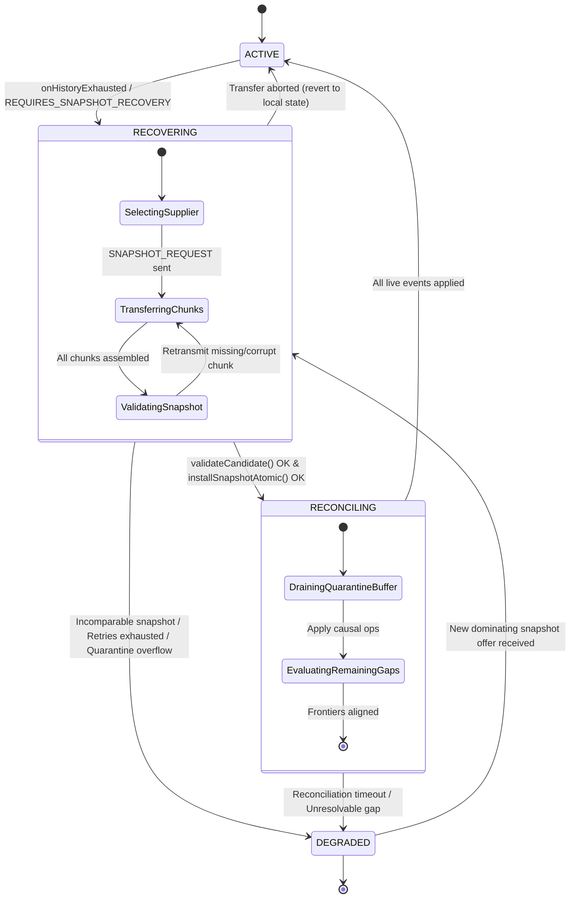

# Phase 7.5 — Fault Tolerance & State Recovery: Architecture Specification

**Status:** APPROVED ARCHITECTURAL DESIGN (RE-AUDITED)  
**Date:** 2026-11-19  
**Branch Baseline:** `main` at `3a3d9e5`  
**Frozen Baselines:** Phase 7.3 (`e49b81a`), Phase 7.4 M1–M5 (`dbd5217`, `3a3d9e5`)  

---

## 1. System Context Diagram

```
+----------------------------------------------------------------------------------------------------+
|                                    SYNCPLAY ARCHITECTURE CONTEXT                                   |
|                                                                                                    |
|  +----------------------------------------------------------------------------------------------+  |
|  |                                  APPLICATION / SDK LAYER                                     |  |
|  |  PlaybackControls, HTML5 Media Adapter, UI State Listeners, EngineHealthCallbacks             |  |
|  +-----------------------------------------------^----------------------------------------------+  |
|                                                  | State / Health Notifications                    |
|  +-----------------------------------------------v----------------------------------------------+  |
|  |                                     SYNC ENGINE LAYER                                        |  |
|  |                                                                                              |  |
|  |  +------------------------------------+      +--------------------------------------------+  |  |
|  |  |   RecoveryCoordinator (Phase 7.5)   |      |        AntiEntropyManager (Phase 7.4)      |  |  |
|  |  |  - RecoveryStateMachine            |      |  - RepairRequestPipeline (Requester M3)    |  |  |
|  |  |  - SnapshotTransferManager         |<---->|  - RepairSupplierService (Supplier M4)     |  |  |
|  |  |  - SnapshotInstaller (Stage/Commit)|      |  - ReplicationComparator                   |  |  |
|  |  |  - QuarantineBuffer (Cap: 1000)    |      +----------------------^---------------------+  |  |
|  |  +------------------^-----------------+                             |                         |  |
|  |                     |                                               |                         |  |
|  |  +------------------v-----------------------------------------------v---------------------+  |  |
|  |  |                           LeaderlessSyncEngine (Phase 7.3 Core)                        |  |  |
|  |  |  - OrderedOperationLog (Compacted checkpoints, history pruning, base snapshot)         |  |  |
|  |  |  - LogicalClockManager (Lamport clock tracking, exact causal advancement, reseed)        |  |  |
|  |  |  - Causal frontier vectors (replicationVector, snapshotFrontier, localCausalContext)   |  |  |
|  |  +------------------------------------------^---------------------------------------------+  |  |
|  +---------------------------------------------|------------------------------------------------+  |
|                                                | Trusted Capability Registration                   |
|  +---------------------------------------------v------------------------------------------------+  |
|  |                            TRUSTED TRANSPORT ADAPTER (Phase 7.4 M5)                          |  |
|  |  - Capability-gated inbound context creation (AuthenticatedSupplierContext / RequesterContext) |
|  |  - Exact UTF-8 wire size measurement (min(64KB, sctpLimit))                                 |  |
|  |  - Epoch & generation currency validation immediately before serialization                   |  |
|  +---------------------------------------------^------------------------------------------------+  |
|                                                | Unchanged Serialized Wire Bytes                   |
|  +---------------------------------------------v------------------------------------------------+  |
|  |                                   PEER MESH LAYER (WebRTC)                                   |  |
|  |  PeerManager, WebRTCTransport, DataChannels, ConnectionGeneration, RTTEngine                 |  |
|  +----------------------------------------------------------------------------------------------+  |
+----------------------------------------------------------------------------------------------------+
```

---

## 2. Core Architectural Principles & Re-Evaluated Invariants

1. **Absence of Globally Agreed Stable Frontier:**
   In a leaderless WebRTC mesh, a globally agreed consensus frontier does NOT exist. Peers autonomously prune operation logs bounded by the membership-scoped safe frontier ($V_{\text{epoch\_safe}}$) or by local memory bounds ($K=256$). Snapshot recovery is therefore a **first-class protocol requirement** to service reconnecting peers who fall outside supplier log horizons.
2. **Strict Vector Domination & Historical Compatibility:**
   A snapshot is eligible for installation if and only if $V_S[p] \ge V_L[p]$ for all known origins AND checkpoint fingerprints match at all common sequences. Vector domination without checkpoint verification is strictly insufficient.
3. **No Arbitrary Tie-Breaking:**
   If two snapshots have incomparable frontiers, the engine transitions to `DEGRADED` state and notifies the application. Arbitrary tie-breaking (by peer ID or wall clock) is mathematically forbidden.
4. **Dynamic Chunk Sizing for WebRTC DataChannels:**
   Chunk payload sizes are dynamically calculated per peer based on `PeerManager.getSctpMaxMessageSize(peerId)`. The complete JSON wire message is serialized once, measured, and verified before being sent over `RTCDataChannel.send()`.
5. **Exact Lamport Reseed:**
   Lamport clocks are reseeded strictly as $L_{\text{local}} = \max(L_{\text{local}}, S.\text{maxLogicalTimestamp})$ **without $+1$**, preventing clock runaway.
6. **Isolated Staging and Atomic Commit:**
   Snapshot validation executes in a pre-commit phase (`validateCandidate`). Installation is synchronous and atomic, with state backup and rollback on error.
7. **Quarantine Buffer & Local Input Fencing:**
   Local control operations are blocked while recovering. Incoming live operations are quarantined (capped at 1,000 operations). Exceeding capacity synchronously aborts transfer to `DEGRADED`.

---

## 3. Four-State Recovery State Machine



### State Definitions and Behaviors

| State | Local Control Inputs | Incoming Broadcast Operations | Inbound Snapshot Transfers | Description |
| :--- | :--- | :--- | :--- | :--- |
| **`ACTIVE`** | Allowed (processed immediately) | Processed via standard Phase 7.3 causal ordering | None | Normal playback synchronization. |
| **`RECOVERING`** | **Blocked** (rejects or queues locally) | **Quarantined** in `QuarantineBuffer` (cap: 1000) | Exactly 1 active transfer | Inbound snapshot chunk transfer and pre-validation. |
| **`RECONCILING`** | **Blocked** | **Quarantined** until buffer drains | None | Snapshot installed; draining quarantine buffer in causal order. |
| **`DEGRADED`** | **Blocked** | Discarded or held; state frozen | None | Causal divergence detected or retries exhausted; requires application intervention. |

---

## 4. Chunked Transfer and Transport Boundary Integration

### 4.1 Dynamic Chunk Sizing Derivation
To ensure messages never exceed negotiated SCTP limits (RFC 8841):

$$\text{effectiveLimit} = \min(65536, \text{sctpLimit} \text{ if defined and } > 0 \text{ else } 65536)$$
$$\text{envelopeBudget} = 768 \text{ bytes (JSON keys, UUIDs, chunkSha256, session metadata)}$$
$$\text{availableBase64Bytes} = \max(0, \text{effectiveLimit} - \text{envelopeBudget})$$
$$\text{dynamicChunkBytes} = \min(32768, \lfloor \text{availableBase64Bytes} \times \frac{3}{4} \rfloor)$$

- **Standard 64 KB SCTP limit:** `dynamicChunkBytes = 32,768` bytes (32 KB).
- **Constrained 16 KB SCTP limit:** `dynamicChunkBytes = 11,712` bytes.
- **Unfeasible Limit ($< 2048$ bytes):** Aborts with `TRANSPORT_LIMIT_EXCEEDED` $\to$ `DEGRADED`.

### 4.2 WebRTC Send Boundary Trace
1. Outbound chunk message is formatted as `ProtocolMessage<'SNAPSHOT_CHUNK'>`.
2. `wireJson = JSON.stringify(wireMessage)` is generated once.
3. UTF-8 byte length is measured: `new TextEncoder().encode(wireJson).byteLength`.
4. `PeerManager.sendSerialized(peerId, wireJson, generation)` verifies:
   - Target peer exists in connection table.
   - Active generation matches expected generation.
   - DataChannel state is `open`.
   - `byteLength <= effectiveLimit`.
5. The exact string is passed to `RTCDataChannel.send(wireJson)`.

---

## 5. Multi-Stage Atomic Installation & Quarantine Processing

### 5.1 Architecture of `SnapshotInstaller`
Unlike the legacy `importSnapshotV2()` which mutates engine state directly without checks, Phase 7.5 enforces a 2-stage commit pattern:

```
+----------------------------------------------------------------------------------------------------+
| STAGE 1: Pre-Commit Validation (validateCandidate)                                                 |
| - Pure dry-run execution out-of-engine.                                                            |
| - Validates StateSnapshotPayloadV2Schema.                                                          |
| - Calculates and compares canonical SHA-256 digest against snapshot.sha256Digest.                 |
| - Checks epoch currency: S.membershipEpoch <= currentEpoch.                                        |
| - Checks vector domination: for all known origins p, V_S[p] >= V_local[p].                         |
| - Checks checkpoint fingerprint equivalence for all common sequences min(V_S[p], V_local[p]).       |
| - Verifies Lamport clock reasonableness: maxLogicalTimestamp <= MAX_SAFE_INTEGER.                  |
| - GUARANTEE: Zero engine state is modified. Throws immediately on failure.                         |
+----------------------------------------------------------------------------------------------------+
                                                 │
                                                 ▼ Validation Passed
+----------------------------------------------------------------------------------------------------+
| STAGE 2: Synchronous Atomic Commit (installSnapshotAtomic)                                         |
| - Captures backup of current PlaybackState, clock, replicationVector, logs, and queues.             |
| - Invokes engine.importSnapshotV2(validatedSnapshot).                                              |
| - Clock reseeded: L_local = max(L_local, S.maxLogicalTimestamp) (WITHOUT +1).                      |
| - Vectors wiped and reset to V_S.                                                                  |
| - Logs cleared and checkpoints ingested.                                                           |
| - Local stateVersion incremented by +1.                                                            |
| - If any error is thrown: synchronously restores backup state (atomic rollback).                   |
+----------------------------------------------------------------------------------------------------+
                                                 │
                                                 ▼ Commit Successful
+----------------------------------------------------------------------------------------------------+
| STAGE 3: Post-Commit Quarantine Drain (RecoveryCoordinator)                                        |
| - Transitions engine to RECONCILING state.                                                         |
| - Drains QuarantineBuffer:                                                                         |
|   - Operations with sequence <= V_S[origin] are discarded as already subsumed.                     |
|   - Operations with sequence > V_S[origin] are validated causally and applied.                     |
| - Once queue is empty and gaps are resolved, transitions to ACTIVE state.                          |
+----------------------------------------------------------------------------------------------------+
```

### 5.2 Quarantine Buffer Capacity and Overflow Policy
- **Capacity:** Fixed at 1,000 operations (`maxQuarantinedOperations = 1000`).
- **Overflow Policy:** If active mesh broadcast generates more than 1,000 operations before a snapshot transfer completes:
  1. Transfer is aborted synchronously with reason `QUARANTINE_OVERFLOW`.
  2. Quarantine buffer is purged.
  3. Engine transitions to `DEGRADED` state.
  4. Application callback `onRecoveryDegraded` is dispatched.
  5. State remains uncorrupted; no partial snapshot is ever committed.

---

## 6. Boundary Between Ordinary Recovery and Manual Reset

- **Ordinary Recovery:** Fully automated and mathematically constrained by causal consistency. Any incomparable snapshot, fork, or unresolvable gap halts recovery and enters `DEGRADED`.
- **Manual Reset:** An out-of-band administrative intervention where a user intentionally discards incompatible history and generates a new session identity (`newSessionId`) with an epoch fence barrier ($E_{\text{reset}} = E + 1000$).
- **Phase 7.5 Scope:** Ordinary recovery and `DEGRADED` fencing are fully implemented in Phase 7.5. Manual reset workflows and UI interactions are **explicitly deferred to Phase 8**.
