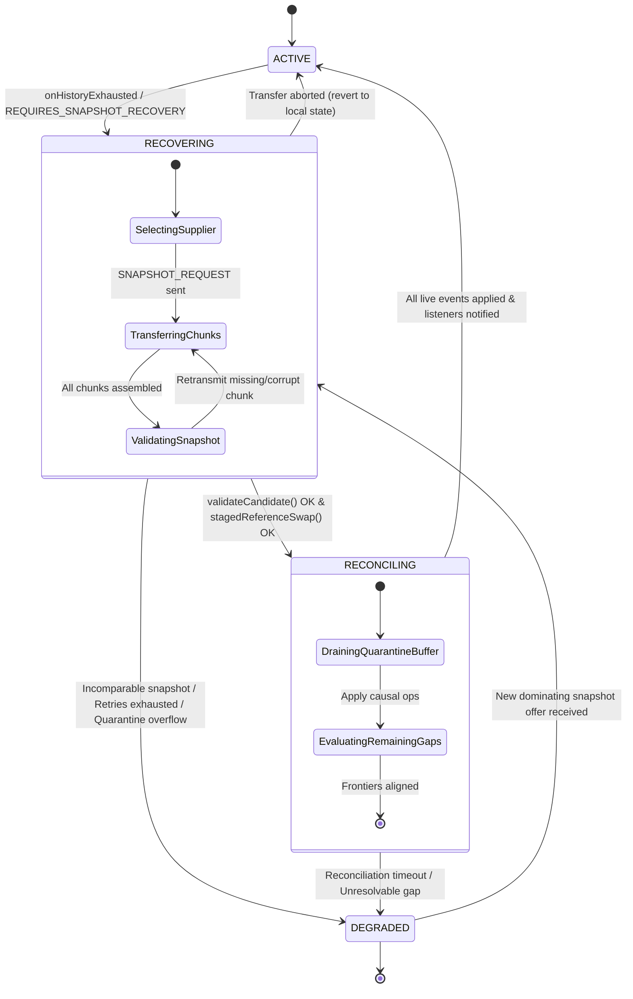

# Phase 7.5 — Fault Tolerance & State Recovery: Architecture Specification

**Status:** APPROVED ARCHITECTURAL DESIGN (FINAL CLOSURE)  
**Date:** 2026-11-19  
**Branch Baseline:** `main` at `30b8e5f`  
**Frozen Baselines:** Phase 7.3 (`e49b81a`), Phase 7.4 M1–M5 (`dbd5217`, `3a3d9e5`)  

---

## 1. System Context Diagram

```
+----------------------------------------------------------------------------------------------------+
|                                    SYNCPLAY ARCHITECTURE CONTEXT                                   |
|                                                                                                    |
|  +----------------------------------------------------------------------------------------------+  |
|  |                                  APPLICATION / SDK LAYER                                     |  |
|  |  PlaybackControls, HTML5 Media Adapter, UI State Listeners, EngineHealthCallbacks             |  |
|  +-----------------------------------------------^----------------------------------------------+  |
|                                                  | State / Health Notifications (Deferred post-swap)
|  +-----------------------------------------------v----------------------------------------------+  |
|  |                                     SYNC ENGINE LAYER                                        |  |
|  |                                                                                              |  |
|  |  +------------------------------------+      +--------------------------------------------+  |  |
|  |  |   RecoveryCoordinator (Phase 7.5)   |      |        AntiEntropyManager (Phase 7.4)      |  |  |
|  |  |  - RecoveryStateMachine            |      |  - RepairRequestPipeline (Requester M3)    |  |  |
|  |  |  - SnapshotTransferManager         |<---->|  - RepairSupplierService (Supplier M4)     |  |  |
|  |  |  - SnapshotInstaller (Staged Swap) |      |  - ReplicationComparator                   |  |  |
|  |  |  - QuarantineBuffer (Cap: 1000)    |      +----------------------^---------------------+  |  |
|  |  +------------------^-----------------+                             |                         |  |
|  |                     | Staged Instance Replacement                   |                         |  |
|  |  +------------------v-----------------------------------------------v---------------------+  |  |
|  |  |                           LeaderlessSyncEngine (Phase 7.3 Core)                        |  |  |
|  |  |  - OrderedOperationLog (Compacted checkpoints, history pruning, base snapshot)         |  |  |
|  |  |  - LogicalClockManager (Lamport clock tracking, exact causal advancement, reseed)        |  |  |
|  |  |  - Causal frontier vectors (replicationVector, snapshotFrontier, localCausalContext)   |  |  |
|  |  +------------------------------------------^---------------------------------------------+  |  |
|  +---------------------------------------------|------------------------------------------------+  |
|                                                | Trusted Capability Registration                   |
|  +---------------------------------------------v------------------------------------------------+  |
|  |                            TRUSTED TRANSPORT ADAPTER (Phase 7.4 M5)                          |  |
|  |  - Capability-gated inbound context creation (AuthenticatedSupplierContext / RequesterContext) |
|  |  - Iterative UTF-8 wire size measurement & send boundary (min(64KB, sctpLimit))              |  |
|  |  - Epoch & generation currency validation immediately before serialization                   |  |
|  +---------------------------------------------^------------------------------------------------+  |
|                                                | Unchanged Serialized Wire Bytes                   |
|  +---------------------------------------------v------------------------------------------------+  |
|  |                                   PEER MESH LAYER (WebRTC)                                   |  |
|  |  PeerManager, WebRTCTransport, DataChannels, ConnectionGeneration, RTTEngine                 |  |
|  +----------------------------------------------------------------------------------------------+  |
+----------------------------------------------------------------------------------------------------+
```

---

## 2. Core Architectural Principles & Invariants

1. **Absence of Globally Agreed Stable Frontier:**
   In a leaderless WebRTC mesh, a globally agreed consensus frontier does NOT exist. Peers autonomously prune operation logs bounded by the membership-scoped safe frontier ($V_{\text{epoch\_safe}}$) over a verified view $\mathcal{V}$, or by local memory bounds ($K=256$). Snapshot recovery is a **first-class protocol requirement** to service reconnecting peers outside supplier log horizons.
2. **Historical Compatibility via Prefix Verification:**
   Because single-operation fingerprints do not hash historical chains, a snapshot is eligible if and only if $V_S[p] \ge V_L[p]$ AND all common retained sequence checkpoints in the prefix $[1, \min(V_L[p], V_S[p])]$ match bit-exact. Any unverified sequence gaps trigger `REQUIRES_HISTORY_REPAIR` and fail to `DEGRADED`.
3. **No Arbitrary Tie-Breaking:**
   If two snapshots have incomparable frontiers, the engine transitions to `DEGRADED` state and notifies the application. Arbitrary tie-breaking (by peer ID or wall clock) is mathematically forbidden.
4. **Normative Iterative Transport Sizing:**
   `calculateDynamicChunkSize` serves solely as an initial estimation. Outbound chunks undergo a normative 7-step iterative send-boundary loop that serializes, measures exact UTF-8 bytes, and reduces binary payload until fitting within the negotiated SCTP limit before calling `RTCDataChannel.send()`.
5. **Exact Phase 7.2 Lamport Invariant Reinstated:**
   $$S.\text{maxLogicalTimestamp} \equiv \max_{p \in \text{origins}(V_S)} S.\text{originFrontierTimestamps}[p]$$
   Reseeding executes strictly as $L_{\text{local}} = \max(L_{\text{local}}, S.\text{maxLogicalTimestamp})$ **without $+1$**.
6. **Staged Immutable Engine-State Replacement:**
   Installation constructs a new `OrderedOperationLog`, state, and replication vectors out-of-band. Once validated, an atomic reference swap executes in a single synchronous run-to-completion step. External listeners are notified only post-swap and post-reconciliation.
7. **Quarantine Buffer & Local Input Fencing:**
   Local control operations are blocked while recovering. Incoming live operations are quarantined (capacity: 1,000 operations). Exceeding capacity synchronously aborts transfer to `DEGRADED`.

---

## 3. Four-State Recovery State Machine



### State Definitions and Behaviors

| State | Local Control Inputs | Incoming Broadcast Operations | Inbound Snapshot Transfers | Description |
| :--- | :--- | :--- | :--- | :--- |
| **`ACTIVE`** | Allowed (processed immediately) | Processed via standard Phase 7.3 causal ordering | None | Normal playback synchronization. |
| **`RECOVERING`** | **Blocked** (rejects or queues locally) | **Quarantined** in `QuarantineBuffer` (cap: 1000) | Exactly 1 active transfer | Inbound snapshot chunk transfer and pre-validation. |
| **`RECONCILING`** | **Blocked** | **Quarantined** until buffer drains | None | Staged reference swap complete; draining quarantine in causal order. |
| **`DEGRADED`** | **Blocked** | Discarded or held; state frozen | None | Causal divergence detected or retries exhausted; requires application intervention. |

---

## 4. Compaction Frontier Procedure & Revalidation

### 4.1 Membership View $\mathcal{V}$ Capture
The local peer captures:
$$\mathcal{V} = \Big( E_{\text{local}}, \mathcal{P} = \{ (p, gen_p) \mid \text{dataChannelState}(p) === \text{'open'} \} \Big)$$

### 4.2 Current Digest Requirement
For every peer in $\mathcal{P}$, the local engine must hold an authenticated `STATE_DIGEST` $D_p$ matching $(p, gen_p, E_{\text{local}})$.
- If any peer has not supplied a current digest, the view is incomplete. Compaction at $V_{\text{epoch\_safe}}$ is held.
- If memory requires pruning ($K=256$), the engine prunes locally under $V_{\text{local\_cand}}$ without peer safety guarantees.

### 4.3 Pre-Commit Revalidation
Immediately prior to invoking `compactAtFrontier(V_epoch_safe)`:
1. Verify `engine.epoch === V.epoch`.
2. Verify active connected peer set in `PeerManager` matches $\mathcal{P}$ exactly.
3. If any peer disconnected, generation changed, or epoch incremented: **abort compaction immediately**.

---

## 5. Chunked Transfer and Transport Boundary Integration

### 5.1 Iterative Sizing and Send Procedure
1. Initial estimation: `calculateDynamicChunkSize(sctpMaxMessageSize)` provides starting slice size.
2. Binary payload is sliced and formatted into `ProtocolMessage<'SNAPSHOT_CHUNK'>`.
3. `wireJson = JSON.stringify(msg)` is generated.
4. Exact UTF-8 byte length is measured: `new TextEncoder().encode(wireJson).byteLength`.
5. If `byteLength <= effectiveLimit`:
   - Pass `wireJson` unchanged to `PeerManager.sendSerialized()`.
   - `PeerManager` checks generation and DataChannel state immediately prior to `RTCDataChannel.send()`.
6. If `byteLength > effectiveLimit`:
   - Calculate overshoot $\Delta = \lceil (\text{byteLength} - \text{effectiveLimit}) \times 0.75 \rceil + 32$.
   - Reduce chunk binary slice and repeat from Step 2.
   - If chunk binary size drops below 256 bytes without fitting: abort with `TRANSPORT_LIMIT_EXCEEDED` $\to$ `DEGRADED`.

---

## 6. Staged Immutable Engine-State Replacement

### 6.1 Replacement Workflow
```
+----------------------------------------------------------------------------------------------------+
| STAGE 1: Pure Dry-Run Validation (validateCandidate)                                               |
| - Validates StateSnapshotPayloadV2Schema, canonical SHA-256 digest, epoch, vector domination, and  |
|   complete common checkpoint prefix. ZERO engine state is touched.                                 |
+----------------------------------------------------------------------------------------------------+
                                                 │
                                                 ▼ Validation Passed
+----------------------------------------------------------------------------------------------------+
| STAGE 2: Out-of-Band Staged Instance Construction                                                  |
| - Construct StagedPlaybackState with stateVersion = localVersion + 1.                              |
| - Construct new OrderedOperationLog pre-loaded with snapshot base and checkpoints.                 |
| - Construct new replicationVector, localCausalContext, and empty pendingQueue.                     |
| - If any constructor throws: discard staged instances. Old engine state remains 100% active.       |
+----------------------------------------------------------------------------------------------------+
                                                 │
                                                 ▼ Staging Succeeded
+----------------------------------------------------------------------------------------------------+
| STAGE 3: Atomic Reference Swap (installSnapshotAtomic)                                             |
| - Synchronous run-to-completion property swap:                                                    |
|     this.state = stagedState;                                                                      |
|     this.baseSnapshot = stagedState;                                                               |
|     this.operationLog = stagedLog;                                                                 |
|     this.replicationVector = stagedVector;                                                         |
|     this.localCausalContext = stagedCausalContext;                                                 |
|     this.clockManager.reseed(snapshot.maxLogicalTimestamp);                                        |
|     this.pendingQueue = stagedQueue;                                                               |
| - Transition state to RECONCILING.                                                                 |
+----------------------------------------------------------------------------------------------------+
                                                 │
                                                 ▼ Post-Swap
+----------------------------------------------------------------------------------------------------+
| STAGE 4: Quarantine Drain & Deferred Listener Notification                                         |
| - Drain QuarantineBuffer in causal order.                                                          |
| - Upon successful drain and transition to ACTIVE:                                                  |
|     Notify registered stateChangeListeners(this.state).                                            |
| - Listeners NEVER observe intermediate recovery states.                                            |
+----------------------------------------------------------------------------------------------------+
```

### 6.2 Enumeration of Swapped State
- Playback State (`PlaybackState`) & incremented `stateVersion`
- Logical Clock (`clockManager` reseeded to exact $S.\text{maxLogicalTimestamp}$ without $+1$)
- Replication Vector (`Record<string, number>`)
- Local Causal Context (`Record<string, number>`)
- Operation Log (`OrderedOperationLog` with reset base and checkpoints)
- Pending Dependency Queue (`PendingOperationQueue` cleared/reset)
- Base Snapshot Frontier (`baseSnapshotFrontier`)
- Deduplication and replay filters

---

## 7. Boundary Between Ordinary Recovery and Manual Reset

- **Ordinary Recovery:** Fully automated and mathematically constrained by causal consistency. Any incomparable snapshot, fork, or unresolvable gap halts recovery and enters `DEGRADED`.
- **Manual Reset:** An out-of-band administrative intervention where a user intentionally discards incompatible history and generates a new session identity (`newSessionId`) with an epoch fence barrier ($E_{\text{reset}} = E + 1000$).
- **Phase 7.5 Scope:** Ordinary recovery and `DEGRADED` fencing are fully implemented in Phase 7.5. Manual reset workflows and UI interactions are **explicitly deferred to Phase 8**.
