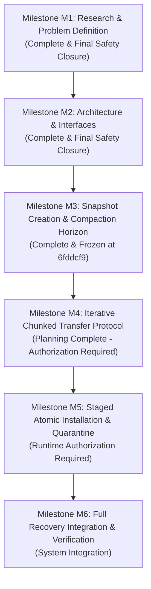

# Phase 7.5 — Fault Tolerance & State Recovery: Implementation Roadmap

**Status:** APPROVED ARCHITECTURAL DESIGN (FINAL SAFETY CLOSURE)  
**Date:** 2026-11-19  
**Branch Baseline:** `main` at `6fddcf9` (Phase 7.5 M3 Implemented & Frozen)  
**Frozen Baselines:** Phase 7.3 (`e49b81a`), Phase 7.4 M1–M5 (`dbd5217`, `3a3d9e5`), Phase 7.5 M3 (`6fddcf9`)  
**Detailed M4 Implementation Roadmap:** See [PHASE7_5_M4_IMPLEMENTATION_ROADMAP.md](./PHASE7_5_M4_IMPLEMENTATION_ROADMAP.md)  

---

## 1. Roadmap Overview and Dependency Graph

Phase 7.5 provides state recovery and fault tolerance when operation logs are compacted or peers rejoin after extended disconnections. The implementation is partitioned into six discrete, dependency-aware milestones (M1 through M6).

---

## 2. Milestone Breakdown (M1 to M6)

### Milestone M1: Research, Problem Definition, and Threat Model
- **Status:** COMPLETE & FINAL SAFETY CLOSURE (Planning Phase)
- **Objective:** Establish the theoretical foundations, failure scenarios, and boundaries of state recovery.
- **Scope:**
  - Complete answers to the 18 research questions.
  - Compaction frontier re-evaluation: mandatory local peer inclusion in $V_{\text{epoch\_safe}}$, captured membership view $\mathcal{V} = (E, V_{\text{local}}, \mathcal{P})$, current digest requirement, pre-commit revalidation, and absence of globally agreed stable frontier.
  - Historical compatibility proof: single-operation fingerprints do not chain history; prefix verification across all common retained sequences $[1, k]$ produces one of 4 explicit outcomes (`HISTORY_VERIFIED`, `HISTORY_CONFLICT`, `HISTORY_INCOMPLETE`, `HISTORY_UNAVAILABLE`).
  - Formal boundary between ordinary recovery and manual reset (deferred to Phase 8).
  - Mechanically testable non-supersession predicate for older-epoch snapshots.
- **Deliverables:** `docs/PHASE7_5_RESEARCH_AND_PROBLEM_DEFINITION.md`
- **Exit Conditions:** Architectural sign-off on research answers and invariants.

---

### Milestone M2: Architecture, Chunk Protocol, and Interface Specification
- **Status:** COMPLETE & FINAL SAFETY CLOSURE (Planning Phase)
- **Objective:** Specify all wire contracts, schemas, component interfaces, state machines, and integration hooks.
- **Scope:**
  - System context and block diagrams.
  - Formal 4-state recovery state machine (`ACTIVE`, `RECOVERING`, `RECONCILING`, `DEGRADED`).
  - Wire schemas: `SNAPSHOT_OFFER`, `SNAPSHOT_REQUEST`, `SNAPSHOT_CHUNK`, `SNAPSHOT_CHUNK_REQUEST`, `SNAPSHOT_ABORT`.
  - Component interfaces: `ISnapshotTransferManager`, `IRecoveryCoordinator`, `ISnapshotInstaller`, `IRecoveryStateMachine`.
  - Normative 7-step iterative send-boundary loop.
  - Staged Immutable Engine-State Replacement pattern across 14 mutable components.
  - Error codes, diagnostics taxonomy, and Open Decisions register (OD-7.5-1 to OD-7.5-5).
- **Deliverables:**
  - `docs/PHASE7_5_ARCHITECTURE.md`
  - `docs/PHASE7_5_INTERFACE_SPECIFICATION.md`
  - `docs/PHASE7_5_IMPLEMENTATION_ROADMAP.md`
  - `docs/PHASE7_5_ACCEPTANCE_CRITERIA.md`
  - `docs/PHASE7_5_RISK_REGISTER.md`
- **Exit Conditions:** Architectural approval of all specifications before runtime implementation authorization.

---

### Milestone M3: Snapshot Creation, Compaction Horizon, and Canonical Serialization
- **Status:** COMPLETE & FROZEN (Commit: `6fddcf9`)
- **Objective:** Implement deterministic snapshot generation, canonical serialization, and autonomous compaction horizon management in the sync engine.
- **Scope:**
  - Integrate `StateSnapshotPayloadV2Schema` wire definitions into `@syncplay/protocol`.
  - Enhance `OrderedOperationLog` compaction to retain origin checkpoints up to the frontier.
  - Implement deterministic canonical RFC 8785 JSON serialization and SHA-256 digest computation.
  - Implement captured view revalidation for $V_{\text{epoch\_safe}}$ with mandatory local peer inclusion.
  - Handle empty remote membership ($V_{\text{epoch\_safe}} = V_{\text{local}}$) and missing origins ($0$).
  - Enforce exact Phase 7.2 invariant: `maxLogicalTimestamp === max(originFrontierTimestamps.values())`.
- **Affected Packages and Files:**
  - `packages/protocol/src/payloads/recovery.ts` (new schemas)
  - `packages/protocol/src/payloads/index.ts` (exports)
  - `packages/sync-engine/src/snapshot/snapshot-generator.ts` (canonical serialization)
  - `packages/sync-engine/src/log/ordered-operation-log.ts` (checkpoint retention & view revalidation)
- **Invariants Enforced:**
  - Local replication vector $V_{\text{local}}$ is an explicit member of $V_{\text{epoch\_safe}}$.
  - Compaction never discards checkpoints.
  - Canonical JSON key ordering ensures identical SHA-256 digests across all platforms and V8 versions.
  - Compaction revalidation aborts if view $\mathcal{V}$ changed.
  - Snapshot size strictly capped at 4 MB.
- **Verification and Tests:**
  - Unit tests verifying that local peer inclusion prevents compacting past local applied sequence.
  - Unit tests for canonical serialization determinism under varied key insertion orders.
  - Checkpoint integrity tests across multiple sequential compaction cycles.
  - Snapshot payload validation under corrupted or malformed structures.
- **Acceptance Criteria:**
  - Snapshots generated from identical playback states produce byte-identical SHA-256 digests.
  - Compacted checkpoints accurately reflect all pruned origins.
- **Prohibited Work:**
  - Modifying the live playback loop or Phase 7.3 causal ordering core.
  - Implementing chunking or network transmission (deferred to M4).

---

### Milestone M4: Iterative Chunked Snapshot Transfer Protocol and WebRTC Multiplexing
- **Status:** PENDING AUTHORIZATION (Runtime Implementation)
- **Objective:** Implement reliable, dynamic chunked snapshot transfer over WebRTC DataChannels within strict SCTP limits.
- **Scope:**
  - Implement `SnapshotTransferManager` for outbound chunking and inbound reassembly.
  - Implement normative 7-step iterative send-boundary loop.
  - Enforce strictly **1 active transfer** per recovering peer.
  - Implement sliding-window flow control with pipelined chunk requests (window of 4).
  - Implement chunk retransmission requests (`SNAPSHOT_CHUNK_REQUEST`) via missing-index arrays.
  - Implement SHA-256 integrity verification per chunk and for full reassembled payload.
  - Reuse Phase 7.4 M5 `TrustedTransportAdapter` send boundary.
- **Affected Packages and Files:**
  - `packages/sync-engine/src/recovery/snapshot-transfer-manager.ts` (new)
  - `packages/sync-engine/src/recovery/chunk-assembler.ts` (new)
  - `packages/sync-engine/src/transport/trusted-transport-adapter.ts` (wire routing)
- **Invariants Enforced:**
  - No serialized message exceeds the transport limit (min of negotiated SCTP limit and 64 KB).
  - Chunk indices strictly bounded ($0 \le i < \text{totalChunks} \le 128$).
  - Per-chunk SHA-256 and overall SHA-256 must match exactly before assembly is accepted.
  - Transfer strictly aborts if peer disconnects or epoch transitions.
- **Verification and Tests:**
  - Transfer of 4 MB snapshots with zero chunk loss under standard 64 KB SCTP limit.
  - Transfer under constrained simulated 16 KB SCTP limit with dynamic chunk reduction.
  - Out-of-order chunk arrival and duplicate chunk deduplication.
  - Simulated packet drop and selective retransmission recovery.
  - Corrupted chunk rejection and transfer abort on hash mismatch.
- **Acceptance Criteria:**
  - Snapshots transfer reliably over simulated high-latency, packet-loss links.
  - Wire size never exceeds negotiated SCTP limit at `RTCDataChannel.send()`.
- **Prohibited Work:**
  - Modifying existing Phase 7.4 anti-entropy repair message handlers.
  - Installing snapshots into active playback state (deferred to M5).

---

### Milestone M5: Staged Atomic Snapshot Installation, Causal Restoration, and Event Quarantine
- **Status:** PENDING AUTHORIZATION (Runtime Implementation)
- **Objective:** Atomically install verified snapshots via staged instance replacement, restore causal vectors, and drain quarantined live events.
- **Scope:**
  - Implement `SnapshotInstaller` providing Stage 1 out-of-engine pre-validation (`validateCandidate`) evaluating the 4 historical prefix outcomes (`HISTORY_VERIFIED`, `HISTORY_CONFLICT`, `HISTORY_INCOMPLETE`, `HISTORY_UNAVAILABLE`).
  - Implement Stage 2 out-of-band staged instance construction and Stage 3 synchronous atomic reference swap across all 14 mutable components.
  - Defer listener notifications until Stage 4 (post-reconciliation).
  - Implement `QuarantineBuffer` in `RecoveryCoordinator` for incoming live events (capacity: 1,000 operations).
  - Block local control inputs while in `RECOVERING` and `RECONCILING` states.
  - Implement exact Lamport clock reseed: $L_{\text{local}} = \max(L_{\text{local}}, L_{\text{snapshot}})$ without $+1$.
  - Implement quarantine queue drain with causal re-validation against new snapshot frontier.
  - Implement synchronous abort to `DEGRADED` upon quarantine buffer overflow.
- **Affected Packages and Files:**
  - `packages/sync-engine/src/recovery/snapshot-installer.ts` (new)
  - `packages/sync-engine/src/recovery/quarantine-buffer.ts` (new)
  - `packages/sync-engine/src/engine/leaderless-sync-engine.ts` (quarantine hooks & atomic install)
- **Invariants Enforced:**
  - Atomic commit via staged reference swap across all 14 components.
  - Local state version is strictly incremented: $V_{\text{local}} = V_{\text{local}} + 1$.
  - Quarantined operations older than snapshot frontier are safely discarded without re-execution.
  - Local inputs are blocked while in `RECOVERING` and `RECONCILING` states.
- **Verification and Tests:**
  - Staged rollback verification under simulated install failure.
  - Full prefix checkpoint divergence detection (counterexample test).
  - Handling of `HISTORY_INCOMPLETE` vs `HISTORY_UNAVAILABLE`.
  - Quarantine queue 1,000-operation overflow abortion and transition to `DEGRADED`.
- **Acceptance Criteria:**
  - Recovered peer converges to identical playback state with zero state corruption.
  - No duplicate operation execution from quarantined events.
- **Prohibited Work:**
  - Permitting unquarantined live operation execution while recovery is in flight.
  - Arbitrary tie-breaking on incomparable snapshots.

---

### Milestone M6: Full Recovery Integration, Fault Injection, and Deterministic Churn Verification
- **Status:** PENDING AUTHORIZATION (System Integration)
- **Objective:** Integrate all recovery components with Phase 7.4 anti-entropy, WebRTC transport, and verify resilience under extreme failure conditions.
- **Scope:**
  - Wire `RepairRequestPipeline.onHistoryExhausted` into `RecoveryCoordinator`.
  - Wire `AntiEntropyManager` to publish targeted `SNAPSHOT_OFFER` and service `SNAPSHOT_REQUEST`.
  - Connect `TrustedTransportAdapter` to validate and route recovery payloads.
  - Implement partition heal verification: two divergent partitions heal and synchronize.
  - Stress test under network churn, peer drops during chunk transfers, and epoch increments.
  - Validate clean transition to `DEGRADED` state when incomparable snapshots or `HISTORY_UNAVAILABLE` are detected.
- **Affected Packages and Files:**
  - `packages/sync-engine/src/replication/anti-entropy-manager.ts` (wire integration)
  - `packages/sync-engine/src/replication/repair-request-pipeline.ts` (exhaustion handoff)
  - `packages/sync-engine/test/recovery/` (comprehensive integration test suite)
- **Invariants Enforced:**
  - End-to-end leaderless operation maintained without bootstrap server playback authority.
  - Clean handoff between anti-entropy log repair and snapshot recovery.
  - Memory usage strictly bounded under repeated disconnect/reconnect loops.
- **Verification and Tests:**
  - End-to-end multi-peer recovery tests across simulated WebRTC DataChannels.
  - Verification of the 4 historical prefix outcomes.
  - Peer crash and failover during active snapshot transfer.
  - Deterministic property-based test of causal frontier monotonicity.
- **Acceptance Criteria:**
  - 100% pass rate on full monorepo test suite (retaining all 967+ baseline tests).
  - Clean recovery in under 3 seconds on typical network configurations.
  - Zero memory leaks across repeated recovery cycles.
- **Prohibited Work:**
  - Modifying frozen Phase 7.3 or Phase 7.4 architectural contracts.

---

## 3. Implementation Order and Gating Rules

1. **Strict Gate Enforcement:** Each milestone must be accompanied by comprehensive tests and receive architectural approval before work on the next milestone begins.
2. **Regression Floor:** Any test regression in Phase 7.1, 7.2, 7.3, or 7.4 immediately blocks progress.
3. **No Speculative Runtime Work:** Do not write runtime code until explicit user authorization for that specific milestone is granted.
