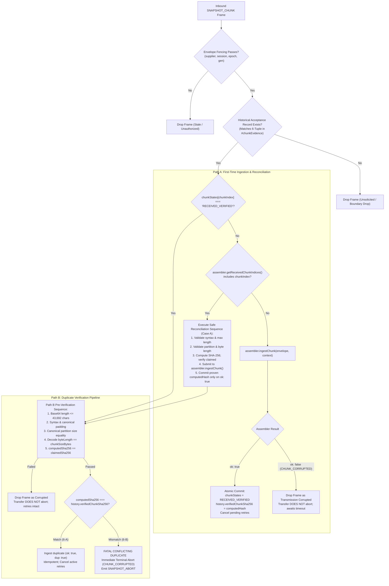
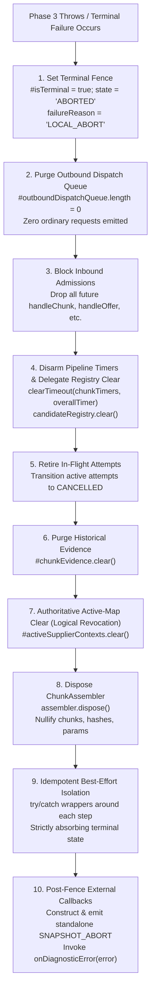
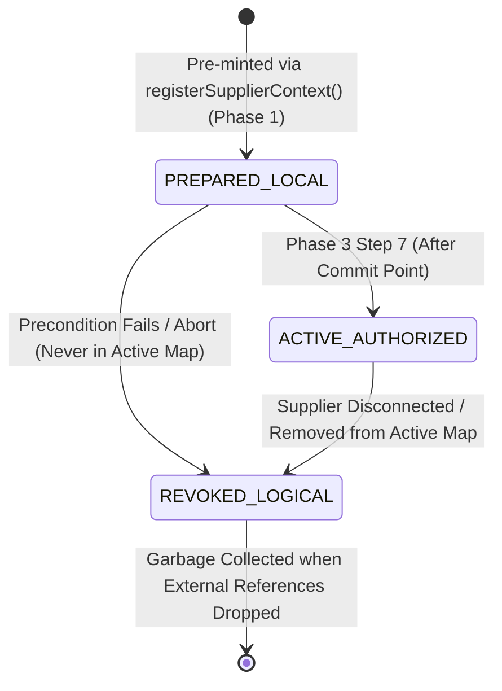

# Phase 7.5 M4.2d — Inbound Snapshot Pipeline & Window Reception Architecture and Interface Specification

**Document Version:** 1.18.0  
**Status:** Approved Planning Specification (Corrected Baseline Post-Audit R18)  
**Date:** November 23, 2026  
**Target Milestone:** Phase 7.5 Sub-Milestone M4.2d (`SnapshotInboundPipeline`)  
**Authoritative Baselines:**
- Frozen M4.1 Baseline: `fd23edae5bdb52cff32674860229277a79cb1aca` (Wire Schemas & `ChunkAssembler`)
- Frozen M4.2a Baseline: `e3245912626758c094d83edbd4d9264a922070f5` (`SnapshotSerializer` & `SerializedSnapshotArtifact`)
- Frozen M4.2b Baseline: `8f509f94a39be9ece4060003ee498dc747efb813` (`SnapshotPreparationQueue` & `SnapshotChunkProducer`)
- Frozen M4.2c Baseline: `79919a0f8cb0bb81cb80cc010fe02918bef79787` (`SnapshotOutboundPipeline`)

---

## 1. Executive Summary & Architectural Motivation

### 1.1 Placement within Milestone M4
Milestone M4 establishes the peer-to-peer state recovery pipeline across WebRTC DataChannels. Sub-Milestone M4.2c successfully established the **sender-side outbound pipeline** (`SnapshotOutboundPipeline`), delivering:
1. Sequential preparation gating via `SnapshotPreparationQueue`.
2. Exact UTF-8 complete-message byte length measurement at the send boundary.
3. In-flight transmission window tracking and active attempt coalescing.
4. Dual attempt identity tracking separating transport transmission attempts from logical chunks.
5. 100% encapsulated public session views with zero mutable object reference leaks.

Sub-Milestone **M4.2d** establishes the symmetrical **receiver-side counterpart**: the `SnapshotInboundPipeline`. It governs how a recovering peer receives, validates, flow-controls, ingests, reassembles, and verifies state snapshots.

```mermaid
flowchart LR
    subgraph Sender["Sender Node (M4.2c)"]
        OutPipeline["SnapshotOutboundPipeline"]
        Artifact["SerializedSnapshotArtifact"]
        OutPipeline -->|SNAPSHOT_OFFER| NetSend["Transport Handoff"]
        OutPipeline -->|SNAPSHOT_CHUNK| NetSend
    end

    subgraph TransportBoundary["WebRTC Transport Layer (M4.3)"]
        NetSend --> DC["WebRTC DataChannel (SCTP)"]
        DC --> NetRecv["Transport Ingestion"]
    end

    subgraph Receiver["Receiver Node (M4.2d & M4.1)"]
        NetRecv --> InPipeline["SnapshotInboundPipeline"]
        InPipeline -->|Validate Offer & Admission| FlowCtrl["Bounded Sliding Window (W <= 4)"]
        FlowCtrl -->|SNAPSHOT_REQUEST (missing=[0,1,2,3])| NetOut["Transport Handoff"]
        FlowCtrl -->|SNAPSHOT_CHUNK_REQUEST (missing=[i])| NetOut
        InPipeline -->|Ingest Chunks| Assembler["ChunkAssembler (M4.1)"]
        Assembler -->|Final Contiguous Buffer| Verify["10-Step Canonical Verification"]
        Verify -->|SnapshotTransferResult| M5["Milestone M5 Handoff"]
    end
```

### 1.2 The "Contracts First" Architectural Principle
Integrating sender and receiver directly into the WebRTC transport adapter in M4.3 without a complete, independently validated receiving pipeline creates high coupling and unverified assumptions. Establishing M4.2d first guarantees:
- **Clean Separation of Concerns:** Inbound protocol logic (admission, flow control, reassembly, deduplication, failover) is decoupled from WebRTC transport I/O, DataChannel event listeners, and peer connection lifecycle.
- **Symmetrical Verification:** Inbound and outbound pipelines can be cross-tested in memory using mock transport shims before touching real WebRTC DataChannels.
- **Strict Architectural Invariant:** M4.2d strictly transfers, reassembles, and verifies canonical snapshot bytes. It does **NOT** install snapshots, modify `PlaybackState`, alter `replicationVector`, reseed Lamport clocks, or drain quarantined operations (strictly reserved for Milestone M5).

---

## 2. In-Process Capability Custody & Module Architecture

### 2.1 Trust Model & Boundary Definition
The capability architecture in `@syncplay/sync-engine` establishes an **in-process API custody boundary under a cooperative application trust model**. It prevents application consumers from inadvertently bypassing transport verification by calling internal pipeline methods directly. It is not an operating-system sandbox or hardware security boundary.

```mermaid
flowchart TD
    subgraph PackageBoundary["Package Boundary: @syncplay/sync-engine"]
        subgraph MintingModule["packages/sync-engine/src/recovery/inbound-custody.ts (INTERNAL)"]
            PrivateBrand["INBOUND_CAPABILITY_BRAND: unique symbol = Symbol('INBOUND_CAPABILITY_BRAND')"]
            PrivateFactory["createInboundTransportCapability(sessionId, brand)"]
            PrivateBrand --> PrivateFactory
        end

        subgraph CompositionRootModule["packages/sync-engine/src/engine/leaderless-sync-engine.ts"]
            CompRoot["LeaderlessSyncEngine / SyncEngineFactory (Authorized Composition Root)"]
            PrivateFactory -->|Relative Import| CompRoot
            PrivateBrand -->|Relative Import| CompRoot
            CompRoot --> MintCap["Mint authorizedCapability Instance<br/>Object.freeze({ [INBOUND_CAPABILITY_BRAND]: true, sessionId })"]
        end

        subgraph PipelineModule["packages/sync-engine/src/recovery/snapshot-inbound-pipeline.ts"]
            Pipeline["SnapshotInboundPipeline Instance"]
            AssertCap["#assertCapability(capability)"]
            Pipeline --> AssertCap
        end

        MintCap -->|Pass via Constructor| Pipeline
    end

    subgraph ConsumerSpace["External Application / Test Consumers"]
        Consumer["Application Consumer Code"]
        AttemptFake["Attempt to Forge Capability<br/>{ [brand]: true, sessionId }"]
        Consumer -.->|Blocked: Brand Symbol Not Exported| AttemptFake
    end

    AssertCap -->|Throws SyncEngineError('UNAUTHORIZED') if brand invalid| Pipeline
```

### 2.2 Custody Invariants & Authoritative Active-Map Fencing (Option A)
1. **Private Symbol Branding:** The minting symbol `INBOUND_CAPABILITY_BRAND` is kept package-private in an internal module (`inbound-custody.ts`). It is never re-exported through package entry points (`index.ts`).
2. **Authorized Minting:** Only the composition root (`LeaderlessSyncEngine`) and authorized internal test harnesses can mint `InboundTransportCapability`.
3. **Context Provenance via WeakSet:** `AuthenticatedSupplierContext` instances are minted exclusively by `registerSupplierContext()`, which requires an authorized capability. Each context is frozen and tied to immutable `(supplierPeerId, connectionGeneration, sessionId, membershipEpoch)`. Provenance is tracked in `#validSupplierContexts: WeakSet<AuthenticatedSupplierContext>`.
4. **Authoritative Active-Map Fencing (Option A):** Because a JavaScript `WeakSet` is non-iterable and provides no `.clear()` method, **`#validSupplierContexts` is used strictly for origin provenance, NEVER for admission authorization**. Inbound chunk admission is governed **authoritatively by `#activeSupplierContexts: Map<string, AuthenticatedSupplierContext>`**.
5. **Logical Revocation:** Context revocation is **logical**: removing a context from `#activeSupplierContexts` immediately revokes its admission authority. Any un-enumerable reference remaining in the `WeakSet` is completely inert, because provenance alone never authorizes admission.

---

## 3. Sliding-Window Geometry, Flow Control & Ingestion Architecture

### 3.1 Receiver-Side Sliding Window ($W = 4$)
Inbound chunk flow is paced by a bounded sliding window with maximum concurrent in-flight requests $W = 4$ (`MAX_CONCURRENT_CHUNK_REQUESTS`):
- **Base Chunk Pointer ($i_{\text{base}}$):** Index of the lowest unreceived chunk.
- **Window Boundaries:** At any instant, chunks eligible for concurrent requests satisfy:
  $$i_{\text{base}} \le i < \min(i_{\text{base}} + W, \text{totalChunks})$$
- **Flow Pacing:** Initial dispatch emits a single `SNAPSHOT_REQUEST` containing `missingChunkIndices = [0, 1, 2, 3]`. Subsequent missing chunks are requested via individual `SNAPSHOT_CHUNK_REQUEST` messages as earlier chunks are verified and stored.

### 3.2 Unified Historical Acceptance Invariant across Path A and Path B
To prevent unsolicited frames from polluting the pipeline or triggering spurious aborts:

> **Authoritative Invariant (Unified Inbound Admission):**  
> An inbound chunk frame is admissible for pipeline and assembler evaluation **if and only if** `#chunkEvidence.get(chunkIndex)` contains a `ChunkEvidenceHistory` holding an active or fulfilled `AcceptedAttemptRecord` matching the 6-tuple:  
> `(transferId, chunkIndex, sessionId, membershipEpoch, supplierPeerId, connectionGeneration)`.  
> Any inbound frame failing this 6-tuple lookup is **immediately dropped at the transport boundary** with zero state mutation, zero assembler invocation, and zero abort triggers.

### 3.3 Safe Ingestion & Reconciliation Architecture



### 3.4 Reconciliation Authorization: Case A vs Case B (R15-5)
1. **Case A (Authentic Request, Interrupted Before Commit):**
   - **Condition:** An accepted attempt record matching the 6-tuple exists in `history.attempts`, `assembler.getReceivedChunkIndices()` includes `chunkIndex`, but pipeline state `chunkStates[chunkIndex] !== 'RECEIVED_VERIFIED'` (e.g. prior execution turn was interrupted after assembler ingestion but before pipeline commit).
   - **Authorization Source:** Legitimate prior DataChannel dispatch recorded in `history.attempts`.
   - **Action:** Pre-checks run (syntax, partition size, compute SHA-256). Frame is submitted to `assembler.ingestChunk()`. If duplicate confirmed (`duplicate: true`) $\implies$ commits `RECEIVED_VERIFIED` with proven `computedHash`. If conflicting (`CHUNK_CORRUPTED`) $\implies$ terminal abort. Unknown error $\implies$ fail-closed abort (`LOCAL_ABORT`).
2. **Case B (Unsolicited Frame for Index Present in Assembler):**
   - **Condition:** Assembler contains chunk $k$, but `history.attempts` has **NO matching accepted attempt record**.
   - **Authorization Source:** NONE.
   - **Action:** **REJECTED AND DROPPED AT THE TRANSPORT BOUNDARY.**
   - **Core Invariant:** Storage in the assembler **NEVER** confers admission authority. Inbound frames are authorized strictly by authentic DataChannel dispatch evidence. Case B frames never invoke the assembler.

### 3.5 Ten-Step Delayed-Response Settlement Ordering
When an inbound chunk arrives while a newer retry attempt is pending (`LOCAL_PENDING`):
1. **Transport & Context Fencing:** Check `state === 'TRANSFERRING'`, session, epoch, supplier, generation.
2. **Historical Acceptance Authority Lookup:** Verify matching `AcceptedAttemptRecord` exists in `#chunkEvidence`.
3. **Payload Metadata & Partition Verification:** Verify `transferId`, `snapshotId`, `expectedChunkSize`.
4. **Actual Digest Validation:** Decode Base64, compute SHA-256, verify against claimed digest.
5. **Duplicate / Conflict Pre-Classification:** If already verified, compare against `history.verifiedChunkSha256`.
6. **Assembler Ingestion:** Invoke `ChunkAssembler.ingestChunk()`.
7. **Successful First-Time Storage Confirmation:** Assert `{ ok: true, duplicate: false }`.
8. **Chunk State Transition:** Transition chunk state to `RECEIVED_VERIFIED`.
9. **Cancellation of Pending Retry:** Clear watchdog timer on pending retry; transition retry attempt state to `CANCELLED`.
10. **Batch & Evidence Settlement:** Remove index from pending batch `unsettledChunkIndices`; mark matching attempts `'FULFILLED_DUPLICATE_ADMISSIBLE'`; advance $i_{\text{base}}$.

---

## 4. Per-Chunk Attempt History, State Machines & Settlement Semantics

### 4.1 Structural Decoupling: `ChunkEvidenceHistory` and `AcceptedAttemptRecord`
The architecture decouples chunk-level tracking from individual dispatch attempts:

```typescript
export interface AcceptedAttemptRecord {
  readonly attemptToken: string;            // Unique UUIDv4 per dispatch attempt (36 bytes)
  readonly transferId: string;              // Transfer session identity (36 bytes)
  readonly chunkIndex: number;              // Target chunk index (8 bytes)
  readonly sessionId: string;               // Session identity (<= 128 bytes)
  readonly membershipEpoch: number;         // Room membership epoch (8 bytes)
  readonly supplierPeerId: string;          // Target supplier peer ID (<= 64 bytes)
  readonly connectionGeneration: number;    // Transport connection generation (8 bytes)
  readonly messageId: string;               // Protocol message UUID (36 bytes)
  readonly acceptedAtMs: number;            // Timestamp of DataChannel buffering (8 bytes)
  status: AcceptedEvidenceStatus;           // Status enum (<= 30 bytes)
}

export interface ChunkEvidenceHistory {
  readonly chunkIndex: number;
  readonly attempts: AcceptedAttemptRecord[]; // Bounded FIFO array (max 4 entries)
  hasActiveAcceptedAttempt: boolean;          // True if any attempt is ACCEPTED_PENDING
  verifiedChunkSha256?: string;               // Immutable digest set upon RECEIVED_VERIFIED
}
```

### 4.2 Inbound Response Matching Under Wire Constraints
- **Wire Protocol Constraint:** `SnapshotChunkPayload` in `@syncplay/protocol` **DOES NOT carry an `attemptToken`**.
- **Matching Rule:** Inbound frames match against `history.attempts` by 6-tuple `(transferId, chunkIndex, sessionId, membershipEpoch, supplierPeerId, connectionGeneration)`.
- **Indistinguishable Attempts Resolution:** When a valid frame arrives for chunk $k$, all active and superseded attempts in `history.attempts` for chunk $k$ transition to `FULFILLED_DUPLICATE_ADMISSIBLE`. Active chunk timers are disarmed and pending retries cancelled.
- **Bounds:** Array length is bounded by $\le \text{MAX\_CHUNK\_RETRIES} + 1 = 4$ attempts per chunk. Total simultaneous records across all chunks $\le 138$.

### 4.3 Discrete State Machines
1. **`InboundChunkState` (Aggregate Chunk State):** `'UNREQUESTED'` $\to$ `'REQUESTED'` $\to$ `'RECEIVED_VERIFIED'`.
2. **`AttemptLifecycleState` (Local Execution State):** `'LOCAL_PENDING'`, `'LOCALLY_FAILED'`, `'LOCALLY_TIMED_OUT'`, `'DATA_CHANNEL_ACCEPTED'`, `'REMOTE_RESPONSE_TIMED_OUT'`, `'SUPERSEDED_BY_RETRY'`, `'FULFILLED'`, `'CANCELLED'`.
3. **`AcceptedEvidenceStatus` (Admission Authorization Status):**
   - `'ACCEPTED_PENDING'`: In-flight; authorizes Path A arrival.
   - `'ACCEPTED_TIMED_OUT'`: 5,000 ms expired; authorizes delayed Path A arrival.
   - `'SUPERSEDED_ADMISSIBLE'`: Newer retry dispatched; authorizes delayed Path A arrival.
   - `'FULFILLED_DUPLICATE_ADMISSIBLE'`: Chunk verified and stored; authorizes Path B duplicate verification.
   - `'RETIRED_INADMISSIBLE'`: Inadmissible; disposed upon context retirement.

> **Authoritative Invariant (Irreversible Acceptance):**  
> **Once an attempt has recorded DataChannel acceptance (`handleHandoffSuccess`), no later exception, Promise rejection, failure callback, watchdog, or batch-level error may reverse that acceptance.**  
> A batch-level outcome or post-acceptance failure must never overwrite an individual attempt's accepted or terminal state.

---

## 5. Unified Context Transition Ceiling & Quantitative Bounds (R15-3 & R15-4)

### 5.1 Protocol Limit Hierarchy & Scope
1. **`MAX_CHUNK_RETRIES = 3`:** Unambiguously defined as **at most 3 retransmissions after the initial request**. A single chunk can have at most $1 + 3 = 4$ total accepted attempts under one context.
2. **`MAX_TRANSFER_RETRIES = 10`:** Cumulative transfer-wide ceiling maintained in `session.cumulativeRetries`. **Never resets upon supplier failover or generation replacement**.
3. **`MAX_TRANSFER_CONTEXT_TRANSITIONS = 8`:** Hard lifetime ceiling bounding the sum of supplier promotions (failovers) and same-peer generation replacements.
4. **`MAX_LOCAL_REDISPATCH_ATTEMPTS = 3`:** Maximum consecutive local handoff failures before immediate `LOCAL_ABORT` (`LOCAL_HANDOFF_FAILURE_EXCEEDED`). Operates independently of the 60-second transfer timeout.

### 5.2 Derivation of the Five Quantitative Bounds

$$\begin{aligned}
Q_1 &\le (\text{MAX\_TRANSFER\_CONTEXT\_TRANSITIONS} + 1) \times N + \text{MAX\_TRANSFER\_RETRIES} \\
    &\le (8 + 1) \times 128 + 10 = \mathbf{1,162 \text{ records ever created over transfer lifetime}}
\end{aligned}$$

$$\begin{aligned}
Q_2 &\le N + \text{MAX\_TRANSFER\_RETRIES} \\
    &\le 128 + 10 = \mathbf{138 \text{ records simultaneously retained in memory}} \quad (\ll 512 \text{ defensive cap})
\end{aligned}$$

- **$Q_3$ (Active Context Records):** Exactly $\mathbf{\le 138 \text{ records}}$ ($Q_3 \equiv Q_2$).
- **$Q_4$ (Records Needed for Delayed Responses):** Exactly $\mathbf{\le 138 \text{ records}}$ (delayed frames from retired contexts are blocked by context fencing).

### 5.3 Complete Declared Field Evidence Accounting
Accounting for all 10 declared fields in `AcceptedAttemptRecord` under `@syncplay/protocol` schema limits:

| Field Name | Type | Maximum Enforceable Wire/Schema Constraint | Maximum Primitive Size |
| :--- | :--- | :--- | :--- |
| `attemptToken` | `string` | UUIDv4 (36 ASCII characters) | 36 bytes |
| `transferId` | `string` | UUIDv4 (36 ASCII characters) | 36 bytes |
| `chunkIndex` | `number` | Integer $0 \le i \le 127$ (IEEE-754 float) | 8 bytes |
| `sessionId` | `string` | ASCII string, max 128 chars | $\le 128$ bytes |
| `membershipEpoch` | `number` | Non-negative safe integer | 8 bytes |
| `supplierPeerId` | `string` | ASCII string, max 64 chars | $\le 64$ bytes |
| `connectionGeneration` | `number` | Non-negative safe integer | 8 bytes |
| `messageId` | `string` | UUIDv4 (36 ASCII characters) | 36 bytes |
| `acceptedAtMs` | `number` | Safe integer millisecond timestamp | 8 bytes |
| `status` | `AcceptedEvidenceStatus` | Enum string (`'FULFILLED_DUPLICATE_ADMISSIBLE'`) | $\le 30$ bytes |
| **Total per Record** | | **Maximum Enforceable Primitive Data** | **$\le 362 \text{ bytes}$** |

- **$Q_5$ (Retained Application Evidence Bytes):**
  - Maximum primitive data across 138 simultaneous records: $138 \times \le 362\text{ bytes} = \mathbf{\le 48.8 \text{ KiB}}$.
  - Maximum primitive data across 128 `ChunkEvidenceHistory` containers: $128 \times \le 88\text{ bytes} = \mathbf{\le 11.0 \text{ KiB}}$.
  - Container and Map overhead: $\approx 2.2\text{ KiB}$.
  - **Total Application-Owned Primitive Data:** $\mathbf{\le 62.0 \text{ KiB}}$.
  - **Analytical V8 Heap Estimate:** $\mathbf{\approx 86.9 \text{ KiB}} < 100\text{ KiB}$ (Object headers, hidden classes, Shape descriptors). Explicitly classified as an **analytical estimate**, not a hard OS process ceiling.

### 5.4 Honest Evaluation of `MAX_EVIDENCE_RECORDS = 512`
`MAX_EVIDENCE_RECORDS = 512` is an **explicitly redundant defensive guardrail (circuit breaker)**. Because $Q_2 \le 138$ is mathematically proven, reaching 512 indicates an internal memory leak or failure to purge on context transition. If reached, the transfer immediately aborts with `MEMORY_EXCEEDED`.

---

## 6. Candidate Offer Registry Lifecycle & Timer Ownership (R18-2)

### 6.1 Registry Constraints
1. **Capacity:** `MAX_OFFER_CANDIDATES = 8` (concurrent instantaneous capacity).
2. **Single Unambiguous TTL:** Exactly **30 seconds** from initial admission (`expiresAtMs = admittedAtMs + 30000`).
3. **Duplicate Offer Rules:** Must present authenticated context with generation currency (`gen >= candidate.gen`). Identical fields update context reference but leave TTL unchanged. Conflicting fields rejected with `OFFER_INCONSISTENT`.
4. **Complete 7-Field Predicate:** Failover requires bit-exact match on `sessionId`, `membershipEpoch`, `snapshotId`, `expectedSha256Digest`, `totalSizeBytes`, `totalChunks`, and `nominalChunkSizeBytes`.
5. **Lifetime Ceiling:** Governed by `MAX_TRANSFER_CONTEXT_TRANSITIONS = 8`.

### 6.2 Timer Ownership & Synchronous Lifecycle API (R18-2)
Candidate offers admitted during the session have a 30-second TTL. The associated watchdog timers (`candidate.timerId`) are allocated and tracked internally by `CandidateOfferRegistry`.
- `SnapshotInboundPipeline` **does not reach into private registry data structures** or assume it can iterate another component's timers.
- Instead, `CandidateOfferRegistry` provides a defined synchronous lifecycle method `public clear(): void`:
  ```typescript
  public clear(): void {
    for (const entry of this.candidates.values()) {
      if (entry.ttlTimer !== null) {
        clearTimeout(entry.ttlTimer);
        entry.ttlTimer = null;
      }
    }
    this.candidates.clear();
  }
  ```
- During the pipeline's terminal-abort procedure, the pipeline invokes `this.#candidateRegistry.clear();`, cleanly disarming all candidate TTL timers within their owning component.

---

## 7. Failover Transaction Ordering, Disconnect Authentication & Terminal Abort (R16, R17 & R18)

### 7.1 The Three-Phase Failover Execution Contract & Dispatch Boundary
Inspection of frozen `ChunkAssembler.prepareForFailover()` (`chunk-assembler.ts`, lines 389–601) reveals that candidate rejection is non-destructive (lines 407–590), but successful execution mutates internal assembler state (`transferId`, `supplierPeerId`, `connectionGeneration`, lines 593–595). Therefore, successful execution is an **irreversible assembler commit point**.

To guarantee execution integrity and eliminate reentrancy vulnerabilities, failover is structured into three strictly ordered phases, culminating in a formal **Dispatch Boundary**:

```mermaid
sequenceDiagram
    autonumber
    participant Net as Transport Layer
    participant Pipe as SnapshotInboundPipeline
    participant Reg as CandidateOfferRegistry
    participant Asm as ChunkAssembler

    Note over Pipe: Phase 1: Pre-Commit Validation (Zero Mutation)
    Net->>Pipe: handleSupplierDisconnected(context, capability)
    Pipe->>Pipe: 1. Authenticate capability & WeakSet provenance
    Pipe->>Pipe: 2. Verify active context (supplier, generation)
    Pipe->>Reg: 3. Select eligible candidate C_k
    Pipe->>Pipe: 4. Validate candidate identity & transfer geometry
    Pipe->>Pipe: 5. Verify candidate TTL (now <= expiresAtMs)
    Pipe->>Pipe: 6. Re-verify active context has not changed
    Pipe->>Pipe: 7. Verify contextTransitionCount < 8
    Pipe->>Pipe: 8. Verify pipeline preconditions (state === TRANSFERRING)
    Pipe->>Pipe: 9. Pre-mint candidate context (State: PREPARED_LOCAL)
    
    Note over Pipe,Asm: Phase 2: Assembler Commit Point
    Pipe->>Asm: prepareForFailover(candidateParams)
    alt Outcome A: Candidate Rejection (ok: false)
        Asm-->>Pipe: { ok: false, reason: 'GEOMETRY_MISMATCH' }
        Pipe->>Pipe: Assembler UNMUTATED. Pipeline state UNMUTATED.
        Pipe->>Reg: Evict C_k; evaluate next candidate C_{k+1}...
    else Outcome B: Candidate Success (ok: true) - IRREVERSIBLE COMMIT
        Asm-->>Pipe: { ok: true, retainedChunks: N }
        Note over Pipe: Assembler committed to C_k identity
        
        Note over Pipe: Phase 3: Post-Commit Synchronous Finalization (Zero External Callbacks)
        Pipe->>Pipe: 1. Revoke old context from active map (State: REVOKED_LOGICAL)
        Pipe->>Pipe: 2. Retire in-flight attempts to CANCELLED
        Pipe->>Pipe: 3. Clear active chunk response & watchdog timers
        Pipe->>Pipe: 4. Purge old historical evidence (#chunkEvidence.clear())
        Pipe->>Pipe: 5. Update session identity (supplier, generation, transferId)
        Pipe->>Pipe: 6. Increment session.contextTransitionCount++ exactly once
        Pipe->>Pipe: 7. Publish candidate context to active map (State: ACTIVE_AUTHORIZED)
        Pipe->>Pipe: 8. Reset unverified chunks in #chunkStates to UNREQUESTED
        Pipe->>Pipe: 9. Enqueue window requests into #outboundDispatchQueue (W=4)
        
        Note over Pipe: DISPATCH BOUNDARY: Phase 3 Completion
        Pipe->>Net: 10. Drain #outboundDispatchQueue via onEmitMessage (Eligible Post-Commit)
    end
```

#### Phase 1: Pre-Commit Validation (Zero State Mutation)
Before calling `assembler.prepareForFailover()`, the pipeline completes all non-mutating validations:
1. Authenticate notification: `capability === this.#authorizedCapability` with `[INBOUND_CAPABILITY_BRAND]: true`.
2. Verify active context: `context.supplierPeerId === session.supplierPeerId` and generation matches.
3. Select candidate: Query registry for candidate $C_k$ matching `(sessionId, membershipEpoch, snapshotId)`.
4. Validate candidate compatibility: Verify bit-exact geometry, snapshot ID, and SHA-256 digest.
5. Verify candidate TTL: Assert `now <= candidate.expiresAtMs`.
6. Re-verify active context: Ensure active supplier has not changed.
7. Verify transition budget: Assert `session.contextTransitionCount < MAX_TRANSFER_CONTEXT_TRANSITIONS (8)`. If $\ge 8 \implies$ abort with `SUPPLIER_DISCONNECTED` without calling assembler.
8. Verify pipeline preconditions: Assert state is `TRANSFERRING`, transfer not disposed, not terminal.
9. Pre-mint candidate context locally: Construct `AuthenticatedSupplierContext` for $C_k$ (lifecycle state: `PREPARED_LOCAL`) and add to `#validSupplierContexts: WeakSet`. **Do NOT add to `#activeSupplierContexts`**.

*Rule:* If any check in Phase 1 fails, `assembler.prepareForFailover()` **MUST NOT be invoked**.

#### Phase 2: Assembler Commit Point
The pipeline invokes the frozen assembler method: `assembler.prepareForFailover(candidateParams)`.
- **Outcome A (Rejection, `ok: false`):** Assembler leaves `this.transferParams` and `this.chunks` untouched. Pipeline state, evidence, timers, and counter remain **100% unmutated**. Candidate $C_k$ is evicted; pipeline evaluates next candidate. Transition counter is not incremented.
- **Outcome B (Success, `ok: true`):** **This is the irreversible assembler commit point.** The assembler commits $C_k$'s identity. The previous assembler state is destroyed and cannot be restored. The pipeline immediately proceeds to Phase 3 in the same synchronous call stack without yielding, awaiting Promises, or invoking user callbacks.

#### Phase 3: Post-Commit Synchronous Finalization (Zero External Callbacks)
In the same uninterrupted execution turn, execute synchronously:
1. **Revoke Old Context:** Remove $S_{\text{old}}$ from `#activeSupplierContexts` (lifecycle state: `REVOKED_LOGICAL`).
2. **Retire Old Attempts:** Transition all in-flight attempts to `CANCELLED`.
3. **Disarm Old Timers:** Clear active chunk response and watchdog timers.
4. **Purge Old Evidence:** Execute `#chunkEvidence.clear()`.
5. **Commit Session Identity:** Update `session.supplierPeerId`, `connectionGeneration`, `transferId`.
6. **Increment Budget:** Exactly once: `session.contextTransitionCount++`.
7. **Publish New Context:** Insert $C_k$'s context into `#activeSupplierContexts` (lifecycle state: `ACTIVE_AUTHORIZED`).
8. **Reset Scheduling State:** Reset unverified chunks in `#chunkStates` to `UNREQUESTED` (retaining verified chunks matching assembler's retained chunks).
9. **Enqueue Window Requests:** Calculate eligible window indices ($i_{\text{base}} \le i < \min(i_{\text{base}} + W, N)$) and enqueue request descriptors into `#outboundDispatchQueue: OutboundHandoffRequest[]`.

#### Dispatch Boundary Contract (R17-2)
- **Phase 3 Completion $\to$ Outbound Dispatch Eligible:** Phase 3 **MUST NOT** invoke `onEmitMessage`, user callbacks, or transport handoff code. Its scope is strictly confined to internal state mutations and enqueuing outbound request descriptors.
- External emission occurs **strictly after Phase 3 completion** via a dedicated dispatch pump (`#flushOutboundDispatchQueue()`), eliminating synchronous callback reentrancy while the pipeline is in transition.

---

### 7.2 Reconciled Terminal-Abort Procedure & Queue Purge (R18-1, R18-2, R18-3)
When any operation in Phase 3 fails after `assembler.prepareForFailover()` has committed, or when an unrecoverable failure triggers terminal abort:
Because the assembler has already mutated its internal `transferParams` to the candidate's identity, the previous supplier context cannot be restored, nor can the partial transition proceed.

The pipeline synchronously executes an **exact 10-step fail-closed terminal-abort procedure**:



1. **Set Terminal Fence:** Immediately set `#isTerminal = true`, `session.state = 'ABORTED'`, and `session.failureReason = 'LOCAL_ABORT'` (`failureDetail = 'FAILOVER_COMMIT_FINALIZATION_FAILED'`). This fence is written before any cleanup code executes.
2. **Purge Outbound Dispatch Queue (R18-3):** Execute `this.#outboundDispatchQueue.length = 0;`, immediately discarding any queued request descriptors. This guarantees zero ordinary chunk requests are emitted post-abort.
3. **Block Inbound Admissions:** The terminal fence permanently blocks all public pipeline entry points. Any subsequent inbound message is dropped at the transport boundary with `{ accepted: false, duplicate: false, completed: false }` or a silent no-op.
4. **Disarm Timers & Delegate Registry Cleanup (R18-2):**
   - Clear all active per-chunk watchdog timers via `clearTimeout`.
   - Clear the session overall timeout timer via `clearTimeout`.
   - Invoke `this.#candidateRegistry.clear();` to synchronously disarm all candidate TTL timers and clear candidate offer records.
5. **Retire In-Flight Attempts:** Transition all in-flight attempt records across all chunks to `CANCELLED`.
6. **Purge Historical Evidence:** Execute `#chunkEvidence.clear()`, dereferencing all `AcceptedAttemptRecord` and `ChunkEvidenceHistory` containers to release memory.
7. **Authoritative Active-Map Clear (Logical Revocation, R18-1):** Execute `#activeSupplierContexts.clear()`. This logically revokes all contexts simultaneously. Any context reference remaining in `#validSupplierContexts: WeakSet` is rendered permanently inert.
8. **Dispose ChunkAssembler:** Invoke `this.#assembler.dispose()`. Per ground-truth inspection (`chunk-assembler.ts`, line 759), this sets `disposed = true`, nullifies `chunks`, `chunkHashes`, and `transferParams`, and zeroes all counters, releasing held chunk view buffers to the garbage collector.
9. **Idempotent Best-Effort Cleanup:** Each cleanup step is wrapped in isolated `try/catch` blocks so that a secondary failure in one step cannot prevent subsequent steps from executing. Cleanup failure **cannot reactivate the transfer, cannot revert session state, and cannot restore the previous supplier**.
10. **Post-Fence External Callback Ordering (R18-3):** Construct a standalone `SNAPSHOT_ABORT` handoff request and emit via `onEmitMessage` strictly after all internal cleanup is complete. If `onEmitMessage` or `onDiagnosticError` throws, the error is isolated without altering the terminal state.

> [!IMPORTANT]
> **Runtime and Memory Limits:**  
> In-memory cleanup guarantees that all application references held by `SnapshotInboundPipeline` and `ChunkAssembler` are nullified. It **DOES NOT** guarantee recovery from OS process termination, browser tab destruction, or immediate release of memory controlled by V8 garbage collection heuristics or WebRTC native socket buffers.

---

### 7.3 Supplier-Context Provenance Lifecycle (R18-1)
A supplier context undergoes a strict, unidirectional 3-state lifecycle governed by authoritative active-map presence:



| Context State | Active Map (`#activeSupplierContexts`) | Provenance Set (`#validSupplierContexts`) | Inbound Chunks Admissible? | Disconnect Admissible? | Logical / Physical Mechanism |
| :--- | :---: | :---: | :---: | :---: | :--- |
| **`PREPARED_LOCAL`** | **NO** | **YES** | **STRICTLY FORBIDDEN (DROPPED)** | NO | Provenance recorded in `WeakSet`. Not in active map. |
| **`ACTIVE_AUTHORIZED`** | **YES** | **YES** | **YES** (Path A / Path B) | YES | Inserted into active map in Phase 3 Step 7. Authorizes chunk ingestion. |
| **`REVOKED_LOGICAL`** | **NO** | **YES** (Inert) | **STRICTLY FORBIDDEN (DROPPED)** | YES (Idempotent / Stale) | Removed from active map. Provenance in `WeakSet` remains inert until GC. |

#### Provenance, Capability Branding, and Active Fencing
1. **Private Capability Branding (`INBOUND_CAPABILITY_BRAND`):** Validates caller authority to invoke privileged pipeline methods. An unforgeable package-private symbol ensures external callers cannot fabricate capabilities.
2. **`WeakSet` Provenance (`#validSupplierContexts`):** Proves that an `AuthenticatedSupplierContext` object was legitimately minted by `registerSupplierContext()`. Prevents external callers from forging context objects.
3. **Authoritative Active-Map Fencing (`#activeSupplierContexts`):** A context is eligible for inbound chunk admission **if and only if it exists in `#activeSupplierContexts`** (i.e. state is `ACTIVE_AUTHORIZED`).
4. **Identity String Prohibition:** Possession of matching identity strings (`supplierPeerId`, `sessionId`, `membershipEpoch`, `connectionGeneration`) **NEVER constitutes authentication**. Inbound frames must pass both context provenance and active registration fencing.

---

### 7.4 Safety Justification & Single-Threaded Run-to-Completion Boundaries
- **Local Transfer Safety Justification:** Terminal abort upon post-commit failure protects **local transfer safety and internal state integrity**. It prevents a partially transitioned pipeline from executing with mismatched assembler and session identities. It does **NOT** establish Strong Eventual Consistency (SEC) across peers (snapshot recovery is a point-to-point transfer; upon abort, the local peer remains unrecovered and must re-initiate state discovery).
- **Run-to-Completion Guarantees:** Single-threaded JavaScript run-to-completion guarantees that between the execution of `prepareForFailover()` (Phase 2) and the return of Phase 3, no Macrotask or Microtask can interleave.
- **Accurate Boundary Limits:** Run-to-completion does **NOT** provide durable transaction or write-ahead-log (WAL) guarantees, nor does it protect against OS process termination, browser tab destruction, fatal V8 OOM errors, or reentrant application callbacks if external code is invoked mid-stack (which is why R17-2 strictly prohibits calling `onEmitMessage` during Phase 3).

---

### 7.5 Complete 10-Case Failure & Race Outcome Table

| Case # | Scenario Description | Execution Phase | Assembler Mutated? | Pipeline State Mutation | Context Lifecycle State | Evidence & Timers | Transition Counter | Transfer Outcome |
| :---: | :--- | :---: | :---: | :--- | :---: | :--- | :---: | :--- |
| **1** | **Candidate rejected by assembler** | Phase 2 (`prepareForFailover` returns `ok: false`) | **NO** | Active context unchanged; candidate evicted from registry | Candidate: `REVOKED_LOGICAL`; Active: `ACTIVE_AUTHORIZED` | Active evidence & timers intact | **Not incremented** | `TRANSFERRING` (Evaluates next candidate) |
| **2** | **Candidate accepted and assembler succeeds** | Phase 2 $\to$ Phase 3 | **YES** (Irreversible Commit Point) | Full transition: new supplier, new generation, new transferId | Old: `REVOKED_LOGICAL`; Candidate: `ACTIVE_AUTHORIZED` | Old purged; new requests enqueued into dispatch queue | **Incremented (+1)** | `TRANSFERRING` (Drains dispatch queue post-commit) |
| **3** | **Transition budget exhausted before assembler call** | Phase 1 (`contextTransitionCount >= 8`) | **NO** (Call blocked) | Transition aborted; enters terminal abort | Candidate: `REVOKED_LOGICAL`; Active: `REVOKED_LOGICAL` | Queue purged; all timers cancelled; evidence purged | **Not incremented** | **ABORTED** (`SUPPLIER_DISCONNECTED`) |
| **4** | **Active context stale before assembler call** | Phase 1 ($G_{\text{ctx}} < G_{\text{session}}$ or $S \neq S_{\text{session}}$) | **NO** (Call blocked) | Notification dropped as stale/idempotent no-op; session intact | Active remains `ACTIVE_AUTHORIZED` | Zero mutation | **Not incremented** | `TRANSFERRING` (Session continues unaffected) |
| **5** | **No eligible candidate in registry** | Phase 1 (Registry empty or no matching geometry) | **NO** (Call blocked) | Cannot failover; enters terminal abort | Active: `REVOKED_LOGICAL` | Queue purged; all timers cancelled; evidence purged | **Not incremented** | **ABORTED** (`SUPPLIER_DISCONNECTED`) |
| **6** | **Exception before assembler invocation** | Phase 1 (Error during pre-validation) | **NO** (Call blocked) | Caught by outer handler; enters terminal abort | Candidate: `REVOKED_LOGICAL`; Active: `REVOKED_LOGICAL` | Queue purged; all timers cancelled; evidence purged | **Not incremented** | **ABORTED** (`LOCAL_ABORT`) |
| **7** | **Exception after successful assembler mutation** | Phase 3 (Synchronous error during post-commit finalization) | **YES** (Already committed) | **CANNOT ROLLBACK**; executes R18 terminal-abort protocol | All contexts: `REVOKED_LOGICAL` | Queue purged; timers disarmed; evidence purged; assembler disposed | **Incremented (+1)** | **FAIL-CLOSED ABORT** (`LOCAL_ABORT`) |
| **8** | **New-context registration failure after assembler mutation** | Phase 3 (Registration throws or fails in map) | **YES** (Already committed) | **CANNOT ROLLBACK**; executes R18 terminal-abort protocol | Candidate: `REVOKED_LOGICAL`; Old: `REVOKED_LOGICAL` | Queue purged; timers disarmed; evidence purged; assembler disposed | **Incremented (+1)** | **FAIL-CLOSED ABORT** (`LOCAL_ABORT`) |
| **9** | **Duplicate disconnect notification after transition** | Phase 1 (Evaluated against $S_{\text{new}}, G_{\text{new}}$) | **NO** (Call blocked) | Context peer ID mismatch; dropped as idempotent no-op | Active remains `ACTIVE_AUTHORIZED` | Zero mutation | **Not incremented** | `TRANSFERRING` (Session continues unaffected) |
| **10** | **Old-generation disconnect notification after transition** | Phase 1 ($G_{\text{old}} < G_{\text{new}}$) | **NO** (Call blocked) | Generation check fails; dropped as stale no-op | Active remains `ACTIVE_AUTHORIZED` | Zero mutation | **Not incremented** | `TRANSFERRING` (Session continues unaffected) |

---

### 7.6 Disconnect Notification Authentication & Fencing Contract
1. **Authentication Contract:** `handleSupplierDisconnected` requires `capability === this.#authorizedCapability` (strict referential equality) with `[INBOUND_CAPABILITY_BRAND]: true`. Invalid $\implies$ throws `UNAUTHORIZED`.
2. **Context Provenance:** Context must exist in `this.#validSupplierContexts: WeakSet`.
3. **Fencing:** Must match active session and epoch. If `context.connectionGeneration < session.connectionGeneration` $\implies$ dropped as stale no-op. If `context.supplierPeerId !== session.supplierPeerId` $\implies$ dropped as idempotent no-op.
4. **Chunk Fencing Preserved:** Revoked contexts are removed from `#activeSupplierContexts`, strictly blocking inbound chunk frames even while disconnect is evaluated.

---

## 8. Memory Classification, Inbound Buffering & Ownership

### 8.1 What $W = 4$ Actually Bounds
$W = 4$ (`MAX_CONCURRENT_CHUNK_REQUESTS`) bounds the **number of outstanding chunk requests issued by the application** ($i_{\text{base}} \le i < i_{\text{base}} + 4$). It **DOES NOT bound native WebRTC/SCTP socket receive buffers**, which are runtime-managed.

### 8.2 Buffer Ownership and Maximum Simultaneous Lifetime Table

| Buffer / Object Entity | Owner Module | Allocation Point | Deallocation / Unreachable Point | Maximum Simultaneous Retention | Memory Guarantee Status |
| :--- | :--- | :--- | :--- | :--- | :--- |
| **DataChannel Wire Message** | WebRTC Transport | DataChannel `onmessage` | Dereferenced upon parse completion in `handleChunk` | 1 message per event turn | Native / Runtime-managed |
| **Parsed Envelope & Payload** | Inbound Pipeline | `JSON.parse` & Zod validation | Dereferenced upon return of `handleChunk` | 1 envelope per event turn | Transient V8 heap |
| **Inbound Base64 String** | Inbound Pipeline | Field in parsed payload | Dereferenced upon Base64 decode | 1 string per event turn ($\le 43.7\text{ KiB}$) | Transient V8 heap |
| **Decoded `rawBytes` Slice** | Inbound Pipeline $\to$ Assembler | `Buffer.from` / `decodeBase64` | Transferred to `ChunkAssembler.chunks[i]` | $N \le 128$ slices ($S_{\text{actual}} \le 4\text{ MiB}$) | Held in assembler during transfer |
| **Assembler Chunk Views** | `ChunkAssembler` | `ingestChunk()` | **Nullified in `finalizeAssembly`** (`this.chunks = null`) | $S_{\text{actual}} \le 4.00\text{ MiB}$ | Released before return |
| **Assembled Master Buffer** | `ChunkAssembler` | `finalizeAssembly()` | Transferred to `SnapshotTransferResult.rawBytes` | $S_{\text{actual}} \le 4.00\text{ MiB}$ | Unaliased copy owned by caller |
| **Snapshot JSON Object Graph** | `SnapshotSerializer` | `deserializeSnapshot()` (M4.2a) | Returned in `SnapshotTransferResult.snapshot` | $\approx 8.00\text{–}16.00\text{ MiB}$ (V8 heap) | Analytical estimate (caller owned) |
| **Serializer Artifact Buffers** | Outbound Pipeline | Sender preparation (M4.2a/c) | Disposed via explicit lease release | 0 bytes on receiver | Sender-side only |
| **Installer State Buffers** | `SnapshotInstaller` | Milestone M5 installation | Managed by M5 state machine | 0 bytes in M4.2d pipeline | Milestone M5 responsibility |

---

## 9. Retry Exhaustion, Local Redispatch & Terminal Ordering

1. **Watchdog Firing:** Watchdog timer fires for `chunkIndex`.
2. **Context Verification:** Pipeline re-verifies transfer is active and attempt token matches.
3. **Counters Incremented:** `chunkRetries.set(chunkIndex, retries + 1)`, `cumulativeTransferRetries++`.
4. **Budget Evaluation:**
   - If `currentRetries > 3` (4th timeout) OR `cumulativeTransferRetries > 10` (11th cumulative timeout):
     $\implies$ Enters terminal `ABORTED` with `failureReason = 'RETRY_BUDGET_EXHAUSTED'`.
5. **Local Handoff Guardrail:** If a chunk fails local transport submission 3 consecutive times without DataChannel acceptance $\implies$ immediate `LOCAL_ABORT` (`LOCAL_HANDOFF_FAILURE_EXCEEDED`).
6. **Absorbing Terminal State:** Cancels all timers, retires all active attempts, clears ownership maps, emits `SNAPSHOT_ABORT`, and aborts assembler. All subsequent late frames and callbacks are dropped.

---

## 10. Callback Lifecycle & Result Ownership

1. **Terminal Decision Precedence:** Pipeline transitions state to `COMPLETED` and sets `#isTerminal = true` **strictly before invoking `onTransferComplete`**.
2. **At-Most-Once Delivery:** `onTransferComplete` is invoked at most once per transfer session.
3. **Error Isolation:** If `onTransferComplete` throws or rejects, the error is isolated; state remains `COMPLETED`.
4. **Ownership:** `result.rawBytes` is an unaliased deep copy (`assembledBuffer.slice(0)`), mutable and caller-owned. `result.snapshot` is deeply immutable via recursive `Object.freeze`.

---

## 11. Complete TypeScript Interface Definitions

```typescript
/**
 * @module @syncplay/sync-engine/recovery
 */

import {
  type ProtocolMessage,
  type SnapshotOfferPayload,
  type SnapshotRequestPayload,
  type SnapshotChunkPayload,
  type SnapshotChunkRequestPayload,
  type SnapshotAbortPayload,
  type SnapshotAbortReason,
  type StateSnapshotPayloadV2,
} from '@syncplay/protocol';

export const INBOUND_CAPABILITY_BRAND: unique symbol = Symbol('INBOUND_CAPABILITY_BRAND');
export type InboundCapabilityBrand = typeof INBOUND_CAPABILITY_BRAND;

export interface InboundTransportCapability {
  readonly [INBOUND_CAPABILITY_BRAND]: true;
  readonly sessionId: string;
}

export type SupplierContextLifecycleState =
  | 'PREPARED_LOCAL'
  | 'ACTIVE_AUTHORIZED'
  | 'REVOKED_LOGICAL';

export interface AuthenticatedSupplierContext {
  readonly supplierPeerId: string;
  readonly sessionId: string;
  readonly membershipEpoch: number;
  readonly connectionGeneration: number;
  readonly sctpMaxMessageSize?: number;
}

export type InboundChunkState =
  | 'UNREQUESTED'
  | 'REQUESTED'
  | 'RECEIVED_VERIFIED';

export type AttemptLifecycleState =
  | 'LOCAL_PENDING'
  | 'LOCALLY_FAILED'
  | 'LOCALLY_TIMED_OUT'
  | 'DATA_CHANNEL_ACCEPTED'
  | 'REMOTE_RESPONSE_TIMED_OUT'
  | 'SUPERSEDED_BY_RETRY'
  | 'FULFILLED'
  | 'CANCELLED';

export type AcceptedEvidenceStatus =
  | 'ACCEPTED_PENDING'
  | 'ACCEPTED_TIMED_OUT'
  | 'SUPERSEDED_ADMISSIBLE'
  | 'FULFILLED_DUPLICATE_ADMISSIBLE'
  | 'RETIRED_INADMISSIBLE';

export interface AcceptedAttemptRecord {
  readonly attemptToken: string;
  readonly transferId: string;
  readonly chunkIndex: number;
  readonly sessionId: string;
  readonly membershipEpoch: number;
  readonly supplierPeerId: string;
  readonly connectionGeneration: number;
  readonly messageId: string;
  readonly acceptedAtMs: number;
  status: AcceptedEvidenceStatus;
}

export interface ChunkEvidenceHistory {
  readonly chunkIndex: number;
  readonly attempts: AcceptedAttemptRecord[]; // Bounded FIFO array (max 4 entries)
  hasActiveAcceptedAttempt: boolean;
  verifiedChunkSha256?: string;
}

export type OutboundMessageType =
  | 'SNAPSHOT_REQUEST'
  | 'SNAPSHOT_CHUNK_REQUEST'
  | 'SNAPSHOT_ABORT';

export interface OutboundHandoffRequest {
  readonly message: ProtocolMessage<any>;
  readonly messageType: OutboundMessageType;
  readonly transferId: string;
  readonly handoffAttemptToken: string;
  readonly chunkIndices?: ReadonlyArray<number>;
}

export type InboundTransferState =
  | 'IDLE'
  | 'ADMITTED'
  | 'TRANSFERRING'
  | 'REASSEMBLING'
  | 'VERIFYING'
  | 'COMPLETED'
  | 'ABORTED';

export interface InboundTransferSession {
  readonly transferId: string;
  readonly sessionId: string;
  readonly supplierPeerId: string;
  readonly membershipEpoch: number;
  readonly connectionGeneration: number;
  readonly state: InboundTransferState;
  readonly snapshotId: string;
  readonly totalSizeBytes: number;
  readonly totalChunks: number;
  readonly nominalChunkSizeBytes: number;
  readonly expectedSha256Digest: string;
  readonly receivedChunks: ReadonlySet<number>;
  readonly inflightRequests: ReadonlySet<number>;
  readonly missingChunks: ReadonlySet<number>;
  readonly chunkRetries: ReadonlyMap<number, number>;
  readonly cumulativeRetries: number;
  readonly contextTransitionCount: number; // Bounded by MAX_TRANSFER_CONTEXT_TRANSITIONS = 8
  readonly offer: Readonly<SnapshotOfferPayload>;
  readonly failureReason?: SnapshotAbortReason;
  readonly failureDetail?: string;
  readonly isTerminal: boolean;
}

export interface SnapshotTransferResult {
  readonly transferId: string;
  readonly snapshotId: string;
  readonly sessionId: string;
  readonly membershipEpoch: number;
  readonly authorPeerId: string;
  readonly totalSizeBytes: number;
  readonly sha256Digest: string;
  readonly snapshot: Readonly<StateSnapshotPayloadV2>;
  readonly rawBytes: Uint8Array;
}

export interface InboundPipelineConfig {
  readonly transportCapability: InboundTransportCapability;
  readonly slidingWindowSize?: number;                // Default: 4
  readonly chunkTimeoutMs?: number;                   // Default: 5,000ms
  readonly overallTimeoutMs?: number;                 // Default: 60,000ms
  readonly maxRetriesPerChunk?: number;               // Default: 3
  readonly maxTransferRetries?: number;               // Default: 10
  readonly maxTransferContextTransitions?: number;    // Default: 8
  readonly maxLocalRedispatchAttempts?: number;       // Default: 3
  readonly nowFn?: () => number;                      // Monotonic millisecond provider
  readonly onTransferComplete: (result: SnapshotTransferResult) => Promise<void> | void;
  readonly onEmitMessage: (handoff: OutboundHandoffRequest) => Promise<void> | void;
  readonly onDiagnosticError?: (error: unknown, context: string) => void;
}

export class SnapshotInboundPipeline {
  constructor(config: InboundPipelineConfig);

  public registerSupplierContext(
    supplierPeerId: string,
    connectionGeneration: number,
    sctpMaxMessageSize: number,
    capability: InboundTransportCapability
  ): AuthenticatedSupplierContext;

  public revokeSupplierContext(
    supplierPeerId: string,
    connectionGeneration: number,
    capability: InboundTransportCapability
  ): void;

  public handleOffer(
    message: ProtocolMessage<SnapshotOfferPayload>,
    context: AuthenticatedSupplierContext
  ): { admitted: boolean; role: 'ACTIVE' | 'CANDIDATE' | 'REJECTED'; reason?: SnapshotAbortReason; detail?: string };

  public startTransfer(): Promise<boolean>;

  public handleChunk(
    message: ProtocolMessage<SnapshotChunkPayload>,
    context: AuthenticatedSupplierContext
  ): Promise<{ accepted: boolean; duplicate: boolean; completed: boolean }>;

  public handleHandoffSuccess(
    transferId: string,
    chunkIndex: number,
    messageId: string,
    attemptToken: string,
    context: AuthenticatedSupplierContext
  ): void;

  public handleHandoffFailure(
    transferId: string,
    chunkIndex: number,
    messageId: string,
    attemptToken: string,
    error: unknown,
    context: AuthenticatedSupplierContext
  ): void;

  public handleRemoteAbort(
    message: ProtocolMessage<SnapshotAbortPayload>,
    context: AuthenticatedSupplierContext
  ): void;

  public handleSupplierDisconnected(
    context: AuthenticatedSupplierContext,
    capability: InboundTransportCapability
  ): Promise<{ failoverSuccess: boolean }>;

  public abortTransfer(
    reason: SnapshotAbortReason,
    detail?: string
  ): Promise<void>;

  public getActiveSession(): InboundTransferSession | null;

  public dispose(): void;
}
```

---

## 12. Reconciled 42-Scenario Adversarial Test Matrix

The adversarial matrix defines 42 comprehensive scenarios with exact 8-column specifications:

| Case ID | Scenario Description | Admission / Lifecycle Decision | Assembler Invoked | Bytes Stored | Pipeline State Mutation | Evidence Mutation | Retry Timers Cancelled? | Retry Budget Consumed? | Transfer Outcome |
| :---: | :--- | :---: | :---: | :---: | :--- | :--- | :---: | :---: | :---: |
| **1** | First valid chunk arrival (Path A) | **ADMITTED** | **YES** | **YES** | `RECEIVED_VERIFIED` | $\to$ `FULFILLED_DUPLICATE_ADMISSIBLE` | **YES** | 0 | `TRANSFERRING` |
| **2** | Final chunk completion | **ADMITTED** | **YES** | **YES** | `RECEIVED_VERIFIED` $\to$ `COMPLETED` | $\to$ `FULFILLED_DUPLICATE_ADMISSIBLE` | **YES** | 0 | `COMPLETED` |
| **3** | Corrupted chunk bytes (Path A) | **ADMITTED** | **NO** (Pre-check) | **NO** | Zero mutation (`REQUESTED`) | Retained (`ACCEPTED_PENDING`) | **NO** | 0 | `TRANSFERRING` (Awaits timeout) |
| **4** | Duplicate response after verification | **ADMITTED** (Path B) | **YES** (Dup check) | **NO** (Already stored) | Remains `RECEIVED_VERIFIED` | Retained (`FULFILLED_DUPLICATE_ADMISSIBLE`) | **NO** | 0 | `TRANSFERRING` (Idempotent) |
| **5** | Duplicate response during active retry | **ADMITTED** (Path B) | **YES** (Dup check) | **NO** | Remains `RECEIVED_VERIFIED` | Retained (`FULFILLED_DUPLICATE_ADMISSIBLE`) | **YES** | 0 | `TRANSFERRING` (Retry averted) |
| **6** | Attempt times out; valid response arrives before retry | **ADMITTED** (Path A) | **YES** | **YES** | `RECEIVED_VERIFIED` | $\to$ `FULFILLED_DUPLICATE_ADMISSIBLE` | **YES** | 1 | `TRANSFERRING` |
| **7** | Attempt times out; valid response arrives after retry | **ADMITTED** (Path A) | **YES** | **YES** | `RECEIVED_VERIFIED` | $\to$ `FULFILLED_DUPLICATE_ADMISSIBLE` | **YES** | 1 | `TRANSFERRING` |
| **8** | Old supplier responds after failover | **REJECTED & DROPPED** | **NO** | **NO** | Zero mutation | Zero mutation | **NO** | 0 | `TRANSFERRING` ($S_{\text{new}}$) |
| **9** | Old supplier responds after generation change | **REJECTED & DROPPED** | **NO** | **NO** | Zero mutation | Zero mutation | **NO** | 0 | `TRANSFERRING` |
| **10** | Stale transfer chunk (`transferId` mismatch) | **REJECTED & DROPPED** | **NO** | **NO** | Zero mutation | Zero mutation | **NO** | 0 | `TRANSFERRING` |
| **11** | Promise rejects after DataChannel acceptance | N/A (Outbound) | **NO** | **NO** | Remains `DATA_CHANNEL_ACCEPTED` | Retained (`ACCEPTED_PENDING`) | **NO** | 0 | `TRANSFERRING` (Irreversible) |
| **12** | Failure callback after success callback | N/A (Outbound) | **NO** | **NO** | Remains `DATA_CHANNEL_ACCEPTED` | Zero mutation | **NO** | 0 | `TRANSFERRING` (Stale dropped) |
| **13** | Watchdog and success callback race | N/A (Outbound) | **NO** | **NO** | First-settler wins | Success: created; Watchdog: unrecorded | **NO** | 0 | `TRANSFERRING` |
| **14** | Duplicate disconnect callback after promotion | N/A | **NO** | **NO** | Zero mutation | Zero mutation | **NO** | 0 | `TRANSFERRING` (Idempotent) |
| **15** | Same-peer generation replacement without promotion | N/A | Phase 1 $\to$ Commit Point $\to$ Phase 3 | Unchanged | Context transition count incremented | Old evidence purged in Phase 3 | **YES** | 0 | `TRANSFERRING` ($G+1$) |
| **16** | Repeated generation replacements (reconnect churn) | N/A | Phase 1 $\to$ Commit Point $\to$ Phase 3 | Unchanged | Increments `contextTransitionCount` | Purged on each transition | **YES** | 0 | Aborts on 9th replacement |
| **17** | Accepted attempts retained across retry for same chunk | N/A | **NO** | **NO** | `SUPERSEDED_ADMISSIBLE` retained | Array retains up to 4 attempts | **NO** | 1 | `TRANSFERRING` |
| **18** | More than one historical accepted attempt for same chunk | **ADMITTED** | **YES** | **YES** | Fulfills chunk | All matching attempts marked `FULFILLED` | **YES** | 0 | `TRANSFERRING` |
| **19** | Delayed response matched against historical evidence | **ADMITTED** | **YES** | **YES** | `RECEIVED_VERIFIED` | $\to$ `FULFILLED_DUPLICATE_ADMISSIBLE` | **YES** | 0 | `TRANSFERRING` |
| **20** | Historical evidence reaches defensive cap (512 records) | N/A | **NO** | **NO** | `ABORTED` (`MEMORY_EXCEEDED`) | Map disposed | **YES** | 0 | `ABORTED` |
| **21** | Evidence eviction followed by unsolicited response | **REJECTED & DROPPED** | **NO** | **NO** | Zero mutation | Zero mutation | **NO** | 0 | `TRANSFERRING` (Dropped) |
| **22** | Case A reconciliation: historical evidence, stored bytes match | **ADMITTED** (Case A) | **YES** (`dup: true`) | Unchanged | `RECEIVED_VERIFIED` | `verifiedChunkSha256 = computedHash` | **YES** | 0 | `TRANSFERRING` (Reconciled) |
| **23** | Case A reconciliation: historical evidence, conflicting bytes | **ADMITTED** (Case A) | **YES** (`CHUNK_CORRUPTED`) | Unchanged | $\to$ `ABORTED` | Cleared on abort | **YES** | 0 | **TERMINAL ABORT** (`CHUNK_CORRUPTED`) |
| **24** | Case A reconciliation: unknown assembler error detail | **ADMITTED** (Case A) | **YES** (Unknown error) | Unchanged | $\to$ `ABORTED` | Cleared on abort | **YES** | 0 | **FAIL-CLOSED ABORT** (`LOCAL_ABORT`) |
| **25** | Case B reconciliation: stored in assembler, NO evidence | **REJECTED & DROPPED** | **NO** | **NO** | Zero mutation | Zero mutation | **NO** | 0 | `TRANSFERRING` (Unsolicited) |
| **26** | Candidate rejected by assembler (Phase 2) | N/A (Phase 2) | `prepareForFailover` (fails: `ok: false`) | Unchanged | **ZERO MUTATION**; candidate evicted | **ZERO MUTATION** | **NO** | 0 | `TRANSFERRING` (Evaluates next candidate) |
| **27** | Context changed or stale before assembler invocation | N/A (Phase 1) | **NO** (Pre-check blocked) | Unchanged | Stale notification dropped as no-op | Zero mutation | **NO** | 0 | `TRANSFERRING` (Active transfer preserved) |
| **28** | No eligible candidate remaining before assembler invocation | N/A (Phase 1) | **NO** (Pre-check blocked) | Unchanged | $\to$ `ABORTED` | Cleared on abort | **YES** | 0 | `ABORTED` (`SUPPLIER_DISCONNECTED`) |
| **29** | Transition budget exhausted before assembler invocation | N/A (Phase 1) | **NO** (Pre-check blocked) | Unchanged | $\to$ `ABORTED` | Cleared on abort | **YES** | 0 | `ABORTED` (`SUPPLIER_DISCONNECTED`) |
| **30** | Unauthorized fabricated disconnect notification | **THROWS UNAUTHORIZED** | **NO** | **NO** | Zero mutation | Zero mutation | **NO** | 0 | `TRANSFERRING` (Spoof blocked) |
| **31** | Disconnect callback from older generation ($G_{\text{old}} < G$) | N/A | **NO** | **NO** | Zero mutation | Zero mutation | **NO** | 0 | `TRANSFERRING` (Stale no-op) |
| **32** | Disconnect notification racing with candidate pre-validation | Single-threaded | Evaluated sequentially in Phase 1 | Per turn | Sequential state check ensures consistency | State checked in turn | Paced | 0 | Deterministic sequential turn |
| **33** | Disconnect notification arriving after assembler commit point | Single-threaded | **NO** (Phase 1 filters stale context) | Per turn | Evaluated against updated active context; dropped as stale no-op | Zero mutation | **NO** | 0 | `TRANSFERRING` (Stale dropped) |
| **34** | Accepted-attempt identity mismatch: `supplierPeerId` | **REJECTED & DROPPED** | **NO** | **NO** | Zero mutation | Zero mutation | **NO** | 0 | `TRANSFERRING` (Dropped) |
| **35** | Accepted-attempt identity mismatch: `connectionGeneration` | **REJECTED & DROPPED** | **NO** | **NO** | Zero mutation | Zero mutation | **NO** | 0 | `TRANSFERRING` (Dropped) |
| **36** | Accepted-attempt identity mismatch: `sessionId` / `membershipEpoch` | **REJECTED & DROPPED** | **NO** | **NO** | Zero mutation | Zero mutation | **NO** | 0 | `TRANSFERRING` (Dropped) |
| **37** | Four accepted attempts for one chunk | N/A | **NO** | **NO** | Array holds 4 attempts | Array capacity reached (4 entries) | **NO** | 3 | `TRANSFERRING` (5th timeout aborts) |
| **38** | Repeated local handoff failure (3 consecutive) | N/A (Outbound) | **NO** | **NO** | $\to$ `ABORTED` (`LOCAL_ABORT`) | Zero accepted records added | **YES** | 0 | `ABORTED` (`LOCAL_HANDOFF_FAILURE`) |
| **39** | Transfer-wide retry budget across context transitions | N/A | Phase 3 commit | Unchanged | Cumulative retries preserved ($\le 10$) | Evidence purged | **YES** | 10 | Aborts on 11th cumulative retry |
| **40** | Exception after assembler mutation before pipeline settlement | Next frame arrives | Case A Safe Reconciliation | Stored in prior turn | Reconciles to `RECEIVED_VERIFIED` | Reconciles to `FULFILLED` | **YES** | 0 | `TRANSFERRING` (Reconciled) |
| **41** | Path B valid conflicting duplicate | **ADMITTED** (Path B) | **NO** (Pre-check 6-B) | **NO** | $\to$ `ABORTED` | Cleared on abort | **YES** | 0 | **TERMINAL ABORT** (`CHUNK_CORRUPTED`) |
| **42** | Registration of prepared candidate fails after assembler commit | Phase 3 (Post-Commit) | Already mutated in Phase 2 | Unchanged | **CANNOT ROLLBACK**; executes R18 terminal abort | Queue purged; cleared on abort | **YES** | 0 | **FAIL-CLOSED ABORT** (`LOCAL_ABORT`) |

---

## 13. Explicit Remaining Open Dependencies

| Dependency | Target Milestone | Description | Architectural Impact |
| :--- | :--- | :--- | :--- |
| **DEP-M4.1-1** | Milestone M4.3 / Phase 8 | Separate error codes in `ChunkAssembler.ingestChunk()` for `CHUNK_DIGEST_MISMATCH` vs `CONFLICTING_DUPLICATE`, and add `public getChunkSha256(chunkIndex): string \| null`. | Enables direct assembler distinction without pipeline pre-digest hashing. |
| **DEP-M4.3-1** | Milestone M4.3 Transport | Synchronous adapter invocation of `handleHandoffSuccess` immediately following `RTCDataChannel.send()` return. | Required to prevent inbound preemption races. |
| **DEP-M4.3-2** | Milestone M4.3 Transport | Transport-level DataChannel completion vs protocol wire ACK. | Outbound pipeline chunk acknowledgement. |
| **DEP-M5-1** | Milestone M5 State Recovery | Ownership and retention of `rawBytes` and `StateSnapshotPayloadV2` inside `SnapshotInstaller`. | Post-handoff memory boundary. |

---

## 14. Final Decision Gate & Implementation Authorization Status

### 14.1 Architecture Decision Gate
```
[X] READY FOR FINAL DESIGN ACCEPTANCE
[ ] NOT READY FOR FINAL DESIGN ACCEPTANCE
```

### 14.2 Implementation Authorization Status

> [!CAUTION]
> **IMPLEMENTATION IS NOT AUTHORIZED.**  
> Marking this specification as `READY FOR FINAL DESIGN ACCEPTANCE` signifies that the architectural planning and specification correction phase is complete on paper.  
> **No runtime source files or tests may be created or modified** until this R18 specification has undergone independent architectural review and received explicit user authorization to proceed to implementation.
