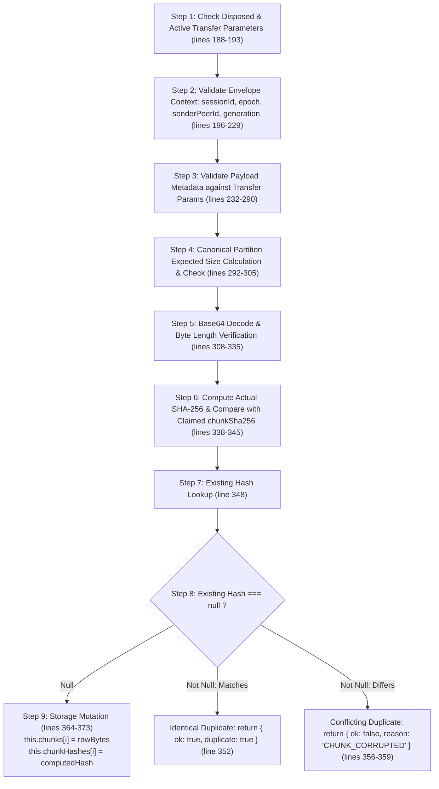

# Phase 7.5 M4.2d-R10 — Delayed Response Admission and Final Lifecycle Contract Correction Report

**Document Version:** 1.0.0  
**Status:** COMPLETE — READY FOR INDEPENDENT REVIEW — IMPLEMENTATION STILL UNAUTHORIZED  
**Date:** November 23, 2026  
**Author:** Senior TypeScript Distributed-Systems Architect  
**Scope:** Strictly Documentational & Architectural Correction (Zero Runtime/Test Code Modifications)  
**Authoritative Baseline:** M4.2c-R6 Closure (`79919a0f8cb0bb81cb80cc010fe02918bef79787`)  

---

> [!CRITICAL]
> **AUTHORIZATION BOUNDARY NOTICE**  
> **M4.2d implementation remains strictly unauthorized pending independent review and explicit user approval.**  
> This task is strictly documentational, read-only, and analytical. It introduces NO modifications to runtime source code, NO modifications to test files, NO package export or configuration changes, NO dependency additions, and NO wire schema modifications. Frozen baselines M4.1, M4.2a, M4.2b, and M4.2c remain 100% byte-exact and unmodified.

---

## 1. Baseline Provenance & Working-Tree Cleanliness Verification

### 1.1 Git Working-Tree Verification
- **Current HEAD Commit:** `79919a0f8cb0bb81cb80cc010fe02918bef79787` (M4.2c-R6 Closure)
- **Direct Parent Commit:** `699019ee46e44e9ce1dfdfb4f7d1262bce239048` (M4.2c-R5)
- **Active Branch:** `main`
- **Working-Tree Status:** Clean on all tracked source and test files. Zero uncommitted changes in `packages/`.
- **Frozen Baselines Verified (0 diffs):**
  - Frozen M4.1 Baseline: `fd23edae5bdb52cff32674860229277a79cb1aca` (Wire Schemas, Constants, `ChunkAssembler`)
  - Frozen M4.2a Baseline: `e3245912626758c094d83edbd4d9264a922070f5` (`SnapshotSerializer`, `SerializedSnapshotArtifact`)
  - Frozen M4.2b Baseline: `8f509f94a39be9ece4060003ee498dc747efb813` (`SnapshotPreparationQueue`, `SnapshotChunkProducer`)
  - Frozen M4.2c Baseline: `79919a0f8cb0bb81cb80cc010fe02918bef79787` (`SnapshotOutboundPipeline`)

---

## 2. Exact Frozen Source Implementation Inspection & Verification

The following exact frozen source implementations and line ranges were inspected read-only to establish ground truth:

1. `packages/sync-engine/src/recovery/chunk-assembler.ts`:
   - **Lines 45–50:** `ChunkEnvelopeContext` interface (`sessionId`, `senderPeerId`, `membershipEpoch`, `connectionGeneration?`).
   - **Lines 184–230:** Step 1 & 2 validation: Disposed check, active transfer parameters existence check, and envelope context verification (`sessionId`, `membershipEpoch`, `senderPeerId`, `connectionGeneration`).
   - **Lines 231–290:** Step 3 validation: Payload metadata validation against active transfer parameters (`transferId`, `sessionId`, `snapshotId`, `supplierPeerId`, `membershipEpoch`, `totalChunks`, `totalSizeBytes`, `chunkIndex` bounds $[0, \text{totalChunks})$, and `chunkSizeBytes > this.maxChunkBytes`).
   - **Lines 292–306:** Step 4 validation: Canonical partition expected size calculation and equality verification (`expectedChunkSize`).
   - **Lines 308–336:** Step 5 validation: Base64 decoding of `payload.dataBase64` via Node `Buffer.from` or browser `atob`, followed by exact byte length assertion (`rawBytes.byteLength === payload.chunkSizeBytes`).
   - **Lines 338–346:** Step 6 validation: SHA-256 calculation `computedHash = sha256(rawBytes).toLowerCase()` and comparison with claimed `payload.chunkSha256.toLowerCase()`. Returns `{ ok: false, reason: 'CHUNK_CORRUPTED' }` on mismatch.
   - **Lines 348–361:** Step 7 & 8 validation: Existing hash lookup `this.chunkHashes[payload.chunkIndex]`. If `existingHash !== null`:
     - If `existingHash === computedHash`: returns `{ ok: true, duplicate: true, completed: this.isComplete() }` (identical duplicate).
     - Else: returns `{ ok: false, reason: 'CHUNK_CORRUPTED' }` (conflicting duplicate).
   - **Lines 363–374:** Step 9 mutation: Executed **strictly after** all validation:
     `this.chunks[payload.chunkIndex] = rawBytes;`
     `this.chunkHashes[payload.chunkIndex] = computedHash;`
     `this.receivedChunksCount++;`
     `this.receivedBytesCount += rawBytes.byteLength;`
   - **Lines 389–601:** `prepareForFailover()`: Preserves `this.chunks` and `this.chunkHashes` while updating expected `supplierPeerId`, `membershipEpoch`, and `connectionGeneration`.
   - **Lines 689–716:** `finalizeAssembly()`: Allocates contiguous `new Uint8Array(totalSizeBytes)`, copies slices via `.set()`, and immediately executes `this.chunks = null; this.chunkHashes = null;` at line 714 before returning.

2. `packages/sync-engine/src/recovery/snapshot-serializer.ts`:
   - **Lines 364–377:** `copyByteRange(offset, length)` calls `this.#masterBytes!.slice(offset, offset + length)`. `cloneBytes()` calls `new Uint8Array(this.#masterBuffer!.slice(0))`, producing completely unaliased deep copies.
   - **Lines 417–464:** `dispose()` provides idempotent resource cleanup; `#finalizeDisposal()` nullifies `#masterBuffer` and `#masterBytes`.

3. `packages/sync-engine/src/recovery/snapshot-outbound-pipeline.ts`:
   - **Lines 61–86:** `OutboundTransportCapability` and `createOutboundTransportCapability`.
   - **Lines 92–98:** `AuthenticatedRecipientContext` interface.
   - **Lines 505–527:** `#authorizedCapability` validation and private storage in `#transfers` and `#validRecipientContexts`.

4. `packages/protocol/src/constants.ts`:
   - **Lines 78–168:** `MAX_SNAPSHOT_BYTES` ($4,194,304\text{ B}$), `MAX_CHUNK_BYTES` ($32,768\text{ B}$), `MIN_RAW_CHUNK_BYTES` ($256\text{ B}$), `MAX_CHUNKS_PER_SNAPSHOT` (128), `MAX_CONCURRENT_CHUNK_REQUESTS` (4), `CHUNK_REQUEST_TIMEOUT_MS` ($5,000\text{ ms}$), `MAX_CHUNK_RETRIES` (3), `MAX_TRANSFER_RETRIES` (10), `OVERALL_TRANSFER_TIMEOUT_MS` ($60,000\text{ ms}$).

---

## 3. R10-1 — Bounded Historical Dispatch Evidence Model & Delayed Response Admission

### 3.1 Defect Analysis in R9 Admission Rule
In R9 Section 3.2 and Section 3.6, the rule stated:
> "If an inbound chunk arrives while the attempt is still in `LOCAL_HANDOFF_PENDING`, the pipeline strictly rejects and drops the frame."

This rule contained a critical liveness defect when an earlier attempt had already been accepted by `RTCDataChannel.send()`:
1. Attempt A requests chunk 5.
2. `RTCDataChannel.send()` succeeds; adapter calls `handleHandoffSuccess()`.
3. Attempt A enters `AWAITING_REMOTE_RESPONSE`.
4. Remote response timeout ($5,000\text{ ms}$) fires; Attempt A is marked timed out.
5. Attempt B retries chunk 5 and enters `LOCAL_HANDOFF_PENDING`.
6. A delayed response to Attempt A arrives while Attempt B is still in `LOCAL_HANDOFF_PENDING`.

Under R9, because the *current active attempt* for chunk 5 was Attempt B in `LOCAL_HANDOFF_PENDING`, the inbound frame was discarded as an "unconfirmed request". This discarded a legitimate, verified transmission from Attempt A simply because a retry was in flight.

### 3.2 The Inbound Chunk Admission Authority Invariant
We establish the following definitive invariant:

> [!IMPORTANT]
> **Definitive Inbound Admission Invariant:**  
> An inbound chunk is admissible for assembler ingestion if and only if **at least one prior transmission attempt for that chunk index reached `DATACHANNEL_ACCEPTED`** under the active `transferId`, `sessionId`, `membershipEpoch`, `supplierPeerId`, and `supplierGeneration`, AND the chunk has not already been terminally verified.  
> **A newer pending retry (`LOCAL_HANDOFF_PENDING`) MUST NOT erase or suppress valid historical acceptance evidence from an earlier attempt.**

### 3.3 Bounded Historical Dispatch Evidence Data Structure
To track DataChannel acceptance across multiple sequential attempts without unbounded growth:

```typescript
export interface AcceptedAttemptRecord {
  readonly attemptToken: string;
  readonly messageId: string;
  readonly supplierPeerId: string;
  readonly supplierGeneration: number;
  readonly acceptedAtMs: number;
  status: 'PENDING_RESPONSE' | 'TIMED_OUT' | 'SUPERSEDED' | 'FULFILLED';
}

export interface ChunkHistoricalEvidence {
  readonly chunkIndex: number;
  /**
   * Bounded array of accepted attempts.
   * Maximum capacity: MAX_CHUNK_RETRIES + 1 = 4 entries.
   */
  readonly acceptedAttempts: AcceptedAttemptRecord[];
  /**
   * Fast-path boolean: true if acceptedAttempts contains at least one record
   * matching active supplier and generation.
   */
  hasActiveDataChannelAcceptance: boolean;
}
```

### 3.4 Bounded Capacity & Lifecycle Guarantees
- **Map Cardinality:** Keyed by `chunkIndex: number`. Cardinality is bounded by `totalChunks <= MAX_CHUNKS_PER_SNAPSHOT = 128`.
- **Per-Chunk Array Bounds:** Each chunk can experience at most `MAX_CHUNK_RETRIES` (3 retries) + 1 initial attempt = **at most 4 accepted attempt records**.
- **Total Historical Records:** At most $128 \times 4 = 512$ attempt records across the entire transfer session. Total memory footprint: $< 50\text{ KiB}$.
- **Safe Evidence-Retirement Conditions:**
  1. **Chunk Verification (`FULFILLED`):** When chunk $i$ is verified by `ChunkAssembler`, all accepted records for chunk $i$ transition to `'FULFILLED'`. They remain in memory to classify subsequent duplicate frames as idempotent duplicates without re-invoking assembler logic.
  2. **Transfer Terminal State (`COMPLETED` or `ABORTED`):** When the transfer reaches terminal state, the entire `#chunkEvidence` map is cleared and disposed.
  3. **Failover to New Supplier:** When failover occurs to candidate supplier $S_{\text{new}}$ with generation $G_{\text{new}}$, all records in `#chunkEvidence` associated with old supplier $S_{\text{old}}$ are pruned or deactivated (`hasActiveDataChannelAcceptance = false`). Chunks from $S_{\text{old}}$ will fail supplier fencing; unsolicited chunks from $S_{\text{new}}$ will fail because $S_{\text{new}}$ has not yet received a request.
  4. **Generation Change:** If supplier connection generation increments to $G+1$, old generation $G$ records are deactivated; new requests must be accepted under generation $G+1$.

### 3.5 Seven Discrete Chunk Evidence States

| Evidence State | Description | Inbound Frame Admission Decision |
| :--- | :--- | :--- |
| **1. NEVER_REQUESTED** | Index has no entry in `#chunkEvidence` and no active attempt. | **STRICTLY REJECTED & DROPPED** (unsolicited chunk). |
| **2. SUBMITTED_UNACCEPTED** | Active attempt is `LOCAL_HANDOFF_PENDING`; zero accepted records exist for this index. | **STRICTLY REJECTED & DROPPED** (unconfirmed frame). |
| **3. ACCEPTED_PENDING** | At least one attempt reached `DATACHANNEL_ACCEPTED` and is currently `AWAITING_REMOTE_RESPONSE`. | **ADMITTED** for assembler ingestion. |
| **4. ACCEPTED_TIMED_OUT** | Prior attempt reached `DATACHANNEL_ACCEPTED` and timed out remotely (5s); no retry is active. | **ADMITTED** for assembler ingestion. |
| **5. ACCEPTED_SUPERSEDED** | Prior attempt reached `DATACHANNEL_ACCEPTED`; newer retry is pending or in-flight. | **ADMITTED** for assembler ingestion. Active retry cancelled upon verification. |
| **6. RECEIVED_VERIFIED** | Chunk already ingested, hash verified, and stored in `ChunkAssembler`. | **ADMITTED to Duplicate Handler** (returns `{ ok: true, duplicate: true }`; dropped idempotently). |
| **7. OBSOLETE_IDENTITY** | Frame matches old transferId, sessionId, epoch, supplier, or connection generation. | **STRICTLY REJECTED & DROPPED** (fencing failure). |

---

## 4. R10-2 — Four Distinct Lifecycles: Transfer, Chunk Reception, Attempt, and Batch

To prevent state conflation, the architecture cleanly separates four independent lifecycles:

```mermaid
flowchart TD
    subgraph TransferLifecycle["1. Transfer Session Lifecycle"]
        T_IDLE["IDLE"] --> T_ADMITTED["ADMITTED"]
        T_ADMITTED --> T_XFER["TRANSFERRING"]
        T_XFER --> T_REASS["REASSEMBLING"]
        T_REASS --> T_VERIFY["VERIFYING"]
        T_VERIFY --> T_COMP["COMPLETED"]
        T_XFER --> T_ABORT["ABORTED"]
    end

    subgraph ChunkLifecycle["2. Chunk Reception Lifecycle (Per Chunk 0..N-1)"]
        C_UNREQ["UNREQUESTED"] --> C_REQ["REQUESTED"]
        C_REQ --> C_VERIFIED["RECEIVED_VERIFIED"]
        C_UNREQ --> C_VERIFIED
    end

    subgraph AttemptLifecycle["3. Transmission Attempt Lifecycle (Per Attempt Token)"]
        A_PEND["LOCAL_HANDOFF_PENDING"] --> A_AWAIT["AWAITING_REMOTE_RESPONSE (DataChannel Accepted)"]
        A_PEND --> A_FAIL["LOCAL_HANDOFF_FAILED"]
        A_PEND --> A_WD_TO["LOCAL_WATCHDOG_TIMEOUT"]
        A_AWAIT --> A_TO["REMOTE_RESPONSE_TIMED_OUT"]
        A_AWAIT --> A_REC["TERMINAL: RECEIVED"]
        A_AWAIT --> A_CANC["TERMINAL: CANCELLED (Superseded/Aborted)"]
    end

    subgraph BatchLifecycle["4. Batch Message Lifecycle (Per Wire Message)"]
        B_ACT["ACTIVE (unsettledChunkIndices: Set<number>)"] --> B_ALL_REC["RETIRED: ALL_RECEIVED"]
        B_ACT --> B_ALL_FAIL["RETIRED: ALL_FAILED"]
        B_ACT --> B_MIXED["RETIRED: MIXED"]
        B_ACT --> B_CANC["RETIRED: CANCELLED"]
    end
```



### 4.1 State Interplay Matrix
- **Attempt Settlement vs Chunk State:** When an attempt times out remotely, the *attempt* transitions to `REMOTE_RESPONSE_TIMED_OUT`, but the *chunk* transitions from `REQUESTED` to `UNREQUESTED` (ready for retry scheduling), while the *chunk's historical evidence* retains the timed-out attempt as valid acceptance proof.
- **Retry Dispatch vs Historical Proof:** When a retry attempt is dispatched, the *retry attempt* enters `LOCAL_HANDOFF_PENDING`. The *chunk* transitions to `REQUESTED`. The *historical evidence* retains the previous attempt's `DATACHANNEL_ACCEPTED` record.
- **Inbound Arrival During Retry:** When a chunk arrives:
  1. Admission check queries `#chunkEvidence.get(chunkIndex)`. Because `hasActiveDataChannelAcceptance === true`, the chunk is admitted.
  2. `ChunkAssembler.ingestChunk()` validates bytes and stores them.
  3. Chunk state transitions to `RECEIVED_VERIFIED`.
  4. The pending retry attempt is cancelled; its watchdog timer is cleared.
  5. The batch owning the retry attempt removes `chunkIndex` from its `unsettledChunkIndices`.

---

## 5. R10-3 — Disconnect Notification Authentication & Unforgeable Context Ownership

### 5.1 The Threat Model & Authentication Defect
In R9, disconnect handling relied on checking `supplierPeerId` and `connectionGeneration` against immutable session fields. However, this left an authentication ambiguity: if an unprivileged or malicious caller invokes `handleSupplierDisconnected(peerId, gen)`, how does the pipeline verify that the caller is the authorized WebRTC transport adapter?

### 5.2 Authoritative Disconnect Notification Contract
We resolve disconnect authentication through **Capability Possession and Genuine Context Identity**:

```typescript
public handleSupplierDisconnected(
  context: AuthenticatedSupplierContext,
  capability: InboundTransportCapability
): Promise<{ failoverSuccess: boolean }>;
```

1. **In-Process Capability Assertion:**
   - The pipeline constructor receives `authorizedCapability: InboundTransportCapability` minted by the composition root.
   - `handleSupplierDisconnected` asserts `capability === this.#authorizedCapability`.
   - External application callers cannot obtain or forge this capability (`ERR_PACKAGE_PATH_NOT_EXPORTED` on internal modules).
2. **Unforgeable Context Verification:**
   - The caller must present an `AuthenticatedSupplierContext` that was minted by `pipeline.registerSupplierContext()`.
   - The pipeline verifies `this.#validSupplierContexts.has(context) === true` via its private `WeakSet`.
   - Because the context is frozen and contains `readonly supplierPeerId` and `readonly connectionGeneration`, an attacker cannot pass a synthesized JavaScript object.
3. **Session & Generation Fencing:**
   - The pipeline asserts:
     - `context.sessionId === session.sessionId`
     - `context.membershipEpoch === session.membershipEpoch`
     - `context.supplierPeerId === session.supplierPeerId`
     - `context.connectionGeneration === session.supplierGeneration`

### 5.3 Safe Revocation-Before-Disconnect Ordering
- When the transport connection terminates, the adapter may invoke `revokeSupplierContext(context, capability)` *before* `handleSupplierDisconnected(context, capability)`.
- **How Revocation Operates:** `revokeSupplierContext` removes the context from `#activeSupplierContexts: Map<string, ActiveSupplierRecord>`. However, the context object **remains registered in `#validSupplierContexts: WeakSet`**.
- **Safe Execution:** When `handleSupplierDisconnected(context, capability)` is subsequently called:
  - `this.#validSupplierContexts.has(context)` evaluates to `true`.
  - Session matching against immutable `session.supplierPeerId` and `session.supplierGeneration` evaluates to `true`.
  - Failover executes cleanly and deterministically.
- **Duplicate Disconnect Safety:** If a duplicate disconnect notification arrives for the same context:
  - On the first call, failover promoted candidate $C_1$ to `session.supplierPeerId`.
  - On the second call, `context.supplierPeerId !== session.supplierPeerId`.
  - Dropped idempotently as a safe no-op.

---

## 6. R10-4 — Complete Callback and Promise Settlement Semantics

### 6.1 Exact Contract of `onEmitMessage()`
The transport handoff hook has the following signature:
```typescript
onEmitMessage: (handoff: OutboundHandoffRequest) => Promise<void> | void;
```

### 6.2 Settlement Scenarios & Invariant Protection

| Scenario | Execution Sequence | Authoritative Pipeline Action |
| :--- | :--- | :--- |
| **Sync Success** | `onEmitMessage()` returns without throwing; adapter calls `handleHandoffSuccess()` synchronously. | Attempt transitions to `AWAITING_REMOTE_RESPONSE`. Watchdog cleared. 5s remote timer armed. Historical evidence recorded. |
| **Sync Exception** | `onEmitMessage()` throws synchronously (e.g. DataChannel closed). | Catch block catches error. All chunk attempts in handoff transition to `LOCAL_HANDOFF_FAILURE`. Watchdogs cleared. Tier 1 redispatch scheduled. |
| **Promise Rejection Before Acceptance** | Adapter returns Promise; Promise rejects before `handleHandoffSuccess()` is called. | For each chunk in batch still in `LOCAL_HANDOFF_PENDING`: transition to `LOCAL_HANDOFF_FAILURE`. Watchdogs cleared. |
| **Promise Rejection After Acceptance** | Adapter calls `handleHandoffSuccess()` synchronously, then Promise rejects asynchronously. | **DATACHANNEL ACCEPTANCE INVARIANT HOLDS.** Rejection is **strictly ignored** for accepted chunks. Attempt remains in `AWAITING_REMOTE_RESPONSE`. Logged to `onDiagnosticError`. |
| **Duplicate Success Callback** | Adapter calls `handleHandoffSuccess()` twice with same `attemptToken`. | First call transitions attempt. Second call checks `active.state === 'LOCAL_HANDOFF_PENDING'`; finds `AWAITING_REMOTE_RESPONSE`. Dropped as duplicate no-op. |
| **Failure After Success** | Adapter calls `handleHandoffSuccess()`, then calls `handleHandoffFailure()`. | Pipeline checks state; attempt is already in `AWAITING_REMOTE_RESPONSE`. Failure callback is dropped as stale no-op. |
| **Watchdog Racing With Success** | 2,000 ms watchdog timer fires while `handleHandoffSuccess()` is being invoked. | If success runs first: watchdog cleared synchronously. If watchdog runs first: attempt settled as `LOCAL_WATCHDOG_TIMEOUT`; late success callback dropped as stale. |
| **Batch Partial Settlement** | Batch [0, 1] dispatched; chunk 0 accepted, chunk 1 fails send. | Chunk 0 transitions to `AWAITING_REMOTE_RESPONSE`. Chunk 1 transitions to `LOCAL_HANDOFF_FAILURE`. Batch retains Chunk 0 in `unsettledChunkIndices`. |

---

## 7. R10-5 — Exact 9-Step Duplicate-Integrity Ordering in `ChunkAssembler.ingestChunk()`

Inspection of frozen `packages/sync-engine/src/recovery/chunk-assembler.ts` lines 184–374 establishes the following exact 9-step execution ordering:



> [!IMPORTANT]
> **Source Evidence on Claimed Hash Ordering:**  
> Step 6 occurs at line 339, **strictly before** existing hash lookup at line 348.  
> If an inbound chunk carries bytes matching an existing chunk but specifies an incorrect claimed `chunkSha256`, it fails immediately at line 340 with `CHUNK_CORRUPTED` ("Chunk SHA-256 digest mismatch"). It **never reaches line 348**. Therefore, it is physically impossible for an incorrect claimed digest to trigger a false duplicate-conflict classification!

---

## 8. R10-6 — Full Memory Allocation Ownership and Lifetime Table

The following table provides the complete, authoritative memory allocation breakdown across all 13 targets:

| # | Allocation Target | Max Size | Owner | Creation Point | Aliasing | Is Copy? | Max Simultaneous Instances | Release Point | Bound Type |
| :--- | :--- | :--- | :--- | :--- | :--- | :--- | :--- | :--- | :--- |
| **1** | **Accumulating Chunk Slices** | $4,194,304\text{ B}$ ($4.00\text{ MiB}$) | `ChunkAssembler.chunks` | `ingestChunk()` on chunk receipt | Unaliased | Yes (from Base64 decode) | Up to 128 slices summing to $\le 4.00\text{ MiB}$ | `finalizeAssembly()` line 714 (`chunks = null`) | **Code-Guaranteed** ($\le \text{MAX\_SNAPSHOT\_BYTES}$) |
| **2** | **Base64 JSON Wire Strings** | $\approx 43.7\text{ KiB}$ / chunk | V8 Heap / Inbound message | JSON wire parse | Unaliased | Yes (wire JSON) | $\le 4$ in-flight window ($\approx 175\text{ KiB}$) | Dereferenced after Base64 decode in `ingestChunk()` | **Code-Guaranteed** ($4 \times \lceil 32\text{ KiB} \times 4/3 \rceil$) |
| **3** | **Decoded Base64 Uint8Array** | $32,768\text{ B}$ ($32.00\text{ KiB}$) | `ingestChunk()` local scope | `Buffer.from` / `atob` decode | Stored in `this.chunks[i]` | Yes (decoded) | 1 active during decode | Slices released in `finalizeAssembly()` line 714 | **Code-Guaranteed** ($\le \text{MAX\_CHUNK\_BYTES}$) |
| **4** | **Contiguous Assembled Buffer** | $4,194,304\text{ B}$ ($4.00\text{ MiB}$) | `ChunkAssembler` $\to$ `AssembledSnapshot` | `finalizeAssembly()` line 690 | Unaliased new `ArrayBuffer` | Yes (copied from slices via `.set()`) | 1 per transfer | Handed to pipeline verification; freed on session disposal | **Code-Guaranteed** ($\le \text{MAX\_SNAPSHOT\_BYTES}$) |
| **5** | **Returned `rawBytes` in Result** | $4,194,304\text{ B}$ ($4.00\text{ MiB}$) | `SnapshotTransferResult` $\to$ M5 | `assembled.slice(0)` | Unaliased deep copy | Yes (deep copy via `.slice(0)`) | 1 per completed transfer | Managed by M5 `SnapshotInstaller` | **Code-Guaranteed** ($\le \text{MAX\_SNAPSHOT\_BYTES}$) |
| **6** | **UTF-8 Decoded JSON String** | $\approx 4.00\text{–}8.00\text{ MiB}$ | V8 Heap (Step 2 verification) | `TextDecoder.decode()` | Unaliased | Yes (decoded from bytes) | 1 | Dereferenced after `JSON.parse()` completes | **Analytically Estimated** (V8 string layout) |
| **7** | **Parsed Snapshot Object Graph** | $\approx 150\text{–}300\text{ KiB}$ | V8 Heap $\to$ `authoritativeSnapshot` | `JSON.parse()` & Zod schema parse | Object tree | Yes | 1 | Delivered in `SnapshotTransferResult` $\to$ M5 | **Analytically Estimated** |
| **8** | **Canonical JSON String** | $\approx 4.00\text{–}8.00\text{ MiB}$ | `SnapshotSerializer.serialize()` | `canonicalizeJson(preimage)` | Unaliased | Yes | 1 | Nullified line 580 of `snapshot-serializer.ts` | **Analytically Estimated** |
| **9** | **Canonical Artifact Master Buffer** | $4,194,304\text{ B}$ ($4.00\text{ MiB}$) | `SerializedSnapshotArtifact` | `new TextEncoder().encode()` | Unaliased | Yes (encoded UTF-8) | 1 | `canonicalArtifact.dispose()` in `finally` block | **Code-Guaranteed** ($\le \text{MAX\_SNAPSHOT\_BYTES}$) |
| **10** | **`cloneBytes()` Comparison Copy** | $4,194,304\text{ B}$ ($4.00\text{ MiB}$) | Step 8 verification block | `canonicalArtifact.cloneBytes()` | Unaliased deep copy | Yes (`masterBuffer.slice(0)`) | 1 | Dereferenced immediately after byte equality loop | **Code-Guaranteed** ($\le \text{MAX\_SNAPSHOT\_BYTES}$) |
| **11** | **`copyByteRange()` Output Buffer** | $\le 32,768\text{ B}$ ($32.00\text{ KiB}$) | Caller local scope | `canonicalArtifact.copyByteRange()` | Unaliased deep copy | Yes (`masterBytes.slice()`) | 0 during inbound pipeline | Dereferenced immediately | **Code-Guaranteed** ($\le \text{MAX\_CHUNK\_BYTES}$) |
| **12** | **M5 Installer-Owned Retention** | $\le 4.00\text{ MiB}$ + $\approx 300\text{ KiB}$ | `SnapshotInstaller` (M5) | On delivery of `SnapshotTransferResult` | Caller-owned | Caller-governed | 1 during staging | Released after atomic installation in M5 | **Milestone M5-Owned** (Outside M4.2d boundary) |
| **13** | **Runtime & GC Overhead** | Dynamic | V8 Engine / Process RSS | Heap metadata, hidden classes, fragmentation | System-owned | N/A | Process lifetime | Governed by V8 Garbage Collector sweeps | **Unmeasured Runtime Overhead** |

---

## 9. R10-7 — Complete Adversarial Test Matrix (18 Core Cases)

| # | Test Scenario | Admission / Rejection | Assembler Invocation | Attempt State | Chunk State | Batch Ownership | Historical Evidence Mutation | Transfer State | Retry Budget Change |
| :--- | :--- | :--- | :--- | :--- | :--- | :--- | :--- | :--- | :--- |
| **1** | First request never reaches DataChannel acceptance; unsolicited chunk arrives | **REJECTED & DROPPED** | **NO** | Remains `LOCAL_HANDOFF_PENDING` | `UNREQUESTED` | Retained in `unsettledChunkIndices` | Zero mutation | `TRANSFERRING` | Zero change |
| **2** | Attempt A accepted; Attempt A times out; Attempt B pending; delayed Attempt A response arrives | **ADMITTED** | **YES** | Attempt B cancelled & cleared | `RECEIVED_VERIFIED` | Removed from Attempt B batch | Attempt A marked `'FULFILLED'` | `TRANSFERRING` | Zero change |
| **3** | Attempt A accepted; Attempt B locally fails; delayed Attempt A response arrives | **ADMITTED** | **YES** | Attempt B was `LOCAL_HANDOFF_FAILURE` | `RECEIVED_VERIFIED` | Removed upon failure | Attempt A marked `'FULFILLED'` | `TRANSFERRING` | Zero change |
| **4** | Attempt A accepted; Attempt B accepted; duplicate responses arrive | Resp 1: **ADMITTED**; Resp 2: **ADMITTED (Dup)** | Resp 1: **YES (Store)**; Resp 2: **YES (Dup Check)** | Settled as `RECEIVED` | `RECEIVED_VERIFIED` | Removed upon Resp 1 | Both marked `'FULFILLED'` | `TRANSFERRING` | Zero change |
| **5** | Attempt A times out; response arrives before retry | **ADMITTED** | **YES** | Was `REMOTE_RESPONSE_TIMED_OUT` | Transitions to `RECEIVED_VERIFIED` | Already settled upon timeout | Marked `'FULFILLED'` | `TRANSFERRING` | Zero change (no retry needed) |
| **6** | Attempt A times out; response arrives after retry | **ADMITTED** | **YES** | Retry attempt cancelled | `RECEIVED_VERIFIED` | Removed from retry batch | Marked `'FULFILLED'` | `TRANSFERRING` | Zero change |
| **7** | Old supplier responds after failover | **REJECTED & DROPPED** | **NO** (fencing fails) | Old attempts were cleared | Unchanged | Old batches retired | Zero mutation | `TRANSFERRING` (new supplier) | Zero change |
| **8** | Old supplier responds after generation revocation | **REJECTED & DROPPED** | **NO** ($G < G_{\text{session}}$) | Unchanged | Unchanged | Unchanged | Zero mutation | `TRANSFERRING` | Zero change |
| **9** | New transfer reuses chunk index with different transferId | **REJECTED & DROPPED** | **NO** (`transferId` mismatch) | Unchanged | Unchanged | Unchanged | Zero mutation | `TRANSFERRING` (new transfer) | Zero change |
| **10** | Promise rejects after success callback | N/A (outbound event) | **NO** | **UNMUTATED** (`AWAITING_REMOTE_RESPONSE`) | `REQUESTED` | Retained | Retains `PENDING_RESPONSE` | `TRANSFERRING` | Zero change |
| **11** | Failure callback arrives after success callback | N/A | **NO** | **UNMUTATED** (`AWAITING_REMOTE_RESPONSE`) | `REQUESTED` | Retained | Zero mutation | `TRANSFERRING` | Zero change |
| **12** | Watchdog and success callback race | N/A | **NO** | If success first: `AWAITING_REMOTE_RESPONSE`. If watchdog first: `LOCAL_WATCHDOG_TIMEOUT` | If success: `REQUESTED`. If watchdog: `UNREQUESTED` | If success: retained. If watchdog: removed | If success: recorded. If watchdog: unrecorded | `TRANSFERRING` | 0 remote retries consumed |
| **13** | Duplicate disconnect callback arrives after supplier promotion | N/A | **NO** | Unchanged (promoted transfer active) | Unchanged | Unchanged | Zero mutation | `TRANSFERRING` (promoted) | Zero change (idempotent no-op) |
| **14** | Revocation occurs before disconnect notification | N/A | **NO** | Cleared for old supplier | Unverified $\to$ `UNREQUESTED` | Retired | Old evidence pruned | Promotes candidate or aborts | Zero change |
| **15** | Disconnect notification occurs before revocation | N/A | **NO** | Cleared during disconnect | As in Case 14 | Retired | Old evidence pruned | Promotes candidate or aborts | Zero change |
| **16** | Incorrect claimed digest supplied for bytes matching existing chunk | **ADMITTED to Assembler** | **YES** (Fails Step 6 with `CHUNK_CORRUPTED`) | Frame dropped as corrupted | Remains `RECEIVED_VERIFIED` | Unchanged | Zero mutation | `TRANSFERRING` | Zero change |
| **17** | Identical valid duplicate arrives | **ADMITTED to Assembler** | **YES** (Returns `{ ok: true, duplicate: true }`) | Idempotent duplicate | Remains `RECEIVED_VERIFIED` | Unchanged | Retains `'FULFILLED'` | `TRANSFERRING` | Zero change |
| **18** | Conflicting valid chunk arrives for already stored index | **ADMITTED to Assembler** | **YES** (Fails Step 8 with `CHUNK_CORRUPTED`) | Terminal abort initiated | `ABORTED` | All retired | Cleared on abort | Transitions to `ABORTED` | Transfer terminated |

---

## 10. R10-8 — Reconciled Master Specification Summary

The master specification `docs/PHASE7_5_M4_2D_ARCHITECTURE_AND_INTERFACE_SPECIFICATION.md` is updated to **Version 1.10.0**:
1. **Contradictory R9 Wording Removed:** Fully eliminated the blanket rule that rejected any chunk arriving during `LOCAL_HANDOFF_PENDING`.
2. **Historical Acceptance Authority Codified:** Established the Bounded Historical Dispatch Evidence Model (§3) verifying that at least one request reached `DATACHANNEL_ACCEPTED` under active supplier parameters.
3. **Four Independent Lifecycles Defined:** Documented transfer, chunk reception, attempt, and batch lifecycles without cross-layer conflation (§4).
4. **Authenticated Disconnect Handling:** Codified capability and frozen context verification for `handleSupplierDisconnected` (§5).
5. **Exact 9-Step Duplicate-Integrity Ordering:** Preserved the verified source execution ordering from `chunk-assembler.ts` (§7).
6. **13-Row Allocation Ownership Table:** Fully integrated the complete allocation ownership, aliasing, and lifetime table (§8).
7. **Frozen Constants Preserved:** Maintained $60,000\text{ ms}$ overall timeout, $5,000\text{ ms}$ chunk timeout, $2,000\text{ ms}$ watchdog, $30,000\text{ ms}$ candidate TTL, $W=4$ sliding window, and retry limits.

---

## 11. Frozen Baseline Diff Verification (0 Diffs)

```bash
git diff --exit-code packages/
# Returns 0 (0 bytes diff)

git diff --exit-code 79919a0f8cb0bb81cb80cc010fe02918bef79787 packages/
# Returns 0 (0 bytes diff against M4.2c-R6 closure)
```

No runtime source files, test files, package configurations, or wire protocol schemas were modified.

---

## 12. Final Decision Gate

**Verdict:** **`READY FOR INDEPENDENT REVIEW — IMPLEMENTATION STILL UNAUTHORIZED`**

> [!CRITICAL]
> **M4.2d implementation remains strictly unauthorized pending independent review and explicit user approval.**
