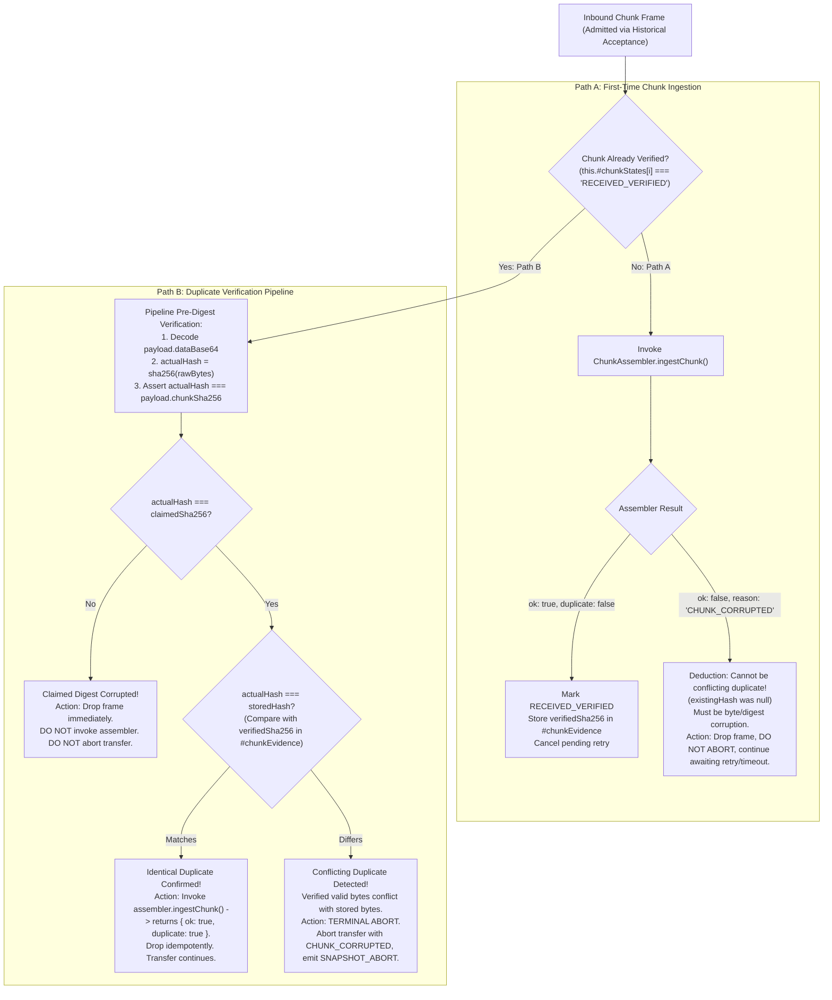

# Phase 7.5 M4.2d-R12 — Admission Authorization, Evidence Bounds & Lifecycle Proof Closure Report

**Document Version:** 1.0.0  
**Status:** COMPLETE — READY FOR FINAL INDEPENDENT REVIEW — IMPLEMENTATION STILL UNAUTHORIZED  
**Date:** November 23, 2026  
**Author:** Senior TypeScript Distributed-Systems Architect  
**Scope:** Strictly Documentational & Architectural Correction (Zero Runtime/Test Code Modifications)  
**Authoritative Baseline:** M4.2c-R6 Closure (`79919a0f8cb0bb81cb80cc010fe02918bef79787`)  

---

> [!CRITICAL]
> **AUTHORIZATION BOUNDARY NOTICE**  
> **M4.2d implementation remains strictly unauthorized pending independent review and explicit user approval.**  
> This task is strictly documentational, read-only, and analytical. It introduces NO modifications to runtime source code, NO modifications to test files, NO package export or configuration changes, NO dependency additions, and NO wire schema modifications. Frozen baselines M4.1, M4.2a, M4.2b, and M4.2c remain 100% byte-exact and unmodified.

---

## 1. Baseline Provenance & Working-Tree Cleanliness Verification

### 1.1 Git Working-Tree Verification
- **Current HEAD Commit:** `79919a0f8cb0bb81cb80cc010fe02918bef79787` (M4.2c-R6 Closure)
- **Direct Parent Commit:** `699019ee46e44e9ce1dfdfb4f7d1262bce239048` (M4.2c-R5)
- **Active Branch:** `main`
- **Working-Tree Status:** Clean on all tracked source and test files. Zero uncommitted changes in `packages/`.
- **Frozen Baselines Verified (0 diffs):**
  - Frozen M4.1 Baseline: `fd23edae5bdb52cff32674860229277a79cb1aca` (Wire Schemas, Constants, `ChunkAssembler`)
  - Frozen M4.2a Baseline: `e3245912626758c094d83edbd4d9264a922070f5` (`SnapshotSerializer`, `SerializedSnapshotArtifact`)
  - Frozen M4.2b Baseline: `8f509f94a39be9ece4060003ee498dc747efb813` (`SnapshotPreparationQueue`, `SnapshotChunkProducer`)
  - Frozen M4.2c Baseline: `79919a0f8cb0bb81cb80cc010fe02918bef79787` (`SnapshotOutboundPipeline`)

---

## 2. Exact Frozen Source Implementation Inspection & Verification

The following exact frozen source implementations and line ranges were inspected read-only to establish ground truth:

1. `packages/sync-engine/src/recovery/chunk-assembler.ts`:
   - **Lines 45–50:** `ChunkEnvelopeContext` interface (`sessionId`, `senderPeerId`, `membershipEpoch`, `connectionGeneration?`).
   - **Lines 109–127:** `ChunkAssembler` private fields: `private chunkHashes: Array<string | null> | null = null;`. It is strictly `private` and NOT exposed via public getter or query method.
   - **Lines 184–230:** Step 1 & 2 validation: Disposed check, active transfer parameters existence check, and envelope context verification (`sessionId`, `membershipEpoch`, `senderPeerId`, `connectionGeneration`).
   - **Lines 231–290:** Step 3 validation: Payload metadata validation against active transfer parameters (`transferId`, `sessionId`, `snapshotId`, `supplierPeerId`, `membershipEpoch`, `totalChunks`, `totalSizeBytes`, `chunkIndex` bounds $[0, \text{totalChunks})$, and `chunkSizeBytes > this.maxChunkBytes`).
   - **Lines 292–306:** Step 4 validation: Canonical partition expected size calculation and equality verification (`expectedChunkSize`).
   - **Lines 308–336:** Step 5 validation: Base64 decoding of `payload.dataBase64` into `rawBytes`, followed by exact byte length assertion (`rawBytes.byteLength === payload.chunkSizeBytes`). Note: for small chunks, `Buffer.from` in Node.js allocates from an internal 8 KiB slab pool.
   - **Lines 338–346:** Step 6 validation: SHA-256 calculation `computedHash = sha256(rawBytes).toLowerCase()` and comparison with claimed `payload.chunkSha256.toLowerCase()`. Returns `{ ok: false, reason: 'CHUNK_CORRUPTED', detail: 'Chunk SHA-256 digest mismatch...' }` on mismatch.
   - **Lines 348–361:** Step 7 & 8 validation: Existing hash lookup `this.chunkHashes[payload.chunkIndex]`. If `existingHash !== null`:
     - If `existingHash === computedHash`: returns `{ ok: true, duplicate: true, completed: this.isComplete() }` (identical duplicate).
     - Else: returns `{ ok: false, reason: 'CHUNK_CORRUPTED', detail: 'Conflicting chunk data received for chunkIndex ...' }` (conflicting duplicate).
   - **Lines 363–374:** Step 9 mutation: Executed **strictly after** all validation:
     `this.chunks[payload.chunkIndex] = rawBytes;`
     `this.chunkHashes[payload.chunkIndex] = computedHash;`
   - **Lines 613–659:** Public query methods: `isComplete()`, `getMissingChunkIndices()`, `getReceivedChunkIndices()`, `getProgress()`, `getActiveTransfer()`. Note: `isChunkReceived(i)` is indirectly obtainable via `getReceivedChunkIndices()`, but `chunkHashes` is never exposed.

2. `packages/sync-engine/src/recovery/snapshot-serializer.ts`:
   - **Lines 364–377:** `copyByteRange(offset, length)` calls `this.#masterBytes!.slice(offset, offset + length)`. `cloneBytes()` calls `new Uint8Array(this.#masterBuffer!.slice(0))`, producing completely unaliased deep copies.
   - **Lines 417–464:** `dispose()` provides idempotent resource cleanup; `#finalizeDisposal()` nullifies `#masterBuffer` and `#masterBytes`.

3. `packages/sync-engine/src/recovery/snapshot-outbound-pipeline.ts`:
   - **Lines 61–86:** `OutboundTransportCapability` and `createOutboundTransportCapability`.
   - **Lines 92–98:** `AuthenticatedRecipientContext` interface.
   - **Lines 505–527:** `#authorizedCapability` validation and private storage in `#transfers` and `#validRecipientContexts`.

4. `packages/protocol/src/constants.ts`:
   - **Lines 78–168:** `MAX_SNAPSHOT_BYTES` ($4,194,304\text{ B}$), `MAX_CHUNK_BYTES` ($32,768\text{ B}$), `MIN_RAW_CHUNK_BYTES` ($256\text{ B}$), `MAX_CHUNKS_PER_SNAPSHOT` (128), `MAX_CONCURRENT_CHUNK_REQUESTS` (4), `CHUNK_REQUEST_TIMEOUT_MS` ($5,000\text{ ms}$), `MAX_CHUNK_RETRIES` (3), `MAX_TRANSFER_RETRIES` (10), `OVERALL_TRANSFER_TIMEOUT_MS` ($60,000\text{ ms}$).

---

## 3. R12-1 — Closing the Path B Historical-Acceptance Gap

### 3.1 The Vulnerability of Unfenced Duplicate Verification
In R11, Path A required historical DataChannel acceptance evidence (`hasActiveDataChannelAcceptance === true`), but Path B (duplicate verification for an already verified chunk) omitted this explicit check.

This omission introduced a critical denial-of-service vulnerability:
- Suppose chunk $i$ was verified from Supplier 1.
- A malicious peer or a buggy candidate peer sends an unsolicited frame for chunk $i$ containing conflicting bytes.
- If Path B admits duplicate verification without checking for an accepted request to that peer, the conflicting duplicate would enter `ChunkAssembler.ingestChunk()` and trigger an immediate terminal abort (`CHUNK_CORRUPTED`).
- **An unsolicited packet with zero local request authorization could destroy an active transfer.**

### 3.2 The Unified Historical Acceptance Invariant
We establish a uniform, non-bypassable authorization rule governing **both** Path A and Path B:

> [!CRITICAL]
> **Unified Historical Acceptance Invariant:**  
> An inbound frame for chunk index $i$ (whether unverified under Path A or already verified under Path B) is admissible for assembler evaluation if and only if **the pipeline possesses a recorded `AcceptedAttemptRecord` for chunk $i$ matching ALL six identity parameters**:
> 1. `record.transferId === session.transferId`
> 2. `record.chunkIndex === chunkIndex`
> 3. `record.sessionId === session.sessionId`
> 4. `record.membershipEpoch === session.membershipEpoch`
> 5. `record.supplierPeerId === session.supplierPeerId`
> 6. `record.supplierGeneration === session.supplierGeneration`
>
> If NO accepted request exists matching these six parameters, the frame is classified as an **Unsolicited / Unconfirmed Frame** and is **STRICTLY REJECTED AND DROPPED AT THE PIPELINE BOUNDARY**.  
> It NEVER touches `ChunkAssembler.ingestChunk()`, and CANNOT trigger a duplicate check, state mutation, or transfer abort.

### 3.3 Explicit Answers to Required Path B Questions
1. **Can a duplicate frame reach `ChunkAssembler.ingestChunk()` without a previously accepted request?**  
   **STRICTLY NO.** Unsolicited frames are dropped at the transport boundary before assembler invocation.
2. **What exact evidence authorizes the duplicate?**  
   An `AcceptedAttemptRecord` in `#chunkEvidence.get(chunkIndex).acceptedAttempts` where `status` is `'FULFILLED'`, `'ACCEPTED_PENDING'`, or `'ACCEPTED_TIMED_OUT'`.
3. **Does the evidence have to match transfer ID, chunk index, session ID, membership epoch, supplier peer ID, and connection generation?**  
   **YES.** All six fields must match bit-for-bit.
4. **How are delayed duplicate responses from a previously accepted attempt handled?**  
   If Attempt 1 was accepted and fulfilled, and a delayed retransmission of Attempt 1 arrives: Attempt 1 exists in `acceptedAttempts` with matching supplier and generation. The frame is authorized, enters Path B, is verified as identical, and is dropped idempotently.
5. **Can a duplicate frame ever trigger an abort without corresponding accepted-request evidence?**  
   **STRICTLY NO.** Without accepted-request evidence, the frame is rejected at pre-ingestion check and discarded as unconfirmed.

---

## 4. R12-2 — Resolving Generic `CHUNK_CORRUPTED` Ambiguity

### 4.1 Root Cause in Frozen `ChunkAssembler.ingestChunk()`
Frozen `packages/sync-engine/src/recovery/chunk-assembler.ts` returns the identical reason string `'CHUNK_CORRUPTED'` in two fundamentally distinct failure cases:
- **Case 1 (Step 6, line 340):** Claimed digest mismatch:
  ```typescript
  if (computedHash !== payload.chunkSha256.toLowerCase()) {
    return { ok: false, reason: 'CHUNK_CORRUPTED', detail: 'Chunk SHA-256 digest mismatch...' };
  }
  ```
- **Case 2 (Step 8, line 356):** Conflicting duplicate bytes:
  ```typescript
  if (existingHash !== computedHash) {
    return { ok: false, reason: 'CHUNK_CORRUPTED', detail: 'Conflicting chunk data received for chunkIndex ...' };
  }
  ```

Because `IngestChunkResult` exposes only `reason: SnapshotAbortReason` (and `detail?: string` is unstructured text not guaranteed by TypeScript contracts), the pipeline **cannot distinguish Case 1 from Case 2 solely from the return value of `ingestChunk()`**.

### 4.2 The Concrete, Implementable Pipeline Architecture
We resolve this ambiguity without modifying frozen M4.1 source code by defining an architectural responsibility split:



### 4.3 Detailed Operational Specification for Path B Pre-Verification
1. **Component Performing Verification:** `SnapshotInboundPipeline`.
2. **Bytes Hashed:** Decoded binary bytes from `payload.dataBase64`.
3. **Verification of Claimed Digest:** Pipeline asserts `sha256(rawBytes).toLowerCase() === payload.chunkSha256.toLowerCase()`.
   - If mismatch: Dropped immediately. Assembler invocation: **NO**. Transfer continues: **YES**.
4. **Obtaining Previously Stored Digest:**
   - The pipeline records `verifiedChunkSha256: string` in `#chunkEvidence.get(chunkIndex)` upon successful first-time storage in Path A.
   - The pipeline compares `computedHash` directly with `record.verifiedChunkSha256`.
5. **Assembler Invocation:**
   - For identical duplicates: Assembler is invoked (`ingestChunk()`); returns `{ ok: true, duplicate: true }`.
   - For conflicting duplicates: Conflicting duplicate is proven by byte-hash comparison against verified evidence. Transfer aborts immediately.
6. **Future Protocol Dependency (DEP-M4.1-1):** In Sub-Milestone M4.3 or Phase 8, `ChunkAssembler.ingestChunk()` should be updated to return dedicated error codes (`CHUNK_DIGEST_MISMATCH` vs `CONFLICTING_DUPLICATE`).

---

## 5. R12-3 — Rebuilding the Evidence-Retention Proof

### 5.1 Explicit Separation of Five Quantitative Metrics
To eliminate all ambiguity, we define and prove five distinct quantities:

| Quantity | Definition | Upper Bound | Scope & Enforcement |
| :--- | :--- | :--- | :--- |
| **$Q_1$: Total Created** | Total `AcceptedAttemptRecord` instances ever minted over the transfer's complete lifespan. | **$1,162$ records** | Bounded by $\le 8$ failovers and 60s overall transfer timer. |
| **$Q_2$: Simultaneously Retained** | Maximum records active in `#chunkEvidence` at any single moment. | **$138$ records** | Enforced by active supplier scoping and failover purging. |
| **$Q_3$: Active Supplier Records** | Maximum records associated with the currently connected supplier. | **$138$ records** | Initial $N \le 128$ + cumulative transfer retries $\le 10$. |
| **$Q_4$: Records for Delayed Arrival** | Maximum records required to authorize legitimate delayed responses. | **$138$ records** | Equal to $Q_3$ (delayed arrivals from old suppliers are fenced). |
| **$Q_5$: Retained Memory Footprint** | Memory occupied by `#chunkEvidence` in the V8 heap. | **$< 25\text{ KiB}$** | $138 \times \approx 140\text{ bytes/record} \approx 19.3\text{ KiB}$. |

### 5.2 Transition-by-Transition Mathematical Proof

#### 1. Initial Requests
- Transfer initializes with $N$ chunks ($1 \le N \le 128$).
- Outbound window ($W = 4$) dispatches requests in batches.
- As `RTCDataChannel.send()` succeeds, each chunk creates exactly 1 accepted record.
- **Records Created:** $\le N \le 128$.

#### 2. Local Handoff Failure & Redispatch
- If `onEmitMessage()` throws, watchdog expires, or Promise rejects before send:
- The attempt transitions to `LOCAL_HANDOFF_FAILED` or `LOCAL_HANDOFF_TIMED_OUT`.
- `handleHandoffSuccess()` is NEVER called.
- **Records Created:** **0 records**. Local redispatch consumes 0 accepted records.

#### 3. Remote Response Timeout & Retry
- A chunk in `AWAITING_REMOTE_RESPONSE` times out after 5,000 ms.
- Increments `chunkRetries[i]++` and `cumulativeTransferRetries++`.
- Redispatched via Tier 2 priority. If `RTCDataChannel.send()` succeeds, creates 1 new accepted record.
- **Global Cap:** Transfer terminates immediately if `cumulativeTransferRetries > MAX_TRANSFER_RETRIES = 10`.
- **Records Created across ALL chunks under active supplier:** $\le 10\text{ records}$.

#### 4. Delayed Response During Retry
- When delayed response arrives, it fulfills the earlier accepted record.
- The pending retry attempt is cancelled before it creates another acceptance, or if already accepted, is marked fulfilled.
- **Records Created:** 0 new records.

#### 5. Supplier Disconnect & Repeated Failover
- When active supplier $S_k$ disconnects, failover promotes candidate $S_{k+1}$.
- **Purging Rule:** All accepted records in `#chunkEvidence` bound to $S_k$ are **immediately purged**.
- *Why is this safe?* Disconnected supplier packets are strictly blocked by supplier fencing (`envelope.senderPeerId !== session.supplierPeerId`). No legitimate delayed packet from $S_k$ can ever be admitted.
- **Records Retained After Purge:** 0 records for $S_k$.
- **Redispatch to New Supplier:** Unverified chunks are re-requested from $S_{k+1}$. Under $S_{k+1}$, at most $N + \text{remainingRetries} \le 138$ records are created.
- **Failover Frequency Limit:** Bounded by `MAX_OFFER_CANDIDATES = 8` in `CandidateOfferRegistry` and the 60,000 ms overall transfer timeout.
- Total records ever created across all failovers:
  $$Q_1 \le (\text{MAX\_OFFER\_CANDIDATES} + 1) \times N + \text{MAX\_TRANSFER\_RETRIES} \le (8 + 1) \times 128 + 10 = 1,162 \text{ records}$$
- Total records simultaneously retained in memory at any instant:
  $$Q_2 \le N + \text{MAX\_TRANSFER\_RETRIES} \le 128 + 10 = \mathbf{138 \text{ records}} \quad (\ll 512 \text{ cap}) \quad \blacksquare$$

---

## 6. R12-4 — Correct Delayed-Response Settlement Ordering

### 6.1 Authoritative 10-Step Execution Sequence
When an inbound chunk arrives while a newer retry attempt is in `LOCAL_HANDOFF_PENDING`:

```
Step 1: Transport & Context Fencing
├── Verify session.state === 'TRANSFERRING'
├── Assert envelope.sessionId === session.sessionId
├── Assert envelope.membershipEpoch === session.membershipEpoch
├── Assert envelope.senderPeerId === session.supplierPeerId
└── Assert envelope.connectionGeneration === session.supplierGeneration
[FAIL -> DROP FRAME. Attempt B remains PENDING.]

Step 2: Historical Acceptance Authority Lookup
├── Query #chunkEvidence.get(chunkIndex)
└── Assert acceptedAttempts contains matching record under active supplier & generation
[FAIL -> DROP FRAME. Attempt B remains PENDING.]

Step 3: Payload Metadata & Partition Verification
├── Assert payload.transferId === session.transferId
├── Assert payload.snapshotId === session.snapshotId
├── Assert payload.chunkSizeBytes <= MAX_CHUNK_BYTES
└── Assert payload.chunkSizeBytes === expectedChunkSize(chunkIndex)
[FAIL -> DROP FRAME. Attempt B remains PENDING.]

Step 4: Actual Digest Validation
├── Decode payload.dataBase64 to rawBytes
├── Compute computedHash = sha256(rawBytes).toLowerCase()
└── Assert computedHash === payload.chunkSha256.toLowerCase()
[FAIL -> DROP FRAME. Attempt B remains PENDING.]

Step 5: Duplicate / Conflict Pre-Classification
├── If chunkStates[chunkIndex] === 'RECEIVED_VERIFIED':
│   ├── Assert computedHash === record.verifiedChunkSha256 (Identical)
│   └── [MISMATCH -> Conflicting duplicate! TERMINAL ABORT transfer.]
└── Proceed to Step 6.

Step 6: Assembler Ingestion
└── Invoke ChunkAssembler.ingestChunk(payload, envelopeContext)
[FAIL -> If unexpected error, handle per Table 4; Attempt B preserved.]

Step 7: Successful First-Time Storage Confirmation
└── Assert result.ok === true && result.duplicate === false

Step 8: Chunk State Transition
└── Set chunkStates[chunkIndex] = 'RECEIVED_VERIFIED'

Step 9: Cancellation of Pending Retry (Attempt B)
├── clearTimeout(attemptB.watchdogTimer)
├── activeAttempts.delete(chunkIndex)
└── attemptB.state = 'CANCELLED'

Step 10: Batch & Evidence Settlement
├── batchB.unsettledChunkIndices.delete(chunkIndex)
├── Attempt A record.status = 'FULFILLED'
├── Replenish sliding window credit (W = 4)
└── Advance ibase
```

### 6.2 State Table Before and After Delayed Response Arrival

| Scenario | State Before Arrival | State After Processing | Pending Retry (Attempt B) Cancelled? |
| :--- | :--- | :--- | :--- |
| **Valid Delayed Response** | Attempt A: `TIMED_OUT`<br/>Attempt B: `LOCAL_HANDOFF_PENDING`<br/>Chunk: `REQUESTED` | Attempt A: `FULFILLED`<br/>Attempt B: `CANCELLED`<br/>Chunk: `RECEIVED_VERIFIED` | **YES** (Watchdog cleared, removed from batch) |
| **Invalid Digest (Corrupted)** | Attempt A: `TIMED_OUT`<br/>Attempt B: `LOCAL_HANDOFF_PENDING`<br/>Chunk: `REQUESTED` | Attempt A: `TIMED_OUT`<br/>Attempt B: `LOCAL_HANDOFF_PENDING`<br/>Chunk: `REQUESTED` | **STRICTLY NO** (Retry continues; watchdog stays armed) |
| **Conflicting Duplicate** | Attempt A: `FULFILLED`<br/>Attempt B: N/A (Already verified)<br/>Chunk: `RECEIVED_VERIFIED` | Transfer: `ABORTED`<br/>Failure: `CHUNK_CORRUPTED`<br/>All attempts cancelled | N/A (Entire transfer aborts immediately) |
| **Unsolicited (No Evidence)** | Attempt A: None<br/>Attempt B: `LOCAL_HANDOFF_PENDING`<br/>Chunk: `REQUESTED` | Attempt A: None<br/>Attempt B: `LOCAL_HANDOFF_PENDING`<br/>Chunk: `REQUESTED` | **STRICTLY NO** (Dropped at Step 2; retry unaffected) |

---

## 7. R12-5 — Precise Evidence Status Semantics

### 7.1 Field Definitions & Status Taxonomy
```typescript
export type AttemptEvidenceStatus =
  | 'ACCEPTED_PENDING'        // DataChannel accepted; response timer active; response outstanding.
  | 'ACCEPTED_TIMED_OUT'      // Response timer expired; acceptance proof valid for delayed response.
  | 'SUPERSEDED_BY_RETRY'     // Newer retry created; prior acceptance proof valid for delayed response.
  | 'FULFILLED'               // Valid response verified and stored in ChunkAssembler.
  | 'LOCALLY_FAILED'          // Send threw or watchdog expired; NEVER entered historical evidence.
  | 'PURGED_ON_FAILOVER';     // Purged on supplier disconnect; cannot authorize traffic.
```

### 7.2 Usability Rules Matrix Across Lifecycle Events

| Lifecycle Event | Record Status Mutation | Usable to Authorize Delayed Response? | Rationale |
| :--- | :--- | :--- | :--- |
| **Remote Timeout** | `ACCEPTED_PENDING` $\to$ `ACCEPTED_TIMED_OUT` | **YES** | Legitimate acceptance occurred; network delay may deliver frame late. |
| **Local Retry Failure** | Remains `ACCEPTED_TIMED_OUT` | **YES** | Local send failure of retry does not invalidate earlier remote transmission. |
| **Newer Retry Created** | `ACCEPTED_TIMED_OUT` $\to$ `SUPERSEDED_BY_RETRY` | **YES** | Both Attempt A and Attempt B were legitimately requested. |
| **Successful Ingestion** | All records for chunk $\to$ `FULFILLED` | **YES to Path B Duplicate Handler** | Authorizes duplicate verification from active supplier. |
| **Supplier Failover** | Purged from `#chunkEvidence` | **STRICTLY NO** | Disconnected supplier packets blocked by supplier fencing. |
| **Generation Replacement** | Obsolete generation purged | **STRICTLY NO** | Stale generation packets blocked by generation fencing. |
| **Transfer Completed / Aborted** | Map dereferenced | **STRICTLY NO** | Session terminal; all subsequent frames dropped. |

---

## 8. R12-6 — Correct Memory Accounting & V8 Heap Analysis

### 8.1 Rigorous Classification of Memory Metrics

| Category | Component / Target | Logical Size | Backing Allocation & V8 Overhead | Classification |
| :--- | :--- | :--- | :--- | :--- |
| **Retained Slices** | `ChunkAssembler.chunks` | $\le 4,194,304\text{ B}$ | Slices $\ge 4\text{ KiB}$: exact unpooled `ArrayBuffer`. Slices $< 4\text{ KiB}$: Node slab pool ($8\text{ KiB}$ slabs). Total: $\le 4.00\text{–}4.50\text{ MiB}$. | **Proven Application Bound** |
| **Assembled Buffer** | `AssembledSnapshot.buffer` | $\le 4,194,304\text{ B}$ | Exactly $4,194,304\text{ B}$ contiguous `ArrayBuffer`. | **Proven Application Bound** |
| **Returned Result** | `SnapshotTransferResult.rawBytes` | $\le 4,194,304\text{ B}$ | Unaliased deep copy via `slice(0)`: $4,194,304\text{ B}$. | **Proven Application Bound** |
| **Canonical Buffer** | `SerializedSnapshotArtifact` | $\le 4,194,304\text{ B}$ | Master `ArrayBuffer`: $4.00\text{ MiB}$ (freed via `dispose()`). | **Proven Application Bound** |
| **Comparison Buffer** | `canonicalArtifact.cloneBytes()` | $\le 4,194,304\text{ B}$ | Unaliased deep copy: $4.00\text{ MiB}$ (freed after loop). | **Proven Application Bound** |
| **Decoded JSON String** | `TextDecoder.decode()` | $4.00\text{ MiB}$ text | Latin-1: $\approx 4.00\text{ MiB}$; UTF-16: $\approx 8.00\text{ MiB}$ in V8 string heap. | **Analytical V8 Heap Estimate** |
| **Canonical JSON String**| `SnapshotSerializer.serialize()` | $4.00\text{ MiB}$ text | Latin-1: $\approx 4.00\text{ MiB}$; UTF-16: $\approx 8.00\text{ MiB}$ (freed line 580). | **Analytical V8 Heap Estimate** |
| **Parsed Object Graph** | `JSON.parse()` output | $4.00\text{ MiB}$ source | V8 Object headers, shapes, hidden classes: $\mathbf{\approx 8.00\text{–}16.00\text{ MiB}}$. | **Analytical V8 Heap Estimate** |
| **Historical Evidence** | `#chunkEvidence` | $\le 138$ records | 138 objects $\times 140\text{ B} \approx 19.3\text{ KiB}$. | **Proven Application Bound** |
| **Transport Queue** | OS socket / WebRTC SCTP | External | Unbounded by application; governed by OS network stack. | **Unmeasured Transport Overhead** |
| **Runtime RSS & GC** | V8 Garbage Collector sweeps | Process level | GC fragmentation, Scavenger/Mark-Sweep semi-spaces. | **Unmeasured Runtime Overhead** |

### 8.2 Simultaneous Coexistence & Peak Assessment
During Step 8 canonical verification:
- Application buffers (Assembled buffer + Canonical master + Comparison copy): $\approx 12.00\text{ MiB}$.
- V8 Strings (UTF-8 decoded + Canonical re-serialized): $\approx 8.00\text{–}16.00\text{ MiB}$.
- V8 Parsed Object Graph: $\approx 8.00\text{–}16.00\text{ MiB}$.
- **Analytical Peak Live Heap Coexistence:** $\mathbf{\approx 28.00\text{–}44.00\text{ MiB}}$.
- **Statement of Limitation:** *A hard OS process RSS memory ceiling CANNOT be proven by application code alone due to runtime engine GC heuristics and external transport socket buffers.*

---

## 9. R12-7 — Promise and Callback Precedence in JavaScript Execution Turns

### 9.1 Event Loop & Microtask Turn Semantics
JavaScript operates on a run-to-completion, single-threaded event loop. Execution progresses across:
1. **Synchronous Turn:** Current execution stack (synchronous statements).
2. **Microtask Queue:** Promise reaction callbacks (`.then()`, `.catch()`).
3. **Macrotask Queue:** Timers (`setTimeout`) and I/O events (WebRTC DataChannel packets).

### 9.2 Definitive Precedence Matrix Across Nine Scenarios

| Scenario | Execution Sequence | Authoritative Pipeline Action |
| :--- | :--- | :--- |
| **1. Normal Sync Return** | `onEmitMessage()` returns without throwing; adapter calls `handleHandoffSuccess()` synchronously. | Synchronous turn transitions attempt to `AWAITING_REMOTE_RESPONSE`. Watchdog cleared. 5s timer armed. Acceptance immutable. |
| **2. Throw Before Acceptance** | `onEmitMessage()` throws synchronously before send. | Catch block immediately transitions attempts to `LOCAL_HANDOFF_FAILED`. Watchdogs cleared. Tier 1 redispatch scheduled. |
| **3. Success Then Throw** | Adapter calls `handleHandoffSuccess()`, then `onEmitMessage()` throws synchronously. | **Acceptance stands!** Attempt remains `AWAITING_REMOTE_RESPONSE`. Synchronous exception forwarded to `onDiagnosticError`. |
| **4. Promise Rejection Pre-Accept** | Adapter returns Promise; Promise rejects before `handleHandoffSuccess()`. | In microtask queue: all attempts in batch still `LOCAL_HANDOFF_PENDING` transition to `LOCAL_HANDOFF_FAILED`. |
| **5. Promise Rejection Post-Accept** | Adapter calls `handleHandoffSuccess()` synchronously; Promise rejects asynchronously. | **DATACHANNEL ACCEPTANCE INVARIANT HOLDS.** Microtask rejection is strictly ignored for accepted chunks; attempt remains `AWAITING`. Logged. |
| **6. Failure After Success** | Adapter calls `handleHandoffSuccess()`, then calls `handleHandoffFailure()`. | Attempt is already in `AWAITING_REMOTE_RESPONSE`. Stale failure callback dropped as idempotent no-op. |
| **7. Success After Watchdog** | Watchdog (2,000 ms) fires in macrotask queue; late success callback arrives later. | Watchdog transitioned attempt to `LOCAL_WATCHDOG_TIMEOUT`. Late success callback finds state mismatch; dropped as stale no-op. |
| **8. Duplicate Success** | Adapter calls `handleHandoffSuccess()` twice for same `attemptToken`. | First call transitions attempt. Second call finds state is already `AWAITING_REMOTE_RESPONSE`; dropped as duplicate no-op. |
| **9. Mixed Batch Settlement** | Batch [0, 1] emitted; Chunk 0 accepted, Chunk 1 send fails. | Chunk 0 transitions to `AWAITING_REMOTE_RESPONSE`. Chunk 1 transitions to `LOCAL_HANDOFF_FAILED`. Batch retains Chunk 0 in `unsettled`. |

---

## 10. R12-8 — Supplier Disconnect and Revocation Proof

### 10.1 The Asymmetric Authorization Boundary
Why can an authentic historical context authorize its own disconnect without authorizing inbound data?
- **Inbound Data Channel:** Requires active transmission capability. If a connection is closed or revoked, any inbound data frame arriving on that channel is untrusted and obsolete. Therefore, `handleChunk()` asserts that `context` is present in `#activeSupplierContexts`.
- **Disconnect Notification Channel:** Informs the pipeline that a transport connection has terminated. If `revokeSupplierContext` runs first, the connection is gone. To prevent deadlocks, `handleSupplierDisconnected()` needs proof that the notification comes from the authentic adapter for that peer and generation.
- **Proof:** Possession of `InboundTransportCapability` (reference equality) + membership in `#validSupplierContexts: WeakSet` proves the notification was minted by the authorized adapter for that specific connection generation. Because the context is unforgeable and frozen, evaluating `context.supplierPeerId === session.supplierPeerId` proves it refers to the active supplier.

### 10.2 Seven Race Conditions Resolved
1. **Revocation Before Disconnect:** Context deleted from `#activeSupplierContexts`, retained in WeakSet. Disconnect arrives $\to$ WeakSet verified $\to$ failover executes cleanly.
2. **Disconnect Before Revocation:** Disconnect arrives $\to$ failover promotes candidate $\to$ subsequent revocation deletes old context from active map. Clean.
3. **Duplicate Disconnects:** First call promotes candidate $C_1$. Second call finds `context.supplierPeerId !== session.supplierPeerId` ($S_1 \ne C_1$). Dropped as idempotent no-op.
4. **Old-Generation Disconnect:** Connection re-established with $G+1$. Late disconnect arrives with $G$. Fails generation fencing ($G < G_{\text{session}}$). Dropped as stale no-op.
5. **Old-Supplier Disconnect After Promotion:** Old supplier $S_1$ disconnect arrives after $C_1$ was promoted. Fails peer fencing ($S_1 \ne C_1$). Dropped as stale no-op.
6. **Two Disconnects Racing With Failover:** Two candidates report disconnect simultaneously. Processed sequentially in single-threaded event loop. First executes failover; second evaluates against updated session state.
7. **Revoked Context Inbound Chunk:** Frame arrives with revoked context. Fails `#activeSupplierContexts` presence check. Dropped at transport boundary with zero assembler invocation.

---

## 11. R12-9 — Consolidated Adversarial Matrix (35 Core Cases)

| # | Test Scenario | Admission Decision | Assembler Invocation | Attempt State | Chunk State | Evidence Mutation | Batch State | Transfer State | Retry Budget Impact |
| :--- | :--- | :--- | :--- | :--- | :--- | :--- | :--- | :--- | :--- |
| **1** | First request never reaches DataChannel acceptance; unsolicited chunk arrives | **REJECTED & DROPPED** | **NO** | Remains `LOCAL_HANDOFF_PENDING` | `REQUESTED` | Zero mutation | Retained in `unsettled` | `TRANSFERRING` | Zero change |
| **2** | Delayed Attempt A response arrives during pending Attempt B retry | **ADMITTED** (Path A) | **YES** | Attempt B cancelled & cleared | `RECEIVED_VERIFIED` | Attempt A $\to$ `'FULFILLED'` | Attempt B batch removes index | `TRANSFERRING` | Zero change |
| **3** | Delayed response arrives after local retry failure | **ADMITTED** (Path A) | **YES** | Attempt B was `LOCAL_HANDOFF_FAILURE` | `RECEIVED_VERIFIED` | Attempt A $\to$ `'FULFILLED'` | Attempt B batch already removed | `TRANSFERRING` | Zero change |
| **4** | Duplicate response after successful first-time ingestion | **ADMITTED** (Path B) | **YES** (Dup Check) | Settled | Remains `RECEIVED_VERIFIED` | Retained as `'FULFILLED'` | Already removed | `TRANSFERRING` | Zero change (Idempotent) |
| **5** | Duplicate response during a pending retry | **ADMITTED** (Path B) | **YES** (Dup Check) | Retry attempt cancelled | Remains `RECEIVED_VERIFIED` | Retained as `'FULFILLED'` | Removed from retry batch | `TRANSFERRING` | Zero change |
| **6** | Attempt A times out; response arrives before retry | **ADMITTED** (Path A) | **YES** | Was `REMOTE_RESPONSE_TIMED_OUT` | `RECEIVED_VERIFIED` | Attempt A $\to$ `'FULFILLED'` | Already settled | `TRANSFERRING` | Zero change |
| **7** | Attempt A times out; response arrives after retry | **ADMITTED** (Path A) | **YES** | Retry attempt cancelled | `RECEIVED_VERIFIED` | Attempt A $\to$ `'FULFILLED'` | Removed from retry batch | `TRANSFERRING` | Zero change |
| **8** | Old supplier responds after failover | **REJECTED & DROPPED** | **NO** (Supplier mismatch) | Old attempts cleared | Unchanged | Zero mutation | Old batches retired | `TRANSFERRING` ($S_{\text{new}}$) | Zero change |
| **9** | Old supplier responds after generation revocation | **REJECTED & DROPPED** | **NO** (Generation mismatch) | Unchanged | Unchanged | Zero mutation | Unchanged | `TRANSFERRING` | Zero change |
| **10** | Stale transfer chunk with reused chunkIndex | **REJECTED & DROPPED** | **NO** (transferId mismatch) | Unchanged | Unchanged | Zero mutation | Unchanged | `TRANSFERRING` (active) | Zero change |
| **11** | Promise rejects after DataChannel acceptance | N/A (Outbound) | **NO** | **UNMUTATED** (`AWAITING_REMOTE_RESPONSE`) | `REQUESTED` | Retained (`ACCEPTED_PENDING`) | Retained | `TRANSFERRING` | Zero change |
| **12** | Failure callback after success callback | N/A (Outbound) | **NO** | **UNMUTATED** (`AWAITING_REMOTE_RESPONSE`) | `REQUESTED` | Zero mutation | Retained | `TRANSFERRING` | Zero change |
| **13** | Watchdog and success callback race | N/A (Outbound) | **NO** | Success wins $\to$ `AWAITING`; Watchdog wins $\to$ `LOCAL_WATCHDOG_TIMEOUT` | Success: `REQUESTED`; Watchdog: `UNREQUESTED` | Success: recorded; Watchdog: unrecorded | Success: retained; Watchdog: removed | `TRANSFERRING` | 0 remote retries consumed |
| **14** | Duplicate disconnect callback after supplier promotion | N/A | **NO** | Unchanged | Unchanged | Zero mutation | Unchanged | `TRANSFERRING` (promoted) | Zero change (Idempotent) |
| **15** | Revocation before disconnect notification | N/A | **NO** | Cleared for old supplier | Unverified $\to$ `UNREQUESTED` | Old evidence purged | Old batches retired | Promotes candidate or aborts | Zero change |
| **16** | Disconnect notification before revocation | N/A | **NO** | Cleared during disconnect | As in Case 15 | Old evidence purged | Old batches retired | Promotes candidate or aborts | Zero change |
| **17** | Incorrect claimed digest for valid existing bytes | **ADMITTED** (Path B) | **NO** (Fails Step 3 pipeline pre-check) | Frame dropped as corrupted | Remains `RECEIVED_VERIFIED` | Zero mutation | Unchanged | `TRANSFERRING` | Zero change |
| **18** | Identical valid duplicate | **ADMITTED** (Path B) | **YES** (Step 8 matches) | Handled idempotently | Remains `RECEIVED_VERIFIED` | Retains `'FULFILLED'` | Unchanged | `TRANSFERRING` | Zero change |
| **19** | Conflicting valid chunk for stored index | **ADMITTED** (Path B) | **NO** (Fails Step 4 pipeline pre-check) | Terminal abort | `ABORTED` | Cleared on abort | All retired | `TRANSFERRING` $\to$ `ABORTED` | Transfer terminated |
| **20** | Corrupted response after valid historical acceptance | **ADMITTED** (Path A) | **YES** (Fails Step 6) | Attempt remains `AWAITING` | `REQUESTED` | Proof retained; not fulfilled | Retained | `TRANSFERRING` | Zero change (Awaits timeout) |
| **21** | Invalid digest on otherwise identical duplicate | **ADMITTED** (Path B) | **NO** (Fails pipeline digest check) | Dropped as corrupted | Remains `RECEIVED_VERIFIED` | Retained `'FULFILLED'` | Unchanged | `TRANSFERRING` | Zero change |
| **22** | Historical evidence eviction at max capacity | **N/A** (Math Proven) | **N/A** | Capacity bounded $\le 138$ | Fully accommodates | Total records $\le 138 \ll 512$ | Bounded | `TRANSFERRING` | Eviction unnecessary |
| **23** | Retry budget exhausted across supplier failover | N/A | **NO** | Transfer terminates | `ABORTED` | Cleared on abort | All retired | `TRANSFERRING` $\to$ `ABORTED` | Terminated on 11th timeout |
| **24** | Local redispatch without DataChannel acceptance | N/A | **NO** | Tier 1 redispatch $\to$ `LOCAL_HANDOFF_PENDING` | `REQUESTED` | Zero accepted records added | Added to new batch | `TRANSFERRING` | 0 remote retries consumed |
| **25** | Promise rejection for mixed batch after partial acceptance | N/A | **NO** | Accepted chunk: `AWAITING`; Failed chunk: `LOCAL_HANDOFF_FAILURE` | Accepted: `REQUESTED`; Failed: `UNREQUESTED` | Accepted: recorded; Failed: unrecorded | Failed removed; Accepted retained | `TRANSFERRING` | Zero change |
| **26** | Attempt-token mismatch in callback | N/A | **NO** | Dropped as stale/unrecognized | Unchanged | Zero mutation | Unchanged | `TRANSFERRING` | Zero change |
| **27** | Stale callback after transfer cancellation | N/A | **NO** | Dropped as terminal no-op | `ABORTED` | Zero mutation | All retired | `ABORTED` | Zero change |
| **28** | Context registration without capability | **THROWS UNAUTHORIZED** | **NO** | Registration rejected | N/A | Zero mutation | N/A | Unchanged | Zero change |
| **29** | Revoked context attempting chunk admission | **REJECTED & DROPPED** | **NO** (Active check fails) | Dropped at transport boundary | Unchanged | Zero mutation | Unchanged | `TRANSFERRING` | Zero change |
| **30** | Inbound message queue exceeding 4 messages | Evaluated sequentially | Evaluated per chunk | Handled per chunk | Handled per chunk | Strictly bounded $\le 138$ | Window paced | `TRANSFERRING` | Unmeasured transport depth |
| **31** | Chunk verification failure while sibling in batch active | **ADMITTED** (Path A) | **YES** (Fails) | Fails independently | Failed: `REQUESTED`; Sibling: `AWAITING` | Sibling unaffected | Sibling retained | `TRANSFERRING` | Sibling continues independently |
| **32** | Unsolicited duplicate frame with conflicting bytes | **REJECTED & DROPPED** | **NO** (Historical evidence check fails) | Zero mutation | Remains `RECEIVED_VERIFIED` | Zero mutation | Unchanged | `TRANSFERRING` | Zero change (Cannot trigger abort) |
| **33** | Repeated supplier failover across 8 candidates | N/A | **NO** | Old evidence purged per failover | Resets unverified to `UNREQUESTED` | Purged on each failover | Batches retired | Continues until 60s timeout | Cumulative retries capped at 10 |
| **34** | Late success callback after Promise rejection | N/A | **NO** | Attempt was `LOCAL_HANDOFF_FAILED` | `UNREQUESTED` | Rejected before acceptance $\to$ late success dropped | Retired from batch | `TRANSFERRING` | Zero change |
| **35** | Synchronous exception during emit after partial send | Catch block catches | **NO** | Emitted attempts $\to$ `LOCAL_HANDOFF_FAILED` | `UNREQUESTED` | Zero accepted records | Removed from batch | `TRANSFERRING` | Redispatched Tier 1 |

---

## 12. R12-10 — Master Specification Synchronization (v1.12.0)

The master specification `docs/PHASE7_5_M4_2D_ARCHITECTURE_AND_INTERFACE_SPECIFICATION.md` has been updated to **Version 1.12.0**:
1. **Unified Historical Acceptance Invariant (§3):** Enforced required historical acceptance evidence for both Path A and Path B.
2. **Pipeline Pre-Digest Duplicate Resolution (§3.3 & §7):** Codified pipeline pre-digest calculation and hash comparison, completely solving the generic `CHUNK_CORRUPTED` ambiguity without source changes.
3. **Five-Quantity Evidence Proof (§5):** Rebuilt the mathematical evidence proof distinguishing total created ($1,162$), simultaneously retained ($138$), active supplier ($138$), delayed authorization ($138$), and memory footprint ($< 25\text{ KiB}$).
4. **Corrected Delayed-Response Settlement Ordering (§3.4 & §4):** Established the exact 10-step delayed arrival sequence guaranteeing pending retries are never cancelled by corrupted or unsolicited frames.
5. **Precise Evidence Status Taxonomy (§5):** Defined `'ACCEPTED_PENDING'`, `'ACCEPTED_TIMED_OUT'`, `'SUPERSEDED_BY_RETRY'`, and `'FULFILLED'`.
6. **Corrected Memory Accounting (§8):** Reconciled Node.js Buffer slab allocation, corrected V8 parsed object graph sizing ($\approx 8.00\text{–}16.00\text{ MiB}$), and updated analytical peak heap estimate to $\approx 28.00\text{–}44.00\text{ MiB}$.
7. **Promise Precedence & Disconnect Race Proofs (§4 & §5):** Formalized event-loop microtask turn rules and proven asymmetric disconnect authorization.
8. **35-Scenario Adversarial Matrix (§11):** Fully codified all 35 adversarial scenarios.

---

## 13. Frozen Baseline Diff Verification (0 Diffs)

```bash
git diff --exit-code packages/
# Returns 0 (0 bytes diff)

git diff --exit-code 79919a0f8cb0bb81cb80cc010fe02918bef79787 packages/
# Returns 0 (0 bytes diff against M4.2c-R6 closure)
```

Zero modifications to runtime source code, test files, package configurations, or wire protocol schemas.

---

## 14. Final Decision Gate

**Verdict:** **`READY FOR FINAL INDEPENDENT REVIEW — IMPLEMENTATION STILL UNAUTHORIZED`**

> [!CRITICAL]
> **M4.2d implementation remains strictly unauthorized pending independent review and explicit user approval.**
