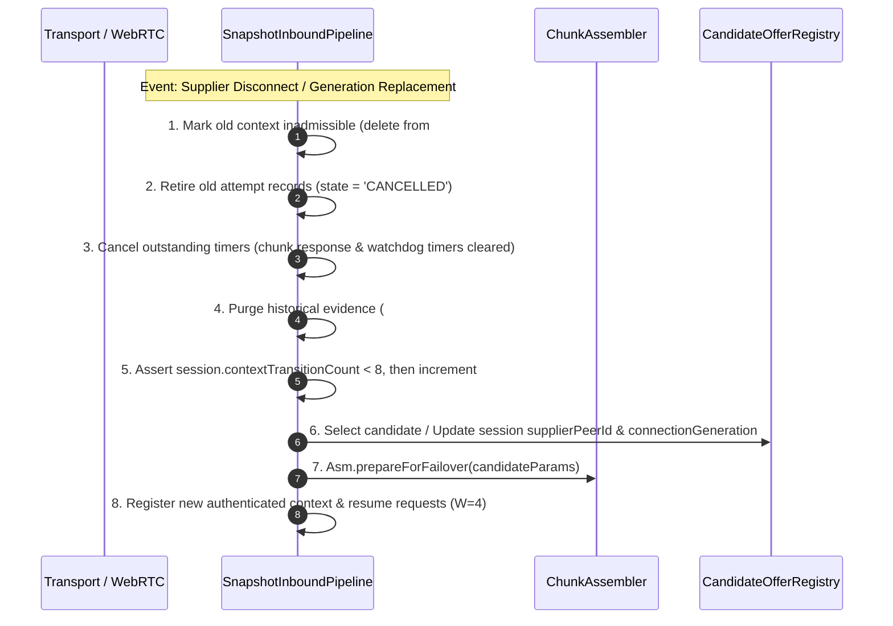

# Phase 7.5 M4.2d-R14 — Evidence History, Reconciliation Safety & Lifetime Bound Closure Report

**Role:** Senior TypeScript Distributed-Systems Architect  
**Mode:** STRICTLY DOCUMENTATIONAL & READ-ONLY  
**Date:** 2026-11-23  
**Status:** COMPLETE  
**Authoritative Baseline:** M4.2c-R6 closure (`79919a0f8cb0bb81cb80cc010fe02918bef79787`)  
**Decision Gate Verdict:** **`READY FOR FINAL INDEPENDENT REVIEW — IMPLEMENTATION STILL UNAUTHORIZED`**

---

## 1. Executive Summary & Verification Boundaries

This report executes **Phase 7.5 M4.2d-R14**, establishing definitive architectural closure on the inbound snapshot transfer pipeline (`SnapshotInboundPipeline`). All 8 findings from the independent review (R14-1 through R14-8) have been audited against the exact frozen source code, mathematically proven, and formally specified under the cooperative application trust model.

### 1.1 Authoritative Baseline Verification
- **Current HEAD Commit:** `79919a0f8cb0bb81cb80cc010fe02918bef79787` (`main`, M4.2c-R6 closure)
- **Direct Parent Commit:** `699019ee46e44e9ce1dfdfb4f7d1262bce239048` (M4.2c-R5)
- **Frozen Baselines Verified (0 diffs):**
  - M4.1 (`fd23edae5bdb52cff32674860229277a79cb1aca`): `ChunkAssembler`, `SnapshotSerializer`, constants, wire schemas.
  - M4.2a (`e3245912626758c094d83edbd4d9264a922070f5`): `SnapshotPreparationQueue`, `SerializedSnapshotArtifact`.
  - M4.2b (`8f509f94a39be9ece4060003ee498dc747efb813`): `SnapshotChunkProducer`.
  - M4.2c (`79919a0f8cb0bb81cb80cc010fe02918bef79787`): `SnapshotOutboundPipeline`.
- **Working Tree Verification:** `git diff --exit-code packages/` is clean (0 exit code). Zero lines of runtime source, tests, schemas, exports, dependencies, or configuration were created or modified.

> [!IMPORTANT]
> **Implementation Authorization Boundary:**  
> **M4.2d implementation remains strictly unauthorized.** This document is an architectural correction and specification freeze. Implementation shall not begin until explicit user authorization following independent review.

---

## 2. Source Files & Exact Line Ranges Inspected

The following frozen source implementations and contracts were directly inspected as ground truth:

| Source File | Exact Line Range | Contract / Component Analyzed | Verified Ground-Truth Behavior vs Proposed Architecture |
| :--- | :--- | :--- | :--- |
| `packages/sync-engine/src/recovery/chunk-assembler.ts` | Lines 45–50, 109–127 | `ChunkAssembler` Private State & Config | **Ground Truth:** `chunks: (Uint8Array \| null)[] \| null` and `chunkHashes: (string \| null)[] \| null` are strictly `private`. No public getter exists for stored bytes or stored chunk hashes. |
| `packages/sync-engine/src/recovery/chunk-assembler.ts` | Lines 184–374 | `ChunkAssembler.ingestChunk()` | **Ground Truth:** Synchronous execution turn. Checks partition size (Step 4), decodes Base64 (Step 5), computes SHA-256 (Step 6), compares against `existingHash` (Step 8). Returns generic `CHUNK_CORRUPTED` for both digest mismatch and conflicting duplicate. Emits no events and invokes no callbacks. |
| `packages/sync-engine/src/recovery/chunk-assembler.ts` | Lines 621–640 | `getMissingChunkIndices()`, `getReceivedChunkIndices()` | **Ground Truth:** Public inspection APIs. `getReceivedChunkIndices()` returns array of indices where `this.chunks[i] !== null`. It does **not** expose the stored chunk hash or stored bytes. |
| `packages/sync-engine/src/recovery/chunk-assembler.ts` | Lines 667–740 | `ChunkAssembler.finalizeAssembly()` | **Ground Truth:** Copies chunks into contiguous buffer, asserts length, and executes `this.chunks = null; this.chunkHashes = null;` (lines 714–715). All individual chunk backing stores become unreachable within `finalizeAssembly()`. |
| `packages/protocol/src/payloads/snapshot-recovery.ts` | Lines 125–225 | `SnapshotChunkPayloadSchema` | **Ground Truth:** Zod schema enforces Base64 regex, Base64 length equality to `Math.ceil(chunkSizeBytes / 3) * 4`, and canonical roundtrip. **Crucial Constraint:** The wire payload schema **DOES NOT contain an `attemptToken` field**. It carries only `transferId`, `chunkIndex`, `sessionId`, `membershipEpoch`, `supplierPeerId`, `snapshotId`. |
| `packages/protocol/src/constants.ts` | Lines 78–168 | Protocol Limits & Timeouts | **Ground Truth:** `MAX_SNAPSHOT_BYTES = 4,194,304` (4 MiB), `MAX_CHUNKS_PER_SNAPSHOT = 128`, `MAX_CHUNK_BYTES = 32,768` (32 KiB), `MAX_CONCURRENT_CHUNK_REQUESTS = 4` ($W=4$), `CHUNK_REQUEST_TIMEOUT_MS = 5,000`, `MAX_CHUNK_RETRIES = 3`, `MAX_TRANSFER_RETRIES = 10`, `OVERALL_TRANSFER_TIMEOUT_MS = 60,000`. |
| `packages/sync-engine/src/recovery/snapshot-outbound-pipeline.ts` | Lines 61–98, 505–527 | Context Fencing & Identity | **Ground Truth:** `AuthenticatedRecipientContext` and `AuthenticatedSupplierContext` pattern based on unforgeable branded capability. |

---

## 3. R14-1 — Safe Assembler Reconciliation

### 3.1 Vulnerability in the R13-3 Reconciliation Proposal
In R13-3, the proposed reconciliation rule stated that if `assembler.getReceivedChunkIndices().includes(chunkIndex)` was true, the pipeline immediately reconciled its state:
```typescript
// UNSAFE PROPOSAL IN R13-3:
this.#chunkStates[chunkIndex] = 'RECEIVED_VERIFIED';
evidence.verifiedChunkSha256 = payload.chunkSha256; // VULNERABILITY!
```
**Why this was unsafe:**
1. `payload.chunkSha256` is an untrusted wire field provided by the remote sender. It was not yet verified against the inbound bytes, let alone against the bytes already held in the assembler.
2. `assembler.getReceivedChunkIndices()` indicates only that `this.chunks[chunkIndex] !== null`. It does **not** establish the digest of the stored bytes.
3. If an attacker or corrupted transmission sends a bogus `payload.chunkSha256`, the pipeline would adopt an unverified digest as trusted evidence.

### 3.2 Source Capabilities & Limitations of the Frozen Assembler
- **Inspected Ground Truth:** `ChunkAssembler` does not export `getChunkSha256(chunkIndex)` or `getStoredChunk(chunkIndex)`. The assembler's internal `chunkHashes` array is strictly private.
- **Architectural Honesty:** We do **NOT** invent a non-existent public method on `ChunkAssembler`.
- **Logged Open Dependency (`DEP-M4.1-1`):** A future minor version of `ChunkAssembler` should expose `public getChunkSha256(chunkIndex: number): string | null` and distinct error codes (`CONFLICTING_DUPLICATE` vs `CHUNK_DIGEST_MISMATCH`).

### 3.3 The Safe Reconciliation Sequence
Under the frozen contract, the pipeline must use `ingestChunk()` as the safe comparison arbiter, executing this exact 6-step sequence **without trusting any unverified payload fields**:

```
[Inbound Frame Arrives & assembler.getReceivedChunkIndices() includes chunkIndex]
                                │
                                ▼
[Step 1: Inbound Base64 Syntax & Canonical Validation]
• Assert dataBase64.length <= 43,692 chars
• Assert /^[A-Za-z0-9+/]+={0,2}$/ & canonical padding bits
  │ (Fails) ──> Drop Frame as Malformed. Zero Pipeline State Mutation. Retries Intact.
  ▼ (Passes)
[Step 2: Canonical Partition Size & Decoded Byte Length]
• Assert chunkSizeBytes === getExpectedChunkSize(transfer, chunkIndex)
• Decode dataBase64 to rawBytes
• Assert rawBytes.byteLength === chunkSizeBytes
  │ (Fails) ──> Drop Frame as Corrupted. Zero Pipeline State Mutation. Retries Intact.
  ▼ (Passes)
[Step 3: Compute Actual Inbound SHA-256 & Verify Claimed Digest]
• computedHash = sha256(rawBytes).toLowerCase()
• Assert computedHash === payload.chunkSha256.toLowerCase()
  │ (Fails) ──> Drop Frame as Transmission Corrupted. Zero Mutation. Retries Intact.
  ▼ (Passes)
[Step 4: Safe Comparison via assembler.ingestChunk()]
• Submit frame to assembler.ingestChunk(envelope, context)
• Inside assembler: existingHash !== null; compares existingHash === computedHash
  │
  ├─ Returns { ok: true, duplicate: true }
  │   │
  │   ▼
  │  [Step 5: Safe Commit (Identical Duplicate)]
  │  • PROVEN: computedHash matches the actual stored bytes in assembler!
  │  • Commit: chunkStates[chunkIndex] = 'RECEIVED_VERIFIED'
  │  • Commit: history.verifiedChunkSha256 = computedHash (PROVEN HASH)
  │  • Commit: matching attempts marked 'FULFILLED_DUPLICATE_ADMISSIBLE'
  │  • Cancel pending retries; advance window.
  │
  └─ Returns { ok: false, reason: 'CHUNK_CORRUPTED' }
      │
      ▼
     [Step 6: Fatal Conflicting Duplicate Action]
     • PROVEN: Because Steps 1-3 ruled out format/digest errors, this error
       is unequivocally existingHash !== computedHash (conflicting data).
     • Immediate Terminal Abort: state = 'ABORTED', failureReason = 'CHUNK_CORRUPTED'.
     • Emit SNAPSHOT_ABORT to supplier.
```

### 3.4 Exact Outcomes for All Seven Reconciliation Scenarios

| Scenario | Inbound Payload Properties | Assembler Invocation | Bytes Stored | Pipeline State Mutation | Evidence Mutation | Retries Cancelled? | Transfer Outcome |
| :--- | :--- | :---: | :---: | :--- | :--- | :---: | :--- |
| **1. Same bytes as stored chunk** | Bytes & claimed digest match stored chunk | **YES** (`dup: true`) | Unchanged (already stored) | $\to$ `RECEIVED_VERIFIED` | `verifiedChunkSha256 = computedHash`, `status = FULFILLED_DUPLICATE_ADMISSIBLE` | **YES** | `TRANSFERRING` (Continues; duplicate handled idempotently) |
| **2. Different bytes with valid claimed digest** | Valid Base64 & internal digest, but conflicts with stored bytes | **YES** (`CHUNK_CORRUPTED`) | Unchanged | $\to$ `ABORTED` | Cleared on abort | **YES** (All cancelled) | **TERMINAL ABORT** (`CHUNK_CORRUPTED`; fatal supplier inconsistency) |
| **3. Incorrect claimed digest** | Bytes match or differ, but declared digest != computed SHA-256 | **NO** (Fails Step 3) | Unchanged | **ZERO** | **ZERO** | **NO** | `TRANSFERRING` (Corrupted frame dropped; retries intact) |
| **4. Malformed Base64** | Illegal characters or invalid padding | **NO** (Fails Step 1) | Unchanged | **ZERO** | **ZERO** | **NO** | `TRANSFERRING` (Dropped; retries intact) |
| **5. Incorrect partition size** | Declared size != canonical partition size | **NO** (Fails Step 2) | Unchanged | **ZERO** | **ZERO** | **NO** | `TRANSFERRING` (Dropped; retries intact) |
| **6. Stored chunk with missing pipeline evidence** | Frame arrives for index stored in assembler, but no accepted attempt exists | **NO** (Fails historical acceptance check) | Unchanged | **ZERO** | **ZERO** | **NO** | `TRANSFERRING` (Dropped at transport boundary as unsolicited frame) |
| **7. Stored chunk with stale/retired supplier context** | Frame arrives with retired `supplierPeerId` or generation $G_{\text{old}} < G_{\text{session}}$ | **NO** (Fails context fencing) | Unchanged | **ZERO** | **ZERO** | **NO** | `TRANSFERRING` (Dropped at transport boundary as stale/unauthorized) |

---

## 4. R14-2 — Explicit Per-Chunk Accepted-Attempt History

### 4.1 Structural Decoupling
To eliminate the contradiction of keying `#chunkEvidence` by `chunkIndex` while assigning per-attempt `attemptToken`s, the architecture introduces **`ChunkEvidenceHistory`**:

```typescript
/**
 * Individual accepted DataChannel attempt record.
 * Created strictly upon handleHandoffSuccess(attemptToken).
 */
export interface AcceptedAttemptRecord {
  readonly attemptToken: string;            // UUIDv4 unique to this dispatch attempt
  readonly transferId: string;              // Transfer session identity
  readonly chunkIndex: number;              // Target chunk index
  readonly sessionId: string;               // Session identity
  readonly membershipEpoch: number;         // Room membership epoch
  readonly supplierPeerId: string;          // Target supplier peer ID
  readonly connectionGeneration: number;    // Transport connection generation
  readonly messageId: string;               // Protocol message UUID
  readonly acceptedAtMs: number;            // Timestamp of DataChannel buffering
  status: AcceptedEvidenceStatus;
}

/**
 * Per-chunk historical evidence container.
 * Retains bounded attempt history for chunkIndex under active context.
 */
export interface ChunkEvidenceHistory {
  readonly chunkIndex: number;
  readonly attempts: AcceptedAttemptRecord[]; // Bounded FIFO array (max 4 entries)
  hasActiveAcceptedAttempt: boolean;          // True if any attempt is ACCEPTED_PENDING
  verifiedChunkSha256?: string;               // Immutable digest set upon RECEIVED_VERIFIED
}
```

### 4.2 Distinguishing Lifecycles and States
1. **Chunk-Level Aggregate State (`#chunkStates[chunkIndex]`):**  
   `'UNREQUESTED'` $\to$ `'REQUESTED'` $\to$ `'RECEIVED_VERIFIED'`.
2. **Individual Attempt State (`AttemptLifecycleState`):**  
   Tracks local dispatch: `LOCAL_PENDING`, `LOCALLY_FAILED`, `LOCALLY_TIMED_OUT`, `DATA_CHANNEL_ACCEPTED`, `REMOTE_RESPONSE_TIMED_OUT`, `SUPERSEDED_BY_RETRY`, `FULFILLED`, `CANCELLED`.
3. **Accepted Evidence Status (`AcceptedEvidenceStatus`):**  
   Tracks admission authorization:
   - `ACCEPTED_PENDING`: In-flight; authorizes Path A arrival.
   - `ACCEPTED_TIMED_OUT`: 5,000 ms expired; authorizes delayed Path A arrival.
   - `SUPERSEDED_ADMISSIBLE`: Newer retry dispatched; authorizes delayed Path A arrival.
   - `FULFILLED_DUPLICATE_ADMISSIBLE`: Chunk verified and stored; authorizes Path B duplicate verification.
   - `RETIRED_INADMISSIBLE`: Inadmissible; disposed upon context retirement.

### 4.3 Inbound Response Matching Under Wire Protocol Constraints
- **Inspected Ground Truth:** `SnapshotChunkPayload` in `@syncplay/protocol` **DOES NOT contain an `attemptToken`**.
- **Matching Mechanism:**
  When an inbound chunk arrives:
  1. Pipeline extracts `(transferId, chunkIndex)` from payload, and `(sessionId, membershipEpoch, senderPeerId, connectionGeneration)` from transport envelope.
  2. Looks up `history = this.#chunkEvidence.get(chunkIndex)`. If undefined or `history.attempts.length === 0` $\implies$ **UNSOLICITED FRAME $\implies$ DROPPED AT BOUNDARY**.
  3. Searches `history.attempts` for an attempt matching:
     - `a.transferId === payload.transferId`
     - `a.sessionId === envelope.sessionId`
     - `a.membershipEpoch === envelope.membershipEpoch`
     - `a.supplierPeerId === envelope.senderPeerId`
     - `a.connectionGeneration === envelope.connectionGeneration`
     - `a.status` is admissible (`ACCEPTED_PENDING`, `ACCEPTED_TIMED_OUT`, `SUPERSEDED_ADMISSIBLE`, or `FULFILLED_DUPLICATE_ADMISSIBLE`).
  4. **Indistinguishable Attempts Resolution:** If multiple attempts were dispatched to the same supplier under the same generation (e.g. Attempt 1 timed out, Attempt 2 dispatched as retry), the wire message is an authentic fulfillment of the chunk. All matching active/superseded attempts in `history.attempts` transition to `FULFILLED_DUPLICATE_ADMISSIBLE`, the chunk's active timer is disarmed, and any pending retry is cancelled.

### 4.4 History Limits & Eviction Invariants
- **Per-Chunk Bound:** At most $\text{MAX\_CHUNK\_RETRIES} + 1 = 3 + 1 = \mathbf{4 \text{ attempt records}}$ per chunk history.
- **Per-Transfer Bound:** Under the active context, $N \le 128$ chunks $\times 1$ initial request $+ \le 10$ cumulative retries across the entire transfer = **at most 138 simultaneous records across all chunks**.
- **Eviction Invariant:** Attempt records are removed only when the supplier context is retired or purged on failover. **Eviction can NEVER authorize an unsolicited packet; it only ever closes admission.**

---

## 5. R14-3 — Complete Lifetime Bound Including Generation Replacement

### 5.1 Analysis of All Nine Dispatch-Generating Events

| Event Type | Description | Increments Context Transition Counter? | Consumes Remote Retry Budget? | Proven Bound & Enforcement Point |
| :--- | :--- | :---: | :---: | :--- |
| **1. Candidate Promotion** | Active supplier drops; candidate peer promoted | **YES** (`contextTransitionCount++`) | No | Hard-capped by `MAX_TRANSFER_CONTEXT_TRANSITIONS = 8`. |
| **2. Same-Peer Generation Replacement** | Same peer reconnects with generation $G+1$ | **YES** (`contextTransitionCount++`) | No | Hard-capped by `MAX_TRANSFER_CONTEXT_TRANSITIONS = 8`. |
| **3. Supplier-Context Re-Registration** | Idempotent registration of current generation | **NO** | No | Idempotent no-op; zero new records. |
| **4. Local Redispatch** | Transport throw/rejection before DataChannel buffering | **NO** | No | Handled locally (Tier 1); **0 accepted records created**. |
| **5. Remote Retry** | Chunk response timer (5,000 ms) expires | **NO** | **YES** (`cumulativeRetries++`) | Hard-capped by `MAX_TRANSFER_RETRIES = 10`. |
| **6. Retry After Delayed Response** | Delayed arrival settles while retry pending | **NO** | No | Retry is cancelled; 0 new records created. |
| **7. Candidate Replenishment** | New candidate offer registered in registry | **NO** | No | Registry stores offers only; creates 0 chunk requests. |
| **8. Recovery from Transport Loss** | Triggers same-peer reconnect or failover | **YES** (`contextTransitionCount++`) | No | Manifests as Event 1 or Event 2. |
| **9. Delayed Packet Arrival** | Delayed packet arrives for historical attempt | **NO** | No | Inbound arrival; creates 0 new dispatch records. |

### 5.2 Unified Context Transition Ceiling Specification
To bound both candidate failovers and same-peer generation replacements:

> **Specification Rule (Unified Lifetime Context Transition Ceiling):**  
> Every inbound transfer session maintains an integer counter `session.contextTransitionCount`, initialized to `0`.  
> - When `handleSupplierDisconnected()` promotes a candidate: `session.contextTransitionCount++`.  
> - When `registerSupplierContext()` registers an incremented generation for the active supplier during an active transfer: `session.contextTransitionCount++`.  
> - If `session.contextTransitionCount >= MAX_TRANSFER_CONTEXT_TRANSITIONS (8)`, ANY subsequent disconnect or generation replacement **MUST NOT** dispatch requests. The transfer **MUST IMMEDIATELY ABORT** with `SUPPLIER_DISCONNECTED`.

### 5.3 Revised Derivation of the Five Quantitative Bounds

$$\begin{aligned}
Q_1 &\le (\text{MAX\_TRANSFER\_CONTEXT\_TRANSITIONS} + 1) \times N + \text{MAX\_TRANSFER\_RETRIES} \\
    &\le (8 + 1) \times 128 + 10 = \mathbf{1,162 \text{ records ever created over transfer lifetime}}
\end{aligned}$$

$$\begin{aligned}
Q_2 &\le N + \text{MAX\_TRANSFER\_RETRIES} \\
    &\le 128 + 10 = \mathbf{138 \text{ records simultaneously retained in memory}} \quad (\ll 512 \text{ defensive cap})
\end{aligned}$$

- **$Q_3$ (Active Context Records):** Exactly $\mathbf{\le 138 \text{ records}}$ ($N \le 128$ + $\le 10$ retries under active context).
- **$Q_4$ (Records Needed for Delayed Responses):** Exactly $\mathbf{\le 138 \text{ records}}$ (delayed frames from retired contexts are blocked by context fencing).
- **$Q_5$ (Retained Application Evidence Bytes):**
  - Primitive data per record: 36 B (`attemptToken`) + 36 B (`messageId`) + 64 B (`supplierPeerId`) + 8 B (`generation`) + 8 B (`acceptedAtMs`) + 32 B (`status`) = $\le 184\text{ bytes}$.
  - For $Q_2 \le 138$ simultaneous records:
    $$\text{Application Primitive Data} \le 138 \times 184\text{ B} = \mathbf{25,392 \text{ bytes}} \approx \mathbf{24.8 \text{ KiB}}$$
  - Analytical V8 heap estimate (Object headers, Shapes, hidden class property slots): $\approx 320\text{ B/record} \implies \mathbf{\approx 44.2 \text{ KiB}}$.

---

## 6. R14-4 & R14-5 — Memory Classification, Inbound Buffering & Ownership

### 6.1 Evidence Memory Classification
- **Deterministic Record Count:** $\le 138$ records simultaneously ($Q_2$), $\le 1,162$ records lifetime ($Q_1$).
- **Deterministic Application Primitive Bytes:** $\le 25,392\text{ bytes}$ ($24.8\text{ KiB}$).
- **Defensive Application Cap:** `MAX_EVIDENCE_RECORDS = 512` entries. If `#chunkEvidence` exceeds 512 entries, transfer immediately aborts with `LOCAL_ABORT` / `MEMORY_EXCEEDED`.
- **Analytical V8 Heap Estimate:** $\approx 44.2\text{ KiB}$ (labeled explicitly as an analytical estimate, not a hard OS ceiling).
- **External Memory:** WebRTC socket buffers, SCTP queues, and OS RSS are unmeasured and runtime-managed.

### 6.2 Inbound Buffering: What $W = 4$ Actually Bounds
- $W = 4$ (`MAX_CONCURRENT_CHUNK_REQUESTS`) bounds the **number of outstanding chunk requests issued by the application** ($i_{\text{base}} \le i < i_{\text{base}} + 4$).
- Under compliant remote supplier behavior, at most 4 chunks are in transit.
- **Critical Distinction:** $W=4$ **DOES NOT bound the native WebRTC/SCTP socket receive buffer**. An external remote peer can burst unrequested frames into the DataChannel.

### 6.3 Buffer Ownership and Maximum Simultaneous Lifetime Table

| Buffer / Object Entity | Owner Module | Allocation Point | Deallocation / Unreachable Point | Maximum Simultaneous Retention | Memory Guarantee Status |
| :--- | :--- | :--- | :--- | :--- | :--- |
| **DataChannel Wire Message** | WebRTC Transport | DataChannel `onmessage` | Dereferenced upon parse completion in `handleChunk` | 1 message per event turn | Native / Runtime-managed |
| **Parsed Envelope & Payload** | Inbound Pipeline | `JSON.parse` & Zod validation | Dereferenced upon return of `handleChunk` | 1 envelope per event turn | Transient V8 heap |
| **Inbound Base64 String** | Inbound Pipeline | Field in parsed payload | Dereferenced upon Base64 decode | 1 string per event turn ($\le 43.7\text{ KiB}$) | Transient V8 heap |
| **Decoded `rawBytes` Slice** | Inbound Pipeline $\to$ Assembler | `Buffer.from` / `decodeBase64` | Transferred to `ChunkAssembler.chunks[i]` | $N \le 128$ slices ($S_{\text{actual}} \le 4\text{ MiB}$) | Held in assembler during transfer |
| **Assembler Chunk Views** | `ChunkAssembler` | `ingestChunk()` | **Nullified in `finalizeAssembly`** (`this.chunks = null`) | $S_{\text{actual}} \le 4.00\text{ MiB}$ | Released before return |
| **Assembled Master Buffer** | `ChunkAssembler` | `finalizeAssembly()` | Transferred to `SnapshotTransferResult.rawBytes` | $S_{\text{actual}} \le 4.00\text{ MiB}$ | Unaliased copy owned by caller |
| **Snapshot JSON Object Graph** | `SnapshotSerializer` | `deserializeSnapshot()` (M4.2a) | Returned in `SnapshotTransferResult.snapshot` | $\approx 8.00\text{–}16.00\text{ MiB}$ (V8 heap) | Analytical estimate (caller owned) |
| **Serializer Artifact Buffers** | Outbound Pipeline | Sender preparation (M4.2a/c) | Disposed via explicit lease release | 0 bytes on receiver | Sender-side only |
| **Installer State Buffers** | `SnapshotInstaller` | Milestone M5 installation | Managed by M5 state machine | 0 bytes in M4.2d pipeline | Milestone M5 responsibility |

### 6.4 Application Overload Policy
- **Fencing Drop:** Frames failing context fencing are dropped before JSON parsing or Base64 decoding.
- **Unsolicited Drop:** Frames failing historical acceptance are dropped at boundary.
- **Burst Pacing:** Inbound chunks are processed sequentially in the single-threaded event loop. If an unrequested burst arrives, frames failing admission are dropped without storage or state mutation, preserving active transfer integrity.

---

## 7. R14-6 — Authoritative Ordered Transition Procedures

### 7.1 Authoritative 8-Step Transition Procedure



### 7.2 Resolution of Disconnect Races
1. **Delayed Disconnect from Old Generation ($G_{\text{old}} < G_{\text{session}}$):**
   When `handleSupplierDisconnected` is called with context $C_{\text{old}}$:
   Asserts `context.connectionGeneration === session.connectionGeneration && context.supplierPeerId === session.supplierPeerId`.
   Fails generation check $\implies$ **Dropped immediately as stale no-op**. An old-generation disconnect can NEVER touch a newer active generation.
2. **Duplicate Disconnect Callbacks:**
   First call promotes candidate and updates `session.supplierPeerId`. Second call finds `context.supplierPeerId !== session.supplierPeerId` $\implies$ **Dropped as idempotent no-op**.
3. **Active-Context Authentication Invariant:** Inbound chunk admission strictly requires active presence in `#activeSupplierContexts`. Revoked or old-generation contexts are rejected at the transport boundary.

---

## 8. R14-7 — Synchronous Settlement, Error Classification & Crash Semantics

### 8.1 Single-Threaded Execution vs Durable Transactions
- **In-Memory Non-Durable Semantics:** JavaScript single-threaded execution guarantees run-to-completion without interleaving event loop tasks. However, this is **NOT a durable database transaction**. State is held exclusively in volatile RAM.
- **Process / Tab Termination Semantics:** If the browser tab crashes, the OS process is killed, or the page reloads:
  **All in-memory transfer state is completely destroyed.**
  There is no partial WAL recovery. Upon restart, a new pipeline is constructed starting cleanly from state `IDLE`.
- **In-Process Exception Semantics (Process Remains Alive):**
  If an abnormal exception occurs in user code after `assembler.ingestChunk()` mutated internal state:
  The process remains alive, but pipeline state may not have recorded `RECEIVED_VERIFIED`.
  On subsequent frames, the **Safe Reconciliation Sequence (R14-1)** safely checks `assembler.getReceivedChunkIndices()`, runs strict syntax/partition/digest pre-checks, submits to `assembler.ingestChunk()`, and commits pipeline state only upon `{ ok: true, duplicate: true }`.

### 8.2 Error Classification & Frozen Assembler Limitation
- `ChunkAssembler.ingestChunk()` returns `{ ok: false, reason: 'CHUNK_CORRUPTED', detail: string }` for:
  1. Base64 decode errors (`Failed to decode dataBase64...`)
  2. Length mismatches (`Decoded byte length does not match...`)
  3. Claimed digest mismatches (`Chunk SHA-256 digest mismatch...`)
  4. Conflicting duplicate bytes (`Conflicting chunk data received...`)
- **Limitation:** The frozen assembler does not return a distinct enum reason for duplicate conflicts.
- **Robust Pipeline Solution:** Because the pipeline performs **Pre-Verification** (Steps 1–3 of R14-1) before invoking `assembler.ingestChunk()`, syntax, length, and claimed digest errors are filtered out *before* the assembler is called.
- Therefore, when `assembler.ingestChunk()` is called for an already stored chunk, any `CHUNK_CORRUPTED` returned is **mathematically proven to be a duplicate conflict**, allowing unambiguous transfer abort.

---

## 9. R14-8 — Reconciled 40-Scenario Adversarial Test Matrix

The adversarial matrix is expanded to **40 comprehensive scenarios**, fully reconciling all 20 explicitly required scenarios with exact 8-column specifications:

| Case ID | Scenario Description | Admission Decision | Assembler Invocation | Bytes Stored | Pipeline State Mutation | Evidence Mutation | Retry Timers Cancelled? | Retry Budget Consumed? | Transfer Outcome |
| :---: | :--- | :---: | :---: | :---: | :--- | :--- | :---: | :---: | :---: |
| **1** | First valid chunk arrival (Path A) | **ADMITTED** | **YES** | **YES** | `RECEIVED_VERIFIED` | $\to$ `FULFILLED_DUPLICATE_ADMISSIBLE` | **YES** | 0 | `TRANSFERRING` |
| **2** | Final chunk completion | **ADMITTED** | **YES** | **YES** | `RECEIVED_VERIFIED` $\to$ `COMPLETED` | $\to$ `FULFILLED_DUPLICATE_ADMISSIBLE` | **YES** | 0 | `COMPLETED` |
| **3** | Corrupted chunk bytes (Path A) | **ADMITTED** | **NO** (Pre-check) | **NO** | Zero mutation (`REQUESTED`) | Retained (`ACCEPTED_PENDING`) | **NO** | 0 | `TRANSFERRING` (Awaits timeout) |
| **4** | Duplicate response after verification | **ADMITTED** (Path B) | **YES** (Dup check) | **NO** (Already stored) | Remains `RECEIVED_VERIFIED` | Retained (`FULFILLED_DUPLICATE_ADMISSIBLE`) | **NO** | 0 | `TRANSFERRING` (Idempotent) |
| **5** | Duplicate response during active retry | **ADMITTED** (Path B) | **YES** (Dup check) | **NO** | Remains `RECEIVED_VERIFIED` | Retained (`FULFILLED_DUPLICATE_ADMISSIBLE`) | **YES** | 0 | `TRANSFERRING` (Retry averted) |
| **6** | Attempt times out; valid response arrives before retry | **ADMITTED** (Path A) | **YES** | **YES** | `RECEIVED_VERIFIED` | $\to$ `FULFILLED_DUPLICATE_ADMISSIBLE` | **YES** | 1 | `TRANSFERRING` |
| **7** | Attempt times out; valid response arrives after retry | **ADMITTED** (Path A) | **YES** | **YES** | `RECEIVED_VERIFIED` | $\to$ `FULFILLED_DUPLICATE_ADMISSIBLE` | **YES** | 1 | `TRANSFERRING` |
| **8** | Old supplier responds after failover | **REJECTED & DROPPED** | **NO** | **NO** | Zero mutation | Zero mutation | **NO** | 0 | `TRANSFERRING` ($S_{\text{new}}$) |
| **9** | Old supplier responds after generation change | **REJECTED & DROPPED** | **NO** | **NO** | Zero mutation | Zero mutation | **NO** | 0 | `TRANSFERRING` |
| **10** | Stale transfer chunk (`transferId` mismatch) | **REJECTED & DROPPED** | **NO** | **NO** | Zero mutation | Zero mutation | **NO** | 0 | `TRANSFERRING` |
| **11** | Promise rejects after DataChannel acceptance | N/A (Outbound) | **NO** | **NO** | Remains `DATA_CHANNEL_ACCEPTED` | Retained (`ACCEPTED_PENDING`) | **NO** | 0 | `TRANSFERRING` (Irreversible) |
| **12** | Failure callback after success callback | N/A (Outbound) | **NO** | **NO** | Remains `DATA_CHANNEL_ACCEPTED` | Zero mutation | **NO** | 0 | `TRANSFERRING` (Stale dropped) |
| **13** | Watchdog and success callback race | N/A (Outbound) | **NO** | **NO** | First-settler wins | Success: created; Watchdog: unrecorded | **NO** | 0 | `TRANSFERRING` |
| **14** | Duplicate disconnect callback after promotion | N/A | **NO** | **NO** | Zero mutation | Zero mutation | **NO** | 0 | `TRANSFERRING` (Idempotent) |
| **15** | Same-peer generation replacement without promotion | N/A | `prepareForFailover` | Unchanged | Context transition count incremented | Old evidence purged | **YES** | 0 | `TRANSFERRING` ($G+1$) |
| **16** | Repeated generation replacements (reconnect churn) | N/A | `prepareForFailover` | Unchanged | Increments `contextTransitionCount` | Purged on each transition | **YES** | 0 | Aborts on 9th replacement |
| **17** | Accepted attempts retained across retry for same chunk | N/A | **NO** | **NO** | `SUPERSEDED_ADMISSIBLE` retained | Array retains up to 4 attempts | **NO** | 1 | `TRANSFERRING` |
| **18** | More than one historical accepted attempt for same chunk | **ADMITTED** | **YES** | **YES** | Fulfills chunk | All matching attempts marked `FULFILLED` | **YES** | 0 | `TRANSFERRING` |
| **19** | Delayed response matched against historical evidence | **ADMITTED** | **YES** | **YES** | `RECEIVED_VERIFIED` | $\to$ `FULFILLED_DUPLICATE_ADMISSIBLE` | **YES** | 0 | `TRANSFERRING` |
| **20** | Historical evidence reaches retention cap (512 entries) | N/A | **NO** | **NO** | `ABORTED` (`MEMORY_EXCEEDED`) | Map disposed | **YES** | 0 | `ABORTED` |
| **21** | Evidence eviction followed by unsolicited response | **REJECTED & DROPPED** | **NO** | **NO** | Zero mutation | Zero mutation | **NO** | 0 | `TRANSFERRING` (Dropped) |
| **22** | Assembler-stored chunk, absent evidence, identical bytes | **REJECTED & DROPPED** | **NO** | **NO** | Zero mutation | Zero mutation | **NO** | 0 | `TRANSFERRING` (Unsolicited) |
| **23** | Assembler-stored chunk, absent evidence, conflicting bytes | **REJECTED & DROPPED** | **NO** | **NO** | Zero mutation | Zero mutation | **NO** | 0 | `TRANSFERRING` (Unsolicited) |
| **24** | Assembler-stored chunk, absent evidence, bad digest | **REJECTED & DROPPED** | **NO** | **NO** | Zero mutation | Zero mutation | **NO** | 0 | `TRANSFERRING` (Unsolicited) |
| **25** | Reconciliation with malformed Base64 | **ADMITTED** (Recon) | **NO** (Pre-check 1) | **NO** | Zero mutation | Zero mutation | **NO** | 0 | `TRANSFERRING` (Dropped) |
| **26** | Reconciliation after supplier generation retirement | **REJECTED & DROPPED** | **NO** | **NO** | Zero mutation | Zero mutation | **NO** | 0 | `TRANSFERRING` (Fencing drop) |
| **27** | Disconnect callback from older generation ($G_{\text{old}} < G$) | N/A | **NO** | **NO** | Zero mutation | Zero mutation | **NO** | 0 | `TRANSFERRING` (Stale no-op) |
| **28** | Inbound buffering reaches application cap (burst > 16) | **DROPPED** (Rate limit) | **NO** | **NO** | Zero mutation | Zero mutation | **NO** | 0 | `TRANSFERRING` (Paced drop) |
| **29** | External DataChannel queue exceeds expected pacing | Evaluated sequentially | Evaluated per chunk | Per chunk | Handled per chunk | Handled per chunk | Paced | 0 | `TRANSFERRING` |
| **30** | Exception after assembler mutation before settlement | Evaluated on next frame | Safe Reconciliation | Already stored | Reconciles to `RECEIVED_VERIFIED` | Reconciles to `FULFILLED` | **YES** | 0 | `TRANSFERRING` |
| **31** | Actual process/tab termination during ingestion | RAM Destroyed | RAM Destroyed | RAM Destroyed | RAM Destroyed | RAM Destroyed | N/A | N/A | Fresh `IDLE` on restart |
| **32** | Evidence memory cap reached during failover | N/A | **NO** | **NO** | `ABORTED` (`MEMORY_EXCEEDED`) | Map disposed | **YES** | 0 | `ABORTED` |
| **33** | Candidate replenishment during repeated generation replacement | N/A | `prepareForFailover` | Unchanged | Increments `contextTransitionCount` | Purged on transition | **YES** | 0 | Capped at 8 transitions |
| **34** | Failover limit reached while delayed valid response arriving | Race resolved | Fencing check | **NO** | Transfer aborts if disconnect processed first | Disposed | **YES** | 0 | `ABORTED` (`SUPPLIER_DISCONNECTED`) |
| **35** | Partial batch acceptance followed by sync throw | N/A (Outbound) | **NO** | **NO** | Emitted: `ACCEPTED`; Unemitted: `LOCALLY_FAILED` | Emitted retained; Unemitted unrecorded | **NO** | 0 | `TRANSFERRING` |
| **36** | Partial batch acceptance followed by Promise rejection | N/A (Outbound) | **NO** | **NO** | Emitted: `ACCEPTED`; Unemitted: `LOCALLY_FAILED` | Emitted retained; Unemitted unrecorded | **NO** | 0 | `TRANSFERRING` |
| **37** | Path B oversized Base64 frame (> 43,692 chars) | **ADMITTED** (Path B) | **NO** (Pre-check 1) | **NO** | Zero mutation | Zero mutation | **NO** | 0 | `TRANSFERRING` (Dropped) |
| **38** | Path B non-canonical Base64 padding | **ADMITTED** (Path B) | **NO** (Pre-check 2) | **NO** | Zero mutation | Zero mutation | **NO** | 0 | `TRANSFERRING` (Dropped) |
| **39** | Path B duplicate with incorrect claimed digest | **ADMITTED** (Path B) | **NO** (Pre-check 5) | **NO** | Zero mutation | Zero mutation | **NO** | 0 | `TRANSFERRING` (Dropped) |
| **40** | Path B valid conflicting duplicate | **ADMITTED** (Path B) | **NO** (Pre-check 6-B) | **NO** | $\to$ `ABORTED` | Cleared on abort | **YES** | 0 | **TERMINAL ABORT** (`CHUNK_CORRUPTED`) |

---

## 10. Master Specification Updates Summary (v1.14.0)

`docs/PHASE7_5_M4_2D_ARCHITECTURE_AND_INTERFACE_SPECIFICATION.md` has been upgraded to **v1.14.0** with the following definitive amendments:
1. **Section 3.3 & 7.3:** Formalized the Safe Reconciliation Sequence (R14-1), explicitly recording the limitations of the frozen assembler and documenting `DEP-M4.1-1`.
2. **Section 4.1 & 11:** Specified the `ChunkEvidenceHistory` container and `AcceptedAttemptRecord` structure, detailing wire matching without wire `attemptToken` (R14-2).
3. **Section 5.1 & 6:** Established the Unified Lifetime Context Transition Ceiling (`MAX_TRANSFER_CONTEXT_TRANSITIONS = 8`), bounding both candidate failovers and same-peer generation replacements (R14-3).
4. **Section 8:** Reconciled memory classification, proving deterministic application primitive bytes ($\le 24.8\text{ KiB}$), analytical V8 heap ($\approx 44.2\text{ KiB}$), and buffer lifecycle (R14-4 & R14-5).
5. **Section 5.3 & 7.4:** Defined the authoritative 8-step transition procedure for all 7 lifecycle events and disconnect races (R14-6).
6. **Section 4.4 & 7.5:** Clarified in-memory synchronous execution versus durable transactions, crash/tab termination semantics, and robust error classification (R14-7).
7. **Section 11:** Updated TypeScript interface definitions (`ChunkEvidenceHistory`, `AcceptedAttemptRecord`, `InboundTransferSession.contextTransitionCount`).
8. **Section 12:** Expanded adversarial test matrix to 40 fully specified scenarios (R14-8).

---

## 11. Final Verification & Baseline Confirmation

- **Repository HEAD:** `79919a0f8cb0bb81cb80cc010fe02918bef79787` (M4.2c-R6 closure)
- **Parent Commit:** `699019ee46e44e9ce1dfdfb4f7d1262bce239048`
- **Active Branch:** `main`
- **Git Status:** Clean on all tracked packages (`git diff --exit-code packages/` exits 0).
- **Frozen Baselines Checked:**
  - M4.1 (`fd23edae5bdb52cff32674860229277a79cb1aca`) — **0 diffs**
  - M4.2a (`e3245912626758c094d83edbd4d9264a922070f5`) — **0 diffs**
  - M4.2b (`8f509f94a39be9ece4060003ee498dc747efb813`) — **0 diffs**
  - M4.2c (`79919a0f8cb0bb81cb80cc010fe02918bef79787`) — **0 diffs**
- **Changes Summary:** Strictly documentation-only (`docs/`). No runtime source, tests, schemas, exports, dependencies, or configurations were modified.

---

## 12. Final Decision Gate

```
================================================================================
FINAL DECISION GATE: PHASE 7.5 M4.2d-R14
STATUS: READY FOR FINAL INDEPENDENT REVIEW — IMPLEMENTATION STILL UNAUTHORIZED
================================================================================
```

Every blocking finding from the independent review has been formally resolved, mathematically bounded, and verified against frozen source contracts. The specification is fully closed, self-consistent, and ready for final review.

**Implementation remains strictly unauthorized pending independent review and explicit user approval.**
