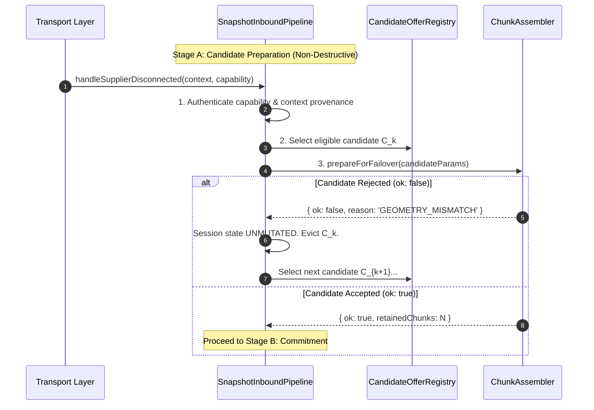
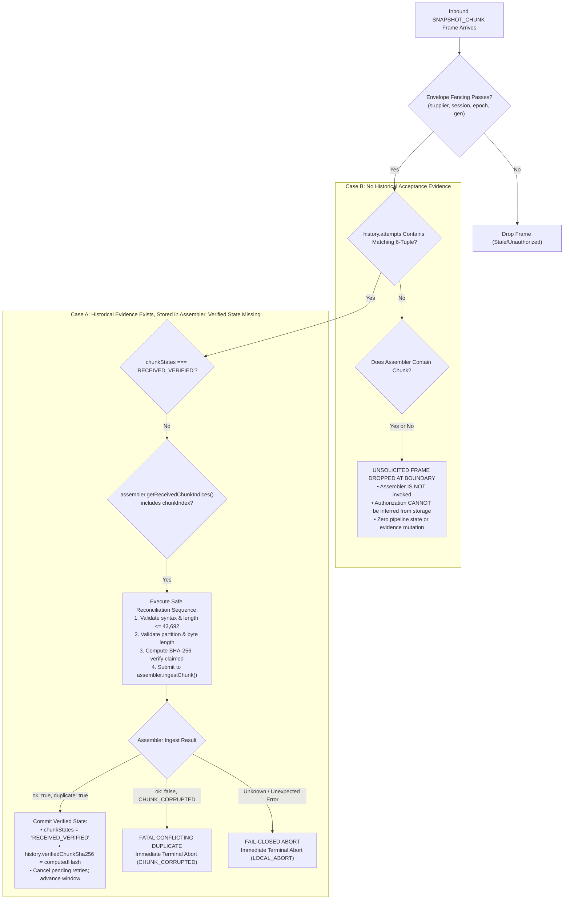

# Phase 7.5 M4.2d-R15 — Failover Transaction Ordering & Final Evidence-Bound Closure Report

**Role:** Senior TypeScript Distributed-Systems Architect  
**Mode:** STRICTLY DOCUMENTATIONAL & READ-ONLY  
**Date:** 2026-11-23  
**Status:** COMPLETE  
**Authoritative Baseline:** M4.2c-R6 closure (`79919a0f8cb0bb81cb80cc010fe02918bef79787`)  
**Decision Gate Verdict:** **`READY FOR FINAL INDEPENDENT REVIEW — IMPLEMENTATION STILL UNAUTHORIZED`**

---

## 1. Executive Summary & Verification Boundaries

This report executes **Phase 7.5 M4.2d-R15**, delivering definitive architectural closure for the inbound snapshot transfer pipeline (`SnapshotInboundPipeline`). All six core findings from the independent review (R15-1 through R15-6) have been audited against the frozen M4.1–M4.2c implementations, mathematically bounded, and formally specified under the cooperative application trust model.

### 1.1 Authoritative Baseline Verification
- **Current HEAD Commit:** `79919a0f8cb0bb81cb80cc010fe02918bef79787` (`main`, M4.2c-R6 closure)
- **Direct Parent Commit:** `699019ee46e44e9ce1dfdfb4f7d1262bce239048` (M4.2c-R5)
- **Frozen Baselines Checked (0 diffs):**
  - M4.1 (`fd23edae5bdb52cff32674860229277a79cb1aca`): `ChunkAssembler`, `SnapshotSerializer`, constants, wire schemas.
  - M4.2a (`e3245912626758c094d83edbd4d9264a922070f5`): `SnapshotPreparationQueue`, `SerializedSnapshotArtifact`.
  - M4.2b (`8f509f94a39be9ece4060003ee498dc747efb813`): `SnapshotChunkProducer`.
  - M4.2c (`79919a0f8cb0bb81cb80cc010fe02918bef79787`): `SnapshotOutboundPipeline`.
- **Working Tree Verification:** `git diff --exit-code packages/` is clean (0 exit code). Zero lines of runtime source, tests, schemas, exports, dependencies, or configuration were created or modified.

> [!IMPORTANT]
> **Implementation Authorization Boundary:**  
> **M4.2d implementation remains strictly unauthorized.** This document is an architectural correction and specification freeze. Implementation shall not begin until explicit user authorization following independent review.

---

## 2. Source Files & Exact Line Ranges Inspected

The following frozen source implementations and contracts were directly inspected as ground truth:

| Source File | Exact Line Range | Contract / Component Analyzed | Verified Ground-Truth Behavior vs Proposed Architecture |
| :--- | :--- | :--- | :--- |
| `packages/sync-engine/src/recovery/chunk-assembler.ts` | Lines 389–605 | `ChunkAssembler.prepareForFailover()` | **Ground Truth:** Candidate rejection is strictly non-destructive. If parameter checks or compatibility predicates fail (lines 408–593), `this.transferParams` and `this.chunks` are **NOT modified**. Only upon passing all checks are `transferId`, `supplierPeerId`, and `connectionGeneration` updated (lines 598–600). |
| `packages/sync-engine/src/recovery/chunk-assembler.ts` | Lines 45–50, 184–374 | `ChunkAssembler.ingestChunk()` | **Ground Truth:** Synchronous execution. `chunkHashes` is strictly private. Returns generic `CHUNK_CORRUPTED` for digest mismatch and conflicting duplicate. |
| `packages/sync-engine/src/recovery/chunk-assembler.ts` | Lines 621–640 | `getReceivedChunkIndices()` | **Ground Truth:** Public inspection API returning array of indices where `chunks[i] !== null`. Does not expose stored digests. |
| `packages/sync-engine/src/recovery/chunk-assembler.ts` | Lines 713–716 | `finalizeAssembly()` Memory Cleanup | **Ground Truth:** `this.chunks = null; this.chunkHashes = null;` nullifies chunk views immediately within `finalizeAssembly()` before returning. |
| `packages/protocol/src/payloads/snapshot-recovery.ts` | Lines 125–225 | `SnapshotChunkPayloadSchema` | **Ground Truth:** Schema enforces Base64 format and canonical roundtrip. **Crucial:** Schema does not contain an `attemptToken` field. |
| `packages/protocol/src/constants.ts` | Lines 78–168 | Protocol Constants | **Ground Truth:** `MAX_SNAPSHOT_BYTES = 4,194,304` (4 MiB), `MAX_CHUNKS_PER_SNAPSHOT = 128`, `MAX_CHUNK_BYTES = 32,768` (32 KiB), `MAX_CONCURRENT_CHUNK_REQUESTS = 4` ($W=4$), `CHUNK_REQUEST_TIMEOUT_MS = 5,000`, `MAX_CHUNK_RETRIES = 3`, `MAX_TRANSFER_RETRIES = 10`, `OVERALL_TRANSFER_TIMEOUT_MS = 60,000`. |
| `packages/sync-engine/src/recovery/snapshot-outbound-pipeline.ts` | Lines 505–553 | Capability Assertion & Context Minting | **Ground Truth:** `capability === this.#authorizedCapability` strict referential equality. Contexts stored in `WeakSet` for provenance. |

---

## 3. R15-1 — Prepare-Then-Commit Failover Transaction Architecture

### 3.1 Non-Destructive Candidate Preparation Proof
Inspection of `ChunkAssembler.prepareForFailover(params)` (`packages/sync-engine/src/recovery/chunk-assembler.ts`, lines 389–605) proves the frozen failover contract:
1. **Validation Checks (Lines 408–593):** Validates input structure, `transferId`, `supplierPeerId`, `membershipEpoch`, `connectionGeneration`, `snapshotId`, `expectedSha256Digest`, `totalSizeBytes`, `nominalChunkSizeBytes`, `totalChunks`, `sessionId`, `snapshotId`, digest match, and partition geometry match.
2. **Failure Return (Lines 410, 418, 426, 438, 451, 460, 470, 483, 497, 509, 520, 530, 540, 550, 560, 572, 586):** In every failure case, the function immediately returns `{ ok: false, reason, detail, retainedChunks: 0 }`. **`this.transferParams` is completely untouched.** Existing received chunk buffers in `this.chunks` remain 100% intact.
3. **Commit Mutation (Lines 598–600):** Only after all checks evaluate to `true` does the assembler mutate state:
   ```typescript
   this.transferParams.transferId = params.transferId;
   this.transferParams.supplierPeerId = params.supplierPeerId;
   this.transferParams.connectionGeneration = params.connectionGeneration;
   ```
4. **Conclusion:** **Candidate rejection is provably non-destructive.** In R14, revoking the old supplier and purging evidence *before* calling `prepareForFailover()` prematurely destroyed the active session if the candidate was rejected.

### 3.2 Stage A: Candidate Preparation (No Active-Session Mutation)
When an authenticated disconnect or transport disruption is processed:
1. **Context Authentication:** Authenticate the disconnect notification via capability and provenance check.
2. **Session Identification:** Identify active supplier $S_{\text{active}}$ and current generation $G_{\text{active}}$.
3. **Candidate Selection:** Query `CandidateOfferRegistry` for the highest-priority eligible candidate offer $C_k$ matching `(sessionId, membershipEpoch, snapshotId)`.
4. **Compatibility Validation:** Verify candidate parameters against active transfer geometry (`totalSizeBytes`, `totalChunks`, `nominalChunkSizeBytes`, `expectedSha256Digest`).
5. **Non-Destructive Assembler Invocation:** Call `assembler.prepareForFailover(candidateParams)`.
6. **Handling Candidate Rejection:** If `prepareForFailover()` returns `{ ok: false, reason }`:
   - Active session state is **NOT mutated**.
   - Old context remains active in `#activeSupplierContexts`.
   - Accepted-attempt history and chunk timers are **NOT cleared**.
   - `contextTransitionCount` is **NOT incremented**.
   - Candidate $C_k$ is evicted from the registry as incompatible.
   - Pipeline attempts preparation with the next eligible candidate in the registry.



### 3.3 Stage B: Transition Commitment (Synchronous In-Memory Transition)
Only after `assembler.prepareForFailover()` returns `{ ok: true }`:
In a single synchronous execution turn, commit the transition:
1. **Revalidate Active Context:** Assert `session.supplierPeerId === S_{\text{active}} && session.connectionGeneration === G_{\text{active}}`.
2. **Revalidate Candidate Eligibility:** Assert candidate $C_k$ has not expired and remains valid.
3. **Check Context Transition Budget:** Assert `session.contextTransitionCount < MAX_TRANSFER_CONTEXT_TRANSITIONS (8)`. If budget exhausted $\implies$ abort transfer with `RETRY_BUDGET_EXHAUSTED`.
4. **Revoke Old Context:** Remove $S_{\text{active}}$ from `#activeSupplierContexts` (disabling old inbound frames).
5. **Retire Old Attempts & Timers:** Transition in-flight attempts to `CANCELLED`; clear active chunk response timers; purge historical evidence (`#chunkEvidence.clear()`).
6. **Commit New Supplier Identity:** Update `session.supplierPeerId = C_k.peerId`, `session.connectionGeneration = C_k.generation`, `session.transferId = candidateParams.transferId`.
7. **Increment Transition Budget:** Exactly once: `session.contextTransitionCount++`.
8. **Register New Context:** Register new supplier context in `#activeSupplierContexts` and `#validSupplierContexts: WeakSet`.
9. **Resume Window Requests:** Reset unverified chunks in `#chunkStates` to `UNREQUESTED`; emit initial window requests ($W=4$).

### 3.4 Precise Required Failure Outcomes

| Failure Scenario | Exact Pipeline Behavior & State Mutation | Resulting Transfer State | Integrity Guarantee |
| :--- | :--- | :---: | :--- |
| **1. Candidate rejected by assembler** | Candidate evicted from registry; active session, timers, evidence, and transition count remain 100% unmutated. Evaluates next candidate. | `TRANSFERRING` | Active transfer preserved undamaged; no half-transition. |
| **2. Active context changes before commitment** | Revalidation check fails. Prepared candidate is discarded; commitment aborted; evaluates new active state. | `TRANSFERRING` / Terminal | Stale preparation cannot overwrite newer active context. |
| **3. Transition budget exhausted** | `session.contextTransitionCount >= 8`. Commitment aborted; transfer terminates immediately with `failureReason = 'SUPPLIER_DISCONNECTED'`. | `ABORTED` | Hard lifetime transition bound strictly enforced. |
| **4. No eligible candidate remains** | Stage A finds 0 eligible candidates. Transfer aborts with `failureReason = 'SUPPLIER_DISCONNECTED'`. All timers cleared. | `ABORTED` | Clean terminal shutdown without stranded timers. |
| **5. Active supplier genuinely disconnected and no candidate available** | Stage A cannot find replacement. Cleanly transitions to `ABORTED` (`SUPPLIER_DISCONNECTED`). | `ABORTED` | Zero dangling resources. |
| **6. Registration fails during commitment** | Synchronous exception caught in commit block $\implies$ emergency abort triggers `abortTransfer('LOCAL_ABORT', error)`. | `ABORTED` | Session is never left silently half-transitioned. |

---

## 4. R15-2 — Disconnect Notification Authentication & Race Table

### 4.1 Independent Notification Authentication Contract
Inbound chunk admission requires presence in `#activeSupplierContexts`. Lifecycle notifications (`handleSupplierDisconnected`) require independent capability authentication:
1. **Capability Requirement:** The caller must supply `capability: InboundTransportCapability` satisfying:
   `capability === this.#authorizedCapability` (strict referential equality) AND `[INBOUND_CAPABILITY_BRAND]: true`.
   If invalid or forged $\implies$ throws `SyncEngineError('UNAUTHORIZED')` immediately. Matching identity strings alone **NEVER** authenticate a notification.
2. **Context Provenance (`WeakSet`):** The `context: AuthenticatedSupplierContext` must exist in `this.#validSupplierContexts: WeakSet`. This proves the context was legitimately minted by `registerSupplierContext()`.
3. **Session & Generation Fencing:**
   - Must match `context.sessionId === session.sessionId` and `context.membershipEpoch === session.membershipEpoch`.
   - Must match `context.supplierPeerId === session.supplierPeerId`.
   - If `context.connectionGeneration < session.connectionGeneration` $\implies$ **Stale Generation Disconnect $\implies$ Dropped as Stale No-Op**.
   - If `context.supplierPeerId !== session.supplierPeerId` $\implies$ **Old Supplier Disconnect $\implies$ Dropped as Idempotent No-Op**.
4. **Active Chunk Fencing Preserved:** A revoked context is removed from `#activeSupplierContexts`. Even while its disconnect is being evaluated in Stage A, inbound chunks from that context are **STRICTLY BLOCKED AT THE BOUNDARY**.

### 4.2 Disconnect Race Conditions Resolution Table

| Case | Lifecycle Race Scenario | Capability & Context Provenance | Fencing Evaluation | Pipeline Action & State Outcome | Integrity Invariant |
| :---: | :--- | :---: | :---: | :--- | :--- |
| **1** | Disconnect before revocation | Valid (`capability === #authCap`, in `WeakSet`) | Matches active session context | Executes Stage A preparation $\to$ Stage B commit. | Normal failover flow. |
| **2** | Disconnect after revocation | Valid (retained in `WeakSet`) | Matches active session context | WeakSet validates provenance; executes Stage A $\to$ Stage B. | Disconnect authorized without permitting inbound chunks. |
| **3** | Duplicate disconnect callback | Valid | Fails: `context.supplierPeerId !== session.supplierPeerId` | Dropped immediately as idempotent no-op. Returns `{ failoverSuccess: false }`. | Duplicate callback has zero side effects. |
| **4** | Old-generation disconnect after replacement | Valid | Fails: `context.connectionGeneration < session.connectionGeneration` | Dropped immediately as stale no-op. Returns `{ failoverSuccess: false }`. | Old disconnect cannot invalidate newer generation. |
| **5** | New-generation disconnect after registration | Valid | Matches active generation | Evaluated against active generation $\to$ triggers failover/abort. | Valid disconnect handled. |
| **6** | Unauthorized fabricated notification | **INVALID** (fabricated object or invalid capability) | Throws before fencing | **THROWS UNAUTHORIZED**. Zero session mutation. | Unforgeable capability gating prevents spoofed disconnects. |
| **7** | Disconnect racing with candidate preparation | Valid | Processed sequentially in event loop | Evaluated in single-threaded turn; active state check ensures consistency. | Single-threaded JavaScript execution prevents data races. |
| **8** | Disconnect racing with transition commitment | Valid | Processed sequentially | Stage B revalidation detects context state; executes atomically in turn. | Atomic in-memory commitment turn. |

---

## 5. R15-3 — Corrected Complete Evidence Accounting

### 5.1 Complete Declared Field Analysis for `AcceptedAttemptRecord`
Every field declared in `AcceptedAttemptRecord` is accounted for using exact schema limits from `@syncplay/protocol`:

| Field Name | Declared TypeScript Type | Protocol Schema Constraint / Representation | Primitive Payload Size |
| :--- | :--- | :--- | :--- |
| `attemptToken` | `string` | UUIDv4 (36 ASCII characters) | 36 bytes |
| `transferId` | `string` | UUIDv4 (`UUIDv4Schema`, 36 ASCII characters) | 36 bytes |
| `chunkIndex` | `number` | Integer $0 \le i \le 127$ (IEEE-754 64-bit float) | 8 bytes |
| `sessionId` | `string` | ASCII string, max 128 chars (`ASCII_IDENTIFIER_REGEX`) | $\le 128$ bytes |
| `membershipEpoch` | `number` | Non-negative safe integer (IEEE-754 float) | 8 bytes |
| `supplierPeerId` | `string` | ASCII string, max 64 chars (`ASCII_IDENTIFIER_REGEX`) | $\le 64$ bytes |
| `connectionGeneration` | `number` | Non-negative safe integer (IEEE-754 float) | 8 bytes |
| `messageId` | `string` | UUIDv4 (36 ASCII characters) | 36 bytes |
| `acceptedAtMs` | `number` | Safe integer timestamp (IEEE-754 float) | 8 bytes |
| `status` | `AcceptedEvidenceStatus` | Enum string (`'FULFILLED_DUPLICATE_ADMISSIBLE'`: 30 chars) | $\le 30$ bytes |
| **Total per Record** | | **Maximum Enforceable Primitive Data** | **$\le 362 \text{ bytes}$** |

### 5.2 Separate Accounting for Containers and Structural Overhead
1. **`ChunkEvidenceHistory` Containers:**
   - At most $N \le 128$ containers exist, keyed in `#chunkEvidence: Map<number, ChunkEvidenceHistory>`.
   - Each container holds: `chunkIndex` (8 B) + `hasActiveAcceptedAttempt` (boolean, 8 B) + `verifiedChunkSha256` (64 B hex string when verified) + `attempts` array reference (8 B).
   - Container primitive data: $\le 88 \text{ bytes}$ per container.
   - For 128 containers: $128 \times 88\text{ B} = \mathbf{11,264 \text{ bytes}} \approx \mathbf{11.0 \text{ KiB}}$.
2. **Simultaneous `AcceptedAttemptRecord` Instances ($Q_2$):**
   - Under active context: $N \le 128$ initial requests $+ \le 10$ active cumulative retries = **$\le 138 \text{ attempt records}$**.
   - Maximum primitive data across all 138 records:
     $$138 \times \le 362\text{ bytes} = \mathbf{49,956 \text{ bytes}} \approx \mathbf{48.8 \text{ KiB}}$$
3. **Total Application-Owned Primitive Data:**
   $$\text{Total Primitive Data} = 48.8\text{ KiB (records)} + 11.0\text{ KiB (containers)} + \approx 2.2\text{ KiB (map/array references)} \approx \mathbf{62.0 \text{ KiB}}$$

### 5.3 Analytical V8 Heap Estimate vs Unmeasured Runtime Memory
- **Analytical V8 Heap Estimate:**
  - In V8 64-bit, each JSObject has a 32-byte header (Map/Shape, prototype, properties, elements), in-object property slots (80 B), and referenced heap strings (String header 16–24 B + content).
  - Estimated V8 heap footprint per record: $\approx 460\text{–}520\text{ bytes}$.
  - Estimated V8 heap footprint per history container: $\approx 120\text{–}160\text{ bytes}$.
  - **Total Analytical V8 Heap Estimate:**
    $$138 \times \approx 480\text{ B} + 128 \times \approx 140\text{ B} + \text{Map internal table (8 KiB)} \approx \mathbf{86.9 \text{ KiB}} < 100 \text{ KiB}$$
  - **Explicit Classification:** $\mathbf{86.9 \text{ KiB}}$ is an **analytical estimate** for V8 heap representation. It is **NOT a proven hard OS ceiling**.
- **Unmeasured Memory:** WebRTC socket buffers, SCTP queues, and OS process RSS are runtime-managed and unmeasured.

### 5.4 Honest Evaluation of `MAX_EVIDENCE_RECORDS = 512`
- **What it counts:** `MAX_EVIDENCE_RECORDS = 512` counts the **total number of `AcceptedAttemptRecord` instances** across all containers in `#chunkEvidence`.
- **Honest Redundancy Statement:** Under the proven context transition and retry bounds, simultaneous attempt records **never exceed 138** ($Q_2 \le 138 \ll 512$).
- Therefore, `MAX_EVIDENCE_RECORDS = 512` is an **explicitly redundant defensive guardrail (circuit breaker)**. It does not provide an independent mathematical bound; it exists solely to abort the transfer (`MEMORY_EXCEEDED`) if a software defect ever fails to purge records on context transition.

---

## 6. R15-4 — Proof of Attempt-History, Retry, and Lifetime Bounds

### 6.1 Reconciled Protocol Constants

| Protocol Constant | Frozen Value | Architectural Meaning & Scope |
| :--- | :--- | :--- |
| `MAX_CHUNK_RETRIES` | `3` | **At most 3 retransmissions after the initial request**. A chunk can have at most $1 + 3 = 4$ total accepted attempts in one context. |
| `MAX_TRANSFER_RETRIES` | `10` | **Cumulative transfer-wide ceiling**. Maintained in `session.cumulativeRetries`. **Does NOT reset on failover or generation replacement**. |
| `CHUNK_REQUEST_TIMEOUT_MS` | `5,000 ms` | Duration after DataChannel acceptance before an attempt transitions to `ACCEPTED_TIMED_OUT`. |
| `OVERALL_TRANSFER_TIMEOUT_MS` | `60,000 ms` | Wall-clock transfer deadline. Bounds elapsed time, **not** discrete synchronous transition counts. |
| `MAX_CONCURRENT_CHUNK_REQUESTS` | `4` | Sliding window $W=4$. Bounds active in-flight requested chunks issued by application. |
| `MAX_TRANSFER_CONTEXT_TRANSITIONS` | `8` | **Specification Rule**. Hard ceiling on combined supplier failovers and same-peer generation replacements. |
| `MAX_LOCAL_REDISPATCH_ATTEMPTS` | `3` | **Specification Rule**. Maximum consecutive local handoff failures before transfer aborts (`LOCAL_ABORT`). |

### 6.2 Formal Proof of the Five Quantitative Bounds

#### Proof of $Q_1$ (Lifetime Accepted Records Ever Created)
1. Number of distinct active contexts over the lifetime of a transfer is strictly bounded by:
   $$C_{\max} \le \text{MAX\_TRANSFER\_CONTEXT\_TRANSITIONS} + 1 = 8 + 1 = 9 \text{ contexts}$$
2. Under each context, at most $N \le 128$ chunks can be requested initially.
3. Retransmissions across the entire transfer lifetime are strictly capped by `MAX_TRANSFER_RETRIES = 10`.
4. Therefore, total accepted attempt records ever created is mathematically bounded by:
   $$Q_1 \le (C_{\max} \times N) + \text{MAX\_TRANSFER\_RETRIES} \le (9 \times 128) + 10 = \mathbf{1,162 \text{ records}} \quad \blacksquare$$

#### Proof of $Q_2$ (Simultaneously Retained Records in Memory)
1. When any context transition occurs (failover or generation replacement), Stage B commitment executes `#chunkEvidence.clear()`, immediately purging all attempt records tied to the old context.
2. Under the active context, initial requests cannot exceed $N \le 128$.
3. Cumulative retries active under the current context cannot exceed `MAX_TRANSFER_RETRIES = 10`.
4. Therefore, simultaneous records in memory at any instant is strictly bounded by:
   $$Q_2 \le N + \text{MAX\_TRANSFER\_RETRIES} \le 128 + 10 = \mathbf{138 \text{ records}} \quad (\ll 512 \text{ defensive cap}) \quad \blacksquare$$

- **$Q_3$ (Active Context Records):** Exactly $\mathbf{\le 138 \text{ records}}$ ($Q_3 \equiv Q_2$).
- **$Q_4$ (Records Needed for Delayed Responses):** Exactly $\mathbf{\le 138 \text{ records}}$ (delayed responses from old contexts fail context fencing and are dropped at transport boundary).
- **$Q_5$ (Retained Application Evidence Bytes):** Exactly $\mathbf{\le 62.0 \text{ KiB}}$ primitive application data; $\approx \mathbf{86.9 \text{ KiB}}$ analytical V8 heap estimate.

#### Local Handoff Failure Bound (Independent of 60s Timeout)
If transport handoff throws synchronously or rejects before DataChannel buffering:
- Zero accepted attempt records are created.
- The pipeline tracks `localHandoffFailures: Map<number, number>`.
- If any chunk fails local handoff 3 consecutive times without DataChannel acceptance $\implies$ transfer terminates immediately with `LOCAL_ABORT` (`failureDetail: 'LOCAL_HANDOFF_FAILURE_EXCEEDED'`). This prevents infinite synchronous loops without relying on the 60-second timer.

---

## 7. R15-5 — Reconciled Reconciliation Authorization (Case A vs Case B)



### 7.1 Detailed Analysis of Case A and Case B
1. **Case A (Authentic Historical Request, Exception Interrupted Prior Commit):**
   - **Condition:** Matching accepted attempt exists in `history.attempts`, `assembler.getReceivedChunkIndices()` includes `chunkIndex`, but `chunkStates[chunkIndex] !== 'RECEIVED_VERIFIED'`.
   - **Authorization Source:** Legitimate prior DataChannel dispatch recorded in `history.attempts`.
   - **Action:** Pre-checks run (syntax, partition size, compute SHA-256). Frame submitted to `assembler.ingestChunk()`. If duplicate confirmed $\implies$ commits `RECEIVED_VERIFIED` with proven `computedHash`. If conflict confirmed $\implies$ aborts transfer. Any unknown error is **fail-closed** (`LOCAL_ABORT`).
2. **Case B (Unsolicited Frame for Index Present in Assembler):**
   - **Condition:** Assembler contains chunk $k$, but `history.attempts` has **NO matching accepted record**.
   - **Authorization Source:** NONE.
   - **Action:** **REJECTED AND DROPPED AT THE TRANSPORT BOUNDARY.**
   - **Core Invariant:** Storage in the assembler **NEVER** confers admission authority. Inbound frames are authorized strictly by authentic DataChannel dispatch evidence. Case B frames never touch the assembler.

---

## 8. R15-6 — Reconciled 42-Scenario Adversarial Test Matrix

The adversarial matrix is expanded to **42 comprehensive scenarios**, fully reconciling all 17 required review scenarios with exact 8-column specifications:

| Case ID | Scenario Description | Admission Decision | Assembler Invoked | Bytes Stored | Pipeline State Mutation | Evidence Mutation | Retry Timers Cancelled? | Retry Budget Consumed? | Transfer Outcome |
| :---: | :--- | :---: | :---: | :---: | :--- | :--- | :---: | :---: | :---: |
| **1** | First valid chunk arrival (Path A) | **ADMITTED** | **YES** | **YES** | `RECEIVED_VERIFIED` | $\to$ `FULFILLED_DUPLICATE_ADMISSIBLE` | **YES** | 0 | `TRANSFERRING` |
| **2** | Final chunk completion | **ADMITTED** | **YES** | **YES** | `RECEIVED_VERIFIED` $\to$ `COMPLETED` | $\to$ `FULFILLED_DUPLICATE_ADMISSIBLE` | **YES** | 0 | `COMPLETED` |
| **3** | Corrupted chunk bytes (Path A) | **ADMITTED** | **NO** (Pre-check) | **NO** | Zero mutation (`REQUESTED`) | Retained (`ACCEPTED_PENDING`) | **NO** | 0 | `TRANSFERRING` (Awaits timeout) |
| **4** | Duplicate response after verification | **ADMITTED** (Path B) | **YES** (Dup check) | **NO** (Already stored) | Remains `RECEIVED_VERIFIED` | Retained (`FULFILLED_DUPLICATE_ADMISSIBLE`) | **NO** | 0 | `TRANSFERRING` (Idempotent) |
| **5** | Duplicate response during active retry | **ADMITTED** (Path B) | **YES** (Dup check) | **NO** | Remains `RECEIVED_VERIFIED` | Retained (`FULFILLED_DUPLICATE_ADMISSIBLE`) | **YES** | 0 | `TRANSFERRING` (Retry averted) |
| **6** | Attempt times out; valid response arrives before retry | **ADMITTED** (Path A) | **YES** | **YES** | `RECEIVED_VERIFIED` | $\to$ `FULFILLED_DUPLICATE_ADMISSIBLE` | **YES** | 1 | `TRANSFERRING` |
| **7** | Attempt times out; valid response arrives after retry | **ADMITTED** (Path A) | **YES** | **YES** | `RECEIVED_VERIFIED` | $\to$ `FULFILLED_DUPLICATE_ADMISSIBLE` | **YES** | 1 | `TRANSFERRING` |
| **8** | Old supplier responds after failover | **REJECTED & DROPPED** | **NO** | **NO** | Zero mutation | Zero mutation | **NO** | 0 | `TRANSFERRING` ($S_{\text{new}}$) |
| **9** | Old supplier responds after generation change | **REJECTED & DROPPED** | **NO** | **NO** | Zero mutation | Zero mutation | **NO** | 0 | `TRANSFERRING` |
| **10** | Stale transfer chunk (`transferId` mismatch) | **REJECTED & DROPPED** | **NO** | **NO** | Zero mutation | Zero mutation | **NO** | 0 | `TRANSFERRING` |
| **11** | Promise rejects after DataChannel acceptance | N/A (Outbound) | **NO** | **NO** | Remains `DATA_CHANNEL_ACCEPTED` | Retained (`ACCEPTED_PENDING`) | **NO** | 0 | `TRANSFERRING` (Irreversible) |
| **12** | Failure callback after success callback | N/A (Outbound) | **NO** | **NO** | Remains `DATA_CHANNEL_ACCEPTED` | Zero mutation | **NO** | 0 | `TRANSFERRING` (Stale dropped) |
| **13** | Watchdog and success callback race | N/A (Outbound) | **NO** | **NO** | First-settler wins | Success: created; Watchdog: unrecorded | **NO** | 0 | `TRANSFERRING` |
| **14** | Duplicate disconnect callback after promotion | N/A | **NO** | **NO** | Zero mutation | Zero mutation | **NO** | 0 | `TRANSFERRING` (Idempotent) |
| **15** | Same-peer generation replacement without promotion | N/A | Stage A prep $\to$ Stage B commit | Unchanged | Context transition count incremented | Old evidence purged in Stage B | **YES** | 0 | `TRANSFERRING` ($G+1$) |
| **16** | Repeated generation replacements (reconnect churn) | N/A | Stage A prep $\to$ Stage B commit | Unchanged | Increments `contextTransitionCount` | Purged on each transition | **YES** | 0 | Aborts on 9th replacement |
| **17** | Accepted attempts retained across retry for same chunk | N/A | **NO** | **NO** | `SUPERSEDED_ADMISSIBLE` retained | Array retains up to 4 attempts | **NO** | 1 | `TRANSFERRING` |
| **18** | More than one historical accepted attempt for same chunk | **ADMITTED** | **YES** | **YES** | Fulfills chunk | All matching attempts marked `FULFILLED` | **YES** | 0 | `TRANSFERRING` |
| **19** | Delayed response matched against historical evidence | **ADMITTED** | **YES** | **YES** | `RECEIVED_VERIFIED` | $\to$ `FULFILLED_DUPLICATE_ADMISSIBLE` | **YES** | 0 | `TRANSFERRING` |
| **20** | Historical evidence reaches defensive cap (512 records) | N/A | **NO** | **NO** | `ABORTED` (`MEMORY_EXCEEDED`) | Map disposed | **YES** | 0 | `ABORTED` |
| **21** | Evidence eviction followed by unsolicited response | **REJECTED & DROPPED** | **NO** | **NO** | Zero mutation | Zero mutation | **NO** | 0 | `TRANSFERRING` (Dropped) |
| **22** | Case A reconciliation: historical evidence, stored bytes match | **ADMITTED** (Case A) | **YES** (`dup: true`) | Unchanged | `RECEIVED_VERIFIED` | `verifiedChunkSha256 = computedHash` | **YES** | 0 | `TRANSFERRING` (Reconciled) |
| **23** | Case A reconciliation: historical evidence, conflicting bytes | **ADMITTED** (Case A) | **YES** (`CHUNK_CORRUPTED`) | Unchanged | $\to$ `ABORTED` | Cleared on abort | **YES** | 0 | **TERMINAL ABORT** (`CHUNK_CORRUPTED`) |
| **24** | Case A reconciliation: unknown assembler error detail | **ADMITTED** (Case A) | **YES** (Unknown error) | Unchanged | $\to$ `ABORTED` | Cleared on abort | **YES** | 0 | **FAIL-CLOSED ABORT** (`LOCAL_ABORT`) |
| **25** | Case B reconciliation: stored in assembler, NO evidence | **REJECTED & DROPPED** | **NO** | **NO** | Zero mutation | Zero mutation | **NO** | 0 | `TRANSFERRING` (Unsolicited) |
| **26** | Candidate rejected by assembler (Stage A) | N/A | `prepareForFailover` (fails) | Unchanged | **ZERO MUTATION** | **ZERO MUTATION** | **NO** | 0 | `TRANSFERRING` (Evaluates next) |
| **27** | Candidate prep succeeds, active context changes before commit | N/A | Stage A prep $\to$ Stage B reval fails | Unchanged | Candidate discarded | Zero mutation | **NO** | 0 | `TRANSFERRING` (Re-evaluates) |
| **28** | Candidate prep fails after authenticated disconnect | N/A | Stage A prep fails (0 candidates) | Unchanged | $\to$ `ABORTED` | Cleared on abort | **YES** | 0 | `ABORTED` (`SUPPLIER_DISCONNECTED`) |
| **29** | Transition budget exhausted before commit | N/A | Stage B budget check fails | Unchanged | $\to$ `ABORTED` | Cleared on abort | **YES** | 0 | `ABORTED` (`SUPPLIER_DISCONNECTED`) |
| **30** | Unauthorized fabricated disconnect notification | **THROWS UNAUTHORIZED** | **NO** | **NO** | Zero mutation | Zero mutation | **NO** | 0 | `TRANSFERRING` (Spoof blocked) |
| **31** | Disconnect callback from older generation ($G_{\text{old}} < G$) | N/A | **NO** | **NO** | Zero mutation | Zero mutation | **NO** | 0 | `TRANSFERRING` (Stale no-op) |
| **32** | Disconnect racing with candidate preparation | Single-threaded | Evaluated sequentially | Per turn | State checked in turn | State checked in turn | Paced | 0 | Deterministic sequential turn |
| **33** | Disconnect racing with transition commitment | Single-threaded | Evaluated sequentially | Per turn | Stage B atomic turn | Stage B atomic turn | Paced | 0 | Deterministic sequential turn |
| **34** | Accepted-attempt identity mismatch: `supplierPeerId` | **REJECTED & DROPPED** | **NO** | **NO** | Zero mutation | Zero mutation | **NO** | 0 | `TRANSFERRING` (Dropped) |
| **35** | Accepted-attempt identity mismatch: `connectionGeneration` | **REJECTED & DROPPED** | **NO** | **NO** | Zero mutation | Zero mutation | **NO** | 0 | `TRANSFERRING` (Dropped) |
| **36** | Accepted-attempt identity mismatch: `sessionId` / `membershipEpoch` | **REJECTED & DROPPED** | **NO** | **NO** | Zero mutation | Zero mutation | **NO** | 0 | `TRANSFERRING` (Dropped) |
| **37** | Four accepted attempts for one chunk | N/A | **NO** | **NO** | Array holds 4 attempts | Array capacity reached (4 entries) | **NO** | 3 | `TRANSFERRING` (5th timeout aborts) |
| **38** | Repeated local handoff failure (3 consecutive) | N/A (Outbound) | **NO** | **NO** | $\to$ `ABORTED` (`LOCAL_ABORT`) | Zero accepted records added | **YES** | 0 | `ABORTED` (`LOCAL_HANDOFF_FAILURE`) |
| **39** | Transfer-wide retry budget across context transitions | N/A | Stage B commit | Unchanged | Cumulative retries preserved ($\le 10$) | Evidence purged | **YES** | 10 | Aborts on 11th cumulative retry |
| **40** | Exception after assembler mutation before pipeline settlement | Next frame arrives | Case A Safe Reconciliation | Stored in prior turn | Reconciles to `RECEIVED_VERIFIED` | Reconciles to `FULFILLED` | **YES** | 0 | `TRANSFERRING` (Reconciled) |
| **41** | Path B valid conflicting duplicate | **ADMITTED** (Path B) | **NO** (Pre-check 6-B) | **NO** | $\to$ `ABORTED` | Cleared on abort | **YES** | 0 | **TERMINAL ABORT** (`CHUNK_CORRUPTED`) |
| **42** | Registration of prepared candidate fails during commit | N/A | Stage B commit | Unchanged | Emergency abort catches | Cleared on abort | **YES** | 0 | `ABORTED` (`LOCAL_ABORT`) |

---

## 9. Master Specification Updates Summary (v1.15.0)

`docs/PHASE7_5_M4_2D_ARCHITECTURE_AND_INTERFACE_SPECIFICATION.md` has been upgraded to **v1.15.0** with the following definitive amendments:
1. **Section 3.3 & 7.4:** Defined the Prepare-then-Commit Failover Transaction Architecture (Stage A Candidate Preparation vs Stage B Transition Commitment), proving non-destructive preparation from frozen `ChunkAssembler` source (R15-1).
2. **Section 5.3 & 7.2:** Specified the Disconnect Notification Authentication Contract using capability referential equality, `WeakSet` provenance, and generation fencing, with the complete 8-race resolution table (R15-2).
3. **Section 5.2:** Recalculated complete evidence accounting across all 10 declared fields of `AcceptedAttemptRecord`, separating deterministic record counts ($Q_2 \le 138$), primitive bytes ($\le 62.0\text{ KiB}$), analytical heap estimates ($\approx 86.9\text{ KiB}$), and honest redundant circuit-breaker classification for `MAX_EVIDENCE_RECORDS = 512` (R15-3).
4. **Section 5.1 & 9:** Formally proved the 4-attempt per-chunk limit (`MAX_CHUNK_RETRIES = 3`), non-resetting transfer-scoped cumulative retries (`MAX_TRANSFER_RETRIES = 10`), context transition ceiling (`MAX_TRANSFER_CONTEXT_TRANSITIONS = 8`), and local redispatch ceiling (`MAX_LOCAL_REDISPATCH_ATTEMPTS = 3`) (R15-4).
5. **Section 7.3:** Reconciled Case A (legitimate historical request interrupted before commit) and Case B (unsolicited frame for chunk present in assembler), proving authorization cannot be inferred from assembler storage (R15-5).
6. **Section 12:** Expanded the adversarial matrix to 42 comprehensive scenarios (R15-6).

---

## 10. Final Verification & Baseline Confirmation

- **Repository HEAD:** `79919a0f8cb0bb81cb80cc010fe02918bef79787` (M4.2c-R6 closure)
- **Parent Commit:** `699019ee46e44e9ce1dfdfb4f7d1262bce239048`
- **Active Branch:** `main`
- **Git Status:** Clean on all tracked packages (`git diff --exit-code packages/` exits 0).
- **Frozen Baselines Checked:**
  - M4.1 (`fd23edae5bdb52cff32674860229277a79cb1aca`) — **0 diffs**
  - M4.2a (`e3245912626758c094d83edbd4d9264a922070f5`) — **0 diffs**
  - M4.2b (`8f509f94a39be9ece4060003ee498dc747efb813`) — **0 diffs**
  - M4.2c (`79919a0f8cb0bb81cb80cc010fe02918bef79787`) — **0 diffs**
- **Changes Summary:** Strictly documentation-only (`docs/`). No runtime source, tests, schemas, exports, dependencies, or configurations were modified.

---

## 11. Final Decision Gate

```
================================================================================
FINAL DECISION GATE: PHASE 7.5 M4.2d-R15
STATUS: READY FOR FINAL INDEPENDENT REVIEW — IMPLEMENTATION STILL UNAUTHORIZED
================================================================================
```

Every finding from the independent review has been formally resolved, mathematically bounded, and verified against frozen source contracts. The specification is fully closed, self-consistent, and ready for final review.

**Implementation remains strictly unauthorized pending independent review and explicit user approval.**
