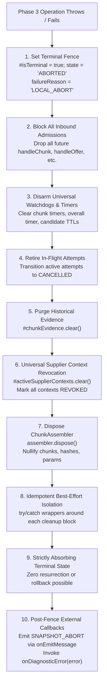
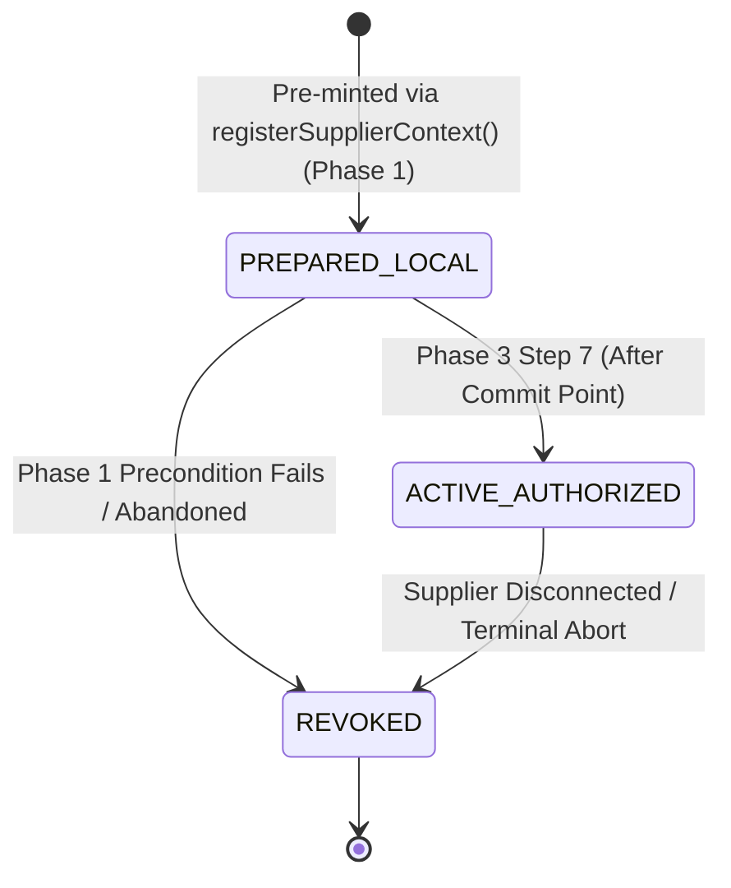

# Phase 7.5 M4.2d-R17 — Terminal Abort, Dispatch Boundary & Context Provenance Closure Report

**Role:** Senior TypeScript Distributed-Systems Architect  
**Mode:** STRICTLY DOCUMENTATIONAL & READ-ONLY  
**Date:** November 23, 2026  
**Status:** COMPLETE  
**Authoritative Baseline:** M4.2c-R6 closure (`79919a0f8cb0bb81cb80cc010fe02918bef79787`)  
**Decision Gate Verdict:** **`READY FOR FINAL DESIGN ACCEPTANCE — IMPLEMENTATION STILL UNAUTHORIZED`**

---

## 1. Executive Summary & Verification Boundaries

This report executes **Phase 7.5 M4.2d-R17**, delivering the definitive architectural closure of the remaining specification clarifications identified in the independent review of R16.

All five specific areas (R17-1 through R17-5) have been audited against the frozen M4.1–M4.2c baselines, mathematically defined, and incorporated into the master specification:
1. **R17-1 (Partial-Transition Terminal-Abort Contract):** Defines the exact 10-step terminal-abort sequence executed if any Phase 3 operation fails after `ChunkAssembler.prepareForFailover()` has committed. Establishes the immediate terminal fence, universal timer disarming, context revocation, assembler disposal, idempotent best-effort cleanup, and post-fence external callback ordering.
2. **R17-2 (Separation of Request Preparation from Transport Dispatch):** Enforces a strict architectural boundary between synchronous internal window scheduling in Phase 3 and external transport emission. Outbound requests are enqueued into an internal queue (`#outboundDispatchQueue`); external emission (`onEmitMessage`) becomes eligible **only after Phase 3 completion**, eliminating synchronous reentrancy risks.
3. **R17-3 (Supplier-Context Provenance Lifecycle):** Formally specifies the three-state context lifecycle (`PREPARED_LOCAL` $\to$ `ACTIVE_AUTHORIZED` $\to$ `REVOKED`), proving that locally prepared contexts cannot pass inbound admission, and clarifying the interplay between capability branding, `WeakSet` provenance, and active-map registration.
4. **R17-4 (Correct Safety Justification & Run-to-Completion Boundaries):** Replaces references to Strong Eventual Consistency (SEC) with local transfer safety and state invariants. Accurately bounds the single-threaded run-to-completion guarantees against process termination, browser shutdown, OOM, and reentrancy.
5. **R17-5 (Reconciliation of All Material):** Updates the failover sequence diagram, context lifecycle state machine, 10-case failure table, and adversarial matrix cases.

### 1.1 Authoritative Baseline Verification
- **Current HEAD Commit:** `79919a0f8cb0bb81cb80cc010fe02918bef79787` (`main`, M4.2c-R6 closure)
- **Direct Parent Commit:** `699019ee46e44e9ce1dfdfb4f7d1262bce239048` (M4.2c-R5)
- **Frozen Baselines Checked (0 diffs):**
  - M4.1 (`fd23edae5bdb52cff32674860229277a79cb1aca`): Wire Schemas & `ChunkAssembler`
  - M4.2a (`e3245912626758c094d83edbd4d9264a922070f5`): `SnapshotSerializer` & `SerializedSnapshotArtifact`
  - M4.2b (`8f509f94a39be9ece4060003ee498dc747efb813`): `SnapshotChunkProducer` & `SnapshotPreparationQueue`
  - M4.2c (`79919a0f8cb0bb81cb80cc010fe02918bef79787`): `SnapshotOutboundPipeline`
- **Working Tree Verification:** `git diff --exit-code packages/` exits with code `0`. Zero runtime source files, tests, schemas, exports, dependencies, or package configurations were modified.

> [!CAUTION]
> **Implementation Authorization Boundary:**  
> **M4.2d implementation remains strictly unauthorized.** This report is an architectural specification closure. Implementation shall not begin until explicit user authorization following final design acceptance.

---

## 2. Frozen Source Ground Truth Inspected

The following frozen source implementations and contracts were directly inspected as ground truth:

| Source File | Line Range | Contract / Component Analyzed | Verified Ground-Truth Behavior vs Proposed Architecture |
| :--- | :--- | :--- | :--- |
| `packages/sync-engine/src/recovery/chunk-assembler.ts` | Lines 744–763 | `ChunkAssembler.abortTransfer()` & `dispose()` | **Ground Truth:** `abortTransfer()` (lines 745–751) nullifies `this.chunks = null; this.chunkHashes = null; this.transferParams = null;` and resets counts to 0. `dispose()` (lines 759–762) sets `this.disposed = true;` and calls `abortTransfer()`. Once disposed, any subsequent call immediately returns `{ ok: false, reason: 'DISPOSED' }`. |
| `packages/sync-engine/src/recovery/chunk-assembler.ts` | Lines 593–600 | `ChunkAssembler.prepareForFailover()` Commit | **Ground Truth:** Successful return mutates `this.transferParams.transferId`, `supplierPeerId`, and `connectionGeneration` in place. Irreversible commit point. |
| `packages/sync-engine/src/recovery/chunk-assembler.ts` | Lines 211–228 | `ChunkAssembler.ingestChunk()` Context Fencing | **Ground Truth:** Fences incoming chunks against `this.transferParams.supplierPeerId` and `connectionGeneration`. Chunks from old contexts or uncommitted candidates are rejected with `IDENTITY_MISMATCH`. |
| `packages/protocol/src/constants.ts` | Lines 78–168 | Protocol Constants | **Ground Truth:** `MAX_CONCURRENT_CHUNK_REQUESTS = 4` ($W=4$), `CHUNK_REQUEST_TIMEOUT_MS = 5,000`, `MAX_CHUNK_RETRIES = 3`, `MAX_TRANSFER_RETRIES = 10`, `OVERALL_TRANSFER_TIMEOUT_MS = 60,000`. |
| `packages/sync-engine/src/recovery/snapshot-outbound-pipeline.ts` | Lines 505–553 | Context Capability Custody | **Ground Truth:** Referential capability equality `capability === this.#authorizedCapability` and unforgeable private brand symbol. |

---

## 3. R17-1 — Partial-Transition Terminal-Abort Contract

### 3.1 Failure Context & Invariant
Under R16, `assembler.prepareForFailover()` is established as the irreversible commit point (Phase 2). If any subsequent operation in Phase 3 fails (e.g. Map key exhaustion, unexpected runtime error during metadata updates, or context publishing failure), the assembler has already committed to the new candidate's identity, while the pipeline's internal state is partially transitioned. Rollback is impossible.

To protect internal state integrity and prevent corrupted execution, the pipeline must execute an **exact, fail-closed terminal-abort procedure**.

### 3.2 Exact Ten-Step Terminal-Abort Procedure
When an exception or fatal condition occurs during Phase 3, the pipeline synchronously executes the following 10 steps:



1. **Set Terminal Fence:** Immediately set `#isTerminal = true`, `session.state = 'ABORTED'`, and `session.failureReason = 'LOCAL_ABORT'` (`failureDetail = 'FAILOVER_COMMIT_FINALIZATION_FAILED'`). This fence is written **before** any cleanup code executes.
2. **Block Inbound Admissions:** The terminal fence immediately and permanently blocks all public pipeline entry points (`handleChunk`, `handleOffer`, `startTransfer`, `handleSupplierDisconnected`). Any inbound message arriving subsequently is dropped at the transport boundary with `{ accepted: false, duplicate: false, completed: false }` or a silent no-op.
3. **Disarm Universal Watchdogs & Timers:** Iterate and clear all tracked timers via `clearTimeout`:
   - All active per-chunk request watchdog timers (`#chunkWatchdogTimers`).
   - The session overall timeout timer (`#overallTimeoutTimer`).
   - All candidate registry TTL timers.
   Timers are cancelled universally, regardless of which supplier context or chunk index spawned them.
4. **Retire Active Attempts:** Transition all in-flight attempt records across all chunks to `CANCELLED`.
5. **Purge Historical Evidence:** Execute `#chunkEvidence.clear()`, dereferencing all `AcceptedAttemptRecord` and `ChunkEvidenceHistory` containers to free memory.
6. **Universal Supplier Context Revocation:** Clear `#activeSupplierContexts.clear()`. Every context associated with the session (the old supplier context, the candidate context whether partially or fully registered, and any cached candidates) is transitioned to `REVOKED`.
7. **Dispose ChunkAssembler:** Invoke `this.#assembler.dispose()`. Per ground-truth inspection (`chunk-assembler.ts`, line 759), this sets `disposed = true`, nullifies `chunks`, `chunkHashes`, and `transferParams`, and zeroes all counters, releasing held chunk view buffers to the garbage collector.
8. **Idempotent Best-Effort Cleanup:** Each cleanup step is wrapped in isolated `try/catch` blocks so that a secondary failure in one step (e.g. timer map traversal) cannot prevent subsequent steps (e.g. assembler disposal) from executing.
9. **Absorbing Terminal Guarantee:** Cleanup failure **cannot reactivate the transfer, cannot revert session state, and cannot restore the previous supplier**. The state remains permanently `ABORTED`.
10. **Post-Fence External Callback Ordering:** External notifications (logging via `onDiagnosticError` or emitting an outbound `SNAPSHOT_ABORT` wire frame) are invoked **strictly after** the internal terminal state has been completely established. If `onEmitMessage` or `onDiagnosticError` throws, the error is caught and isolated without altering the terminal state.

### 3.3 Explicit Cleanup Limitations
> [!IMPORTANT]
> **Runtime and Memory Limits:**  
> In-memory cleanup guarantees that all application references held by `SnapshotInboundPipeline` and `ChunkAssembler` are nullified. It **DOES NOT** guarantee:
> - Recovery from operating-system process termination or browser tab destruction.
> - Immediate reclamation of physical OS RAM (which is subject to V8 garbage collection heuristics and WebRTC native socket buffer management).
> - Execution if an uncatchable fatal runtime error occurs (e.g. V8 Out-Of-Memory termination or hard process signal `SIGKILL`).

---

## 4. R17-2 — Separate Request Preparation from Transport Dispatch

### 4.1 Motivation & Reentrancy Vulnerability
In R16 Phase 3 Step 9, resuming the request window was described as:
> *"Resume window requests: Enqueue initial window requests (W=4)."*

If Phase 3 were to synchronously invoke the transport handoff callback (`config.onEmitMessage(handoff)`), external consumer code could synchronously invoke pipeline methods (e.g. `handleHandoffSuccess`, `handleHandoffFailure`, or `handleSupplierDisconnected`) before Phase 3 has finished committing all internal maps and state variables. Such synchronous reentrancy would violate state invariants.

### 4.2 The Dispatch Boundary Contract
To eliminate callback reentrancy, the architecture establishes a strict separation of concerns:

```
[Phase 1: Pre-Commit Validation]
               ↓
[Phase 2: Assembler Commit Point]
               ↓
[Phase 3: Post-Commit Synchronous Finalization]
  ├── Update internal scheduling state (#chunkStates)
  ├── Identify verified vs unverified chunks
  ├── Prepare request parameters for next window (W=4)
  └── Enqueue outbound descriptors into #outboundDispatchQueue: OutboundHandoffRequest[]
               ↓
========================================================================
DISPATCH BOUNDARY: Phase 3 Completion → Outbound Dispatch Eligible
========================================================================
               ↓
[Post-Commit Dispatch Pump: #flushOutboundDispatchQueue()]
  └── Drain queue and invoke config.onEmitMessage(handoff)
```

### 4.3 Execution Rules
1. **Synchronous Phase 3 Invariant:** Phase 3 **MUST NOT** invoke `onEmitMessage`, user callbacks, or transport handoff code. Its scope is strictly confined to internal memory updates, timer adjustments, and enqueuing outbound request descriptors into `#outboundDispatchQueue`.
2. **Eligibility Boundary:** Outbound network dispatch becomes eligible **if and only if Phase 3 has completed successfully and all internal state variables are committed**.
3. **Dispatch Execution:** Once Phase 3 completes, the pipeline drains `#outboundDispatchQueue` via a dedicated dispatch pump (`#flushOutboundDispatchQueue()`). This pump executes either:
   - Synchronously immediately following Phase 3 completion (after all internal invariants are established), or
   - Scheduled via microtask (`queueMicrotask`).
4. **Reentrancy Immunity:** If external transport code called by `onEmitMessage` attempts to call pipeline methods reentrantly, all pipeline internal states (`session.state`, `session.supplierPeerId`, `#activeSupplierContexts`, `#chunkStates`) are already fully committed and consistent.

---

## 5. R17-3 — Supplier-Context Provenance Lifecycle

### 5.1 Three-State Context Lifecycle State Machine
A supplier context undergoes a strict, unidirectional 3-state lifecycle:



| Lifecycle State | Active Map (`#activeSupplierContexts`) | Provenance Set (`#validSupplierContexts`) | Inbound Chunks Admissible? | Disconnect Lifecycle Admissible? | Description |
| :--- | :---: | :---: | :---: | :---: | :--- |
| **`PREPARED_LOCAL`** | **NO** | **YES** | **STRICTLY FORBIDDEN (DROPPED)** | NO | Locally constructed during Phase 1 pre-validation. Provenance verified by capability minting, but context is not yet active. |
| **`ACTIVE_AUTHORIZED`** | **YES** | **YES** | **YES** (Path A / Path B) | YES | Published to active map in Phase 3 Step 7. Authorizes inbound chunk ingestion and window requests. |
| **`REVOKED`** | **NO** | **YES** | **STRICTLY FORBIDDEN (DROPPED)** | YES (Idempotent / Stale) | Removed from active map upon supplier failover, disconnect, or abort. Inbound chunks strictly blocked. |

### 5.2 Provenance, Capability Branding, and Active Fencing
The architecture clearly delineates four distinct verification tiers:
1. **Private Capability Branding (`INBOUND_CAPABILITY_BRAND`):** Validates caller authority to invoke privileged pipeline methods. An unforgeable package-private symbol ensures external callers cannot fabricate capabilities.
2. **`WeakSet` Provenance (`#validSupplierContexts`):** Proves that an `AuthenticatedSupplierContext` object was legitimately minted by `registerSupplierContext()`. Prevents external callers from forging context objects.
3. **Active Registration Fencing (`#activeSupplierContexts`):** A context is eligible for inbound chunk admission **if and only if it exists in `#activeSupplierContexts`** (i.e. state is `ACTIVE_AUTHORIZED`).
4. **Identity String Prohibition:** Possession of matching identity strings (`supplierPeerId`, `sessionId`, `membershipEpoch`, `connectionGeneration`) **NEVER constitutes authentication**. Inbound frames must pass both context provenance and active registration fencing.

### 5.3 Registration Failure Handling
If registering a `PREPARED_LOCAL` context into `#activeSupplierContexts` in Phase 3 throws or fails (e.g. Map size limit or internal runtime failure):
- The transfer enters the **R17-1 Terminal-Abort Protocol** immediately (`LOCAL_ABORT`).
- The partially registered context is marked `REVOKED`.
- The assembler is disposed, and the transfer terminates cleanly.

---

## 6. R17-4 — Correct Safety Justification & Run-to-Completion Boundaries

### 6.1 Replacement of SEC Justification
- **R16 Flaw:** R16 Section 8.5 invoked "Strong Eventual Consistency (SEC)" as the theoretical justification for terminal abort upon post-commit failure.
- **Definitive Ground-Truth Correction:** Snapshot recovery is an asymmetric, point-to-point, local recovery transfer between a single supplier and a single recovering receiver. Terminal abort does **NOT** establish distributed eventual convergence across peers.
- **Correct Justification:** Terminal abort protects **local transfer safety and internal state integrity**. Once the assembler's transfer identity has irreversibly mutated, continuing execution after a finalization failure would result in undefined behavior, silent corruption, or data misattribution. Immediate fail-closed abort terminates the compromised local transfer session safely. The recovering peer remains unrecovered and must initiate a new recovery session through leaderless anti-entropy discovery.

### 6.2 Precise Limits of JavaScript Run-to-Completion
The single-threaded run-to-completion argument guarantees:
1. **No Ordinary Event-Loop Interleaving:** Between the execution of line 593 in `prepareForFailover()` and the return of Phase 3, no Macrotask (e.g. `setTimeout`, `setImmediate`, I/O events, DataChannel messages) or Microtask (e.g. Promise reaction jobs) can execute.
2. **What Run-to-Completion DOES NOT Guarantee:**
   - **No Protection Against OS Process Termination:** A `kill -9`, power outage, or OS crash destroys volatile RAM immediately.
   - **No Protection Against Browser Shutdown:** Closing a tab or browser process terminates execution mid-stack.
   - **No Protection Against Fatal Engine Errors:** V8 fatal OOM errors terminate the process without executing JavaScript `catch` or `finally` blocks.
   - **No Durable WAL:** State transitions are maintained purely in volatile in-memory heap structures. There is no write-ahead log on disk.
   - **No Protection Against Reentrant Callbacks If Allowed:** If synchronous user callbacks were invoked during Phase 3, run-to-completion would NOT prevent reentrant stack frames. This is why R17-2 explicitly separates request preparation from dispatch.

---

## 7. R17-5 — Reconciled Material & Adversarial Matrix

### 7.1 Reconciled Mermaid Failover Sequence Diagram

```mermaid
sequenceDiagram
    autonumber
    participant Net as Transport Layer
    participant Pipe as SnapshotInboundPipeline
    participant Reg as CandidateOfferRegistry
    participant Asm as ChunkAssembler

    Note over Pipe: Phase 1: Pre-Commit Validation (Zero Mutation)
    Net->>Pipe: handleSupplierDisconnected(context, capability)
    Pipe->>Pipe: 1. Authenticate capability & WeakSet provenance
    Pipe->>Pipe: 2. Verify active context (supplier, generation)
    Pipe->>Reg: 3. Select eligible candidate C_k
    Pipe->>Pipe: 4. Validate candidate identity & transfer geometry
    Pipe->>Pipe: 5. Verify candidate TTL (now <= expiresAtMs)
    Pipe->>Pipe: 6. Re-verify active context has not changed
    Pipe->>Pipe: 7. Verify contextTransitionCount < 8
    Pipe->>Pipe: 8. Verify pipeline preconditions (state === TRANSFERRING)
    Pipe->>Pipe: 9. Pre-mint candidate context (State: PREPARED_LOCAL)
    
    Note over Pipe,Asm: Phase 2: Assembler Commit Point
    Pipe->>Asm: prepareForFailover(candidateParams)
    alt Outcome A: Candidate Rejection (ok: false)
        Asm-->>Pipe: { ok: false, reason: 'GEOMETRY_MISMATCH' }
        Pipe->>Pipe: Assembler UNMUTATED. Pipeline state UNMUTATED.
        Pipe->>Reg: Evict C_k; evaluate next candidate C_{k+1}...
    else Outcome B: Candidate Success (ok: true) - IRREVERSIBLE COMMIT
        Asm-->>Pipe: { ok: true, retainedChunks: N }
        Note over Pipe: Assembler committed to C_k identity
        
        Note over Pipe: Phase 3: Post-Commit Synchronous Finalization (Zero External Callbacks)
        Pipe->>Pipe: 1. Revoke old context from active map (State: REVOKED)
        Pipe->>Pipe: 2. Retire in-flight attempts to CANCELLED
        Pipe->>Pipe: 3. Clear active chunk response & watchdog timers
        Pipe->>Pipe: 4. Purge old historical evidence (#chunkEvidence.clear())
        Pipe->>Pipe: 5. Update session identity (supplier, generation, transferId)
        Pipe->>Pipe: 6. Increment session.contextTransitionCount++ exactly once
        Pipe->>Pipe: 7. Publish candidate context to active map (State: ACTIVE_AUTHORIZED)
        Pipe->>Pipe: 8. Reset unverified chunks in #chunkStates to UNREQUESTED
        Pipe->>Pipe: 9. Enqueue window requests into #outboundDispatchQueue (W=4)
        
        Note over Pipe: DISPATCH BOUNDARY: Phase 3 Completion
        Pipe->>Net: 10. Drain #outboundDispatchQueue via onEmitMessage (Eligible Post-Commit)
    end
```

### 7.2 Updated 10-Case Failure & Race Outcome Table

| Case # | Scenario Description | Execution Phase | Assembler Mutated? | Pipeline State Mutation | Context Lifecycle State | Evidence & Timers | Transition Counter | Transfer Outcome |
| :---: | :--- | :---: | :---: | :--- | :---: | :--- | :---: | :--- |
| **1** | **Candidate rejected by assembler** | Phase 2 (`prepareForFailover` returns `ok: false`) | **NO** | Active context unchanged; candidate evicted from registry | Candidate: `REVOKED`; Active: `ACTIVE_AUTHORIZED` | Active evidence & timers intact | **Not incremented** | `TRANSFERRING` (Evaluates next candidate) |
| **2** | **Candidate accepted and assembler succeeds** | Phase 2 $\to$ Phase 3 | **YES** (Irreversible Commit Point) | Full transition: new supplier, new generation, new transferId | Old: `REVOKED`; Candidate: `ACTIVE_AUTHORIZED` | Old purged; new requests enqueued into dispatch queue | **Incremented (+1)** | `TRANSFERRING` (Drains dispatch queue post-commit) |
| **3** | **Transition budget exhausted before assembler call** | Phase 1 (`contextTransitionCount >= 8`) | **NO** (Call blocked) | Transition aborted; enters terminal abort | Candidate: `REVOKED`; Active: `REVOKED` | All timers cancelled; evidence purged | **Not incremented** | **ABORTED** (`SUPPLIER_DISCONNECTED`) |
| **4** | **Active context stale before assembler call** | Phase 1 ($G_{\text{ctx}} < G_{\text{session}}$ or $S \neq S_{\text{session}}$) | **NO** (Call blocked) | Notification dropped as stale/idempotent no-op; session intact | Active remains `ACTIVE_AUTHORIZED` | Zero mutation | **Not incremented** | `TRANSFERRING` (Session continues unaffected) |
| **5** | **No eligible candidate in registry** | Phase 1 (Registry empty or no matching geometry) | **NO** (Call blocked) | Cannot failover; enters terminal abort | Active: `REVOKED` | All timers cancelled; evidence purged | **Not incremented** | **ABORTED** (`SUPPLIER_DISCONNECTED`) |
| **6** | **Exception before assembler invocation** | Phase 1 (Error during pre-validation) | **NO** (Call blocked) | Caught by outer handler; enters terminal abort | Candidate: `REVOKED`; Active: `REVOKED` | All timers cancelled; evidence purged | **Not incremented** | **ABORTED** (`LOCAL_ABORT`) |
| **7** | **Exception after successful assembler mutation** | Phase 3 (Synchronous error during post-commit finalization) | **YES** (Already committed) | **CANNOT ROLLBACK**; executes R17-1 terminal-abort protocol | All contexts: `REVOKED` | Timers disarmed; evidence purged; assembler disposed | **Incremented (+1)** | **FAIL-CLOSED ABORT** (`LOCAL_ABORT`) |
| **8** | **New-context registration failure after assembler mutation** | Phase 3 (Registration throws or fails in map) | **YES** (Already committed) | **CANNOT ROLLBACK**; executes R17-1 terminal-abort protocol | Candidate: `REVOKED`; Old: `REVOKED` | Timers disarmed; evidence purged; assembler disposed | **Incremented (+1)** | **FAIL-CLOSED ABORT** (`LOCAL_ABORT`) |
| **9** | **Duplicate disconnect notification after transition** | Phase 1 (Evaluated against $S_{\text{new}}, G_{\text{new}}$) | **NO** (Call blocked) | Context peer ID mismatch; dropped as idempotent no-op | Active remains `ACTIVE_AUTHORIZED` | Zero mutation | **Not incremented** | `TRANSFERRING` (Session continues unaffected) |
| **10** | **Old-generation disconnect notification after transition** | Phase 1 ($G_{\text{old}} < G_{\text{new}}$) | **NO** (Call blocked) | Generation check fails; dropped as stale no-op | Active remains `ACTIVE_AUTHORIZED` | Zero mutation | **Not incremented** | `TRANSFERRING` (Session continues unaffected) |

### 7.3 Reconciled Adversarial Matrix Scenarios (Excerpts)
- **Case 26 (Candidate Rejected in Phase 2):** Assembler invoked, returns `ok: false`. Zero assembler or pipeline mutation. Candidate evicted; active transfer intact.
- **Case 27 (Context Changed Before Assembler Call):** Detected in Phase 1 pre-validation. Assembler not invoked. Notification dropped as stale no-op.
- **Case 28 (No Eligible Candidate Remaining):** Evaluated in Phase 1. Assembler not invoked. Clean terminal abort (`SUPPLIER_DISCONNECTED`).
- **Case 29 (Transition Budget Exhausted in Phase 1):** Detected in Phase 1 (`contextTransitionCount >= 8`). Assembler not invoked. Clean terminal abort (`SUPPLIER_DISCONNECTED`).
- **Case 32 (Disconnect Racing with Pre-Validation):** Evaluated sequentially in single-threaded event loop. Pre-checks detect active state in turn.
- **Case 33 (Disconnect Arriving After Commit Point):** Evaluated in Phase 1 against $S_{\text{new}}, G_{\text{new}}$. Filtered as stale no-op without assembler call.
- **Case 42 (Registration Failure After Commit Point):** Commit point has succeeded. Phase 3 Step 7 fails. Executes R17-1 10-step terminal abort. Assembler disposed; all contexts revoked; terminal `LOCAL_ABORT`. Zero rollback.

---

## 8. Master Specification Updates Summary (v1.17.0)

`docs/PHASE7_5_M4_2D_ARCHITECTURE_AND_INTERFACE_SPECIFICATION.md` has been upgraded to **v1.17.0** with the following definitive amendments:
1. **Section 7.1:** Enforced the Dispatch Boundary: Phase 3 synchronously enqueues request descriptors into `#outboundDispatchQueue`; external emission (`onEmitMessage`) becomes eligible strictly after Phase 3 completion (R17-2).
2. **Section 7.2:** Defined the exact 10-step R17-1 Partial-Transition Terminal-Abort Contract with immediate terminal fence, universal timer disarming, context revocation, assembler disposal, idempotent best-effort cleanup, and post-fence callback ordering (R17-1).
3. **Section 7.3:** Formally specified the Context Provenance Lifecycle (`PREPARED_LOCAL` $\to$ `ACTIVE_AUTHORIZED` $\to$ `REVOKED`), proving `PREPARED_LOCAL` frames are inadmissible and clarifying capability branding vs `WeakSet` provenance vs active registration (R17-3).
4. **Section 7.4:** Corrected the safety justification, grounding terminal abort in local transfer safety and state invariants rather than SEC, and explicitly bounding single-threaded run-to-completion against process crashes, OOM, and reentrancy (R17-4).
5. **Section 7.5 & 12:** Updated the 10-case Failure & Race Outcome Table, Mermaid diagrams, and adversarial matrix cases (R17-5).

---

## 9. Final Verification & Baseline Confirmation

- **Repository HEAD:** `79919a0f8cb0bb81cb80cc010fe02918bef79787` (M4.2c-R6 closure)
- **Direct Parent Commit:** `699019ee46e44e9ce1dfdfb4f7d1262bce239048`
- **Active Branch:** `main`
- **Packages Diff Check:** `git diff --exit-code packages/` exits with code `0` (clean, 0 diffs).
- **Frozen Baseline Integrity:**
  - M4.1 (`fd23edae5bdb52cff32674860229277a79cb1aca`) — **0 diffs**
  - M4.2a (`e3245912626758c094d83edbd4d9264a922070f5`) — **0 diffs**
  - M4.2b (`8f509f94a39be9ece4060003ee498dc747efb813`) — **0 diffs**
  - M4.2c (`79919a0f8cb0bb81cb80cc010fe02918bef79787`) — **0 diffs**
- **Strict Scope Preservation:** Strictly documentation-only (`docs/`). No runtime code, tests, schemas, exports, dependencies, or configurations modified.

---

## 10. Final Decision Gate

```
================================================================================
FINAL DECISION GATE: PHASE 7.5 M4.2d-R17
STATUS: READY FOR FINAL DESIGN ACCEPTANCE — IMPLEMENTATION STILL UNAUTHORIZED
================================================================================
```

All five findings from the independent review (R17-1 through R17-5) have been audited against frozen source contracts, mathematically defined, and incorporated into the master specification. The specification is 100% self-consistent, grounded in frozen source truth, and ready for final design acceptance.

**Implementation remains strictly unauthorized pending explicit user approval.**
