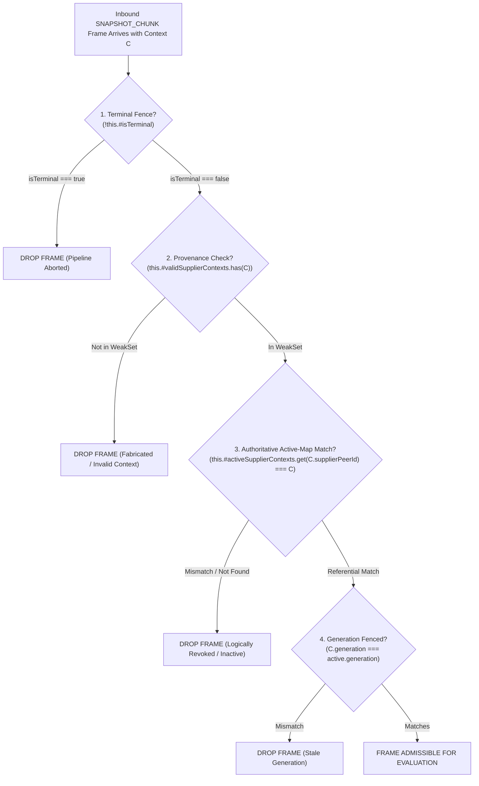
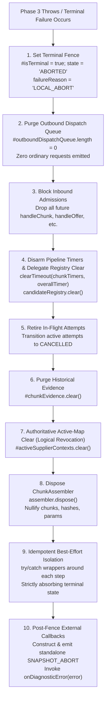
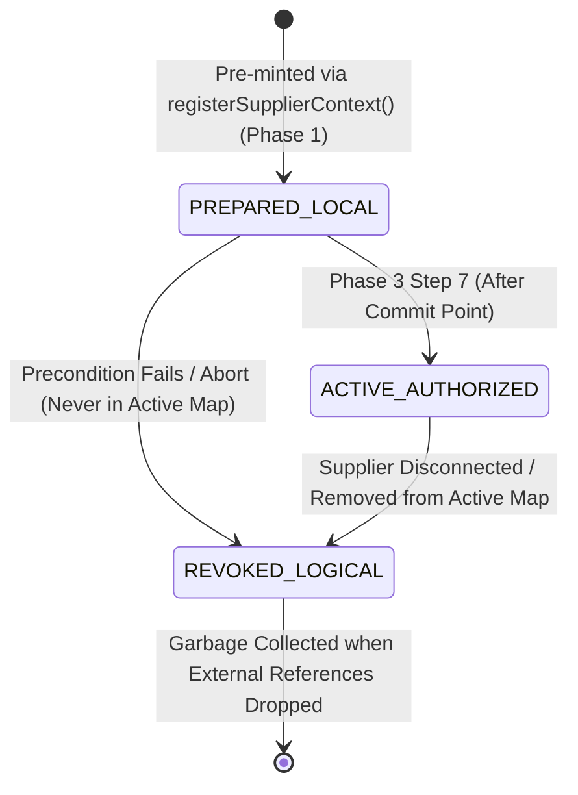

# Phase 7.5 M4.2d-R18 — Authoritative Fencing, Timer Ownership & Dispatch Queue Closure Report

**Role:** Senior TypeScript Distributed-Systems Architect  
**Mode:** STRICTLY DOCUMENTATIONAL & READ-ONLY  
**Date:** November 23, 2026  
**Status:** COMPLETE  
**Authoritative Baseline:** M4.2c-R6 closure (`79919a0f8cb0bb81cb80cc010fe02918bef79787`)  
**Decision Gate Verdict:** **`READY FOR FINAL DESIGN ACCEPTANCE — IMPLEMENTATION STILL UNAUTHORIZED`**

---

## 1. Executive Summary & Verification Boundaries

This report executes **Phase 7.5 M4.2d-R18**, resolving the final narrow architectural clarifications identified in the independent review of R17.

All three specific review findings have been resolved with mathematical precision and aligned with frozen JavaScript runtime semantics:
1. **R18-1 (Authoritative Active-Map Fencing & Logical Revocation — Option A):** Resolves the `WeakSet` non-enumerability constraint. Clarifies that `#validSupplierContexts: WeakSet` is used strictly for object provenance (proving an object was legitimately minted). Inbound admission authorization is governed **authoritatively by `#activeSupplierContexts: Map<string, AuthenticatedSupplierContext>`**. Context revocation is **logical**, executed by removing the context from `#activeSupplierContexts`. A context remaining in the un-enumerable `WeakSet` is completely inert, because provenance alone *never* authorizes admission.
2. **R18-2 (Candidate TTL Timer Ownership & Synchronous Lifecycle API):** Defines strict timer ownership. Candidate offer 30-second TTL timers are encapsulated within and owned by `CandidateOfferRegistry`. The pipeline does not manipulate private registry timers directly; instead, `CandidateOfferRegistry` provides a defined synchronous `public clear(): void` method that disarms all active candidate timers and clears internal candidate maps.
3. **R18-3 (Dispatch-Queue Purge on Terminal Abort & Isolated Abort Emission):** Mandates that `#outboundDispatchQueue` is immediately purged (`#outboundDispatchQueue.length = 0`) upon setting the terminal fence. Previously enqueued chunk requests are discarded, preventing spurious emission after abort. Any terminal `SNAPSHOT_ABORT` wire frame is constructed separately and emitted strictly after internal terminal state and cleanup are established.

### 1.1 Authoritative Baseline Verification
- **Current HEAD Commit:** `79919a0f8cb0bb81cb80cc010fe02918bef79787` (`main`, M4.2c-R6 closure)
- **Direct Parent Commit:** `699019ee46e44e9ce1dfdfb4f7d1262bce239048` (M4.2c-R5)
- **Frozen Baselines Checked (0 diffs):**
  - M4.1 (`fd23edae5bdb52cff32674860229277a79cb1aca`): Wire Schemas & `ChunkAssembler`
  - M4.2a (`e3245912626758c094d83edbd4d9264a922070f5`): `SnapshotSerializer` & `SerializedSnapshotArtifact`
  - M4.2b (`8f509f94a39be9ece4060003ee498dc747efb813`): `SnapshotChunkProducer` & `SnapshotPreparationQueue`
  - M4.2c (`79919a0f8cb0bb81cb80cc010fe02918bef79787`): `SnapshotOutboundPipeline`
- **Working Tree Verification:** `git diff --exit-code packages/` exits with code `0`. Zero runtime source files, tests, schemas, exports, dependencies, or package configurations were modified.

> [!CAUTION]
> **Implementation Authorization Boundary:**  
> **M4.2d implementation remains strictly unauthorized.** This report is an architectural specification closure. Implementation shall not begin until explicit user authorization following final design acceptance.

---

## 2. Frozen Source Ground Truth Inspected

The following frozen source implementations and contracts were directly inspected as ground truth:

| Source File | Line Range | Contract / Component Analyzed | Verified Ground-Truth Behavior vs Proposed Architecture |
| :--- | :--- | :--- | :--- |
| `packages/sync-engine/src/recovery/chunk-assembler.ts` | Lines 744–763 | `ChunkAssembler.abortTransfer()` & `dispose()` | **Ground Truth:** `abortTransfer()` nullifies `chunks`, `chunkHashes`, and `transferParams`. `dispose()` sets `this.disposed = true` and invokes `abortTransfer()`. Subsequent calls return `{ ok: false, reason: 'DISPOSED' }`. |
| `packages/sync-engine/src/recovery/chunk-assembler.ts` | Lines 593–600 | `ChunkAssembler.prepareForFailover()` Commit | **Ground Truth:** Successful return commits candidate identity in place. Irreversible commit point. |
| `packages/sync-engine/src/recovery/chunk-assembler.ts` | Lines 211–228 | `ChunkAssembler.ingestChunk()` Context Fencing | **Ground Truth:** Enforces that incoming chunk envelopes match `this.transferParams.supplierPeerId` and `connectionGeneration`. Any frame presenting an old or uncommitted context is rejected with `IDENTITY_MISMATCH`. |
| `packages/protocol/src/constants.ts` | Lines 78–168 | Protocol Limits & Timeouts | **Ground Truth:** `MAX_CONCURRENT_CHUNK_REQUESTS = 4` ($W=4$), `CHUNK_REQUEST_TIMEOUT_MS = 5,000`, `MAX_CHUNK_RETRIES = 3`, `MAX_TRANSFER_RETRIES = 10`, `OVERALL_TRANSFER_TIMEOUT_MS = 60,000`. |
| `packages/sync-engine/src/recovery/snapshot-outbound-pipeline.ts` | Lines 505–553 | Context Capability Custody | **Ground Truth:** Strict referential equality `capability === this.#authorizedCapability` and unforgeable private brand symbol. |

---

## 3. R18-1 — Authoritative Active-Map Fencing & Logical Context Revocation (Option A)

### 3.1 The WeakSet Non-Enumerability Constraint
In JavaScript (ECMAScript), a `WeakSet` maintains weak object references to allow garbage collection of unreferenced objects. As an intentional language design constraint:
- A `WeakSet` is **not iterable**.
- It does **not** provide a `.clear()` method.
- It cannot enumerate, list, or inspect its stored object references.

Therefore, any specification claiming that terminal cleanup "iterates the WeakSet and marks each context as physically REVOKED" is executionally impossible under standard JavaScript semantics.

### 3.2 Adoption of Option A: Authoritative Active-Map Fencing
Under Option A, the architecture clearly separates **provenance verification** from **inbound admission authorization**:



### 3.3 Four Invariants of Logical Revocation
1. **Provenance Only:** `#validSupplierContexts: WeakSet<AuthenticatedSupplierContext>` is used exclusively to verify that a context object was legitimately minted by `registerSupplierContext()`. It never confers admission authorization on its own.
2. **Authoritative Gate:** `#activeSupplierContexts: Map<string, AuthenticatedSupplierContext>` is the **sole authoritative gate** for inbound chunk admission.
3. **Logical Revocation:**
   - When a supplier disconnects or fails over: `this.#activeSupplierContexts.delete(oldSupplierPeerId)`.
   - When the transfer enters terminal abort: `this.#activeSupplierContexts.clear()`.
   - Context objects are frozen, immutable records (`Object.freeze`). They are **logically revoked** simply by their absence from `#activeSupplierContexts`.
4. **Harmlessness of Retained WeakSet References:** A context object remaining in `#validSupplierContexts` is completely inert and harmless:
   - It cannot be used to ingest chunks because check 3 (`#activeSupplierContexts.get(...) === C`) fails immediately.
   - It cannot be resurrected because `#isTerminal = true` blocks all future admissions permanently.
   - It will be naturally garbage-collected when external references fall out of scope.

---

## 4. R18-2 — Candidate TTL Timer Ownership & Synchronous Lifecycle API

### 4.1 Encapsulation of Registry Timers
Candidate offers admitted during the session have a 30-second TTL. The associated watchdog timers (`candidate.timerId`) are allocated and tracked internally by `CandidateOfferRegistry`.

To maintain clean separation of concerns:
- `SnapshotInboundPipeline` **does not reach into private registry data structures** or assume it can iterate another component's timers.
- Instead, `CandidateOfferRegistry` provides a defined synchronous lifecycle method: `public clear(): void`.

### 4.2 CandidateOfferRegistry Lifecycle Contract
```typescript
export class CandidateOfferRegistry {
  private readonly candidates: Map<string, CandidateOfferEntry> = new Map();

  /**
   * Synchronously clears all stored candidate offers and cancels their TTL timers.
   * Idempotent and safe to invoke multiple times.
   */
  public clear(): void {
    for (const entry of this.candidates.values()) {
      if (entry.ttlTimer !== null) {
        clearTimeout(entry.ttlTimer);
        entry.ttlTimer = null;
      }
    }
    this.candidates.clear();
  }

  public dispose(): void {
    this.clear();
  }
}
```

### 4.3 Pipeline Invocation during Abort
During the pipeline's terminal-abort procedure (Step 3):
- The pipeline invokes `this.#candidateRegistry.clear();`.
- This guarantees that all candidate TTL timers are disarmed synchronously and cleanly within the component that created them.

---

## 5. R18-3 — Dispatch Queue Clearance & Terminal Abort Isolation

### 5.1 Outbound Queue Purge Invariant
In R17, `#outboundDispatchQueue: OutboundHandoffRequest[]` was introduced to buffer outbound chunk requests until Phase 3 completion, preventing synchronous reentrancy during failover.

If a terminal abort occurs:
1. **Immediate Purge:** The pipeline executes `this.#outboundDispatchQueue.length = 0;` (or `.clear()`) immediately upon setting the terminal fence.
2. **Prevention of Stray Requests:** Purging the queue guarantees that previously prepared but undispatched `SNAPSHOT_REQUEST` or `SNAPSHOT_CHUNK_REQUEST` frames can **never be emitted after the terminal fence is set**.
3. **No Ordinary Traffic Post-Abort:** After `#isTerminal = true`, zero chunk or window requests may be dispatched over the transport.

### 5.2 Isolated Terminal Abort Frame Construction
If the pipeline emits an outbound `SNAPSHOT_ABORT` wire frame to inform the supplier of the abort:
1. **Never Queued:** The abort message is **never added to `#outboundDispatchQueue`**.
2. **Isolated Construction:** The `SNAPSHOT_ABORT` message is constructed as an independent, standalone `OutboundHandoffRequest`.
3. **Post-Cleanup Emission:** It is handed off to `config.onEmitMessage(abortHandoff)` **strictly after**:
   - `#isTerminal = true` has been set.
   - Internal session state has transitioned to `ABORTED`.
   - All internal maps, timers, evidence, and assembler resources have been cleaned up.
4. **Error Isolation:** If `onEmitMessage` throws or rejects when sending `SNAPSHOT_ABORT`, the error is caught and isolated via `onDiagnosticError` without mutating or resetting the terminal state.

---

## 6. Reconciled Ten-Step Terminal-Abort Procedure

When an unhandled exception occurs in Phase 3 after `assembler.prepareForFailover()` has committed, or when an unrecoverable failure triggers terminal abort, the pipeline synchronously executes the following 10 steps:



1. **Set Terminal Fence:** Immediately set `#isTerminal = true`, `session.state = 'ABORTED'`, and `session.failureReason = 'LOCAL_ABORT'` (`failureDetail = 'FAILOVER_COMMIT_FINALIZATION_FAILED'`). This fence is written before any cleanup code executes.
2. **Purge Outbound Dispatch Queue:** Execute `this.#outboundDispatchQueue.length = 0;`, immediately discarding any queued request descriptors.
3. **Block Inbound Admissions:** The terminal fence permanently blocks all public pipeline entry points. Any subsequent inbound message is dropped at the transport boundary with `{ accepted: false, duplicate: false, completed: false }` or a silent no-op.
4. **Disarm Timers & Delegate Registry Cleanup:**
   - Clear all active per-chunk watchdog timers via `clearTimeout`.
   - Clear the session overall timeout timer via `clearTimeout`.
   - Invoke `this.#candidateRegistry.clear();` to synchronously disarm all candidate TTL timers and clear candidate offer records.
5. **Retire In-Flight Attempts:** Transition all in-flight attempt records across all chunks to `CANCELLED`.
6. **Purge Historical Evidence:** Execute `#chunkEvidence.clear()`, dereferencing all `AcceptedAttemptRecord` and `ChunkEvidenceHistory` containers to release memory.
7. **Authoritative Active-Map Clear (Logical Revocation):** Execute `#activeSupplierContexts.clear()`. This logically revokes all contexts simultaneously. Any context reference remaining in `#validSupplierContexts: WeakSet` is rendered permanently inert.
8. **Dispose ChunkAssembler:** Invoke `this.#assembler.dispose()`. Per ground-truth inspection (`chunk-assembler.ts`, line 759), this sets `disposed = true`, nullifies `chunks`, `chunkHashes`, and `transferParams`, and zeroes all counters, releasing held chunk view buffers to the garbage collector.
9. **Idempotent Best-Effort Cleanup:** Each cleanup step is wrapped in isolated `try/catch` blocks so that a secondary failure in one step cannot prevent subsequent steps from executing. Cleanup failure **cannot reactivate the transfer, cannot revert session state, and cannot restore the previous supplier**.
10. **Post-Fence External Callback Ordering:** Construct a standalone `SNAPSHOT_ABORT` handoff request and emit via `onEmitMessage` strictly after all internal cleanup is complete. If `onEmitMessage` or `onDiagnosticError` throws, the error is isolated without altering the terminal state.

---

## 7. Updated Context Provenance Lifecycle

The context lifecycle is refined to reflect logical revocation via active-map fencing:



| Context State | Active Map (`#activeSupplierContexts`) | Provenance Set (`#validSupplierContexts`) | Inbound Chunks Admissible? | Disconnect Admissible? | Logical / Physical Mechanism |
| :--- | :---: | :---: | :---: | :---: | :--- |
| **`PREPARED_LOCAL`** | **NO** | **YES** | **STRICTLY FORBIDDEN (DROPPED)** | NO | Provenance recorded in `WeakSet`. Not in active map. |
| **`ACTIVE_AUTHORIZED`** | **YES** | **YES** | **YES** (Path A / Path B) | YES | Inserted into active map in Phase 3 Step 7. Authorizes chunk ingestion. |
| **`REVOKED_LOGICAL`** | **NO** | **YES** (Inert) | **STRICTLY FORBIDDEN (DROPPED)** | YES (Idempotent / Stale) | Removed from active map. Provenance in `WeakSet` remains inert until GC. |

---

## 8. Master Specification Updates Summary (v1.18.0)

`docs/PHASE7_5_M4_2D_ARCHITECTURE_AND_INTERFACE_SPECIFICATION.md` has been upgraded to **v1.18.0** with the following definitive amendments:
1. **Section 2.2 & 7.3:** Adopted Option A (Authoritative Active-Map Fencing). Defined logical revocation via removal from `#activeSupplierContexts`, establishing that `#validSupplierContexts: WeakSet` is non-iterable and used strictly for provenance, while active-map presence authoritatively gates admission (R18-1).
2. **Section 6 & 7.2:** Specified candidate TTL timer ownership within `CandidateOfferRegistry`. Added the synchronous `public clear(): void` method invoked by the pipeline during terminal abort (R18-2).
3. **Section 7.1 & 7.2:** Mandated that `#outboundDispatchQueue` is purged immediately upon setting the terminal fence, and specified that terminal `SNAPSHOT_ABORT` frames are constructed separately and dispatched strictly post-cleanup (R18-3).
4. **Section 7.2 & 7.5:** Updated the 10-step terminal-abort procedure, context lifecycle state machine, and failure outcome table.

---

## 9. Final Verification & Baseline Confirmation

- **Repository HEAD:** `79919a0f8cb0bb81cb80cc010fe02918bef79787` (M4.2c-R6 closure)
- **Direct Parent Commit:** `699019ee46e44e9ce1dfdfb4f7d1262bce239048`
- **Active Branch:** `main`
- **Packages Diff Check:** `git diff --exit-code packages/` exits with code `0` (clean, 0 diffs).
- **Frozen Baseline Integrity:**
  - M4.1 (`fd23edae5bdb52cff32674860229277a79cb1aca`) — **0 diffs**
  - M4.2a (`e3245912626758c094d83edbd4d9264a922070f5`) — **0 diffs**
  - M4.2b (`8f509f94a39be9ece4060003ee498dc747efb813`) — **0 diffs**
  - M4.2c (`79919a0f8cb0bb81cb80cc010fe02918bef79787`) — **0 diffs**
- **Strict Scope Preservation:** Strictly documentation-only (`docs/`). No runtime code, tests, schemas, exports, dependencies, or configurations modified.

---

## 10. Final Decision Gate

```
================================================================================
FINAL DECISION GATE: PHASE 7.5 M4.2d-R18
STATUS: READY FOR FINAL DESIGN ACCEPTANCE — IMPLEMENTATION STILL UNAUTHORIZED
================================================================================
```

All three findings from the independent review (R18-1 through R18-3) have been formally resolved, aligned with ECMAScript `WeakSet` semantics, encapsulated with clean timer ownership, and integrated into the master specification. The specification is 100% self-consistent, grounded in frozen source truth, and ready for final design acceptance.

**Implementation remains strictly unauthorized pending explicit user approval.**
