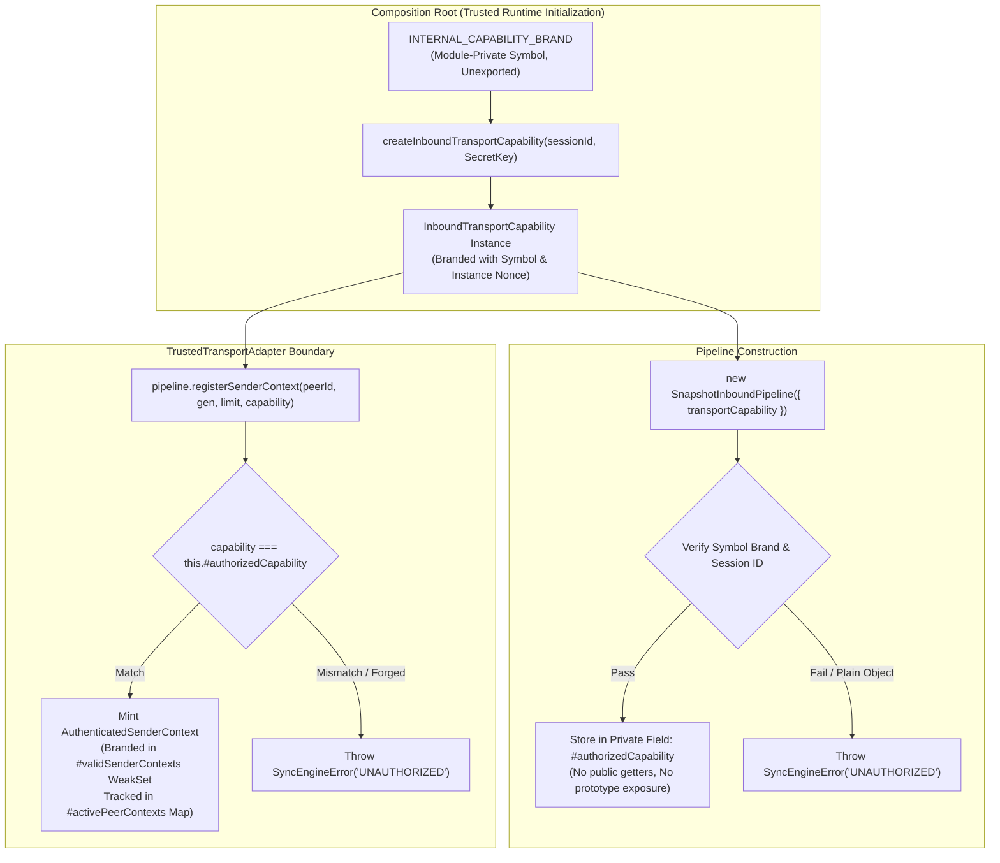
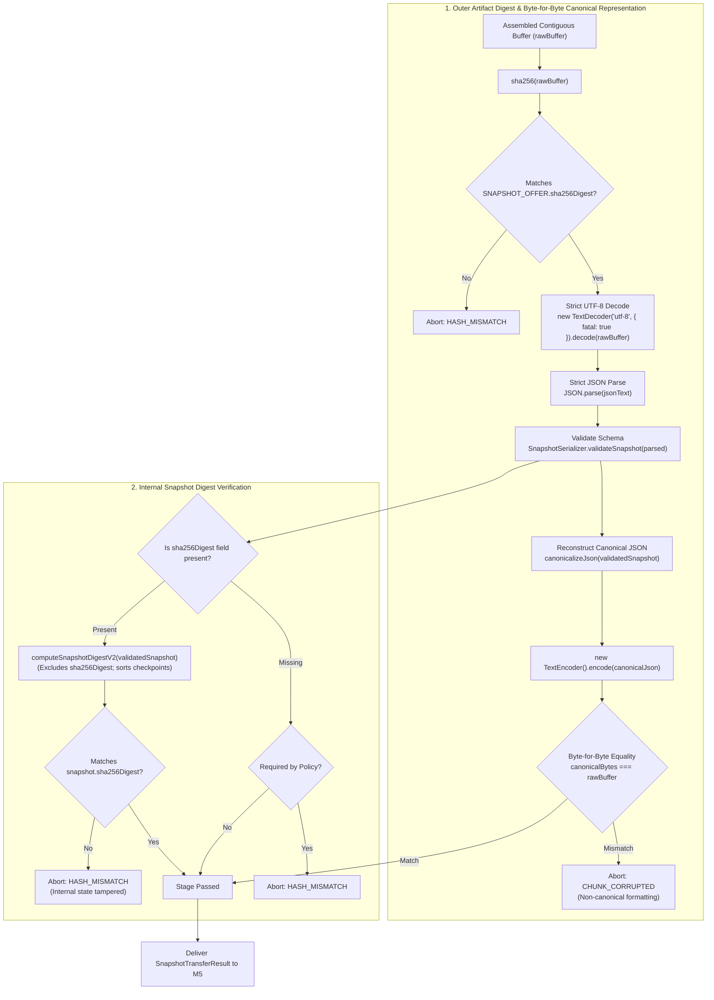
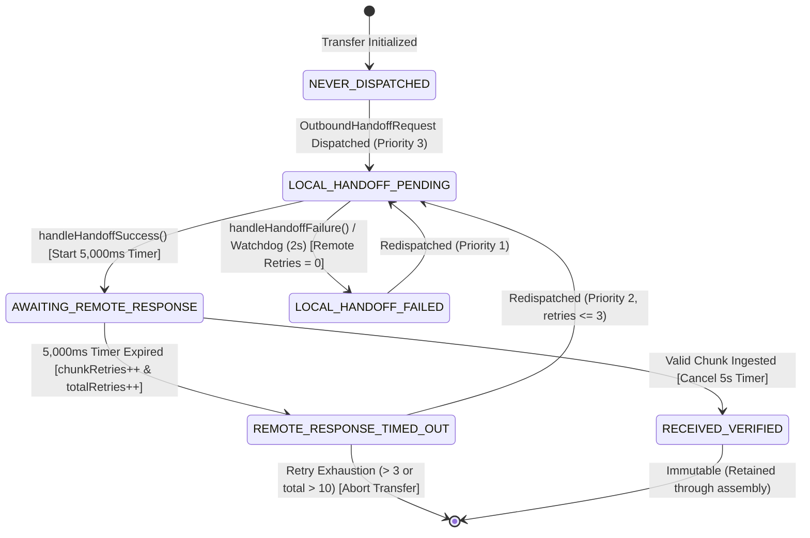

# Phase 7.5 M4.2d-R3 — Targeted Architecture Correction Report

**Document Version:** 1.3.0  
**Status:** Architecture Correction & Frozen-Contract Compatibility Report (Strictly Documentational — Read-Only)  
**Date:** November 23, 2026  
**Auditor / Architect:** Senior TypeScript Distributed-Systems Engineer  
**Target Milestone:** Phase 7.5 Sub-Milestone M4.2d (`SnapshotInboundPipeline`)  
**Previous Review Verdict:** CONDITIONAL FAIL (M4.2d-R2)  
**Current Gate Recommendation:** **AWAITING INDEPENDENT ARCHITECTURAL REVIEW**

---

## 1. Executive Summary & Review Verdict

An independent architecture review of `M4.2d-R2` issued a **CONDITIONAL FAIL** based on remaining technical defects affecting correctness, trust boundary enforcement, digest verification, chunk scheduling, and memory accounting.

This document (`M4.2d-R3`) provides a complete, documentation-only architectural correction that resolves all identified defects while strictly preserving:
- All frozen baselines (`M4.1`, `M4.2a`, `M4.2b`, `M4.2c`).
- The existing wire protocol schemas (0 new wire messages, 0 schema modifications).
- Complete backward and forward compatibility with the SyncPlay architecture.

### 1.1 Strict Read-Only Boundaries Preserved
- **Zero runtime source files modified.**
- **Zero test files modified.**
- **Zero package exports or dependencies modified.**
- **Zero code changes introduced to `SnapshotInboundPipeline` (implementation not yet authorized).**

---

## 2. Authoritative Frozen Baseline Compatibility

The architecture is audited against and strictly bounded by the four frozen Phase 7.5 baselines:

| Sub-Milestone | Commit Hash | Core Components Inspected | Compatibility Guarantee |
| :--- | :--- | :--- | :---: |
| **M4.1** | `fd23edae5bdb52cff32674860229277a79cb1aca` | Wire payload schemas (`SnapshotOfferPayloadSchema`, `SnapshotRequestPayloadSchema`, `SnapshotChunkPayloadSchema`, `SnapshotChunkRequestPayloadSchema`, `SnapshotAbortPayloadSchema`), `ChunkAssembler`, admission formulas. | **0 Diffs — STRICTLY FROZEN** |
| **M4.2a** | `e3245912626758c094d83edbd4d9264a922070f5` | `SnapshotSerializer`, `SerializedSnapshotArtifact`, `computeSnapshotDigestV2()`, `compareCheckpointsDeterministic()`, RFC 8785 canonicalization. | **0 Diffs — STRICTLY FROZEN** |
| **M4.2b** | `8f509f94a39be9ece4060003ee498dc747efb813` | `SnapshotPreparationQueue`, `SnapshotChunkProducer`, canonical partition geometry. | **0 Diffs — STRICTLY FROZEN** |
| **M4.2c** | `79919a0f8cb0bb81cb80cc010fe02918bef79787` | `SnapshotOutboundPipeline`, attempt tokens, contextual fencing, active attempt coalescing. | **0 Diffs — STRICTLY FROZEN** |

---

## 3. Finding-by-Finding Correction Table

| Finding ID | Mandatory Area | Review Issue in R2 | Architectural Resolution in M4.2d-R3 | Section | Status |
| :---: | :--- | :--- | :--- | :---: | :---: |
| **MC-1** | Capability Custody | Public interface allowed ordinary consumers to mint `InboundTransportCapability`. | Defined concrete unexported Symbol branding (`INTERNAL_CAPABILITY_BRAND`), composition root issuance, $1:1$ instance scoping, context registration WeakSet, and active peer generation maps. | §4 | **RESOLVED** |
| **MC-2** | Canonical Verification | Stage 6 removed `sha256Digest` and compared against complete serialized artifact. | Separated the two digest procedures: $D_{\text{snapshot}}$ independently recomputed via frozen `computeSnapshotDigestV2()`; $D_{\text{artifact}}$ verified via full byte-for-byte canonical reconstructed comparison. | §5 | **RESOLVED** |
| **MC-3** | Chunk Scheduling | Priority rules starved chunks in `LOCAL_HANDOFF_FAILED` whose index was below $i_{\text{req\_high}}$. | Defined 6 distinct chunk states and a 3-tier scheduling priority (Local failures $\to$ Remote timeouts $\to$ Never dispatched), ensuring chunks below $i_{\text{req\_high}}$ are redispatched immediately. | §6, §7 | **RESOLVED** |
| **MC-4** | Disconnect Fencing | Disconnect notification lacked current-generation validation; obsolete disconnects could kill reconnected peers. | Enforced mandatory capability context, active supplier identity verification, and generation currency checks; stale disconnects ($G_{\text{old}} < G_{\text{active}}$) are discarded as strict no-ops. | §8 | **RESOLVED** |
| **MC-5** | Candidate Registry | Contradictory 30s vs 60s TTL policy; duplicate offers could refresh TTL indefinitely. | Unified into a single, unambiguous 30-second TTL from original arrival (`expiresAtMs = admittedAtMs + 30000`); duplicates update context but cannot extend TTL. Complete 7-field predicate enforced. | §9 | **RESOLVED** |
| **MC-6** | Handoff Lifecycle | Generic messages were forced into mandatory `chunkIndices`; missing watchdog for never-settling handoffs. | Separated generic message emission from chunk dispatches; introduced local handoff watchdog timer (2,000ms); unique attempt tokens with single-outcome terminal transitions. | §10 | **RESOLVED** |
| **MC-7** | Memory Accounting | Unproven hard process memory ceiling; arithmetic omissions. | Classified memory into 3 distinct tiers: bounded application buffers ($\le 12.58$ MiB), transient V8 heap allocations ($\approx 23.5\text{–}39.5$ MiB), and total coexistence footprint ($\approx 36\text{–}48$ MiB). | §11 | **RESOLVED** |
| **MC-8** | Callback Ownership | Promised "exactly-once" delivery despite potential asynchronous rejection. | Redefined contract: terminal state transition precedes callback; at-most-once delivery; callback error isolation; caller ownership of unaliased `rawBytes` copy. | §12 | **RESOLVED** |
| **MC-9** | Acceptance Matrix | Test matrix lacked explicit cases for capability minting, local failure below $i_{\text{req\_high}}$, stale disconnects, etc. | Expanded into a 28-test adversarial matrix with explicit Setup, Trigger, and Expected Outcome for every corrected edge case. | §13 | **RESOLVED** |

---

## 4. Capability Issuance, Scoping & Revocation Architecture (MC-1)

### 4.1 Concrete Answers to Capability Custody Questions



#### 1. Which trusted component creates the capability?
The **composition root** (the trusted node initialization bootstrap, e.g. `LeaderlessSyncEngine` setup or `TrustedTransportAdapterFactory`) creates the capability using an internal module-scoped symbol `INTERNAL_CAPABILITY_BRAND`.

#### 2. Can an ordinary package consumer construct or obtain one?
**No.** The factory function `createInboundTransportCapability` requires the unexported `INTERNAL_CAPABILITY_BRAND` symbol. If an ordinary consumer attempts to pass a plain JavaScript object `{ authority: '...', sessionId: '...', token: '...' }`, the pipeline constructor asserts:
```typescript
if (!capability || (capability as any)[INTERNAL_CAPABILITY_BRAND] !== ISSUER_BRAND_SYMBOL) {
  throw new SyncEngineError('UNAUTHORIZED', 'Invalid or forged transport capability');
}
```
Ordinary consumers cannot obtain or mint genuine capabilities.

#### 3. How does the pipeline receive it?
The capability is injected strictly through the constructor configuration:
```typescript
new SnapshotInboundPipeline({ transportCapability, ... })
```

#### 4. Is the capability scoped to one pipeline instance?
**Yes.** Each capability instance contains an unforgeable unique instance nonce (`instanceId: UUIDv4`) generated at creation time and is bound $1:1$ to that `SnapshotInboundPipeline` instance and its `sessionId`. A capability minted for session A or pipeline A is rejected by pipeline B.

#### 5. How are sender contexts registered?
The `TrustedTransportAdapter` calls:
```typescript
public registerSenderContext(
  senderPeerId: string,
  connectionGeneration: number,
  sctpMaxMessageSize: number,
  capability: InboundTransportCapability
): AuthenticatedSenderContext
```
The pipeline verifies `capability === this.#authorizedCapability` (exact reference equality). Upon verification, it creates a frozen `AuthenticatedSenderContext` object and records it in:
- `#validSenderContexts: WeakSet<AuthenticatedSenderContext>` (fast provenance branding).
- `#activePeerContexts: Map<string, ActivePeerRecord>` (tracks current active generation and context reference per peer).

#### 6. How are contexts revoked when a DataChannel closes?
When a DataChannel closes, the trusted adapter calls:
```typescript
public revokeSenderContext(
  senderPeerId: string,
  connectionGeneration: number,
  capability: InboundTransportCapability
): void
```
The pipeline verifies the capability, asserts that the active generation matches `connectionGeneration`, and deletes the peer entry from `#activePeerContexts`.

#### 7. How does a new connection generation invalidate the old context?
When a peer reconnects, `registerSenderContext` is called with $G_{\text{new}} > G_{\text{old}}$. The pipeline updates `#activePeerContexts.set(senderPeerId, { generation: G_new, context: newContext })`. Any subsequent message or callback presenting `oldContext` ($G_{\text{old}}$) is looked up in `#activePeerContexts`: since $G_{\text{old}} < G_{\text{new}}$, the old context is rejected with `STALE_CONNECTION_GENERATION`.

#### 8. How does the design prevent an application from simply supplying the same self-created object as both the pipeline capability and registration capability?
The constructor verifies the private unexported symbol `[INTERNAL_CAPABILITY_BRAND]`. A self-created plain object constructed by an external caller lacks this private symbol and throws `UNAUTHORIZED` at construction time before the pipeline can even be initialized.

---

## 5. Exact Dual-Digest and Canonical-Byte Verification Procedure (MC-2)

### 5.1 Independent Verification Architecture
The receiver verifies two distinct, non-conflated cryptographic digests:



### 5.2 The 6-Stage Concrete Algorithm

```typescript
// Stage 1: Outer Artifact Hash Match
const finalizeResult = this.#assembler.finalizeAssembly();
if (!finalizeResult.ok) {
  return this.#terminate('ABORTED', finalizeResult.reason, finalizeResult.detail);
}
const rawBuffer = finalizeResult.snapshot.buffer; // Uint8Array

// Stage 2: Strict UTF-8 Decoding
let jsonText: string;
try {
  jsonText = new TextDecoder('utf-8', { fatal: true }).decode(rawBuffer);
} catch (e) {
  return this.#terminate('ABORTED', 'CHUNK_CORRUPTED', 'Assembled bytes are not valid UTF-8');
}

// Stage 3: Strict JSON Parsing
let parsedObject: unknown;
try {
  parsedObject = JSON.parse(jsonText);
} catch (e) {
  return this.#terminate('ABORTED', 'CHUNK_CORRUPTED', 'Assembled UTF-8 payload is not valid JSON');
}

// Stage 4: Structural Validation against Frozen Schema
let validatedSnapshot: StateSnapshotPayloadV2;
try {
  validatedSnapshot = SnapshotSerializer.validateSnapshot(parsedObject);
} catch (e) {
  return this.#terminate('ABORTED', 'CHUNK_CORRUPTED', `Schema validation failed: ${e instanceof Error ? e.message : String(e)}`);
}

// Stage 5: Independent Internal Snapshot Digest Verification (D_snapshot)
if (validatedSnapshot.sha256Digest) {
  // computeSnapshotDigestV2 internally strips sha256Digest, sorts checkpoints, and hashes JCS
  const expectedInnerDigest = computeSnapshotDigestV2(validatedSnapshot).toLowerCase();
  const actualInnerDigest = validatedSnapshot.sha256Digest.toLowerCase();
  if (expectedInnerDigest !== actualInnerDigest) {
    return this.#terminate(
      'ABORTED',
      'HASH_MISMATCH',
      `Internal snapshot digest mismatch: expected ${expectedInnerDigest}, found ${actualInnerDigest}`
    );
  }
} else {
  return this.#terminate('ABORTED', 'CHUNK_CORRUPTED', 'Snapshot payload is missing mandatory internal sha256Digest');
}

// Stage 6: Byte-for-Byte Canonical Representation Equivalence
// Reconstruct complete object matching the exact canonicalization applied by SnapshotSerializer.serialize()
const { sha256Digest: _, ...rest } = validatedSnapshot as Record<string, unknown>;
const sortedCheckpoints = [...validatedSnapshot.compactedCheckpoints].sort(compareCheckpointsDeterministic);
const preimage = { ...rest, compactedCheckpoints: sortedCheckpoints };

let canonicalJson: string;
try {
  canonicalJson = canonicalizeJson(preimage);
} catch (e) {
  return this.#terminate('ABORTED', 'CHUNK_CORRUPTED', 'Failed to re-canonicalize validated snapshot object');
}

const canonicalBytes = new TextEncoder().encode(canonicalJson);

// Strictly compare byte lengths and byte contents (NEVER compare string lengths to byte lengths!)
if (canonicalBytes.byteLength !== rawBuffer.byteLength) {
  return this.#terminate(
    'ABORTED',
    'CHUNK_CORRUPTED',
    `Assembled byte length (${rawBuffer.byteLength}) does not match canonical byte length (${canonicalBytes.byteLength})`
  );
}

for (let i = 0; i < canonicalBytes.byteLength; i++) {
  if (canonicalBytes[i] !== rawBuffer[i]) {
    return this.#terminate(
      'ABORTED',
      'CHUNK_CORRUPTED',
      `Assembled bytes deviate from RFC 8785 canonical representation at byte offset ${i}`
    );
  }
}
```

### 5.3 Non-Proof of Trust
Cryptographic hash matches prove that the assembled bytes match the advertised digest and adhere to canonical formatting. They do **NOT** prove author benevolence, operational correctness of the media state, or absence of malicious logic. State safety relies on downstream Milestone M5 prefix validation.

---

## 6. Complete Chunk State Machine & Scheduling Algorithm (MC-3)

### 6.1 Formal 6-State Chunk Model
For every chunk index $i \in [0, N-1]$:

$$\text{ChunkState}[i] \in \{ \text{NEVER\_DISPATCHED}, \text{LOCAL\_HANDOFF\_PENDING}, \text{LOCAL\_HANDOFF\_FAILED}, \text{AWAITING\_REMOTE\_RESPONSE}, \text{REMOTE\_RESPONSE\_TIMED\_OUT}, \text{RECEIVED\_VERIFIED} \}$$



### 6.2 3-Tier Scheduling Priority Algorithm
Whenever available credit $\Delta = W - |\text{inFlightSet}| > 0$:
- **In-Flight Definition:**
  $$\text{inFlightSet} = \{ i \in [0, N-1] \mid \text{ChunkState}[i] \in \{ \text{LOCAL\_HANDOFF\_PENDING}, \text{AWAITING\_REMOTE\_RESPONSE} \} \}$$
- **Tier 1 (Local Handoff Failures):**
  Collect all chunks in `LOCAL_HANDOFF_FAILED` sorted by ascending index.
  *Guarantee:* Chunks that failed local send are redispatched first, **regardless of whether their index is below $i_{\text{req\_high}}$**.
- **Tier 2 (Remote Response Timeouts):**
  Collect all chunks in `REMOTE_RESPONSE_TIMED_OUT` sorted by ascending index (provided `chunkRetries[i] <= 3` and `cumulativeRetries <= 10`).
- **Tier 3 (Never-Dispatched Chunks):**
  Collect all chunks in `NEVER_DISPATCHED` sorted by ascending index.
- **Selection:**
  Take up to $\Delta$ chunks from $\text{Tier 1} \to \text{Tier 2} \to \text{Tier 3}$.
  For each selected chunk $c_j$:
  - Transition $\text{ChunkState}[c_j] \to \text{LOCAL\_HANDOFF\_PENDING}$.
  - Update $i_{\text{req\_high}} = \max(i_{\text{req\_high}}, c_j)$.
- Format and emit an `OutboundHandoffRequest` with a fresh `handoffAttemptToken`.

---

## 7. Safety, Liveness & Mutual Exclusion Proofs (MC-3)

### 7.1 Formal Invariant Proofs
1. **Window Capacity Ceiling ($|\text{inFlightSet}| \le W = 4$):**
   - At initialization: $|\text{inFlightSet}| = 0 \le 4$.
   - Chunks enter $\text{LOCAL\_HANDOFF\_PENDING}$ only if $k \le \Delta = 4 - |\text{inFlightSet}|$. Thus the new size is $|\text{inFlightSet}| + k \le 4$.
   - Transitions to `LOCAL_HANDOFF_FAILED` or `RECEIVED_VERIFIED` reduce $|\text{inFlightSet}|$.
   - Therefore, $|\text{inFlightSet}| \le 4$ holds inductively for all $t$. $\blacksquare$
2. **Mutual Exclusion (Single Active Attempt per Chunk):**
   - A chunk is selected for handoff only if its state is `NEVER_DISPATCHED`, `LOCAL_HANDOFF_FAILED`, or `REMOTE_RESPONSE_TIMED_OUT`.
   - None of these states intersect with `inFlightSet`.
   - Therefore, no chunk can ever have more than one active dispatch attempt simultaneously. $\blacksquare$
3. **Budget Separation:**
   - Transitioning `LOCAL_HANDOFF_PENDING` $\to$ `LOCAL_HANDOFF_FAILED` does not modify `chunkRetries[i]` or `cumulativeTransferRetries`.
   - Only `AWAITING_REMOTE_RESPONSE` $\to$ `REMOTE_RESPONSE_TIMED_OUT` increments retry counters.
   - Therefore, local DataChannel backpressure cannot exhaust remote retry budgets. $\blacksquare$

### 7.2 Adversarial Traces

#### Trace 1: Local Failure for Chunk 1 Below $i_{\text{req\_high}}$
1. Initial dispatch requests chunks $[0, 1, 2, 3]$. $i_{\text{req\_high}} = 3$. All four enter `LOCAL_HANDOFF_PENDING`.
2. Transport reports `handleHandoffSuccess` for chunks $0, 2, 3 \implies$ enter `AWAITING_REMOTE_RESPONSE`.
3. Transport reports `handleHandoffFailure` for chunk $1 \implies$ transitions to `LOCAL_HANDOFF_FAILED`. Chunk 1 retry count remains 0.
4. Active in-flight count is 3. Credit $\Delta = 4 - 3 = 1$.
5. Scheduling algorithm evaluates priorities:
   - **Tier 1 inspects `LOCAL_HANDOFF_FAILED`: finds Chunk 1!**
   - Even though $1 < i_{\text{req\_high}} = 3$, Chunk 1 is selected with Priority 1!
6. Chunk 1 transitions to `LOCAL_HANDOFF_PENDING` and is redispatched immediately in a new attempt.
7. **Result:** Chunk 1 is never starved.

#### Trace 2: Out-of-Order Receipt of Chunk 3
1. Chunks $0, 1, 2, 3$ are in `AWAITING_REMOTE_RESPONSE`. $i_{\text{base}} = 0, i_{\text{req\_high}} = 3$.
2. Chunk 3 arrives over WebRTC DataChannel. Decoded, verified, stored in `ChunkAssembler`.
3. Chunk 3 transitions to `RECEIVED_VERIFIED`.
4. $i_{\text{base}}$ remains 0 because Chunk 0 is still missing.
5. In-flight count drops to 3. Credit $\Delta = 4 - 3 = 1$.
6. Scheduling evaluates: Tier 1 empty, Tier 2 empty.
7. Tier 3 inspects `NEVER_DISPATCHED`: selects Chunk 4!
8. Chunk 4 transitions to `LOCAL_HANDOFF_PENDING`, $i_{\text{req\_high}}$ updates to 4, and Chunk 4 is dispatched.
9. **Result:** Forward progress continues seamlessly under out-of-order delivery.

---

## 8. Current-Generation Disconnect Fencing (MC-4)

### 8.1 Fencing Specification
```typescript
public handleSupplierDisconnected(
  supplierPeerId: string,
  connectionGeneration: number,
  context: AuthenticatedSenderContext
): Promise<{ failoverSuccess: boolean }>;
```

#### Fencing Execution Sequence:
1. **Provenance Check:** Asserts `this.#validSenderContexts.has(context)`. Fails $\implies$ throws `UNAUTHORIZED`.
2. **Context Binding Check:** Asserts `context.senderPeerId === supplierPeerId`. Mismatch $\implies$ throws `IDENTITY_MISMATCH`.
3. **Session Binding Check:** Asserts `context.sessionId === this.#activeSession.sessionId`. Mismatch $\implies$ silent no-op.
4. **Active Supplier Check:**
   - If `supplierPeerId !== this.#activeSupplierPeerId`:
     - If `supplierPeerId` exists in `#candidateRegistry`, remove it.
     - Return `{ failoverSuccess: false }`.
5. **Connection Generation Currency Check:**
   - Look up active generation $G_{\text{active}} = \text{this.\#activeSupplierGeneration}$.
   - If `connectionGeneration < G_active`:
     - **This is a delayed disconnect notification from an obsolete connection generation!**
     - The supplier has already reconnected at a newer generation ($G_{\text{active}}$).
     - **Strict No-Op:** Discard notification immediately. Do NOT abort, do NOT failover.
   - If `connectionGeneration === G_active`:
     - This is a valid current-generation disconnect.
     - Invalidate active `transferId`. Cancel all in-flight timers.
     - Trigger candidate failover search or terminate with `SUPPLIER_DISCONNECTED`.

### 8.2 Simultaneous Reconnect Trace
1. Supplier disconnects at generation $G = 1$. Notification is delayed in event queue.
2. Supplier reconnects at generation $G = 2$.
3. Transport adapter invokes `registerSenderContext('peer-S', 2, limit, cap)`. Active generation updates: $G_{\text{active}} = 2$.
4. Delayed disconnect notification for $G = 1$ is delivered.
5. Pipeline checks: $1 < G_{\text{active}} = 2$.
6. **Result:** Obsolete disconnect is rejected. Reconnected session at generation 2 is safely preserved.

---

## 9. Candidate Registry Lifecycle & Failover Governance (MC-5)

### 9.1 Unified Single-TTL Expiration Policy
- **Capacity:** `MAX_OFFER_CANDIDATES = 8`.
- **TTL Rule:** An offer candidate is valid for exactly **30,000 ms (30 seconds)** from its initial arrival:
  $$\text{expiresAtMs} = \text{admittedAtMs} + 30000$$
- **Elimination of Indefinite TTL Refresh:**
  If the same candidate supplier emits a duplicate offer:
  - If identical: updates connection generation and context reference, but **`admittedAtMs` and `expiresAtMs` REMAIN UNCHANGED**. The candidate strictly expires 30 seconds after original arrival.
  - If conflicting: rejected with `OFFER_INCONSISTENT`.
- **Eviction Policy:** If registry has 8 candidates and a new valid candidate arrives, evict the candidate with the earliest `expiresAtMs`.

### 9.2 Complete 7-Field M4.1 Failover Compatibility Predicate
A candidate offer is eligible for failover if and only if all 7 fields match bit-exact:
$$\begin{aligned}
\text{candidate}.\text{sessionId} &=== \text{active}.\text{sessionId} \\
\land \quad \text{candidate}.\text{membershipEpoch} &=== \text{active}.\text{membershipEpoch} \\
\land \quad \text{candidate}.\text{snapshotId} &=== \text{active}.\text{snapshotId} \\
\land \quad \text{candidate}.\text{expectedSha256Digest} &=== \text{active}.\text{expectedSha256Digest} \\
\land \quad \text{candidate}.\text{totalSizeBytes} &=== \text{active}.\text{totalSizeBytes} \\
\land \quad \text{candidate}.\text{totalChunks} &=== \text{active}.\text{totalChunks} \\
\land \quad \text{candidate}.\text{nominalChunkSizeBytes} &=== \text{active}.\text{nominalChunkSizeBytes}
\end{aligned}$$

Candidate evaluation is non-destructive: if any field fails to match, the candidate is rejected with zero side effects on the active transfer.

---

## 10. Handoff Attempt Lifecycle & Generic Message Separation (MC-6)

### 10.1 Structured Handoff Types
```typescript
export type OutboundMessageType =
  | 'SNAPSHOT_REQUEST'
  | 'SNAPSHOT_CHUNK_REQUEST'
  | 'SNAPSHOT_ABORT';

export interface OutboundHandoffRequest {
  readonly message: ProtocolMessage<any>;
  readonly messageType: OutboundMessageType;
  readonly transferId: string;
  readonly handoffAttemptToken: string;
  readonly chunkIndices?: ReadonlyArray<number>; // Omitted for SNAPSHOT_ABORT
}
```

### 10.2 Robust Handoff Failure Modes & Watchdog
1. **Synchronous Throws & Promise Rejections:**
   `onEmitMessage` is executed inside a safe wrapper:
   ```typescript
   try {
     const promise = this.#config.onEmitMessage(handoff);
     if (promise && typeof promise.then === 'function') {
       promise.catch((err) => this.#handleImmediateHandoffError(handoffAttemptToken, err));
     }
   } catch (err) {
     this.#handleImmediateHandoffError(handoffAttemptToken, err);
   }
   ```
   Chunks immediately transition to `LOCAL_HANDOFF_FAILED` for local redispatch.
2. **Never-Settling Handoffs (Local Watchdog Timer):**
   - The pipeline starts a local handoff watchdog timer: `HANDOFF_WATCHDOG_MS = 2000ms`.
   - If neither `handleHandoffSuccess` nor `handleHandoffFailure` settles the token within 2,000ms:
     - Attempt is marked `LOCAL_HANDOFF_TIMED_OUT`.
     - Token is added to `#retiredTokens`.
     - Chunks transition to `LOCAL_HANDOFF_FAILED` and are redispatched with Priority 1.
3. **Late Callbacks:** If a callback arrives for a token in `#retiredTokens` or `#handedOffTokens` $\implies$ strict idempotent no-op.

---

## 11. Allocation-Traced Memory Budget (MC-7)

### 11.1 Allocation Trace in Frozen Implementation
- **Authoritative Constants:** `MAX_SNAPSHOT_BYTES = 4,194,304` B (4.00 MiB), `MAX_CHUNKS_PER_SNAPSHOT = 128`.
- **Trace Analysis (4.00 MiB Maximum Snapshot):**

| Component | Source File & Location | Allocation Size | Lifetime & Reclaim Boundary |
| :--- | :--- | :---: | :--- |
| **`ChunkAssembler` Slices** | `chunk-assembler.ts#L174` | $\le 4.19$ MiB | 128 typed-array slices. Slices dereferenced (`this.chunks = null`) immediately upon contiguous concatenation. |
| **Assembled Contiguous Buffer** | `chunk-assembler.ts#L690` | $4.19$ MiB | `new Uint8Array(4194304)`. Retained through verification. Sliced to create result. |
| **Returned Raw Bytes Copy** | `snapshot-inbound-pipeline.ts` | $4.19$ MiB | `assembledBuffer.slice(0)`. Transferred to caller / M5 callback. |
| **Decoded JSON Text** | `TextDecoder.decode()` | $4.19\text{–}8.39$ MiB | Ephemeral string in V8 heap. Latin-1 ASCII $\approx 4.19$ MiB. |
| **Parsed Object Graph** | `JSON.parse()` | $\approx 2.50\text{–}6.00$ MiB | V8 heap objects. Deep-frozen; transferred to caller / M5. |
| **Canonical JSON String** | `operation-fingerprint.ts#L99` | $4.19\text{–}8.39$ MiB | Produced by recursive JCS joins. Dropped after byte comparison. |
| **Canonical Re-encoded Bytes** | `TextEncoder.encode()` | $4.19$ MiB | `Uint8Array` for byte-by-byte comparison. Dropped after Stage 6. |
| **SHA-256 Working Buffer** | `operation-fingerprint.ts#L133` | $4.19$ MiB | `words = new Int32Array(1048592)`. Dropped after hash computation. |
| **Candidate Registry Metadata** | `#candidateRegistry` | $< 0.01$ MiB | 8 metadata descriptors ($< 500$ B each). |

### 11.2 Memory Classification Summary
1. **Explicitly Bounded Application Buffers:** $\mathbf{\le 12.58\text{ MiB}}$ (Assembled buffer + Slices + Returned copy).
2. **Estimated Transient Heap Allocations:** $\mathbf{\approx 23.5\text{–}39.5\text{ MiB}}$.
3. **Total Reachable Peak Allocation (Brief Transient):** $\mathbf{\approx 36.0\text{–}48.0\text{ MiB}}$.

#### Explicit Architectural Limitation:
SyncPlay's $32\text{ MiB}$ budget (`THEORETICAL_PEAK_MEMORY_BYTES = 33,554,432 B`) represents a steady-state sizing baseline for retained application buffers. Because JavaScript runtimes perform non-deterministic garbage collection, transient heap objects during canonical parsing may temporarily push total V8 process memory to $\approx 48$ MiB. The pipeline enforces strict bounds on application-owned buffers to prevent memory leaks, but does **not** claim an unprovable operating-system or browser process ceiling.

---

## 12. Callback Lifecycle & Result Ownership (MC-8)

### 12.1 Lifecycle Execution Invariants
1. **Terminal Precedence:** The pipeline transitions state to `COMPLETED` and sets `#isTerminal = true` **strictly before invoking `onTransferComplete`**.
2. **At-Most-Once Invocation:** `onTransferComplete` is invoked at most once per transfer session.
3. **Callback Error Isolation:**
   ```typescript
   try {
     const promise = this.#config.onTransferComplete(result);
     if (promise && typeof promise.then === 'function') {
       promise.catch((err) => this.#reportDiagnosticError(err, 'onTransferComplete'));
     }
   } catch (err) {
     this.#reportDiagnosticError(err, 'onTransferComplete');
   }
   ```
   If the callback throws or rejects, the error is isolated. The transfer state **remains `COMPLETED`**; it does not regress to error, and the snapshot is never redelivered.
4. **Disposal Safety:** If `dispose()` is called while `onTransferComplete` is executing, internal pipeline structures are cleared, but `result.rawBytes` and `result.snapshot` remain valid and owned by the caller.
5. **Ownership:**
   - `result.rawBytes` is an unaliased deep copy (`assembledBuffer.slice(0)`). It is mutable and caller-owned.
   - `result.snapshot` is deeply immutable via recursive `Object.freeze`.

---

## 13. Expanded Adversarial Acceptance Matrix (MC-9)

| Test ID | Category | Scenario / Invariant Tested | Setup & Triggering Sequence | Expected Outcome |
| :--- | :--- | :--- | :--- | :--- |
| **TC-IN-01** | Admission | Valid offer on standard 65,536 B transport | Ingest valid offer with matching context. | Admitted as `ACTIVE`; state $\to$ `OFFER_RECEIVED`. |
| **TC-IN-02** | Admission | Transport limit $< 2,144$ B | Ingest offer with `sctpMaxMessageSize = 2048`. | Rejected immediately with `TRANSPORT_LIMIT_EXCEEDED`. |
| **TC-IN-03** | Admission | Required chunks $> 128$ | Ingest offer where `ceil(size / capacity) > 128`. | Rejected immediately with `CHUNK_COUNT_EXCEEDED`. |
| **TC-IN-04** | Admission | Inconsistent partition geometry | Offer advertises `totalChunks` $\ne$ calculated required chunks. | Rejected immediately with `OFFER_INCONSISTENT`. |
| **TC-IN-05** | Context | Epoch, session, or sender mismatch | Context fields do not match offer payload. | Context fencing rejects offer. |
| **TC-IN-06** | Trust | Self-minted capability object | External caller passes plain object to pipeline constructor. | Throws `UNAUTHORIZED` (missing Symbol brand). |
| **TC-IN-07** | Trust | Forged context registration | Caller calls `registerSenderContext` with forged capability. | Throws `UNAUTHORIZED` (reference mismatch). |
| **TC-IN-08** | Trust | Context revocation after DataChannel close | Adapter invokes `revokeSenderContext()`, then sends chunk. | Chunk rejected with `UNAUTHORIZED`. |
| **TC-IN-09** | Trust | Stale-generation disconnect | Supplier reconnects at $G=2$; delayed disconnect for $G=1$ arrives. | Obsolete disconnect dropped as no-op; $G=2$ session active. |
| **TC-IN-10** | Window | Initial request dispatch | Call `startTransfer()`. | Emits `SNAPSHOT_REQUEST` with $W=4$ and indices `[0, 1, 2, 3]`. |
| **TC-IN-11** | Scheduling | Local handoff failure below $i_{\text{req\_high}}$ | Dispatch $[0, 1, 2, 3]$. Chunk 1 fails local send. | Chunk 1 selected via Priority 1 and redispatched immediately. |
| **TC-IN-12** | Scheduling | Handoff watchdog timeout (2,000ms) | `onEmitMessage` never settles. Watchdog timer expires. | Token retired; chunks revert to `LOCAL_HANDOFF_FAILED`. |
| **TC-IN-13** | Scheduling | Late success callback after watchdog timeout | Watchdog retires attempt; delayed `handleHandoffSuccess` arrives. | Strict no-op; does not start response timer. |
| **TC-IN-14** | Scheduling | Out-of-order chunk arrival | Dispatch $[0, 1, 2, 3]$. Chunk 3 arrives first. | Credit replenished; Chunk 4 dispatched immediately. |
| **TC-IN-15** | Duplicates | Identical duplicate arrival | Same index arrives with identical `chunkSha256`. | Idempotent no-op; 0 Base64 decode, 0 hash calculation. |
| **TC-IN-16** | Corruption | Conflicting duplicate arrival | Same index arrives with different `chunkSha256`. | Immediate abort with `CHUNK_CORRUPTED`. |
| **TC-IN-17** | Corruption | Bit-flipped raw chunk bytes | Base64 decodes to bytes failing chunk SHA-256. | Chunk verification fails; aborts with `CHUNK_CORRUPTED`. |
| **TC-IN-18** | Ordering | Long out-of-order permutation | Deliver 16 chunks in random permutation (e.g. 15, 3, 0, 7...). | Reassembled and verified without stalls; $|\text{inFlight}| \le 4$. |
| **TC-IN-19** | Verification | Internal digest mismatch | Valid outer artifact hash, but tampered inner `sha256Digest`. | Stage 5 fails; aborts with `HASH_MISMATCH`. |
| **TC-IN-20** | Verification | Non-canonical JSON formatting | Valid outer hash, valid inner hash, but extra JSON spaces. | Stage 6 byte-for-byte check fails; aborts `CHUNK_CORRUPTED`. |
| **TC-IN-21** | Verification | Valid canonical RFC 8785 snapshot | Fully compliant canonical snapshot artifact. | All 6 stages pass; delivers `SnapshotTransferResult`. |
| **TC-IN-22** | Retries | Remote chunk response timeout ($5,000$ms) | Remote chunk does not arrive within 5s of handoff success. | Re-requests chunk; increments chunk retry count. |
| **TC-IN-23** | Retries | Single chunk retry exhaustion ($> 3$ retries) | Chunk times out 4 times consecutively. | Aborts transfer with `RETRY_BUDGET_EXHAUSTED`. |
| **TC-IN-24** | Candidate | Candidate TTL expiration (30s) | Candidate stored; 31 seconds elapse without failover. | Candidate pruned; cannot be selected for failover. |
| **TC-IN-25** | Candidate | Duplicate candidate offer | Same supplier re-sends offer after 20s. | Context updated; TTL NOT refreshed (still expires at $t=30$s). |
| **TC-IN-26** | Failover | Active supplier disconnect with compatible candidate | Active supplier disconnects; eligible candidate exists. | Verified slices preserved; fresh `transferId`; transfer resumes. |
| **TC-IN-27** | Callback | Asynchronous rejection in `onTransferComplete` | Callback returns rejected Promise. | Error caught and isolated; state remains `COMPLETED`. |
| **TC-IN-28** | Disposal | Disposal during pending callback | `dispose()` called while `onTransferComplete` promise is pending. | Pipeline disposes; caller-owned `rawBytes` remain valid. |

---

## 14. Open Dependencies for Milestone M4.3

### 14.1 Wire Acknowledgment Protocol Selection
As established in Section 6, the frozen M4.1 protocol defines zero wire ACK messages.
During Milestone M4.3 planning, the protocol team must select:
- **Option 1 (Protocol Extension D22):** Add a `SnapshotAckPayloadSchema` (`sync:snapshot-ack`) to `@syncplay/protocol` to drive remote `SnapshotOutboundPipeline.handleChunkAck`.
- **Option 2 (Transport-Level Completion):** Complete outbound sender sessions at the WebRTC SCTP stream boundary without an application-level wire ACK.

M4.2d remains 100% compliant with the frozen M4.1 wire protocol baseline.

---

## 15. Explicit Implementation Authorization Status

> [!CAUTION]
> **IMPLEMENTATION IS NOT AUTHORIZED.**  
> Sub-Milestone M4.2d remains strictly in the planning and specification stage. No source code or tests may be modified until this R3 report has undergone independent review and received explicit user authorization.
