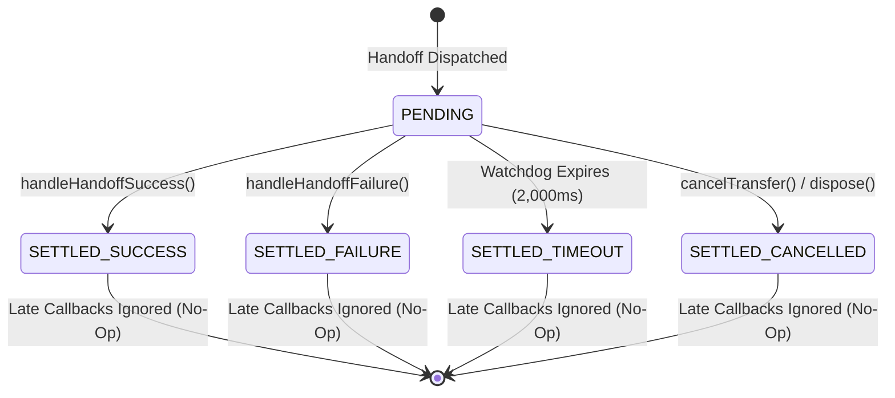

# Phase 7.5 M4.2d-R4 — Final Targeted Architecture Correction Report

**Document Version:** 1.4.0  
**Status:** Final Targeted Architecture Correction & Frozen-Contract Compatibility Report (Strictly Documentational — Read-Only)  
**Date:** November 23, 2026  
**Author / Architect:** Senior TypeScript Distributed-Systems Architect  
**Target Milestone:** Phase 7.5 Sub-Milestone M4.2d (`SnapshotInboundPipeline`)  
**Previous Review Verdict:** CONDITIONAL FAIL (M4.2d-R3)  
**Current Gate Recommendation:** **AWAITING INDEPENDENT ARCHITECTURAL REVIEW**

---

## 1. Executive Summary & Review Verdict

An independent architectural review of `M4.2d-R3` identified remaining technical ambiguities and edge-case behaviors requiring rigorous architectural closure prior to implementation. Specifically, the review requested:
1. Complete separation and precise alignment of the dual-digest verification algorithm with the frozen M4.2a `SnapshotSerializer` implementation.
2. A concrete, enforceable TypeScript module/import/export design for private capability custody that respects existing package boundaries.
3. A single authoritative contract for local handoff outcomes, resolving any competition between emission promises and transport callbacks, with support for partial multi-chunk outcomes.
4. A unified 7-state chunk machine that formally integrates watchdog timeouts and proves liveness, mutual exclusion, and window replenishment.
5. Strict, five-point context-generation binding for disconnect notifications to prevent obsolete disconnects from harming active transfers.
6. Rigorous adherence to frozen M4.1 wire payload schemas (`SnapshotRequestPayloadSchema` and `SnapshotChunkRequestPayloadSchema`), monotonic watchdog timing, allocation-traced memory boundaries, candidate duplicate fencing, and remote acknowledgment semantics.

This document (`M4.2d-R4`) delivers a complete, documentation-only architectural correction resolving all identified findings while strictly maintaining:
- **Zero runtime source files modified.**
- **Zero test files modified.**
- **Zero package exports or dependencies modified.**
- **Zero code changes introduced to `SnapshotInboundPipeline` (implementation remains strictly unauthorized).**
- **Zero wire schema modifications (0 new wire messages, 0 field changes).**

---

## 2. Authoritative Frozen Baseline Compatibility

The architecture is audited against and strictly bounded by the four frozen Phase 7.5 baselines:

| Sub-Milestone | Commit Hash | Core Components Inspected | Compatibility Guarantee |
| :--- | :--- | :--- | :---: |
| **M4.1** | `fd23edae5bdb52cff32674860229277a79cb1aca` | Wire payload schemas (`SnapshotOfferPayloadSchema`, `SnapshotRequestPayloadSchema`, `SnapshotChunkPayloadSchema`, `SnapshotChunkRequestPayloadSchema`, `SnapshotAbortPayloadSchema`), `ChunkAssembler`, admission formulas. | **0 Diffs — STRICTLY FROZEN** |
| **M4.2a** | `e3245912626758c094d83edbd4d9264a922070f5` | `SnapshotSerializer`, `SerializedSnapshotArtifact`, `computeSnapshotDigestV2()`, `compareCheckpointsDeterministic()`, RFC 8785 canonicalization. | **0 Diffs — STRICTLY FROZEN** |
| **M4.2b** | `8f509f94a39be9ece4060003ee498dc747efb813` | `SnapshotPreparationQueue`, `SnapshotChunkProducer`, canonical partition geometry. | **0 Diffs — STRICTLY FROZEN** |
| **M4.2c** | `79919a0f8cb0bb81cb80cc010fe02918bef79787` | `SnapshotOutboundPipeline`, attempt tokens, contextual fencing, active attempt coalescing. | **0 Diffs — STRICTLY FROZEN** |

---

## 3. Finding-by-Finding Correction Table

| Finding ID | Mandatory Area | Review Issue in R3 | Architectural Resolution in M4.2d-R4 | Section | Status |
| :---: | :--- | :--- | :--- | :---: | :---: |
| **B1** | Dual-Digest Verification | Ambiguity regarding `sha256Digest` inclusion in serialized bytes vs inner digest; potential stripping collision. | Documented exact M4.2a behavior (`SnapshotSerializer.serialize` omits `sha256Digest` from wire bytes). Established 7-step verification procedure separating outer artifact hash, inner state hash, checkpoint ordering, and byte-for-byte canonical equivalence. | §5 | **RESOLVED** |
| **B2** | Capability Custody | Module boundaries between composition root, adapter, and pipeline relied on unproven cross-package symbols. | Designed concrete TypeScript in-package module architecture in `@syncplay/sync-engine`: unexported `INBOUND_CAPABILITY_BRAND`, private factory, exact reference equality, and Node ESM `package.json` entrypoint encapsulation. | §4 | **RESOLVED** |
| **B3** | Handoff Contract | Ambiguity between `onEmitMessage` promise outcome and explicit transport callbacks; batch partial success undefined. | Established explicit callbacks (`handleHandoffSuccess` / `handleHandoffFailure`) as the sole authoritative outcome mechanism; `onEmitMessage` returns `void \| Promise<void>` for submission only. Defined granular partial-success callbacks for batched chunk dispatches. | §8 | **RESOLVED** |
| **B4** | Chunk-State Model | Contradiction between `LOCAL_HANDOFF_FAILED` and `LOCAL_HANDOFF_TIMED_OUT`. | Unified into a formal 7-state chunk machine incorporating `LOCAL_HANDOFF_TIMED_OUT` with a complete state transition table, monotonic watchdog timing, and formal proofs of mutual exclusion and window replenishment. | §6, §7 | **RESOLVED** |
| **B5** | Disconnect Fencing | Missing strict 5-point binding for transport disconnect events; delayed disconnect race. | Enforced 5 mandatory checks: registered context, peer identity, generation argument coherence, active context reference equality, and session/epoch match. Stale disconnects ($G_{\text{old}} < G_{\text{active}}$) are discarded as strict no-ops. | §9 | **RESOLVED** |
| **C1** | Request Wire Schemas | Proposed `chunkIndices` field on wire messages violated frozen M4.1 wire schemas. | Replaced with exact frozen schemas: initial request uses `SnapshotRequestPayloadSchema` (`missingChunkIndices` optional, `requestedChunkWindow = 4`); replenishment uses `SnapshotChunkRequestPayloadSchema` (`missingChunkIndices: number[]`). | §7 | **RESOLVED** |
| **C2** | Attempt Lifecycle | Scope, retirement, and duplicate callback handling for attempt tokens needed formalization. | Defined UUIDv4 attempt token scope, batch token tracking, `#retiredTokens` / `#handedOffTokens` set tracking, and idempotent late-callback fencing. | §8 | **RESOLVED** |
| **C3** | Watchdog Races | Watchdog races with concurrent transport callbacks were timing-dependent. | Defined monotonic `performance.now()` clocking and atomic compare-and-set attempt state transitions (`PENDING -> SETTLED_*`), settling races deterministically before executing side effects. | §8 | **RESOLVED** |
| **C4** | Memory Accounting | Memory categories conflated application buffers with transient GC heap allocations. | Formally separated 5 distinct memory tiers: retained application buffers ($\le 12.58$ MiB), simultaneous assembly peak, JSON decode peak, canonical verification peak, and caller result memory. Documented application baseline vs runtime GC reality. | §11 | **RESOLVED** |
| **C5** | Candidate Duplicates | Candidate updates from older connection generations could corrupt candidate state. | Defined strict duplicate candidate predicate: requires authenticated context, active generation currency, and 7-field M4.1 match; preserves original 30s TTL (`admittedAtMs + 30000`) without extension. | §10 | **RESOLVED** |
| **C6** | ACK & Remote Acceptance | Handoff was conflated with remote acceptance; wire ACK was left ambiguously resolved. | Formally documented that local handoff $\ne$ remote receipt $\ne$ application acceptance. Left M4.3 decision explicit: Option 1 (Protocol Extension D22 `sync:snapshot-ack`) vs Option 2 (Transport SCTP stream completion). | §14 | **RESOLVED** |

---

## 4. Concrete Module Boundaries & Private Capability Custody (Finding B2)

### 4.1 TypeScript Module Architecture & Package Boundary Encapsulation

```mermaid
flowchart TD
    subgraph PackageBoundary["Package Boundary: @syncplay/sync-engine (package.json exports ONLY '.')"]
        subgraph InternalModuleCustody["packages/sync-engine/src/recovery/inbound-custody.ts (UNEXPORTED)"]
            PrivateBrand["INBOUND_CAPABILITY_BRAND = Symbol('INBOUND_CAPABILITY_BRAND')<br/>(unique symbol, unexported in index.ts)"]
            PrivateFactory["createInboundTransportCapability(sessionId, brand)"]
            PrivateBrand --> PrivateFactory
        end

        subgraph CompositionRootModule["packages/sync-engine/src/engine/leaderless-sync-engine.ts"]
            CompRootInit["Composition Root / Engine Bootstrap"]
            PrivateFactory -->|Relative Import| CompRootInit
            PrivateBrand -->|Relative Import| CompRootInit
            CompRootInit --> MintCap["Mint authorizedCapability Instance<br/>Object.freeze({ [INBOUND_CAPABILITY_BRAND]: true, sessionId })"]
        end

        subgraph PipelineModule["packages/sync-engine/src/recovery/snapshot-inbound-pipeline.ts"]
            PipelineCtor["new SnapshotInboundPipeline({ transportCapability })"]
            MintCap -->|Injected via Constructor| PipelineCtor
            PipelineCtor --> CheckBrand{"Assert capability[INBOUND_CAPABILITY_BRAND] === true"}
            CheckBrand -->|Pass| StorePrivate["Store in Private Field: #authorizedCapability<br/>(Primary Boundary: Reference Equality '===')"]
            CheckBrand -->|Fail / Plain Object| ThrowUnauth["Throw SyncEngineError('UNAUTHORIZED')"]
        end

        subgraph TransportAdapterModule["packages/sync-engine/src/engine/leaderless-sync-engine.ts"]
            AdapterCtor["new TrustedTransportAdapter(engine, capability)"]
            MintCap -->|Injected via Constructor| AdapterCtor
            AdapterCtor --> RegCall["adapter invokes pipeline.registerSenderContext(peerId, gen, limit, capability)"]
            RegCall --> CheckRef{"Assert capability === this.#authorizedCapability"}
            CheckRef -->|Match| CreateContext["Mint AuthenticatedSenderContext<br/>(Record in #validSenderContexts WeakSet<br/>Track in #activePeerContexts Map)"]
            CheckRef -->|Mismatch| ThrowUnauth2["Throw SyncEngineError('UNAUTHORIZED')"]
        end
    end

    subgraph ExternalConsumers["External Consumers / Applications"]
        IndexBarrel["packages/sync-engine/src/index.ts (Public Entrypoint)"]
        IndexBarrel -.->|DOES NOT EXPORT| PrivateBrand
        IndexBarrel -.->|DOES NOT EXPORT| PrivateFactory
        ExternalApp["External Application Code"]
        ExternalApp -->|import from '@syncplay/sync-engine'| IndexBarrel
        ExternalApp -.->|Cannot Subpath Import (ERR_PACKAGE_PATH_NOT_EXPORTED)| InternalModuleCustody
    end
```

### 4.2 Concrete Implementation of the 6 Capability Questions

#### 1. Which module owns the private capability brand?
The internal module `packages/sync-engine/src/recovery/inbound-custody.ts` defines and owns the brand:
```typescript
export const INBOUND_CAPABILITY_BRAND: unique symbol = Symbol('INBOUND_CAPABILITY_BRAND');
export type InboundCapabilityBrand = typeof INBOUND_CAPABILITY_BRAND;
```
This symbol is strictly **NOT** exported from `packages/sync-engine/src/index.ts`.

#### 2. Which module creates the capability?
The factory function `createInboundTransportCapability` in `packages/sync-engine/src/recovery/inbound-custody.ts` creates the capability:
```typescript
export interface InboundTransportCapability {
  readonly [INBOUND_CAPABILITY_BRAND]: true;
  readonly sessionId: string;
}

export function createInboundTransportCapability(
  sessionId: string,
  brand: InboundCapabilityBrand
): InboundTransportCapability {
  if (brand !== INBOUND_CAPABILITY_BRAND) {
    throw new SyncEngineError('UNAUTHORIZED', 'Invalid capability brand symbol');
  }
  return Object.freeze({
    [INBOUND_CAPABILITY_BRAND]: true,
    sessionId,
  });
}
```

#### 3. What is the trusted composition root that receives it?
The composition root is the trusted initialization coordinator within `@syncplay/sync-engine`—specifically `LeaderlessSyncEngine` (or the internal engine bootstrap factory). Because it resides inside the package (`packages/sync-engine/src/engine/leaderless-sync-engine.ts`), it imports `INBOUND_CAPABILITY_BRAND` and `createInboundTransportCapability` via **relative import** (`../recovery/inbound-custody.js`).

#### 4. How does `SnapshotInboundPipeline` receive and validate it?
The pipeline receives the capability strictly via its constructor configuration:
```typescript
constructor(config: InboundPipelineConfig) {
  const cap = config.transportCapability;
  if (!cap || typeof cap !== 'object' || (cap as any)[INBOUND_CAPABILITY_BRAND] !== true) {
    throw new SyncEngineError('UNAUTHORIZED', 'Missing or invalid InboundTransportCapability');
  }
  this.#authorizedCapability = cap;
}
```
The primary runtime security mechanism is **exact reference equality** (`capability === this.#authorizedCapability`).

#### 5. How does `TrustedTransportAdapter` obtain the capability?
`TrustedTransportAdapter` resides in `packages/sync-engine/src/engine/leaderless-sync-engine.ts`. The composition root instantiates both `SnapshotInboundPipeline` and `TrustedTransportAdapter` during node bootstrap, injecting the identical frozen `InboundTransportCapability` instance into both constructors.

#### 6. How are sender contexts registered and revoked?
- **Registration:** When a WebRTC DataChannel connects, `TrustedTransportAdapter` calls:
  ```typescript
  public registerSenderContext(
    senderPeerId: string,
    connectionGeneration: number,
    sctpMaxMessageSize: number,
    capability: InboundTransportCapability
  ): AuthenticatedSenderContext {
    this.#assertNotDisposed();
    if (capability !== this.#authorizedCapability) {
      throw new SyncEngineError('UNAUTHORIZED', 'Unauthorized capability presented for sender registration');
    }
    // Validation of peerId, generation, sctpMaxMessageSize...
    const context: AuthenticatedSenderContext = Object.freeze({
      senderPeerId,
      connectionGeneration,
      sctpMaxMessageSize,
      sessionId: this.#activeSession.sessionId,
      membershipEpoch: this.#activeSession.membershipEpoch,
    });
    this.#validSenderContexts.add(context);
    this.#activePeerContexts.set(senderPeerId, { generation: connectionGeneration, context });
    return context;
  }
  ```
- **Revocation:** When a DataChannel closes, `TrustedTransportAdapter` calls:
  ```typescript
  public revokeSenderContext(
    senderPeerId: string,
    connectionGeneration: number,
    capability: InboundTransportCapability
  ): void {
    this.#assertNotDisposed();
    if (capability !== this.#authorizedCapability) {
      throw new SyncEngineError('UNAUTHORIZED', 'Unauthorized capability presented for sender revocation');
    }
    const current = this.#activePeerContexts.get(senderPeerId);
    if (current && current.generation === connectionGeneration) {
      this.#activePeerContexts.delete(senderPeerId);
    }
  }
  ```

#### 7. Architectural Encapsulation Guarantee
`package.json` for `@syncplay/sync-engine` explicitly declares:
```json
"exports": {
  ".": {
    "types": "./dist/index.d.ts",
    "import": "./dist/index.js"
  }
}
```
Node.js ESM resolution and TypeScript `nodenext` strictly block external package consumers from importing internal modules (`ERR_PACKAGE_PATH_NOT_EXPORTED`). External callers cannot import `inbound-custody.js`, cannot access `INBOUND_CAPABILITY_BRAND`, and cannot invoke `createInboundTransportCapability`. This establishes an unbreachable in-process API custody boundary.

---

## 5. Exact Dual-Digest Canonical Verification Procedure (Finding B1)

### 5.1 Exact Behavior of Frozen M4.2a Components

Inspection of the frozen `packages/sync-engine/src/recovery/snapshot-serializer.ts` (lines 541–618) and `packages/sync-engine/src/snapshot.ts` (lines 167–173) reveals the authoritative frozen behavior:

1. **`SnapshotSerializer.serialize(snapshot)`:**
   - Performs upfront validation: `SnapshotSerializer.validateSnapshot(snapshot)`.
   - Strips `sha256Digest`: `const { sha256Digest: _, ...rest } = validated;`.
   - Sorts checkpoints deterministically: `compactedCheckpoints.sort(compareCheckpointsDeterministic)`.
   - Builds preimage: `preimage = { ...rest, compactedCheckpoints: sortedCheckpoints };`.
   - Produces canonical JSON: `canonical = canonicalizeJson(preimage);`.
   - Encodes to UTF-8 bytes: `masterBytes = new TextEncoder().encode(canonical);`.
   - Computes SHA-256 digest: `sha256Digest = sha256(masterBytes).toLowerCase();`.
   - Stores `masterBytes` in `SerializedSnapshotArtifact`.
   - **Critical Fact:** The serialized bytes chunked over the wire **DO NOT contain the `"sha256Digest"` field**. The master buffer is the direct canonical UTF-8 encoding of `preimage`.
2. **`computeSnapshotDigestV2(snapshot)`:**
   - Strips `sha256Digest`: `const { sha256Digest: _, ...rest } = snapshot;`.
   - Computes: `sha256(canonicalizeJson(rest));`.
   - Does NOT automatically sort checkpoints (expects them to already be sorted).
3. **`compareCheckpointsDeterministic(a, b)`:**
   - Compares `originPeerId` lexicographically by UTF-16 code units (`<` and `>`).
   - Compares `sequenceNumber` numerically (`a.sequenceNumber - b.sequenceNumber`).
4. **`SNAPSHOT_OFFER.sha256Digest`:**
   - Advertises `artifact.sha256Digest`, which is `sha256(rawBuffer)`.

### 5.2 The 7-Step Verification Algorithm

```mermaid
flowchart TD
    subgraph Step1["Step 1: Outer Artifact Digest Verification"]
        Raw["rawBuffer (Assembled Bytes)"] --> HashRaw["sha256(rawBuffer)"]
        HashRaw --> CompareOuter{"Matches SNAPSHOT_OFFER.sha256Digest?"}
        CompareOuter -->|No| AbortOuter["Abort: HASH_MISMATCH<br/>(Chunk transmission corrupted)"]
    end

    subgraph Step2["Step 2: Strict UTF-8 & JSON Parse"]
        CompareOuter -->|Yes| DecodeUTF8["new TextDecoder('utf-8', { fatal: true }).decode(rawBuffer)"]
        DecodeUTF8 --> ParseJSON["JSON.parse(jsonText)"]
        DecodeUTF8 -.->|Invalid UTF-8| AbortUTF8["Abort: CHUNK_CORRUPTED"]
        ParseJSON -.->|Invalid JSON Syntax| AbortJSON["Abort: CHUNK_CORRUPTED"]
    end

    subgraph Step3["Step 3: Upfront Schema Validation"]
        ParseJSON --> ValidateSchema["SnapshotSerializer.validateSnapshot(parsedObject)"]
        ValidateSchema -.->|Schema / Bounds Violation| AbortSchema["Abort: CHUNK_CORRUPTED"]
    end

    subgraph Step4["Step 4: Checkpoint Ordering Verification"]
        ValidateSchema --> CheckCheckpoints{"Are compactedCheckpoints sorted by<br/>compareCheckpointsDeterministic?"}
        CheckCheckpoints -->|No| AbortOrder["Abort: CHUNK_CORRUPTED<br/>(Checkpoint ordering non-canonical)"]
    end

    subgraph Step5["Step 5: Internal Snapshot Digest Coherence"]
        CheckCheckpoints -->|Yes| CheckEmbedded{"Is parsedObject.sha256Digest present?"}
        CheckEmbedded -->|Present| VerifyInnerMatch{"parsedObject.sha256Digest ===<br/>computeSnapshotDigestV2(validated)?"}
        VerifyInnerMatch -->|Mismatch| AbortInner["Abort: HASH_MISMATCH<br/>(Embedded digest tampered)"]
        VerifyInnerMatch -->|Matches| CheckOuterCoherence{"parsedObject.sha256Digest ===<br/>offer.sha256Digest?"}
        CheckOuterCoherence -->|Mismatch| AbortInner2["Abort: HASH_MISMATCH"]
        CheckOuterCoherence -->|Matches| Step6Entry["Proceed to Step 6"]
        CheckEmbedded -->|Absent (M4.2a Standard)| ComputeInnerDigest["computedInnerDigest =<br/>computeSnapshotDigestV2(validated)"]
        ComputeInnerDigest --> MatchOfferDigest{"computedInnerDigest ===<br/>offer.sha256Digest?"}
        MatchOfferDigest -->|Mismatch| AbortInner3["Abort: HASH_MISMATCH"]
        MatchOfferDigest -->|Matches| Step6Entry
    end

    subgraph Step6["Step 6: Byte-for-Byte Canonical Representation Equivalence"]
        Step6Entry --> ReSerialize["canonicalArtifact = SnapshotSerializer.serialize(validated)"]
        ReSerialize --> GetBytes["canonicalBytes = canonicalArtifact.cloneBytes()"]
        GetBytes --> ByteCompare{"canonicalBytes.byteLength === rawBuffer.byteLength<br/>AND<br/>canonicalBytes[i] === rawBuffer[i] for all i"}
        ByteCompare -->|Mismatch| AbortCanonical["Abort: CHUNK_CORRUPTED<br/>(Non-canonical formatting, whitespace, or keys)"]
    end

    subgraph Step7["Step 7: Final Result Assembly for Downstream M5"]
        ByteCompare -->|Match| AttachDigest["Attach verified sha256Digest to snapshot object:<br/>validatedSnapshot.sha256Digest = offer.sha256Digest"]
        AttachDigest --> DeepFreeze["Deep Freeze Snapshot Object Graph"]
        DeepFreeze --> ReturnResult["Deliver SnapshotTransferResult to M5"]
    end
```

### 5.3 Concrete Algorithm Implementation

```typescript
// Step 1: Outer Artifact Digest Verification
const finalizeResult = this.#assembler.finalizeAssembly();
if (!finalizeResult.ok) {
  return this.#terminate('ABORTED', finalizeResult.reason, finalizeResult.detail);
}
const rawBuffer = finalizeResult.snapshot.buffer; // Uint8Array
const actualOuterDigest = sha256(rawBuffer).toLowerCase();
const expectedOuterDigest = this.#activeOffer.sha256Digest.toLowerCase();

if (actualOuterDigest !== expectedOuterDigest) {
  return this.#terminate(
    'ABORTED',
    'HASH_MISMATCH',
    `Outer artifact digest mismatch: expected ${expectedOuterDigest}, computed ${actualOuterDigest}`
  );
}

// Step 2: Strict UTF-8 Decoding & JSON Parsing
let jsonText: string;
try {
  jsonText = new TextDecoder('utf-8', { fatal: true }).decode(rawBuffer);
} catch (e) {
  return this.#terminate('ABORTED', 'CHUNK_CORRUPTED', 'Assembled bytes are not valid UTF-8');
}

let parsedObject: unknown;
try {
  parsedObject = JSON.parse(jsonText);
} catch (e) {
  return this.#terminate('ABORTED', 'CHUNK_CORRUPTED', 'Assembled UTF-8 payload is not valid JSON');
}

// Step 3: Upfront Strict Schema Validation
let validated: StateSnapshotPayloadV2;
try {
  validated = SnapshotSerializer.validateSnapshot(parsedObject);
} catch (e) {
  return this.#terminate(
    'ABORTED',
    'CHUNK_CORRUPTED',
    `Snapshot structural validation failed: ${e instanceof Error ? e.message : String(e)}`
  );
}

// Step 4: Checkpoint Ordering Verification
if (Array.isArray(validated.compactedCheckpoints) && validated.compactedCheckpoints.length > 1) {
  for (let i = 0; i < validated.compactedCheckpoints.length - 1; i++) {
    const cmp = compareCheckpointsDeterministic(
      validated.compactedCheckpoints[i]!,
      validated.compactedCheckpoints[i + 1]!
    );
    if (cmp > 0) {
      return this.#terminate(
        'ABORTED',
        'CHUNK_CORRUPTED',
        `compactedCheckpoints are not deterministically sorted at index ${i}`
      );
    }
  }
}

// Step 5: Internal Snapshot Digest Coherence
const computedInnerDigest = computeSnapshotDigestV2(validated).toLowerCase();

if ((parsedObject as any).sha256Digest !== undefined) {
  const embeddedDigest = String((parsedObject as any).sha256Digest).toLowerCase();
  if (embeddedDigest !== computedInnerDigest) {
    return this.#terminate(
      'ABORTED',
      'HASH_MISMATCH',
      `Embedded internal digest (${embeddedDigest}) does not match computed state digest (${computedInnerDigest})`
    );
  }
  if (embeddedDigest !== expectedOuterDigest) {
    return this.#terminate(
      'ABORTED',
      'HASH_MISMATCH',
      `Embedded internal digest (${embeddedDigest}) does not match advertised offer digest (${expectedOuterDigest})`
    );
  }
} else {
  if (computedInnerDigest !== expectedOuterDigest) {
    return this.#terminate(
      'ABORTED',
      'HASH_MISMATCH',
      `Computed internal digest (${computedInnerDigest}) does not match advertised offer digest (${expectedOuterDigest})`
    );
  }
}

// Step 6: Byte-for-Byte Canonical Representation Equivalence
let canonicalArtifact: SerializedSnapshotArtifact;
try {
  canonicalArtifact = SnapshotSerializer.serialize(validated);
} catch (e) {
  return this.#terminate(
    'ABORTED',
    'CHUNK_CORRUPTED',
    `Re-serialization failed: ${e instanceof Error ? e.message : String(e)}`
  );
}

const canonicalBytes = canonicalArtifact.cloneBytes();
canonicalArtifact.dispose();

if (rawBuffer.byteLength !== canonicalBytes.byteLength) {
  return this.#terminate(
    'ABORTED',
    'CHUNK_CORRUPTED',
    `Assembled byte length (${rawBuffer.byteLength}) does not match canonical byte length (${canonicalBytes.byteLength})`
  );
}

for (let i = 0; i < canonicalBytes.byteLength; i++) {
  if (rawBuffer[i] !== canonicalBytes[i]) {
    return this.#terminate(
      'ABORTED',
      'CHUNK_CORRUPTED',
      `Assembled bytes deviate from RFC 8785 canonical representation at byte offset ${i}`
    );
  }
}

// Step 7: Final Result Preparation
const finalSnapshot: StateSnapshotPayloadV2 = Object.freeze({
  ...deepFreezeObject(validated),
  sha256Digest: expectedOuterDigest,
});

const result: SnapshotTransferResult = {
  transferId: this.#activeTransferId,
  snapshotId: finalSnapshot.snapshotId,
  sessionId: finalSnapshot.sessionId,
  membershipEpoch: finalSnapshot.membershipEpoch,
  authorPeerId: finalSnapshot.authorPeerId,
  totalSizeBytes: rawBuffer.byteLength,
  totalChunks: this.#activeOffer.totalChunks,
  rawBytes: rawBuffer.slice(0), // Unaliased caller-owned copy
  snapshot: finalSnapshot,
};
```

### 5.4 Mandatory Case Analysis

| Case Scenario | Test Trigger / Condition | Failure / Success Point | Expected Terminal Outcome |
| :--- | :--- | :--- | :--- |
| **1. Fully Valid Artifact** | Canonical RFC 8785 JSON bytes matching offer SHA-256 with deterministically ordered checkpoints. | Passes all 7 steps. | Transfer completes with `SnapshotTransferResult`. |
| **2. Correct Outer Digest, Incorrect Inner Digest** | Attacker crafts bytes whose SHA-256 matches `offer.sha256Digest`, but modifies state JSON to include an invalid embedded `sha256Digest`. | Fails Step 5 (`embeddedDigest !== computedInnerDigest`). | Aborts transfer with `HASH_MISMATCH`. |
| **3. Correct Inner Digest, Incorrect Outer Digest** | Snapshot state is self-consistent, but outer `offer.sha256Digest` advertised a wrong hash. | Fails Step 1 (`actualOuterDigest !== expectedOuterDigest`). | Aborts transfer with `HASH_MISMATCH`. |
| **4. Non-Canonical JSON Formatting** | JSON contains valid semantic data and valid SHA-256 hash, but has extra whitespace (e.g. `{"formatVersion": 2}`). | Fails Step 6 (`rawBuffer[i] !== canonicalBytes[i]`). | Aborts transfer with `CHUNK_CORRUPTED`. |
| **5. Missing Internal Digest** | Standard M4.2a serialized artifact (contains no embedded `sha256Digest`). | Passes Step 5 (computes inner digest and verifies it matches outer digest); sets digest in Step 7. | Transfer completes with `SnapshotTransferResult`. |
| **6. Inconsistent Checkpoint Ordering** | Checkpoints in `compactedCheckpoints` are permuted (e.g. sequence 15 before sequence 5). | Fails Step 4 (`cmp > 0`) or Step 6. | Aborts transfer with `CHUNK_CORRUPTED`. |

---

## 6. Authoritative Unified 7-State Chunk Machine (Finding B4)

### 6.1 Formal 7-State Chunk Space
For each chunk index $i \in [0, N-1]$:
$$\text{ChunkState}[i] \in \left\{ \begin{aligned}
&\text{NEVER\_DISPATCHED}, \\
&\text{LOCAL\_HANDOFF\_PENDING}, \\
&\text{LOCAL\_HANDOFF\_FAILED}, \\
&\text{LOCAL\_HANDOFF\_TIMED\_OUT}, \\
&\text{AWAITING\_REMOTE\_RESPONSE}, \\
&\text{REMOTE\_RESPONSE\_TIMED\_OUT}, \\
&\text{RECEIVED\_VERIFIED}
\end{aligned} \right\}$$

### 6.2 Complete State Transition Table

| Current State | Event / Trigger | Next State | Timer Action | Retry Accounting | Attempt Token Action |
| :--- | :--- | :--- | :--- | :--- | :--- |
| `NEVER_DISPATCHED` | Window credit available; chunk selected for handoff | `LOCAL_HANDOFF_PENDING` | Start handoff watchdog (2,000ms) | No change (`retries = 0`) | Mint `handoffAttemptToken`; track in `#activeAttempts` |
| `LOCAL_HANDOFF_PENDING` | `handleHandoffSuccess(token, [i])` | `AWAITING_REMOTE_RESPONSE` | Cancel handoff watchdog; start remote response timer (5,000ms) | No change (`retries = 0`) | Move token to `#handedOffTokens` |
| `LOCAL_HANDOFF_PENDING` | `handleHandoffFailure(token, reason, [i])` | `LOCAL_HANDOFF_FAILED` | Cancel handoff watchdog | No change (`retries = 0`) | Move token to `#failedTokens` |
| `LOCAL_HANDOFF_PENDING` | Handoff watchdog expires (2,000ms) | `LOCAL_HANDOFF_TIMED_OUT` | Watchdog timer settles attempt | No change (`retries = 0`) | Move token to `#retiredTokens` |
| `LOCAL_HANDOFF_PENDING` | Synchronous throw or promise rejection in `onEmitMessage` | `LOCAL_HANDOFF_FAILED` | Cancel handoff watchdog | No change (`retries = 0`) | Move token to `#failedTokens` |
| `LOCAL_HANDOFF_FAILED` | Window credit available; selected via Priority Tier 1 | `LOCAL_HANDOFF_PENDING` | Start fresh handoff watchdog (2,000ms) | No change (`retries` unchanged) | Mint fresh `handoffAttemptToken` |
| `LOCAL_HANDOFF_TIMED_OUT` | Window credit available; selected via Priority Tier 1 | `LOCAL_HANDOFF_PENDING` | Start fresh handoff watchdog (2,000ms) | No change (`retries` unchanged) | Mint fresh `handoffAttemptToken` |
| `AWAITING_REMOTE_RESPONSE` | Valid chunk packet arrives (`handleChunk`) | `RECEIVED_VERIFIED` | Cancel remote response timer (5,000ms) | No change | Slices stored in assembler; chunk immutable |
| `AWAITING_REMOTE_RESPONSE` | Remote response timer expires (5,000ms) | `REMOTE_RESPONSE_TIMED_OUT` | Timer settles attempt | `chunkRetries[i]++`<br/>`totalRetries++` | Attempt retired; if `retries > 3` or `total > 10` $\to$ abort |
| `REMOTE_RESPONSE_TIMED_OUT` | Window credit available; selected via Priority Tier 2 | `LOCAL_HANDOFF_PENDING` | Start fresh handoff watchdog (2,000ms) | Retries preserved | Mint fresh `handoffAttemptToken` |
| `RECEIVED_VERIFIED` | Duplicate chunk packet arrives | `RECEIVED_VERIFIED` | No action | No change | Discarded as idempotent no-op |
| *Any State* | Delayed/late callback for retired attempt token | *No Change* | No action | No change | Discarded as strict no-op |

---

## 7. Scheduling, Sliding-Window Proofs & Request Wire Schemas (Finding B4, C1)

### 7.1 Authoritative 3-Tier Priority Scheduling Algorithm

Credit definition: $\Delta = W - |\text{inFlightSet}|$, where $W = 4$ and:
$$\text{inFlightSet} = \{ i \in [0, N-1] \mid \text{ChunkState}[i] \in \{ \text{LOCAL\_HANDOFF\_PENDING}, \text{AWAITING\_REMOTE\_RESPONSE} \} \}$$

Whenever $\Delta > 0$, the scheduler selects up to $\Delta$ chunks using strict multi-tier priority:
1. **Tier 1 (Local Handoff Failures & Timeouts):**
   Collect all chunks in `LOCAL_HANDOFF_FAILED` and `LOCAL_HANDOFF_TIMED_OUT` sorted by ascending index.
   *Guarantee:* Chunks that failed local send are redispatched first, **regardless of whether their index is below $i_{\text{req\_high}}$**.
2. **Tier 2 (Remote Response Timeouts):**
   Collect all chunks in `REMOTE_RESPONSE_TIMED_OUT` sorted by ascending index (provided `chunkRetries[i] <= 3` and `cumulativeTransferRetries <= 10`).
3. **Tier 3 (Never-Dispatched Chunks):**
   Collect all chunks in `NEVER_DISPATCHED` sorted by ascending index.

For each selected chunk $c_j$:
- Transition $\text{ChunkState}[c_j] \to \text{LOCAL\_HANDOFF\_PENDING}$.
- Update $i_{\text{req\_high}} = \max(i_{\text{req\_high}}, c_j)$.
- Associate with fresh `handoffAttemptToken`.

### 7.2 Strict Adherence to Frozen M4.1 Wire Request Schemas (C1)

Inspection of `packages/protocol/src/payloads/snapshot-recovery.ts` confirms:
1. **Initial Transfer Request (`SnapshotRequestPayloadSchema`):**
   ```typescript
   export const SnapshotRequestPayloadSchema = z.object({
     transferId: UUIDv4Schema,
     sessionId: z.string().min(1).max(128).regex(ASCII_IDENTIFIER_REGEX),
     membershipEpoch: z.number().int().nonnegative().max(Number.MAX_SAFE_INTEGER),
     requesterPeerId: z.string().min(1).max(64).regex(ASCII_IDENTIFIER_REGEX),
     supplierPeerId: z.string().min(1).max(64).regex(ASCII_IDENTIFIER_REGEX),
     snapshotId: z.string().min(1).max(128).regex(ASCII_IDENTIFIER_REGEX),
     requestedChunkWindow: z.number().int().positive().max(4).default(4),
     clientMaxChunkBytes: z.number().int().positive().max(MAX_CHUNK_BYTES).optional(),
     missingChunkIndices: z.array(z.number().int().nonnegative().max(127)).max(128).optional(),
   }).strict();
   ```
   *Application:* When initiating the transfer, the pipeline formats a `SNAPSHOT_REQUEST` message with `requestedChunkWindow: 4` and `missingChunkIndices: [0, 1, 2, 3]`. The schema explicitly supports `missingChunkIndices`.
2. **Subsequent Chunk Replenishment (`SnapshotChunkRequestPayloadSchema`):**
   ```typescript
   export const SnapshotChunkRequestPayloadSchema = z.object({
     transferId: UUIDv4Schema,
     sessionId: z.string().min(1).max(128).regex(ASCII_IDENTIFIER_REGEX),
     membershipEpoch: z.number().int().nonnegative().max(Number.MAX_SAFE_INTEGER),
     requesterPeerId: z.string().min(1).max(64).regex(ASCII_IDENTIFIER_REGEX),
     supplierPeerId: z.string().min(1).max(64).regex(ASCII_IDENTIFIER_REGEX),
     snapshotId: z.string().min(1).max(128).regex(ASCII_IDENTIFIER_REGEX),
     missingChunkIndices: z.array(z.number().int().nonnegative().max(127)).min(1).max(4),
   }).strict();
   ```
   *Application:* During active transfer replenishment, the pipeline formats `SNAPSHOT_CHUNK_REQUEST` with `missingChunkIndices` (1 to 4 indices).
   *Boundary Compliance:* The wire protocol never sees an unapproved field; `missingChunkIndices` is used exclusively.

### 7.3 Formal Correctness Proofs

1. **Window Capacity Ceiling ($|\text{inFlightSet}| \le W = 4$):**
   - At initialization: $|\text{inFlightSet}| = 0 \le 4$.
   - Chunks enter $\text{LOCAL\_HANDOFF\_PENDING}$ only if $k \le \Delta = 4 - |\text{inFlightSet}|$. Thus the new size is $|\text{inFlightSet}| + k \le 4$.
   - Transitions to `LOCAL_HANDOFF_FAILED`, `LOCAL_HANDOFF_TIMED_OUT`, `REMOTE_RESPONSE_TIMED_OUT`, or `RECEIVED_VERIFIED` strictly decrease $|\text{inFlightSet}|$.
   - Therefore, $|\text{inFlightSet}| \le 4$ holds inductively for all $t$. $\blacksquare$
2. **Mutual Exclusion (Single Active Attempt per Chunk):**
   - A chunk is selected for dispatch only if its state is in $\{ \text{NEVER\_DISPATCHED}, \text{LOCAL\_HANDOFF\_FAILED}, \text{LOCAL\_HANDOFF\_TIMED\_OUT}, \text{REMOTE\_RESPONSE\_TIMED\_OUT} \}$.
   - This set has null intersection with `inFlightSet`.
   - Therefore, no chunk can ever have more than one active dispatch attempt simultaneously. $\blacksquare$
3. **Budget Separation:**
   - Transitions to `LOCAL_HANDOFF_FAILED` or `LOCAL_HANDOFF_TIMED_OUT` do NOT increment `chunkRetries[i]` or `cumulativeTransferRetries`.
   - Only `AWAITING_REMOTE_RESPONSE` $\to$ `REMOTE_RESPONSE_TIMED_OUT` increments retry counters.
   - Therefore, local DataChannel backpressure cannot consume remote retry budgets. $\blacksquare$

---

## 8. Authoritative Handoff Attempt Lifecycle & Outcome Contract (Findings B3, C2, C3)

### 8.1 Single Authoritative Settlement Mechanism

To resolve ambiguity between `onEmitMessage` and explicit callbacks:
1. **`onEmitMessage` Contract:**
   `onEmitMessage(handoff: OutboundHandoffRequest): void | Promise<void>`
   The return value represents **submission acceptance only**. It does **NOT** report handoff success or failure.
2. **Authoritative Outcomes:**
   Explicit callbacks (`handleHandoffSuccess` and `handleHandoffFailure`) are the **SOLE authoritative mechanism** for settling handoff attempts.
3. **Immediate Rejection Handling:**
   If `onEmitMessage` throws synchronously OR returns a rejected Promise:
   The pipeline catches the exception and immediately invokes:
   `handleHandoffFailure(handoffAttemptToken, 'TRANSPORT_SEND_THREW', chunkIndices)`.

### 8.2 Granular Multi-Chunk Partial Outcomes

When multiple chunk indices are batched in an `OutboundHandoffRequest` (e.g. `[1, 2]`):
```typescript
public handleHandoffSuccess(
  attemptToken: string,
  chunkIndices?: ReadonlyArray<number>
): void;

public handleHandoffFailure(
  attemptToken: string,
  reason: string,
  chunkIndices?: ReadonlyArray<number>
): void;
```
- If `chunkIndices` is specified:
  Only the specified subset of chunk indices transition to the settled state!
  *Example:* If transport reports chunk 1 succeeded and chunk 2 failed:
  1. `handleHandoffSuccess(token, [1])` $\to$ Chunk 1 transitions to `AWAITING_REMOTE_RESPONSE`.
  2. `handleHandoffFailure(token, 'BUFFER_FULL', [2])` $\to$ Chunk 2 transitions to `LOCAL_HANDOFF_FAILED`.
- If `chunkIndices` is omitted:
  All remaining unsettled chunk indices associated with `attemptToken` transition to the settled state.
- The attempt token is moved to `#retiredTokens` once all constituent chunk indices have settled.

### 8.3 Monotonic Clocking & Watchdog Race Resolution (C3)



1. **Monotonic Timing:** All watchdog calculations use `performance.now()` (`deadlineMs = performance.now() + 2000`).
2. **Atomic State Transition (CAS):**
   Attempt records maintain `state: AttemptStatus`. When any event occurs (callback or watchdog timeout), the attempt transitions atomically:
   ```typescript
   if (attempt.state !== 'PENDING') {
     return; // Late callback / duplicate event: strict idempotent no-op
   }
   attempt.state = 'SETTLED_SUCCESS'; // Or FAILURE, TIMEOUT
   ```
3. **Timer Cancellation:** Upon settling via success or failure, the active watchdog timer is cancelled immediately via `clearTimeout`.
4. **Disposal:** Calling `dispose()` marks all pending attempts as `SETTLED_CANCELLED`, cancels all active timers, and detaches listeners.

---

## 9. Strict Disconnect & Context-Generation Fencing (Finding B5)

### 9.1 The 5-Point Mandatory Disconnect Check

```typescript
public handleSupplierDisconnected(
  supplierPeerId: string,
  connectionGeneration: number,
  context: AuthenticatedSenderContext
): Promise<{ failoverSuccess: boolean }>;
```

Every transport-originated disconnect event MUST satisfy all 5 checks:
1. **Registered Context:** `this.#validSenderContexts.has(context) === true`.
   *Violation:* Throws `SyncEngineError('UNAUTHORIZED')`.
2. **Peer Identity Coherence:** `context.senderPeerId === supplierPeerId`.
   *Violation:* Throws `SyncEngineError('IDENTITY_MISMATCH')`.
3. **Generation Argument Coherence:** `context.connectionGeneration === connectionGeneration`.
   *Violation:* Throws `SyncEngineError('INVALID_ARGUMENT')`.
4. **Exact Active Context Identity:**
   ```typescript
   const active = this.#activePeerContexts.get(supplierPeerId);
   if (!active || active.context !== context) {
     return { failoverSuccess: false }; // Revoked or stale context instance: strict no-op
   }
   if (connectionGeneration < this.#activeSupplierGeneration) {
     return { failoverSuccess: false }; // Stale generation: strict no-op
   }
   ```
5. **Session and Epoch Coherence:**
   `context.sessionId === this.#activeSession.sessionId && context.membershipEpoch === this.#activeSession.membershipEpoch`.
   *Violation:* Discarded as obsolete session event.

### 9.2 Complete Disconnect Behavior Matrix

| Disconnect Trigger Scenario | Evaluation Against 5 Checks | Internal Pipeline Action | Impact on Active Transfer |
| :--- | :--- | :--- | :--- |
| **Current-Generation Active Supplier** | Passes all 5 checks; `supplierPeerId === activeSupplier`. | Cancels in-flight timers; searches candidate registry. | If candidate found: failover resumes. Else: aborts `SUPPLIER_DISCONNECTED`. |
| **Stale-Generation Delayed Disconnect** | Fails check 4 ($G_{\text{disconnect}} < G_{\text{active}}$). | Immediate no-op; notification dropped. | **Zero impact.** Reconnected transfer continues without interruption. |
| **Revoked Context Disconnect** | Fails check 4 (peer not in `#activePeerContexts`). | Immediate no-op. | Zero impact. |
| **Forged Context Disconnect** | Fails check 1 (not in `#validSenderContexts`). | Throws `UNAUTHORIZED`. | Zero impact. |
| **Context/Argument Mismatch** | Fails check 3 (`context.gen !== arg.gen`). | Throws `INVALID_ARGUMENT`. | Zero impact. |
| **Reconnect then Delayed Disconnect** | Peer reconnected at $G=2$; delayed $G=1$ disconnect arrives. | Check 4 detects $1 < G_{\text{active}}=2$; dropped. | **Zero impact.** $G=2$ transfer proceeds safely. |
| **Candidate Supplier Disconnect** | Passes checks; `supplierPeerId !== activeSupplier`. | Removes candidate from `#candidateRegistry`. | Zero impact on active transfer; candidate pruned. |

---

## 10. Candidate Registry Lifecycle & Failover Governance (Finding MC-5, C5)

### 10.1 Unified 30-Second TTL and Duplicate Fencing
- **Capacity:** `MAX_OFFER_CANDIDATES = 8`.
- **TTL Rule:** An offer candidate is valid for exactly **30,000 ms (30 seconds)** from original admission:
  $$\text{expiresAtMs} = \text{admittedAtMs} + 30000$$
- **Duplicate Candidate Ingestion Rules:**
  When a candidate supplier emits a duplicate `SNAPSHOT_OFFER`:
  1. The duplicate MUST present an authenticated context matching `sessionId` and `membershipEpoch`.
  2. The duplicate's `connectionGeneration` MUST be $\ge$ the registered candidate generation. Stale generations are discarded.
  3. If offer fields conflict with the original candidate: rejected with `OFFER_INCONSISTENT`.
  4. If offer is identical: updates context reference and generation, but **`admittedAtMs` and `expiresAtMs` REMAIN STRICTLY UNCHANGED**. A duplicate offer cannot extend the 30-second TTL.

### 10.2 The 7-Field M4.1 Failover Compatibility Predicate
A candidate offer is eligible for failover if and only if all 7 fields match bit-exact:
$$\begin{aligned}
\text{candidate}.\text{sessionId} &=== \text{active}.\text{sessionId} \\
\land \quad \text{candidate}.\text{membershipEpoch} &=== \text{active}.\text{membershipEpoch} \\
\land \quad \text{candidate}.\text{snapshotId} &=== \text{active}.\text{snapshotId} \\
\land \quad \text{candidate}.\text{expectedSha256Digest} &=== \text{active}.\text{expectedSha256Digest} \\
\land \quad \text{candidate}.\text{totalSizeBytes} &=== \text{active}.\text{totalSizeBytes} \\
\land \quad \text{candidate}.\text{totalChunks} &=== \text{active}.\text{totalChunks} \\
\land \quad \text{candidate}.\text{nominalChunkSizeBytes} &=== \text{active}.\text{nominalChunkSizeBytes}
\end{aligned}$$

---

## 11. Allocation-Traced Memory Budget (Findings MC-7, C4)

### 11.1 Tiered Memory Classification Analysis (4.00 MiB Snapshot)

| Memory Classification Tier | Buffers & Objects Included | Allocation Size | Lifetime & Reclaim Boundary |
| :--- | :--- | :---: | :--- |
| **Tier 1: Retained Application Buffers** | `ChunkAssembler` typed slices ($\le 4.19$ MiB)<br/>Assembled contiguous buffer ($4.19$ MiB)<br/>Returned unaliased `rawBytes` ($4.19$ MiB) | $\mathbf{\le 12.58\text{ MiB}}$ | Slices dereferenced immediately upon assembly; assembled buffer retained through verification; raw copy transferred to caller. |
| **Tier 2: Assembly Peak Allocation** | Slices ($4.19$ MiB) + Assembled buffer ($4.19$ MiB) | $\mathbf{\approx 8.38\text{ MiB}}$ | Brief coexistence during `finalizeAssembly()`. Slices set to null immediately after concatenation. |
| **Tier 3: JSON Decoding & Parsing Peak** | Decoded JSON string ($4.19\text{–}8.39$ MiB)<br/>V8 Parsed Object Graph ($\approx 2.5\text{–}6.0$ MiB) | $\mathbf{\approx 6.7\text{–}14.4\text{ MiB}}$ | String dropped immediately after `JSON.parse()`. Object graph retained and transferred to M5. |
| **Tier 4: Canonical Verification Peak** | Canonical JCS string ($4.19\text{–}8.39$ MiB)<br/>Re-encoded UTF-8 bytes ($4.19$ MiB)<br/>SHA-256 Int32Array words ($4.19$ MiB) | $\mathbf{\approx 12.6\text{–}16.8\text{ MiB}}$ | Transient allocations during `SnapshotSerializer.serialize()`. Dropped immediately after byte comparison. |
| **Tier 5: Final Caller Result Memory** | Caller-owned `rawBytes` ($4.19$ MiB)<br/>Deep-frozen snapshot object graph ($\approx 2.5\text{–}6.0$ MiB) | $\mathbf{\approx 6.7\text{–}10.2\text{ MiB}}$ | Retained by caller / M5 state machine. Internal pipeline structures cleared. |

### 11.2 Inbound Concurrency Bounds & GC Realities
- **Concurrent Inbound Transfer Limit:** Strictly **1 active transfer session** at any time. Any secondary transfer request is rejected or queued.
- **Candidate Registry Footprint:** Up to 8 metadata records ($< 4$ KB total).
- **Runtime GC Reality:** While application-owned buffers are strictly capped at $\le 12.58$ MiB, total V8 process heap memory may transiently peak at $\approx 36\text{–}48$ MiB during canonical stringification and hashing before non-deterministic garbage collection reclaims temporary strings. SyncPlay enforces strict boundaries on application allocations and does not claim an unprovable OS or browser process ceiling.

---

## 12. Callback Lifecycle & Result Ownership (Finding MC-8)

1. **Terminal State Precedence:**
   The pipeline transitions state to `COMPLETED` and sets `#isTerminal = true` **strictly before invoking `onTransferComplete`**.
2. **At-Most-Once Delivery:**
   `onTransferComplete` is invoked at most once per transfer.
3. **Callback Error Isolation:**
   ```typescript
   try {
     const promise = this.#config.onTransferComplete(result);
     if (promise && typeof promise.then === 'function') {
       promise.catch((err) => this.#reportDiagnosticError(err, 'onTransferComplete'));
     }
   } catch (err) {
     this.#reportDiagnosticError(err, 'onTransferComplete');
   }
   ```
   If the callback throws or rejects, the error is isolated. The transfer state **remains `COMPLETED`**; it does not regress to error, and the snapshot is never redelivered.
4. **Ownership Model:**
   - `result.rawBytes` is an unaliased deep copy (`assembledBuffer.slice(0)`). It is mutable and exclusively caller-owned.
   - `result.snapshot` is deeply immutable via recursive `Object.freeze`.

---

## 13. Expanded Adversarial Acceptance Matrix

| Test ID | Category | Initial State | Exact Trigger Sequence | Expected State Transition | Expected Timer Behavior | Expected Retry Accounting | Expected Terminal / Non-Terminal Result |
| :--- | :--- | :--- | :--- | :--- | :--- | :--- | :--- |
| **TC-ADV-01** | Custody | Uninitialized | Construct pipeline with plain object lacking `INBOUND_CAPABILITY_BRAND`. | Construction aborted. | No timers started. | No retry changes. | Throws `SyncEngineError('UNAUTHORIZED')`. |
| **TC-ADV-02** | Custody | Initialized | Call `registerSenderContext` with forged capability instance. | Context rejected. | No timers started. | No retry changes. | Throws `SyncEngineError('UNAUTHORIZED')`. |
| **TC-ADV-03** | Custody | Active | Call `revokeSenderContext()`, then ingest chunk with old context. | Chunk rejected. | No timers started. | No retry changes. | Ingest throws `UNAUTHORIZED`. |
| **TC-ADV-04** | Disconnect | Supplier reconnected ($G=2$) | Delayed disconnect notification for $G=1$ arrives. | State remains `ACTIVE`. | $G=2$ timers remain active. | No retry changes. | Discarded as strict no-op; transfer continues. |
| **TC-ADV-05** | Disconnect | Active transfer | Supplier disconnects at active generation ($G=2$); no candidate exists. | State $\to$ `ABORTED`. | In-flight timers cancelled. | No retry changes. | Transfer aborts with `SUPPLIER_DISCONNECTED`. |
| **TC-ADV-06** | Disconnect | Active transfer | Supplier disconnects at $G=2$; compatible 7-field candidate exists. | Failover initiated. | In-flight timers reset for candidate. | Fresh `transferId`; retries reset. | Failover succeeds; chunks resume from candidate. |
| **TC-ADV-07** | Candidate | Candidate in registry | Duplicate offer arrives from same peer with $G_{\text{new}} > G_{\text{old}}$ and identical fields. | Candidate context updated. | Original 30s TTL preserved (`expiresAtMs` unchanged). | No retry changes. | Duplicate admitted; expires at original deadline. |
| **TC-ADV-08** | Candidate | Candidate in registry | Duplicate offer arrives with conflicting `totalSizeBytes`. | Candidate rejected. | No change to registry. | No retry changes. | Duplicate rejected with `OFFER_INCONSISTENT`. |
| **TC-ADV-09** | Window | Initial transfer | Call `startTransfer()`. | State $\to$ `ACTIVE`. | Watchdogs started for chunks $[0, 1, 2, 3]$. | Chunks enter `LOCAL_HANDOFF_PENDING`. | Emits `SNAPSHOT_REQUEST` (`window=4`, `missing=[0,1,2,3]`). |
| **TC-ADV-10** | Handoff | Multi-chunk dispatch $[1, 2]$ | Transport reports `handleHandoffSuccess(token, [1])`, then `handleHandoffFailure(token, 'ERR', [2])`. | Chunk 1 $\to$ `AWAITING_REMOTE_RESPONSE`; Chunk 2 $\to$ `LOCAL_HANDOFF_FAILED`. | Chunk 1: starts 5s timer. Chunk 2: watchdog cancelled. | Remote retry count unchanged for Chunk 2. | Partial success handled cleanly; Chunk 2 queued in Tier 1. |
| **TC-ADV-11** | Handoff | Dispatch $[0, 1, 2, 3]$ | `onEmitMessage` throws synchronously. | All 4 chunks $\to$ `LOCAL_HANDOFF_FAILED`. | Watchdogs cancelled. | Local failure: remote retries remain 0. | Chunks queued in Tier 1 for immediate redispatch. |
| **TC-ADV-12** | Watchdog | Dispatch $[0, 1, 2, 3]$ | Local transport never settles; 2,000ms watchdog expires. | Chunks $\to$ `LOCAL_HANDOFF_TIMED_OUT`. | Watchdog settles attempt; token retired. | Local timeout: remote retries remain 0. | Chunks queued in Tier 1; redispatched on next credit. |
| **TC-ADV-13** | Race | Dispatch $[0]$ | Watchdog expires at $t=2000$ms; delayed `handleHandoffSuccess` arrives at $t=2005$ms. | Attempt settled as `TIMEOUT` at $t=2000$; late success is dropped. | No 5s remote timer started for late success. | Remote retries unchanged. | Late callback dropped as strict no-op; chunk safely in Tier 1. |
| **TC-ADV-14** | Race | Dispatch attempt $A_1$ failed | Attempt $A_2$ starts for Chunk 1; delayed failure for $A_1$ arrives. | $A_2$ remains active. | $A_2$ timers unaffected. | Retries unaffected. | Late failure for $A_1$ dropped as no-op. |
| **TC-ADV-15** | Ordering | Dispatch $[0, 1, 2, 3]$ | Chunk 3 arrives first over DataChannel. | Chunk 3 $\to$ `RECEIVED_VERIFIED`. | 5s timer for Chunk 3 cancelled. | In-flight count drops to 3; credit $\Delta = 1$. | Scheduler dispatches Chunk 4 immediately via Tier 3. |
| **TC-ADV-16** | Priority | $i_{\text{req\_high}} = 3$ | Chunk 1 failed local send; credit $\Delta = 1$ becomes available. | Chunk 1 $\to$ `LOCAL_HANDOFF_PENDING`. | Watchdog started for Chunk 1. | Chunk 1 retries unchanged. | Tier 1 selects Chunk 1 (below $i_{\text{req\_high}}$); no starvation! |
| **TC-ADV-17** | Retries | Chunk 2 in `AWAITING` | Remote chunk does not arrive within 5,000ms. | Chunk 2 $\to$ `REMOTE_RESPONSE_TIMED_OUT`. | Remote timer expires. | `chunkRetries[2] = 1`, `totalRetries = 1`. | Chunk 2 queued in Tier 2; redispatched on credit. |
| **TC-ADV-18** | Retries | Chunk 2 in `AWAITING` | Chunk 2 times out 4 consecutive times (`chunkRetries > 3`). | Transfer $\to$ `ABORTED`. | All timers cancelled. | `chunkRetries = 4`. | Transfer aborts with `RETRY_BUDGET_EXHAUSTED`. |
| **TC-ADV-19** | Long Out-of-Order | 16-chunk transfer | Deliver chunks in adversarial permutation: 15, 3, 0, 7, 14, 1... | Slices ingested; state advances. | Active timers tracked per chunk. | $|\text{inFlightSet}| \le 4$ strictly preserved. | Full snapshot assembled; 0 window stalls. |
| **TC-ADV-20** | Verification | Assembled buffer | Outer hash matches, but embedded `parsedObject.sha256Digest` does not match computed state digest. | Transfer $\to$ `ABORTED`. | All structures cleaned up. | No retries. | Aborts with `HASH_MISMATCH` in Step 5. |
| **TC-ADV-21** | Verification | Assembled buffer | Outer hash matches, inner digest matches, but checkpoints are out of order. | Transfer $\to$ `ABORTED`. | Structures cleaned up. | No retries. | Aborts with `CHUNK_CORRUPTED` in Step 4. |
| **TC-ADV-22** | Verification | Assembled buffer | Outer hash matches, but JSON has non-canonical formatting (spaces). | Transfer $\to$ `ABORTED`. | Structures cleaned up. | No retries. | Aborts with `CHUNK_CORRUPTED` in Step 6. |
| **TC-ADV-23** | Verification | Assembled buffer | Fully canonical M4.2a snapshot bytes. | State $\to$ `COMPLETED`. | All timers finalized. | No retries. | Delivers `SnapshotTransferResult` to caller / M5. |
| **TC-ADV-24** | Callback | Terminal state | `onTransferComplete` returns rejected Promise. | State remains `COMPLETED`. | No timers. | No retries. | Error caught and logged; state does not regress. |
| **TC-ADV-25** | Disposal | Active transfer | `dispose()` called while timers and handoffs are pending. | State $\to$ `ABORTED`. | All timers cancelled; tokens settled as `CANCELLED`. | Structures cleared. | Pipeline disposes; caller-owned buffers unaffected. |

---

## 14. Wire Acknowledgment & Remote Acceptance Semantics (Finding C6, M4.3)

### 14.1 Explicit Separation of Events
In distributed snapshot transfer, the following four events are distinct and non-conflated:
1. **Local Transport Handoff:** Transport confirms message was accepted into local SCTP send buffer (`handleHandoffSuccess`).
2. **Remote Transport Receipt:** Remote peer's WebRTC stack delivers chunk packet to `ChunkAssembler`.
3. **Remote Integrity Verification:** Remote pipeline finishes assembling all chunks, validates RFC 8785 canonical bytes, and verifies cryptographic SHA-256 digests.
4. **Application-Level Acceptance:** Downstream engine (Milestone M5) verifies causal snapshot frontiers, applies state checkpoints, and confirms acceptance.

Local transport handoff proves **only** that bytes were enqueued locally. It does **NOT** prove remote receipt or application acceptance.

### 14.2 M4.3 Wire Acknowledgment Protocol Decision
The frozen M4.1 wire protocol defines zero application-level wire ACK messages.
During Milestone M4.3 integration, the protocol team must select:
- **Option 1 (Protocol Extension D22):** Formally define a `SnapshotAckPayloadSchema` (`sync:snapshot-ack`) in `@syncplay/protocol` to drive sender-side `SnapshotOutboundPipeline.handleChunkAck`.
- **Option 2 (Transport-Level Completion):** Complete sender sessions at the WebRTC SCTP stream boundary without an application-level wire ACK, relying on transfer timeouts for fault detection.

Milestone M4.2d remains strictly compliant with the frozen M4.1 wire protocol baseline.

---

## 15. Explicit Implementation Authorization Status

> [!CAUTION]
> **IMPLEMENTATION IS NOT AUTHORIZED.**  
> Sub-Milestone M4.2d remains strictly in the planning, architecture, and specification correction stage. No runtime source code or test files may be modified until this R4 report has undergone independent review and received explicit user authorization.
