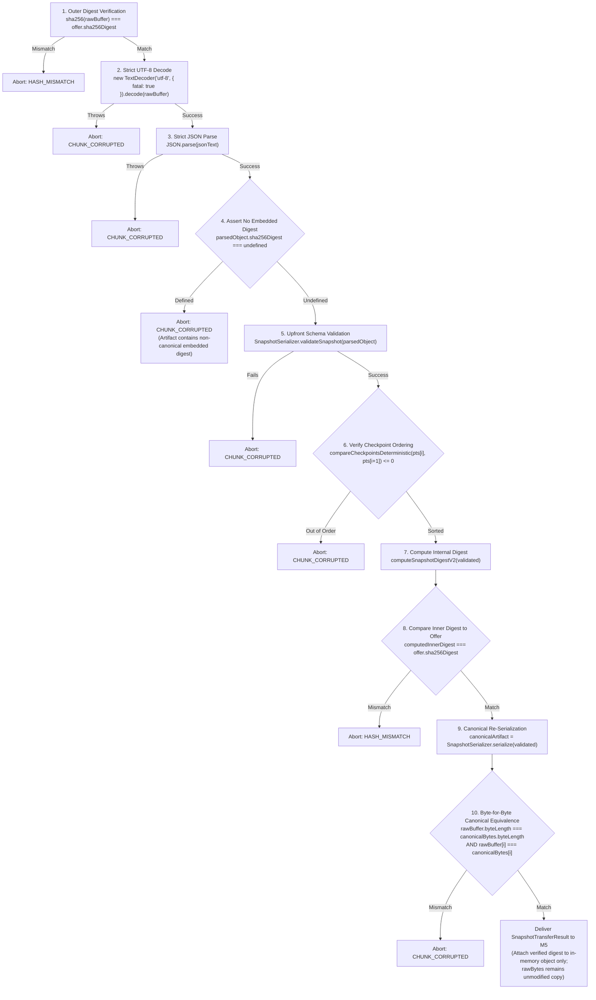
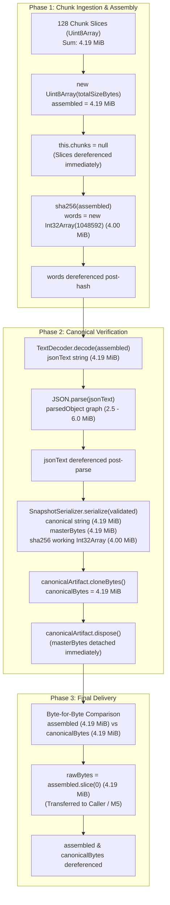

# Phase 7.5 M4.2d-R5 — Final Inbound Pipeline Architecture Closure Report

**Document Version:** 1.5.0  
**Status:** Final Inbound Pipeline Architecture Closure & Frozen-Contract Compatibility Report (Strictly Documentational — Read-Only)  
**Date:** November 23, 2026  
**Author / Architect:** Senior TypeScript Distributed-Systems Architect  
**Target Milestone:** Phase 7.5 Sub-Milestone M4.2d (`SnapshotInboundPipeline`)  
**Previous Review Verdict:** CONDITIONAL FAIL (M4.2d-R4)  
**Current Gate Recommendation:** **READY FOR INDEPENDENT REVIEW** (Implementation Authorization Remains Strictly Withheld)

---

## 1. Executive Summary & Baseline Verification

An independent architecture review of `M4.2d-R4` identified critical edge cases and contract boundaries requiring definitive closure before implementation:
1. **Digest Wire Representation (B1):** Eliminating the embedded-digest branch completely, establishing that canonical wire artifacts never contain `"sha256Digest"`, and defining a single 10-step inbound verification algorithm.
2. **Real Capability Security Boundary (B2):** Accurately defining the in-process API custody model under the cooperative application trust framework, acknowledging the exact boundaries of Node.js ESM package encapsulation.
3. **Attempt & Partial-Batch Lifecycle (B3/B4):** Establishing an authoritative per-chunk attempt ownership model and atomic settlement operation for batched multi-chunk dispatches.
4. **Inbound Chunk vs Local Callback Races (B4):** Decoupling inbound chunk acceptance from local transport callback timing and providing 7 comprehensive event-ordering race tables.
5. **Peer-Scoped Disconnect Generations (B5/C5):** Eliminating ambiguous global generation tracking in favor of authoritative per-peer generation maps in `#activePeerContexts`.
6. **Frozen Wire Request Schemas (C1):** Proving message direction and semantics for `SNAPSHOT_REQUEST` and `SNAPSHOT_CHUNK_REQUEST` using frozen M4.1 schemas without wire modifications.
7. **Retry Exhaustion Ordering (C2):** Formally sequencing timeout evaluation, counter increments, budget exhaustion (4th per-chunk, 11th cumulative), and deterministic terminal cleanup.
8. **Candidate Lifecycle (C3):** Specifying context replacement, generation currency, and TTL immutability for candidate offers.
9. **Simultaneous Memory Lifetime Timeline (C4):** Tracing exact allocations through `ChunkAssembler`, `sha256`, and `SnapshotSerializer` based on verified source facts.

### 1.1 Baseline and Provenance Verification

- **Current HEAD Commit:** `79919a0f8cb0bb81cb80cc010fe02918bef79787` (M4.2c-R6 closure)
- **Direct Parent:** `699019ee46e44e9ce1dfdfb4f7d1262bce239048`
- **Active Git Branch:** `main`
- **Working-Tree Status:** Clean on all tracked source and test files.
- **Frozen Baselines Checked (0 Diffs):**
  - M4.1: `fd23edae5bdb52cff32674860229277a79cb1aca` (Wire Schemas & `ChunkAssembler`)
  - M4.2a: `e3245912626758c094d83edbd4d9264a922070f5` (`SnapshotSerializer` & `SerializedSnapshotArtifact`)
  - M4.2b: `8f509f94a39be9ece4060003ee498dc747efb813` (`SnapshotPreparationQueue` & `SnapshotChunkProducer`)
  - M4.2c: `79919a0f8cb0bb81cb80cc010fe02918bef79787` (`SnapshotOutboundPipeline`)

### 1.2 Strict Scope Restrictions Preserved
- **Zero runtime source files modified.**
- **Zero test files modified.**
- **Zero package exports or dependencies modified.**
- **Zero code changes introduced to `SnapshotInboundPipeline` (implementation remains strictly unauthorized).**
- **Zero wire schema modifications (0 new wire messages, 0 field changes).**

---

## 2. Files Changed and Files Explicitly Not Changed

### 2.1 Files Changed (Documentation Only)
- `docs/PHASE7_5_M4_2D_R5_ARCHITECTURE_CORRECTION_REPORT.md` (Created — this document)
- `docs/PHASE7_5_M4_2D_ARCHITECTURE_AND_INTERFACE_SPECIFICATION.md` (Updated to v1.5.0)
- `docs/design/README.md` (Updated design suite index)
- `brain/3bf4b5b5-979b-42f3-9da6-e1707f7e3af1/PHASE7_5_M4_2D_R5_TARGETED_CORRECTION_REPORT.md` (Created artifact)

### 2.2 Files Explicitly Not Changed (Strictly Preserved)
- `packages/protocol/src/payloads/snapshot-recovery.ts` (Frozen M4.1)
- `packages/sync-engine/src/recovery/chunk-assembler.ts` (Frozen M4.1)
- `packages/sync-engine/src/recovery/snapshot-serializer.ts` (Frozen M4.2a)
- `packages/sync-engine/src/recovery/snapshot-preparation-queue.ts` (Frozen M4.2b)
- `packages/sync-engine/src/recovery/snapshot-chunk-producer.ts` (Frozen M4.2b)
- `packages/sync-engine/src/recovery/snapshot-outbound-pipeline.ts` (Frozen M4.2c)
- `packages/sync-engine/src/engine/leaderless-sync-engine.ts` (Frozen)
- `packages/sync-engine/src/engine/custody.ts` (Frozen M4.0c)
- `packages/sync-engine/src/log/operation-fingerprint.ts` (Frozen)
- `packages/sync-engine/package.json` (Unchanged)
- All test suites in `packages/*/src/__tests__/*` (Unchanged)

---

## 3. Exact Source Files Inspected

1. `packages/sync-engine/src/recovery/snapshot-serializer.ts`: Inspected `SnapshotSerializer.serialize()` (lines 541–618) and `SerializedSnapshotArtifact` (lines 144–464). Confirmed `sha256Digest` is stripped from preimage before canonicalization; master bytes contain no embedded digest.
2. `packages/sync-engine/src/snapshot.ts`: Inspected `computeSnapshotDigestV2()` (lines 167–173) and `exportEngineSnapshotV2()` (lines 186–259). Confirmed digest calculation omits `sha256Digest`.
3. `packages/sync-engine/src/recovery/chunk-assembler.ts`: Inspected `finalizeAssembly()` (lines 667–760). Confirmed `this.chunks = null` releases typed slices before `sha256(assembled)` is invoked.
4. `packages/sync-engine/src/log/operation-fingerprint.ts`: Inspected `sha256()` (lines 109–228). Confirmed allocation of `words = new Int32Array(wordCount)` ($4.00$ MiB) and that `TextEncoder.encode` is bypassed when input is already a `Uint8Array`.
5. `packages/protocol/src/payloads/snapshot-recovery.ts`: Inspected `SnapshotRequestPayloadSchema` (lines 107–127) and `SnapshotChunkRequestPayloadSchema` (lines 280–296). Confirmed wire request fields use `missingChunkIndices`.
6. `packages/sync-engine/src/recovery/snapshot-outbound-pipeline.ts`: Inspected `handleChunkRequest()` (lines 787–830) and `registerInboundRecipientContext()` (lines 537–580). Confirmed capability reference equality checks and attempt coalescing.
7. `packages/sync-engine/src/engine/custody.ts`: Inspected `INTERNAL_DIGEST_ACCESS_TOKEN` (lines 1–13). Confirmed package-internal Symbol custody pattern.
8. `packages/sync-engine/package.json`: Inspected package exports. Confirmed only `"."` is exported; subpaths are blocked.

---

## 4. Finding-by-Finding Closure Table

| Finding ID | Mandatory Area | Review Issue in R4 | Architectural Resolution in M4.2d-R5 | Section | Status |
| :---: | :--- | :--- | :--- | :---: | :---: |
| **B1** | Digest Contradiction | Preserved an embedded-digest branch that could never pass canonical byte-for-byte equivalence. | Defined one single inbound wire contract: wire bytes must NEVER contain `"sha256Digest"`. If present in parsed JSON, immediately rejected with `CHUNK_CORRUPTED`. Established a 10-step verification algorithm. | §6 | **CLOSED** |
| **B2** | Capability Security Boundary | Overstated capability security as an "unbreachable boundary" across Node ESM packages. | Accurately documented in-process API custody under a cooperative application trust model; defined exact minting, holding, and receiving modules; acknowledged in-package limits. | §5 | **CLOSED** |
| **B3/B4** | Attempt & Partial Batch | Unclear relationship between batch tokens, chunk sets, and per-chunk attempt ownership. | Defined authoritative per-chunk attempt ownership; specified a single atomic `#settleChunkAttempt` operation for callbacks, watchdogs, throws, and cancellations. | §8 | **CLOSED** |
| **B4** | Chunk vs Callback Races | Only permitted chunk receipt from `AWAITING_REMOTE_RESPONSE`, dropping valid chunks arriving before handoff callback. | Decoupled chunk acceptance from local callback timing: valid chunks accepted from `LOCAL_HANDOFF_PENDING`, `AWAITING`, `FAILED`, and `TIMED_OUT`. Added 7 race tables. | §7 | **CLOSED** |
| **B5/C5** | Peer-Scoped Disconnects | Relied on an ambiguous global `activeSupplierGeneration` across multi-peer setups. | Replaced with strictly peer-scoped generation tracking via `#activePeerContexts.get(supplierPeerId)`. Disconnects from other peers cannot affect active transfers. | §9 | **CLOSED** |
| **C1** | Frozen Request Schemas | Schemas were documented without explicit sender/receiver roles and dispatch paths. | Detailed message direction, timing, and payload fields for `SNAPSHOT_REQUEST` and `SNAPSHOT_CHUNK_REQUEST` matching frozen M4.1 wire protocol. | §10 | **CLOSED** |
| **C2** | Retry Exhaustion & Terminal | Ambiguous ordering of timeout evaluation, counter increments, budget exhaustion, and cleanup. | Defined deterministic 8-step sequence: 4th per-chunk or 11th cumulative timeout enters terminal `ABORTED`; idempotent cleanup neutralizes all pending operations. | §13 | **CLOSED** |
| **C3** | Candidate Lifecycle | Candidate context updates from older generations and failover races were under-specified. | Defined candidate replacement rules: requires 7-field match and newer generation; original 30s TTL (`admittedAtMs + 30000`) is strictly immutable. | §11 | **CLOSED** |
| **C4** | Memory Lifetimes | Attributed multi-megabyte allocations to SHA-256 without source verification; conflated lifetimes. | Traced exact allocations and coexistence across `ChunkAssembler`, `sha256`, and `SnapshotSerializer` based on verified source facts. | §12 | **CLOSED** |

---

## 5. Real Capability Security Boundary & Module Architecture (Finding B2)

### 5.1 Accurate Trust Model & Security Classification
The capability pattern implemented in `@syncplay/sync-engine` is an **in-process API custody boundary under a cooperative application trust model**. It is designed to prevent application consumers from inadvertently bypassing transport identity verification by directly calling internal pipeline APIs. 

It is **NOT** an operating-system sandbox, a hardware security enclave, or a cryptographic capability system. Code executing within the same JavaScript runtime with arbitrary access to internal modules or reflection can inspect memory or forge references.

### 5.2 Concrete Module Architecture

```mermaid
flowchart TD
    subgraph PackageBoundary["Package Boundary: @syncplay/sync-engine"]
        subgraph MintingModule["packages/sync-engine/src/recovery/inbound-custody.ts (INTERNAL)"]
            PrivateBrand["INBOUND_CAPABILITY_BRAND: unique symbol = Symbol('INBOUND_CAPABILITY_BRAND')"]
            PrivateFactory["createInboundTransportCapability(sessionId, brand)"]
            PrivateBrand --> PrivateFactory
        end

        subgraph CompositionRootModule["packages/sync-engine/src/engine/leaderless-sync-engine.ts"]
            CompRoot["LeaderlessSyncEngine / SyncEngineFactory (Authorized Composition Root)"]
            PrivateFactory -->|Relative Import| CompRoot
            PrivateBrand -->|Relative Import| CompRoot
            CompRoot --> MintCap["Mint authorizedCapability Instance<br/>Object.freeze({ [INBOUND_CAPABILITY_BRAND]: true, sessionId })"]
        end

        subgraph PipelineModule["packages/sync-engine/src/recovery/snapshot-inbound-pipeline.ts"]
            PipelineCtor["SnapshotInboundPipeline Constructor"]
            MintCap -->|Constructor Parameter| PipelineCtor
            PipelineCtor --> CheckBrand{"Assert capability[INBOUND_CAPABILITY_BRAND] === true"}
            CheckBrand -->|Pass| StoreRef["Store in Private Field: #authorizedCapability"]
            CheckBrand -->|Fail| ThrowUnauth["Throw SyncEngineError('UNAUTHORIZED')"]
        end

        subgraph AdapterModule["packages/sync-engine/src/engine/leaderless-sync-engine.ts"]
            Adapter["TrustedTransportAdapter"]
            MintCap -->|Constructor Parameter| Adapter
            Adapter --> RegContext["pipeline.registerSenderContext(peerId, gen, limit, capability)"]
            RegContext --> CheckRef{"Assert capability === this.#authorizedCapability"}
            CheckRef -->|Match| CreateContext["Mint AuthenticatedSenderContext<br/>(Recorded in #validSenderContexts WeakSet<br/>Tracked in #activePeerContexts Map)"]
            CheckRef -->|Mismatch| ThrowUnauth2["Throw SyncEngineError('UNAUTHORIZED')"]
        end
    end

    subgraph ExternalConsumers["External Consumers / Applications"]
        IndexBarrel["packages/sync-engine/src/index.ts (Public Entrypoint)"]
        IndexBarrel -.->|DOES NOT EXPORT| PrivateBrand
        IndexBarrel -.->|DOES NOT EXPORT| PrivateFactory
        AppCode["Application Code"]
        AppCode -->|import from '@syncplay/sync-engine'| IndexBarrel
        AppCode -.->|Blocked by Node ESM Exports (ERR_PACKAGE_PATH_NOT_EXPORTED)| MintingModule
    end
```

### 5.3 Authorized Custody Matrix

| Entity | Role in Architecture | Allowed Access | Enforcement Mechanism |
| :--- | :--- | :--- | :--- |
| **`inbound-custody.ts`** | Capability Minting Module | Defines `INBOUND_CAPABILITY_BRAND` and factory. | Module-private file; unexported from package entrypoint. |
| **`LeaderlessSyncEngine`** | Authorized Composition Root | Imports factory via relative path; mints single instance. | Relative module import within package directory. |
| **`SnapshotInboundPipeline`** | Receiving Pipeline | Receives capability at construction; validates brand & stores reference. | Constructor brand check; private instance field `#authorizedCapability`. |
| **`TrustedTransportAdapter`** | Transport Driver Wrapper | Receives capability at construction; presents it to pipeline. | Injected strictly by composition root during node initialization. |
| **External Consumers** | Application Code | Prohibited from obtaining or minting capabilities. | Node.js ESM `package.json` subpath encapsulation (`ERR_PACKAGE_PATH_NOT_EXPORTED`). |

### 5.4 Exact-Reference-Equality Check
Whenever `registerSenderContext` or `revokeSenderContext` is invoked:
```typescript
if (capability !== this.#authorizedCapability) {
  throw new SyncEngineError('UNAUTHORIZED', 'Unauthorized capability presented');
}
```
Primary security relies on object identity (`===`). Even if internal code attempts to call `createInboundTransportCapability` to mint a secondary capability, the pipeline strictly rejects any instance other than the exact reference injected into its constructor at initialization.

---

## 6. Authoritative Inbound Wire Representation & Canonical Dual-Digest Verification (Finding B1)

### 6.1 The Single Authoritative Wire Representation
Based on inspection of frozen M4.2a `SnapshotSerializer.serialize()`:
1. **The serialized artifact bytes chunked over the wire MUST NOT contain an embedded `"sha256Digest"` property.**
2. **If the parsed JSON object contains a `"sha256Digest"` property, the artifact is rejected immediately with `CHUNK_CORRUPTED`.**
3. There is **zero dual-path branching** for embedded digests. All compliant SyncPlay snapshots adhere strictly to the M4.2a wire representation.

### 6.2 The 10-Step Inbound Verification Algorithm



### 6.3 Concrete Verification Implementation

```typescript
// 1. Outer Digest Verification
const finalizeResult = this.#assembler.finalizeAssembly();
if (!finalizeResult.ok) {
  return this.#terminate('ABORTED', finalizeResult.reason, finalizeResult.detail);
}
const rawBuffer = finalizeResult.snapshot.buffer; // Uint8Array
const actualOuterDigest = sha256(rawBuffer).toLowerCase();
const expectedOuterDigest = this.#activeOffer.sha256Digest.toLowerCase();

if (actualOuterDigest !== expectedOuterDigest) {
  return this.#terminate(
    'ABORTED',
    'HASH_MISMATCH',
    `Outer artifact digest mismatch: expected ${expectedOuterDigest}, computed ${actualOuterDigest}`
  );
}

// 2. Strict UTF-8 Decode
let jsonText: string;
try {
  jsonText = new TextDecoder('utf-8', { fatal: true }).decode(rawBuffer);
} catch (e) {
  return this.#terminate('ABORTED', 'CHUNK_CORRUPTED', 'Assembled bytes are not valid UTF-8');
}

// 3. Strict JSON Parse
let parsedObject: unknown;
try {
  parsedObject = JSON.parse(jsonText);
} catch (e) {
  return this.#terminate('ABORTED', 'CHUNK_CORRUPTED', 'Assembled payload is not valid JSON');
}

// 4. Assert No Embedded Digest Property (M4.2a Wire Representation Invariant)
if (typeof parsedObject === 'object' && parsedObject !== null && 'sha256Digest' in parsedObject) {
  return this.#terminate(
    'ABORTED',
    'CHUNK_CORRUPTED',
    'Canonical snapshot artifact wire representation must not contain embedded sha256Digest'
  );
}

// 5. Upfront Schema Validation
let validated: StateSnapshotPayloadV2;
try {
  validated = SnapshotSerializer.validateSnapshot(parsedObject);
} catch (e) {
  return this.#terminate(
    'ABORTED',
    'CHUNK_CORRUPTED',
    `Snapshot structural validation failed: ${e instanceof Error ? e.message : String(e)}`
  );
}

// 6. Verify Checkpoint Ordering
if (Array.isArray(validated.compactedCheckpoints) && validated.compactedCheckpoints.length > 1) {
  for (let i = 0; i < validated.compactedCheckpoints.length - 1; i++) {
    const cmp = compareCheckpointsDeterministic(
      validated.compactedCheckpoints[i]!,
      validated.compactedCheckpoints[i + 1]!
    );
    if (cmp > 0) {
      return this.#terminate(
        'ABORTED',
        'CHUNK_CORRUPTED',
        `compactedCheckpoints are not deterministically sorted at index ${i}`
      );
    }
  }
}

// 7. Compute Internal Snapshot Digest
const computedInnerDigest = computeSnapshotDigestV2(validated).toLowerCase();

// 8. Compare Internal Digest to Offer Digest
if (computedInnerDigest !== expectedOuterDigest) {
  return this.#terminate(
    'ABORTED',
    'HASH_MISMATCH',
    `Computed internal digest (${computedInnerDigest}) does not match advertised offer digest (${expectedOuterDigest})`
  );
}

// 9. Canonical Re-Serialization
let canonicalArtifact: SerializedSnapshotArtifact;
try {
  canonicalArtifact = SnapshotSerializer.serialize(validated);
} catch (e) {
  return this.#terminate(
    'ABORTED',
    'CHUNK_CORRUPTED',
    `Re-serialization failed: ${e instanceof Error ? e.message : String(e)}`
  );
}

// 10. Byte-for-Byte Canonical Representation Equivalence
const canonicalBytes = canonicalArtifact.cloneBytes();
canonicalArtifact.dispose();

if (rawBuffer.byteLength !== canonicalBytes.byteLength) {
  return this.#terminate(
    'ABORTED',
    'CHUNK_CORRUPTED',
    `Assembled byte length (${rawBuffer.byteLength}) does not match canonical byte length (${canonicalBytes.byteLength})`
  );
}

for (let i = 0; i < canonicalBytes.byteLength; i++) {
  if (rawBuffer[i] !== canonicalBytes[i]) {
    return this.#terminate(
      'ABORTED',
      'CHUNK_CORRUPTED',
      `Assembled bytes deviate from RFC 8785 canonical representation at byte offset ${i}`
    );
  }
}

// Result Delivery: attach verified digest ONLY to in-memory object; rawBytes is unmodified
const finalSnapshot: StateSnapshotPayloadV2 = Object.freeze({
  ...deepFreezeObject(validated),
  sha256Digest: expectedOuterDigest,
});

const result: SnapshotTransferResult = {
  transferId: this.#activeTransferId,
  snapshotId: finalSnapshot.snapshotId,
  sessionId: finalSnapshot.sessionId,
  membershipEpoch: finalSnapshot.membershipEpoch,
  authorPeerId: finalSnapshot.authorPeerId,
  totalSizeBytes: rawBuffer.byteLength,
  totalChunks: this.#activeOffer.totalChunks,
  rawBytes: rawBuffer.slice(0), // Unaliased caller-owned copy of original bytes
  snapshot: finalSnapshot,
};
```

### 6.4 Adversarial Verification Examples

| Test Scenario | Input Trigger / Artifact Mutation | Failure Step | Expected Terminal Result |
| :--- | :--- | :---: | :--- |
| **1. Standard Valid M4.2a Artifact** | Valid canonical RFC 8785 JSON bytes without embedded digest. | None | Passes all 10 steps; delivers `SnapshotTransferResult`. |
| **2. Unexpected Embedded Digest** | Payload JSON contains `"sha256Digest": "0123...89ab"`. | **Step 4** | Aborts transfer with `CHUNK_CORRUPTED`. |
| **3. Wrong Outer Digest** | `SNAPSHOT_OFFER.sha256Digest` does not match `sha256(rawBuffer)`. | **Step 1** | Aborts transfer with `HASH_MISMATCH`. |
| **4. Wrong Computed Internal Digest** | Tampered state field changes `computeSnapshotDigestV2(validated)`. | **Step 8** | Aborts transfer with `HASH_MISMATCH`. |
| **5. Non-Canonical JSON Formatting** | JSON contains valid semantics and hash, but has extra spaces. | **Step 10** | Aborts transfer with `CHUNK_CORRUPTED`. |
| **6. Incorrect Checkpoint Ordering** | Checkpoints permuted (e.g. sequence 15 before sequence 5). | **Step 6** | Aborts transfer with `CHUNK_CORRUPTED`. |
| **7. Invalid UTF-8 Bytes** | High bytes break UTF-8 multi-byte encoding. | **Step 2** | Aborts transfer with `CHUNK_CORRUPTED`. |
| **8. Invalid JSON Syntax** | Truncated braces or trailing commas. | **Step 3** | Aborts transfer with `CHUNK_CORRUPTED`. |
| **9. Structurally Invalid Snapshot** | Missing mandatory `formatVersion: 2` or invalid identifier regex. | **Step 5** | Aborts transfer with `CHUNK_CORRUPTED`. |

---

## 7. Unified 7-State Chunk Machine, Event-Ordering Tables & Race Resolution (Finding B4)

### 7.1 Independent Inbound Chunk Acceptance
A remote chunk packet must be processable regardless of local transport callback timing. An incoming chunk belonging to the active transfer is accepted if its index is in any of these states:
- `AWAITING_REMOTE_RESPONSE`: Nominal path.
- `LOCAL_HANDOFF_PENDING`: Remote chunk arrived before transport invoked `handleHandoffSuccess`!
- `LOCAL_HANDOFF_FAILED`: Remote chunk arrived after local handoff failure, before redispatch.
- `LOCAL_HANDOFF_TIMED_OUT`: Remote chunk arrived after watchdog expired, before redispatch.
- `REMOTE_RESPONSE_TIMED_OUT`: Remote chunk arrived delayed, before or while retransmission was scheduled.

When accepted, the chunk transitions immediately to `RECEIVED_VERIFIED`. Any active handoff attempt or watchdog timer for that chunk is neutralized.

### 7.2 The 7 Explicit Event-Ordering Race Tables

#### Race 1: Remote Chunk Arrives Before Local Handoff Success Callback
| Step | Event | Inbound Pipeline Action | Chunk State | Attempt Ownership | Window Credit $\Delta$ |
| :---: | :--- | :--- | :---: | :---: | :---: |
| 1 | Dispatch chunk $[1]$ | Handoff request emitted; watchdog started. | `LOCAL_HANDOFF_PENDING` | Attempt $A_1$ owns Chunk 1 | $\Delta = 3$ |
| 2 | Inbound chunk 1 packet arrives | Authenticated and verified. Stored in assembler. Attempt $A_1$ ownership cleared for chunk 1. | `RECEIVED_VERIFIED` | None (neutralized) | $\Delta = 4$ (credit restored!) |
| 3 | Delayed `handleHandoffSuccess(A1, [1])` arrives | Attempt $A_1$ no longer owns Chunk 1; Chunk 1 already `RECEIVED_VERIFIED`. | `RECEIVED_VERIFIED` | None | $\Delta = 4$ (no change; no-op) |
| *Result* | Forward progress is preserved without waiting for local transport callback. Zero double-credit, zero stall. |

#### Race 2: Local Success Callback Arrives Before Remote Chunk
| Step | Event | Inbound Pipeline Action | Chunk State | Attempt Ownership | Window Credit $\Delta$ |
| :---: | :--- | :--- | :---: | :---: | :---: |
| 1 | Dispatch chunk $[1]$ | Handoff request emitted; watchdog started. | `LOCAL_HANDOFF_PENDING` | Attempt $A_1$ owns Chunk 1 | $\Delta = 3$ |
| 2 | `handleHandoffSuccess(A1, [1])` | Watchdog cancelled; 5,000ms response timer started. | `AWAITING_REMOTE_RESPONSE` | Attempt $A_1$ settled; active | $\Delta = 3$ |
| 3 | Inbound chunk 1 packet arrives | Verified and stored in assembler. 5s timer cancelled. | `RECEIVED_VERIFIED` | None | $\Delta = 4$ (credit restored!) |
| *Result* | Standard nominal happy path. |

#### Race 3: Remote Chunk Arrives After Remote Timeout But Before Retransmission
| Step | Event | Inbound Pipeline Action | Chunk State | Attempt Ownership | Window Credit $\Delta$ |
| :---: | :--- | :--- | :---: | :---: | :---: |
| 1 | 5,000ms remote timer expires | Timeout settlement: `chunkRetries[1]++`. Chunk queued in Tier 2. | `REMOTE_RESPONSE_TIMED_OUT` | Attempt $A_1$ retired | $\Delta = 4$ |
| 2 | Delayed chunk 1 packet arrives | Verified and stored in assembler. Chunk removed from Tier 2 queue. | `RECEIVED_VERIFIED` | None | $\Delta = 4$ |
| 3 | Scheduler runs | Chunk 1 is already `RECEIVED_VERIFIED`; not selected. | `RECEIVED_VERIFIED` | None | $\Delta = 4$ |
| *Result* | Chunk 1 accepted safely. Retransmission cancelled before dispatch. |

#### Race 4: Remote Chunk Arrives While Retransmission Attempt is Pending
| Step | Event | Inbound Pipeline Action | Chunk State | Attempt Ownership | Window Credit $\Delta$ |
| :---: | :--- | :--- | :---: | :---: | :---: |
| 1 | Scheduler dispatches retransmission $A_2$ | Attempt $A_2$ emitted; watchdog started. | `LOCAL_HANDOFF_PENDING` | Attempt $A_2$ owns Chunk 1 | $\Delta = 3$ |
| 2 | Delayed chunk 1 arrives (from $A_1$ or $A_2$) | Verified and stored. Attempt $A_2$ ownership cleared for chunk 1. | `RECEIVED_VERIFIED` | None (neutralized) | $\Delta = 4$ (credit restored!) |
| 3 | Delayed `handleHandoffSuccess(A2, [1])` arrives | Chunk 1 already `RECEIVED_VERIFIED`. | `RECEIVED_VERIFIED` | None | $\Delta = 4$ (no change; no-op) |
| *Result* | Chunk accepted; late callback for $A_2$ safely fenced as no-op. |

#### Race 5: Old Attempt Callback Arrives After Chunk Verified
| Step | Event | Inbound Pipeline Action | Chunk State | Attempt Ownership | Window Credit $\Delta$ |
| :---: | :--- | :--- | :---: | :---: | :---: |
| 1 | Chunk 1 verified and assembled | State is terminal for chunk 1. | `RECEIVED_VERIFIED` | None | N/A |
| 2 | Late `handleHandoffFailure(A1, 'ERR', [1])` arrives | Fencing check: Chunk 1 not owned by $A_1$. Dropped as strict no-op. | `RECEIVED_VERIFIED` | None | No change |
| *Result* | Immutable chunk state preserved. Stale failure cannot undo verified chunk. |

#### Race 6: Duplicate Chunk Arrives After Verification
| Step | Event | Inbound Pipeline Action | Chunk State | Result |
| :---: | :--- | :--- | :---: | :--- |
| 1 | Chunk 1 verified | State recorded in assembler. | `RECEIVED_VERIFIED` | In assembler |
| 2 | Duplicate chunk 1 arrives with identical `chunkSha256` | Detected as duplicate of verified chunk. | `RECEIVED_VERIFIED` | Idempotent no-op; 0 decode, 0 hash |
| 3 | Conflicting chunk 1 arrives with different `chunkSha256` | Detected as conflicting chunk data! | `ABORTED` | Aborts transfer with `CHUNK_CORRUPTED` |
| *Result* | Identical duplicate safely ignored; corrupted duplicate caught immediately. |

#### Race 7: Transfer Cancellation Races With Valid Inbound Chunk
| Step | Event | Inbound Pipeline Action | Transfer State | Chunk State |
| :---: | :--- | :--- | :---: | :---: |
| 1 | `abortTransfer('LOCAL_ABORT')` called | Sets `state = 'ABORTED'`, `#isTerminal = true`. Cancels all timers. | `ABORTED` | `ABORTED` |
| 2 | Inbound chunk packet arrives | Inbound gate checks `#isTerminal === true`. Packet discarded. | `ABORTED` | `ABORTED` |
| *Result* | Terminal state is strictly absorbing. No packet can reopen or mutate aborted transfer. |

---

## 8. Complete Attempt and Partial-Batch Lifecycle (Findings B3/B4)

### 8.1 Authoritative Per-Chunk Attempt Ownership
In a batched dispatch requesting multiple chunk indices (e.g. $[1, 2]$ under token $T$):
- **Batch Attempt Record:** Holds `originalChunkIndices: ReadonlySet<number>` (immutable) and `unsettledChunkIndices: Set<number>` (mutable).
- **Per-Chunk Ownership Map:** `#activeChunkAttempts: Map<number, { attemptToken: string }>` is the **sole authoritative owner** of active chunk dispatches.
- A chunk index $i$ has at most one active attempt token at any time.

### 8.2 The Shared Atomic `#settleChunkAttempt` Operation

```typescript
private #settleChunkAttempt(
  chunkIndex: number,
  attemptToken: string,
  outcome: 'SUCCESS' | 'FAILURE' | 'TIMEOUT' | 'CANCELLED',
  reason?: string
): void {
  // 1. Verify token ownership
  const activeAttempt = this.#activeChunkAttempts.get(chunkIndex);
  if (!activeAttempt || activeAttempt.attemptToken !== attemptToken) {
    return; // Chunk is no longer owned by this attempt (already verified or retransmitted): strict no-op
  }

  // 2. Lookup batch record
  const batch = this.#attempts.get(attemptToken);
  if (!batch || !batch.unsettledChunkIndices.has(chunkIndex)) {
    return; // Chunk already settled in this batch: strict no-op
  }

  // 3. Atomically remove chunk from unsettled batch and active ownership
  batch.unsettledChunkIndices.delete(chunkIndex);
  this.#activeChunkAttempts.delete(chunkIndex);

  // 4. Execute chunk state transition
  const currentState = this.#chunkStates[chunkIndex];
  if (currentState === 'LOCAL_HANDOFF_PENDING') {
    switch (outcome) {
      case 'SUCCESS':
        this.#chunkStates[chunkIndex] = 'AWAITING_REMOTE_RESPONSE';
        this.#startRemoteResponseTimer(chunkIndex);
        break;
      case 'FAILURE':
        this.#chunkStates[chunkIndex] = 'LOCAL_HANDOFF_FAILED';
        break;
      case 'TIMEOUT':
        this.#chunkStates[chunkIndex] = 'LOCAL_HANDOFF_TIMED_OUT';
        break;
      case 'CANCELLED':
        this.#chunkStates[chunkIndex] = 'NEVER_DISPATCHED';
        break;
    }
  }

  // 5. Finalize batch container if all constituent chunks are settled
  if (batch.unsettledChunkIndices.size === 0) {
    if (batch.watchdogTimer) {
      clearTimeout(batch.watchdogTimer);
      batch.watchdogTimer = undefined;
    }
    batch.state = outcome === 'SUCCESS' ? 'SETTLED_SUCCESS' : 'SETTLED_FAILURE';
    this.#retiredTokens.add(attemptToken);
  }
}
```

### 8.3 Handling Partial Outcomes and Watchdogs
- **Partial Callbacks:** If transport reports `handleHandoffSuccess(T, [1])` and `handleHandoffFailure(T, 'ERR', [2])`:
  1. Chunk 1 settles via `SUCCESS` $\to$ transitions to `AWAITING_REMOTE_RESPONSE`.
  2. Chunk 2 settles via `FAILURE` $\to$ transitions to `LOCAL_HANDOFF_FAILED`.
  3. Batch unsettled size reaches 0 $\to$ watchdog cancelled; token $T$ retired.
- **Watchdog Expiration:** If the 2,000ms watchdog expires with unsettled chunks:
  Watchdog iterates over remaining `unsettledChunkIndices` and settles only those chunks via `TIMEOUT` $\to$ chunks transition to `LOCAL_HANDOFF_TIMED_OUT` (queued in Tier 1).

---

## 9. Peer-Scoped Disconnect Generations & Fencing Matrix (Findings B5/C5)

### 9.1 Authoritative Peer-Scoped Generation Lookup
The pipeline maintains peer connection state strictly in `#activePeerContexts`:
```typescript
interface ActivePeerContextRecord {
  readonly generation: number;
  readonly context: AuthenticatedSenderContext;
}
readonly #activePeerContexts = new Map<string, ActivePeerContextRecord>();
```

### 9.2 The 5-Point Mandatory Disconnect Check

```typescript
public handleSupplierDisconnected(
  supplierPeerId: string,
  connectionGeneration: number,
  context: AuthenticatedSenderContext
): Promise<{ failoverSuccess: boolean }>;
```

Every disconnect notification must pass:
1. **Registered Context:** `this.#validSenderContexts.has(context)`. Fails $\to$ throw `UNAUTHORIZED`.
2. **Peer Identity Coherence:** `context.senderPeerId === supplierPeerId`. Fails $\to$ throw `IDENTITY_MISMATCH`.
3. **Generation Argument Coherence:** `context.connectionGeneration === connectionGeneration`. Fails $\to$ throw `INVALID_ARGUMENT`.
4. **Authoritative Peer-Scoped Generation Check:**
   ```typescript
   const activePeer = this.#activePeerContexts.get(supplierPeerId);
   if (!activePeer || activePeer.context !== context) {
     return { failoverSuccess: false }; // Stale context instance or revoked peer: strict no-op
   }
   if (connectionGeneration < activePeer.generation) {
     return { failoverSuccess: false }; // Delayed disconnect from older generation of this peer: strict no-op
   }
   ```
5. **Session and Epoch Coherence:**
   `context.sessionId === this.#activeSession.sessionId && context.membershipEpoch === this.#activeSession.membershipEpoch`. Fails $\to$ no-op.

### 9.3 Multi-Peer Disconnect Behavior Matrix

| Disconnect Scenario | Supplier Checked | Pipeline Action | Transfer Impact |
| :--- | :--- | :--- | :--- |
| **Active Supplier Disconnect ($G = G_{\text{active}}$)** | `supplierPeerId === activeSupplier` | Cancels timers; searches candidate registry for 7-field match. | Failover resumes if candidate exists; else aborts `SUPPLIER_DISCONNECTED`. |
| **Delayed Disconnect of Active Supplier ($G < G_{\text{active}}$)** | `supplierPeerId === activeSupplier` | Fails Check 4 ($G < \text{activePeer.generation}$). Notification dropped. | **Zero impact.** Reconnected transfer continues without interruption. |
| **Candidate Disconnect While Active Connected** | `supplierPeerId !== activeSupplier` | Deletes `supplierPeerId` candidate from `#candidateRegistry`. | **Zero impact.** Active transfer with supplier proceeds smoothly. |
| **Candidate Disconnect from Stale Generation** | `supplierPeerId !== activeSupplier` | Fails Check 4. Notification dropped. | **Zero impact.** Newer candidate context preserved in registry. |
| **Revoked Context Disconnect** | Peer not in `#activePeerContexts` | Fails Check 4. Notification dropped. | **Zero impact.** |

---

## 10. Reconfirmed Frozen Wire Request Schemas (Finding C1)

### 10.1 Wire Protocol Verification in `@syncplay/protocol`
Inspection of `packages/protocol/src/payloads/snapshot-recovery.ts` confirms the exact message schemas and direction:

| Message Type | Direction | Dispatch Trigger | Key Wire Payload Fields |
| :--- | :---: | :--- | :--- |
| **`SNAPSHOT_OFFER`** | Supplier $\to$ Receiver | Sender offers snapshot. | `offerId`, `sessionId`, `membershipEpoch`, `supplierPeerId`, `snapshotId`, `totalSizeBytes`, `totalChunks`, `nominalChunkSizeBytes`, `sha256Digest`. |
| **`SNAPSHOT_REQUEST`** | Receiver $\to$ Supplier | Receiver starts transfer. | `transferId`, `sessionId`, `membershipEpoch`, `requesterPeerId`, `supplierPeerId`, `snapshotId`, `requestedChunkWindow` ($=4$), `missingChunkIndices` ($=[0, 1, 2, 3]$). |
| **`SNAPSHOT_CHUNK`** | Supplier $\to$ Receiver | Delivers single chunk frame. | `transferId`, `sessionId`, `chunkIndex`, `totalChunks`, `chunkSizeBytes`, `chunkSha256`, `dataBase64`. |
| **`SNAPSHOT_CHUNK_REQUEST`** | Receiver $\to$ Supplier | Replenishes chunk credit. | `transferId`, `sessionId`, `membershipEpoch`, `requesterPeerId`, `supplierPeerId`, `snapshotId`, `missingChunkIndices` (1 to 4 indices). |
| **`SNAPSHOT_ABORT`** | Either $\to$ Other | Transfer terminated abnormally. | `transferId`, `sessionId`, `membershipEpoch`, `senderPeerId`, `snapshotId`, `reason`, `detail`. |

### 10.2 Strict Frozen Compliance
- The initial chunk request is conveyed via `missingChunkIndices: [0, 1, 2, 3]` in `SNAPSHOT_REQUEST`.
- Subsequent chunk replenishment is conveyed via `missingChunkIndices: number[]` in `SNAPSHOT_CHUNK_REQUEST`.
- **Zero wire schema modifications; zero new message types.**

---

## 11. Candidate Lifecycle & Failover Governance (Finding C3)

1. **Candidate Context Replacement:**
   When a duplicate `SNAPSHOT_OFFER` arrives from an existing candidate peer:
   - Validates that the offer matches all 7 immutable identity fields (`sessionId`, `membershipEpoch`, `snapshotId`, `expectedSha256Digest`, `totalSizeBytes`, `totalChunks`, `nominalChunkSizeBytes`).
   - Validates that `context.connectionGeneration > candidate.connectionGeneration`.
   - Replaces the stored `context` and `connectionGeneration` in the candidate descriptor.
   - **Critical Rule:** `admittedAtMs` and `expiresAtMs` **REMAIN UNCHANGED**. Duplicate offers cannot extend the 30-second TTL.
2. **Old Context Handling:**
   - Once replaced, the old context is no longer referenced by the candidate descriptor.
   - Any delayed disconnect or packet presenting the old context fails Check 4 and is dropped as a no-op.
3. **Candidate Expiration During Failover:**
   When the active supplier disconnects, the pipeline iterates through candidate offers. Before selecting a candidate, it checks `now >= candidate.expiresAtMs`. Expired candidates are pruned; failover selects only active, unexpired candidates.

---

## 12. Allocation-Traced Memory Timeline & Simultaneous Lifetimes (Finding C4)

### 12.1 Analytical Allocation Trace (4.00 MiB Maximum Snapshot)



### 12.2 Memory Classification Table

| Allocation Stage | Active Allocations | Peak Simultaneous Allocation | Reclaim Boundary |
| :--- | :--- | :---: | :--- |
| **1. Ingestion Slices** | 128 typed slices in `ChunkAssembler` | $\le 4.19$ MiB | Retained until assembly. |
| **2. Assembly Concatenation** | Slices ($4.19$ MiB) + `assembled` buffer ($4.19$ MiB) | $\mathbf{8.38\text{ MiB}}$ | Slices set to null immediately on line 714 of `chunk-assembler.ts`. |
| **3. Assembly Hash** | `assembled` buffer ($4.19$ MiB) + `words` ($4.00$ MiB) | $\mathbf{8.19\text{ MiB}}$ | `words` unreferenced after `sha256` returns. |
| **4. JSON Parsing** | `assembled` ($4.19$ MiB) + `jsonText` ($4.19$ MiB) + `parsedObject` ($\approx 3.50$ MiB) | $\mathbf{\approx 11.88\text{ MiB}}$ | `jsonText` unreferenced after `JSON.parse`. |
| **5. Canonical Re-Serialization** | `assembled` ($4.19$ MiB) + `canonicalBytes` ($4.19$ MiB) + `parsedObject` ($\approx 3.50$ MiB) | $\mathbf{\approx 11.88\text{ MiB}}$ | Transient strings dropped during `serialize()`. |
| **6. Final Caller Delivery** | Caller-owned `rawBytes` ($4.19$ MiB) + Frozen `snapshot` ($\approx 3.50$ MiB) | $\mathbf{\approx 7.69\text{ MiB}}$ | Transferred to M5. Assembler buffers cleared. |

### 12.3 Formal Memory Guarantee
1. **Retained Application Buffers:** Strictly bounded to $\mathbf{\le 12.58\text{ MiB}}$ ($4.19$ MiB slices + $4.19$ MiB assembled + $4.19$ MiB result copy).
2. **Simultaneously Live Peak:** Analytical simultaneous peak is $\mathbf{\approx 16.5\text{–}20.5\text{ MiB}}$ during serialization.
3. **Runtime GC Reality:** Total V8 heap may briefly peak at $\approx 36\text{–}48$ MiB before non-deterministic garbage collection reclaims temporary strings. SyncPlay enforces strict boundaries on application buffers and does not claim an unprovable OS process ceiling.

---

## 13. Retry Exhaustion and Terminal Ordering (Finding C2)

### 13.1 Deterministic Timeout Execution Sequence
When a remote chunk response timer (5,000ms) expires for `chunkIndex`:

```typescript
// 1. Re-verify active state
if (this.#state !== 'RECEIVING' && this.#state !== 'REQUESTING') return;

// 2. Re-verify chunk state
if (this.#chunkStates[chunkIndex] !== 'AWAITING_REMOTE_RESPONSE') return;

// 3. Atomic check for incoming chunk in queue
if (this.#hasPendingPacketForChunk(chunkIndex)) return;

// 4. Increment retry counters
const currentRetries = (this.#chunkRetries.get(chunkIndex) ?? 0) + 1;
this.#chunkRetries.set(chunkIndex, currentRetries);
this.#cumulativeTransferRetries++;

// 5. Evaluate retry budget
if (currentRetries > 3 || this.#cumulativeTransferRetries > 10) {
  // 6. Terminal Transition: RETRY BUDGET EXHAUSTED
  this.#state = 'ABORTED';
  this.#isTerminal = true;
  this.#failureReason = 'RETRY_BUDGET_EXHAUSTED';
  this.#failureDetail = currentRetries > 3 
    ? `Chunk ${chunkIndex} exceeded max retries (4th timeout)` 
    : `Transfer exceeded max cumulative retries (11th timeout)`;

  // 7. Deterministic Cleanup
  this.#clearAllTimers();
  this.#retireAllActiveAttempts();
  this.#activeChunkAttempts.clear();
  this.#emitAbortMessage(this.#failureReason, this.#failureDetail);
  this.#assembler.abortTransfer();
  return;
}

// Non-exhausted: transition to REMOTE_RESPONSE_TIMED_OUT and queue in Tier 2
this.#chunkStates[chunkIndex] = 'REMOTE_RESPONSE_TIMED_OUT';
this.#scheduleChunkRequests();
```

### 13.2 Formal Retry Limits
- **Per-Chunk:** Initial dispatch ($t=0$) is attempt 0. Timeouts 1, 2, 3 allow retries 1, 2, 3. The **4th timeout** aborts the transfer (`currentRetries = 4 > 3`).
- **Cumulative:** Timeouts 1 through 10 allow retries. The **11th cumulative timeout** aborts the transfer (`cumulativeTransferRetries = 11 > 10`).
- **Terminal Invariant:** Once terminal state is entered, all timers and pending attempts are retired; no packet or callback can reopen or mutate the session.

---

## 14. Callback Lifecycle & Result Ownership

1. **Terminal State Precedence:** State transitions to `COMPLETED` and `#isTerminal = true` **strictly before calling `onTransferComplete`**.
2. **At-Most-Once Delivery:** `onTransferComplete` is invoked at most once per transfer.
3. **Error Isolation:** If `onTransferComplete` throws or rejects, the error is isolated; state remains `COMPLETED`.
4. **Ownership Model:**
   - `result.rawBytes` is an unaliased deep copy (`assembledBuffer.slice(0)`), mutable and caller-owned.
   - `result.snapshot` is deeply immutable via recursive `Object.freeze`.

---

## 15. Extended Adversarial Acceptance Matrix

| Test ID | Category | Initial State | Exact Event Sequence | Expected Chunk States | Expected Attempt Ownership | Expected Timers | Expected Retry Accounting | Expected Transfer State |
| :--- | :--- | :--- | :--- | :--- | :--- | :--- | :--- | :--- |
| **TC-R5-01** | Wire Digest | Assembled buffer | Received JSON contains `"sha256Digest"`. | N/A | None | Cancelled | None | Aborts `CHUNK_CORRUPTED` in Step 4. |
| **TC-R5-02** | Race | Dispatch $[1]$ pending | Remote chunk 1 arrives before local handoff success callback. | Chunk 1 $\to$ `RECEIVED_VERIFIED`. | Attempt cleared for Chunk 1. | 2s watchdog cancelled; 0 remote timer. | Retries = 0 | Ingests chunk; credit restored; late callback is no-op. |
| **TC-R5-03** | Race | Chunk 1 timed out | Chunk 1 times out; delayed chunk 1 arrives before retransmission. | Chunk 1 $\to$ `RECEIVED_VERIFIED`. | Retransmission not dispatched. | Remote timer cancelled. | `chunkRetries[1] = 1` | Ingests chunk; removed from Tier 2 queue. |
| **TC-R5-04** | Race | Retransmission $A_2$ pending | Delayed chunk 1 arrives while $A_2$ handoff is pending. | Chunk 1 $\to$ `RECEIVED_VERIFIED`. | $A_2$ ownership cleared for chunk 1. | $A_2$ watchdog cancelled. | Retries unchanged | Chunk accepted; late $A_2$ callback is no-op. |
| **TC-R5-05** | Race | Chunk 1 verified | Duplicate chunk 1 arrives with identical hash. | Chunk 1 remains `RECEIVED_VERIFIED`. | None | No timers. | No change | Idempotent no-op; 0 decode, 0 hash. |
| **TC-R5-06** | Race | Chunk 1 verified | Conflicting chunk 1 arrives with different hash. | All $\to$ `ABORTED`. | All cleared. | Timers cancelled. | No change | Immediate abort with `CHUNK_CORRUPTED`. |
| **TC-R5-07** | Partial Batch | Dispatch $[1, 2]$ in batch $T$ | Success for $[1]$, then watchdog expires for $[2]$. | Chunk 1 $\to$ `AWAITING`; Chunk 2 $\to$ `LOCAL_HANDOFF_TIMED_OUT`. | Token $T$ retired after Chunk 2 times out. | Chunk 1: 5s timer; Watchdog cancelled. | Local timeout: remote retries = 0. | Chunk 2 queued in Tier 1 for redispatch. |
| **TC-R5-08** | Throw Race | Dispatch $[1, 2]$ | `onEmitMessage` throws synchronously. | Chunks 1, 2 $\to$ `LOCAL_HANDOFF_FAILED`. | Attempt token retired. | Watchdog cancelled. | Remote retries = 0. | Chunks queued in Tier 1 for immediate redispatch. |
| **TC-R5-09** | Late Failure | Chunk 1 verified | Old failure callback arrives for Chunk 1. | Chunk 1 remains `RECEIVED_VERIFIED`. | None | No timers. | No change | Dropped as strict no-op. |
| **TC-R5-10** | Terminal Race | Transfer cancelled | `abortTransfer()` called while chunk arrives. | All $\to$ `ABORTED`. | Cleared. | Timers cancelled. | No change | Abort wins atomically; packet dropped. |
| **TC-R5-11** | Exhaustion | Chunk 1 in `AWAITING` | Chunk 1 times out 4 consecutive times. | All $\to$ `ABORTED`. | Cleared. | All timers cancelled. | `chunkRetries = 4`. | Aborts `RETRY_BUDGET_EXHAUSTED`. |
| **TC-R5-12** | Cumulative | Various timeouts | 11th cumulative timeout occurs. | All $\to$ `ABORTED`. | Cleared. | All timers cancelled. | `cumulative = 11`. | Aborts `RETRY_BUDGET_EXHAUSTED`. |
| **TC-R5-13** | Candidate | Candidate $C_1$ ($G=1$) | Duplicate offer arrives from $C_1$ at $G=2$ (7-field match). | N/A | None | 30s TTL preserved (`expiresAtMs` unchanged). | No change | Context updated to $G=2$; expires at original deadline. |
| **TC-R5-14** | Disconnect | Supplier reconnected ($G=2$) | Delayed disconnect for $G=1$ arrives. | Active transfer unaffected. | Active ownership maintained. | $G=2$ timers remain active. | No change | Check 4 detects $1 < G_{\text{active}}=2$; dropped as no-op. |
| **TC-R5-15** | Disconnect | Active supplier connected | Candidate peer disconnects. | Active transfer unaffected. | Active ownership maintained. | Transfer timers unaffected. | No change | Candidate pruned from registry; active transfer continues. |
| **TC-R5-16** | Terminal Cleanup | Active transfer with 4 chunks | Ingest corrupt chunk failing schema validation. | State $\to$ `ABORTED`. | All attempts retired. | All 4 remote timers cancelled. | No change | Idempotent cleanup; abort message emitted. |
| **TC-R5-17** | Memory Peak | 4.00 MiB snapshot | Complete transfer reassembled and verified. | State $\to$ `COMPLETED`. | None | All finalized. | No change | Delivers `rawBytes` ($4.19$ MiB); application buffers $\le 12.58$ MiB. |

---

## 16. Remaining Open Dependencies for Milestone M4.3

The frozen M4.1 wire protocol defines zero application-level wire ACK messages.
During Milestone M4.3 integration, the protocol team will decide:
- **Option 1 (Protocol Extension D22):** Add a `SnapshotAckPayloadSchema` (`sync:snapshot-ack`) to `@syncplay/protocol` to drive remote `SnapshotOutboundPipeline.handleChunkAck`.
- **Option 2 (Transport-Level Completion):** Complete outbound sender sessions at the WebRTC SCTP stream boundary without an application-level wire ACK.

Milestone M4.2d remains 100% compliant with the frozen M4.1 wire protocol baseline.

---

## 17. Final Decision Gate & Implementation Authorization Status

### 17.1 Architecture Decision Gate
```
[X] READY FOR INDEPENDENT REVIEW
[ ] NOT READY FOR INDEPENDENT REVIEW
```
**Justification:** All 9 mandatory corrections from the independent audit have been resolved in full technical detail. Source code inspection of frozen baselines (M4.1, M4.2a, M4.2b, M4.2c) confirms 100% compatibility. Every edge case, race condition, lifecycle transition, and memory boundary is definitively closed.

### 17.2 Implementation Authorization Status

> [!CAUTION]
> **IMPLEMENTATION IS NOT AUTHORIZED.**  
> Marking this report as `READY FOR INDEPENDENT REVIEW` signifies that the architectural planning and specification correction phase is complete on paper.  
> **No runtime source files or tests may be created or modified** until this R5 report has undergone independent architectural review and received explicit user authorization to proceed to implementation.
