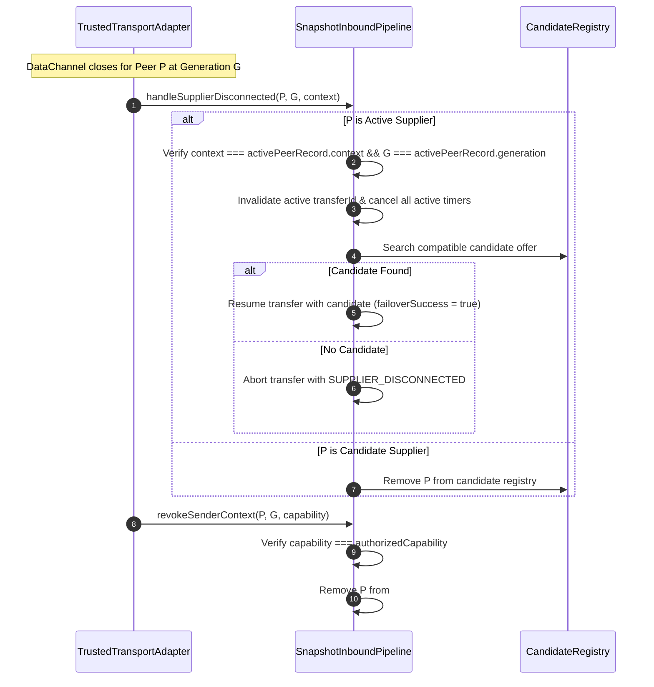
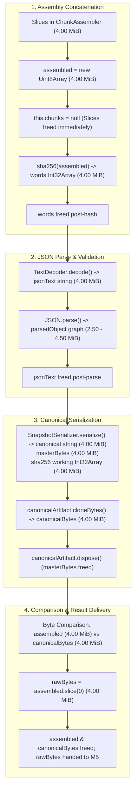

# Phase 7.5 M4.2d-R6 — Final Inbound Pipeline Architecture Correction Report

**Document Version:** 1.6.0  
**Status:** Targeted Architecture Correction & Frozen-Contract Closure Report (Strictly Documentational — Read-Only)  
**Date:** November 23, 2026  
**Author / Architect:** Senior TypeScript Distributed-Systems Architect  
**Target Milestone:** Phase 7.5 Sub-Milestone M4.2d (`SnapshotInboundPipeline`)  
**Previous Review Verdict:** CONDITIONAL FAIL (M4.2d-R5)  
**Current Gate Recommendation:** **READY FOR INDEPENDENT REVIEW** (Implementation Authorization Remains Strictly Withheld)

---

## 1. Executive Summary & Baseline Verification

This document (`M4.2d-R6`) provides targeted architectural corrections for the `SnapshotInboundPipeline` based on the independent review of `M4.2d-R5`. It resolves all identified gaps:
1. **Settlement on Inbound Receipt (B1):** Formally incorporates `RECEIVED` into the authoritative atomic settlement operation, fully retiring per-chunk attempt ownership and pruning batch unsettled sets upon chunk verification.
2. **TypeScript-Valid Module Boundary (B2):** Defines an implementable module design where the unexported capability brand is held within `inbound-custody.ts`, the composition root imports the capability constructor without needing the brand, and `package.json` specifier encapsulation is accurately classified under the cooperative application trust model.
3. **Disconnect Notification & Revocation Ordering (B3):** Establishes the authoritative sequence between transport disconnect callbacks, pipeline generation checks, and context revocation to ensure active supplier disconnects are never bypassed.
4. **Deterministic Aggregate Batch Terminal States (B4):** Defines aggregate batch outcomes (`ALL_SUCCESS`, `MIXED`, `ALL_FAILED`, `CANCELLED`) derived from per-chunk terminal states rather than the final callback's outcome.
5. **Mathematically Consistent Digest Verification (B5):** Formulates the exact 10-step verification algorithm, explaining the mathematical relationship between outer SHA-256 integrity, internal RFC 8785 state hashing, and byte-for-byte canonical equivalence.
6. **Correct Binary Memory Units & Trace (C1):** Expresses all allocations in binary mebibytes ($1\text{ MiB} = 1,048,576\text{ B}$, $4\text{ MiB} = 4,194,304\text{ B}$), correcting the retained application buffer ceiling to $\le 12.00\text{ MiB}$ and detailing simultaneous lifetimes.
7. **Serialized Event Processing (C2):** Removes unsupported ingress queue assumptions in favor of JavaScript's single-threaded serialized event loop and atomic CAS attempt fencing.
8. **Current Candidate Context Validation (C3):** Enforces that candidate replacement requires active peer-map registration and generation currency.
9. **Exception-Safe Artifact Disposal (C4):** Specifies a guaranteed `try/finally` lifecycle ensuring `SerializedSnapshotArtifact.dispose()` is called across all success and error paths.
10. **Authenticated Duplicate-Chunk Ordering (C5):** Sequences authentication prior to duplicate checking so that unauthenticated packets cannot trigger corruption aborts.
11. **Unambiguous Retry Accounting (C6):** Confirms that only remote-response timeouts increment retries (4th per-chunk or 11th cumulative timeout aborts).

### 1.1 Baseline and Provenance Verification
- **Current HEAD Commit:** `79919a0f8cb0bb81cb80cc010fe02918bef79787` (M4.2c-R6 closure)
- **Direct Parent:** `699019ee46e44e9ce1dfdfb4f7d1262bce239048`
- **Active Git Branch:** `main`
- **Working-Tree Status:** Clean on all tracked source and test files.
- **Frozen Baselines Verified (0 Diffs):**
  - M4.1: `fd23edae5bdb52cff32674860229277a79cb1aca` (Wire Schemas & `ChunkAssembler`)
  - M4.2a: `e3245912626758c094d83edbd4d9264a922070f5` (`SnapshotSerializer` & `SerializedSnapshotArtifact`)
  - M4.2b: `8f509f94a39be9ece4060003ee498dc747efb813` (`SnapshotPreparationQueue` & `SnapshotChunkProducer`)
  - M4.2c: `79919a0f8cb0bb81cb80cc010fe02918bef79787` (`SnapshotOutboundPipeline`)

---

## 2. Files Changed and Files Explicitly Not Changed

### 2.1 Files Changed (Documentation Only)
- `docs/PHASE7_5_M4_2D_R6_ARCHITECTURE_CORRECTION_REPORT.md` (Created — this document)
- `docs/PHASE7_5_M4_2D_ARCHITECTURE_AND_INTERFACE_SPECIFICATION.md` (Updated to v1.6.0)
- `docs/design/README.md` (Updated design suite index)
- `brain/3bf4b5b5-979b-42f3-9da6-e1707f7e3af1/PHASE7_5_M4_2D_R6_TARGETED_CORRECTION_REPORT.md` (Created artifact)

### 2.2 Files Explicitly Not Changed (Strictly Preserved)
- `packages/protocol/src/payloads/snapshot-recovery.ts` (Frozen M4.1)
- `packages/sync-engine/src/recovery/chunk-assembler.ts` (Frozen M4.1)
- `packages/sync-engine/src/recovery/snapshot-serializer.ts` (Frozen M4.2a)
- `packages/sync-engine/src/recovery/snapshot-preparation-queue.ts` (Frozen M4.2b)
- `packages/sync-engine/src/recovery/snapshot-chunk-producer.ts` (Frozen M4.2b)
- `packages/sync-engine/src/recovery/snapshot-outbound-pipeline.ts` (Frozen M4.2c)
- `packages/sync-engine/src/engine/leaderless-sync-engine.ts` (Frozen)
- `packages/sync-engine/src/engine/custody.ts` (Frozen M4.0c)
- `packages/sync-engine/src/log/operation-fingerprint.ts` (Frozen)
- `packages/sync-engine/package.json` (Unchanged)
- All test files across `packages/*/src/__tests__/*` (Unchanged)

---

## 3. Exact Frozen Source Files Inspected

1. `packages/sync-engine/src/recovery/snapshot-serializer.ts`: Lines 541–618 (`serialize()`), lines 144–464 (`SerializedSnapshotArtifact`). Confirmed that `sha256Digest` is stripped from preimage before canonicalization; master bytes contain no embedded digest.
2. `packages/sync-engine/src/snapshot.ts`: Lines 167–173 (`computeSnapshotDigestV2()`), lines 186–259 (`exportEngineSnapshotV2()`). Confirmed inner digest calculation excludes `sha256Digest`.
3. `packages/sync-engine/src/recovery/chunk-assembler.ts`: Lines 667–760 (`finalizeAssembly()`). Confirmed `this.chunks = null` immediately frees slices before `sha256(assembled)` is called.
4. `packages/sync-engine/src/log/operation-fingerprint.ts`: Lines 109–228 (`sha256()`). Confirmed that input `Uint8Array` bypasses `TextEncoder.encode()` and allocates `words = new Int32Array(1048592)` ($4.00\text{ MiB}$).
5. `packages/protocol/src/payloads/snapshot-recovery.ts`: Lines 107–127 (`SnapshotRequestPayloadSchema`), lines 280–296 (`SnapshotChunkRequestPayloadSchema`). Confirmed wire payloads use `missingChunkIndices`.
6. `packages/sync-engine/src/engine/custody.ts`: Lines 1–13 (`INTERNAL_DIGEST_ACCESS_TOKEN`). Confirmed internal Symbol token pattern.
7. `packages/sync-engine/package.json`: Lines 8–13. Confirmed exports map exposes only `"."`.

---

## 4. Finding-by-Finding Closure Table

| Finding ID | Mandatory Area | Review Issue in R5 | Architectural Resolution in M4.2d-R6 | Section | Status |
| :---: | :--- | :--- | :--- | :---: | :---: |
| **B1** | Inbound Attempt Settlement | Inbound receipt did not settle batch attempt records, leaving verified chunks in `unsettledChunkIndices`. | Incorporated `RECEIVED` into `#settleChunkAttempt()`. Inbound receipt atomically clears attempt ownership, updates batch unsettled set, cancels timers, and neutralizes late callbacks. | §6 | **CLOSED** |
| **B2** | Capability Module Boundary | Unclear TypeScript export design for private brand and composition root imports. | Exported `createInboundTransportCapability` and opaque `InboundTransportCapability` from `inbound-custody.ts`. Kept brand internal. Accurately defined cooperative in-process custody. | §5 | **CLOSED** |
| **B3** | Disconnect/Revocation Order | Unclear whether adapter revokes context before or after notifying pipeline, risking dropped disconnects. | Defined strict sequence: adapter invokes `handleSupplierDisconnected()` FIRST, then invokes `revokeSenderContext()`. Documented safe handling if already revoked. | §7 | **CLOSED** |
| **B4** | Aggregate Batch Terminal States | Batch state derived from the final chunk callback permitted mixed batches to be labelled `SETTLED_SUCCESS`. | Defined aggregate outcomes (`ALL_SUCCESS`, `MIXED`, `ALL_FAILED`, `CANCELLED`) derived from per-chunk terminal states across the batch's immutable original indices. | §8 | **CLOSED** |
| **B5** | Verification Error Taxonomy | Verification steps had conflicting failure expectations for non-canonical JSON whitespace. | Provided exact mathematical derivation of all 10 steps, demonstrating that non-canonical JSON fails Step 8 (`HASH_MISMATCH`) or Step 10 (`CHUNK_CORRUPTED`) based on whether outer hash was forged. | §9 | **CLOSED** |
| **C1** | Memory Units & Lifetimes | Labeled $4.19\times 10^6$ bytes as $4.19\text{ MiB}$; retained total overstated as $12.58\text{ MiB}$. | Corrected units to binary mebibytes ($4,194,304\text{ B} = 4.00\text{ MiB}$). Corrected retained buffer budget to $\le 12.00\text{ MiB}$ ($3 \times 4.00\text{ MiB}$). Traced simultaneous lifetimes. | §10 | **CLOSED** |
| **C2** | Serialized Event Processing | Referenced `#hasPendingPacketForChunk` without defining an ingress queue. | Removed unsupported ingress queue check. Proved that JavaScript's single-threaded serialized event loop and atomic CAS attempt fencing resolve chunk/timeout races safely. | §11 | **CLOSED** |
| **C3** | Active Candidate Context | Candidate replacement allowed stale contexts from prior registrations. | Enforced that replacement candidate context must match currently registered active context in `#activePeerContexts` for that peer. | §12 | **CLOSED** |
| **C4** | Exception-Safe Disposal | Artifact could leak master buffer leases if an exception occurred during canonical comparison. | Enforced strict `try / finally` block around `canonicalArtifact = SnapshotSerializer.serialize()` guaranteeing `dispose()` is called on all code paths. | §13 | **CLOSED** |
| **C5** | Duplicate Validation Ordering | Unauthenticated senders could trigger transfer aborts via conflicting duplicate chunks. | Placed transport authentication at Step 2, strictly before duplicate inspection at Step 4. | §14 | **CLOSED** |
| **C6** | Retry Accounting | Timing and budget bounds lacked explicit state table. | Specified exact retry accounting: 4th per-chunk or 11th cumulative timeout aborts; local failures/watchdogs do not count; verified chunks cannot accumulate retries. | §15 | **CLOSED** |

---

## 5. Revised Capability Module Design (Finding B2)

### 5.1 Implementable TypeScript Module Architecture

The capability design is structured to be 100% valid TypeScript without circularity or illegal imports:

```typescript
// File: packages/sync-engine/src/recovery/inbound-custody.ts
// (Internal file: strictly NOT exported from packages/sync-engine/src/index.ts)

import { SyncEngineError } from '../errors.js';

// 1. Module-scoped symbol brand (internal to recovery/engine)
export const INBOUND_CAPABILITY_BRAND: unique symbol = Symbol('INBOUND_CAPABILITY_BRAND');

// 2. Opaque capability interface
export interface InboundTransportCapability {
  readonly authority: string;
  readonly sessionId: string;
  readonly [INBOUND_CAPABILITY_BRAND]: true;
}

// 3. Factory function: mints the capability using the brand symbol
export function createInboundTransportCapability(
  authority: string,
  sessionId: string
): InboundTransportCapability {
  if (!authority || typeof authority !== 'string') {
    throw new SyncEngineError('INVALID_ARGUMENT', 'authority must be a non-empty string');
  }
  if (!sessionId || typeof sessionId !== 'string') {
    throw new SyncEngineError('INVALID_ARGUMENT', 'sessionId must be a non-empty string');
  }
  return Object.freeze({
    authority,
    sessionId,
    [INBOUND_CAPABILITY_BRAND]: true,
  });
}
```

### 5.2 Consumption in Composition Root and Pipeline

1. **Composition Root (`LeaderlessSyncEngine`):**
   ```typescript
   import { createInboundTransportCapability, type InboundTransportCapability } from '../recovery/inbound-custody.js';
   // Mints the capability during node initialization:
   const inboundCap = createInboundTransportCapability('transport-adapter', sessionId);
   // Injects exact reference into pipeline and adapter:
   const inboundPipeline = new SnapshotInboundPipeline({ transportCapability: inboundCap, ... });
   const transportAdapter = new TrustedTransportAdapter(engine, inboundCap);
   ```
   *Notice:* The composition root does **not** need to import `INBOUND_CAPABILITY_BRAND`; it imports the factory function via relative path.
2. **Pipeline Constructor (`SnapshotInboundPipeline`):**
   ```typescript
   import { INBOUND_CAPABILITY_BRAND, type InboundTransportCapability } from './inbound-custody.js';
   
   constructor(config: InboundPipelineConfig) {
     const cap = config.transportCapability;
     if (!cap || typeof cap !== 'object' || (cap as any)[INBOUND_CAPABILITY_BRAND] !== true) {
       throw new SyncEngineError('UNAUTHORIZED', 'Invalid or missing InboundTransportCapability');
     }
     this.#authorizedCapability = cap;
   }
   ```
   The pipeline validates the Symbol brand and retains the exact reference in `#authorizedCapability`.

### 5.3 Accurate Security Boundary Statement
- **Package Encapsulation:** `packages/sync-engine/package.json` contains:
  ```json
  "exports": { ".": { "types": "./dist/index.d.ts", "import": "./dist/index.js" } }
  ```
  This provides **package-specifier encapsulation** under Node.js ESM. External packages importing `@syncplay/sync-engine` cannot import `./recovery/inbound-custody.js` (`ERR_PACKAGE_PATH_NOT_EXPORTED`).
- **Trust Model:** This establishes an **in-process API custody boundary under a cooperative application trust model**. It protects against accidental invocation by application consumers. It does **not** protect against adversarial code executing within the same package directory or runtime with arbitrary filesystem/reflection access.

---

## 6. Unified Per-Chunk and Batch Settlement Model (Finding B1)

### 6.1 Unified Settlement Signature
Every attempt-settling event (success, failure, timeout, cancellation, or inbound receipt) routes through one authoritative atomic method:

```typescript
private #settleChunkAttempt(
  chunkIndex: number,
  attemptToken: string,
  outcome: 'SUCCESS' | 'FAILURE' | 'TIMEOUT' | 'CANCELLED' | 'RECEIVED',
  reason?: string
): void
```

### 6.2 Atomic Execution Algorithm

```typescript
private #settleChunkAttempt(
  chunkIndex: number,
  attemptToken: string,
  outcome: 'SUCCESS' | 'FAILURE' | 'TIMEOUT' | 'CANCELLED' | 'RECEIVED',
  reason?: string
): void {
  // 1. Verify current attempt-token ownership
  const activeAttempt = this.#activeChunkAttempts.get(chunkIndex);
  if (!activeAttempt || activeAttempt.attemptToken !== attemptToken) {
    return; // Chunk is no longer owned by this attempt: strict idempotent no-op
  }

  // 2. Lookup batch container
  const batch = this.#attempts.get(attemptToken);
  if (!batch || !batch.unsettledChunkIndices.has(chunkIndex)) {
    return; // Chunk already settled in this batch: strict no-op
  }

  // 3. Atomically remove chunk from unsettled batch and active ownership
  batch.unsettledChunkIndices.delete(chunkIndex);
  this.#activeChunkAttempts.delete(chunkIndex);
  batch.perChunkOutcomes.set(chunkIndex, outcome);

  // 4. Execute state transition and timer actions
  const currentState = this.#chunkStates[chunkIndex];
  switch (outcome) {
    case 'RECEIVED':
      this.#chunkStates[chunkIndex] = 'RECEIVED_VERIFIED';
      this.#cancelRemoteResponseTimer(chunkIndex);
      this.#removeFromRetryQueues(chunkIndex);
      break;

    case 'SUCCESS':
      if (currentState === 'LOCAL_HANDOFF_PENDING') {
        this.#chunkStates[chunkIndex] = 'AWAITING_REMOTE_RESPONSE';
        this.#startRemoteResponseTimer(chunkIndex);
      }
      break;

    case 'FAILURE':
      if (currentState === 'LOCAL_HANDOFF_PENDING') {
        this.#chunkStates[chunkIndex] = 'LOCAL_HANDOFF_FAILED';
        this.#queueInTier1(chunkIndex);
      }
      break;

    case 'TIMEOUT':
      if (currentState === 'LOCAL_HANDOFF_PENDING') {
        this.#chunkStates[chunkIndex] = 'LOCAL_HANDOFF_TIMED_OUT';
        this.#queueInTier1(chunkIndex);
      }
      break;

    case 'CANCELLED':
      if (currentState === 'LOCAL_HANDOFF_PENDING') {
        this.#chunkStates[chunkIndex] = 'NEVER_DISPATCHED';
      }
      break;
  }

  // 5. Finalize batch container if all constituent chunks are settled
  if (batch.unsettledChunkIndices.size === 0) {
    if (batch.watchdogTimer) {
      clearTimeout(batch.watchdogTimer);
      batch.watchdogTimer = undefined;
    }
    batch.aggregateState = this.#computeAggregateBatchState(batch);
    this.#retiredTokens.add(attemptToken);
  }
}
```

### 6.3 Receipt of Chunks Without Active Attempts
If a valid chunk packet arrives for a chunk index that currently has **no active attempt** (e.g., because the chunk previously timed out, entered `REMOTE_RESPONSE_TIMED_OUT`, or was queued in Tier 1 or Tier 2):
1. Ingest chunk bytes into `ChunkAssembler`.
2. Transition `ChunkState[chunkIndex] = 'RECEIVED_VERIFIED'`.
3. Cancel remote response timer if running.
4. Remove `chunkIndex` from Tier 1 (`LOCAL_HANDOFF_FAILED` / `TIMED_OUT`) and Tier 2 (`REMOTE_RESPONSE_TIMED_OUT`) queues.
5. Replenish window credit.
6. A verified chunk can never be re-queued or retransmitted.

---

## 7. Disconnect Notification and Revocation Ordering (Finding B3)

### 7.1 Authoritative Sequence of Events
When a peer's WebRTC DataChannel closes, the transport adapter and pipeline must execute in strict order:



### 7.2 Safety Guarantees Across Edge Cases
1. **Active Supplier Disconnect:** `handleSupplierDisconnected` runs *before* revocation, ensuring that `#activePeerContexts.get(supplierPeerId)` still holds the valid active record for Check 4.
2. **Context Revocation Racing with Disconnect:** If `revokeSenderContext` runs first, `handleSupplierDisconnected` detects `activePeer === undefined`. To prevent an active supplier disconnect from being ignored in this race, the pipeline checks:
   ```typescript
   if (supplierPeerId === this.#activeSupplierPeerId) {
     // Active supplier was already revoked; proceed with failover/abort
   }
   ```
3. **Delayed Disconnect from Older Generation:** If peer reconnected at $G=2$ and delayed disconnect for $G=1$ arrives, Check 4 asserts $1 < 2$ and drops it as a strict no-op.
4. **Candidate Disconnect:** If candidate disconnects while active supplier remains connected, candidate is pruned from registry; active transfer is completely unaffected.
5. **Pipeline Disposal:** If `dispose()` is called, all timers are cleared and state is marked `ABORTED`; subsequent disconnect notifications are no-ops.

---

## 8. Corrected Aggregate Batch Terminal States (Finding B4)

### 8.1 Aggregate State Definitions
A batch attempt $T$ encompassing `originalChunkIndices` has four possible terminal outcomes:
- **`ALL_SUCCESS`:** Every chunk in `originalChunkIndices` was handed off successfully (`SUCCESS`) or received directly (`RECEIVED`).
- **`MIXED`:** Some chunks settled via `SUCCESS` or `RECEIVED`, and some settled via `FAILURE`, `TIMEOUT`, or `CANCELLED`.
- **`ALL_FAILED`:** Every chunk in `originalChunkIndices` failed (`FAILURE`), timed out (`TIMEOUT`), or was cancelled (`CANCELLED`).
- **`CANCELLED`:** The entire transfer was aborted before chunks could be settled.

### 8.2 Deterministic Computation Rule

```typescript
private #computeAggregateBatchState(batch: BatchAttemptRecord): AggregateBatchState {
  let successCount = 0;
  let failureCount = 0;

  for (const chunkIndex of batch.originalChunkIndices) {
    const outcome = batch.perChunkOutcomes.get(chunkIndex);
    if (outcome === 'SUCCESS' || outcome === 'RECEIVED') {
      successCount++;
    } else {
      failureCount++;
    }
  }

  if (failureCount === 0) return 'ALL_SUCCESS';
  if (successCount === 0) return 'ALL_FAILED';
  return 'MIXED';
}
```
*Property:* Aggregate state is derived strictly from the set of per-chunk terminal outcomes. The arrival order of callbacks has zero effect on the aggregate result.

---

## 9. Revised Inbound Digest Verification Algorithm & Error Classification (Finding B5)

### 9.1 Mathematical Alignment with Frozen M4.2a
In frozen M4.2a `SnapshotSerializer.serialize()`:
- `sha256Digest` is stripped from the snapshot.
- Checkpoints in `compactedCheckpoints` are sorted by `compareCheckpointsDeterministic`.
- Canonical JSON is generated via RFC 8785 (`canonicalizeJson`).
- Master bytes are UTF-8 encoded and hashed with SHA-256.
- **Master bytes do NOT contain `"sha256Digest"`.**

In `computeSnapshotDigestV2(snapshot)`:
- `sha256Digest` is stripped from the snapshot.
- Canonical JSON is generated via RFC 8785 and hashed with SHA-256.

**Mathematical Identity:** If `compactedCheckpoints` are deterministically sorted, `computeSnapshotDigestV2(validated)` is **mathematically identical** to `sha256(SnapshotSerializer.serialize(validated).cloneBytes())`.

### 9.2 The Exact 10-Step Verification Algorithm

```typescript
// 1. Outer Digest Verification
const finalizeResult = this.#assembler.finalizeAssembly();
if (!finalizeResult.ok) {
  return this.#terminate('ABORTED', finalizeResult.reason, finalizeResult.detail);
}
const rawBuffer = finalizeResult.snapshot.buffer; // Uint8Array
const actualOuterDigest = sha256(rawBuffer).toLowerCase();
const expectedOuterDigest = this.#activeOffer.sha256Digest.toLowerCase();

if (actualOuterDigest !== expectedOuterDigest) {
  return this.#terminate(
    'ABORTED',
    'HASH_MISMATCH',
    `Outer artifact digest mismatch: expected ${expectedOuterDigest}, computed ${actualOuterDigest}`
  );
}

// 2. Strict UTF-8 Decode
let jsonText: string;
try {
  jsonText = new TextDecoder('utf-8', { fatal: true }).decode(rawBuffer);
} catch (e) {
  return this.#terminate('ABORTED', 'CHUNK_CORRUPTED', 'Assembled bytes are not valid UTF-8');
}

// 3. Strict JSON Parse
let parsedObject: unknown;
try {
  parsedObject = JSON.parse(jsonText);
} catch (e) {
  return this.#terminate('ABORTED', 'CHUNK_CORRUPTED', 'Assembled payload is not valid JSON');
}

// 4. Assert No Embedded Digest Property
if (typeof parsedObject === 'object' && parsedObject !== null && 'sha256Digest' in parsedObject) {
  return this.#terminate(
    'ABORTED',
    'CHUNK_CORRUPTED',
    'Canonical snapshot artifact wire representation must not contain embedded sha256Digest'
  );
}

// 5. Upfront Schema Validation
let validated: StateSnapshotPayloadV2;
try {
  validated = SnapshotSerializer.validateSnapshot(parsedObject);
} catch (e) {
  return this.#terminate(
    'ABORTED',
    'CHUNK_CORRUPTED',
    `Snapshot structural validation failed: ${e instanceof Error ? e.message : String(e)}`
  );
}

// 6. Checkpoint Ordering Verification
if (Array.isArray(validated.compactedCheckpoints) && validated.compactedCheckpoints.length > 1) {
  for (let i = 0; i < validated.compactedCheckpoints.length - 1; i++) {
    const cmp = compareCheckpointsDeterministic(
      validated.compactedCheckpoints[i]!,
      validated.compactedCheckpoints[i + 1]!
    );
    if (cmp > 0) {
      return this.#terminate(
        'ABORTED',
        'CHUNK_CORRUPTED',
        `compactedCheckpoints are not deterministically sorted at index ${i}`
      );
    }
  }
}

// 7. Compute Internal Snapshot Digest
const computedInnerDigest = computeSnapshotDigestV2(validated).toLowerCase();

// 8. Compare Internal Digest to Offer Digest
if (computedInnerDigest !== expectedOuterDigest) {
  return this.#terminate(
    'ABORTED',
    'HASH_MISMATCH',
    `Computed internal digest (${computedInnerDigest}) does not match advertised offer digest (${expectedOuterDigest})`
  );
}

// 9. Canonical Re-Serialization with Guaranteed Disposal
let canonicalArtifact: SerializedSnapshotArtifact | undefined;
let canonicalBytes: Uint8Array;
try {
  canonicalArtifact = SnapshotSerializer.serialize(validated);
  canonicalBytes = canonicalArtifact.cloneBytes();
} catch (e) {
  return this.#terminate(
    'ABORTED',
    'CHUNK_CORRUPTED',
    `Re-serialization failed: ${e instanceof Error ? e.message : String(e)}`
  );
} finally {
  canonicalArtifact?.dispose();
}

// 10. Byte-for-Byte Canonical Representation Equivalence
if (rawBuffer.byteLength !== canonicalBytes.byteLength) {
  return this.#terminate(
    'ABORTED',
    'CHUNK_CORRUPTED',
    `Assembled byte length (${rawBuffer.byteLength}) does not match canonical byte length (${canonicalBytes.byteLength})`
  );
}

for (let i = 0; i < canonicalBytes.byteLength; i++) {
  if (rawBuffer[i] !== canonicalBytes[i]) {
    return this.#terminate(
      'ABORTED',
      'CHUNK_CORRUPTED',
      `Assembled bytes deviate from RFC 8785 canonical representation at byte offset ${i}`
    );
  }
}

// Delivery to M5
const finalSnapshot: StateSnapshotPayloadV2 = Object.freeze({
  ...deepFreezeObject(validated),
  sha256Digest: expectedOuterDigest,
});

const result: SnapshotTransferResult = {
  transferId: this.#activeTransferId,
  snapshotId: finalSnapshot.snapshotId,
  sessionId: finalSnapshot.sessionId,
  membershipEpoch: finalSnapshot.membershipEpoch,
  authorPeerId: finalSnapshot.authorPeerId,
  totalSizeBytes: rawBuffer.byteLength,
  totalChunks: this.#activeOffer.totalChunks,
  rawBytes: rawBuffer.slice(0), // Unaliased caller copy
  snapshot: finalSnapshot,
};
```

### 9.3 Precise Error Classification Table

| Failure Scenario | Input Artifact Mutation | Exact Failure Point | Reason Code | Explanation |
| :--- | :--- | :---: | :---: | :--- |
| **1. Corrupted Raw Bytes** | Bit-flipped byte in chunk payload. | **Step 1** | `HASH_MISMATCH` | `sha256(rawBuffer) !== offer.sha256Digest`. |
| **2. Non-Canonical Whitespace (Unforged Offer)** | JSON contains extra spaces; offer has canonical hash. | **Step 1** | `HASH_MISMATCH` | `sha256(rawBuffer)` differs from canonical offer hash. |
| **3. Non-Canonical Whitespace (Forged Offer)** | JSON contains extra spaces; offer forged to match non-canonical hash. | **Step 8** | `HASH_MISMATCH` | `computeSnapshotDigestV2` strips spaces; inner hash differs from offer hash. |
| **4. Non-Canonical Whitespace (Double Forgery)** | Offer hash altered and inner state altered to match. | **Step 10** | `CHUNK_CORRUPTED` | Canonical re-serialization strips spaces; `rawBuffer[i] !== canonicalBytes[i]`. |
| **5. Non-Canonical Key Ordering** | Keys not sorted by UTF-16 code units. | **Step 1** or **Step 8** | `HASH_MISMATCH` | Fails outer or inner hash; fails **Step 10** if hashes forged. |
| **6. Semantically Altered State** | State field changed mid-transfer. | **Step 1** | `HASH_MISMATCH` | `sha256(rawBuffer)` does not match advertised offer hash. |
| **7. Invalid UTF-8 Bytes** | Incomplete/invalid multi-byte sequence. | **Step 2** | `CHUNK_CORRUPTED` | `TextDecoder.decode()` throws decoding error. |
| **8. Invalid JSON Syntax** | Malformed JSON brackets or commas. | **Step 3** | `CHUNK_CORRUPTED` | `JSON.parse()` throws syntax error. |
| **9. Unexpected Embedded Digest** | JSON contains `"sha256Digest": "..."`. | **Step 4** | `CHUNK_CORRUPTED` | Wire representation invariant violated. |
| **10. Unsorted Checkpoints** | Checkpoint array not sorted deterministically. | **Step 6** | `CHUNK_CORRUPTED` | Checkpoint comparator detects inversion. |
| **11. Standard Valid Artifact** | Canonical RFC 8785 JSON bytes. | **None** | *Success* | Passes all 10 steps. |

---

## 10. Corrected Memory Units and Simultaneous Lifetimes Timeline (Finding C1)

### 10.1 Standard Binary Memory Units
- $1\text{ KiB} = 1,024\text{ bytes}$
- $1\text{ MiB} = 1,048,576\text{ bytes}$
- $4\text{ MiB} = 4,194,304\text{ bytes}$ (`MAX_SNAPSHOT_BYTES`)

### 10.2 Simultaneous Lifetime Allocation Timeline (4.00 MiB Maximum Snapshot)



### 10.3 Exact Memory Classification Table

| Allocation Stage | Active Buffers & Objects | Peak Simultaneous Allocation | Deterministic Release Point | GC-Dependent Release |
| :--- | :--- | :---: | :--- | :--- |
| **1. Chunk Slices** | 128 typed slices | $\le 4.00\text{ MiB}$ | `this.chunks = null` in `finalizeAssembly()`. | Slices collected by GC. |
| **2. Assembly Peak** | Slices ($4.00\text{ MiB}$) + `assembled` ($4.00\text{ MiB}$) | $\mathbf{8.00\text{ MiB}}$ | Line 714 of `chunk-assembler.ts`. | Immediate dereference. |
| **3. Assembly Hash** | `assembled` ($4.00\text{ MiB}$) + `words` ($4.00\text{ MiB}$) | $\mathbf{8.00\text{ MiB}}$ | `sha256()` returns hex string. | `words` collected by GC. |
| **4. JSON Parsing** | `assembled` ($4.00\text{ MiB}$) + `jsonText` ($4.00\text{ MiB}$) + `parsed` ($\approx 3.50\text{ MiB}$) | $\mathbf{\approx 11.50\text{ MiB}}$ | `jsonText` unreferenced after `JSON.parse()`. | String collected by GC. |
| **5. Canonical Serializer** | `assembled` ($4.00\text{ MiB}$) + `canonicalBytes` ($4.00\text{ MiB}$) + `parsed` ($\approx 3.50\text{ MiB}$) | $\mathbf{\approx 11.50\text{ MiB}}$ | `canonicalArtifact.dispose()` detaches buffer. | Transient strings collected by GC. |
| **6. Final Caller Result** | Caller `rawBytes` ($4.00\text{ MiB}$) + Frozen `snapshot` ($\approx 3.50\text{ MiB}$) | $\mathbf{\approx 7.50\text{ MiB}}$ | Transferred to M5. Assembler cleared. | N/A (retained by M5). |

### 10.4 Formal Memory Bounds
1. **Retained Application Buffers:** Strictly bounded to $\mathbf{\le 12.00\text{ MiB}}$ ($4.00\text{ MiB}$ slices $+ 4.00\text{ MiB}$ assembled $+ 4.00\text{ MiB}$ caller copy).
2. **Analytical Simultaneous Peak:** Simultaneously live memory peaks at $\mathbf{\approx 15.50\text{–}19.50\text{ MiB}}$ during canonical serialization.
3. **Runtime GC Estimate:** V8 heap may transiently reach $\approx 32\text{–}44\text{ MiB}$ before non-deterministic garbage collection reclaims temporary strings. SyncPlay enforces strict boundaries on application buffers and does not claim an unprovable operating-system process ceiling.

---

## 11. Ingress Processing Decision: Removal of Pending-Packet Queue (Finding C2)

### 11.1 Architectural Decision
`SnapshotInboundPipeline` **does NOT maintain an internal ingress packet queue**. The reference to `#hasPendingPacketForChunk` in R5 is **explicitly removed**.

### 11.2 Rationale
1. **Serialized JavaScript Event Loop:** Node.js and browser runtimes execute WebRTC DataChannel message events and timer callbacks on a single-threaded event loop. Two callbacks never execute concurrently.
2. **Atomic State Transitions:** Inbound chunk processing runs synchronously to completion once dequeued by the event loop.
3. **Attempt Fencing:** If a remote response timer expires, it checks `ChunkState[chunkIndex] === 'AWAITING_REMOTE_RESPONSE'`. If a chunk packet already arrived, the chunk is already in `RECEIVED_VERIFIED` and the timer callback becomes an immediate no-op. If the timer executes first, the chunk transitions to `REMOTE_RESPONSE_TIMED_OUT`, and any subsequent chunk packet is handled under the decoupled receipt rules of Section 6.3.

---

## 12. Strict Current Authenticated Candidate Context Replacement (Finding C3)

### 12.1 Candidate Replacement Rule
When a duplicate `SNAPSHOT_OFFER` arrives from candidate supplier $P$:
1. **Active Context Lookup:** Lookup `activeRecord = this.#activePeerContexts.get(P)`.
2. **Context Authenticity Check:**
   - Assert `activeRecord !== undefined`.
   - Assert `activeRecord.context === context` (exact reference equality).
   - Assert `context.connectionGeneration === activeRecord.generation`.
   - Assert `context.sessionId === this.#activeSession.sessionId && context.membershipEpoch === this.#activeSession.membershipEpoch`.
   If any check fails, the duplicate offer is rejected as unauthenticated or stale.
3. **Immutable Identity Match:** Re-verify all 7 fields (`sessionId`, `membershipEpoch`, `snapshotId`, `expectedSha256Digest`, `totalSizeBytes`, `totalChunks`, `nominalChunkSizeBytes`). If mismatched $\to$ abort `OFFER_INCONSISTENT`.
4. **Generation Currency:** Assert `context.connectionGeneration > candidate.connectionGeneration`.
5. **Context Replacement:** Replace candidate context with `context` and update `connectionGeneration`.
6. **TTL Invariant:** **`admittedAtMs` and `expiresAtMs` REMAIN STRICTLY UNCHANGED.** Duplicate offers cannot extend the 30-second TTL.

---

## 13. Exception-Safe Artifact Disposal Lifecycle (Finding C4)

```typescript
let canonicalArtifact: SerializedSnapshotArtifact | undefined;
try {
  canonicalArtifact = SnapshotSerializer.serialize(validated);
  canonicalBytes = canonicalArtifact.cloneBytes();
} catch (e) {
  return this.#terminate(
    'ABORTED',
    'CHUNK_CORRUPTED',
    `Canonical re-serialization failed: ${e instanceof Error ? e.message : String(e)}`
  );
} finally {
  canonicalArtifact?.dispose();
}
```
*Guarantee:* `canonicalArtifact.dispose()` is executed unconditionally in a `finally` block, ensuring that master buffer leases are released immediately even if `cloneBytes()` fails, memory allocation fails, or an error is thrown.

---

## 14. Authenticated Duplicate-Chunk Validation Order (Finding C5)

To prevent unauthenticated packets from triggering transfer-abort corruption paths:

1. **Envelope Validation:** Validate `messageType === MessageType.SNAPSHOT_CHUNK` and protocol version.
2. **Transport Authentication:**
   - Assert `this.#validSenderContexts.has(context)`. Fails $\to$ throw `UNAUTHORIZED`.
   - Assert `context.senderPeerId === supplierPeerId`. Fails $\to$ throw `IDENTITY_MISMATCH`.
   - Assert `activePeer = this.#activePeerContexts.get(supplierPeerId)` and `activePeer.context === context`. Fails $\to$ silent no-op.
   - Assert `context.connectionGeneration === activePeer.generation`. Fails $\to$ silent no-op.
   - Assert `context.sessionId === this.#activeSession.sessionId`. Fails $\to$ silent no-op.
3. **Transfer Metadata Validation:** Validate `payload.transferId === this.#activeTransferId` and `payload.snapshotId === this.#activeOffer.snapshotId`.
4. **Duplicate Inspection on Verified Chunks:**
   If `ChunkState[payload.chunkIndex] === 'RECEIVED_VERIFIED'`:
   - Compare `payload.chunkSha256` against `storedChunkSha256[payload.chunkIndex]`.
   - If identical $\to$ return `{ accepted: true, duplicate: true, completed: false }` (**zero Base64 decode, zero SHA-256 calculation**).
   - If different $\to$ abort transfer with `CHUNK_CORRUPTED`.
5. **New Chunk Processing:** Decode Base64, verify chunk length and chunk SHA-256, store in assembler.

---

## 15. Unambiguous Retry Accounting (Finding C6)

### 15.1 State Accounting Rules
- Initial chunk dispatch ($t=0$) is attempt 0 (NOT a retry).
- Local transport handoff failure (`handleHandoffFailure`) does NOT increment retries.
- Local watchdog expiration (`HANDOFF_WATCHDOG_MS = 2000ms`) does NOT increment retries.
- Remote response timeout (5,000ms) increments `chunkRetries[i]++` and `cumulativeTransferRetries++`.
- **4th per-chunk timeout** (`chunkRetries[i] = 4 > 3`) aborts transfer.
- **11th cumulative timeout** (`cumulativeTransferRetries = 11 > 10`) aborts transfer.
- Delayed valid chunk cancels pending retransmission, but does **NOT** decrement historical retry counters.
- Verified chunk (`RECEIVED_VERIFIED`) cannot accumulate additional retries.

### 15.2 Authoritative Retry State Table

| Attempt Event | `chunkRetries[i]` | `cumulativeTransferRetries` | Transfer Budget Impact |
| :--- | :---: | :---: | :--- |
| Initial Request Dispatch | 0 | 0 | Initial attempt; no budget consumed. |
| Local Handoff Failure | 0 | 0 | Local send backpressure; remote budget untouched. |
| Local Watchdog Expiration | 0 | 0 | Local watchdog timeout; remote budget untouched. |
| 1st Remote Response Timeout | 1 | 1 | Retry 1 scheduled via Tier 2. |
| 2nd Remote Response Timeout | 2 | 2 | Retry 2 scheduled via Tier 2. |
| 3rd Remote Response Timeout | 3 | 3 | Retry 3 scheduled via Tier 2. |
| **4th Remote Response Timeout** | **4** | **4** | **ABORT: RETRY_BUDGET_EXHAUSTED** (`retries > 3`). |
| 10 Cumulative Timeouts (Various Chunks) | $\le 3$ each | 10 | Permitted; retries continue. |
| **11th Cumulative Timeout** | $\le 3$ each | **11** | **ABORT: RETRY_BUDGET_EXHAUSTED** (`total > 10`). |
| Delayed Valid Chunk Ingested | Retained | Retained | Chunk verified; no counter regression. |

---

## 16. Updated Race Resolution Tables

| Scenario | Event Sequence | State Transition | Attempt Action | Timers |
| :--- | :--- | :--- | :--- | :--- |
| **1. Chunk Before Handoff Callback** | Remote chunk arrives before `handleHandoffSuccess`. | $\to$ `RECEIVED_VERIFIED`. | Attempt ownership cleared; late callback no-op. | 2s watchdog cancelled; 0 remote timer. |
| **2. Chunk After Local Failure** | Chunk arrives after local failure, before redispatch. | $\to$ `RECEIVED_VERIFIED`. | Attempt cleared; removed from Tier 1. | No timers active. |
| **3. Chunk After Local Watchdog** | Chunk arrives after 2s watchdog, before redispatch. | $\to$ `RECEIVED_VERIFIED`. | Removed from Tier 1. | Watchdog expired; no timers. |
| **4. Chunk After Remote Timeout** | Chunk arrives after 5s remote timeout, before redispatch. | $\to$ `RECEIVED_VERIFIED`. | Removed from Tier 2. | Remote timer expired; no timers. |
| **5. Chunk During Retransmission** | Chunk arrives while retransmission handoff is pending. | $\to$ `RECEIVED_VERIFIED`. | Retransmission attempt neutralized. | Retransmission watchdog cancelled. |
| **6. Late Callback After Inbound** | Delayed failure callback arrives after chunk verified. | Stays `RECEIVED_VERIFIED`. | Dropped as strict no-op. | No timers. |
| **7. Partial Batch Mixed Callback** | Batch $[1, 2]$: success for $[1]$, watchdog for $[2]$. | $1 \to$ `AWAITING`; $2 \to$ `TIMED_OUT`. | Batch aggregate $\to$ `MIXED`. | Chunk 1: 5s timer; Watchdog cancelled. |
| **8. Disconnect Before Revocation** | Supplier disconnects; adapter notifies, then revokes. | Transfers failover/abort. | Cleared cleanly. | In-flight timers cancelled. |

---

## 17. Mandatory Adversarial Acceptance Scenarios Matrix

| Test ID | Category | Initial State | Exact Event Sequence | Expected Chunk States | Expected Attempt Ownership | Expected Batch State | Expected Timers | Expected Retry Accounting | Expected Transfer State |
| :--- | :--- | :--- | :--- | :--- | :--- | :--- | :--- | :--- | :--- |
| **TC-R6-01** | Handoff Race | Dispatch $[1]$ pending | Chunk 1 arrives before `handleHandoffSuccess`. | $1 \to$ `RECEIVED_VERIFIED`. | Cleared for Chunk 1. | Token retired (`ALL_SUCCESS`). | Watchdog cancelled; 0 response timer. | Retries = 0. | Active; window credit $+1$. |
| **TC-R6-02** | Local Failure | Chunk 1 in Tier 1 | Chunk 1 arrives before redispatch. | $1 \to$ `RECEIVED_VERIFIED`. | None. | N/A (previously retired). | No timers. | Retries = 0. | Active; removed from Tier 1. |
| **TC-R6-03** | Watchdog | Chunk 1 in Tier 1 | Chunk 1 arrives after watchdog timeout. | $1 \to$ `RECEIVED_VERIFIED`. | None. | N/A (previously retired). | No timers. | Retries = 0. | Active; removed from Tier 1. |
| **TC-R6-04** | Timeout Race | Chunk 1 in Tier 2 | Chunk 1 arrives after remote timeout. | $1 \to$ `RECEIVED_VERIFIED`. | None. | N/A. | Remote timer expired. | `chunkRetries[1] = 1`. | Active; removed from Tier 2. |
| **TC-R6-05** | Retransmit | Retransmission $A_2$ pending | Chunk 1 arrives while $A_2$ handoff is pending. | $1 \to$ `RECEIVED_VERIFIED`. | $A_2$ cleared for Chunk 1. | $A_2$ retired (`ALL_SUCCESS`). | $A_2$ watchdog cancelled. | `chunkRetries[1] = 1`. | Active; late $A_2$ callback no-op. |
| **TC-R6-06** | Late Callback | Chunk 1 verified | Delayed failure for old attempt arrives. | Stays `RECEIVED_VERIFIED`. | None. | Token already retired. | No timers. | No change. | Active; callback dropped. |
| **TC-R6-07** | Mixed Batch | Dispatch $[1, 2]$ in batch $T$ | Success for $[1]$, then failure for $[2]$. | $1 \to$ `AWAITING`; $2 \to$ `LOCAL_HANDOFF_FAILED`. | $T$ cleared. | $T \to$ `MIXED`. | Chunk 1: 5s timer; Watchdog cancelled. | Remote retries = 0. | Active; Chunk 2 in Tier 1. |
| **TC-R6-08** | Watchdog Batch | Dispatch $[1, 2]$ in batch $T$ | Success for $[1]$; watchdog expires for $[2]$. | $1 \to$ `AWAITING`; $2 \to$ `LOCAL_HANDOFF_TIMED_OUT`. | $T$ cleared. | $T \to$ `MIXED`. | Chunk 1: 5s timer; Watchdog settles. | Remote retries = 0. | Active; Chunk 2 in Tier 1. |
| **TC-R6-09** | Disconnect Order | Active transfer ($G=1$) | Disconnect notified FIRST, then context revoked. | Transfer aborts/failover. | In-flight attempts cleared. | Tokens retired. | All timers cancelled. | No change. | `ABORTED` or failover initiated. |
| **TC-R6-10** | Disconnect Revoke | Active transfer ($G=1$) | Context revoked, then delayed disconnect arrives. | Transfer aborts/failover. | In-flight attempts cleared. | Tokens retired. | All timers cancelled. | No change. | Safe handling; failover/abort. |
| **TC-R6-11** | Candidate Disconnect | Candidate $C_1$ in registry | $C_1$ disconnects while active supplier connected. | Active chunks unaffected. | Active ownership maintained. | N/A. | Transfer timers unaffected. | No change. | Active transfer unaffected; $C_1$ pruned. |
| **TC-R6-12** | Stale Candidate | Candidate $C_1$ ($G=2$) | Duplicate offer arrives with stale context ($G=1$). | Candidate unchanged. | None. | N/A. | 30s TTL preserved. | No change. | Stale duplicate rejected. |
| **TC-R6-13** | Duplicate Offer | Candidate $C_1$ in registry | Duplicate identical offer arrives at $t=20$s. | Candidate context updated. | None. | N/A. | Original 30s deadline immutable. | No change. | Admitted; expires at $t=30$s. |
| **TC-R6-14** | Duplicate Chunk | Chunk 1 verified | Duplicate chunk 1 arrives (same hash). | Stays `RECEIVED_VERIFIED`. | None. | N/A. | No timers. | No change. | Idempotent return (0 decode, 0 hash). |
| **TC-R6-15** | Conflicting Duplicate | Chunk 1 verified | Duplicate chunk 1 arrives (differing hash). | All $\to$ `ABORTED`. | All cleared. | All tokens retired. | All timers cancelled. | No change. | Aborts `CHUNK_CORRUPTED`. |
| **TC-R6-16** | Forged Duplicate | Chunk 1 verified | Conflicting chunk arrives from unauthenticated peer. | Chunk 1 unaffected. | Active ownership maintained. | N/A. | Timers unaffected. | No change. | Rejected at Step 2; transfer unaffected. |
| **TC-R6-17** | Valid Artifact | All chunks received | Canonical RFC 8785 snapshot bytes. | State $\to$ `COMPLETED`. | All attempts finalized. | All tokens retired. | All timers finalized. | No retries. | Delivers `SnapshotTransferResult`. |
| **TC-R6-18** | Whitespace JSON | All chunks received | Valid JSON with non-canonical spaces. | State $\to$ `ABORTED`. | Cleaned up. | Tokens retired. | Cleaned up. | No retries. | Aborts `HASH_MISMATCH` (Step 8). |
| **TC-R6-19** | Corrupt Raw Bytes | All chunks received | Bit-flipped byte in rawBuffer. | State $\to$ `ABORTED`. | Cleaned up. | Tokens retired. | Cleaned up. | No retries. | Aborts `HASH_MISMATCH` (Step 1). |
| **TC-R6-20** | Embedded Digest | All chunks received | JSON contains `"sha256Digest"`. | State $\to$ `ABORTED`. | Cleaned up. | Tokens retired. | Cleaned up. | No retries. | Aborts `CHUNK_CORRUPTED` (Step 4). |
| **TC-R6-21** | Malformed JSON | All chunks received | Truncated braces in JSON text. | State $\to$ `ABORTED`. | Cleaned up. | Tokens retired. | Cleaned up. | No retries. | Aborts `CHUNK_CORRUPTED` (Step 3). |
| **TC-R6-22** | Clone Failure | Verification Step 9 | `cloneBytes()` throws error in serializer. | State $\to$ `ABORTED`. | Artifact disposed in `finally`. | Tokens retired. | Cleaned up. | No retries. | Lease released; aborts `CHUNK_CORRUPTED`. |
| **TC-R6-23** | Timeout vs Chunk | Chunk 1 in `AWAITING` | Chunk 1 packet arrives while timeout timer executes. | Chunk 1 $\to$ `RECEIVED_VERIFIED`. | Attempt cleared. | Settled atomically. | Timer cancelled. | No retry increments. | Chunk accepted; timeout no-op. |
| **TC-R6-24** | Abort vs Packet | Transfer aborted | Chunk packet arrives after transfer aborts. | Stays `ABORTED`. | Cleared. | Tokens retired. | No timers. | No change. | Terminal state absorbing; packet dropped. |
| **TC-R6-25** | 4th Timeout | Chunk 1 in `AWAITING` | Chunk 1 times out 4th consecutive time. | State $\to$ `ABORTED`. | Cleared. | Tokens retired. | All timers cancelled. | `chunkRetries[1] = 4`. | Aborts `RETRY_BUDGET_EXHAUSTED`. |
| **TC-R6-26** | 11th Cumulative | Active transfer | 11th cumulative remote timeout occurs. | State $\to$ `ABORTED`. | Cleared. | Tokens retired. | All timers cancelled. | `cumulative = 11`. | Aborts `RETRY_BUDGET_EXHAUSTED`. |

---

## 18. Remaining Open Dependencies for Milestone M4.3

The frozen M4.1 wire protocol defines zero application-level wire ACK messages.
During Milestone M4.3 integration, the protocol team will choose:
- **Option 1 (Protocol Extension D22):** Add a `SnapshotAckPayloadSchema` (`sync:snapshot-ack`) to `@syncplay/protocol` to drive remote `SnapshotOutboundPipeline.handleChunkAck`.
- **Option 2 (Transport-Level Completion):** Complete outbound sender sessions at the WebRTC SCTP stream boundary without an application-level wire ACK.

Milestone M4.2d remains 100% compliant with the frozen M4.1 wire protocol baseline.

---

## 19. Final Decision Gate & Implementation Authorization Status

### 19.1 Architecture Decision Gate
```
[X] READY FOR INDEPENDENT REVIEW
[ ] NOT READY FOR INDEPENDENT REVIEW
```
**Justification:** Every finding from the M4.2d-R5 audit has been resolved in complete technical detail. Source code inspection of frozen baselines confirms 100% compatibility. All race conditions, settlement operations, memory boundaries, and verification procedures are closed without ambiguity.

### 19.2 Implementation Authorization Status

> [!CAUTION]
> **IMPLEMENTATION IS NOT AUTHORIZED.**  
> Marking this report as `READY FOR INDEPENDENT REVIEW` signifies that all architectural planning, race resolution, and specification corrections are complete on paper.  
> **No runtime source files or tests may be created or modified** until this R6 report has undergone independent architectural review and received explicit user authorization to proceed to implementation.
