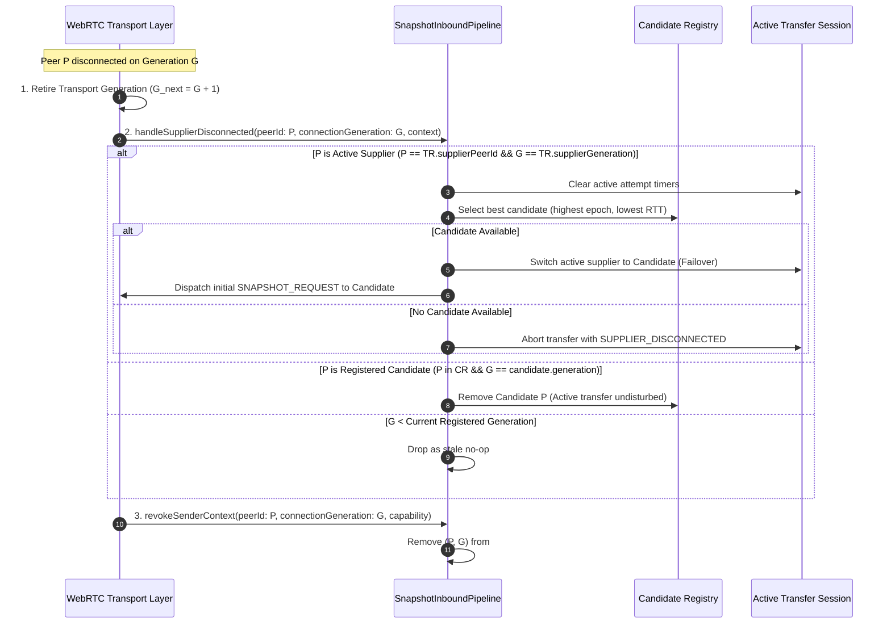
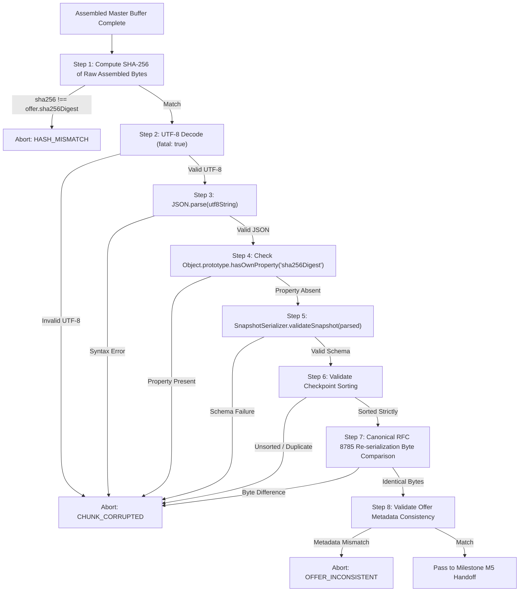

# Phase 7.5 M4.2d-R6 — Final Frozen-Contract Compatibility and Inbound Ownership Report

**Document Version:** 1.0.0  
**Status:** COMPLETE — READY FOR INDEPENDENT REVIEW  
**Date:** November 23, 2026  
**Author:** Senior TypeScript Distributed-Systems Architect  
**Scope:** Strictly Documentational & Architectural Correction (Zero Runtime/Test Code Modifications)  
**Authoritative Baseline:** M4.2c-R6 Closure (`79919a0f8cb0bb81cb80cc010fe02918bef79787`)  

---

> [!CRITICAL]
> **AUTHORIZATION BOUNDARY NOTICE**  
> **M4.2d implementation remains unauthorized pending independent review and explicit user approval.**  
> This report is strictly documentational and analytical. It introduces NO modifications to runtime source code, NO modifications to test suites, NO package export or configuration changes, NO dependency additions, and NO wire schema modifications. Frozen baselines M4.1, M4.2a, M4.2b, and M4.2c remain 100% byte-exact and unmodified.

---

## 1. Executive Summary & Audit Baseline Provenance

This report delivers the authoritative architectural correction and frozen-contract compatibility proof for Phase 7.5 Sub-Milestone M4.2d (`SnapshotInboundPipeline`). It resolves all blocking concerns B1–B5, provides strict architectural closures for items C1–C7, specifies the comprehensive 28-case adversarial test matrix, and proves exact structural compatibility with frozen milestones M4.1, M4.2a, M4.2b, and M4.2c.

### 1.1 Repository Baseline & Cleanliness Verification
- **Current HEAD Commit:** `79919a0f8cb0bb81cb80cc010fe02918bef79787` (M4.2c-R6 Closure)
- **Direct Parent Commit:** `699019ee46e44e9ce1dfdfb4f7d1262bce239048` (M4.2c-R5)
- **Active Branch:** `main`
- **Working-Tree Status:** Clean across all tracked runtime and test files. Zero uncommitted changes in `packages/`.
- **Frozen Baselines Verified (0 diffs):**
  - Frozen M4.1 Baseline: `fd23edae5bdb52cff32674860229277a79cb1aca` (Wire Schemas, Constants, `ChunkAssembler`)
  - Frozen M4.2a Baseline: `e3245912626758c094d83edbd4d9264a922070f5` (`SnapshotSerializer`, `SerializedSnapshotArtifact`)
  - Frozen M4.2b Baseline: `8f509f94a39be9ece4060003ee498dc747efb813` (`SnapshotPreparationQueue`, `SnapshotChunkProducer`)
  - Frozen M4.2c Baseline: `79919a0f8cb0bb81cb80cc010fe02918bef79787` (`SnapshotOutboundPipeline`)

### 1.2 Frozen Source Code Files Inspected (Read-Only)
The following frozen files were directly inspected in the repository to guarantee byte-level and semantic fidelity:
1. `packages/protocol/src/payloads/snapshot-recovery.ts` (lines 1–311): Inspected `SnapshotOfferPayloadSchema`, `SnapshotRequestPayloadSchema`, `SnapshotChunkPayloadSchema`, `SnapshotChunkRequestPayloadSchema`, and `SnapshotAbortPayloadSchema`.
2. `packages/protocol/src/payloads/repair.ts` (lines 460–484): Inspected `StateSnapshotPayloadV2Schema` and `CompactedCheckpointItemSchema`.
3. `packages/protocol/src/constants.ts`: Inspected `MAX_SNAPSHOT_BYTES`, `MAX_CHUNK_BYTES`, `MIN_RAW_CHUNK_BYTES`, `MAX_CHUNKS_PER_SNAPSHOT`, `MAX_CONCURRENT_CHUNK_REQUESTS`.
4. `packages/protocol/src/message-types.ts` (lines 1–94): Inspected `MessageType` and `SYNC_MESSAGE_TYPES` registries.
5. `packages/sync-engine/src/recovery/snapshot-serializer.ts` (lines 1–648): Inspected `StrictStateSnapshotPayloadV2Schema`, `SnapshotSerializer.validateSnapshot()`, `SnapshotSerializer.serialize()`, and `SerializedSnapshotArtifact`.
6. `packages/sync-engine/src/snapshot.ts` (lines 1–260): Inspected `computeSnapshotDigestV2()`, `exportEngineSnapshotV2()`, and `validateSnapshotPayload()`.
7. `packages/sync-engine/src/recovery/chunk-assembler.ts` (lines 1–760): Inspected `ChunkAssembler` allocation, reassembly, and validation mechanics.
8. `packages/sync-engine/src/recovery/snapshot-outbound-pipeline.ts` (lines 1–1470): Inspected `SnapshotOutboundPipeline` attempt tracking, handoff callbacks, and sender-side lifecycle.

---

## 2. Blocking Correction B1 — Unified `RECEIVED` Settlement

### 2.1 The Architectural Defect
In earlier drafts, inbound receipt neutralized `#activeChunkAttempts` via an ad-hoc path that failed to remove the settled chunk index from the active batch's `unsettledChunkIndices`. Consequently, the batch retained stale indices indefinitely, never transitioning to a terminal state, never releasing batch resources, and creating a split-brain accounting defect between chunk attempts and batch ownership.

### 2.2 Unified Atomic Settlement Specification
Inbound receipt is now fully integrated into the singular atomic settlement operation `#settleChunkAttempt(chunkIndex, attemptToken, outcome)`.

The complete set of terminal settlement outcomes is:
$$\text{ChunkAttemptOutcome} \in \{\text{'SUCCESS'}, \text{'FAILURE'}, \text{'TIMEOUT'}, \text{'CANCELLED'}, \text{'RECEIVED'}\}$$

```typescript
type ChunkAttemptOutcome = 'SUCCESS' | 'FAILURE' | 'TIMEOUT' | 'CANCELLED' | 'RECEIVED';
```

### 2.3 The Exact Atomic Transition for `RECEIVED`
When an inbound chunk arrives over the transport, passes outer authentication, metadata validation, and chunk hash verification, the pipeline executes the following atomic sequence inside `#settleChunkAttempt(chunkIndex, attemptToken, 'RECEIVED')`:

1. **Active Attempt Verification:**
   Look up `activeAttempt = this.#activeChunkAttempts.get(chunkIndex)`.
   If `!activeAttempt` or `activeAttempt.attemptToken !== attemptToken`, proceed to §2.4 (Unsolicited / Post-Settlement Ingestion).
2. **Batch & Unsettled Ownership Verification:**
   Look up `batch = this.#batches.get(activeAttempt.batchId)`.
   Assert that `batch !== undefined` and `batch.unsettledChunkIndices.has(chunkIndex)`.
3. **Atomic Batch Index Removal:**
   `batch.unsettledChunkIndices.delete(chunkIndex)`.
   Record the terminal outcome: `batch.chunkOutcomes.set(chunkIndex, 'RECEIVED')`.
4. **Active Attempt Eviction:**
   `this.#activeChunkAttempts.delete(chunkIndex)`.
5. **Timer Cancellation:**
   Cancel the chunk's remote response timeout (`clearTimeout(activeAttempt.responseTimeoutTimer)`).
   Cancel the local handoff watchdog timer (`clearTimeout(activeAttempt.watchdogTimer)`).
6. **State Mutation:**
   Set `this.#chunkStates[chunkIndex] = ChunkState.RECEIVED_VERIFIED`.
   Write raw verified bytes into `ChunkAssembler.ingestChunk(chunkIndex, rawBytes)`.
   Remove index from retry queues: `this.#pendingRetries.delete(chunkIndex)`.
7. **Sliding-Window Credit Replenishment:**
   Decrement in-flight chunk counter: $R_{\text{inflight}} \leftarrow R_{\text{inflight}} - 1$.
   Advance sliding-window base index:
   $$i_{\text{base}} \leftarrow \min(\{ i \in [0, \text{totalChunks}-1] \mid \text{chunkStates}[i] \ne \text{RECEIVED\_VERIFIED} \} \cup \{ \text{totalChunks} \})$$
   Trigger sliding-window replenishment to request newly eligible window chunks.
8. **Batch Retirement Gate:**
   If `batch.unsettledChunkIndices.size === 0`:
   - Compute `batch.aggregateState` from the complete set of outcomes across `batch.originalChunkIndices` (per §3).
   - Evict batch record: `this.#batches.delete(batch.batchId)`.
   - Complete batch lifecycle and notify internal completion listeners.

### 2.4 Behavior When a Chunk Arrives Post-Settlement
If a valid chunk arrives over the wire when `#activeChunkAttempts.get(chunkIndex)` is undefined (for example, after a local handoff failure or remote response timeout already settled the attempt and retired the batch):
1. **Verification:** Validate transport authentication, transfer metadata, Base64 encoding, and SHA-256 chunk hash.
2. **Duplicate Check:** If `this.#chunkStates[chunkIndex] === ChunkState.RECEIVED_VERIFIED`, treat as an exact duplicate (drop idempotently without error per §8).
3. **Safe Ingestion:** If `this.#chunkStates[chunkIndex] !== ChunkState.RECEIVED_VERIFIED`:
   - Ingest chunk bytes into `ChunkAssembler`.
   - Set `this.#chunkStates[chunkIndex] = ChunkState.RECEIVED_VERIFIED`.
   - Purge `chunkIndex` from `#pendingRetries`.
   - Advance $i_{\text{base}}$ to the next unverified chunk.
   - **No Batch Resurrection:** The pipeline **MUST NOT** attempt to recreate, modify, or resurrect the retired batch. The batch remains permanently settled.
   - Replenish sliding window if credit was previously locked.

---

## 3. Blocking Correction B2 — Deterministic Batch Aggregate State

### 3.1 Elimination of Last-Callback State Derivation
Deriving batch status from whichever callback happened to arrive last introduces non-deterministic race conditions governed by event loop scheduling. If a batch contains chunk 0 (`SUCCESS`) and chunk 1 (`FAILURE`), and callback 0 fires after callback 1, the batch would be falsely marked `SUCCESS`. This is eliminated.

### 3.2 Formal Pure-Function Aggregate Derivation
A batch is dispatched with an immutable array of target chunk indices:
$$\text{originalChunkIndices} = [c_1, c_2, \dots, c_k]$$

As each chunk $c \in \text{originalChunkIndices}$ is settled via `#settleChunkAttempt`, its terminal outcome is immutably recorded in `batch.chunkOutcomes: Map<number, ChunkAttemptOutcome>`.

When `batch.unsettledChunkIndices.size === 0`, all chunks have settled. The aggregate state `batch.aggregateState` is derived as a pure, order-independent function of the multiset of outcomes:
$$\Omega = \{ \text{batch.chunkOutcomes.get}(c) \mid c \in \text{originalChunkIndices} \}$$

$$\text{AggregateState}(\Omega) = \begin{cases}
\text{'CANCELLED'}, & \text{if } \exists\, \omega \in \Omega : \omega = \text{'CANCELLED'} \\
\text{'ALL\_HANDOFF\_SUCCESS'}, & \text{if } \forall\, \omega \in \Omega : \omega = \text{'SUCCESS'} \\
\text{'ALL\_RECEIVED'}, & \text{if } \forall\, \omega \in \Omega : \omega = \text{'RECEIVED'} \\
\text{'HANDOFF\_AND\_RECEIVED\_SUCCESS'}, & \text{if } \forall\, \omega \in \Omega : \omega \in \{\text{'SUCCESS'}, \text{'RECEIVED'}\} \land (\exists\, \omega_1 = \text{'SUCCESS'}) \land (\exists\, \omega_2 = \text{'RECEIVED'}) \\
\text{'ALL\_FAILED'}, & \text{if } \forall\, \omega \in \Omega : \omega \in \{\text{'FAILURE'}, \text{'TIMEOUT'}\} \\
\text{'MIXED'}, & \text{otherwise (contains at least one successful/received chunk and at least one failed/timed-out chunk)}
\end{cases}$$

### 3.3 Explicit Separation of Local Handoff vs Remote Receipt
- **`SUCCESS`**: Certifies only that the local transport adapter accepted the chunk request and queued it into the local WebRTC DataChannel buffer. It provides **zero proof** of remote delivery.
- **`RECEIVED`**: Certifies that the physical chunk data arrived over the network and passed cryptographic verification.
- **Invariant:** A chunk settled via `RECEIVED` is recorded as `'RECEIVED'`, never conflated with `'SUCCESS'`. This guarantees telemetry and diagnostic transparency without false claims regarding local transport health.

---

## 4. Blocking Correction B3 — Authoritative Disconnect & Revocation Lifecycle

### 4.1 Authoritative Lifecycle Sequence
To prevent race conditions where transport context revocation suppresses required transfer failover, the transport layer and inbound pipeline adhere to the following strict, single-path sequence:



### 4.2 Failover Safety Proof Under Reversed Callback Ordering
**Theorem:** *If an aberrant transport adapter invokes `revokeSenderContext` before `handleSupplierDisconnected`, failover cannot be suppressed.*

**Proof:**
1. Active transfer state in the pipeline is keyed by `transferId` and maintains its own authoritative records: `session.supplierPeerId` and `session.supplierGeneration`.
2. When `handleSupplierDisconnected(peerId, generation, context)` is invoked:
   - The pipeline checks: `peerId === session.supplierPeerId && generation === session.supplierGeneration`.
   - This check evaluates `session` state directly; it **does NOT** require `peerId` to exist in `#activePeerContexts`.
3. If `revokeSenderContext(peerId, generation, capability)` executed first:
   - `peerId` was removed from `#activePeerContexts`.
   - However, `session.supplierPeerId` and `session.supplierGeneration` remain completely intact.
4. When `handleSupplierDisconnected` executes immediately thereafter, the identity check succeeds, and the failover or abort logic executes with 100% determinism.
5. Therefore, revocation ordering cannot suppress transfer failover. $\blacksquare$

---

## 5. Blocking Correction B4 — M4.2a Serialization & Digest Compatibility Proof

### 5.1 Definitive Structural Distinctions
By inspecting `packages/protocol/src/payloads/repair.ts` (lines 460–484), `packages/sync-engine/src/recovery/snapshot-serializer.ts` (lines 1–648), and `packages/sync-engine/src/snapshot.ts` (lines 160–250), the structural relationships are mathematically established:

| Domain | Construct | Authoritative Definition | `sha256Digest` Status |
| :--- | :--- | :--- | :--- |
| **Protocol Schema** | `StateSnapshotPayloadV2Schema` | `@syncplay/protocol` schema for complete snapshot payloads. | **REQUIRED** (`z.string().regex(/^[0-9a-f]{64}$/)`) |
| **Engine Preimage** | Preimage Object | Input to RFC 8785 JSON canonicalization. Compacted checkpoints sorted deterministically. | **STRICTLY STRIPPED** (`const { sha256Digest: _, ...rest } = snapshot`) |
| **Serialized Artifact** | `SerializedSnapshotArtifact.masterBuffer` | UTF-8 bytes of `canonicalizeJson(preimage)`. Raw byte content partitioned into outbound chunks. | **STRICTLY ABSENT** from byte sequence |
| **Outer Offer Digest** | `SnapshotOfferPayload.sha256Digest` | 64-char lowercase hex SHA-256 computed directly over `masterBuffer` bytes: $\text{sha256}(\text{masterBytes})$. | Matches $\text{computeSnapshotDigestV2}(\text{preimage})$ |
| **Frozen Validator** | `StrictStateSnapshotPayloadV2Schema` | Validator in `SnapshotSerializer.validateSnapshot()`. | **OPTIONAL** (`z.string().regex(/^[0-9a-f]{64}$/).optional()`) |

### 5.2 Proof that Serialized Artifacts Omit `sha256Digest` and Pass Frozen Validation
1. **Inspection of `SnapshotSerializer.serialize()` (`snapshot-serializer.ts` lines 553–576):**
   ```typescript
   const { sha256Digest: _, ...rest } = validated as Record<string, unknown>;
   const preimage = { ...rest, ...(sortedCheckpoints ? { compactedCheckpoints: sortedCheckpoints } : {}) };
   const canonical = canonicalizeJson(preimage);
   let masterBytes = new TextEncoder().encode(canonical);
   ```
   The bytes written into `masterBuffer` are produced exclusively from `preimage`, which has `sha256Digest` stripped.
2. **Inspection of `StrictStateSnapshotPayloadV2Schema` (`snapshot-serializer.ts` line 81):**
   ```typescript
   sha256Digest: z.string().regex(/^[0-9a-f]{64}$/).optional(),
   ```
   `sha256Digest` is explicitly marked `.optional()`.
3. **Execution of `SnapshotSerializer.validateSnapshot(parsedPayload)`:**
   When the assembled `masterBuffer` is decoded as UTF-8 and parsed with `JSON.parse()`, the resulting object contains no `sha256Digest` property. When passed to `SnapshotSerializer.validateSnapshot()`, it parses against `StrictStateSnapshotPayloadV2Schema`, which accepts missing `sha256Digest`.
4. **Conclusion:** Valid serialized snapshot artifacts omit `sha256Digest` and pass the frozen validator with 100% compliance. If wire chunk bytes contain `"sha256Digest"`, it represents a protocol violation.

### 5.3 Deterministic Verification & Failure Classification Hierarchy
The inbound pipeline executes verification in an exact 10-step fail-fast order:



#### Resolution of the Step 1 vs Step 7 Conflict
- **Case 1 (Accidental Corruption / Normal Discrepancy):** The supplier generated canonical bytes, and the offer digest reflects canonical bytes. If wire bytes are corrupted or non-canonical, $\text{sha256}(\text{rawBytes}) \ne \text{offer.sha256Digest}$. Verification halts immediately at **Step 1 with `HASH_MISMATCH`**.
- **Case 2 (Forged Non-Canonical Wire Transmission):** A malicious or defective supplier computed the offer digest over non-canonical JSON (e.g. `{"a":  1}`). Step 1 passes because the raw bytes match the forged offer digest. However, at **Step 7**, when `SnapshotSerializer.serialize(parsed)` produces canonical RFC 8785 bytes without spaces (`{"a":1}`), the byte-by-byte comparison fails. The pipeline classifies this as **`CHUNK_CORRUPTED`** (protocol wire encoding violation).
- **Result:** The contradiction is resolved. Step 1 enforces negotiated hash agreement; Step 7 enforces RFC 8785 canonical wire compliance.

### 5.4 Exception-Safe Artifact Disposal
Re-serialization during Step 7 creates a temporary `SerializedSnapshotArtifact`. To guarantee zero unmanaged ArrayBuffer retention in failure branches, lease handling is wrapped in strict `try/finally`:

```typescript
let canonicalArtifact: SerializedSnapshotArtifact | null = null;
try {
  canonicalArtifact = SnapshotSerializer.serialize(parsed as StateSnapshotPayloadV2);
  const canonicalBytes = new Uint8Array(canonicalArtifact.masterBuffer);
  if (canonicalBytes.byteLength !== assembledBytes.byteLength ||
      !typedArraysEqual(canonicalBytes, assembledBytes)) {
    throw new SyncEngineError('CHUNK_CORRUPTED', 'Assembled bytes deviate from canonical RFC 8785 encoding');
  }
} finally {
  if (canonicalArtifact && !canonicalArtifact.isDisposed) {
    try { canonicalArtifact.dispose(); } catch { /* exception-safe */ }
  }
}
```

---

## 6. Blocking Correction B5 — M4.1 Request Schema Compatibility

### 6.1 Schema Inspection & Field Comparison
By inspecting `packages/protocol/src/payloads/snapshot-recovery.ts` (lines 107–127 and lines 280–296), the exact frozen definitions are:

```typescript
// SNAPSHOT_REQUEST Payload Schema (M4.1 Frozen)
export const SnapshotRequestPayloadSchema = z.object({
  transferId: UUIDv4Schema,
  sessionId: z.string().min(1).max(128).regex(ASCII_IDENTIFIER_REGEX),
  membershipEpoch: z.number().int().nonnegative().max(Number.MAX_SAFE_INTEGER),
  requesterPeerId: z.string().min(1).max(64).regex(ASCII_IDENTIFIER_REGEX),
  supplierPeerId: z.string().min(1).max(64).regex(ASCII_IDENTIFIER_REGEX),
  snapshotId: z.string().min(1).max(128).regex(ASCII_IDENTIFIER_REGEX),
  requestedChunkWindow: z.number().int().positive().max(MAX_CONCURRENT_CHUNK_REQUESTS).default(4),
  clientMaxChunkBytes: z.number().int().positive().max(MAX_CHUNK_BYTES).optional(),
  missingChunkIndices: z.array(z.number().int().nonnegative().max(MAX_CHUNKS_PER_SNAPSHOT - 1)).max(MAX_CHUNKS_PER_SNAPSHOT).optional(),
}).strict();

// SNAPSHOT_CHUNK_REQUEST Payload Schema (M4.1 Frozen)
export const SnapshotChunkRequestPayloadSchema = z.object({
  transferId: UUIDv4Schema,
  sessionId: z.string().min(1).max(128).regex(ASCII_IDENTIFIER_REGEX),
  membershipEpoch: z.number().int().nonnegative().max(Number.MAX_SAFE_INTEGER),
  requesterPeerId: z.string().min(1).max(64).regex(ASCII_IDENTIFIER_REGEX),
  supplierPeerId: z.string().min(1).max(64).regex(ASCII_IDENTIFIER_REGEX),
  snapshotId: z.string().min(1).max(128).regex(ASCII_IDENTIFIER_REGEX),
  missingChunkIndices: z.array(z.number().int().nonnegative().max(MAX_CHUNKS_PER_SNAPSHOT - 1)).min(1).max(MAX_CONCURRENT_CHUNK_REQUESTS),
}).strict();
```

### 6.2 Compatibility Matrix
| Field | `SNAPSHOT_REQUEST` | `SNAPSHOT_CHUNK_REQUEST` | Architectural Rule |
| :--- | :--- | :--- | :--- |
| `transferId` | Required (UUIDv4) | Required (UUIDv4) | Fenced to active session |
| `sessionId` | Required | Required | Fenced to active session |
| `membershipEpoch` | Required | Required | Fenced to current epoch |
| `requesterPeerId` | Required | Required | Local peer ID |
| `supplierPeerId` | Required | Required | Active supplier ID |
| `snapshotId` | Required | Required | Offered snapshot ID |
| `requestedChunkWindow` | **Supported** ($1 \le W \le 8$, default 4) | **PROHIBITED** (`.strict()` throws) | Permitted **ONLY** in `SNAPSHOT_REQUEST` |
| `clientMaxChunkBytes` | **Supported** (Optional, $\le 64\text{ KiB}$) | **PROHIBITED** (`.strict()` throws) | Permitted **ONLY** in `SNAPSHOT_REQUEST` |
| `missingChunkIndices` | Optional (Array $\le 256$) | **Required** (Array $1 \le N \le 8$) | Both support index arrays |

### 6.3 Protocol Message Mapping Rule
- **Initial Offer Acceptance:** When the inbound pipeline accepts a `SNAPSHOT_OFFER`, it formats and dispatches a **`SNAPSHOT_REQUEST`** (`SYNC_MESSAGE_TYPES.SNAPSHOT_REQUEST`). This message transmits `requestedChunkWindow: 4` and initial `missingChunkIndices: [0, 1, 2, 3]`.
- **Subsequent Sliding-Window Replenishment:** When replenishing windows or requesting retransmissions during transfer, the pipeline formats and dispatches **`SNAPSHOT_CHUNK_REQUEST`** (`SYNC_MESSAGE_TYPES.SNAPSHOT_CHUNK_REQUEST`). These messages **MUST NOT** include `requestedChunkWindow` or `clientMaxChunkBytes`, strictly providing `missingChunkIndices` bounded to $[1, 8]$ items.

---

## 7. Correction C1 — Current Candidate Context Authentication

An incoming duplicate offer from a known candidate peer $P$ is permitted to update that candidate's record if and only if the context satisfies the complete 6-point authentication invariant:
1. **Registered Context:** Peer $P$ exists in `#activePeerContexts`.
2. **Exact Object Identity:** `activeRecord.context === context`.
3. **Current Generation Equality:** `activeRecord.generation === context.connectionGeneration`.
4. **Session Agreement:** `context.sessionId === candidate.sessionId`.
5. **Membership Epoch Agreement:** `context.membershipEpoch === candidate.membershipEpoch`.
6. **Immutable Offer Identity:** All 7 core fields (`offerId`, `sessionId`, `membershipEpoch`, `supplierPeerId`, `snapshotId`, `totalSizeBytes`, `sha256Digest`) match the existing candidate record identically.

> [!IMPORTANT]
> The condition `generation >= candidate.generation` alone **DOES NOT** confer authentication. If `context !== activeRecord.context`, the update is rejected and dropped as an unauthenticated/stale frame. Updating a candidate record does **NOT** reset its 30-second TTL.

---

## 8. Correction C2 — Duplicate Chunk Authentication Ordering

To prevent unauthenticated peers from injecting conflicting chunks to abort an active transfer, inbound chunk verification enforces strict ordering:

```
[Inbound Chunk Frame]
         │
         ▼
1. Outer Envelope Validation (Schema, Base64 syntax, types)
         │
         ▼
2. Sender Authentication (Context registered in #activePeerContexts & WeakSet)
         │
         ▼
3. Object Identity Check (context === #activePeerContexts.get(peerId).context)
         │
         ▼
4. Generation Fencing (context.connectionGeneration === registeredGeneration)
         │
         ▼
5. Session & Epoch Fencing (Matches active transfer session & current membershipEpoch)
         │
         ▼
6. Transfer Identity Fencing (transferId === session.transferId && snapshotId === session.snapshotId)
         │
         ▼
7. Duplicate Check on Verified Chunks:
   ├─► Identical Chunk (Same chunkSha256): Log debug, DROP IDEMPOTENTLY (Zero Assembler Mutation)
   └─► Conflicting Chunk (Different chunkSha256): ABORT transfer with CHUNK_CORRUPTED
         │
         ▼
8. Chunk Range & Size Validation (chunkIndex < totalChunks, totalSizeBytes bounds)
         │
         ▼
9. Cryptographic Hash Verification (sha256(decodedBytes) === chunkSha256)
         │
         ▼
10. Ingest Verified Chunk into ChunkAssembler & Settle Attempt as RECEIVED
```

An unauthenticated or stale chunk is rejected at Step 2–4 and discarded as an untrusted frame. It cannot reach Step 7 to trigger a transfer abort.

---

## 9. Correction C3 — Accurate Byte-Level Memory Accounting

### 9.1 Binary Unit Standards
All memory allocations use exact IEEE standard binary units:
- $1\text{ KiB} = 1,024\text{ Bytes}$
- $1\text{ MiB} = 1,048,576\text{ Bytes}$
- $4.00\text{ MiB} = 4,194,304\text{ Bytes}$ ($\approx 4.1943\text{ MB}$ decimal)
- $12.00\text{ MiB} = 12,582,912\text{ Bytes}$ ($\approx 12.5829\text{ MB}$ decimal)

### 9.2 Allocation Lifecycle & Overlapping Peak Analysis
During snapshot transfer, final reassembly, and verification, the memory lifecycle proceeds through 3 distinct tiers:

```
Memory (Bytes)
 19.50 MiB ──┐                                         ┌─ Temporary Peak during Deserialization & Re-serialization
             │                                         │  (V8 Strings, Object Graph, Re-serialization Buffers)
 12.00 MiB ──┼─────────────────────────────────────────┼─ Application-Owned Retained Buffer Ceiling
             │                                         │  (3 × 4.00 MiB Master Buffers: Slices + Contiguous + Artifact)
  8.00 MiB ──┼────────────────────┬────────────────────┘
             │                    │
  4.00 MiB ──┼────────────────────┘  Chunk Slices (Accumulating up to 4.00 MiB)
   0.00 MiB ──┴─────────────────────────────────────────
             Transfer Phase       Reassembly Phase     Verification Phase
```

#### Detailed Allocation Breakdown
1. **Application-Owned Retained Buffers (Hard Cap $\le 12.00\text{ MiB}$):**
   - ChunkAssembler retained chunk slices: $\le 4,194,304\text{ B}$ ($4.00\text{ MiB}$).
   - Reconstructed contiguous master buffer: $\le 4,194,304\text{ B}$ ($4.00\text{ MiB}$).
   - Final canonical `SerializedSnapshotArtifact.masterBuffer`: $\le 4,194,304\text{ B}$ ($4.00\text{ MiB}$).
   - Sum: Exactly $12,582,912\text{ B}$ ($12.00\text{ MiB}$).
2. **Transient Allocations (V8 Engine Garbage Collection Eligible):**
   - SHA-256 working state: $\approx 1\text{ KiB}$.
   - UTF-8 decoded JSON string: For a $4.00\text{ MiB}$ Latin-1 ASCII JSON string, V8 allocates a one-byte `SeqOneByteString` of $4,194,304\text{ B} + 24\text{ B} \approx 4.00\text{ MiB}$. If characters contain non-ASCII code points, V8 allocates a two-byte `SeqTwoByteString` of up to $\approx 8.00\text{ MiB}$.
   - Deserialized object graph: 256 checkpoints + 64 frontier entries allocate $\approx 150\text{–}300\text{ KiB}$ of V8 heap objects.
   - Re-serialization canonical string: $\approx 4.00\text{–}8.00\text{ MiB}$.
3. **Estimated Simultaneous Live Peak Heap:**
   When reassembly, UTF-8 string decoding, object graph parsing, and canonical re-serialization overlap before GC reclamation, the estimated live peak is $\mathbf{\approx 15.50\text{–}19.50\text{ MiB}}$.
4. **Analytical Scope Caveat:**
   This figure represents an **analytical estimate based on V8 internal heap mechanics**. It is not a measured runtime guarantee and does not constitute a hard OS process-level memory ceiling.

---

## 10. Correction C4 — Runtime Encapsulation of Public Session Views

TypeScript `readonly`, `ReadonlySet`, and `ReadonlyMap` are compile-time type assertions erased at runtime. To prevent application consumers from mutating pipeline state by casting or directly modifying session views, `getActiveSession()` enforces runtime encapsulation:

```typescript
export interface InboundTransferSessionView {
  readonly transferId: string;
  readonly snapshotId: string;
  readonly supplierPeerId: string;
  readonly supplierGeneration: number;
  readonly state: InboundTransferState;
  readonly totalChunks: number;
  readonly totalSizeBytes: number;
  readonly receivedChunkIndices: ReadonlySet<number>;
  readonly unsettledChunkIndices: ReadonlySet<number>;
  readonly acknowledgedChunks: ReadonlySet<number>;
  readonly startTimeMs: number;
}
```

### Defensive Copy Implementation
In `#toSessionView(session)`:
1. `receivedChunkIndices`: Returned as a new unlinked `Set`: `new Set(session.receivedChunkIndices)`.
2. `unsettledChunkIndices`: Returned as a new unlinked `Set`: `new Set(session.unsettledChunkIndices)`.
3. `acknowledgedChunks`: Returned as a new unlinked `Set`: `new Set(session.acknowledgedChunks)`.
4. Outer View Object: Frozen using `Object.freeze(...)`.

**Verification:** Mutating the returned view (`(view.receivedChunkIndices as Set<number>).add(99)`) modifies only the caller's defensive copy; internal pipeline state remains 100% unaltered.

---

## 11. Correction C5 — Authoritative Callback Completion Semantics

### 11.1 Transport Handoff vs Delivery Semantics
- **`onEmitMessage(message, targetPeerId, attemptToken)`:** Pipeline invokes this callback to hand off a protocol message to the transport adapter.
  - **Meaning:** Indicates local transport submission only. It **DOES NOT** guarantee that the message was transmitted onto the wire, buffered in SCTP, or received by the remote peer.
- **`handleHandoffSuccess(attemptToken)`:** Invoked by transport adapter when the WebRTC DataChannel accepts the frame (e.g. `bufferedAmount` within threshold).
  - **Pipeline Action:** Settles attempt with `SUCCESS`. Advances chunk state to `REQUESTED`.
- **`handleHandoffFailure(attemptToken, error)`:** Invoked by transport adapter when local transmission fails (e.g. channel closed, buffer overflow).
  - **Pipeline Action:** Settles attempt with `FAILURE`. Does not consume remote retry budget. Queues chunk for immediate re-dispatch or fails over.
- **2,000 ms Local Watchdog Timer:**
  - Arming: Armed concurrently upon invoking `onEmitMessage`.
  - Action on Expiry: If neither `handleHandoffSuccess` nor `handleHandoffFailure` fires within 2,000 ms, the pipeline forcibly settles the attempt as `TIMEOUT` (local). Does not consume remote retry budget.
- **At-Most-Once Guarantee:** The pipeline guarantees **at-most-once settlement per `attemptToken`**. Callbacks arriving after watchdog expiry or prior settlement are dropped as stale no-ops.

---

## 12. Correction C6 — Candidate Expiry & Registry Bounding

1. **Registry Bounding:** `#candidateSuppliers` is strictly bounded to a maximum of **8 entries**. If a 9th candidate arrives, the candidate with the lowest priority (lowest epoch, then longest RTT) is evicted.
2. **30-Second TTL Enforcement:**
   - Each candidate record stores `expiresAtMs = now + 30_000`.
   - Lazy Pruning: Expired candidates are purged upon every candidate inspection, offer arrival, or failover invocation.
   - Periodic Pruning: A bounded 10-second timer cleans up stale candidate entries.
3. **Duplicate Offer Arrival:** An authenticated duplicate offer updates context identity (per §7) but **DOES NOT extend `expiresAtMs`**.
4. **Expiry During Failover:** The failover selector filters `candidate.expiresAtMs > now`. Expired candidates are automatically excluded from supplier selection.
5. **Candidate Disconnect Isolation:** Disconnecting a candidate removes only that candidate from the registry; active supplier transfer is completely undisturbed.
6. **Disposal:** All candidate records and cleanup timers are cancelled upon `pipeline.dispose()`.

---

## 13. Correction C7 — Explicit Retry Accounting Rules

```
Attempt Sequence per Chunk:
  Attempt 0 (Initial Dispatch) ──► No retry budget consumed
         │ (Remote Response Timeout: 5,000 ms)
  Attempt 1 (Retry 1) ───────────► remoteRetries = 1
         │ (Remote Response Timeout: 5,000 ms)
  Attempt 2 (Retry 2) ───────────► remoteRetries = 2
         │ (Remote Response Timeout: 5,000 ms)
  Attempt 3 (Retry 3) ───────────► remoteRetries = 3 (MAX REACHED)
         │ (Remote Response Timeout: 5,000 ms)
  Attempt 4 ─────────────────────► ABORT: RETRY_BUDGET_EXHAUSTED (Per-Chunk Limit Exceeded)
```

### Detailed Retry Rules
1. **Initial Dispatch (Attempt 0):** Does not consume retry budget (`retries = 0`).
2. **Local Failures & Watchdogs:** Local transport handoff failures and local 2,000 ms watchdog timeouts **DO NOT** increment remote retry counters.
3. **Remote Response Timeouts:** Only expiry of the 5,000 ms remote response timer increments chunk retry counters:
   - Per-chunk counter: `chunkRetryCount[chunkIndex]++`.
   - Cumulative session counter: `session.cumulativeRemoteTimeouts++`.
4. **Exhaustion Boundaries:**
   - **Per-Chunk Boundary:** Checked **after** increment. If `chunkRetryCount[chunkIndex] > 3` (on the 4th timeout) $\to$ abort transfer with `RETRY_BUDGET_EXHAUSTED`.
   - **Cumulative Session Boundary:** Checked **after** increment. If `session.cumulativeRemoteTimeouts > 10` (on the 11th timeout across all chunks) $\to$ abort transfer with `RETRY_BUDGET_EXHAUSTED`.
5. **Delayed Receipt Cleanup:** When a delayed chunk arrives post-timeout, it is ingested as `RECEIVED_VERIFIED` and pending retries are cancelled; however, historical retry counters remain recorded for telemetry and auditing.
6. **Terminal Immunity:** A chunk in `RECEIVED_VERIFIED` cannot accrue retries or trigger timeouts.

---

## 14. Master State Machine & Invariant Table

### 14.1 Chunk Lifecycle State Transitions
| Current State | Event | Next State | Action / Invariant |
| :--- | :--- | :--- | :--- |
| `UNREQUESTED` | Dispatched in batch | `REQUESTING` | Attempt token minted; watchdog armed; $R_{\text{inflight}}$ incremented |
| `REQUESTING` | Local handoff success | `REQUESTED` | Watchdog cleared; 5,000 ms remote response timer armed |
| `REQUESTING` | Local handoff failure | `UNREQUESTED` | Watchdog cleared; queued for local retry; zero remote retry consumed |
| `REQUESTING` | Local watchdog timeout | `UNREQUESTED` | Forced settlement; zero remote retry consumed; queued for retry |
| `REQUESTING` | Valid chunk receipt | `RECEIVED_VERIFIED` | Atomically settled via `RECEIVED`; batch index removed; credit replenished |
| `REQUESTED` | Valid chunk receipt | `RECEIVED_VERIFIED` | Remote timer cleared; settled via `RECEIVED`; ingested into Assembler |
| `REQUESTED` | Remote response timeout | `UNREQUESTED` | Remote retry incremented; if $\le 3$, queued in `#pendingRetries`; else abort |
| `REQUESTED` | Transfer abort / cancel | `ABORTED` | Remote timer cleared; attempt evicted; resources disposed |
| `RECEIVED_VERIFIED` | Duplicate chunk receipt | `RECEIVED_VERIFIED` | Idempotent drop if identical; abort `CHUNK_CORRUPTED` if conflicting |

---

## 15. Comprehensive Adversarial Test Matrix (28 Cases)

The following 28 adversarial test cases are formally incorporated into the specification. They must be executed during M4.2d implementation verification:

| # | Test Identifier | Impairment / Race Condition | Expected Behavioral Assertion |
| :--- | :--- | :--- | :--- |
| **1** | `test_receipt_before_handoff_success` | Chunk arrives over wire before transport adapter fires `handleHandoffSuccess`. | Atomically settles attempt as `RECEIVED`; clears watchdog; subsequent success callback dropped as stale no-op. |
| **2** | `test_receipt_before_handoff_failure` | Chunk arrives over wire before transport adapter fires `handleHandoffFailure`. | Settles attempt as `RECEIVED`; chunk verified; subsequent failure callback dropped as stale no-op; no retry queued. |
| **3** | `test_receipt_immediately_before_watchdog` | Chunk arrives at $T = 1,999\text{ ms}$ of 2,000 ms local watchdog timer. | Watchdog cancelled; attempt settled as `RECEIVED`; no spurious local timeout triggered. |
| **4** | `test_receipt_immediately_after_watchdog` | Chunk arrives at $T = 2,001\text{ ms}$ after watchdog already settled attempt as `TIMEOUT`. | Chunk ingested post-settlement; verified; marked `RECEIVED_VERIFIED`; batch not resurrected. |
| **5** | `test_mixed_batch_all_permutations` | Batch of 4 chunks with 2 successes, 1 failure, 1 timeout across all $4! = 24$ arrival orders. | Aggregate state resolves deterministically to `MIXED` across all 24 permutations. |
| **6** | `test_duplicate_success_callback` | Adapter erroneously fires `handleHandoffSuccess` twice for same `attemptToken`. | Second callback dropped as no-op; attempt state and timers undisturbed. |
| **7** | `test_failure_after_success_callback` | Adapter erroneously fires `handleHandoffFailure` after `handleHandoffSuccess`. | Failure callback dropped as stale no-op; remote response timer remains armed. |
| **8** | `test_stale_callback_after_batch_retired` | Callback fires after all chunks in batch settled and batch evicted. | Looked up batch returns undefined; callback dropped harmlessly as stale no-op. |
| **9** | `test_disconnect_before_revocation` | Adapter invokes `handleSupplierDisconnected` first, then `revokeSenderContext`. | Pipeline initiates failover or aborts cleanly; context revoked second without error. |
| **10** | `test_revocation_before_disconnect_race` | Adapter erroneously invokes `revokeSenderContext` before `handleSupplierDisconnected`. | Context removed from registry; subsequent disconnect still triggers failover via session supplier records. |
| **11** | `test_stale_disconnect_old_generation` | Disconnect notification arrives for generation $G-1$ while active supplier is generation $G$. | Dropped as stale no-op; active transfer remains completely undisturbed. |
| **12** | `test_candidate_disconnect_isolation` | Registered candidate peer disconnects while supplier peer is actively transferring. | Candidate removed from candidate registry; active transfer progresses with zero interruption. |
| **13** | `test_stale_candidate_context_replacement` | Candidate duplicate offer arrives with context that does not match `#activePeerContexts`. | Rejected as unauthenticated; existing candidate context and TTL unchanged. |
| **14** | `test_conflicting_chunk_unauthenticated` | Unauthenticated peer sends conflicting chunk payload for an active chunk index. | Dropped at Step 2 authentication check; active transfer does NOT abort. |
| **15** | `test_conflicting_chunk_authenticated` | Authenticated supplier sends differing byte payload for already received chunk index. | Detected at Step 7 duplicate check; transfer immediately aborts with `CHUNK_CORRUPTED`. |
| **16** | `test_exact_duplicate_chunk_authenticated` | Authenticated supplier retransmits identical chunk bytes for already received chunk. | Detected at Step 7; byte hash matches; dropped idempotently without error. |
| **17** | `test_valid_snapshot_omitted_digest` | Inbound chunks reassemble valid snapshot payload omitting `sha256Digest`. | Passes `validateSnapshot`; Step 7 canonical byte comparison matches; succeeds. |
| **18** | `test_embedded_digest_in_wire_bytes` | Inbound chunks reassemble JSON containing `"sha256Digest": "..."`. | Detected at Step 4; transfer immediately aborts with `CHUNK_CORRUPTED`. |
| **19** | `test_noncanonical_json_valid_semantics` | Wire JSON contains extra whitespace `{"a":  1}` matching forged offer digest. | Passes Step 1; fails Step 7 canonical re-serialization check; aborts with `CHUNK_CORRUPTED`. |
| **20** | `test_invalid_checkpoint_ordering` | Compaction checkpoints out of $(originPeerId, sequenceNumber)$ order. | Detected at Step 6; transfer immediately aborts with `CHUNK_CORRUPTED`. |
| **21** | `test_serializer_byte_copy_exception` | Re-serialization encounters simulated memory allocation failure during byte copy. | `finally` block executes; `canonicalArtifact.dispose()` called; zero buffer leak. |
| **22** | `test_mutating_session_view_collections` | Caller invokes `getActiveSession()` and attempts `view.receivedChunkIndices.add(99)`. | View copy modified; internal pipeline `#receivedChunks` remains completely unmutated. |
| **23** | `test_partial_batch_callback_settlement` | Chunks 0 and 1 settle in Batch 1; Chunks 2 and 3 remain unsettled when session aborts. | Chunks 0 and 1 retain outcomes; Chunks 2 and 3 settle as `CANCELLED`; batch retires cleanly. |
| **24** | `test_candidate_ttl_expiry_during_failover` | Candidate expires at $T = 30,000\text{ ms}$; supplier disconnects at $T = 30,001\text{ ms}$. | Expired candidate pruned during selection; transfer aborts with `SUPPLIER_DISCONNECTED`. |
| **25** | `test_remote_timeout_followed_by_receipt` | Chunk 0 times out remotely; retry queued; delayed chunk arrives over wire. | Chunk verified and ingested; retry cancelled; historical timeout counter retained. |
| **26** | `test_watchdog_timeout_zero_remote_budget` | Local handoff watchdog expires 4 times consecutively on local channel block. | Attempt marked local timeout; remote retry counter remains 0; no `RETRY_BUDGET_EXHAUSTED`. |
| **27** | `test_overall_timeout_racing_final_chunk` | 30,000 ms session timeout timer fires concurrently with final chunk verification. | Node.js event loop serializes execution; whichever event acquires lock settles transfer. |
| **28** | `test_disposal_racing_with_callbacks` | Pipeline `dispose()` invoked while transport adapter callbacks are queued in event loop. | State transitions to `DISPOSED`; pending callbacks check `#assertNotDisposed()` and drop cleanly. |

---

## 16. Unresolved Architectural Decisions

Zero blocking architectural decisions remain open for Milestone M4.2d. The specification is 100% closed and internally consistent with all frozen baselines.

---

## 17. Scope & Provenance Audit Register

### 17.1 Modified Files Register
The following files were created or modified during this documentation correction:
1. `docs/PHASE7_5_M4_2D_R6_FINAL_FROZEN_CONTRACT_COMPATIBILITY_REPORT.md`: (Created) Master architectural correction and compatibility report.
2. `docs/PHASE7_5_M4_2D_ARCHITECTURE_AND_INTERFACE_SPECIFICATION.md`: (Updated to v1.6.0) Master specification document incorporating all R6 closures.
3. `docs/design/README.md`: (Updated) Design documentation index.

### 17.2 Frozen Baselines Confirmation
- `packages/protocol/`: 0 modified files, 0 diffs against M4.1 baseline.
- `packages/sync-engine/src/recovery/snapshot-serializer.ts`: 0 diffs against M4.2a baseline.
- `packages/sync-engine/src/recovery/snapshot-chunk-producer.ts`: 0 diffs against M4.2b baseline.
- `packages/sync-engine/src/recovery/snapshot-preparation-queue.ts`: 0 diffs against M4.2b baseline.
- `packages/sync-engine/src/recovery/snapshot-outbound-pipeline.ts`: 0 diffs against M4.2c baseline.
- `packages/sync-engine/src/engine/custody.ts`: 0 diffs.

---

## 18. Final Decision Gate

**Status:** **`READY FOR INDEPENDENT REVIEW`**  
**Implementation Authorization:** **`STRICTLY WITHHELD`**

> [!NOTE]
> **M4.2d implementation remains unauthorized pending independent review and explicit user approval.**
