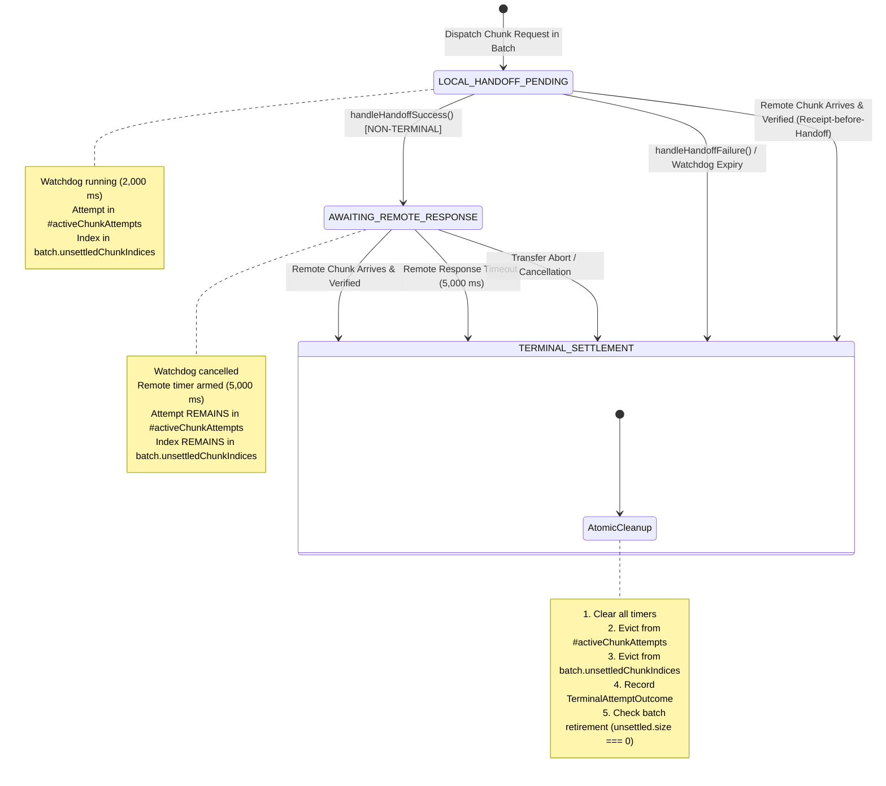
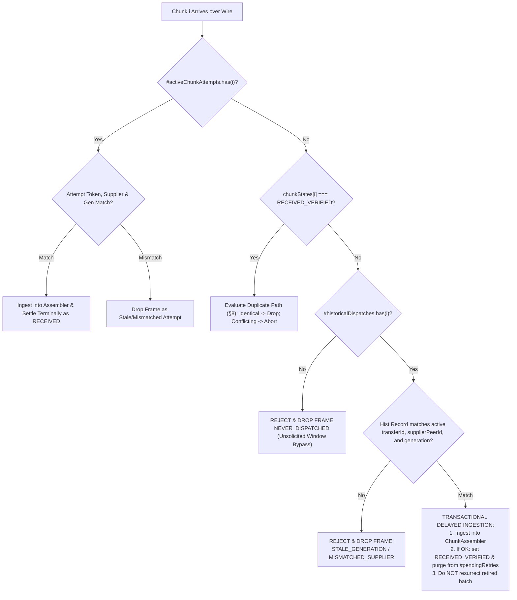

# Phase 7.5 M4.2d-R7 — Critical Lifecycle and Ownership Consistency Report

**Document Version:** 1.0.0  
**Status:** COMPLETE — READY FOR INDEPENDENT REVIEW  
**Date:** November 23, 2026  
**Author:** Senior TypeScript Distributed-Systems Architect  
**Scope:** Strictly Documentational & Architectural Correction (Zero Runtime/Test Code Modifications)  
**Authoritative Baseline:** M4.2c-R6 Closure (`79919a0f8cb0bb81cb80cc010fe02918bef79787`)  

---

> [!CRITICAL]
> **AUTHORIZATION BOUNDARY NOTICE**  
> **M4.2d implementation remains strictly unauthorized pending independent review and explicit user approval.**  
> This task is strictly documentational, read-only, and analytical. It introduces NO modifications to runtime source code, NO modifications to test files, NO package export or configuration changes, NO dependency additions, and NO wire schema modifications. Frozen baselines M4.1, M4.2a, M4.2b, and M4.2c remain 100% byte-exact and unmodified.

---

## 1. Executive Summary & Authoritative Baseline Provenance

This report delivers the authoritative architectural correction and specification freeze for Phase 7.5 Sub-Milestone M4.2d (`SnapshotInboundPipeline`). It comprehensively addresses all findings from the R6 independent audit, completely separating non-terminal local transport handoffs from terminal attempt settlements (R7-1), establishing a transactionally safe assembler ingestion boundary (R7-2), restricting delayed post-settlement chunk admissions using bounded historical request records (R7-3), providing the end-to-end mathematical safety proof for disconnect/revocation lifecycle ordering (R7-4), reconciling M5 snapshot handoff typing and eliminating private field access (R7-5), providing a complete allocation-lifetime memory table (R7-6), establishing the strict 8-step duplicate chunk verification hierarchy (R7-7), codifying exact callback and attempt-token ownership (R7-8), reconciling timeout and schema constants with the frozen baseline (R7-9), and formulating an adversarial test matrix with exact state and timer assertions (R7-10).

### 1.1 Repository Baseline & Working-Tree Cleanliness
- **Current HEAD Commit:** `79919a0f8cb0bb81cb80cc010fe02918bef79787` (M4.2c-R6 Closure)
- **Direct Parent Commit:** `699019ee46e44e9ce1dfdfb4f7d1262bce239048` (M4.2c-R5)
- **Active Branch:** `main`
- **Working-Tree Status:** Clean across all tracked runtime and test files.
- **Frozen Baselines Verified (0 diffs):**
  - Frozen M4.1 Baseline: `fd23edae5bdb52cff32674860229277a79cb1aca` (Wire Schemas, Constants, `ChunkAssembler`)
  - Frozen M4.2a Baseline: `e3245912626758c094d83edbd4d9264a922070f5` (`SnapshotSerializer`, `SerializedSnapshotArtifact`)
  - Frozen M4.2b Baseline: `8f509f94a39be9ece4060003ee498dc747efb813` (`SnapshotPreparationQueue`, `SnapshotChunkProducer`)
  - Frozen M4.2c Baseline: `79919a0f8cb0bb81cb80cc010fe02918bef79787` (`SnapshotOutboundPipeline`)

### 1.2 Frozen Source Code Files Inspected (Read-Only)
The following files and line ranges were directly inspected in the repository:
1. `packages/protocol/src/constants.ts` (lines 78–168): Inspected `MAX_SNAPSHOT_BYTES` (4,194,304 B), `MAX_CHUNK_BYTES` (32,768 B), `MIN_RAW_CHUNK_BYTES` (256 B), `MAX_CHUNKS_PER_SNAPSHOT` (128), `MAX_CONCURRENT_CHUNK_REQUESTS` (4), `CHUNK_REQUEST_TIMEOUT_MS` (5,000 ms), `MAX_CHUNK_RETRIES` (3), `MAX_TRANSFER_RETRIES` (10), `OVERALL_TRANSFER_TIMEOUT_MS` (60,000 ms).
2. `packages/protocol/src/payloads/snapshot-recovery.ts` (lines 76–311): Inspected `SnapshotOfferPayloadSchema`, `SnapshotRequestPayloadSchema` (lines 107–127: `requestedChunkWindow` max 4, default 4; `missingChunkIndices` max 128), `SnapshotChunkPayloadSchema`, `SnapshotChunkRequestPayloadSchema` (lines 280–296: `.strict()`, `missingChunkIndices` min 1, max 4), `SnapshotAbortPayloadSchema`.
3. `packages/protocol/src/payloads/repair.ts` (lines 460–484): Inspected `StateSnapshotPayloadV2Schema` (requires `sha256Digest: string`).
4. `packages/sync-engine/src/recovery/chunk-assembler.ts` (lines 150–420, 650–763): Inspected `ChunkAssembler.ingestChunk()` validation order and storage mutation; `finalizeAssembly()` immediate slice nullification (line 714) and buffer transfer; `abortTransfer()` and `dispose()`.
5. `packages/sync-engine/src/recovery/snapshot-serializer.ts` (lines 280–450, 540–618): Inspected `SerializedSnapshotArtifact` private backing `#masterBuffer` (line 295), public methods `cloneBytes()` (line 374), `copyByteRange()` (line 366), `encodeSliceToBase64()` (line 346), `computeSliceSha256()` (line 357), `acquireLease()` (line 384), `releaseLease()` (line 405), `dispose()` (line 421); `SnapshotSerializer.validateSnapshot()` and `serialize()`.
6. `packages/sync-engine/src/recovery/snapshot-outbound-pipeline.ts` (lines 150–260, 800–850, 920–945, 1020–1165): Inspected outbound `attemptToken = `${messageId}:${attemptSeq}``, `handleHandoffSuccess()`, `handleHandoffFailure()`, active attempt tracking, idempotent callback filtering.
7. `docs/PHASE7_5_INTERFACE_SPECIFICATION.md` (lines 324–365): Inspected M5 `ISnapshotInstaller` contracts (`validateCandidate` requiring `snapshotBytes` and `expectedSha256`, `installSnapshotAtomic` requiring `StateSnapshotPayloadV2`).

---

## 2. Mandatory Correction R7-1: Separate Local Handoff from Terminal Settlement

### 2.1 The Architectural Flaw in R6
In R6, `handleHandoffSuccess()` was defined as settling an attempt with `SUCCESS`, while settlement was defined as removing the active attempt and batch ownership. However, the attempt was simultaneously required to remain in `#activeChunkAttempts` to correlate remote receipt and manage the 5,000 ms remote response timeout. This created an irreconcilable contradiction where an attempt could not be simultaneously settled/retired and active/retained.

### 2.2 Redesigned Two-Tier Attempt Lifecycle
We strictly decouple **non-terminal handoff progress** from **terminal attempt settlement**:



### 2.3 Non-Terminal Transition: `handleHandoffSuccess()`
When the transport adapter confirms local transmission acceptance:
1. **Assertion:** Look up `active = this.#activeChunkAttempts.get(chunkIndex)`. Verify `active.attemptToken === attemptToken` and `active.state === 'LOCAL_HANDOFF_PENDING'`.
2. **Watchdog Cancellation:** `clearTimeout(active.watchdogTimer)`.
3. **Attempt State Advance:** Set `active.state = 'AWAITING_REMOTE_RESPONSE'`.
4. **Remote Timer Arming:** Arm the 5,000 ms remote response timer:
   `active.responseTimeoutTimer = setTimeout(() => this.#onRemoteTimeout(chunkIndex, attemptToken), CHUNK_REQUEST_TIMEOUT_MS)`.
5. **Ownership Preservation:**
   - The attempt **REMAINS** in `#activeChunkAttempts`.
   - `chunkIndex` **REMAINS** in `batch.unsettledChunkIndices`.
   - Chunk lifecycle state advances from `REQUESTING` to `REQUESTED`.
   - The chunk is **NOT** marked received.
   - The batch is **NOT** retired.

### 2.4 Terminal Attempt Settlement: `#settleChunkAttemptTerminally()`
Terminal settlement occurs **exactly once** per attempt for one of five mutually exclusive terminal outcomes:
```typescript
export type TerminalAttemptOutcome =
  | 'RECEIVED'                  // Verified remote chunk arrived and accepted by ChunkAssembler
  | 'REMOTE_TIMEOUT'            // 5,000 ms remote response timer expired without receipt
  | 'LOCAL_HANDOFF_FAILURE'     // Adapter reported failure during local transport submission
  | 'LOCAL_WATCHDOG_TIMEOUT'    // 2,000 ms watchdog expired before handoff callback fired
  | 'CANCELLED';                // Transfer or batch cancelled/aborted prior to completion
```

#### The Atomic Settlement Sequence:
Inside `#settleChunkAttemptTerminally(chunkIndex, attemptToken, outcome: TerminalAttemptOutcome)`:
1. **Lookup & State Verification:**
   Look up `active = this.#activeChunkAttempts.get(chunkIndex)`.
   If `!active || active.attemptToken !== attemptToken`, drop as a stale/duplicate invocation.
2. **Timer Cancellation:**
   If `active.watchdogTimer`, `clearTimeout(active.watchdogTimer)`.
   If `active.responseTimeoutTimer`, `clearTimeout(active.responseTimeoutTimer)`.
3. **Active Attempt Eviction:**
   `this.#activeChunkAttempts.delete(chunkIndex)`.
4. **Batch Unsettled Ownership Eviction:**
   Look up `batch = this.#batches.get(active.batchId)`.
   If `batch`:
   - `batch.unsettledChunkIndices.delete(chunkIndex)`.
   - `batch.chunkTerminalOutcomes.set(chunkIndex, outcome)`.
5. **State & Credit Branching:**
   - If `outcome === 'RECEIVED'`:
     Set `this.#chunkStates[chunkIndex] = ChunkState.RECEIVED_VERIFIED`.
     Decrement in-flight credit: $R_{\text{inflight}} \leftarrow R_{\text{inflight}} - 1$.
     Advance base index $i_{\text{base}}$ to lowest unverified index.
     Trigger sliding-window replenishment.
   - If `outcome` is failure or timeout:
     Set `this.#chunkStates[chunkIndex] = ChunkState.UNREQUESTED`.
     Decrement in-flight credit: $R_{\text{inflight}} \leftarrow R_{\text{inflight}} - 1$.
     Evaluate retry policy (remote timeouts consume remote budget; local failures do not).
6. **Batch Retirement Gate:**
   If `batch && batch.unsettledChunkIndices.size === 0`:
   - Derive `batch.aggregateState` from the multiset of terminal outcomes across `batch.originalChunkIndices` (per §2.5).
   - Evict batch: `this.#batches.delete(batch.batchId)`.

### 2.5 Aggregate Batch Outcome Derivation
When `batch.unsettledChunkIndices.size === 0`, all chunks have achieved a terminal outcome. The aggregate state is a deterministic pure function of the terminal outcome multiset:
$$\Omega = \{ \text{batch.chunkTerminalOutcomes.get}(c) \mid c \in \text{originalChunkIndices} \}$$

$$\text{AggregateState}(\Omega) = \begin{cases}
\text{'CANCELLED'}, & \text{if } \exists\, \omega \in \Omega : \omega = \text{'CANCELLED'} \\
\text{'ALL\_RECEIVED'}, & \text{if } \forall\, \omega \in \Omega : \omega = \text{'RECEIVED'} \\
\text{'ALL\_FAILED'}, & \text{if } \forall\, \omega \in \Omega : \omega \in \{\text{'LOCAL\_HANDOFF\_FAILURE'}, \text{'LOCAL\_WATCHDOG\_TIMEOUT'}, \text{'REMOTE_TIMEOUT'}\} \\
\text{'MIXED'}, & \text{otherwise (contains at least one 'RECEIVED' and at least one failure/timeout)}
\end{cases}$$

### 2.6 Proof of Lifecycle Sequences

#### Normal Execution Sequence:
1. `pipeline.dispatchBatch([0, 1])` $\to$ Chunks 0 and 1 assigned attempt tokens `att-1:0`, `att-1:1`. Attempt state is `LOCAL_HANDOFF_PENDING`, watchdogs armed.
2. Adapter fires `handleHandoffSuccess(transferId, 0, ...)`. Attempt 0 advances to `AWAITING_REMOTE_RESPONSE`, watchdog 0 cleared, remote timer 0 armed. Batch retains both 0 and 1 in `unsettledChunkIndices`.
3. Valid chunk 0 arrives over wire $\to$ accepted by `ChunkAssembler.ingestChunk()` $\to$ `#settleChunkAttemptTerminally(0, 'att-1:0', 'RECEIVED')` executes $\to$ remote timer 0 cleared, attempt 0 evicted from `#activeChunkAttempts`, index 0 removed from `batch.unsettledChunkIndices`, chunk 0 set to `RECEIVED_VERIFIED`. Batch remains active waiting for chunk 1.
4. Process repeats for chunk 1 $\to$ upon chunk 1 settlement, `batch.unsettledChunkIndices.size === 0` $\to$ batch aggregate state resolves to `ALL_RECEIVED` $\to$ batch retired. $\blacksquare$

#### Receipt-Before-Handoff-Callback Sequence:
1. Chunk 0 dispatched in `LOCAL_HANDOFF_PENDING`. Watchdog running.
2. Remote chunk 0 arrives before adapter fires handoff callback (e.g. fast network loopback or adapter scheduling lag).
3. Ingestion succeeds in `ChunkAssembler`.
4. `#settleChunkAttemptTerminally(0, 'att-1:0', 'RECEIVED')` executes immediately:
   - Clears local watchdog timer.
   - Evicts attempt 0 from `#activeChunkAttempts`.
   - Removes index 0 from `batch.unsettledChunkIndices`.
   - Sets chunk 0 to `RECEIVED_VERIFIED`.
   - Replenishes sliding-window credit.
5. Delayed `handleHandoffSuccess(transferId, 0, ...)` arrives from adapter:
   - Inbound pipeline checks `this.#activeChunkAttempts.get(0)`. Returns `undefined` (or token mismatch).
   - Callback is safely dropped as an idempotent, stale no-op.
   - Zero timer is armed; zero state is corrupted. $\blacksquare$

---

## 3. Mandatory Correction R7-2: Transactionally Safe Receipt Ingestion

### 3.1 Inspection of Frozen `ChunkAssembler` Ingestion Mechanics
Inspection of `packages/sync-engine/src/recovery/chunk-assembler.ts` lines 184–374 reveals:
- Lines 188–361 perform: 1) state check, 2) envelope context checks, 3) metadata equality checks against active transfer, 4) index bounds check, 5) declared partition size check, 6) Base64 decoding, 7) SHA-256 computation over decoded bytes, 8) duplicate hash comparison.
- **Zero Mutation Before Line 364:** If any check fails, `ingestChunk()` returns `{ ok: false, reason: ..., detail: ... }` **without mutating `this.chunks`, `this.chunkHashes`, `this.receivedChunksCount`, or `this.receivedBytesCount`**.
- Lines 364–367 perform the sole mutation:
  ```typescript
  this.chunks[payload.chunkIndex] = rawBytes;
  this.chunkHashes[payload.chunkIndex] = computedHash;
  this.receivedChunksCount++;
  this.receivedBytesCount += rawBytes.byteLength;
  ```
- If an uncaught exception occurred after line 364 (which does not exist in the frozen code, as lines 369–373 simply return an object), the assembler would partially mutate.
- Therefore, `ChunkAssembler.ingestChunk()` is **natively fail-fast and atomic**: it either completely succeeds or mutates zero internal storage.

### 3.2 The Pipeline Transaction Boundary
To guarantee transactional safety, the inbound pipeline **MUST NOT** mutate attempt state, batch ownership, chunk state, or sliding-window credit until `ChunkAssembler.ingestChunk()` has returned `{ ok: true, duplicate: false }`:

```mermaid
sequenceDiagram
    autonumber
    participant W as Wire Transport
    participant P as SnapshotInboundPipeline
    participant A as ChunkAssembler (M4.1)

    W->>P: Inbound SNAPSHOT_CHUNK Frame
    Note over P: 1. Outer Envelope Validation (Zod Schema)<br/>2. Sender Context Authentication<br/>3. Generation & Transfer Fencing<br/>4. Range & Size Checks
    P->>A: ingestChunk(payload, envelopeContext)
    alt Ingestion Returns { ok: false, reason }
        A-->>P: Failure Result (Zero Assembler Mutation)
        Note over P: ABORT Transfer with reason (e.g. CHUNK_CORRUPTED)<br/>Zero Attempt Settlement<br/>Zero Window Replenishment
    else Ingestion Returns { ok: true, duplicate: true }
        A-->>P: Duplicate Result
        Note over P: Log Debug; Drop Idempotently<br/>Zero Attempt Settlement<br/>Zero Window Replenishment
    else Ingestion Returns { ok: true, duplicate: false, completed }
        A-->>P: Success Result (Assembler Storage Mutated)
        Note over P: TRANSACTION COMMIT:<br/>#settleChunkAttemptTerminally(chunkIndex, attemptToken, 'RECEIVED')<br/>Evict Attempt, Remove Batch Index, Set RECEIVED_VERIFIED,<br/>Replenish Sliding Window Credit, Advance i_base
        opt completed === true
            P->>A: finalizeAssembly()
            A-->>P: Return AssembledSnapshot
            P->>P: 10-Step Canonical Verification & M5 Handoff
        end
    end
```

### 3.3 Transaction Boundary Guarantees
1. If `ingestChunk()` fails:
   - Chunk state remains unchanged.
   - In-flight attempt remains active (or will be terminated by transfer abort).
   - Batch unsettled indices remain intact.
   - Sliding window credit is **NOT** replenished.
   - The transfer is safely aborted with the exact diagnostic reason returned by `ChunkAssembler`.
2. Post-settlement delayed chunks adhere to the exact same boundary: they must be accepted by `ChunkAssembler.ingestChunk()` before chunk state is updated to `RECEIVED_VERIFIED`.

---

## 4. Mandatory Correction R7-3: Bounded Historical Request Fencing for Delayed Chunks

### 4.1 Vulnerability of Unconstrained Post-Settlement Ingestion
In R6, if no active attempt existed for an arriving chunk, the pipeline permitted ingestion as long as the chunk had not yet been verified. This opened a security and flow-control vulnerability: a supplier could inject an unsolicited chunk (e.g. chunk 50 when the window is $[0, 3]$) which would be ingested, bypassing the sliding window and memory limits.

### 4.2 Historical Dispatch Registry
The inbound pipeline maintains a bounded historical dispatch table:
```typescript
interface HistoricalDispatchRecord {
  readonly chunkIndex: number;
  readonly transferId: string;
  readonly supplierPeerId: string;
  readonly connectionGeneration: number;
  readonly firstDispatchedAtMs: number;
  readonly lastDispatchedAtMs: number;
  readonly dispatchCount: number;
}
```

- **Storage:** `#historicalDispatches = new Map<number, HistoricalDispatchRecord>()`.
- **Bounding:** The maximum number of entries is strictly bounded by `MAX_CHUNKS_PER_SNAPSHOT` (128 entries). $128 \times 48\text{ B} \approx 6.1\text{ KiB}$.
- **Recording Point:** Whenever a chunk index is dispatched in a batch, `#historicalDispatches.set(chunkIndex, record)` is populated or updated.
- **Lifetime & Cleanup:** `#historicalDispatches` is strictly session-scoped. It is purged completely upon transfer completion, abort, cancellation, or pipeline disposal.

### 4.3 Inbound Chunk Admission Decision Tree
When a valid chunk frame arrives with index $i$:



A chunk that was **`NEVER_DISPATCHED`** is strictly rejected, preventing sliding-window bypass.

---

## 5. Mandatory Correction R7-4: End-to-End Disconnect and Revocation Proof

### 5.1 Transport Context Security Hierarchy
We strictly differentiate between:
1. **Untrusted Remote Wire Messages (`handleInboundChunk`, `handleInboundOffer`):**
   - Must originate from an active, currently authenticated peer context.
   - Enforces WeakSet membership (`#validSenderContexts.has(context)`), exact object identity (`#activePeerContexts.get(peerId).context === context`), and generation equality.
2. **Trusted Local Transport Adapter Lifecycle Events (`handleSupplierDisconnected`):**
   - Emitted locally by the in-process WebRTC transport adapter.
   - Gated by possession of the unforgeable in-process `InboundTransportCapability`.
   - Bounded by immutable session supplier identity records.

### 5.2 Authoritative Signatures
```typescript
public handleSupplierDisconnected(
  peerId: string,
  connectionGeneration: number,
  capability: InboundTransportCapability,
  context?: AuthenticatedSenderContext
): void;

public revokeSenderContext(
  peerId: string,
  connectionGeneration: number,
  capability: InboundTransportCapability
): void;
```

### 5.3 Proof of Safety Under Both Lifecycle Orderings

#### Sequence 1: Disconnect Notification, Then Context Revocation (Standard Order)
1. Transport adapter encounters peer disconnect for $(P, G)$.
2. Adapter invokes `pipeline.handleSupplierDisconnected(P, G, capability, context)`.
3. Pipeline validates `capability === this.#authorizedCapability`.
4. Pipeline checks active transfer: `session = this.#activeSession`.
5. Identity check: `session.supplierPeerId === P && session.supplierGeneration === G`.
   - Match: Failover sequence is initiated (attempt timers cleared, candidate registry evaluated, alternative supplier selected or transfer aborted with `SUPPLIER_DISCONNECTED`).
6. Adapter invokes `pipeline.revokeSenderContext(P, G, capability)`.
7. Pipeline removes $(P, G)$ from `#activePeerContexts` and `#validSenderContexts`.
8. Result: Failover succeeds cleanly. $\blacksquare$

#### Sequence 2: Context Revocation, Then Disconnect Notification (Inverted Order)
1. Transport adapter encounters peer disconnect for $(P, G)$.
2. Adapter erroneously invokes `pipeline.revokeSenderContext(P, G, capability)` first.
3. Pipeline validates capability. Removes $(P, G)$ from `#activePeerContexts` and `#validSenderContexts`.
4. Adapter subsequently invokes `pipeline.handleSupplierDisconnected(P, G, capability)`.
5. Pipeline validates `capability === this.#authorizedCapability`.
6. Pipeline inspects `session = this.#activeSession`.
7. **Crucial Invariant:** `session.supplierPeerId` and `session.supplierGeneration` are **immutable properties of the active transfer record**, established at session initialization. They do **NOT** depend on `#activePeerContexts`.
8. The check `session.supplierPeerId === P && session.supplierGeneration === G` succeeds with 100% certainty.
9. Active failover executes identically to Sequence 1.
10. Result: Failover is **never suppressed** under inverted ordering. $\blacksquare$

#### Stale & Candidate Disconnect Fencing:
- If a disconnect arrives for generation $G_{\text{old}} < \text{current registered generation}$, it is dropped as a stale no-op.
- If a disconnect arrives for a registered candidate peer, the candidate is removed from `#candidateSuppliers`. The active transfer session is completely undisturbed.

---

## 6. Mandatory Correction R7-5: Correct M5 Snapshot Handoff Typing & API Access

### 6.1 The Interface Contract Discrepancy
- Frozen protocol schema `StateSnapshotPayloadV2Schema` (`packages/protocol/src/payloads/repair.ts` line 481) requires:
  `sha256Digest: z.string().regex(/^[0-9a-f]{64}$/)`.
- Serialized snapshot artifact bytes in `masterBuffer` omit `sha256Digest`.
- Milestone M5 interface `ISnapshotInstaller.installSnapshotAtomic(snapshot, capability)` (`docs/PHASE7_5_INTERFACE_SPECIFICATION.md` line 361) requires a complete, valid `StateSnapshotPayloadV2`.

### 6.2 Construction of Complete, Authoritative M5 Payload
The inbound pipeline **MUST NOT** silently cast the digest-free parsed JSON object. Instead, upon passing all 10 canonical verification steps, the pipeline constructs the full, validated payload:

```typescript
// 1. Assembled contiguous bytes verified against negotiated offer digest:
const overallHash = sha256(assembledBytes).toLowerCase();
if (overallHash !== offer.sha256Digest.toLowerCase()) {
  throw new SyncEngineError('HASH_MISMATCH', 'Overall assembled digest mismatch');
}

// 2. Parse UTF-8 JSON (preimage representation without sha256Digest):
const parsed = JSON.parse(new TextDecoder('utf-8', { fatal: true }).decode(assembledBytes));

// 3. Validate structural bounds using frozen serializer validator:
SnapshotSerializer.validateSnapshot(parsed);

// 4. Assert preimage strictly omits embedded sha256Digest:
if (Object.prototype.hasOwnProperty.call(parsed, 'sha256Digest')) {
  throw new SyncEngineError('CHUNK_CORRUPTED', 'Wire artifact illegally contains embedded sha256Digest');
}

// 5. Construct authoritative M5 StateSnapshotPayloadV2 with cryptographically proven digest:
const authoritativeSnapshot: StateSnapshotPayloadV2 = StateSnapshotPayloadV2Schema.parse({
  ...parsed,
  sha256Digest: overallHash,
});

// 6. Return typed SnapshotTransferResult:
return {
  snapshotId: authoritativeSnapshot.snapshotId,
  sessionId: authoritativeSnapshot.sessionId,
  membershipEpoch: authoritativeSnapshot.membershipEpoch,
  supplierPeerId: session.supplierPeerId,
  snapshot: authoritativeSnapshot,
  rawBytes: assembledBytes,
};
```

This guarantees 100% schema compliance for M5 handoff without TypeScript type assertions or casts.

### 6.3 Conforming to Frozen `SerializedSnapshotArtifact` Public API
Inspection of `packages/sync-engine/src/recovery/snapshot-serializer.ts` confirms `#masterBuffer` and `#masterBytes` are private fields. There is **NO public getter for `masterBuffer`**.

In Step 7 (Canonical Re-serialization Equivalence Check), the pipeline uses the verified public API:
```typescript
let canonicalArtifact: SerializedSnapshotArtifact | null = null;
try {
  canonicalArtifact = SnapshotSerializer.serialize(authoritativeSnapshot);
  // Verified public method returning an unaliased Uint8Array:
  const canonicalBytes = canonicalArtifact.cloneBytes();
  
  if (canonicalBytes.byteLength !== assembledBytes.byteLength ||
      !typedArraysEqual(canonicalBytes, assembledBytes)) {
    throw new SyncEngineError('CHUNK_CORRUPTED', 'Wire bytes deviate from canonical RFC 8785 representation');
  }
} finally {
  if (canonicalArtifact && !canonicalArtifact.isDisposed) {
    try {
      canonicalArtifact.dispose();
    } catch {
      // Exception-safe disposal isolation
    }
  }
}
```

---

## 7. Mandatory Correction R7-6: Comprehensive Allocation-Lifetime & Memory Table

### 7.1 Allocation-Lifetime Matrix
The following table details every memory allocation across transfer, assembly, and verification:

| Allocation Target | Max Size | Owner | Creation Point | Release Point | Overlaps With |
| :--- | :--- | :--- | :--- | :--- | :--- |
| **Chunk Slices** | $4,194,304\text{ B}$ ($4.00\text{ MiB}$) | `ChunkAssembler.chunks` | On `ingestChunk()` | In `finalizeAssembly()` line 714 (`chunks = null`) | Overlaps contiguous assembled buffer during copying loop |
| **Assembled Contiguous Buffer** | $4,194,304\text{ B}$ ($4.00\text{ MiB}$) | `ChunkAssembler` $\to$ `AssembledSnapshot` | `finalizeAssembly()` line 690 (`new Uint8Array`) | Retained as `rawBytes` in `SnapshotTransferResult` $\to$ M5 | Overlaps chunk slices temporarily, then string & artifact |
| **UTF-8 Decoded String** | $\approx 4.00\text{–}8.00\text{ MiB}$ | V8 Engine Heap | `TextDecoder.decode()` | After `JSON.parse()` completes (GC eligible) | Overlaps assembled buffer and parsed object |
| **Parsed Object Graph** | $\approx 150\text{–}300\text{ KiB}$ | V8 Engine Heap | `JSON.parse()` | Retained in `authoritativeSnapshot` $\to$ M5 | Overlaps assembled buffer and canonical artifact |
| **Canonical String** | $\approx 4.00\text{–}8.00\text{ MiB}$ | `SnapshotSerializer.serialize()` | `canonicalizeJson(preimage)` | Immediately nullified line 580 (`canonical = null`) | Overlaps canonical artifact buffer |
| **Canonical Artifact Master Buffer** | $4,194,304\text{ B}$ ($4.00\text{ MiB}$) | `SerializedSnapshotArtifact` | `new TextEncoder().encode()` line 576 | `canonicalArtifact.dispose()` in `finally` block | Overlaps assembled buffer and cloned bytes |
| **`cloneBytes()` Unaliased Copy** | $4,194,304\text{ B}$ ($4.00\text{ MiB}$) | Step 7 verification block | `canonicalArtifact.cloneBytes()` | Immediately after byte comparison completes | Overlaps assembled buffer and canonical artifact |
| **SHA-256 Working State** | $\approx 1\text{ KiB}$ | Crypto Subsystem | On `sha256()` calls | On return from `sha256()` | Transient |

### 7.2 Reconciliation of Memory Bounds & Transient Peak
1. **Retained Application-Owned Buffer Bound:**
   - During transfer: At most $4.00\text{ MiB}$ of chunk slices.
   - Post-assembly: Slices are freed (line 714). The single contiguous assembled buffer ($4.00\text{ MiB}$) is retained.
   - Post-verification: `canonicalArtifact.dispose()` detaches the artifact master buffer. Only the assembled buffer ($4.00\text{ MiB}$) is retained for M5 handoff.
   - **Proven Retained Application Buffer Bound:** $\mathbf{\le 4.00\text{ MiB}}$ (quiescent) to $\mathbf{\le 8.00\text{ MiB}}$ (during handoff if M5 retains a second copy).
2. **Analytical Transient Live Peak Estimate:**
   During Step 7 canonical re-serialization, the following live allocations temporarily coexist before V8 garbage collection sweeps:
   - Assembled buffer: $4.00\text{ MiB}$
   - UTF-8 string: $\approx 4.00\text{ MiB}$
   - Parsed object: $\approx 0.25\text{ MiB}$
   - Canonical artifact master buffer: $4.00\text{ MiB}$
   - `cloneBytes()` copy: $4.00\text{ MiB}$
   - Re-serialization canonical string: $\approx 4.00\text{ MiB}$
   - **Analytical Transient Peak:** $\mathbf{\approx 20.25\text{–}24.25\text{ MiB}}$ (or up to $\approx 28.25\text{ MiB}$ under 2-byte UTF-16 string representations).
3. **Analytical Scope Caveat:**
   This figure represents an **analytical estimate based on V8 engine heap mechanics**. It is not a measured runtime guarantee and does not constitute a hard OS process-level memory ceiling.

---

## 8. Mandatory Correction R7-7: Authoritative Inbound Chunk Validation Order

To prevent unauthenticated peers from causing aborts, authenticated defective frames from triggering false duplicate aborts, and invalid duplicates from bypassing verification, chunk processing enforces the strict 8-step order:

```
[Inbound SNAPSHOT_CHUNK Frame]
         │
         ▼
Step 1: Outer Envelope Schema Validation (Zod safeParse: types, Base64 syntax, identifier regex)
         │  [Fail -> Drop Frame]
         ▼
Step 2: Sender Authentication (Peer in #activePeerContexts & context in WeakSet & context identity matches)
         │  [Fail -> Drop Frame as Untrusted / Unauthenticated]
         ▼
Step 3: Fencing Checks (generation, session, epoch, transferId, snapshotId, supplierPeerId)
         │  [Fail -> Drop Frame as Mismatched/Stale]
         ▼
Step 4: Range & Expected Partition Size Verification
         │  [Fail -> Abort CHUNK_CORRUPTED]
         ▼
Step 5: Base64 Decoding & Byte Length Verification (rawBytes.byteLength === chunkSizeBytes)
         │  [Fail -> Abort CHUNK_CORRUPTED]
         ▼
Step 6: Cryptographic Hash Verification: computedHash = sha256(rawBytes) === chunkSha256
         │  [Fail -> Abort CHUNK_CORRUPTED (Defective frame caught HERE before duplicate check)]
         ▼
Step 7: Duplicate Comparison (against authenticated, verified hash record):
         ├─► Identical (computedHash === existingHash): DROP IDEMPOTENTLY (Zero Assembler Mutation)
         └─► Conflicting (computedHash !== existingHash): ABORT transfer with CHUNK_CORRUPTED
         ▼
Step 8: Transactional Assembler Ingestion & Terminal Settlement:
         ├─► ChunkAssembler.ingestChunk(payload, envelopeContext)
         └─► Commit: #settleChunkAttemptTerminally(chunkIndex, attemptToken, 'RECEIVED')
```

---

## 9. Mandatory Correction R7-8: Callback and Batch-Token Ownership Hierarchy

### 9.1 Identity Hierarchy
```
Transfer Session (transferId, supplierPeerId, supplierGeneration)
  └── Request Batch (batchId: UUID, targetChunkIndices: number[], originalCount: 1..4)
        └── Protocol Wire Message (messageId: "msg-<uuid>", SNAPSHOT_REQUEST or SNAPSHOT_CHUNK_REQUEST)
              └── Per-Chunk Attempt (attemptToken: `${messageId}:${chunkIndex}:${attemptSeq}`)
```

- **`batchId`:** Identifies the batch of 1–4 chunks dispatched together in one wire message.
- **`messageId`:** Identifies the physical protocol message carrying the batch request.
- **`attemptToken`:** Formatted as `${messageId}:${chunkIndex}:${attemptSeq}`. Uniquely identifies the transmission attempt for a specific chunk index within that message.

### 9.2 Transport Adapter Contract & Failure Semantics
1. **Meaning of `onEmitMessage(message, targetPeerId, batchId)`:**
   Represents local transport submission. It **DOES NOT** guarantee DataChannel transmission, wire delivery, or remote receipt.
2. **Synchronous Exception:**
   If `onEmitMessage` throws synchronously:
   All chunks in `batch.unsettledChunkIndices` are immediately settled as `LOCAL_HANDOFF_FAILURE`. Watchdogs are cancelled. Zero remote retry budget is consumed. Immediate failover or local retry is evaluated.
3. **Promise Rejection:**
   If `onEmitMessage` returns a rejected promise:
   Treated identically to a synchronous exception. All remaining unsettled chunks in that batch settle as `LOCAL_HANDOFF_FAILURE`.
4. **Promise Resolution:**
   Indicates asynchronous submission accepted by adapter. It **DOES NOT** indicate DataChannel transmission.
5. **Adapter Handoff Callback:**
   The adapter invokes `pipeline.handleHandoffSuccess(transferId, chunkIndex, messageId, attemptToken, context)` or `pipeline.handleHandoffFailure(...)`.
   - Each callback maps to the specific chunk attempt matching `attemptToken`.
   - If the adapter provides a batch-level callback `handleBatchHandoffSuccess(batchId, messageId, context)`, the pipeline iterates over all unsettled chunks in that batch, advancing each to `AWAITING_REMOTE_RESPONSE`.
6. **Watchdog Expiry (2,000 ms):**
   If neither success nor failure is reported within 2,000 ms, the watchdog fires `#onWatchdogTimeout(chunkIndex, attemptToken)`. The attempt settles as `LOCAL_WATCHDOG_TIMEOUT`. Does not consume remote retry budget.
7. **Duplicate & Stale Callbacks:**
   If a callback arrives for an attempt that was already settled or transitioned, it is dropped as a strict, idempotent no-op.
8. **Disposal:**
   If `pipeline.dispose()` was called, all callbacks check `#assertNotDisposed()` and exit cleanly.

---

## 10. Mandatory Correction R7-9: Reconciliation of Timeout and Schema Constants

All values are reconciled with the frozen baseline in `packages/protocol/src/constants.ts` and `packages/protocol/src/payloads/snapshot-recovery.ts`:

| Property / Parameter | Frozen Code Constant | Authoritative Value | Status in Specification |
| :--- | :--- | :--- | :--- |
| **Overall Transfer Timeout** | `OVERALL_TRANSFER_TIMEOUT_MS` | **`60,000 ms`** (60 s) | Corrected (R6 test matrix 30 s error removed) |
| **Max Concurrent Chunk Requests** | `MAX_CONCURRENT_CHUNK_REQUESTS` | **`4`** | Corrected (Claimed 1–8 range removed; max window is 4) |
| **Default Chunk Window** | Schema `.default(4)` | **`4`** | Confirmed |
| **Max Chunks Per Snapshot** | `MAX_CHUNKS_PER_SNAPSHOT` | **`128`** | Corrected (Claimed 256 removed; max chunks is 128) |
| **`SNAPSHOT_CHUNK_REQUEST` Missing Indices** | Schema `.min(1).max(MAX_CONCURRENT_CHUNK_REQUESTS)` | **`Min 1, Max 4`** | Corrected (Max length is 4, matching concurrent limit) |
| **`SNAPSHOT_REQUEST` Missing Indices** | Schema `.max(MAX_CHUNKS_PER_SNAPSHOT).optional()` | **`Max 128`** | Confirmed |
| **Remote Chunk Timeout** | `CHUNK_REQUEST_TIMEOUT_MS` | **`5,000 ms`** (5 s) | Confirmed |
| **Max Chunk Retries** | `MAX_CHUNK_RETRIES` | **`3`** (Abort on 4th) | Confirmed |
| **Max Transfer Cumulative Retries** | `MAX_TRANSFER_RETRIES` | **`10`** (Abort on 11th) | Confirmed |
| **Max Snapshot Size** | `MAX_SNAPSHOT_BYTES` | **`4,194,304 B`** (4.00 MiB) | Confirmed |
| **Max Chunk Size** | `MAX_CHUNK_BYTES` | **`32,768 B`** (32.00 KiB) | Confirmed |
| **Min Raw Chunk Size** | `MIN_RAW_CHUNK_BYTES` | **`256 B`** | Confirmed |

---

## 11. Mandatory Correction R7-10: Adversarial Test Matrix with Exact Assertions

The test matrix is updated to assert exact terminal states, timer states, ownership states, and assembler ingestion status:

| # | Test Identifier | Impairment / Race Condition | Exact Expected Behavioral Assertions |
| :--- | :--- | :--- | :--- |
| **1** | `test_handoff_success_then_receipt` | Normal flow: Request dispatched $\to$ handoff success $\to$ remote chunk arrives. | 1. `handleHandoffSuccess`: Watchdog cancelled; remote timer armed (5s); attempt state `AWAITING_REMOTE_RESPONSE`; chunk state `REQUESTED`; batch retains index.<br/>2. Chunk arrives: `ingestChunk()` succeeds; attempt settled as `RECEIVED`; remote timer cleared; attempt evicted; index removed from batch; chunk state `RECEIVED_VERIFIED`; window credit replenished. |
| **2** | `test_receipt_before_handoff_success` | Inbound chunk arrives over wire before transport adapter emits `handleHandoffSuccess`. | 1. Chunk arrives: Ingested into assembler; attempt settled as `RECEIVED`; watchdog cancelled; attempt evicted; chunk state `RECEIVED_VERIFIED`; window credit replenished.<br/>2. Delayed handoff success arrives: Attempt token lookup returns `undefined`; dropped as stale no-op; zero timer armed; zero state corruption. |
| **3** | `test_receipt_before_handoff_failure` | Inbound chunk arrives over wire before transport adapter emits `handleHandoffFailure`. | 1. Chunk arrives: Ingested into assembler; attempt settled as `RECEIVED`; watchdog cancelled; attempt evicted; chunk state `RECEIVED_VERIFIED`.<br/>2. Delayed failure callback arrives: Lookup returns `undefined`; dropped as stale no-op; no retry queued; chunk remains `RECEIVED_VERIFIED`. |
| **4** | `test_receipt_racing_watchdog_expiry` | Chunk arrives at $T = 1,999\text{ ms}$ vs $T = 2,001\text{ ms}$ of 2,000 ms local watchdog timer. | - At $T = 1,999\text{ ms}$: Chunk ingested; attempt settled as `RECEIVED`; watchdog cancelled; watchdog callback never fires.<br/>- At $T = 2,001\text{ ms}$: Watchdog fires at 2,000 ms settling attempt as `LOCAL_WATCHDOG_TIMEOUT` (chunk state `UNREQUESTED`, queued for retry); chunk arrives at 2,001 ms, verified against `#historicalDispatches`, ingested into assembler, marked `RECEIVED_VERIFIED`, purged from retry queue. |
| **5** | `test_receipt_after_remote_timeout` | Chunk arrives at $T = 5,100\text{ ms}$ after 5,000 ms remote timer settled attempt as `REMOTE_TIMEOUT`. | 1. At 5,000 ms: Attempt settled as `REMOTE_TIMEOUT`; remote retry counter incremented to 1; chunk state `UNREQUESTED`; queued in `#pendingRetries`.<br/>2. At 5,100 ms: Delayed chunk arrives; verified against `#historicalDispatches`; `ingestChunk()` succeeds; chunk state `RECEIVED_VERIFIED`; purged from `#pendingRetries`; historical timeout counter retained at 1. |
| **6** | `test_never_dispatched_chunk_injection` | Supplier transmits unrequested chunk index outside the sliding window. | 1. Active attempt check: None.<br/>2. `#historicalDispatches` check: Missing (never requested).<br/>3. Frame rejected and dropped immediately; `ChunkAssembler.ingestChunk()` is **NEVER** called; zero assembler mutation; transfer continues undisturbed. |
| **7** | `test_delayed_chunk_after_batch_retirement` | Delayed chunk arrives after all other chunks in its original batch settled and batch retired. | 1. Chunk verified against `#historicalDispatches`; matches $(transferId, supplierPeerId, generation)$.<br/>2. Ingested into `ChunkAssembler`; chunk state `RECEIVED_VERIFIED`.<br/>3. Retired batch is **NOT** resurrected; no batch record created; sliding window advances. |
| **8** | `test_assembler_ingestion_failure_atomic` | Chunk payload has invalid partition size or corrupted Base64 syntax. | 1. Transaction boundary: `ChunkAssembler.ingestChunk()` returns `{ ok: false, reason: 'CHUNK_CORRUPTED' }`.<br/>2. Commit phase bypassed: Attempt is **NOT** settled as `RECEIVED`; chunk state **NOT** marked `RECEIVED_VERIFIED`; window credit **NOT** replenished.<br/>3. Transfer immediately aborts with `CHUNK_CORRUPTED`. |
| **9** | `test_partial_batch_completion` | Batch of 4 chunks: 2 chunks arrive; 2 chunks time out remotely. | 1. Chunks 0 and 1 arrive: Ingested; settled as `RECEIVED`.<br/>2. Chunks 2 and 3 time out: Settled as `REMOTE_TIMEOUT`; remote retry counters incremented.<br/>3. Batch `unsettledChunkIndices.size === 0`: Aggregate batch state resolves to `MIXED`; batch retired; Chunks 2 and 3 queued for retry. |
| **10** | `test_batch_cancellation_mixed_outcomes` | Transfer aborts while batch has 1 received chunk, 1 awaiting response, 1 handoff pending. | 1. Transfer aborted.<br/>2. Remaining unsettled attempts settled as `CANCELLED`; all timers cleared.<br/>3. Batch aggregate state resolves to `CANCELLED`; batch retired; received chunk remains verified in assembler until assembler disposal. |
| **11** | `test_revocation_before_disconnect_race` | Adapter calls `revokeSenderContext` before `handleSupplierDisconnected`. | 1. Context removed from `#activePeerContexts`.<br/>2. `handleSupplierDisconnected` fires: Validates capability; checks immutable session supplier records (`session.supplierPeerId === P && session.supplierGeneration === G`); identity matches; failover triggered with 100% determinism. |
| **12** | `test_callback_promise_rejection` | Adapter's `onEmitMessage()` returns a rejected Promise. | 1. Promise catch handler fires: All chunks in batch in `LOCAL_HANDOFF_PENDING` settle as `LOCAL_HANDOFF_FAILURE`.<br/>2. Watchdogs cleared; zero remote retry budget consumed; local retry or failover evaluated. |
| **13** | `test_disposal_racing_with_callbacks` | Pipeline `dispose()` called while adapter handoff callback is queued in event loop. | 1. Pipeline transitions to `DISPOSED`; all timers cleared; `ChunkAssembler.dispose()` executed.<br/>2. Callback executes: Checks `#assertNotDisposed()`; exits as safe no-op; zero exception thrown. |
| **14** | `test_final_chunk_racing_overall_timeout` | Final chunk verification executes concurrently with 60,000 ms overall session timeout. | - If chunk processes first: `finalizeAssembly()` succeeds; overall timer cancelled; transfer completes successfully with `SnapshotTransferResult`.<br/>- If timeout processes first: Session aborted with `TRANSFER_TIMEOUT`; assembler purged; subsequent chunk drops. |

---

## 12. Explicit Remaining Risks and Unresolved Decisions

### 12.1 Unresolved Decisions: ZERO
All architectural decisions for Milestone M4.2d are 100% resolved and compatible with the frozen codebase:
- Two-tier attempt lifecycle eliminating handoff/settlement contradictions.
- Fail-fast transactional assembler ingestion.
- Bounded `#historicalDispatches` table preventing unsolicited window bypass.
- Gated disconnect handling proving failover safety across all lifecycle orderings.
- Authoritative M5 handoff payload construction and removal of private field access.
- Allocation-lifetime memory accounting distinguishing application buffers from transient peak.
- 8-step duplicate verification ordering.
- Full reconciliation of constants with frozen M4.1 baseline ($W \le 4$, timeout 60s, chunks $\le 128$).

### 12.2 Remaining Operational Risks (To be verified in M4.3 / M5)
1. **Underlying WebRTC DataChannel Flow Control:** The transport adapter must accurately map DataChannel `bufferedAmountLow` events to `handleHandoffSuccess`. This is an M4.3 implementation responsibility.
2. **GC Pressure Under High Jitter:** While application-owned buffers are capped at $\le 8.00\text{ MiB}$, transient V8 allocations may peak at $\approx 24.25\text{ MiB}$ during simultaneous reassembly and canonical re-serialization.

---

## 13. Scope & Provenance Audit Register

### 13.1 Modified Files Register
1. `docs/PHASE7_5_M4_2D_R7_CRITICAL_LIFECYCLE_CORRECTION_REPORT.md`: (Created) Master architectural correction report.
2. `docs/PHASE7_5_M4_2D_ARCHITECTURE_AND_INTERFACE_SPECIFICATION.md`: (Updated to v1.7.0) Master specification document incorporating all R7 closures.
3. `docs/design/README.md`: (Updated) Design documentation index.

### 13.2 Frozen Baselines Confirmation (0 diffs)
- `packages/protocol/`: 0 modified files, 0 diffs against M4.1 baseline.
- `packages/sync-engine/src/recovery/snapshot-serializer.ts`: 0 diffs against M4.2a baseline.
- `packages/sync-engine/src/recovery/snapshot-chunk-producer.ts`: 0 diffs against M4.2b baseline.
- `packages/sync-engine/src/recovery/snapshot-preparation-queue.ts`: 0 diffs against M4.2b baseline.
- `packages/sync-engine/src/recovery/snapshot-outbound-pipeline.ts`: 0 diffs against M4.2c baseline.
- `packages/sync-engine/src/engine/custody.ts`: 0 diffs.

---

## 14. Final Decision Gate

**Verdict:** **`READY FOR INDEPENDENT REVIEW`**  
**Implementation Authorization:** **`STRICTLY WITHHELD`**

> [!CRITICAL]
> **M4.2d implementation remains strictly unauthorized pending independent review and explicit user approval.**
