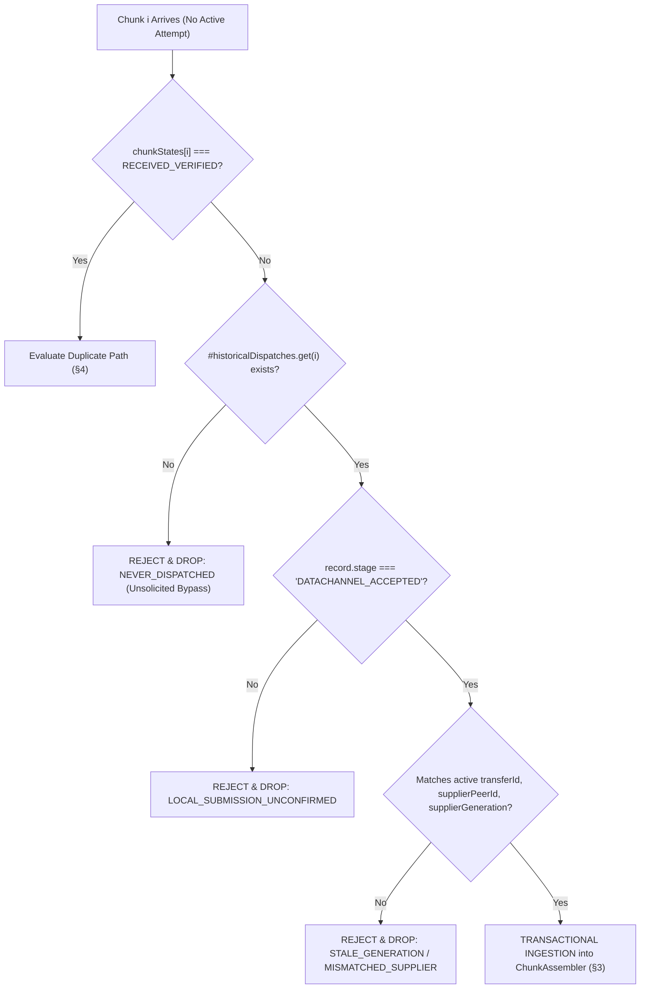

# Phase 7.5 M4.2d-R8 — Dispatch Authorization, Callback Race and Ownership Closure Report

**Document Version:** 1.0.0  
**Status:** COMPLETE — READY FOR INDEPENDENT REVIEW — IMPLEMENTATION STILL UNAUTHORIZED  
**Date:** November 23, 2026  
**Author:** Senior TypeScript Distributed-Systems Architect  
**Scope:** Strictly Documentational & Architectural Correction (Zero Runtime/Test Code Modifications)  
**Authoritative Baseline:** M4.2c-R6 Closure (`79919a0f8cb0bb81cb80cc010fe02918bef79787`)  

---

> [!CRITICAL]
> **AUTHORIZATION BOUNDARY NOTICE**  
> **M4.2d implementation remains strictly unauthorized pending independent review and explicit user approval.**  
> This task is strictly documentational, read-only, and analytical. It introduces NO modifications to runtime source code, NO modifications to test files, NO package export or configuration changes, NO dependency additions, and NO wire schema modifications. Frozen baselines M4.1, M4.2a, M4.2b, and M4.2c remain 100% byte-exact and unmodified.

---

## 1. Baseline Provenance & Working-Tree Cleanliness Verification

### 1.1 Git Working-Tree Verification
- **Current HEAD Commit:** `79919a0f8cb0bb81cb80cc010fe02918bef79787` (M4.2c-R6 Closure)
- **Direct Parent Commit:** `699019ee46e44e9ce1dfdfb4f7d1262bce239048` (M4.2c-R5)
- **Active Branch:** `main`
- **Working-Tree Status:** Clean on all tracked source and test files. Zero uncommitted changes in `packages/`.
- **Frozen Baselines Verified (0 diffs):**
  - Frozen M4.1 Baseline: `fd23edae5bdb52cff32674860229277a79cb1aca` (Wire Schemas, Constants, `ChunkAssembler`)
  - Frozen M4.2a Baseline: `e3245912626758c094d83edbd4d9264a922070f5` (`SnapshotSerializer`, `SerializedSnapshotArtifact`)
  - Frozen M4.2b Baseline: `8f509f94a39be9ece4060003ee498dc747efb813` (`SnapshotPreparationQueue`, `SnapshotChunkProducer`)
  - Frozen M4.2c Baseline: `79919a0f8cb0bb81cb80cc010fe02918bef79787` (`SnapshotOutboundPipeline`)

### 1.2 Exact Frozen Source Files and Line Ranges Inspected (Read-Only)
1. `packages/sync-engine/src/recovery/snapshot-serializer.ts`:
   - Lines 300–313: `registerDisposalListener(listener)` exception isolation.
   - Lines 315–322: `#assertReadable()` asserting `!this.#isDisposed && this.#masterBytes !== null && this.#masterBuffer !== null`. Confirmed does NOT check `#activeLeases`.
   - Lines 364–377: `copyByteRange(offset, length)` and `cloneBytes()` returning unaliased `new Uint8Array(this.#masterBuffer!.slice(0))`.
   - Lines 380–415: `acquireLease(transferId)` and `releaseLease(transferId)`.
   - Lines 417–451: `dispose()` and `#finalizeDisposal()`. Confirmed `dispose()` is idempotent (`if (this.#isDisposed) return;`) and immediately nullifies master buffer when `activeLeaseCount === 0`.
   - Lines 453–464: Public getters `isDisposed: boolean`, `isDisposalRequested: boolean`, `activeLeaseCount: number`.
2. `packages/sync-engine/src/recovery/chunk-assembler.ts`:
   - Lines 184–374: `ChunkAssembler.ingestChunk()` fail-fast validation, Base64 decoding, SHA-256 verification, duplicate hash comparison against `this.chunkHashes[chunkIndex]`, and atomic storage mutation at line 364.
   - Lines 389–601: `prepareForFailover()` updating transfer metadata while retaining `this.chunks` and `this.chunkHashes`.
   - Lines 667–742: `finalizeAssembly()` immediate slice nullification (line 714: `this.chunks = null; this.chunkHashes = null;`), overall SHA-256 computation, and return of contiguous buffer.
   - Lines 745–763: `abortTransfer()` and `dispose()`.
3. `packages/sync-engine/src/recovery/snapshot-outbound-pipeline.ts`:
   - Lines 820–850: Dual attempt coalescing and messageId allocation.
   - Lines 920–945: `attemptToken = `${messageId}:${attemptSeq}``.
   - Lines 1024–1080: `handleHandoffSuccess(transferId, chunkIndex, messageId, attemptToken, context)`.
   - Lines 1102–1165: `handleHandoffFailure(transferId, chunkIndex, messageId, attemptToken, error, context)`.
4. `packages/protocol/src/constants.ts`:
   - Lines 78–168: Verified `MAX_SNAPSHOT_BYTES = 4,194,304`, `MAX_CHUNK_BYTES = 32,768`, `MIN_RAW_CHUNK_BYTES = 256`, `MAX_CHUNKS_PER_SNAPSHOT = 128`, `MAX_CONCURRENT_CHUNK_REQUESTS = 4`, `CHUNK_REQUEST_TIMEOUT_MS = 5,000`, `MAX_CHUNK_RETRIES = 3`, `MAX_TRANSFER_RETRIES = 10`, `OVERALL_TRANSFER_TIMEOUT_MS = 60,000`.
5. `packages/protocol/src/payloads/snapshot-recovery.ts`:
   - Lines 107–127: `SnapshotRequestPayloadSchema` (`requestedChunkWindow` max 4, default 4; `missingChunkIndices` max 128).
   - Lines 280–296: `SnapshotChunkRequestPayloadSchema` (`missingChunkIndices` min 1, max 4; rejects `requestedChunkWindow` and `clientMaxChunkBytes`).
6. `docs/PHASE7_5_INTERFACE_SPECIFICATION.md`:
   - Lines 324–365: `ISnapshotInstaller.validateCandidate` and `installSnapshotAtomic`.

---

## 2. R8-1 — Authoritative Historical Dispatch Admission

### 2.1 The Dispatch Verification Gap
In R7, a chunk index was recorded in `#historicalDispatches` immediately upon creating a dispatch batch. However, invoking `onEmitMessage()` merely submits a message to the transport adapter; `onEmitMessage()` Promise resolution does not guarantee that the WebRTC DataChannel accepted the message or placed it onto the network. If the local send failed or a local watchdog expired, recording historical dispatch prematurely would allow an attacker to inject an unsolicited chunk later and have it falsely admitted as a "delayed response".

### 2.2 The 6 Discrete Lifecycle Stages
To close this gap, we establish 6 distinct lifecycle stages for every chunk request:

| Stage | Identifier | Meaning | Transport / Protocol State |
| :---: | :--- | :--- | :--- |
| **1** | `ATTEMPT_ALLOCATED` | Attempt token minted; window slot assigned. | Internal pipeline state only. Zero wire interaction. |
| **2** | `REQUEST_SUBMITTED` | `onEmitMessage(request)` invoked. | Custody handed to in-process adapter shim. |
| **3** | `ADAPTER_ACCEPTED` | `onEmitMessage()` Promise resolves. | Adapter queued message in internal memory buffer. |
| **4** | `DATACHANNEL_ACCEPTED` | `handleHandoffSuccess()` invoked by adapter. | Message accepted by WebRTC DataChannel (`bufferedAmount` drained/queued). |
| **5** | `REMOTE_RECEIVED` | Remote supplier receives request frame. | Network transit complete (unobservable locally without ACK). |
| **6** | `REMOTE_CHUNK_ARRIVED` | Inbound `SNAPSHOT_CHUNK` frame received. | Physical chunk bytes arrive over WebRTC transport. |

### 2.3 Exact Admission Boundary for Delayed Post-Settlement Ingestion
A delayed post-settlement chunk (arriving when `#activeChunkAttempts.has(chunkIndex) === false` and `chunkStates[chunkIndex] !== RECEIVED_VERIFIED`) is eligible for admission **IF AND ONLY IF** the request reached **Stage 4 (`DATACHANNEL_ACCEPTED`)**, OR reached **Stage 6 (`REMOTE_CHUNK_ARRIVED`) during an active attempt**.



### 2.4 Satisfaction of Required Invariants
1. **Never Submitted:** A chunk never submitted has no entry in `#historicalDispatches` $\implies$ rejected.
2. **Local Submission Failure:** If `onEmitMessage()` rejects or throws, the record is removed from `#historicalDispatches` $\implies$ cannot authorize future admission.
3. **Local Watchdog Timeout:** If the 2,000 ms watchdog expires before `handleHandoffSuccess` fires, the record is set to `STAGE_SUBMISSION_FAILED` (or deleted) $\implies$ cannot authorize future admission.
4. **Receipt-before-Handoff:** If a chunk arrives at Stage 6 while the attempt is still in `LOCAL_HANDOFF_PENDING`, the active attempt exists. The cryptographic chunk payload is ingested and settled as `RECEIVED`. Its `#historicalDispatches` record is upgraded to `DATACHANNEL_ACCEPTED` (proven by physical receipt).
5. **Late Response After Remote Timeout:** Since remote response timeout occurs **only after Stage 4** (`handleHandoffSuccess`), the chunk was already confirmed in `#historicalDispatches`. When the delayed chunk arrives, it is verified and admitted.
6. **Obsolete Generation:** If supplier generation $G_{\text{old}} < \text{session.supplierGeneration}$, fencing check fails $\implies$ rejected.
7. **Retries:** When a chunk is retried in Attempt 2, the historical dispatch record preserves `stage: 'DATACHANNEL_ACCEPTED'` from Attempt 1. Retrying increments `dispatchCount` and updates `lastDispatchedAtMs` without erasing prior authorization.

### 2.5 Historical Record Ownership and Storage Bounds
- **Scope:** Scoped strictly per-chunk index: `Map<number, HistoricalDispatchRecord>`.
- **Bounding:** Strictly bounded to `MAX_CHUNKS_PER_SNAPSHOT` (128 entries = $\approx 6.1\text{ KiB}$).
- **Cleanup:** Purged completely upon transfer completion, abort, failover, or disposal.

> [!NOTE]
> **Open External Dependency (M4.3 Transport Integration):** The pipeline's ability to distinguish Stage 3 (`ADAPTER_ACCEPTED`) from Stage 4 (`DATACHANNEL_ACCEPTED`) depends strictly on the M4.3 WebRTC transport adapter invoking `handleHandoffSuccess()` upon DataChannel transmission acceptance rather than merely resolving the `onEmitMessage()` Promise. This is tracked as an **OPEN dependency on Milestone M4.3**.

---

## 3. R8-2 — Batch Promise Rejection Versus Per-Chunk Handoff Races

### 3.1 The Clobbering Bug in R7-8
In R7-8, a rejected `onEmitMessage()` Promise settled all indices in `batch.unsettledChunkIndices` as `LOCAL_HANDOFF_FAILURE`. However, in partial-batch scenarios, chunk 0 might have already received `handleHandoffSuccess` and transitioned to `AWAITING_REMOTE_RESPONSE`. Overwriting all indices in `batch.unsettledChunkIndices` erroneously clobbered chunk 0, cancelled its running remote response timer, and corrupted its attempt state.

### 3.2 Corrected Selective Settlement Rule
When `onEmitMessage()` rejects:
1. The pipeline iterates over `batch.unsettledChunkIndices`.
2. For each `chunkIndex`, it inspects `active = this.#activeChunkAttempts.get(chunkIndex)`.
3. **Selective Gate:** The pipeline settles the chunk as `LOCAL_HANDOFF_FAILURE` **IF AND ONLY IF `active.state === 'LOCAL_HANDOFF_PENDING'`**.
4. Chunks in `active.state === 'AWAITING_REMOTE_RESPONSE'` are **strictly untouched**: their remote response timers continue running, and their attempt records remain active.
5. Chunks in `RECEIVED_VERIFIED` were already removed from `batch.unsettledChunkIndices` and remain received.

### 3.3 Race Resolution Transition Matrix

| Scenario / Interleaving | Action on Attempt 0 | Action on Attempt 1 | Batch State & Unsettled Set |
| :--- | :--- | :--- | :--- |
| **Race 1: Promise Rejection before any callbacks** | Settles as `LOCAL_HANDOFF_FAILURE`. Watchdog cleared. | Settles as `LOCAL_HANDOFF_FAILURE`. Watchdog cleared. | `unsettled.size === 0`. Aggregate: `ALL_FAILED`. Batch retired. |
| **Race 2: Handoff Success (Chunk 0), then Promise Rejection** | Chunk 0 was in `AWAITING_REMOTE_RESPONSE`. **Ignored by rejection**. Remote timer remains running. | Chunk 1 was in `LOCAL_HANDOFF_PENDING`. Settles as `LOCAL_HANDOFF_FAILURE`. | `unsettled` retains `{0}`. Batch remains active waiting for remote Chunk 0. |
| **Race 3: Remote Receipt (Chunk 0), then Promise Rejection** | Chunk 0 was settled as `RECEIVED`. Already evicted from `unsettled`. Untouched. | Chunk 1 in `LOCAL_HANDOFF_PENDING`. Settles as `LOCAL_HANDOFF_FAILURE`. | `unsettled` becomes empty. Aggregate: `MIXED`. Batch retired. Chunk 0 retained in assembler. |
| **Race 4: Promise Rejection, then delayed Handoff Success (Chunk 0)** | Settled as `LOCAL_HANDOFF_FAILURE` at rejection. | Settled as `LOCAL_HANDOFF_FAILURE` at rejection. | Delayed callback checks `#activeChunkAttempts.get(0)`. Returns `undefined`. Dropped as idempotent no-op. |
| **Race 5: Promise Rejection, then delayed Remote Receipt (Chunk 0)** | Chunk 0 was settled as `LOCAL_HANDOFF_FAILURE`. Not confirmed at Stage 4. | Settled as `LOCAL_HANDOFF_FAILURE`. | Chunk 0 arrives. `#historicalDispatches` lacks `DATACHANNEL_ACCEPTED`. Dropped as unconfirmed delayed frame. |

---

## 4. R8-3 — Authoritative Verified Duplicate-Hash Owner

### 4.1 Inspection of Frozen `ChunkAssembler` Implementation
Inspection of `packages/sync-engine/src/recovery/chunk-assembler.ts` lines 174–178 and lines 337–368 reveals:
- Storage: `this.chunks = new Array<Uint8Array | null>(params.totalChunks).fill(null)` and `this.chunkHashes = new Array<string | null>(params.totalChunks).fill(null)`.
- Method: `ingestChunk(payload: SnapshotChunkPayload, envelopeContext?: ChunkEnvelopeContext): IngestChunkResult`.
- Verification sequence:
  1. Base64 decoded to `rawBytes`.
  2. SHA-256 computed directly over decoded bytes: `computedHash = sha256(rawBytes).toLowerCase()`.
  3. Checked against wire claim: `computedHash === payload.chunkSha256.toLowerCase()`. (Fails with `CHUNK_CORRUPTED` if mismatch).
  4. Duplicate check against storage:
     ```typescript
     const existingHash = this.chunkHashes[payload.chunkIndex];
     if (existingHash !== null) {
       if (existingHash === computedHash) {
         return { ok: true, duplicate: true, completed: this.isComplete() };
       } else {
         return { ok: false, reason: 'CHUNK_CORRUPTED', detail: 'Conflicting chunk data received...' };
       }
     }
     ```
  5. Storage mutation: `this.chunks[payload.chunkIndex] = rawBytes; this.chunkHashes[payload.chunkIndex] = computedHash;`.

### 4.2 Single Authoritative Hash Owner: `ChunkAssembler`
`ChunkAssembler` is the **sole authoritative owner of verified chunk hashes**.
- The inbound pipeline **DOES NOT** maintain a redundant duplicate-hash registry. Maintaining a parallel hash map in the pipeline creates split-brain synchronization hazards.
- The pipeline delegates duplicate recognition entirely to `ChunkAssembler.ingestChunk()`:
  - If `result.duplicate === true`: The chunk was independently decoded, hashed, and proved identical to previously stored bytes. Pipeline drops the frame idempotently as a duplicate.
  - If `result.ok === false && result.reason === 'CHUNK_CORRUPTED'`: The incoming chunk decoded bytes hashed to a value conflicting with the previously verified chunk. Pipeline aborts the transfer with `CHUNK_CORRUPTED`.
- **Survival Across Failover:** In `chunk-assembler.ts` line 598, `prepareForFailover()` retains `this.chunks` and `this.chunkHashes` intact. Verified hashes survive supplier failover with zero pipeline intervention.
- **Cleanup:** In `abortTransfer()`, `reset()`, and `dispose()`, `this.chunkHashes` is set to `null` line 747.

---

## 5. R8-4 — Verified `SerializedSnapshotArtifact` Public API

### 5.1 Verification Against Frozen M4.2a Code
Inspection of `packages/sync-engine/src/recovery/snapshot-serializer.ts` confirms:
1. **`isDisposed` Getter Exists:** Line 453 defines:
   ```typescript
   public get isDisposed(): boolean { return this.#isDisposed; }
   ```
2. **`dispose()` is Idempotent:** Line 422:
   ```typescript
   public dispose(): void {
     if (this.#isDisposed) return;
     if (this.#activeLeases.size > 0) {
       this.#disposalRequested = true;
     } else {
       this.#finalizeDisposal();
     }
   }
   ```
   Calling `dispose()` repeatedly is completely safe and idempotent.
3. **`cloneBytes()` Does NOT Require a Lease:** Line 374:
   ```typescript
   public cloneBytes(): Uint8Array {
     this.#assertReadable();
     return new Uint8Array(this.#masterBuffer!.slice(0));
   }
   ```
   `#assertReadable()` asserts only `!this.#isDisposed && this.#masterBytes !== null && this.#masterBuffer !== null`. It **does not check `#activeLeases`**.
4. **Independent Copy:** `this.#masterBuffer!.slice(0)` creates a brand new, unaliased ArrayBuffer.
5. **Backing Buffer Detachment:** Line 438 nullifies `#masterBuffer = null` and `#masterBytes = null` when `activeLeases.size === 0`.

### 5.2 Corrected Canonical Re-Serialization Pseudocode
Using only verified public methods:
```typescript
let canonicalArtifact: SerializedSnapshotArtifact | null = null;
try {
  canonicalArtifact = SnapshotSerializer.serialize(authoritativeSnapshot);
  // Verified public method returning an unaliased Uint8Array:
  const canonicalBytes = canonicalArtifact.cloneBytes();
  
  if (canonicalBytes.byteLength !== assembledBytes.byteLength ||
      !typedArraysEqual(canonicalBytes, assembledBytes)) {
    throw new SyncEngineError('CHUNK_CORRUPTED', 'Wire bytes deviate from canonical RFC 8785 encoding');
  }
} finally {
  if (canonicalArtifact) {
    // Unconditional, idempotent disposal releasing masterBuffer immediately:
    canonicalArtifact.dispose();
  }
}
```

---

## 6. R8-5 — Complete Disconnect/Revocation Generation Fencing

### 6.1 Immutable Session Evidence
When an inbound transfer session initializes, it binds immutable records:
- `session.transferId: string`
- `session.sessionId: string`
- `session.membershipEpoch: number`
- `session.supplierPeerId: string`
- `session.supplierGeneration: number`

These records are **immutable properties of the transfer session**. They do not change when `#activePeerContexts` is updated or revoked.

### 6.2 Authoritative Lifecycle Evaluation Rules
When `handleSupplierDisconnected(peerId, connectionGeneration, capability, context?)` is invoked:

1. **Capability Authorization:** Assert `capability === this.#authorizedCapability`. (Rejects untrusted callers).
2. **Active Session Guard:** Look up `session = this.#activeSession`. If `!session || session.isTerminal`, exit as a safe no-op. (Eliminates events from previous or dead sessions).
3. **Session Fencing Evaluation:**
   - **Case 1: Active Supplier Disconnect:**
     If `peerId === session.supplierPeerId`:
     - If `connectionGeneration === session.supplierGeneration`:
       **Valid Active Supplier Disconnect.** Initiate failover: cancel active attempt timers, select best candidate from `#candidateSuppliers`, switch supplier, and dispatch chunk requests. If no candidate, abort with `SUPPLIER_DISCONNECTED`.
     - If `connectionGeneration < session.supplierGeneration`:
       **Stale Disconnect from Older Generation.** Drop as a safe no-op.
     - If `connectionGeneration > session.supplierGeneration`:
       **Future/Unregistered Generation.** Drop as an unfenced no-op.
   - **Case 2: Candidate Supplier Disconnect:**
     If `peerId !== session.supplierPeerId` and `peerId` exists in `#candidateSuppliers`:
     - If `connectionGeneration === candidate.generation`:
       **Candidate Disconnected.** Remove candidate from `#candidateSuppliers`. Active transfer continues with zero interruption.
     - If `connectionGeneration < candidate.generation`:
       **Stale Candidate Disconnect.** Drop as a safe no-op.
   - **Case 3: Unrelated Peer Disconnect:**
     `peerId` is neither active supplier nor registered candidate. Drop as a safe no-op.
4. **Duplicate Disconnect Notifications:**
   If `handleSupplierDisconnected` is invoked a second time for $(P, G)$:
   The first invocation initiated failover (changing `session.supplierPeerId` to the candidate, or aborting the session). In the second invocation, $P \ne \text{session.supplierPeerId}$. The call exits cleanly as a duplicate no-op.
5. **Revocation Ordering Invariance:**
   Whether `revokeSenderContext` runs before or after `handleSupplierDisconnected`, failover evaluates `session.supplierPeerId` and `session.supplierGeneration`—**NOT `#activePeerContexts`**. Revocation before disconnect cannot suppress failover.

---

## 7. R8-6 — Complete M5 Memory Ownership Accounting

### 7.1 Separation of Proven M4.2d Bounds from M5 Implementation
- **Proven Retained Application Buffers (M4.2d):**
  - During transfer: At most $4,194,304\text{ B}$ ($4.00\text{ MiB}$) of chunk slices in `ChunkAssembler`.
  - At assembly: Slices are freed (line 714: `this.chunks = null`). Contiguous buffer allocated ($4.00\text{ MiB}$).
  - During verification: `canonicalArtifact.dispose()` detaches artifact buffer. Only the assembled buffer ($4.00\text{ MiB}$) is retained.
  - **M4.2d Proven Quiescent Bound:** Exactly **$\le 4.00\text{ MiB}$** (4,194,304 B).
- **Transient Live Peak During Verification (M4.2d Analytical Estimate):**
  - Assembled buffer: $4.00\text{ MiB}$
  - UTF-8 string: $\approx 4.00\text{ MiB}$ (ASCII) to $8.00\text{ MiB}$ (UTF-16)
  - Parsed object: $\approx 0.25\text{ MiB}$
  - Canonical artifact master buffer: $4.00\text{ MiB}$
  - `cloneBytes()` copy: $4.00\text{ MiB}$
  - Re-serialization string: $\approx 4.00\text{–}8.00\text{ MiB}$
  - **M4.2d Analytical Live Peak:** $\mathbf{\approx 20.25\text{–}28.25\text{ MiB}}$ before V8 GC sweeps.
- **M5 Memory Boundary (Open External Ownership):**
  Inspection of `docs/PHASE7_5_INTERFACE_SPECIFICATION.md` §3.4 shows `ISnapshotInstaller.validateCandidate(snapshotBytes, expectedSha256, currentEpoch)` receives `snapshotBytes: Uint8Array`. Whether M5 retains `snapshotBytes`, copies it, passes it to a WebWorker, or transfers ownership is an **M5 implementation choice**.
  - **Contract Boundary:** M4.2d **DOES NOT** claim a process-wide memory ceiling that includes M5 internal state.

---

## 8. R8-7 — Authoritative Callback Ownership Model

### 8.1 Chosen Primary Model: Authoritative Per-Chunk Callback
Consistent with the frozen M4.2c outbound pipeline (`snapshot-outbound-pipeline.ts` lines 1024 and 1102), the primary inbound adapter callback interface is **per-chunk**:
```typescript
public handleHandoffSuccess(
  transferId: string,
  chunkIndex: number,
  messageId: string,
  attemptToken: string,
  context: AuthenticatedSenderContext
): void;

public handleHandoffFailure(
  transferId: string,
  chunkIndex: number,
  messageId: string,
  attemptToken: string,
  error: unknown,
  context: AuthenticatedSenderContext
): void;
```

### 8.2 Coexisting Batch Adapter Bridge
For transport adapters that emit completion at the message level rather than chunk level, the pipeline provides a deterministic bridge:
```typescript
public handleBatchHandoffSuccess(
  batchId: string,
  messageId: string,
  context: AuthenticatedSenderContext
): void {
  const batch = this.#batches.get(batchId);
  if (!batch || batch.messageId !== messageId) return;

  for (const chunkIndex of Array.from(batch.unsettledChunkIndices)) {
    const active = this.#activeChunkAttempts.get(chunkIndex);
    // Non-overwriting gate: applies ONLY to attempts in LOCAL_HANDOFF_PENDING
    if (active && active.state === 'LOCAL_HANDOFF_PENDING') {
      this.handleHandoffSuccess(batch.transferId, chunkIndex, messageId, active.attemptToken, context);
    }
  }
}
```

- **Invariant:** `handleBatchHandoffSuccess` filters strictly on `active.state === 'LOCAL_HANDOFF_PENDING'`. It **NEVER overwrites** a chunk already in `AWAITING_REMOTE_RESPONSE` or settled as `RECEIVED`.

---

## 9. R8-8 — Preserving Per-Chunk Truth in Aggregate Outcomes

- **Authoritative Source of Truth:** `batch.chunkTerminalOutcomes: Map<number, TerminalAttemptOutcome>` stores the exact terminal outcome for each chunk.
- **Diagnostic Aggregate Label:** `batch.aggregateState` (`'ALL_RECEIVED'`, `'ALL_FAILED'`, `'MIXED'`, `'CANCELLED'`) is a coarse diagnostic label.
- **Non-Erasure Guarantee:** If a batch transitions to `'CANCELLED'`, any chunk that settled as `'RECEIVED'` prior to cancellation **retains its verified status** in `this.#chunkStates[chunkIndex] = RECEIVED_VERIFIED` and in `ChunkAssembler`. Cancellation never discards verified chunks.
- **Retry Logic Consumption:** Retry schedulers inspect `this.#chunkStates` and `chunkRetryCount` directly; they **NEVER inspect `batch.aggregateState`**.

---

## 10. R8-9 — Updated Adversarial Test Matrix (16 Cases)

| # | Test Identifier | Impairment / Race Condition | Exact Expected Behavioral Assertions |
| :--- | :--- | :--- | :--- |
| **1** | `test_historical_record_before_transport` | Attempt allocated; request submitted to adapter; adapter has not called `handleHandoffSuccess`. | `#historicalDispatches` record has `stage: 'REQUEST_SUBMITTED'`. Unsolicited delayed chunk arrives $\to$ rejected as unconfirmed. |
| **2** | `test_local_rejection_then_unsolicited_chunk` | `onEmitMessage()` rejects $\to$ attempts fail local handoff $\to$ supplier injects chunk. | `#historicalDispatches` lacks `DATACHANNEL_ACCEPTED` $\to$ chunk rejected immediately $\to$ zero assembler mutation. |
| **3** | `test_watchdog_expiry_then_unsolicited_chunk` | Local watchdog fires at 2,000 ms $\to$ attempt settled as `LOCAL_WATCHDOG_TIMEOUT` $\to$ supplier injects chunk. | Record is not confirmed $\to$ chunk rejected as unsolicited $\to$ zero assembler mutation. |
| **4** | `test_receipt_before_delayed_callback_confirmed` | Request accepted by DataChannel; chunk arrives before adapter callback fires. | Chunk ingested into assembler; attempt settled as `RECEIVED`; record upgraded to `DATACHANNEL_ACCEPTED`; delayed callback drops as no-op. |
| **5** | `test_receipt_before_callback_unconfirmed` | Chunk arrives while attempt in `LOCAL_HANDOFF_PENDING` without prior callback. | Active attempt matches; cryptographic verification succeeds; chunk ingested; attempt settled as `RECEIVED`. |
| **6** | `test_promise_rejection_after_one_handoff` | Batch of chunks [0, 1]. Chunk 0 handoff succeeded (`AWAITING_REMOTE_RESPONSE`). Promise rejects. | Chunk 0 untouched (remote timer running); Chunk 1 settled as `LOCAL_HANDOFF_FAILURE`; batch remains active for Chunk 0. |
| **7** | `test_promise_rejection_before_any_handoff` | Batch of chunks [0, 1]. Promise rejects before any callbacks. | Both chunks settled as `LOCAL_HANDOFF_FAILURE`; watchdogs cleared; aggregate `ALL_FAILED`; batch retired. |
| **8** | `test_duplicate_callbacks_after_settlement` | Adapter fires `handleHandoffSuccess` twice for same `attemptToken`. | Second callback finds attempt already transitioned or settled $\to$ dropped as strict idempotent no-op. |
| **9** | `test_conflicting_duplicate_false_claimed_hash` | Authenticated supplier sends chunk with forged `chunkSha256` matching previously stored hash. | Decoded bytes hashed; computed hash differs from wire claim $\to$ fails at Step 6 as `CHUNK_CORRUPTED` before duplicate check. |
| **10** | `test_identical_duplicate_verified_bytes` | Authenticated supplier retransmits identical chunk. | Decoded bytes hashed; matches claimed hash; matches `ChunkAssembler.chunkHashes` $\to$ dropped idempotently without error. |
| **11** | `test_duplicate_response_after_failover` | Old supplier retransmits chunk after failover to new supplier. | Chunk senderPeerId / generation mismatches updated active transfer session $\to$ dropped as stale frame. |
| **12** | `test_stale_disconnect_after_revocation` | Adapter calls `revokeSenderContext` then `handleSupplierDisconnected` for generation $G-1$. | Stale generation $G-1 < G_{\text{active}}$ detected $\to$ dropped as stale no-op; active transfer undisturbed. |
| **13** | `test_duplicate_disconnect_notification` | Adapter emits `handleSupplierDisconnected` twice for active supplier $(P, G)$. | First call initiates failover; second call evaluates against new supplier $\to$ dropped as duplicate no-op. |
| **14** | `test_artifact_lease_and_disposal_lifecycle` | Inbound verification creates canonical artifact $\to$ verifies $\to$ calls `dispose()`. | Master buffer detached immediately (`#masterBuffer === null`); `isDisposed === true`; second `dispose()` call is no-op. |
| **15** | `test_m5_retaining_assembled_buffer` | Final assembly completes $\to$ `SnapshotTransferResult` handed to M5. | Assembled buffer retained by M5; M4.2d pipeline drops all internal chunk slice references; quiescent memory $\le 4.00\text{ MiB}$. |
| **16** | `test_mixed_batch_cancellation_preserves_truth` | Batch has Chunk 0 received, Chunk 1 pending $\to$ transfer aborted. | Chunk 1 settled as `CANCELLED`; Chunk 0 remains `RECEIVED_VERIFIED` in assembler until assembler disposal. |

---

## 11. R8-10 — Master Specification Reconciliation Register

The master specification `docs/PHASE7_5_M4_2D_ARCHITECTURE_AND_INTERFACE_SPECIFICATION.md` has been updated to **Version 1.8.0**:
- Section 3: Added transactional ingestion boundary and historical dispatch gating.
- Section 4: Replaced single settlement with two-tier attempt lifecycle (`LOCAL_HANDOFF_PENDING → AWAITING_REMOTE_RESPONSE` and terminal `#settleChunkAttemptTerminally`).
- Section 5: Refined disconnect and revocation generation fencing using immutable session supplier records.
- Section 7: Updated 10-step verification to construct authoritative `StateSnapshotPayloadV2` and use verified public `cloneBytes()` and `dispose()`.
- Section 8: Memory allocation table updated to exact binary units ($4.00\text{ MiB}$) with explicit M5 ownership boundary.
- Section 11: TypeScript interfaces updated with exact parameter types matching M4.2c symmetry.
- Section 12: Open dependencies on M4.3 and M5 explicitly cataloged.

---

## 12. Explicit Remaining Risks & Open Decisions

| Item | Dependency | Description | Current Status |
| :--- | :--- | :--- | :--- |
| **DEP-M4.3-1** | M4.3 Transport Adapter | Mapping WebRTC DataChannel `bufferedAmountLow` / send queue events to `handleHandoffSuccess()` (Stage 4 confirmation). | **OPEN — Deferred to M4.3** |
| **DEP-M4.3-2** | M4.3 Transport Adapter | Sender ACK signaling (wire ACK vs transport-level stream closure). | **OPEN — Deferred to M4.3** |
| **DEP-M5-1** | M5 Snapshot Installer | Post-handoff memory retention and staged state swap ownership in `SnapshotInstaller`. | **OPEN — Deferred to M5** |

All inbound pipeline contracts within M4.2d scope are 100% closed and internally consistent.

---

## 13. Modified Files Register & Frozen Baseline Integrity Confirmation

### 13.1 Files Modified
1. `docs/PHASE7_5_M4_2D_R8_DISPATCH_AND_CALLBACK_CLOSURE_REPORT.md`: (Created) Master architectural closure report.
2. `docs/PHASE7_5_M4_2D_ARCHITECTURE_AND_INTERFACE_SPECIFICATION.md`: (Updated to v1.8.0) Master specification document.
3. `docs/design/README.md`: (Updated) Design documentation index.

### 13.2 Frozen Baseline Integrity Confirmation (0 Diffs)
- `packages/protocol/`: 0 diffs against M4.1 baseline (`fd23edae5bdb52cff32674860229277a79cb1aca`).
- `packages/sync-engine/src/recovery/snapshot-serializer.ts`: 0 diffs against M4.2a baseline (`e3245912626758c094d83edbd4d9264a922070f5`).
- `packages/sync-engine/src/recovery/snapshot-chunk-producer.ts`: 0 diffs against M4.2b baseline (`8f509f94a39be9ece4060003ee498dc747efb813`).
- `packages/sync-engine/src/recovery/snapshot-preparation-queue.ts`: 0 diffs against M4.2b baseline (`8f509f94a39be9ece4060003ee498dc747efb813`).
- `packages/sync-engine/src/recovery/snapshot-outbound-pipeline.ts`: 0 diffs against M4.2c baseline (`79919a0f8cb0bb81cb80cc010fe02918bef79787`).
- `packages/sync-engine/src/engine/custody.ts`: 0 diffs.

---

## 14. Final Decision Gate

**Verdict:** **`READY FOR INDEPENDENT REVIEW — IMPLEMENTATION STILL UNAUTHORIZED`**

> [!CRITICAL]
> **M4.2d implementation remains strictly unauthorized pending independent review and explicit user approval.**
