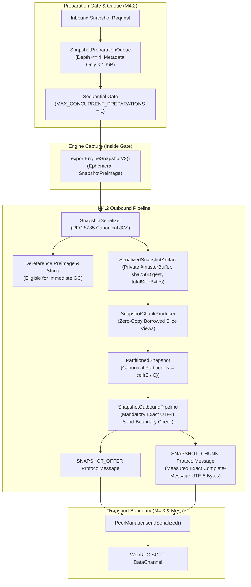
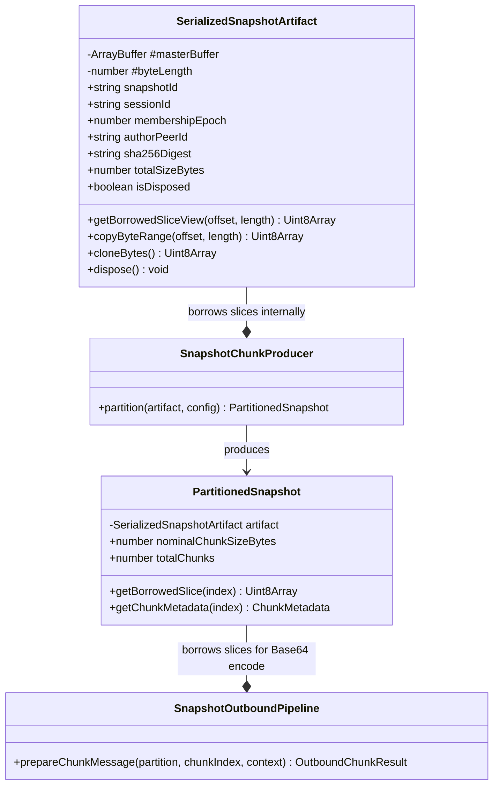

# Phase 7.5 M4.2 — Snapshot Serialization & Outbound Pipeline Architecture

**Document Version:** 1.1.0  
**Status:** Approved Architecture Plan (Targeted Planning Correction Applied)  
**Frozen Baseline Commit:** `fd23edae5bdb52cff32674860229277a79cb1aca`  
**Parent Baseline:** `55bdf80d7fb4bc573d8b5abe672d06dec969678d`  
**Specification Baseline:** `119da194c3feb883cfd61b6928cb81d4b200ac5d`  

---

## 1. Executive Summary & Objective

Milestone M4.2 designs the **sender-side pipeline** of the SyncPlay state recovery system. Its responsibility is to take a validated engine snapshot from the Phase 7.5 M3 export interface, deterministically serialize it into portable canonical bytes, encapsulate it in an immutable, privately held buffer artifact, partition it into canonical binary slices, encode slices into browser-compatible Base64, and format them into strictly bounded `SNAPSHOT_OFFER` and `SNAPSHOT_CHUNK` wire protocol messages that are guaranteed never to exceed negotiated WebRTC SCTP message size limits.

This component is strictly isolated:
- It does **NOT** modify playback state, mutate clocks, or compact logs.
- It does **NOT** install snapshots or make membership decisions.
- It does **NOT** act as the recovery coordinator (which belongs to M4.3).
- It does **NOT** introduce a cluster leader or centralized playback authority.
- It strictly preserves the frozen M4.1 receiver contract, wire schemas, admission formulas, and canonical chunk partition geometry.



---

## 2. Investigation: Contract Inconsistencies & Authoritative Limits

### 2.1 Reconciling the 4 MiB vs. 64 MiB Discrepancy

During the Phase 7.5 M4.1 audit discussions, a 64 MiB limit with up to 262,144 chunks was referenced in audit questionnaires. An exhaustive trace of the committed codebase reveals the true provenance of every limit:

| Subsystem / Component | Source Code Location | Configured Constant | Actual Enforced Value | Rationale & Call Path |
| :--- | :--- | :--- | :---: | :--- |
| **Protocol Constants** | `packages/protocol/src/constants.ts#L81` | `MAX_SNAPSHOT_BYTES` | **4,194,304 B (4 MiB)** | Canonical payload ceiling for state recovery. |
| **Protocol Constants** | `packages/protocol/src/constants.ts#L127`| `MAX_CHUNK_BYTES` | **32,768 B (32 KiB)** | Maximum allowable raw binary chunk slice. |
| **Protocol Constants** | `packages/protocol/src/constants.ts#L132`| `MAX_CHUNKS_PER_SNAPSHOT` | **128 chunks** | Absolute upper bound on chunk partition count. |
| **Protocol Constants** | `packages/protocol/src/constants.ts#L102`| `MIN_RAW_CHUNK_BYTES` | **256 B** | Minimum allowable chunk size before abort. |
| **Protocol Constants** | `packages/protocol/src/constants.ts#L97` | `MAX_ENVELOPE_OVERHEAD_BYTES` | **1,800 B** | Guaranteed ceiling for envelope + metadata framing. |
| **Protocol Constants** | `packages/protocol/src/constants.ts#L116`| `MIN_TRANSPORT_LIMIT_CHUNK_TRANSFER` | **2,144 B** | 1,800 B envelope + 344 B Base64 (256 B binary). |
| **Protocol Constants** | `packages/protocol/src/constants.ts#L122`| `MIN_TRANSPORT_LIMIT_FULL_CHUNK` | **45,492 B** | 1,800 B envelope + 43,692 B Base64 (32 KiB binary). |
| **Snapshot Offer Schema** | `packages/protocol/src/payloads/snapshot-recovery.ts#L89` | `totalSizeBytes` | **$\le$ 4,194,304 B** | Zod schema enforces `.max(MAX_SNAPSHOT_BYTES)`. |
| **Snapshot Offer Schema** | `packages/protocol/src/payloads/snapshot-recovery.ts#L90` | `totalChunks` | **$\le$ 128 chunks** | Zod schema enforces `.max(MAX_CHUNKS_PER_SNAPSHOT)`. |
| **Snapshot Chunk Schema** | `packages/protocol/src/payloads/snapshot-recovery.ts#L140`| `chunkIndex` | **0 .. 127** | Zod schema enforces `.max(MAX_CHUNKS_PER_SNAPSHOT - 1)`. |
| **Snapshot Chunk Schema** | `packages/protocol/src/payloads/snapshot-recovery.ts#L143`| `totalSizeBytes` | **$\le$ 4,194,304 B** | Zod schema enforces `.max(MAX_SNAPSHOT_BYTES)`. |
| **Snapshot Admission** | `packages/protocol/src/admission.ts#L110` | `totalSizeBytes` | **$\le$ 4,194,304 B** | Rejects `totalSizeBytes > MAX_SNAPSHOT_BYTES`. |
| **Snapshot Admission** | `packages/protocol/src/admission.ts#L137` | `calculatedRequiredChunks` | **$\le$ 128 chunks** | Rejects `calculatedRequiredChunks > 128`. |
| **Snapshot V2 Export** | `packages/sync-engine/src/snapshot.ts#L250`| `byteLength` | **$\le$ 4,194,304 B** | Throws `SNAPSHOT_ERROR` if JSON UTF-8 > 4 MiB. |
| **Snapshot V2 Validation**| `packages/sync-engine/src/snapshot.ts#L291`| `byteLength` | **$\le$ 4,194,304 B** | Rejects imported snapshot payloads > 4 MiB. |
| **Chunk Assembler** | `packages/sync-engine/src/recovery/chunk-assembler.ts#L123` | `maxSnapshotBytes` | **$\le$ 4,194,304 B** | Defaults to `MAX_SNAPSHOT_BYTES` (4 MiB). |
| **Chunk Assembler** | `packages/sync-engine/src/recovery/chunk-assembler.ts#L124` | `maxChunks` | **$\le$ 128 chunks** | Defaults to `MAX_CHUNKS_PER_SNAPSHOT` (128). |

### 2.2 Root of the 64 MiB / 262,144 Artifact
The theoretical numbers `64 MiB` and `262,144 chunks` derived from:
$$\frac{64 \text{ MiB}}{256 \text{ B}} = \frac{67,108,864}{256} = 262,144 \text{ chunks}$$
This was an unconstrained hypothetical calculation formulated during early exploratory auditing. **It was never codified in code, schemas, or constants.** The entire monorepo—from schemas to admission gates to export validation to assembly—unconditionally enforces **4 MiB and 128 chunks**.

### 2.3 Mathematical Proof of Authoritative Limits
Under SyncPlay's authoritative limits:
$$\text{Max Chunks} = \frac{\text{MAX\_SNAPSHOT\_BYTES}}{\text{MAX\_CHUNK\_BYTES}} = \frac{4,194,304 \text{ bytes}}{32,768 \text{ bytes}} = \mathbf{128 \text{ chunks exactly}}$$

Furthermore, on a transport link operating at `MIN_TRANSPORT_LIMIT_FULL_CHUNK` (45,492 B) or standard WebRTC fallback (65,536 B):
- Nominal chunk size $C = 32,768$ B.
- Any snapshot up to 4 MiB fits in $\lceil S / 32,768 \rceil \le 128$ chunks.
- If the transport is severely constrained (e.g. 16 KiB link $\implies C = 10,938$ B), a 4 MiB snapshot would require $\lceil 4,194,304 / 10,938 \rceil = 384$ chunks $> 128$.
- As proven in §1.2.5 of `docs/PHASE7_5_M4_ARCHITECTURE.md`, SyncPlay does **not** claim universal 4 MiB transfers over 16 KiB transports; rather, admission safely gates transfer: on a 16 KiB link, snapshots are admitted up to $128 \times 10,938 = 1,400,064$ B (1.34 MiB) and rejected otherwise.

**Authoritative Decision:** Milestone M4.2 strictly adopts:
- `MAX_SNAPSHOT_BYTES = 4,194,304` (4 MiB)
- `MAX_CHUNK_BYTES = 32,768` (32 KiB)
- `MAX_CHUNKS_PER_SNAPSHOT = 128`
- `MIN_RAW_CHUNK_BYTES = 256`
- `MAX_ENVELOPE_OVERHEAD_BYTES = 1,800`
- `MIN_TRANSPORT_LIMIT_CHUNK_TRANSFER = 2,144`

---

## 3. Deterministic Serialization & Digest Architecture

### 3.1 Snapshot Preimage Specification
M4.2 utilizes the Phase 7.5 M3 canonical snapshot format: `StateSnapshotPayloadV2`.

The serialized preimage contains all immutable snapshot fields:
```typescript
interface SnapshotPreimage {
  formatVersion: 2;
  snapshotId: string;
  sessionId: string;
  membershipEpoch: number;
  authorPeerId: string;
  snapshotFrontier: Record<string, number>;
  maxLogicalTimestamp: number;
  originFrontierTimestamps: Record<string, number>;
  compactedCheckpoints: ReadonlyArray<CompactedCheckpointItem>;
  state: EngineSnapshotData;
}
```

### 3.2 Canonical RFC 8785 Serialization Rules
`SnapshotSerializer` invokes `canonicalizeJson(preimage)` from `packages/sync-engine/src/log/operation-fingerprint.ts`:
1. **Excluded Fields:** The `sha256Digest` property is excluded from the preimage before canonicalization (since the digest represents the SHA-256 of the preimage itself).
2. **Deterministic Checkpoint Ordering:** `compactedCheckpoints` are sorted by `(originPeerId, sequenceNumber)` using `localeCompare` and integer subtraction before serialization.
3. **Lamport Invariant:** `maxLogicalTimestamp` is deterministically computed as $\max_{p}(\text{originFrontierTimestamps}[p])$ (or 0 if empty).
4. **Key Sorting:** Object keys are sorted lexicographically by Unicode code points.
5. **Number Formatting:** Finite numbers use standard IEEE-754 representation; `-0` is canonicalized to `0`.
6. **Strict Rejection:** `undefined`, `NaN`, `Infinity`, symbols, functions, `BigInt`, cyclic references, and non-plain objects (`Date`, `RegExp`, `Map`, `Set`) throw `TypeError`.
7. **Isomorphism:** The pure TypeScript JCS implementation guarantees bit-exact output identical across Node.js, Chromium, Safari, and Web Workers.

### 3.3 Cryptographic Digest Binding
The overall snapshot digest is computed via pure synchronous SHA-256 (FIPS 180-4):
$$\text{sha256Digest} = \text{sha256}(\text{rawBytes})$$
Where `rawBytes` is the contiguous UTF-8 encoded byte buffer produced from `canonicalizeJson(preimage)`. This produces a 64-character lowercase hexadecimal string that serves as the root of trust for chunk assembly in M4.1 (`expectedSha256Digest`).

---

## 4. Sender Memory Architecture & Allocation Budget

### 4.1 Scope of the Sender Memory Model
To eliminate ambiguity, the sender memory model partitions allocations into ten distinct components:

1. **Snapshot Preimage Object:** The V8 heap object graph representing `StateSnapshotPayloadV2` (checkpoints, frontiers, state). Peak size: $\approx 4.0\text{–}6.0$ MiB. Active only during `exportEngineSnapshotV2()` inside the serialized preparation gate.
2. **Canonical JSON String:** The UTF-8 formatted string output of `canonicalizeJson(preimage)`. In V8, Latin-1/ASCII strings use 1 byte per character ($4.19$ MiB). In the worst-case scenario with arbitrary multi-byte Unicode strings (e.g. non-ASCII metadata or checkpoint keys), V8 represents the string as two-byte UTF-16 code units: $\le 8.39$ MiB.
3. **Master UTF-8 Byte Buffer:** A single contiguous `ArrayBuffer` holding the encoded bytes of the canonical JSON string. Size: exactly $S \le 4,194,304$ B ($4.19$ MiB). Owned exclusively by `SerializedSnapshotArtifact`.
4. **SHA-256 Working Memory:** Streaming hash calculation state. Size: $< 64$ KiB. Transient during preparation.
5. **Retained Serialized Artifacts:** The `SerializedSnapshotArtifact` instance holding `#masterBuffer`, metadata strings, and slice descriptors. Size: $\approx 4.2$ MiB per artifact. Up to `MAX_ACTIVE_ARTIFACTS = 2` retained simultaneously ($8.4$ MiB total).
6. **Per-Chunk Base64 Strings:** Generated strictly on-demand per transmitted chunk. For a maximum 32 KiB binary slice: $\lceil 32,768 / 3 \rceil \times 4 = 43,692$ characters ($\approx 43.7$ KiB). Chunks are **never** Base64-encoded upfront for all 128 chunks simultaneously.
7. **Serialized Protocol Messages:** Transient JSON string of the complete `ProtocolMessage<SnapshotChunkPayload>`. Peak size: $\approx 45.0$ KiB.
8. **UTF-8 Message-Size Measurement Buffers:** Transient `Uint8Array` created by `new TextEncoder().encode(serializedJson)` to measure exact wire bytes at the send boundary. Peak size: $\approx 45.0$ KiB.
9. **Queued Preparation Requests:** Metadata-only queue entries (`transferId`, `recipientPeerId`, `sctpMaxMessageSize`, `timestampMs`). Peak size: $< 1$ KiB total for maximum queue depth of 4. Holds **zero** snapshot objects or data buffers.
10. **Concurrent Active Transfers:** Up to `MAX_SUPPLIER_CONCURRENT_TRANSFERS = 2` concurrent outbound transfers. Simultaneous chunk framing for two active transfers: $2 \times \approx 135\text{ KiB} \approx 270\text{ KiB}$.

### 4.2 Allocation Lifecycle & Memory Categories
JavaScript runtimes (V8/JavaScriptCore) do not guarantee immediate garbage collection upon object dereference. The memory model therefore formally categorizes allocations:

- **Logically Retained Memory:** Memory intentionally referenced across turn/event-loop boundaries while an artifact or transfer session is active.
- **Transient Live Allocations:** Memory allocated during a synchronous function call (preparation or chunk framing) that is actively reachable while that function executes.
- **Allocations Eligible for Collection:** Memory dereferenced by the application that is awaiting V8 scavenger or mark-sweep garbage collection.
- **Process Heap / RSS:** Total OS virtual memory or resident set size allocated to the JavaScript process. Because V8 garbage collection is non-deterministic and memory pages are retained by OS allocators, process heap/RSS can remain above live allocation totals.

> [!IMPORTANT]
> **Application-Owned Allocation Budget Contract:**  
> The M4.2 architecture guarantees a strictly bounded **application-owned allocation budget**, rather than a hard OS process-level RSS ceiling. The sender pipeline strictly enforces that at no point does application logic hold or trigger live allocations exceeding the defined budget.

### 4.3 Concurrency Policy: Sequential Preparation Gate & Request Queue
To prevent memory exhaustion from overlapping snapshot serializations:

1. **Sequential Preparation Gate (`MAX_CONCURRENT_PREPARATIONS = 1`):**
   - Snapshot preparation is strictly serialized through a non-reentrant asynchronous mutex/gate.
   - **Crucial Invariant:** Engine snapshot capture (`exportEngineSnapshotV2()`) occurs **inside** this serialized critical section, NOT before queuing! The engine never captures multiple 6 MiB snapshot objects concurrently.
2. **Metadata-Only Queue (`MAX_PREPARATION_QUEUE_DEPTH = 4`):**
   - Inbound snapshot preparation requests waiting for the gate store only lightweight metadata:
     ```typescript
     interface QueuedPreparationRequest {
       readonly transferId: string;
       readonly recipientPeerId: string;
       readonly sctpMaxMessageSize: number;
       readonly requestedSnapshotId?: string;
       readonly timestampMs: number;
     }
     ```
   - Total queue footprint is $< 1$ KiB.
3. **Queue Saturation Policy:**
   - If a snapshot preparation request arrives when `queue.length >= MAX_PREPARATION_QUEUE_DEPTH`, the request is immediately rejected with `SNAPSHOT_ABORT` (`reason: 'LOCAL_ABORT'`, detail: `'Preparation queue saturated'`).
4. **Immediate Dereferencing:**
   - As soon as `TextEncoder().encode()` populates `#masterBuffer` and `sha256()` completes, the `SnapshotPreimage` object and the canonical JSON string are dereferenced (`= null`).
   - They become immediately eligible for GC *before* the next queued preparation begins.

### 4.4 Recalculated Peak Application-Owned Allocations
Under worst-case parameters (4 MiB maximum snapshot, two-byte UTF-16 string representation):

| Operational Scenario | Retained Artifacts | Transient Preparation Peak | Active Chunk Framing | Total Peak Application Allocation |
| :--- | :---: | :---: | :---: | :---: |
| **1. Single Snapshot Preparation** | 0.0 MiB | 18.58 MiB (Object + String + Buffer) | 0.0 MiB | **$\le 18.58$ MiB** (14.38 MiB Latin-1) |
| **2. Single Active Retained Artifact (Steady State)** | 4.2 MiB | 0.0 MiB | 0.14 MiB | **$\approx 4.34$ MiB** |
| **3. Preparation of Distinct Snapshot with 1 Retained Artifact** | 4.2 MiB | 18.58 MiB | 0.14 MiB | **$\le 22.92$ MiB** (18.72 MiB Latin-1) |
| **4. Two Active Transfers Sharing 1 Artifact** | 4.2 MiB | 0.0 MiB | 0.27 MiB | **$\approx 4.47$ MiB** |
| **5. Two Distinct Active Artifacts Retained (Steady State)** | 8.4 MiB | 0.0 MiB | 0.27 MiB | **$\approx 8.67$ MiB** |
| **6. Maximum Permitted State: 1 Retained + 1 In-Flight Prep + 2 Sends** | 4.2 MiB | 18.58 MiB | 0.27 MiB | **$\le 23.05$ MiB** (18.85 MiB Latin-1) |

### 4.5 Formal Budget Ceilings
The sender pipeline independently defines and enforces its own allocation budgets:

1. **Steady-State Retained Allocation Budget:** $\mathbf{\le 9.0 \text{ MiB}}$  
   Holds up to 2 distinct active 4 MiB snapshot artifacts ($\approx 4.2$ MiB each) plus metadata and queue descriptors.
2. **Peak Transient Allocation Budget:** $\mathbf{\le 24.0 \text{ MiB}}$  
   Accommodates 1 active retained artifact ($4.2$ MiB), 1 in-flight sequential preparation with conservative 2-byte UTF-16 string representation ($\le 18.58$ MiB), and active chunk framing for 2 concurrent transfers ($0.27$ MiB).

---

## 5. Buffer Ownership, Immutability & Encapsulation Architecture

### 5.1 The Immutability Limitation of JavaScript TypedArrays
In JavaScript runtimes:
- TypeScript `readonly Uint8Array` is purely a compile-time construct; it provides zero runtime protection against indexed byte assignment (`slice[0] = 0xFF`).
- `Object.freeze(typedArray)` freezes wrapper properties, but does **not** freeze the underlying binary elements of the `ArrayBuffer`.
- `Uint8Array.prototype.subarray()` shares the underlying `ArrayBuffer`. If an external consumer mutates a slice view, the master buffer and all concurrent transfers sharing that buffer are permanently corrupted.

### 5.2 Concrete Ownership Boundary
To guarantee absolute runtime byte immutability, M4.2 implements a strict encapsulation boundary:



### 5.3 Encapsulation Rules & Access Tiers

1. **Private Master Buffer:**
   - The master `ArrayBuffer` is stored in a private field `#masterBuffer` inside `SerializedSnapshotArtifact`.
   - The master buffer reference is **never** returned directly by any public getter or property.
2. **Internal Trusted Borrowing (`getBorrowedSliceView`):**
   - Accessible **only** within the internal recovery pipeline (`SnapshotChunkProducer` and `SnapshotOutboundPipeline`).
   - Returns a `Uint8Array` view referencing `(#masterBuffer, offset, length)`.
   - **Lifetime & Escape Boundary:** Borrowed views exist strictly within synchronous framing methods. `SnapshotOutboundPipeline` immediately encodes the borrowed slice to a Base64 string via `encodeBase64()`. Only the resulting Base64 string enters the wire `ProtocolMessage`. Borrowed `Uint8Array` views **never escape** to event listeners, external consumers, or public APIs.
3. **Public Unaliased Access (`copyByteRange`, `cloneBytes`):**
   - Any external caller requesting snapshot bytes receives a freshly allocated, completely unaliased copy via `this.#masterBuffer.slice(offset, offset + length)`.
   - Mutating an unaliased clone has zero effect on `#masterBuffer`, chunk slices, or ongoing transfers.
4. **Hash-to-Encoding Byte Identity:**
   - At artifact creation time, `sha256Digest` is computed directly over the private `#masterBuffer`.
   - Because `#masterBuffer` is completely encapsulated and cannot be modified by any caller, the binary bytes read by `getBorrowedSliceView()` during chunk production are guaranteed to be **bit-exact identical** to the bytes that were hashed.
5. **Artifact Disposal (`dispose`):**
   - Calling `artifact.dispose()` nullifies `#masterBuffer` references and marks `isDisposed = true`.
   - Subsequent calls to `getBorrowedSliceView()`, `copyByteRange()`, or `cloneBytes()` throw `SyncEngineError('ARTIFACT_DISPOSED')`.

---

## 6. Canonical Chunk Partition & Send-Boundary Verification Contract

### 6.1 Strict Canonical Partition Geometry (Frozen M4.1 Contract)
The frozen M4.1 receiver (`ChunkAssembler.ingestChunk()`) enforces strict canonical partition geometry:
- For all non-final chunks ($0 \le i < N - 1$):
  $$\text{chunkSizeBytes}[i] = C \quad (\text{nominalChunkSizeBytes})$$
- For the final chunk ($i = N - 1$):
  $$\text{chunkSizeBytes}[N - 1] = S - (N - 1) \cdot C$$
- If `payload.chunkSizeBytes !== expectedChunkSize`, the receiver immediately aborts with `CHUNK_CORRUPTED`.

> [!CRITICAL]
> **Zero Mid-Transfer Sizing Mutation Rule:**  
> Once `SNAPSHOT_OFFER` is emitted, the sender **MUST NEVER** shrink an individual chunk's binary slice. Reducing a chunk slice mid-transfer breaks the canonical partition equality and causes deterministic receiver rejection.

### 6.2 The Role of Upfront Admission vs. Send-Boundary Verification
Milestone M4.2 decouples transport sizing into two distinct, cooperative phases:

#### Phase 1: Upfront Admission & Capacity Reservation (Before Partitioning)
1. Sender queries the effective transport limit:
   $$\text{effectiveLimit} = \min(65536, \text{peerConnection.dataChannel.maxMessageSize} \mathbin{??} 65536)$$
2. Sender computes nominal chunk capacity via `@syncplay/protocol`'s `calculateChunkCapacity(effectiveLimit)`:
   $$\text{availableBase64} = \max(0, \text{effectiveLimit} - \text{MAX\_ENVELOPE\_OVERHEAD\_BYTES})$$
   $$\text{chunkCapacity} = \min\left(32768, \left\lfloor \frac{\text{availableBase64}}{4} \right\rfloor \times 3\right)$$
3. **The 569-Byte Safety Cushion:**
   - `MAX_ENVELOPE_OVERHEAD_BYTES = 1,800` bytes is reserved upfront.
   - The maximum actual envelope overhead measured across all worst-case UUIDs, timestamps, schemas, and signatures is **1,231 bytes**.
   - This provides an empirical safety cushion of $1,800 - 1,231 = \mathbf{569 \text{ bytes}}$.
   - As a mathematical consequence, any chunk slice sized via `calculateChunkCapacity()` will comfortably fit within `effectiveLimit` on the first framing attempt.
4. Sender validates overall admission via `calculateSnapshotAdmission()`:
   - Validates $S \le 4,194,304$ B.
   - Validates $N = \lceil S / C \rceil \le 128$.
   - Validates $C \ge 256$ B.
5. Slices and partition geometry are locked immutably into `PartitionedSnapshot`.

#### Phase 2: Send-Boundary Invariant Verification (Mandatory Exact Measurement)
When `SnapshotOutboundPipeline.prepareChunkMessage()` frames chunk $i$:
1. Reads canonical slice $i$ of size $S_i$ via `getBorrowedSliceView()`.
2. Encodes binary slice to Base64: length is exactly $\lceil S_i / 3 \rceil \times 4$.
3. Constructs complete `ProtocolMessage<SnapshotChunkPayload>`.
4. Serializes to JSON string via `JSON.stringify(protocolMessage)`.
5. **Measures Exact UTF-8 Byte Length:**
   $$L_i = \text{new TextEncoder}().\text{encode}(\text{serializedJson}).\text{byteLength}$$
6. **Invariant Verification:**
   - **If $L_i \le \text{effectiveLimit}$:** Verification succeeds. The serialized string is authorized for transport delivery.
   - **If $L_i > \text{effectiveLimit}$:** The message violates the transport boundary. Because individual chunk slices cannot be shrunk without corrupting the canonical partition, the preparation **aborts immediately** with `SyncEngineError('TRANSPORT_LIMIT_EXCEEDED')` (emitting `SNAPSHOT_ABORT`).

### 6.3 Removal of Flawed 5-Iteration Sizing Claims
The previous planning assumption that "individual slices can be reduced iteratively by $\Delta_k$ over 5 iterations based on a 40-byte framing variance" was architecturally flawed:
1. Mid-transfer slice reduction violates the frozen M4.1 canonical partition contract.
2. Framing variance across diverse peer IDs, session IDs, and trace contexts cannot be mathematically bounded to 40 bytes without schema restrictions.

**Corrected Contract:**  
M4.2 relies exclusively on **conservative upfront capacity reservation** (1,800 B reserved vs 1,231 B actual) combined with **mandatory exact UTF-8 complete-message measurement** at the send boundary. Estimated character lengths are never sufficient to authorize a send.

---

## 7. Lifecycle, Error Handling & Scope Boundaries

### 7.1 Error Taxonomy

| Failure Mode | Detection Point | Handling / Error Type | System Impact |
| :--- | :--- | :--- | :--- |
| **Invalid Engine State** | `SnapshotSerializer.serialize()` | `SNAPSHOT_ERROR` | Transfer not initiated; engine continues. |
| **Size Exceeds 4 MiB** | Pre-export validation | `SNAPSHOT_ERROR` | Transfer rejected upfront; zero memory leak. |
| **Queue Saturated** | `SnapshotPreparationQueue.enqueue()` | `LOCAL_ABORT` ('Preparation queue saturated') | Inbound request rejected; queue untouched. |
| **Artifact Disposed** | Method call on disposed artifact | `SyncEngineError('ARTIFACT_DISPOSED')` | Read operation rejected; memory remains detached. |
| **Transport Below 2,144 B** | Admission evaluation | `TRANSPORT_LIMIT_EXCEEDED` | Session not initiated. |
| **Send-Boundary Overshoot** | `prepareChunkMessage()` | `TRANSPORT_LIMIT_EXCEEDED` | Transfer aborted cleanly; peer notified via abort. |
| **Epoch Changed Mid-Transfer** | Inbound `SNAPSHOT_REQUEST` check | `EPOCH_MISMATCH` | Outbound transfer cancelled immediately. |
| **Peer Disconnected** | `PeerManager` event | `SUPPLIER_DISCONNECTED` | Transfer resources released. |

### 7.2 Milestone Scope Separation
- **Milestone M4.2 (Sender Pipeline):** Serializer, Preparation Queue, Chunk Producer, Outbound Pipeline, Exact Measurement, Unit Test Suite.
- **Milestone M4.3 (Receiver Pipeline & Coordination):** Inbound state machine, sliding-window chunk requests, retries, supplier failover, and coordinator integration.
- **Milestone M4.4 (Lifecycle & Adapter Wiring):** Transport event routing, peer status listeners, and handoff to M5.
- **Milestone M5 (State Installation):** Atomic snapshot installation, clock reseeding, quarantine buffering.
