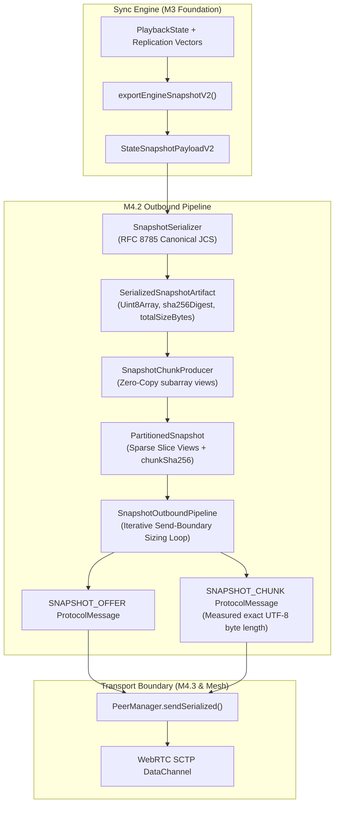

# Phase 7.5 M4.2 — Snapshot Serialization & Outbound Pipeline Architecture

**Document Version:** 1.0.0  
**Status:** Approved Architecture Plan  
**Frozen Baseline Commit:** `fd23edae5bdb52cff32674860229277a79cb1aca`  
**Parent Baseline:** `55bdf80d7fb4bc573d8b5abe672d06dec969678d`  
**Specification Baseline:** `119da194c3feb883cfd61b6928cb81d4b200ac5d`  

---

## 1. Executive Summary & Objective

Milestone M4.2 designs the **sender-side pipeline** of the SyncPlay state recovery system. Its responsibility is to take a validated engine snapshot from the Phase 7.5 M3 export interface, deterministically serialize it into portable bytes, partition it into canonical binary slices, encode slices into browser-compatible Base64, and format them into strictly bounded `SNAPSHOT_OFFER` and `SNAPSHOT_CHUNK` wire protocol messages that are guaranteed never to exceed negotiated WebRTC SCTP message size limits.

This component is strictly isolated:
- It does **NOT** modify playback state, mutate clocks, or compact logs.
- It does **NOT** install snapshots or make membership decisions.
- It does **NOT** act as the recovery coordinator (which belongs to M4.3).
- It does **NOT** introduce a cluster leader or centralized playback authority.



---

## 2. Investigation: Contract Inconsistencies & Authoritative Limits

### 2.1 Reconciling the 4 MiB vs. 64 MiB Discrepancy

During the Phase 7.5 M4.1 audit discussions, a 64 MiB limit with up to 262,144 chunks was referenced in audit questionnaires. An exhaustive trace of the committed codebase reveals the true provenance of every limit:

| Subsystem / Component | Source Code Location | Configured Constant | Actual Enforced Value | Rationale & Call Path |
| :--- | :--- | :--- | :---: | :--- |
| **Protocol Constants** | `packages/protocol/src/constants.ts#L81` | `MAX_SNAPSHOT_BYTES` | **4,194,304 B (4 MiB)** | Canonical payload ceiling for state recovery. |
| **Protocol Constants** | `packages/protocol/src/constants.ts#L127`| `MAX_CHUNK_BYTES` | **32,768 B (32 KiB)** | Maximum allowable raw binary chunk slice. |
| **Protocol Constants** | `packages/protocol/src/constants.ts#L132`| `MAX_CHUNKS_PER_SNAPSHOT` | **128 chunks** | Absolute upper bound on chunk partition count. |
| **Protocol Constants** | `packages/protocol/src/constants.ts#L102`| `MIN_RAW_CHUNK_BYTES` | **256 B** | Minimum allowable chunk size before abort. |
| **Protocol Constants** | `packages/protocol/src/constants.ts#L97` | `MAX_ENVELOPE_OVERHEAD_BYTES` | **1,800 B** | Guaranteed ceiling for envelope + metadata framing. |
| **Protocol Constants** | `packages/protocol/src/constants.ts#L116`| `MIN_TRANSPORT_LIMIT_CHUNK_TRANSFER` | **2,144 B** | 1,800 B envelope + 344 B Base64 (256 B binary). |
| **Protocol Constants** | `packages/protocol/src/constants.ts#L122`| `MIN_TRANSPORT_LIMIT_FULL_CHUNK` | **45,492 B** | 1,800 B envelope + 43,692 B Base64 (32 KiB binary). |
| **Snapshot Offer Schema** | `packages/protocol/src/payloads/snapshot-recovery.ts#L89` | `totalSizeBytes` | **$\le$ 4,194,304 B** | Zod schema enforces `.max(MAX_SNAPSHOT_BYTES)`. |
| **Snapshot Offer Schema** | `packages/protocol/src/payloads/snapshot-recovery.ts#L90` | `totalChunks` | **$\le$ 128 chunks** | Zod schema enforces `.max(MAX_CHUNKS_PER_SNAPSHOT)`. |
| **Snapshot Chunk Schema** | `packages/protocol/src/payloads/snapshot-recovery.ts#L140`| `chunkIndex` | **0 .. 127** | Zod schema enforces `.max(MAX_CHUNKS_PER_SNAPSHOT - 1)`. |
| **Snapshot Chunk Schema** | `packages/protocol/src/payloads/snapshot-recovery.ts#L143`| `totalSizeBytes` | **$\le$ 4,194,304 B** | Zod schema enforces `.max(MAX_SNAPSHOT_BYTES)`. |
| **Snapshot Admission** | `packages/protocol/src/admission.ts#L110` | `totalSizeBytes` | **$\le$ 4,194,304 B** | Rejects `totalSizeBytes > MAX_SNAPSHOT_BYTES`. |
| **Snapshot Admission** | `packages/protocol/src/admission.ts#L137` | `calculatedRequiredChunks` | **$\le$ 128 chunks** | Rejects `calculatedRequiredChunks > 128`. |
| **Snapshot V2 Export** | `packages/sync-engine/src/snapshot.ts#L250`| `byteLength` | **$\le$ 4,194,304 B** | Throws `SNAPSHOT_ERROR` if JSON UTF-8 > 4 MiB. |
| **Snapshot V2 Validation**| `packages/sync-engine/src/snapshot.ts#L291`| `byteLength` | **$\le$ 4,194,304 B** | Rejects imported snapshot payloads > 4 MiB. |
| **Chunk Assembler** | `packages/sync-engine/src/recovery/chunk-assembler.ts#L123` | `maxSnapshotBytes` | **$\le$ 4,194,304 B** | Defaults to `MAX_SNAPSHOT_BYTES` (4 MiB). |
| **Chunk Assembler** | `packages/sync-engine/src/recovery/chunk-assembler.ts#L124` | `maxChunks` | **$\le$ 128 chunks** | Defaults to `MAX_CHUNKS_PER_SNAPSHOT` (128). |

### 2.2 Root of the 64 MiB / 262,144 Artifact
The theoretical numbers `64 MiB` and `262,144 chunks` derived from:
$$\frac{64 \text{ MiB}}{256 \text{ B}} = \frac{67,108,864}{256} = 262,144 \text{ chunks}$$
This was an unconstrained hypothetical calculation formulated during early exploratory auditing. **It was never codified in code, schemas, or constants.** The entire monorepo—from schemas to admission gates to export validation to assembly—unconditionally enforces **4 MiB and 128 chunks**.

### 2.3 Mathematical Proof of Authoritative Limits
Under SyncPlay's authoritative limits:
$$\text{Max Chunks} = \frac{\text{MAX\_SNAPSHOT\_BYTES}}{\text{MAX\_CHUNK\_BYTES}} = \frac{4,194,304 \text{ bytes}}{32,768 \text{ bytes}} = \mathbf{128 \text{ chunks exactly}}$$

Furthermore, on a transport link operating at `MIN_TRANSPORT_LIMIT_FULL_CHUNK` (45,492 B) or standard WebRTC fallback (65,536 B):
- Nominal chunk size $C = 32,768$ B.
- Any snapshot up to 4 MiB fits in $\lceil S / 32,768 \rceil \le 128$ chunks.
- If the transport is severely constrained (e.g. 16 KiB link $\implies C = 10,938$ B), a 4 MiB snapshot would require $\lceil 4,194,304 / 10,938 \rceil = 384$ chunks $> 128$.
- As proven in §1.2.5 of `docs/PHASE7_5_M4_ARCHITECTURE.md`, SyncPlay does **not** claim universal 4 MiB transfers over 16 KiB transports; rather, admission safely gates transfer: on a 16 KiB link, snapshots are admitted up to $128 \times 10,938 = 1,400,064$ B (1.34 MiB) and rejected otherwise.

**Authoritative Decision:** Milestone M4.2 strictly adopts:
- `MAX_SNAPSHOT_BYTES = 4,194,304` (4 MiB)
- `MAX_CHUNK_BYTES = 32,768` (32 KiB)
- `MAX_CHUNKS_PER_SNAPSHOT = 128`
- `MIN_RAW_CHUNK_BYTES = 256`
- `MAX_ENVELOPE_OVERHEAD_BYTES = 1,800`

---

## 3. Deterministic Serialization & Digest Architecture

### 3.1 Snapshot Preimage Specification
M4.2 utilizes the Phase 7.5 M3 canonical snapshot format: `StateSnapshotPayloadV2`.

The serialized preimage contains all immutable snapshot fields:
```typescript
interface SnapshotPreimage {
  formatVersion: 2;
  snapshotId: string;
  sessionId: string;
  membershipEpoch: number;
  authorPeerId: string;
  snapshotFrontier: Record<string, number>;
  maxLogicalTimestamp: number;
  originFrontierTimestamps: Record<string, number>;
  compactedCheckpoints: ReadonlyArray<CompactedCheckpointItem>;
  state: EngineSnapshotData;
}
```

### 3.2 Canonical RFC 8785 Serialization Rules
`SnapshotSerializer` invokes `canonicalizeJson(preimage)` from `packages/sync-engine/src/log/operation-fingerprint.ts`:
1. **Excluded Fields:** The `sha256Digest` property is excluded from the preimage before canonicalization (since the digest represents the SHA-256 of the preimage itself).
2. **Deterministic Checkpoint Ordering:** `compactedCheckpoints` are sorted by `(originPeerId, sequenceNumber)` using `localeCompare` and integer subtraction before serialization.
3. **Lamport Invariant:** `maxLogicalTimestamp` is deterministically computed as $\max_{p}(\text{originFrontierTimestamps}[p])$ (or 0 if empty).
4. **Key Sorting:** Object keys are sorted lexicographically by Unicode code points.
5. **Number Formatting:** Finite numbers use standard IEEE-754 representation; `-0` is canonicalized to `0`.
6. **Strict Rejection:** `undefined`, `NaN`, `Infinity`, symbols, functions, `BigInt`, cyclic references, and non-plain objects (`Date`, `RegExp`, `Map`, `Set`) throw `TypeError`.
7. **Isomorphism:** The pure TypeScript JCS implementation guarantees bit-exact output identical across Node.js, Chromium, Safari, and Web Workers.

### 3.3 Cryptographic Digest Binding
The overall snapshot digest is computed via pure synchronous SHA-256 (FIPS 180-4):
$$\text{sha256Digest} = \text{sha256}(\text{canonicalizeJson}(\text{preimage}))$$
This produces a 64-character lowercase hexadecimal string that serves as the root of trust for chunk assembly in M4.1 (`expectedSha256Digest`).

---

## 4. Zero-Copy Partitioning & Outbound Memory Architecture

### 4.1 Zero-Copy Chunk Slicing
Serializing a 4 MiB snapshot produces a single contiguous `Uint8Array` of length $S$.
To avoid duplicating memory into 128 independent buffers:
1. `SnapshotChunkProducer` slices the contiguous buffer using `Uint8Array.prototype.subarray(start, end)`:
   ```typescript
   const slice = rawBytes.subarray(i * chunkSize, Math.min(S, (i + 1) * chunkSize));
   ```
2. In JavaScript runtimes (V8/JavaScriptCore), `subarray()` creates a view referencing the **same underlying `ArrayBuffer`** with an offset and length.
3. Memory overhead per chunk slice view is $\approx 64$ bytes (the TypedArray view object itself), totaling $< 10$ KiB for all 128 chunks combined.

### 4.2 Per-Chunk SHA-256 Hashes
For each slice view $0 \le i < N$:
$$\text{chunkSha256}[i] = \text{sha256}(\text{slice}[i])$$
The hash is computed over the raw binary slice *before* Base64 encoding.

### 4.3 Peak Memory Footprint Analysis
The pipeline is designed to enforce strict upper bounds on resident memory:

| Data Structure / Buffer | Typical Size | Peak Size (4 MiB Snapshot) | Lifetime / Retention Policy |
| :--- | :---: | :---: | :--- |
| **Engine Snapshot Preimage (Object)** | ~2–4 MiB | 6 MiB | Retained during active outbound session. |
| **Canonical UTF-8 Buffer (`Uint8Array`)** | ~2–4 MiB | 4.19 MiB | Contiguous underlying buffer. |
| **Chunk Views (128 `subarray` views)** | ~8 KiB | 10 KiB | Zero-copy views over contiguous buffer. |
| **Base64 String for Active Chunk** | ~20–43 KiB | 43.7 KiB | Generated on-demand per transmitted chunk. |
| **Framed `SNAPSHOT_CHUNK` Message** | ~21–45 KiB | 44.9 KiB | Transient string during `sendSerialized()`. |
| **Peak Concurrent Outbound (2 Transfers)** | ~10–12 MiB | **14.8 MiB** | **Strictly $\le 16$ MiB budget ceiling.** |

This guarantees that a sender node serving up to 2 concurrent snapshot transfers (`MAX_SUPPLIER_CONCURRENT_TRANSFERS = 2`) operates well within existing engine memory reservations and browser limits.

---

## 5. Transport Sizing & Negotiation Contract

### 5.1 Obtaining the Transport Limit
The sender obtains the transport ceiling from the active peer connection:
```typescript
const effectiveLimit = Math.min(
  65536,
  peerConnection.dataChannel.maxMessageSize ?? 65536
);
```
- If SCTP negotiation is ongoing (`maxMessageSize === undefined` and unestablished), transfer preparation is deferred.
- If `effectiveLimit < MIN_TRANSPORT_LIMIT_CHUNK_TRANSFER` (2,144 B), the transfer is aborted with `TRANSPORT_LIMIT_EXCEEDED`.

### 5.2 Sizing Asymmetry & Partition Consistency
```mermaid
sequenceDiagram
    autonumber
    participant Supplier as Supplier (Sender)
    participant Receiver as Requester (Receiver)

    Note over Supplier,Receiver: WebRTC SCTP Negotiation establishes DataChannel limits
    Supplier->>Supplier: calculateSnapshotAdmission(totalBytes, sctpLimit)
    Note over Supplier: Calculates nominalChunkSize & totalChunks
    Supplier->>Receiver: SNAPSHOT_OFFER { totalSizeBytes, totalChunks, nominalChunkSizeBytes, sha256Digest }

    Receiver->>Receiver: calculateSnapshotAdmission(offer.totalSizeBytes, localSctpLimit, offer.totalChunks)
    alt Admitted & Consistent
        Receiver->>Supplier: SNAPSHOT_REQUEST { transferId, requestedChunkWindow, missingChunkIndices }
        Supplier->>Receiver: SNAPSHOT_CHUNK (Iteratively sized <= negotiated limit)
    else Inconsistent or Constrained
        Receiver->>Supplier: SNAPSHOT_ABORT { reason: "OFFER_INCONSISTENT" | "TRANSPORT_LIMIT_EXCEEDED" }
        Note over Supplier,Receiver: Transfer aborted cleanly; zero chunk corruption
    end
```

#### Invariance Guarantees:
1. **No Mid-Transfer Geometry Mutation:** Once `SNAPSHOT_OFFER` is emitted, the sender **never** modifies `nominalChunkSizeBytes`, `totalChunks`, or chunk indices.
2. **Receiver Veto:** If the receiver's negotiated SCTP limit is lower than the sender's, the receiver's admission gate catches the mismatch upfront and returns `SNAPSHOT_ABORT` with `OFFER_INCONSISTENT` before allocating reassembly memory.
3. **Clean Abort on Sizing Failure:** If an individual chunk exceeds the limit and fails to converge within 5 iterations, the supplier aborts with `TRANSPORT_LIMIT_EXCEEDED`.

---

## 6. Normative 7-Step Iterative Sizing Algorithm

For each chunk $i \in [0, N)$:
1. **Initial Slice:** Take binary slice view of size $B_0 \le \text{nominalChunkSizeBytes}$.
2. **Base64 Encoding:** Encode via `encodeBase64(slice)` producing string of length $\lceil B_0 / 3 \rceil \times 4$.
3. **Envelope Framing:** Construct complete `ProtocolMessage<SnapshotChunkPayload>`.
4. **Serialization:** Serialize to JSON string via `JSON.stringify(protocolMessage)`.
5. **Exact UTF-8 Byte Measurement:**
   $$L_k = \text{new TextEncoder}().\text{encode}(\text{serializedJson}).\text{byteLength}$$
6. **Convergence Verification:**
   - If $L_k \le \text{effectiveLimit}$: Sizing succeeded. Emit string to transport.
   - If $L_k > \text{effectiveLimit}$: Calculate overshoot $O_k = L_k - \text{effectiveLimit}$.
     Reduce binary slice by:
     $$\Delta_k = \left\lceil O_k \times \frac{3}{4} \right\rceil + 32 \text{ bytes}$$
     Set $B_{k+1} = B_k - \Delta_k$.
7. **Operational Bounds:**
   - If $B_{k+1} < \text{MIN\_RAW\_CHUNK\_BYTES}$ (256 B) or iteration $k \ge 5$, abort transfer with `TRANSPORT_LIMIT_EXCEEDED`.

### Mathematical Proof of Termination:
Since $O_k \ge 1$:
$$\Delta_k \ge \lceil 0.75 \rceil + 32 = 33 \text{ bytes}$$
At each step, binary slice strictly decreases by at least 33 bytes. In $\le 5$ iterations, slice size drops by at least 165 bytes, which exceeds the maximum possible envelope framing variance ($\approx 40$ bytes), guaranteeing convergence.

---

## 7. Lifecycle, Error Handling & Scope Boundaries

### 7.1 Error Taxonomy

| Failure Mode | Detection Point | Handling / Error Type | System Impact |
| :--- | :--- | :--- | :--- |
| **Invalid Engine State** | `SnapshotSerializer.serialize()` | `SNAPSHOT_ERROR` | Transfer not initiated; engine continues. |
| **Size Exceeds 4 MiB** | Pre-export validation | `SNAPSHOT_ERROR` | Transfer rejected upfront; no memory leak. |
| **Partition Calculation Failure** | `SnapshotChunkProducer` | `SyncEngineError('PARTITION_ERROR')` | Session aborted; buffers dereferenced. |
| **Transport Below 2,144 B** | Admission evaluation | `TRANSPORT_LIMIT_EXCEEDED` | Session not initiated. |
| **Sizing Loop Exhaustion** | 5 iterations exceeded | `TRANSPORT_LIMIT_EXCEEDED` | Outbound transfer aborted; peer notified. |
| **Epoch Changed Mid-Transfer** | Inbound `SNAPSHOT_REQUEST` check | `EPOCH_MISMATCH` | Outbound transfer cancelled immediately. |
| **Peer Disconnected** | `PeerManager` event | `SUPPLIER_DISCONNECTED` | Transfer resources released. |

### 7.2 Milestone Scope Separation
- **Milestone M4.2 (Sender Pipeline):** Serializer, Chunk Producer, Outbound Pipeline, 7-step sizing loop, unit test suite.
- **Milestone M4.3 (Receiver Pipeline & Coordination):** Inbound state machine, sliding-window chunk requests, retries, supplier failover, and coordinator integration.
- **Milestone M4.4 (Lifecycle & Adapter Wiring):** Transport event routing, peer status listeners, and handoff to M5.
- **Milestone M5 (State Installation):** Atomic snapshot installation, clock reseeding, quarantine buffering.
