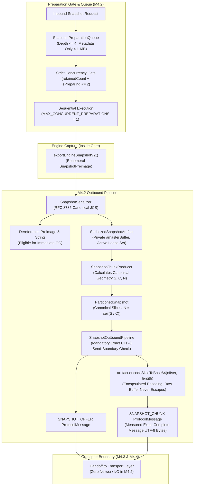

# Phase 7.5 M4.2 — Snapshot Serialization & Outbound Pipeline Architecture

**Document Version:** 1.2.0  
**Status:** Approved Architecture Plan (Final Planning Correction Applied)  
**Frozen Baseline Commit:** `fd23edae5bdb52cff32674860229277a79cb1aca`  
**Parent Baseline:** `55bdf80d7fb4bc573d8b5abe672d06dec969678d`  
**Specification Baseline:** `119da194c3feb883cfd61b6928cb81d4b200ac5d`  

---

## 1. Executive Summary & Objective

Milestone M4.2 designs the **sender-side pipeline** of the SyncPlay state recovery system. Its responsibility is to take a validated engine snapshot from the Phase 7.5 M3 export interface, deterministically serialize it into portable canonical bytes, encapsulate it in an immutable, privately held buffer artifact, compute slice digests and Base64 representations without ever exposing raw mutable typed-array views, and format strictly bounded `SNAPSHOT_OFFER` and `SNAPSHOT_CHUNK` wire protocol messages that are guaranteed never to exceed negotiated WebRTC SCTP message size limits.

This component is strictly isolated:
- It does **NOT** modify playback state, mutate clocks, or compact logs.
- It does **NOT** install snapshots or make membership decisions.
- It does **NOT** act as the recovery coordinator (which belongs to M4.3).
- It does **NOT** perform network sending or manipulate WebRTC DataChannels (which belongs to M4.4).
- It does **NOT** introduce a cluster leader or centralized playback authority.
- It strictly preserves the frozen M4.1 receiver contract, wire schemas, admission formulas, and canonical chunk partition geometry.



---

## 2. Investigation: Contract Inconsistencies & Authoritative Limits

### 2.1 Reconciling the 4 MiB vs. 64 MiB Discrepancy

During the Phase 7.5 M4.1 audit discussions, a 64 MiB limit with up to 262,144 chunks was referenced in exploratory audit notes. An exhaustive trace of the committed codebase confirms the authoritative limits:

| Subsystem / Component | Source Code Location | Configured Constant | Actual Enforced Value | Rationale & Call Path |
| :--- | :--- | :--- | :---: | :--- |
| **Protocol Constants** | `packages/protocol/src/constants.ts#L81` | `MAX_SNAPSHOT_BYTES` | **4,194,304 B (4 MiB)** | Canonical payload ceiling for state recovery. |
| **Protocol Constants** | `packages/protocol/src/constants.ts#L127`| `MAX_CHUNK_BYTES` | **32,768 B (32 KiB)** | Maximum allowable raw binary chunk slice. |
| **Protocol Constants** | `packages/protocol/src/constants.ts#L132`| `MAX_CHUNKS_PER_SNAPSHOT` | **128 chunks** | Absolute upper bound on chunk partition count. |
| **Protocol Constants** | `packages/protocol/src/constants.ts#L102`| `MIN_RAW_CHUNK_BYTES` | **256 B** | Minimum allowable chunk size before abort. |
| **Protocol Constants** | `packages/protocol/src/constants.ts#L97` | `MAX_ENVELOPE_OVERHEAD_BYTES` | **1,800 B** | Guaranteed ceiling for envelope + metadata framing. |
| **Protocol Constants** | `packages/protocol/src/constants.ts#L116`| `MIN_TRANSPORT_LIMIT_CHUNK_TRANSFER` | **2,144 B** | 1,800 B envelope + 344 B Base64 (256 B binary). |
| **Protocol Constants** | `packages/protocol/src/constants.ts#L122`| `MIN_TRANSPORT_LIMIT_FULL_CHUNK` | **45,492 B** | 1,800 B envelope + 43,692 B Base64 (32 KiB binary). |
| **Snapshot Offer Schema** | `packages/protocol/src/payloads/snapshot-recovery.ts#L89` | `totalSizeBytes` | **$\le$ 4,194,304 B** | Zod schema enforces `.max(MAX_SNAPSHOT_BYTES)`. |
| **Snapshot Offer Schema** | `packages/protocol/src/payloads/snapshot-recovery.ts#L90` | `totalChunks` | **$\le$ 128 chunks** | Zod schema enforces `.max(MAX_CHUNKS_PER_SNAPSHOT)`. |
| **Snapshot Chunk Schema** | `packages/protocol/src/payloads/snapshot-recovery.ts#L140`| `chunkIndex` | **0 .. 127** | Zod schema enforces `.max(MAX_CHUNKS_PER_SNAPSHOT - 1)`. |
| **Snapshot Chunk Schema** | `packages/protocol/src/payloads/snapshot-recovery.ts#L143`| `totalSizeBytes` | **$\le$ 4,194,304 B** | Zod schema enforces `.max(MAX_SNAPSHOT_BYTES)`. |
| **Snapshot Admission** | `packages/protocol/src/admission.ts#L110` | `totalSizeBytes` | **$\le$ 4,194,304 B** | Rejects `totalSizeBytes > MAX_SNAPSHOT_BYTES`. |
| **Snapshot Admission** | `packages/protocol/src/admission.ts#L137` | `calculatedRequiredChunks` | **$\le$ 128 chunks** | Rejects `calculatedRequiredChunks > 128`. |
| **Snapshot V2 Export** | `packages/sync-engine/src/snapshot.ts#L250`| `byteLength` | **$\le$ 4,194,304 B** | Throws `SNAPSHOT_ERROR` if JSON UTF-8 > 4 MiB. |
| **Snapshot V2 Validation**| `packages/sync-engine/src/snapshot.ts#L291`| `byteLength` | **$\le$ 4,194,304 B** | Rejects imported snapshot payloads > 4 MiB. |
| **Chunk Assembler** | `packages/sync-engine/src/recovery/chunk-assembler.ts#L123` | `maxSnapshotBytes` | **$\le$ 4,194,304 B** | Defaults to `MAX_SNAPSHOT_BYTES` (4 MiB). |
| **Chunk Assembler** | `packages/sync-engine/src/recovery/chunk-assembler.ts#L124` | `maxChunks` | **$\le$ 128 chunks** | Defaults to `MAX_CHUNKS_PER_SNAPSHOT` (128). |

### 2.2 Mathematical Proof of Authoritative Limits
Under SyncPlay's authoritative limits:
$$\text{Max Chunks} = \frac{\text{MAX\_SNAPSHOT\_BYTES}}{\text{MAX\_CHUNK\_BYTES}} = \frac{4,194,304 \text{ bytes}}{32,768 \text{ bytes}} = \mathbf{128 \text{ chunks exactly}}$$

Furthermore, on a transport link operating at `MIN_TRANSPORT_LIMIT_FULL_CHUNK` (45,492 B) or standard WebRTC fallback (65,536 B):
- Nominal chunk size $C = 32,768$ B.
- Any snapshot up to 4 MiB fits in $\lceil S / 32,768 \rceil \le 128$ chunks.
- On constrained transports (e.g. 16 KiB link $\implies C = 10,938$ B), admission gates the transfer: snapshots are admitted up to $128 \times 10,938 = 1,400,064$ B (1.34 MiB) and rejected otherwise.

---

## 3. Snapshot Object-Graph Analysis & Boundary Classification

### 3.1 Pre-Serialization vs. Post-Serialization Bounds
A rigorous source code and schema inspection clarifies what is genuinely bounded before JSON serialization versus what is enforced only afterwards:

1. **Category A — Schema-Enforced Structural Bounds (Pre-Serialization):**
   - `snapshotId`, `sessionId`: string $\le 128$ characters.
   - `authorPeerId`: string $\le 64$ characters.
   - `compactedCheckpoints`: strictly bounded to `.max(256)` in `packages/protocol/src/payloads/repair.ts:479` ($\approx 25\text{–}30$ KiB maximum).
   - Each checkpoint item: `{ originPeerId: string <= 64, sequenceNumber: number, logicalTimestamp: number }`.
2. **Category B — Bounds Enforced Only After Serialization:**
   - Total snapshot byte size: `byteLength <= MAX_SNAPSHOT_BYTES (4,194,304 B)` is verified in `exportEngineSnapshotV2()` lines 248–255 **after** `JSON.stringify(payload)` and `TextEncoder().encode()`.
   - If an oversized object were passed to serialization, `JSON.stringify()` would run on that object before the size check throws `SNAPSHOT_ERROR`.
3. **Category C — Operational Assumptions (Not Explicitly Bounded by Zod Schema):**
   - `state`: declared as `z.unknown()` in `StateSnapshotPayloadV2Schema`. When constructed internally by `exportEngineSnapshotV2()`, it is populated with `EngineSnapshotData` ($< 1$ KiB). However, the raw wire schema does not enforce a sub-schema on `state`.
   - `snapshotFrontier` & `originFrontierTimestamps`: declared as `z.record(z.string().min(1).max(64), z.number())`. The schema validates key and value types, but does not impose `.max()` on key count. In normal operation, room membership bounds peer count to 16–32 entries ($< 4$ KiB).
   - *Pre-Serialization Object Graph Bound:* For snapshots produced by `exportEngineSnapshotV2()`, the object graph is empirically bounded to **$< 50$ KiB**. However, because schema alone does not impose a recursive size bound prior to stringification, an upper-bound stress snapshot graph could theoretically occupy $\approx 4.0\text{–}6.0$ MiB in V8 heap memory before the post-serialization 4 MiB check triggers.

### 3.2 Pre-Serialization Validation in `SnapshotSerializer`
To prevent unexpectedly large allocations from entering canonicalization:
1. `SnapshotSerializer.serialize()` validates that `Object.keys(preimage.snapshotFrontier).length <= 64`.
2. Validates `Object.keys(preimage.originFrontierTimestamps).length <= 64`.
3. Validates `preimage.compactedCheckpoints.length <= 256`.
4. Validates that `preimage.state` is a plain object with finite numeric fields.

---

## 4. Sender Memory Architecture & Lifetime-Based Allocation Model

### 4.1 Production Call Path Trace for Digest Computation
Inspection of `packages/sync-engine/src/snapshot.ts` and `packages/sync-engine/src/log/operation-fingerprint.ts` reveals the exact production execution trace:

```typescript
// packages/sync-engine/src/snapshot.ts
const preimage = { formatVersion: 2, snapshotId, sessionId, membershipEpoch, authorPeerId, ... };
const sha256Digest = computeSnapshotDigestV2(preimage);

// computeSnapshotDigestV2:
const { sha256Digest: _, ...rest } = snapshot;
const canonical = canonicalizeJson(rest); // Produces canonical JSON string
return sha256(canonical);
```

#### The `sha256()` Allocation Mechanism:
In `packages/sync-engine/src/log/operation-fingerprint.ts` lines 129–133:
```typescript
export function sha256(input: string | Uint8Array): string {
  const utf8 = typeof input === 'string' ? new TextEncoder().encode(input) : input;
  const bitLength = utf8.length * 8;
  const wordCount = (((bitLength + 64) >>> 9) << 4) + 16;
  const words = new Int32Array(wordCount);
```
- When `input` is a `string`: `sha256()` allocates an intermediate `Uint8Array` of size $S$ ($4.19$ MiB) AND an `Int32Array(wordCount)` of size $\approx S$ ($4.19$ MiB), totaling **$8.39$ MiB** inside `sha256()` alone!
- When `input` is an already-encoded `Uint8Array`: `sha256()` skips the `TextEncoder` allocation and allocates **only** the `Int32Array(wordCount)` ($4.19$ MiB).

#### Preferred Implementation Path for M4.2:
To eliminate duplicate 4.19 MiB allocations, `SnapshotSerializer` encodes the canonical JSON string directly into the master `Uint8Array` buffer first, and then passes `masterBytes` directly into `sha256(masterBytes)`:
1. `canonical = canonicalizeJson(preimage)`
2. `masterBytes = new TextEncoder().encode(canonical)` (Allocates master buffer)
3. `preimage = null; canonical = null;` (Immediate dereferencing)
4. `sha256Digest = sha256(masterBytes)` (Allocates only the 4.19 MiB `Int32Array`)

### 4.2 Lifetime-Based Allocation Coexistence Table
The following table details which allocations coexist at each phase of serializing a maximum-size 4 MiB snapshot:

| Execution Phase | Ephemeral Object Graph | Canonical JSON String | Master UTF-8 Buffer | SHA-256 Working Buffer | Retained Artifacts (1 Active) | Active Chunk Framing | Total Coexisting Reachable Memory | Status / Transition |
| :--- | :---: | :---: | :---: | :---: | :---: | :---: | :---: | :--- |
| **Phase 1: Pre-Export Capture** | $4.00\text{–}6.00$ MiB | $0.00$ MiB | $0.00$ MiB | $0.00$ MiB | $4.19$ MiB | $0.14$ MiB | **$8.33\text{–}10.33$ MiB** | Capture executes inside gate. |
| **Phase 2: JCS Canonicalization**| $4.00\text{–}6.00$ MiB | $4.19\text{–}8.39$ MiB | $0.00$ MiB | $0.00$ MiB | $4.19$ MiB | $0.14$ MiB | **$12.52\text{–}18.72$ MiB** | Intermediate string arrays joined. |
| **Phase 3: Master Buffer Encode** | $4.00\text{–}6.00$ MiB | $4.19\text{–}8.39$ MiB | $4.19$ MiB | $0.00$ MiB | $4.19$ MiB | $0.14$ MiB | **$16.71\text{–}22.91$ MiB** | **PEAK REACHABLE MEMORY POINT.** |
| **Phase 4: Pre-Hash Dereference** | $0.00$ MiB | $0.00$ MiB | $4.19$ MiB | $0.00$ MiB | $4.19$ MiB | $0.14$ MiB | **$8.52$ MiB** | Object and string dropped to null. |
| **Phase 5: SHA-256 Hash on Buffer**| $0.00$ MiB | $0.00$ MiB | $4.19$ MiB | $4.19$ MiB | $4.19$ MiB | $0.14$ MiB | **$12.71$ MiB** | `Int32Array` working buffer active. |
| **Phase 6: Artifact Instantiation**| $0.00$ MiB | $0.00$ MiB | $4.19$ MiB | $0.00$ MiB | $4.19$ MiB | $0.14$ MiB | **$8.52$ MiB** | `Int32Array` unreferenced. |
| **Phase 7: Steady-State Retained** | $0.00$ MiB | $0.00$ MiB | $0.00$ MiB | $0.00$ MiB | $8.38$ MiB (2 artifacts)| $0.27$ MiB | **$\le 8.65$ MiB** | Gate unlocked ($P=0$). |

---

## 5. Strict Concurrency Admission & Queue Resumption Policy

### 5.1 Strict Concurrency Policy Formula
To guarantee that total application-owned allocations never exceed the defined budget ceiling:
$$\mathbf{\text{retainedArtifactCount} + (\text{isPreparing} \mathrel{?} 1 : 0) \le 2}$$

The preparing artifact **strictly counts** against the two-artifact limit. A third preparation is **prohibited from starting** while two artifacts exist in combination (whether retained or in-flight).

### 5.2 Concurrency Scenarios & Queue Resumption
1. **$A=0, P=0$ (Cold State):** Preparation request immediately enters gate ($P \to 1$).
2. **$A=1, P=0$ (One Retained Artifact):** $1 + 0 = 1 < 2$. Request enters gate ($P \to 1$).
3. **$A=2, P=0$ (Two Retained Artifacts):** $2 + 0 = 2 == \text{LIMIT}$. Request **must wait** in `SnapshotPreparationQueue`. It cannot capture engine state or allocate serialization memory.
4. **Queue Saturation:** Queue stores metadata descriptors only (`QueuedPreparationRequest`, $< 250$ B each, $< 1$ KiB total for depth 4). If a 5th request arrives while `queue.length == 4`, it is immediately rejected with `SNAPSHOT_ABORT` (`LOCAL_ABORT`, `'Preparation queue saturated'`).
5. **Queue Resumption on Lease Release:**
   - When an active transfer completes, aborts, or times out, it calls `artifact.releaseLease(transferId)`.
   - When an artifact's active lease count reaches 0 and it is disposed, `retainedArtifactCount` decrements ($2 \to 1$).
   - `SnapshotPreparationQueue` receives notification and immediately dequeues the next request, starting preparation ($P \to 1$).
6. **Proof of No Permanent Stall:**
   - Every outbound transfer session is bound to terminal transitions (completion, abort, SCTP close, or timeout).
   - All terminal transitions execute `releaseLease()` in a guaranteed `finally` block.
   - An inactivity guard forcibly releases leases if a transfer is abandoned for $> 60$ seconds.
   - Therefore, leases cannot leak, and the preparation queue cannot permanently stall.

---

## 6. Backing Buffer Ownership, Range-Encoding API & Lease Lifecycle

### 6.1 Elimination of Mutable Buffer Views
To guarantee complete runtime immutability in JavaScript/V8 without relying on TypeScript compile-time visibility:
1. `SerializedSnapshotArtifact` holds `#masterBuffer: ArrayBuffer | null` and `#masterBytes: Uint8Array | null` in private fields.
2. **No public method returns `#masterBuffer` or any `Uint8Array` view.**
3. Instead, the artifact encapsulates all slicing and encoding internally:
   - `encodeSliceToBase64(offset, length): string`: Slices internally and returns an immutable primitive string.
   - `computeSliceSha256(offset, length): string`: Slices internally, hashes, and returns a 64-character hex string.
   - `cloneBytes(): Uint8Array`: Returns a freshly allocated, completely unaliased deep copy via `new Uint8Array(this.#masterBuffer.slice(0))`.
   - `copyByteRange(offset, length): Uint8Array`: Returns an unaliased deep copy of a slice range.
4. Range validation strictly rejects negative offsets or ranges exceeding `totalSizeBytes` with `INVALID_RANGE`.

### 6.2 Transfer Lease Ownership & Lifecycle (12 Operational Cases)

```mermaid
stateDiagram-v2
    [*] --> Active: Artifact Instantiated (leases = 0)
    Active --> Leased: acquireLease(transferId) [leases > 0]
    Leased --> Leased: acquireLease(transferId2) [leases++]
    Leased --> Leased: releaseLease(transferId) [leases--]
    Leased --> Disposing: dispose() called [leases > 0, disposalPending = true]
    Disposing --> Disposing: releaseLease(transferId) [leases--]
    Disposing --> Disposed: last lease released (leases == 0)
    Active --> Disposed: dispose() called [leases == 0]
    Disposed --> [*]: Buffer nullified; eligible for GC
```



#### Exact Resolutions for All 12 Operational Cases:
1. **Transfer Completes Successfully:** Acquires lease at start; calls `releaseLease(transferId)` upon final chunk send.
2. **Transfer Aborts Before First Chunk:** Terminal abort handler releases lease in `finally` block.
3. **Transfer Fails During Encoding:** Exception caught in pipeline; lease released in `finally` block.
4. **Transfer Times Out:** Inactivity timer triggers abort handler; lease released.
5. **Transfer Cancelled (Epoch Change):** Epoch listener triggers cancellation; lease released.
6. **Duplicate Lease Acquisition:** Attempting to call `acquireLease(transferId)` with an already registered `transferId` throws `SyncEngineError('INVALID_STATE', 'Transfer lease already acquired for transferId')`.
7. **Duplicate Lease Release:** `releaseLease(transferId)` is **idempotent**. If the transferId is not present, it returns `false` without throwing.
8. **Disposal Requested While 1 Transfer Active:** `dispose()` sets `#disposalRequested = true`. Buffer detachment is **deferred** until the active transfer finishes and releases its lease.
9. **Disposal Requested While 2 Transfers Share Artifact:** `#disposalRequested = true`. Both transfers continue encoding without interruption.
10. **Last Lease Released After Disposal Requested:** `releaseLease()` detects `#disposalRequested === true` and `#activeLeases.size === 0`. It immediately calls `#finalizeDisposal()`, nullifying `#masterBuffer` and `#masterBytes`.
11. **New Lease Requested After Disposal Requested:** If `#disposalRequested === true` or `#isDisposed === true`, `acquireLease()` throws `SyncEngineError('ARTIFACT_DISPOSED')`.
12. **Read Attempted After Final Disposal:** Any call to `encodeSliceToBase64`, `computeSliceSha256`, `cloneBytes`, or `copyByteRange` calls `#assertReadable()` and throws `SyncEngineError('ARTIFACT_DISPOSED')`.

---

## 7. Harmonized Memory Budget Ceilings

### 7.1 Recalculated Operational Scenarios

| Operational Scenario | Retained Artifacts ($A$) | In-Flight Prep ($P$) | Active Sends ($T$) | Steady Retained Memory | Transient Prep Peak | Active Chunk Framing | Total Peak Application Allocation |
| :--- | :---: | :---: | :---: | :---: | :---: | :---: | :---: |
| **1. Cold Single Preparation** | $0$ | $1$ | $0$ | $0.00$ MiB | $\le 18.58$ MiB | $0.00$ MiB | **$\le 18.58$ MiB** ($14.38$ MiB Latin-1) |
| **2. One Retained + One Preparation** | $1$ | $1$ | $1$ | $4.19$ MiB | $\le 18.58$ MiB | $0.14$ MiB | **$\le 22.91$ MiB** ($18.71$ MiB Latin-1) |
| **3. Two Retained Artifacts (Steady State)** | $2$ | $0$ | $2$ | $8.38$ MiB | $0.00$ MiB | $0.27$ MiB | **$\le 8.65$ MiB** |
| **4. Two Transfers Sharing One Artifact** | $1$ | $0$ | $2$ | $4.19$ MiB | $0.00$ MiB | $0.27$ MiB | **$\le 4.46$ MiB** |
| **5. Preparation Failure / Cancellation** | $1$ | $1 \to 0$ | $1$ | $4.19$ MiB | Drops to $0$ | $0.14$ MiB | **Drops to $4.33$ MiB** |
| **6. Queue Saturation (Depth = 4)** | $1 \text{ or } 2$ | $0 \text{ or } 1$ | $1\text{–}2$ | $4.19\text{–}8.38$ MiB | $0.00\text{–}18.58$ MiB | $0.27$ MiB | **$\le 22.91$ MiB** (metadata $< 1$ KiB) |

### 7.2 Formal Budget Definitions
The sender pipeline establishes and enforces:
1. **Steady-State Retained Allocation Budget:** $\mathbf{\le 9.0 \text{ MiB}}$  
   Holds up to 2 active 4 MiB snapshot artifacts ($\approx 4.2$ MiB each) plus slice descriptors and queue metadata.
2. **Peak Transient Application-Owned Allocation Budget:** $\mathbf{\le 24.0 \text{ MiB}}$  
   Accommodates 1 active retained artifact ($4.19$ MiB), 1 in-flight sequential preparation with conservative 2-byte UTF-16 Unicode string representation ($\le 18.58$ MiB peak coexisting reachable allocations), and active chunk framing for concurrent transfers ($0.27$ MiB).
3. **Classification:** This budget is a strictly bounded **application-owned allocation budget**, not a hard OS process RSS ceiling.

---

## 8. Preserved M4.1 Invariants & Send-Boundary Sizing

The following invariants remain strictly frozen and unmodified:
1. **Canonical Partition Geometry:** $N = \lceil S / C \rceil$, slices $0 \dots N-2$ have size $C$, final slice $N-1$ has size $S - (N-1) \cdot C \in (0, C]$.
2. **Zero Mid-Transfer Resizing:** Individual chunks are never resized.
3. **Upfront Capacity Reservation:** `calculateChunkCapacity()` deducts 1,800 B, providing a 569 B cushion over measured framing overhead (1,231 B).
4. **Mandatory Complete-Message UTF-8 Measurement:** Every frame is measured via `new TextEncoder().encode(serializedJson).byteLength`. If length $> \text{sctpMaxMessageSize}$, preparation aborts with `TRANSPORT_LIMIT_EXCEEDED` without transmitting corrupted or non-canonical chunks.
5. **M4.2 Boundary Integrity:** M4.2 formats messages; it does **not** perform network sending, sliding-window management, retry scheduling, or WebRTC DataChannel operations.
