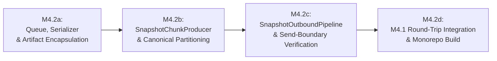

# Phase 7.5 M4.2 — Implementation Roadmap: Snapshot Serialization & Outbound Pipeline

**Document Version:** 1.2.0  
**Status:** Approved Implementation Roadmap (Final Planning Correction Applied)  
**Target Milestone:** M4.2  
**Baseline Commit:** `fd23edae5bdb52cff32674860229277a79cb1aca`  

---

## 1. Roadmap Overview & Execution Plan

Milestone M4.2 is partitioned into four focused, incremental sub-milestones to guarantee test-driven verification, zero regression, and strict isolation from later coordination milestones.

---

## 2. Sub-Milestone Work Breakdown

### Sub-Milestone M4.2a: Preparation Queue, Serializer & Artifact Encapsulation
- **Goal:** Implement the sequential preparation gate, strict concurrency admission ($A + P \le 2$), deterministic RFC 8785 snapshot serialization, immediate resource dereferencing, private master buffer encapsulation with primitive string range-encoding API, and transfer lease lifecycle management.
- **Tasks:**
  1. Author `packages/sync-engine/src/recovery/snapshot-preparation-queue.ts`:
     - Implement `SnapshotPreparationQueue`:
       - Enforce `MAX_CONCURRENT_PREPARATIONS = 1` sequential critical section.
       - Enforce strict concurrency admission: `retainedArtifactCount + (isPreparing ? 1 : 0) <= 2`.
       - Enforce `MAX_PREPARATION_QUEUE_DEPTH = 4` metadata-only queue (< 1 KiB footprint).
       - Ensure snapshot capture (`exportEngineSnapshotV2()`) executes **inside** the gate.
       - Implement `notifyArtifactDisposed()` to resume waiting queued preparation requests.
       - Immediately reject requests when queue is saturated with `LOCAL_ABORT` ('Preparation queue saturated').
  2. Author `packages/sync-engine/src/recovery/snapshot-serializer.ts`:
     - Implement `SerializedSnapshotArtifact`:
       - Encapsulate private `#masterBuffer: ArrayBuffer | null` and `#masterBytes: Uint8Array | null`.
       - Implement `encodeSliceToBase64(offset, length): string` (never exposes raw buffer).
       - Implement `computeSliceSha256(offset, length): string` (never exposes raw buffer).
       - Implement public `copyByteRange(offset, length)` and `cloneBytes()` returning unaliased deep copies.
       - Implement `acquireLease(transferId: string): void` and `releaseLease(transferId: string): boolean`.
       - Implement `dispose()`: defers detachment if leases exist; nullifies buffers when leases reach 0.
       - Range checks and post-disposal assertion (`ARTIFACT_DISPOSED`).
     - Implement `SnapshotSerializer.serialize()`:
       - Validate pre-serialization structural bounds (checkpoints $\le 256$, frontier keys $\le 64$).
       - Canonicalize `StateSnapshotPayloadV2` using RFC 8785 `canonicalizeJson`.
       - Encode canonical UTF-8 bytes directly to master buffer.
       - Immediately dereference `StateSnapshotPayloadV2` object and canonical JSON string.
       - Compute bit-exact SHA-256 digest by passing `Uint8Array` into `sha256()` to avoid duplicate `TextEncoder` allocation.
       - Enforce `MAX_SNAPSHOT_BYTES = 4,194,304` (4 MiB) ceiling.
     - Implement `SnapshotSerializer.serializeFromEngine()`: integrate with `exportEngineSnapshotV2()`.
  3. Author comprehensive unit test suites:
     - `packages/sync-engine/src/__tests__/snapshot-preparation-queue.test.ts`:
       - Verify sequential execution (`MAX_CONCURRENT_PREPARATIONS = 1`).
       - Verify strict admission check: request held if $A=2$, resumes when artifact disposed.
       - Verify queue depth bounding and saturation rejection at depth 4.
       - Verify capture function is invoked only when active execution begins.
     - `packages/sync-engine/src/__tests__/snapshot-serializer.test.ts`:
       - Test empty snapshot, realistic snapshot, and maximum 4 MiB snapshot.
       - Verify identical SHA-256 digests across runs matching `computeSnapshotDigestV2()`.
       - Verify private buffer encapsulation: zero mutable buffer or view exposure.
       - Verify `encodeSliceToBase64` returns valid Base64 string.
       - Verify `cloneBytes()` does not alias master buffer; mutating clone leaves artifact intact.
       - Verify lease lifecycle: acquire, release, deferred disposal, and rejection after final disposal (`ARTIFACT_DISPOSED`).
       - Verify rejection of non-serializable objects and values exceeding 4 MiB.
- **Exit Condition:** 100% unit tests pass; queue, serializer, and artifact encapsulation verified.

---

### Sub-Milestone M4.2b: Canonical Chunk Producer
- **Goal:** Partition serialized snapshot artifacts into canonical binary slices using encapsulated artifact encoding.
- **Tasks:**
  1. Author `packages/sync-engine/src/recovery/snapshot-chunk-producer.ts`:
     - Implement `SnapshotChunkProducer.partition()`.
     - Accept `SerializedSnapshotArtifact` and `ChunkProducerConfig`.
     - Calculate nominal chunk size and canonical chunk count via `calculateChunkCapacity()` and `calculateSnapshotAdmission()`.
     - Enforce canonical partition geometry: $N = \lceil S / C \rceil$, slices $0 \dots N-2$ have size $C$, slice $N-1$ has size $S - (N-1) \cdot C$.
     - Compute per-chunk SHA-256 digests via `artifact.computeSliceSha256()`.
     - Delegate Base64 chunk encoding via `artifact.encodeSliceToBase64()`.
     - Return immutable `PartitionedSnapshot`.
  2. Author comprehensive unit test suite: `packages/sync-engine/src/__tests__/snapshot-chunk-producer.test.ts`:
     - Verify exact partition counts across boundary conditions ($S = 1$ B, $S = 256$ B, $S = 32,768$ B, $S = 4$ MiB).
     - Verify canonical partition sizes: non-final chunks equal $C$, final chunk equals $S - (N-1) \cdot C$.
     - Verify per-chunk SHA-256 digest correctness.
     - Verify rejection when transport requires $> 128$ chunks or chunk capacity $< 256$ B.
- **Exit Condition:** Chunk producer tests pass; canonical geometry and encapsulated hashing confirmed.

---

### Sub-Milestone M4.2c: Send-Boundary Verification & Outbound Pipeline
- **Goal:** Format wire protocol messages and enforce mandatory exact complete-message UTF-8 byte length measurement at the send boundary.
- **Tasks:**
  1. Author `packages/sync-engine/src/recovery/snapshot-outbound-pipeline.ts`:
     - Implement `SnapshotOutboundPipeline.createOfferMessage()`:
       - Validate context and construct `ProtocolMessage<SnapshotOfferPayload>`.
     - Implement `SnapshotOutboundPipeline.prepareChunkMessage()`:
       - Obtain chunk Base64 string via `partition.encodeChunkBase64(chunkIndex)`.
       - Frame complete `ProtocolMessage<SnapshotChunkPayload>`.
       - Serialize to JSON string via `JSON.stringify()`.
       - Measure exact complete-message UTF-8 byte length via `new TextEncoder().encode(serializedJson).byteLength`.
       - If exact byte length $\le \text{context.sctpMaxMessageSize}$: return `{ ok: true, protocolMessage, serializedJson, byteLength }`.
       - If exact byte length $> \text{context.sctpMaxMessageSize}$: return `{ ok: false, reason: 'TRANSPORT_LIMIT_EXCEEDED', detail: ... }`. Never shrink chunks mid-transfer!
  2. Author comprehensive unit test suite: `packages/sync-engine/src/__tests__/snapshot-outbound-pipeline.test.ts`:
     - Test offer message schema compliance with `SnapshotOfferPayloadSchema`.
     - Test chunk message schema compliance with `SnapshotChunkPayloadSchema`.
     - Test exact byte measurement matches UTF-8 byte length.
     - Test that valid messages comfortably fit within negotiated limits thanks to 1,800 B reservation.
     - Test immediate rejection with `TRANSPORT_LIMIT_EXCEEDED` if synthetic message exceeds limit.
- **Exit Condition:** All outbound pipeline unit tests pass; generated chunk messages strictly stay $\le \text{sctpMaxMessageSize}$.

---

### Sub-Milestone M4.2d: M4.1 Ingestion Round-Trip & Monorepo Build Verification
- **Goal:** Prove end-to-end compatibility between M4.2 outbound generation and M4.1 `ChunkAssembler` receiver reassembly.
- **Tasks:**
  1. Author integration test suite: `packages/sync-engine/src/__tests__/m4-2-outbound-integration.test.ts`:
     - Generate a full 4 MiB engine snapshot.
     - Enqueue and serialize via `SnapshotPreparationQueue` and `SnapshotSerializer`.
     - Partition via `SnapshotChunkProducer`.
     - Acquire transfer lease on artifact.
     - Produce all chunk messages via `SnapshotOutboundPipeline`.
     - Ingest all produced chunk messages into frozen M4.1 `ChunkAssembler`.
     - Finalize assembly in `ChunkAssembler` and verify reconstructed buffer matches original byte-for-byte.
     - Verify reconstructed snapshot SHA-256 digest matches original digest.
     - Release lease and verify artifact disposal detaches master buffer.
  2. Execute complete monorepo test suite (`npm test`).
  3. Execute full TypeScript compilations and Vite production bundle build.
- **Exit Condition:** Full round-trip reassembly passes with bit-exact equality; monorepo builds with zero errors.

---

## 3. Scope Boundaries & Forbidden Tasks

To protect milestone boundaries:
- **PROHIBITED:** Writing WebRTC transport listener bindings or handling DataChannel network events (deferred to M4.3/M4.4).
- **PROHIBITED:** Implementing sliding-window request scheduling, retry timers, or requester failover (deferred to M4.3).
- **PROHIBITED:** Modifying `ChunkAssembler` or changing frozen M4.1 code.
- **PROHIBITED:** Modifying `PlaybackState`, clock managers, or operation logs.
- **PROHIBITED:** Importing or installing snapshots into the engine (deferred to M5).
