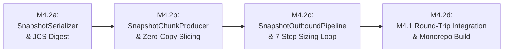

# Phase 7.5 M4.2 — Implementation Roadmap: Snapshot Serialization & Outbound Pipeline

**Document Version:** 1.0.0  
**Status:** Approved Implementation Roadmap  
**Target Milestone:** M4.2  
**Baseline Commit:** `fd23edae5bdb52cff32674860229277a79cb1aca`  

---

## 1. Roadmap Overview & Execution Plan

Milestone M4.2 is partitioned into four focused, incremental sub-milestones to guarantee test-driven verification, zero regression, and strict isolation from later coordination milestones.

---

## 2. Sub-Milestone Work Breakdown

### Sub-Milestone M4.2a: Snapshot Serializer & Canonical JCS Hashing
- **Goal:** Implement deterministic serialization of engine snapshots into canonical bytes and verify digest consistency.
- **Tasks:**
  1. Author `packages/sync-engine/src/recovery/snapshot-serializer.ts`:
     - Implement `SnapshotSerializer.serialize()`: canonicalize `StateSnapshotPayloadV2` using RFC 8785 `canonicalizeJson`.
     - Implement `SnapshotSerializer.serializeFromEngine()`: integrate with `exportEngineSnapshotV2()` to export and canonicalize live playback state.
     - Enforce `MAX_SNAPSHOT_BYTES = 4,194,304` (4 MiB) limit before and after serialization.
     - Compute bit-exact SHA-256 digest over preimage.
     - Return immutable `SerializedSnapshotArtifact`.
  2. Author comprehensive unit test suite: `packages/sync-engine/src/__tests__/snapshot-serializer.test.ts`:
     - Test empty snapshot, realistic snapshot, and maximum 4 MiB snapshot.
     - Test deterministic key ordering and Lamport timestamp calculation.
     - Verify identical SHA-256 digests across multiple runs.
     - Verify rejection of non-serializable objects and values exceeding 4 MiB.
- **Exit Condition:** 100% of serializer unit tests pass; SHA-256 output matches `computeSnapshotDigestV2()` bit-exact.

---

### Sub-Milestone M4.2b: Zero-Copy Canonical Chunk Producer
- **Goal:** Partition serialized snapshot artifacts into canonical binary slices using zero-copy memory views.
- **Tasks:**
  1. Author `packages/sync-engine/src/recovery/snapshot-chunk-producer.ts`:
     - Implement `SnapshotChunkProducer.partition()`.
     - Accept `SerializedSnapshotArtifact` and `ChunkProducerConfig`.
     - Calculate nominal chunk size and canonical chunk count via `calculateChunkCapacity()` and `calculateSnapshotAdmission()`.
     - Enforce partition math: $N = \lceil S / C \rceil$, final slice $\le C$, $N \le 128$.
     - Slice buffer zero-copy using `artifact.rawBytes.subarray()`.
     - Compute per-chunk SHA-256 digests (`chunkSha256`).
     - Return immutable `PartitionedSnapshot`.
  2. Author comprehensive unit test suite: `packages/sync-engine/src/__tests__/snapshot-chunk-producer.test.ts`:
     - Verify zero-copy memory preservation (`sliceView.buffer === artifact.rawBytes.buffer`).
     - Verify exact partition counts across boundary conditions ($S = 1$ B, $S = 256$ B, $S = 32,768$ B, $S = 4$ MiB).
     - Verify per-chunk SHA-256 digest correctness by re-hashing slices.
     - Verify rejection when transport requires $> 128$ chunks or chunk capacity $< 256$ B.
- **Exit Condition:** Chunk producer tests pass; zero memory duplication confirmed.

---

### Sub-Milestone M4.2c: Normative Iterative Sizing Loop & Outbound Pipeline
- **Goal:** Format wire protocol messages and enforce the normative 7-step iterative send-boundary sizing loop.
- **Tasks:**
  1. Author `packages/sync-engine/src/recovery/snapshot-outbound-pipeline.ts`:
     - Implement `SnapshotOutboundPipeline.createOfferMessage()`.
     - Implement `SnapshotOutboundPipeline.prepareChunkMessage()`.
     - Implement the 7-step iterative sizing algorithm:
       - Initial binary slice $B_0 \le \text{nominalChunkSizeBytes}$.
       - Encode to Base64 using `@syncplay/protocol`'s isomorphic `encodeBase64()`.
       - Frame complete `ProtocolMessage<SnapshotChunkPayload>`.
       - Serialize to JSON and measure exact UTF-8 byte length via `new TextEncoder().encode()`.
       - If overshoot $O_k > 0$, reduce binary slice by $\Delta_k = \lceil O_k \times 0.75 \rceil + 32$ B.
       - Enforce `MAX_SIZING_ITERATIONS = 5` and minimum chunk floor of 256 B.
       - Return `OutboundChunkResult`.
  2. Author comprehensive unit test suite: `packages/sync-engine/src/__tests__/snapshot-outbound-pipeline.test.ts`:
     - Test offer message schema compliance with `SnapshotOfferPayloadSchema`.
     - Test chunk message schema compliance with `SnapshotChunkPayloadSchema`.
     - Test convergence on simulated SCTP limits (64 KB, 45,492 B, 32 KB, 16 KB, 4,096 B, 2,144 B).
     - Test termination within $\le 5$ iterations.
     - Test exact byte measurement matches string UTF-8 byte length.
- **Exit Condition:** All outbound pipeline unit tests pass; generated chunk messages strictly stay $\le \text{sctpMaxMessageSize}$.

---

### Sub-Milestone M4.2d: M4.1 Ingestion Round-Trip & Monorepo Build Verification
- **Goal:** Prove end-to-end compatibility between M4.2 outbound generation and M4.1 `ChunkAssembler` receiver reassembly.
- **Tasks:**
  1. Author integration test suite: `packages/sync-engine/src/__tests__/m4-2-outbound-integration.test.ts`:
     - Generate a full 4 MiB engine snapshot.
     - Serialize via `SnapshotSerializer`.
     - Partition via `SnapshotChunkProducer`.
     - Produce all chunk messages via `SnapshotOutboundPipeline`.
     - Ingest all produced chunk messages into M4.1 `ChunkAssembler`.
     - Finalize assembly in `ChunkAssembler` and verify reconstructed buffer matches original byte-for-byte.
     - Verify reconstructed snapshot SHA-256 digest matches original digest.
  2. Execute complete monorepo test suite (`npm test`).
  3. Execute full TypeScript compilations and Vite production bundle build.
- **Exit Condition:** Full round-trip reassembly passes with bit-exact equality; monorepo builds with zero errors.

---

## 3. Scope Boundaries & Forbidden Tasks

To protect milestone boundaries:
- **PROHIBITED:** Writing WebRTC transport listener bindings or handling DataChannel network events (deferred to M4.3/M4.4).
- **PROHIBITED:** Implementing sliding-window request scheduling, retry timers, or requester failover (deferred to M4.3).
- **PROHIBITED:** Modifying `ChunkAssembler` or changing frozen M4.1 code.
- **PROHIBITED:** Modifying `PlaybackState`, clock managers, or operation logs.
- **PROHIBITED:** Importing or installing snapshots into the engine (deferred to M5).
