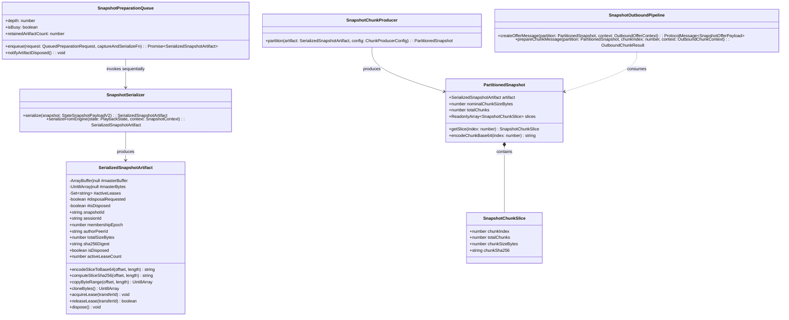

# Phase 7.5 M4.2 — Interface Specification: Snapshot Serialization & Outbound Pipeline

**Document Version:** 1.2.0  
**Status:** Approved Specification (Final Planning Correction Applied)  
**Frozen Baseline:** `fd23edae5bdb52cff32674860229277a79cb1aca`  
**Specification Target:** `@syncplay/sync-engine/recovery`  

---

## 1. Overview & Architecture Placement

This specification establishes the contracts, data structures, and operational boundaries for the M4.2 outbound snapshot transfer pipeline.



---

## 2. Core Data Structures & Interfaces

### 2.1 Sequential Preparation Queue Types

```typescript
/**
 * Lightweight preparation request descriptor.
 * Queued prior to snapshot capture; retains zero snapshot or buffer memory (< 1 KiB footprint).
 */
export interface QueuedPreparationRequest {
  readonly transferId: string;
  readonly recipientPeerId: string;
  readonly sctpMaxMessageSize: number;
  readonly requestedSnapshotId?: string;
  readonly timestampMs: number;
}
```

---

### 2.2 Serialized Snapshot Artifact Contract

```typescript
export interface SerializedSnapshotArtifactParams {
  readonly snapshotId: string;
  readonly sessionId: string;
  readonly membershipEpoch: number;
  readonly authorPeerId: string;
  readonly totalSizeBytes: number;
  readonly sha256Digest: string;
  readonly masterBuffer: ArrayBuffer;
}

/**
 * Encapsulated artifact holding canonical, deterministically serialized snapshot bytes.
 * The underlying ArrayBuffer is private and exclusively owned by the artifact.
 * Range encoding and hashing methods return immutable primitive strings.
 * Zero mutable typed-array views are exposed publicly.
 */
export class SerializedSnapshotArtifact {
  #masterBuffer: ArrayBuffer | null;
  #masterBytes: Uint8Array | null;

  readonly #activeLeases = new Set<string>();
  #disposalRequested = false;
  #isDisposed = false;

  readonly snapshotId: string;
  readonly sessionId: string;
  readonly membershipEpoch: number;
  readonly authorPeerId: string;
  readonly totalSizeBytes: number;
  readonly sha256Digest: string;

  constructor(params: SerializedSnapshotArtifactParams);

  /**
   * Synchronously Base64-encodes a slice range.
   * Master buffer and typed-array views NEVER leave the artifact instance.
   * Returns an immutable primitive string.
   * Throws ARTIFACT_DISPOSED if disposed; throws INVALID_RANGE if offset/length out of bounds.
   */
  public encodeSliceToBase64(offset: number, length: number): string;

  /**
   * Synchronously computes SHA-256 hex digest for a slice range.
   * Returns an immutable 64-character lowercase hex string.
   * Throws ARTIFACT_DISPOSED if disposed; throws INVALID_RANGE if offset/length out of bounds.
   */
  public computeSliceSha256(offset: number, length: number): string;

  /**
   * Public accessor returning a freshly allocated, completely unaliased deep copy of a byte range.
   */
  public copyByteRange(offset: number, length: number): Uint8Array;

  /**
   * Public accessor returning a complete unaliased deep copy of the entire master buffer.
   */
  public cloneBytes(): Uint8Array;

  /**
   * Registers an active transfer lease.
   * Throws ARTIFACT_DISPOSED if disposal has been requested or finalized.
   * Throws INVALID_STATE if the transferId already holds an active lease.
   */
  public acquireLease(transferId: string): void;

  /**
   * Releases an active transfer lease.
   * Idempotent: returns false if transferId was not active, true if released.
   * If disposal was requested and activeLeaseCount reaches 0, detaches buffer immediately.
   */
  public releaseLease(transferId: string): boolean;

  /**
   * Disposes the artifact.
   * If active leases exist, marks disposalRequested = true and defers buffer detachment.
   * If activeLeaseCount === 0, detaches buffer immediately (#masterBuffer = null, #masterBytes = null).
   */
  public dispose(): void;

  public get isDisposed(): boolean;
  public get isDisposalRequested(): boolean;
  public get activeLeaseCount(): number;
}
```

#### Invariants:
1. `totalSizeBytes > 0 && totalSizeBytes <= MAX_SNAPSHOT_BYTES` (4,194,304 bytes).
2. `sha256Digest === sha256(new Uint8Array(#masterBuffer))` at creation time.
3. Preimage object and canonical JSON string are dereferenced immediately post-instantiation; they are not retained by the artifact.
4. Once disposal is finalized, `#masterBuffer === null` and `#masterBytes === null`, detaching the buffer and making memory eligible for GC. Subsequent read operations throw `SyncEngineError('ARTIFACT_DISPOSED')`.

---

### 2.3 Chunk Slice & Partitioned Snapshot

```typescript
/**
 * Metadata descriptor for a canonical chunk slice.
 */
export interface SnapshotChunkSlice {
  readonly chunkIndex: number;
  readonly totalChunks: number;
  readonly chunkSizeBytes: number;
  readonly chunkSha256: string;
}

/**
 * Immutable snapshot partition containing canonical chunk slices.
 */
export interface PartitionedSnapshot {
  readonly artifact: SerializedSnapshotArtifact;
  readonly nominalChunkSizeBytes: number;
  readonly totalChunks: number;
  readonly slices: ReadonlyArray<SnapshotChunkSlice>;

  /** Retrieves chunk slice metadata by index, or undefined if out of range. */
  getSlice(chunkIndex: number): SnapshotChunkSlice | undefined;

  /**
   * Encodes chunk slice to Base64 via artifact encapsulation.
   * Raw buffer views never escape.
   */
  encodeChunkBase64(chunkIndex: number): string;
}
```

#### Invariants:
1. `slices.length === totalChunks`.
2. $1 \le \text{totalChunks} \le \text{MAX\_CHUNKS\_PER\_SNAPSHOT}$ (128).
3. $\text{nominalChunkSizeBytes} \in [\text{MIN\_RAW\_CHUNK\_BYTES}, \text{MAX\_CHUNK\_BYTES}]$ ([256, 32,768]).
4. $\text{totalChunks} === \lceil \text{totalSizeBytes} / \text{nominalChunkSizeBytes} \rceil$.
5. For all $i \in [0, \text{totalChunks} - 1)$: $\text{slices}[i].\text{chunkSizeBytes} === \text{nominalChunkSizeBytes}$.
6. Final chunk: $\text{slices}[\text{totalChunks} - 1].\text{chunkSizeBytes} === \text{totalSizeBytes} - (\text{totalChunks} - 1) \times \text{nominalChunkSizeBytes} \in (0, \text{nominalChunkSizeBytes}]$.
7. For each slice $i$, `encodeChunkBase64(i)` delegates to `artifact.encodeSliceToBase64(i * C, slices[i].chunkSizeBytes)`.
8. Canonical partition geometry is locked immutably upon creation and is **never** modified mid-transfer.

---

### 2.4 Outbound Message Preparation Types

```typescript
export interface OutboundOfferContext {
  readonly transferId: string;
  readonly supplierPeerId: string;
  readonly recipientPeerId: string;
  readonly membershipEpoch: number;
  readonly connectionGeneration?: number;
}

export interface OutboundChunkContext {
  readonly transferId: string;
  readonly supplierPeerId: string;
  readonly recipientPeerId: string;
  readonly membershipEpoch: number;
  readonly sctpMaxMessageSize: number;
  readonly connectionGeneration?: number;
}

export type OutboundChunkResult =
  | {
      readonly ok: true;
      readonly protocolMessage: ProtocolMessage<SnapshotChunkPayload>;
      readonly serializedJson: string;
      readonly byteLength: number;
    }
  | {
      readonly ok: false;
      readonly reason: SnapshotAbortReason;
      readonly detail: string;
    };
```

---

## 3. Component Contracts

### 3.1 SnapshotPreparationQueue
**Module:** `packages/sync-engine/src/recovery/snapshot-preparation-queue.ts`

```typescript
export class SnapshotPreparationQueue {
  public static readonly MAX_CONCURRENT_PREPARATIONS = 1;
  public static readonly MAX_PREPARATION_QUEUE_DEPTH = 4;
  public static readonly MAX_TOTAL_ARTIFACTS = 2;

  /**
   * Enqueues an outbound snapshot preparation request.
   * Strict Concurrency Admission:
   *   retainedArtifactCount + (isPreparing ? 1 : 0) <= 2
   * If 2 artifacts are already retained, preparation does not start until one is released.
   * If queue is saturated (depth >= 4), rejects immediately with LOCAL_ABORT ('Preparation queue saturated').
   */
  public enqueue(
    request: QueuedPreparationRequest,
    captureAndSerializeFn: () => Promise<SerializedSnapshotArtifact> | SerializedSnapshotArtifact
  ): Promise<SerializedSnapshotArtifact>;

  /** Called when a retained artifact is disposed, waking queued preparation requests. */
  public notifyArtifactDisposed(): void;

  public get depth(): number;
  public get isBusy(): boolean;
  public get retainedArtifactCount(): number;
  public clear(): void;
}
```

---

### 3.2 SnapshotSerializer
**Module:** `packages/sync-engine/src/recovery/snapshot-serializer.ts`

```typescript
export class SnapshotSerializer {
  /**
   * Serializes a validated StateSnapshotPayloadV2 into a deterministic artifact.
   * Encodes canonical bytes directly to master ArrayBuffer before computing SHA-256
   * to eliminate duplicate 4.19 MiB TextEncoder buffer allocations.
   * Immediately dereferences preimage and JSON string upon master buffer allocation.
   * Throws SyncEngineError('SNAPSHOT_ERROR') if serialization fails or exceeds MAX_SNAPSHOT_BYTES.
   */
  public static serialize(snapshot: StateSnapshotPayloadV2): SerializedSnapshotArtifact;

  /**
   * Exports and serializes an active engine state into a deterministic artifact.
   * Captures state inside the serialized gate.
   */
  public static serializeFromEngine(
    state: PlaybackState,
    context: {
      sessionId: string;
      membershipEpoch: number;
      authorPeerId: string;
      snapshotFrontier: Record<string, number>;
      originFrontierTimestamps: Record<string, number>;
      compactedCheckpoints: ReadonlyArray<CompactedCheckpointItem>;
      snapshotId?: string;
    }
  ): SerializedSnapshotArtifact;
}
```

---

### 3.3 SnapshotChunkProducer
**Module:** `packages/sync-engine/src/recovery/snapshot-chunk-producer.ts`

```typescript
export interface ChunkProducerConfig {
  /** Target nominal chunk size (bytes). If omitted, derived from sctpMaxMessageSize. */
  nominalChunkSizeBytes?: number;
  /** Transport message size limit. Used to calculate chunk capacity if nominalChunkSizeBytes omitted. */
  sctpMaxMessageSize?: number;
  /** Testing mock flag to allow 65,536 B fallback when sctpMaxMessageSize is unexposed. */
  allowSctpFallback?: boolean;
}

export class SnapshotChunkProducer {
  /**
   * Partitions a serialized snapshot artifact into canonical chunk slices.
   * Computes per-chunk hashes via artifact.computeSliceSha256().
   * Throws SyncEngineError('PARTITION_ERROR') on geometry or admission violation.
   */
  public static partition(
    artifact: SerializedSnapshotArtifact,
    config: ChunkProducerConfig = {}
  ): PartitionedSnapshot;
}
```

---

### 3.4 SnapshotOutboundPipeline
**Module:** `packages/sync-engine/src/recovery/snapshot-outbound-pipeline.ts`

```typescript
export class SnapshotOutboundPipeline {
  /**
   * Formats a SNAPSHOT_OFFER ProtocolMessage for transmission to a recipient peer.
   */
  public static createOfferMessage(
    partition: PartitionedSnapshot,
    context: OutboundOfferContext
  ): ProtocolMessage<SnapshotOfferPayload>;

  /**
   * Formats a SNAPSHOT_CHUNK ProtocolMessage with mandatory exact complete-message
   * UTF-8 byte length measurement at the send boundary.
   *
   * Invariant: Never shrinks an individual chunk slice. If the exact complete-message
   * UTF-8 byte length exceeds context.sctpMaxMessageSize, returns ok: false with
   * reason: 'TRANSPORT_LIMIT_EXCEEDED'.
   */
  public static prepareChunkMessage(
    partition: PartitionedSnapshot,
    chunkIndex: number,
    context: OutboundChunkContext
  ): OutboundChunkResult;
}
```

---

## 4. Error Handling & Failure Semantics

1. **Size Exceedance:** If exported snapshot $> 4,194,304$ bytes $\implies$ `SNAPSHOT_ERROR`.
2. **Unsupported Slicing Limit:** If calculated chunk capacity $< 256$ bytes $\implies$ `TRANSPORT_LIMIT_EXCEEDED`.
3. **Partition Count Ceiling:** If required chunks $> 128 \implies$ `CHUNK_COUNT_EXCEEDED`.
4. **Queue Saturation:** If $\ge 4$ requests in preparation queue $\implies$ `LOCAL_ABORT` ('Preparation queue saturated').
5. **Artifact Disposed:** Method call on disposed artifact $\implies$ `ARTIFACT_DISPOSED`.
6. **Invalid Range:** Out-of-bounds slice offset/length $\implies$ `INVALID_RANGE`.
7. **Duplicate Lease:** Same transferId acquires lease twice $\implies$ `INVALID_STATE`.
8. **Send-Boundary Overshoot:** If exact UTF-8 complete-message size exceeds `sctpMaxMessageSize` $\implies$ `TRANSPORT_LIMIT_EXCEEDED`.
9. **No State Pollution:** All failure paths terminate synchronously with zero modifications to engine state or logs.
