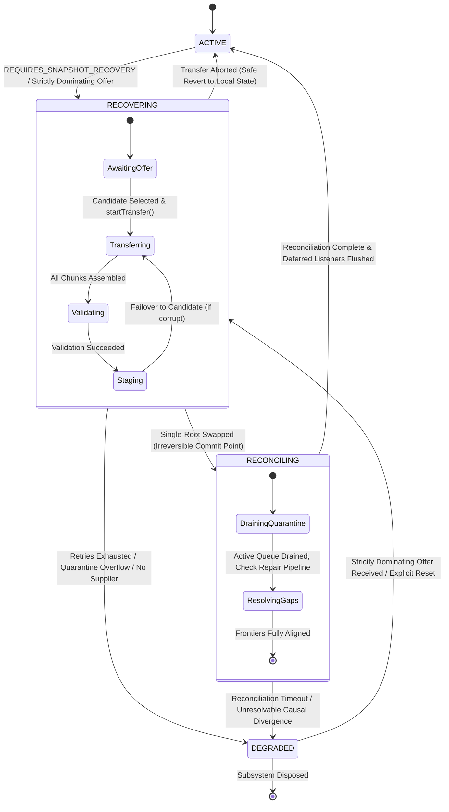

# Phase 7.5 M4.3 — Recovery Orchestration & Lifecycle Integration Architecture

**Author:** Senior TypeScript Distributed-Systems Architect  
**Status:** M4.3 ARCHITECTURE READY FOR FINAL ACCEPTANCE — IMPLEMENTATION UNAUTHORIZED  
**Mode:** STRICTLY READ-ONLY SPECIFICATION (IMPLEMENTATION UNAUTHORIZED)  
**Milestone:** Phase 7.5 Sub-Milestone M4.3  
**Date:** November 24, 2026  
**Revision:** R4 Final Ownership Closure  
**Authoritative Baseline Commit:** `aafa366cc48fdb2b83940f00e80d92d813e7c52e`  
**Direct Parent:** `79919a0f8cb0bb81cb80cc010fe02918bef79787` (M4.2c-R6 closure)  
**Parent of Direct Parent:** `699019ee46e44e9ce1dfdfb4f7d1262bce239048` (M4.2c-R5 closure)  

---

## 1. Executive Summary & Architectural Mission

Sub-Milestone M4.3 provides the **orchestration and lifecycle integration layer** for Phase 7.5 state recovery in SyncPlay. 

Prior milestones M4.1 through M4.2d completed and froze the underlying transport primitives and pipelines:
- **M4.1:** `ChunkAssembler` (canonical chunk reassembly, failover commit point, SHA-256 verification).
- **M4.2a:** `SnapshotSerializer` (JCS RFC 8785 canonicalization, immutable `SerializedSnapshotArtifact`) and `SnapshotPreparationQueue`.
- **M4.2b:** `SnapshotChunkProducer` (deterministic 32 KiB chunk partitioning, send-boundary byte measurement).
- **M4.2c:** `SnapshotOutboundPipeline` (sliding-window outbound chunk servicing, attempt token tracking, retry fencing).
- **M4.2d:** `SnapshotInboundPipeline` (inbound chunk flow control, 6-tuple envelope admission, 3-phase failover, 10-step fail-closed abort), `CandidateOfferRegistry`, and `inbound-custody`.

**The M4.3 Architectural Mission:**  
Connect these isolated inbound and outbound pipelines with the core `LeaderlessSyncEngine`, `AntiEntropyManager`, and WebRTC transport layer into an end-to-end, deterministic recovery workflow. M4.3 coordinates existing components without reimplementing their responsibilities or weakening their frozen contracts.

```
+───────────────────────────────────────────────────────────────────────────────────────────+
│                                  RECOVERY ORCHESTRATION LAYER                             │
│                                                                                           │
│                           +────────────────────────────────────────+                      │
│                           │      RecoveryCoordinator (M4.3)        │                      │
│                           │  - RecoveryStateMachine (4-State)      │                      │
│                           │  - QuarantineBuffer (1000 ops / 4 MiB) │                      │
│                           │  - SnapshotInstaller (Single Root Swap)│                      │
│                           +────────────────────┬───────────────────+                      │
│                                                │                                          │
│                    ┌───────────────────────────┴───────────────────────────┐              │
│                    ▼                                                       ▼              │
│  +───────────────────────────────────+                   +─────────────────────────────+  │
│  │   SnapshotInboundPipeline (M4.2d) │                   │ AntiEntropyManager (P7.4)   │  │
│  │   - CandidateOfferRegistry (M4.2d)│                   │ - RepairRequestPipeline     │  │
│  │   - ChunkAssembler (M4.1)         │                   │ - ReplicationComparator     │  │
│  +───────────────────────────────────+                   +─────────────────────────────+  │
│                    │                                                       │              │
│                    └───────────────────────────┬───────────────────────────┘              │
│                                                ▼                                          │
│                           +────────────────────────────────────────+                      │
│                           │      LeaderlessSyncEngine (Core)       │                      │
│                           │  - EngineCoreState (Single Root)       │                      │
│                           │  - LogicalClockManager                 │                      │
│                           │  - OrderedOperationLog                 │                      │
│                           │  - PendingDependencyQueue              │                      │
│                           +────────────────────────────────────────+                      │
+───────────────────────────────────────────────────────────────────────────────────────────+
```

---

## 2. Baseline & Implementation Differentiation

The baseline commit for M4.3 design is `aafa366cc48fdb2b83940f00e80d92d813e7c52e` (M4.2d complete).  
All frozen milestone baselines remain byte-for-byte unmodified:
- `packages/protocol/*` (M4.0)
- `packages/sync-engine/src/recovery/chunk-assembler.ts` (M4.1)
- `packages/sync-engine/src/recovery/snapshot-serializer.ts`, `snapshot-preparation-queue.ts` (M4.2a)
- `packages/sync-engine/src/recovery/snapshot-chunk-producer.ts` (M4.2b)
- `packages/sync-engine/src/recovery/snapshot-outbound-pipeline.ts` (M4.2c)
- `packages/sync-engine/src/recovery/snapshot-inbound-pipeline.ts`, `candidate-offer-registry.ts`, `inbound-custody.ts` (M4.2d)

### 2.1 Explicit Differentiation of Verified Source vs. Proposed M4.3 Behavior
- **Verified Source Behavior (Existing):**
  - `LeaderlessSyncEngine` currently maintains individual private fields: `state`, `baseSnapshot`, `baseSnapshotFrontier`, `operationLog`, `clockManager`, `pendingQueue`, `localCausalContext`, `replicationVector`, `localOriginSequence`, `currentEpoch`.
  - `importSnapshotV2` executes sequential mutations across these fields and synchronously invokes `stateChangeListeners`.
  - `PendingDependencyQueue` buffers missing dependencies and drains via `drainSatisfied()`.
- **Proposed M4.3 Behavior (Implementation Requirements):**
  - Refactoring these individual fields into a single `EngineCoreState` root reference.
  - Adding `replaceCoreStateAtomic(candidate: EngineCoreState)`.
  - Adding `setRecoveryMode(active: boolean)` and `flushDeferredNotifications()`.
  - Adding `RecoveryCoordinator`, `RecoveryStateMachine`, and `QuarantineBuffer`.

---

## 3. Component Responsibility & State Ownership Matrix

To eliminate split-brain decisions, contradictory state, or duplicate accounting, every state variable and lifecycle transition is assigned an exclusive owner.

| Component | Existing Responsibility | Owned State | Lifecycle Owner | M4.3 Integration Responsibility |
| :--- | :--- | :--- | :--- | :--- |
| **`LeaderlessSyncEngine`** | Core playback state, Lamport clock, ordered operation log, conflict resolution, causal frontier. | `EngineCoreState` (single-root container encapsulating `PlaybackState`, `replicationVector`, `localCausalContext`, `baseSnapshotFrontier`, `OrderedOperationLog`, `LogicalClockManager`, `PendingDependencyQueue`, `localOriginSequence`, `currentEpoch`). | Engine lifecycle (`active` / `disposed`). | Exposes single-root atomic snapshot replacement (`replaceCoreStateAtomic()`), defers observer notifications during recovery, enforces local input blocking during recovery. |
| **`AntiEntropyManager`** | Periodic and reactive digest scheduling, digest comparison (`compareDigests()`), gap detection. | Digest timers, token bucket rate limiter, repair queue. | Manager lifecycle (`isDisposed`). | Invokes `onSnapshotRecoveryRequired` when `compareDigests` classifies `REQUIRES_SNAPSHOT_RECOVERY`. Pauses normal operation-batch repairs during active snapshot recovery. |
| **`SnapshotInboundPipeline`** | Inbound chunk transport, 6-tuple envelope admission, sliding window ($W = 4$), per-chunk watchdog timers. | `InboundTransferSession`, `#chunkEvidence` ($Q_2 \le 138$), `#chunkStates`, `#chunkTimers`, `#outboundDispatchQueue`. | Inbound transfer session lifecycle (`ADMITTED` $\to$ `TRANSFERRING` $\to$ `COMPLETED` / `ABORTED`). | Handles chunk reception and assembly. On assembly completion, invokes `onTransferComplete(result)`. On failover or unrecoverable error, notifies coordinator. |
| **`CandidateOfferRegistry`** | Candidate offer storage (max 8), 30s TTL timer ownership, 7-field consistency check. | Map of candidate entries, internal `setTimeout` timers. | Registry lifecycle (`clear()` / `dispose()`). | Encapsulated inside inbound pipeline; stores competing snapshot offers from peers during active transfer for seamless failover. |
| **`SnapshotOutboundPipeline`** | Outbound chunk production and dispatch, request attempt token fencing, attempt coalescing. | Outbound transfer sessions, active attempts map. | Outbound transfer session lifecycle. | Responds to remote peer `SNAPSHOT_REQUEST` and `SNAPSHOT_CHUNK_REQUEST` when local peer acts as supplier. |
| **`RecoveryCoordinator`** | Top-level recovery state machine, peer offer evaluation, candidate selection, live-operation quarantine, post-install reconciliation. | `RecoveryState` (`ACTIVE`, `RECOVERING`, `RECONCILING`, `DEGRADED`), active transfer pointer, quarantine buffer. | Recovery coordinator lifecycle (`start()` / `dispose()`). | Coordinates overall recovery workflow. Intercepts incoming control events into `QuarantineBuffer`. Dispatches completed snapshot to `SnapshotInstaller`. Coordinates double-buffered reconciliation drain. |
| **`QuarantineBuffer`** | Dual-constraint bounded FIFO queue for remote control operations arriving while engine is in `RECOVERING` or `RECONCILING`. | `activeQueue`, `drainBatch` (count limit: 1,000, byte limit: 4 MiB, per-event cap: 4 KiB), `FutureEpochBuffer` (100 ops, 512 KiB). | Managed exclusively by `RecoveryCoordinator`. | Enforces count and byte bounds. Provides generational handoff for drain. Replays advancing events through engine. |
| **`SnapshotInstaller`** | Out-of-band structural and semantic snapshot validation, staging, and atomic commit point execution. | Staged validation results, pre-constructed candidate `EngineCoreState`. | Transient execution per transfer. | Validates completed snapshot against engine session/epoch/frontier; pre-assembles candidate root container; executes atomic reference swap on engine in a single synchronous JS turn. |

---

## 4. Four-State Recovery Machine Architecture

### 4.1 State Diagram
The recovery lifecycle is modeled as a formal, deterministic state machine:



### 4.2 State Transition Specifications

#### 1. `ACTIVE`
- **Semantics:** Normal synchronized playback operation.
- **Local Operations:** Allowed. Applied immediately to `LeaderlessSyncEngine`.
- **Remote Operations:** Allowed. Ingested via direct causal ordering in `LeaderlessSyncEngine`.
- **Quarantine:** Inactive (`QuarantineBuffer` empty).
- **Inbound Pipeline:** Idle (no active transfer session).
- **Transition Trigger:** `onSnapshotRecoveryRequired` emitted by `AntiEntropyManager`, or remote peer sends `SNAPSHOT_OFFER` strictly dominating local `replicationVector`.

#### 2. `RECOVERING`
- **Semantics:** Snapshot transfer, assembly, validation, and candidate core staging in progress.
- **Local Operations:** **BLOCKED**. Invocations of `receive(localEvent)` return `{ accepted: false, code: 'REJECTED_RECOVERING' }` (or throw `SyncEngineError('RECOVERING')` for intents), preventing divergent user actions.
- **Remote Operations:** **QUARANTINED**. Remote operations arriving over DataChannels are routed into `QuarantineBuffer` (bounded: max 1,000 operations, max 4 MiB serialized UTF-8 bytes).
- **Substates:**
  - `AwaitingOffer`: Waiting for eligible snapshot offer from peer mesh.
  - `Transferring`: `SnapshotInboundPipeline` actively requesting and ingesting chunks.
  - `Validating`: `ChunkAssembler.finalizeAssembly()` completed; `SnapshotInstaller` performing dry-run validation out-of-band.
  - `Staging`: `SnapshotInstaller` pre-constructing candidate `EngineCoreState` out-of-band.
- **Exit to `RECONCILING`:** Triggered when `SnapshotInstaller.commitAtomic()` executes the single-root reference replacement (`this.core = candidateCore`).
- **Exit to `DEGRADED`:** Triggered if all candidates fail, transfer retries exceed budget (10 cumulative), quarantine overflows (> 1,000 operations or > 4 MiB), or overall recovery timeout (120,000ms) expires.
- **Exit to `ACTIVE`:** Triggered if transfer aborts cleanly before commit and local state is intact without corruption.

#### 3. `RECONCILING`
- **Semantics:** Single-root atomic swap completed; draining quarantined operations and catching up to real-time stream.
- **Local Operations:** **BLOCKED** until quarantine buffer is completely drained and transition to `ACTIVE` completes.
- **Remote Operations:** Incoming remote operations continue entering the `activeQueue` of `QuarantineBuffer`.
- **Drain Procedure:** Generational double-buffered drain handoff. Evaluates each quarantined operation against the 5-rule membership epoch and frontier criteria.
- **Exit to `ACTIVE`:** Triggered when `QuarantineBuffer.size === 0`, all causal dependencies are resolved, deferred `stateChangeListeners` are flushed, and admission fence is opened.
- **Exit to `DEGRADED`:** Triggered if reconciliation exceeds timeout (15,000ms), quarantine overflows during drain, or an unresolvable causal conflict is detected.

#### 4. `DEGRADED`
- **Semantics:** Safe freeze state. Causal divergence, history exhaustion, timeout, or recovery failure detected.
- **Local Operations:** **BLOCKED**.
- **Remote Operations:** Discarded; engine state is frozen to prevent silent split-brain.
- **Emissions:** Fires `onRecoveryStateChange('DEGRADED', reason)`.
- **Exit to `RECOVERING`:** A new, valid, strictly dominating snapshot offer arrives from an authorized peer, or application explicitly calls `resetRecovery()`.

---

## 5. Snapshot Eligibility and Digest Semantics

In Phase 7.4 anti-entropy, digest comparisons classify relationships between local and remote knowledge using `ReplicationComparator`. In M4.3, snapshot offer evaluation must strictly respect these digest semantics:

### 5.1 Distinct Comparison Classifications and Eligibility Policy

| # | Comparison Classification | Mathematical Condition | Snapshot Eligible? | History Repair Required? | Local State Action | Recovery State | Next Action / Candidates |
| :---: | :--- | :--- | :---: | :---: | :--- | :---: | :--- |
| **1** | `IDENTICAL` | All origins match identically AND full history verified ($k \le 1$ with matching fingerprints) | **NO** | No | Untouched | `ACTIVE` | No recovery needed. Reject offer. Local node is fully synchronized. |
| **2** | `FRONTIER_AGREEMENT_ONLY` | Frontiers match ($seq_L = seq_R > 1$) and tail fingerprints match, BUT intermediate history ($1 \dots k-1$) unverified | **NO** | Optional (via AE) | Untouched | `ACTIVE` | Cannot overwrite local state with equal-frontier snapshot without proof of divergence. Reject offer. Normal AE verifies checkpoints if needed. |
| **3** | `STRICTLY_DOMINATES` | $\forall o: \text{offer}[o] \ge \text{local}[o] \land \exists o: \text{offer}[o] > \text{local}[o]$ | **YES** | No (pre-install) | Untouched until commit | `RECOVERING` | **Select candidate**. Start transfer via `SnapshotInboundPipeline`. Other offers stored in `CandidateOfferRegistry`. |
| **4** | `INCOMPARABLE_CONCURRENT` | $\exists o_1: \text{offer}[o_1] > \text{local}[o_1] \land \exists o_2: \text{local}[o_2] > \text{offer}[o_2]$ | **NO** | N/A | Untouched | `DEGRADED` (if no other) | **Strictly Rejected**. Arbitrary Lamport or peer-ID tie-breaking is **PROHIBITED**. Evaluate other candidates; if none strictly dominate, transition to `DEGRADED`. |
| **5** | `DOMINATED_BY_LOCAL` | $\forall o: \text{offer}[o] \le \text{local}[o] \land \exists o: \text{offer}[o] < \text{local}[o]$ | **NO** | No | Untouched | Current state | **Strictly Rejected**. Remote candidate is behind local node. Evaluate other candidates. |
| **6a**| `OLDER_EPOCH` | $\text{offerEpoch} < \text{localEpoch}$ | **NO** | No | Untouched | Current state | **Strictly Rejected**. Obsolete membership generation. Discard offer. |
| **6b**| `FUTURE_EPOCH` | $\text{offerEpoch} > \text{localEpoch}$ | **BUFFERED** | No | Untouched | Current state | Buffered in `FutureEpochBuffer` for 5s grace period. Awaits `EpochTransitionCapability`. If expires, enters `DEGRADED`. |
| **7** | `REPAIRABLE_WITHIN_HORIZON` | Missing gap from remote is within log ($fromSeq > remoteSnap \land gap \le 256$) | **NO** | **YES** (via AE) | Untouched | `ACTIVE` | Snapshot recovery NOT initiated. Handled via `RepairRequestPipeline` using `OPERATION_BATCH`. |
| **8** | `OUTSIDE_RETAINED_HORIZON` | Needed sequence range compacted ($fromSeq \le remoteSnap$) | **YES** (if 3 holds) | Post-install drain | Staged for install | `RECOVERING` | `REQUIRES_SNAPSHOT_RECOVERY`. Candidate must satisfy Strict Dominance (Case 3). |

### 5.2 Prohibition of Arbitrary Tie-Breaking
In distributed systems without a designated master or multi-version branching merge, concurrent vector states ($\text{local} \parallel \text{remote}$) represent divergent histories.  
Choosing one branch via arbitrary tie-breaking (e.g. smallest peer ID or higher Lamport clock) permanently discards committed operations on the rejected branch, violating Strong Eventual Consistency (SEC) and causing silent data loss.  
**Invariant:** Incomparable snapshots are **never selected**. Recovery only proceeds when an authorized peer presents a strictly dominating snapshot frontier.

---

## 6. Single-Root Engine Integrity & Ownership Model (R3-1 Closure)

### 6.1 Complete Authoritative Engine State Field Inventory
Every field in `LeaderlessSyncEngine` is categorized into one of five mutually exclusive classes:

| Field Name | Type | Categorization | Architectural Placement | Rationale |
| :--- | :--- | :--- | :--- | :--- |
| `state` | `PlaybackState` | **Authoritative State** | **Inside `EngineCoreState`** | Current playback position, rate, status, version. |
| `baseSnapshot` | `PlaybackState` | **Authoritative State** | **Inside `EngineCoreState`** | Compaction base anchor for speculative replay. |
| `baseSnapshotFrontier` | `Record<string, number>` | **Authoritative State** | **Inside `EngineCoreState`** | Highest compacted sequence numbers per origin. |
| `operationLog` | `OrderedOperationLog` | **Authoritative State** | **Inside `EngineCoreState`** | Authoritative totally-ordered operation log. |
| `clockManager` | `LogicalClockManager` | **Authoritative State** | **Inside `EngineCoreState`** | Lamport logical clock state and validator. |
| `pendingQueue` | `PendingDependencyQueue` | **Authoritative State** | **Inside `EngineCoreState`** | Buffered operations awaiting causal dependencies. |
| `replicationVector` | `Record<string, number>` | **Authoritative State** | **Inside `EngineCoreState`** | Highest contiguous applied sequences. |
| `localCausalContext` | `Record<string, number>` | **Authoritative State** | **Inside `EngineCoreState`** | Observed causal horizon for local event generation. |
| `localOriginSequence` | `number` | **Authoritative State** | **Inside `EngineCoreState`** | Monotonic counter for locally originated events. |
| `currentEpoch` | `number` | **Authoritative State** | **Inside `EngineCoreState`** | Current membership configuration epoch. |
| `lastAppliedEventId` | `string \| undefined` | **Authoritative State** | **Inside `EngineCoreState`** | Identity of the most recently applied operation. |
| `stateVersion` | `number` | **Authoritative State** | **Inside `EngineCoreState`** | Monotonic state version counter. |
| `lastDecision` | `EngineDecision \| undefined` | **Non-Authoritative Cache** | Derived outside root | Cached return value from most recent call. |
| `mutableStats` | `MutableStats` | **Non-Authoritative Cache** | External lifecycle | Counters for events applied/rejected/notifications. |
| `disposed` | `boolean` | **External Lifecycle** | Engine instance property | Engine teardown state flag. |
| `stateChangeListeners` | `Set<StateChangeListener>` | **External Lifecycle** | Observer registry | Registered external subscribers. |
| `decisionListeners` | `Set<DecisionListener>` | **External Lifecycle** | Observer registry | Registered external decision subscribers. |
| `peerGenerationListeners`| `Set<...>` | **External Lifecycle** | Observer registry | WebRTC connection generation observers. |
| `config` | `ResolvedSyncEngineConfig` | **Immutable Config** | Injected in constructor | Static engine configuration. |
| `clock` | `Clock` | **Immutable Config** | Injected in constructor | Monotonic time provider. |
| `authorizedEpochCap` | `EpochTransitionCapability`| **Immutable Capability** | Injected in constructor | Cryptographic capability for epoch increments. |
| `authorizedTransportCap`| `TransportRegistrationCap` | **Immutable Capability** | Injected in constructor | Capability for transport context registration. |
| `validSupplierContexts`| `WeakSet<...>` | **External Custody** | Transport capability | Set of valid transport supplier contexts. |
| `validRequesterContexts`| `WeakSet<...>` | **External Custody** | Transport capability | Set of valid transport requester contexts. |
| `conflictResolver` | `ConflictResolver` | **Stateless Utility** | Helper instance | Pure reducer and replay functions. |
| `compactionManager` | `CompactionManager` | **Stateless Utility** | Helper instance | Computes stable frontier compaction targets. |

### 6.2 Structural Immutability with Controlled Internal Mutation (R4-4 Closure)
The ownership model of `EngineCoreState` is **Structurally Controlled with Encapsulated Mutation**:
1. **Shallow Container Sealing (`Object.seal`):**  
   `Object.seal()` prevents adding or deleting properties on the sealed `EngineCoreState` container itself and marks existing properties as non-configurable.  
   **Crucial Architectural Clarification:** `Object.seal()` is strictly **shallow**: it does NOT recursively freeze or seal nested objects.
2. **Encapsulation of Authoritative State & Mutation Confinement:**  
   - `playbackState` and `baseSnapshot` are deeply and recursively frozen (`Object.freeze(PlaybackState)`).
   - Internal structures with mutable lifecycles (`replicationVector`, `localCausalContext`, `operationLog`, `pendingQueue`, `clockManager`) are nested within `EngineCoreState`.
   - **Zero External Mutation:** External consumers **CANNOT** obtain direct mutable references to installed authoritative state. All public getters return frozen clones (e.g., `Object.freeze({ ...this.core.replicationVector })`) or readonly projection interfaces.
   - **Engine-Confined Mutation:** Controlled internal mutations (such as appending to `operationLog` or advancing `replicationVector`) are strictly confined to private methods of `LeaderlessSyncEngine`.
3. **Candidate Creation, Validation & Ownership Transfer:**  
   - Candidate construction, checkpoint validation, and schema verification occur completely **out-of-band** in `SnapshotInstaller` (Stage 2) before installation.
   - The creator (`SnapshotInstaller`) transfers complete ownership to the engine via `replaceCoreStateAtomic(candidateCore)`.
   - **Zero Retained Mutable Alias:** Upon completing the handoff, the creator explicitly drops its local reference (`candidateCore = null as unknown as EngineCoreState`). No external creator, factory, or pipeline retains an alias to the live core state.
4. **Stale Previous-Root Isolation & Garbage Collection Semantics:**  
   - When `this.core = candidateCore` executes, the old `EngineCoreState` object graph is dereferenced by `LeaderlessSyncEngine`.
   - The old object graph holds no references to the new `core`. Invoking methods or retaining references to the stale root has zero effect on the live engine state.
   - **Garbage Collection Eligibility:** Replacing the root makes the old root **eligible** for garbage collection only after all remaining local stack/closure references are released. The architecture explicitly **does NOT claim deterministic garbage collection**; memory reclamation is governed by the non-deterministic GC cycles of the host JavaScript runtime.
5. **Exact Safety Model (Run-to-Completion):**  
   - Rather than claiming hardware machine-word atomicity, safety is established by **synchronous reference replacement under JavaScript run-to-completion semantics**.
   - Because `this.core = candidateCore` executes in a single synchronous call frame without `await`, yields, or callbacks, no task, microtask, or external reader can observe an intermediate or partially installed state.

---

## 7. In-Flight Drain Ownership, Destination-Specific Acceptance & Exactly-Once Progress (R4-1 & R4-2 Closure)

### 7.1 Formal Operation State Taxonomy
To eliminate any ambiguity where an operation leaves the quarantine queue without proof of destination acceptance, M4.3 formalizes an explicit **In-Flight Ownership Model** with eight distinct lifecycle states:

```
                                      Operation Enters Recovery
                                                 │
                                                 ▼
                                         [ NOT_YET_DRAINED ]
                                      (QuarantineBuffer activeQueue)
                                                 │
                                                 ▼ (queue.shift() & record)
                                      [ DRAINER_IN_FLIGHT ]
                                  (QuarantineDrainer.inFlightRecord)
                                                 │
                       ┌─────────────────────────┼─────────────────────────┐
                       ▼                         ▼                         ▼
            [ ALREADY_REPRESENTED ]   [ ALREADY_OWNED_DUPLICATE ]  [ TERMINALLY_REJECTED ]
               (seq <= frontier)        (in log or pending)          (malformed/bad sig)
                       │                         │                         │
                       ▼                         ▼                         ▼
                   DISCARDED                 DISCARDED                 DISCARDED
              (inFlight cleared)        (inFlight cleared)        (inFlight cleared)
                                                 │
                       ┌─────────────────────────┴─────────────────────────┐
                       ▼                                                   ▼
            Destination: Log (Dependencies Met)              Destination: PendingQueue (Missing Gap)
                       │                                                   │
                       ▼                                                   ▼
            [ SUCCESSFULLY_REDUCED ]                             [ SUCCESSFULLY_INSERTED_PENDING ]
            - Ingested into OrderedOperationLog                  - Enqueued in PendingDependencyQueue
            - Applied to PlaybackState                           - replicationVector DOES NOT advance
            - Advances replicationVector                                           │
            - inFlight cleared                                                     ▼
                                                                          [ AWAITING_REPAIR ]
                                                                          - Targeted REPAIR_REQUEST
                                                                          - Fulfilled by OPERATION_BATCH
                                                                          - Unblocks & reduces to Log
```

1. **`NOT_YET_DRAINED`:** Residing in `QuarantineBuffer.activeQueue` or `QuarantineBuffer.drainBatch`. Owned exclusively by `QuarantineBuffer`.
2. **`DRAINER_IN_FLIGHT`:** Dequeued from `activeQueue` and held in `QuarantineDrainer.inFlightRecord`. Owned exclusively by `QuarantineDrainer`. Awaiting destination confirmation.
3. **`SUCCESSFULLY_REDUCED`:** Confirmed accepted by `OrderedOperationLog` in `EngineCoreState`. Dependencies met, applied to `PlaybackState`, and advanced `replicationVector`.
4. **`SUCCESSFULLY_INSERTED_PENDING`:** Confirmed accepted by `PendingDependencyQueue` in `EngineCoreState`. Valid advancing operation awaiting missing causal dependencies. `replicationVector` **does not advance**.
5. **`ALREADY_REPRESENTED_BY_FRONTIER`:** Confirmed represented by snapshot base ($seq \le \text{installedFrontier}[origin]$). Safely retired; unowned.
6. **`ALREADY_OWNED_DUPLICATE`:** Confirmed already present in `OrderedOperationLog` or `PendingDependencyQueue`. Safely retired; unowned.
7. **`TERMINALLY_REJECTED`:** Fails validation, cryptographic signature, or epoch invariants. Permanently discarded; rejection counter incremented; unowned.
8. **`RECOVERABLE_DESTINATION_REJECTION`:** Destination unable to accept due to temporary capacity limit (e.g. `PendingDependencyQueue` at 256 capacity). Operation remains preserved in `inFlightRecord` (or restored via `unshift()`). Drain halts and transitions to `DEGRADED`.

### 7.2 In-Flight Ownership Lifecycle & Cardinality Contract (R4-1)
1. **In-Flight Cardinality:**  
   Exactly **ONE** operation is in-flight at any instant:
   $$N_{\text{in-flight}} \le 1$$
   During the synchronous drain pass, operations are processed strictly one-by-one (`currentInFlight: DrainedInFlightRecord | null`). This eliminates partial-batch rollback dilemmas, batch splitting hazards, and ambiguous multi-operation states.
2. **Owning Container:**  
   The in-flight record is owned exclusively by `QuarantineDrainer` (a dedicated component of `QuarantineBuffer`):
   ```typescript
   export interface DrainedInFlightRecord {
     readonly operation: SequencedOperation;
     readonly dequeuedAt: number;
     attemptCount: number;
     destinationStatus: DestinationAcceptanceStatus;
   }
   ```
3. **Six-Step Ownership Lifecycle:**
   - **Step 1 (Queue Ownership):** Operation resides in `QuarantineBuffer.activeQueue`.
   - **Step 2 (In-Flight Acquisition):** Drainer removes the operation via `activeQueue.shift()` and immediately assigns it to `this.inFlightRecord`. Ownership transfers from queue to `QuarantineDrainer`.
   - **Step 3 (Destination Submission):** Drainer invokes `engine.admitDrainedOperation(inFlightRecord.operation)`.
   - **Step 4 (Destination Confirmation):** Destination executes admission logic and returns an explicit, synchronous `DestinationAcceptanceReceipt`:
     ```typescript
     export type DestinationAcceptanceReceipt =
       | { status: 'ACCEPTED_REDUCED'; vectorAdvanced: true; newSequence: number }
       | { status: 'ACCEPTED_PENDING'; vectorAdvanced: false; reason: 'MISSING_DEPENDENCY' }
       | { status: 'ALREADY_REPRESENTED'; vectorAdvanced: false }
       | { status: 'ALREADY_OWNED_DUPLICATE'; vectorAdvanced: false }
       | { status: 'TERMINALLY_REJECTED'; vectorAdvanced: false; error: string }
       | { status: 'CAPACITY_REJECTED'; vectorAdvanced: false; currentQueueSize: number; maxCapacity: number };
     ```
   - **Step 5 (In-Flight Release):** If receipt indicates successful acceptance (`ACCEPTED_REDUCED`, `ACCEPTED_PENDING`, `ALREADY_REPRESENTED`, `ALREADY_OWNED_DUPLICATE`, or `TERMINALLY_REJECTED`), Drainer releases in-flight ownership:
     $$\text{this.inFlightRecord} = \text{null}$$
   - **Step 6 (Recoverable Failure Preservation):** If destination acceptance fails due to capacity (`CAPACITY_REJECTED`) or an unexpected exception occurs, the in-flight operation **CANNOT DISAPPEAR**. It remains recorded in `this.inFlightRecord` (or is restored to the head of `activeQueue` via `activeQueue.unshift(op)`). Drain halts immediately, and recovery coordinator transitions safely to `DEGRADED`.
4. **Resumption Semantics for Interrupted Drain:**  
   Upon resuming or re-evaluating drain, `QuarantineDrainer.resumeDrain()` checks:
   ```typescript
   if (this.inFlightRecord !== null) {
     // Check if destination already holds this operation
     if (this.engine.hasOperation(this.inFlightRecord.operation.originPeerId, this.inFlightRecord.operation.sequenceNumber)) {
       // Destination accepted before interruption; complete cleanup
       this.inFlightRecord = null;
     } else {
       // Destination did not accept; re-attempt admission or restore to queue
       this.retryInFlightAdmission();
     }
   }
   ```
5. **Duplicate Processing Prevention:**  
   Before any operation reduces state or inserts into the log, the engine verifies:
   - $seq \le \text{baseSnapshotFrontier}[origin] \implies$ `ALREADY_REPRESENTED`.
   - $\text{operationLog.hasBySequence}(origin, seq) \implies$ `ALREADY_OWNED_DUPLICATE`.
   - $\text{pendingQueue.has}(origin, seq) \implies$ `ALREADY_OWNED_DUPLICATE`.
   The replication vector is updated **only upon first successful reduction**, ensuring zero duplicate state transitions.
6. **Capacity Rejection Handling:**  
   `PendingDependencyQueue` has a hard programmatic capacity of 256 operations. If an operation with missing dependencies arrives when the queue is at capacity (256/256), `admitDrainedOperation` returns `{ status: 'CAPACITY_REJECTED' }`. Drain halts immediately, the operation is preserved in `inFlightRecord`, and recovery enters `DEGRADED` (`PENDING_QUEUE_OVERFLOW`).
7. **Exception Handling During In-Flight Processing:**  
   The entire admission step executes inside a `try / catch` block. If an unexpected error is thrown between dequeue and destination confirmation, `inFlightRecord` remains populated. It is not cleared. Recovery enters `DEGRADED` (`DRAIN_PROCESSING_ERROR`), ensuring full diagnostic traceability without silent operation drop.
8. **Degraded State with In-Flight Operation:**  
   If recovery transitions to `DEGRADED` while an operation is in `DRAINER_IN_FLIGHT`, the in-flight record remains attached to `QuarantineBuffer` and is reflected in telemetry (`syncplay_recovery_inflight_degraded_total`). The operation is not lost in the void.
9. **Single Authoritative Owner Invariant:**  
   At every discrete microsecond:
   $$\text{Owner}(op) \in \{ \text{activeQueue}, \text{inFlightRecord}, \text{operationLog}, \text{pendingQueue}, \emptyset_{\text{retired}} \}$$
   No second operation log exists. No secondary replication vector exists. Exactly one authoritative owner holds the operation.

### 7.3 Proof of Exactly-Once Resumption (Op 41 Scenario with In-Flight Ownership)
- **Ops 1..40:** Sequentially dequeued into `inFlightRecord`, confirmed as `ACCEPTED_REDUCED`, inserted into `operationLog`, and cleared from `inFlightRecord`. `replicationVector` advances to 40.
- **Op 41:** Dequeued into `inFlightRecord`. Evaluated against dependencies; missing $P:5$ detected. Destination confirms `ACCEPTED_PENDING`. Ingested into `PendingDependencyQueue`. `inFlightRecord` cleared. `replicationVector[P]` **remains strictly at 4**.
- **Ops 42..100:** Dequeued sequentially into `inFlightRecord`. Each confirms `ACCEPTED_PENDING` and moves into `PendingDependencyQueue`. None are lost.
- **Outbound Repair Request:** AntiEntropyManager queues repair request for $P:5$ into `deferredRepairRequests`.
- **Topological Unblocking:** When $P:5$ arrives via repair, `replicationVector[P]` advances to 5. `drainPendingOperations()` automatically unblocks op 41, which reduces into `operationLog` and advances `replicationVector`, sequentially unblocking ops 42..100 in strict topological causal sequence. Zero ops re-applied, zero ops lost.

---

## 8. Complete Reentrancy Exclusion & ACTIVE Handoff (R3-2 Closure)

### 8.1 Enumeration of External Callbacks & Adapters
The following external interfaces can execute in normal engine operation:
1. `stateChangeListeners: Set<StateChangeListener>` (User video player UI updates).
2. `decisionListeners: Set<DecisionListener>` (Client SDK decision handlers).
3. `peerGenerationListeners: Set<...>` (WebRTC connection lifecycle hooks).
4. `TransportAdapter.onEmitMessage` (Outbound DataChannel transmission).
5. `RepairRequestPipeline` outbound callbacks (`onSendRepairRequest`, `onEmitRepairRejected`).
6. Imperative user intent methods (`engine.play()`, `engine.pause()`, `engine.seek()`).

### 8.2 Strict Reentrancy Exclusion Rule
**No externally supplied callback, transport adapter, observer, or user hook may execute inside the critical drain and ACTIVE-handoff section.**
- All observer listeners are **deferred** to `deferredStateNotifications` and `deferredDecisions`.
- All outbound repair requests generated during drain are **buffered** in `deferredRepairRequests` and NOT dispatched to the transport adapter until after the transition to `ACTIVE` completes.
- Zero external code executes during the drain loop or the handoff.

### 8.3 Public Operations Submitted During Transition
- Handled by `interceptLocalSubmission()`:
  - Rejected with `{ allowed: false, code: 'REJECTED_RECOVERING' }` (or throw for imperative intents).
  - **Not queued.** User intents must not execute silently against past state without user awareness.
  - If transition enters `DEGRADED`, local submissions remain rejected with `REJECTED_DEGRADED`.

### 8.4 Proof of the 4-Step Critical Section
```typescript
// CRITICAL SECTION (Single synchronous call frame, zero await, zero yields)
// Step 1: Final drain completion
// Step 2: Final empty-queue verification
if (this.quarantineBuffer.activeQueueSize === 0 && this.engine.pendingQueueSize === 0) {
  // Step 3: Admission-fence transition
  this.admissionFence = 'ACTIVE';
  // Step 4: Recovery-state transition to ACTIVE
  this.stateMachine.transition('ACTIVE');
  this.engine.setRecoveryMode(false);
}
// Post-transition (Outside critical section):
this.engine.flushDeferredNotifications();
this.flushDeferredRepairRequests();
```
**Proof:**
- Steps 1, 2, 3, 4 execute in the **exact same synchronous JavaScript call frame**.
- There is NO `await`, NO Promise yield, and NO callback invoked between Step 2 and Step 4.
- Synchronous reentrancy is impossible because zero callbacks execute in the critical section.
- Asynchronous interleaving is impossible because the critical section contains zero suspension points.
- Any operation arriving before Step 3 entered `activeQueue` (preventing Step 4 from executing and triggering another drain pass).
- Any operation arriving after Step 3 enters `engine.receive()` directly. Zero operations can bypass or leak.

---

## 9. Future Epoch Buffer Contract

- **Count Limit:** `MAX_FUTURE_EPOCH_OPERATIONS = 100` operations.
- **Byte Limit:** `MAX_FUTURE_EPOCH_BYTES = 524_288` (512 KiB serialized UTF-8).
- **Per-Event Cap:** `MAX_QUARANTINE_EVENT_BYTES = 4096` (4 KiB).
- **Grace Period:** 5,000ms timer (`DEFAULT_EPOCH_CONVERGENCE_GRACE_MS`).
- **Capability Provenance:** Transition requires an authentic `EpochTransitionCapability` issued by Bootstrap.
- **Expiry Behavior:** If capability does not arrive within 5s, buffer is purged and coordinator transitions to `DEGRADED` (`UNRESOLVED_FUTURE_EPOCH`).
- **Strict Invariant:** Future-epoch operations **NEVER** advance the current epoch's replication vector, NEVER update the Lamport clock, and NEVER touch `PlaybackState`.

---

## 10. Honest Memory Accounting & Resource Boundaries (R3-3 Closure)

### 10.1 Acknowledgment of Transient Coexistence & GC Non-Determinism
When a WebRTC DataChannel message arrives, the runtime holds the serialized UTF-8 string. During `JSON.parse()`, the parsed object graph is instantiated while the input string is still referenced in the execution call stack.  
Although the string becomes unreferenced upon function return, memory reclamation is governed by the V8/SpiderMonkey garbage collector, which is asynchronous and non-deterministic.  
**Therefore, serialized input strings and parsed object graphs temporarily coexist in memory during message ingestion.**

### 10.2 Separate Accounting: Enforced Limits vs. Analytical Estimates

| Category | Boundary / Metric | Value | Nature of Boundary | Enforced Mechanism |
| :--- | :--- | :--- | :--- | :--- |
| **Enforced Limits** | Max Quarantine Operations | 1,000 operations | Hard Programmatic Limit | Rejection via `QUARANTINE_OVERFLOW` |
| | Max Quarantine Serialized Bytes | 4 MiB (4,194,304 B) | Hard Programmatic Limit | Rejection via `QUARANTINE_OVERFLOW` |
| | Max Individual Event Size | 4 KiB (4,096 B) | Hard Programmatic Limit | Admission rejection at boundary |
| | Max Future-Epoch Operations | 100 operations | Hard Programmatic Limit | Rejection via `FUTURE_EPOCH_OVERFLOW` |
| | Max Future-Epoch Serialized Bytes | 512 KiB (524,288 B) | Hard Programmatic Limit | Rejection via `FUTURE_EPOCH_OVERFLOW` |
| | Max Pending Queue Operations | 256 operations | Hard Programmatic Limit | Rejection via `REJECTED_CAPACITY` |
| **Analytical Estimates** | Parsed Event Object Overhead | $2.5\times$ to $3.0\times$ serialized size | Analytical Estimate | Modeled based on 64-bit V8 hidden classes |
| | Steady-State Quarantine Heap | $\approx 10.0\text{ to } 11.2\text{ MiB}$ | Analytical Estimate | Parsed objects under 4 MiB serialized load |
| | Steady-State Future-Epoch Heap | $\approx 1.2\text{ to } 1.4\text{ MiB}$ | Analytical Estimate | Parsed objects under 512 KiB serialized load |
| | Total Analytical Heap Footprint | $\approx 12.6\text{ MiB}$ | **Analytical Estimate** | Retained object graph under steady-state GC |
| | Transient Decoding / GC Headroom | $4\text{ to } 8\text{ MiB}$ | Operating Estimate | Temporary buffer latency prior to GC pass |

**Classification:** The $12.6\text{ MiB}$ figure is strictly an **analytical application-level estimate of retained heap objects under steady-state GC**, NOT a hard V8 heap ceiling or OS-level RSS guarantee.

---

## 11. Notification and Listener Failure Semantics

- **Deferral & Ordering:** `stateChangeListeners` are coalesced into a single final notification; `decisionListeners` preserve FIFO causal order.
- **Exception Isolation:** Every listener is invoked inside an individual `try / catch` block:
  ```typescript
  for (const listener of this.stateChangeListeners) {
    try { listener(finalState); } catch { this.mutableStats.listenerErrorCount++; }
  }
  ```
- **Invariants:** A subscriber throwing an error **CANNOT** roll back engine state, CANNOT corrupt `this.core`, and CANNOT cause replayed operations to apply twice.
- **Reentrancy:** Because notifications flush after the engine is in `ACTIVE`, reentrant calls (`engine.play()`) execute safely.
- **Disposal:** Calling `dispose()` while notifications are queued drops them without emission.

---

## 12. Post-Commit Failure Semantics & Decision Table

Stage 3 (`this.core = candidateCore`) is the irreversible commit point. Post-commit rollback to the old state is **mathematically impossible and prohibited** because the old log has been compacted out:

| Phase / Trigger | Event Description | Live Engine State | Recovery State | Action & Final State |
| :--- | :--- | :--- | :---: | :--- |
| **1. Root Prep Failure** | Checkpoint ingestion throws in Stage 2 | Untouched (`this.core` intact) | `RECOVERING` | Candidate GC'd; failover to next registry candidate. |
| **2. Validation Failure** | RFC 8785 digest fails in Stage 1 | Untouched (`this.core` intact) | `RECOVERING` | Candidate dropped; failover to next registry candidate. |
| **3. Pre-Commit Disconnect**| Supplier disconnects before Stage 3 | Untouched (`this.core` intact) | `RECOVERING` | Candidate dropped; failover via registry. If none, `DEGRADED`. |
| **4. Root-Swap Completion** | `this.core = candidateCore` executes | Swapped to snapshot base | `RECONCILING` | **Irreversible commit point**. Proceeds to Stage 4 drain. |
| **5. Drain Failure** | Causal conflict detected during drain | Snapshot base active | `DEGRADED` | No rollback. Engine freezes safely in `DEGRADED`. |
| **6. Repair Timeout** | Quarantined op missing gap times out (15s)| Snapshot base active | `DEGRADED` | No rollback. Halt drain; freeze safely in `DEGRADED`. |
| **7. Future-Epoch Timeout** | 5s grace period expires without capability | Snapshot base active | `DEGRADED` | No rollback. Purge future buffer; freeze in `DEGRADED`. |
| **8. Listener Failure** | Subscriber UI callback throws in flush | Snapshot base active | `ACTIVE` | Caught in `try / catch`; `listenerErrorCount`++; recovery OK. |
| **9. Quarantine Overflow** | Burst pushes quarantine $> 1000$ ops in drain| Snapshot base active | `DEGRADED` | Halt drain; freeze safely in `DEGRADED`. |
| **10. Disposal in Drain** | Application calls `dispose()` while draining | Snapshot base active | Terminal | Clean teardown; timers disarmed; buffers cleared. |

---

## 13. Acceptance Test Matrix (36 Scenarios)

| # | Test Scenario | Initial State | Action Ordering | Expected Engine State | Recovery State | Replication Vector | Retained Operations & Final Owner | Cleanup Action |
| :---: | :--- | :--- | :--- | :--- | :---: | :--- | :--- | :--- |
| **1** | Equal vectors, different intermediate history | Local at seq 10, remote at seq 10, divergent seq 5 | Remote offers snapshot with equal vector | Local state intact | `ACTIVE` | Local vector (seq 10) | None | Offer rejected (`EQUAL_TO_LOCAL`); AE repair verifies checkpoints |
| **2** | Matching frontier fingerprint, unverified history | Frontiers match at seq 10, tail fingerprint identical | Remote offers snapshot; intermediate history unverified | Local state intact | `ACTIVE` | Local vector (seq 10) | None | Offer rejected (`FRONTIER_AGREEMENT_ONLY`); local state untouched |
| **3** | Strictly dominating snapshot | Local at seq 10, remote offer at seq 25 | Transfer, validate, commit, drain | Updated to snapshot base + drain | `ACTIVE` | Advanced to seq 25 + drain | Drained | Normal completion; deferred listeners flushed |
| **4** | Repairable incomparable snapshot | Local has origin A:10, remote has origin B:10 | Remote offers incomparable snapshot; gaps in log | Local state intact | `ACTIVE` | Local vector intact | None | Snapshot rejected (`INCOMPARABLE_CONCURRENT`); log repair via AE |
| **5** | Unrepairable incomparable snapshot | Local has A:10, remote has B:10; compacted past horizon | Remote offers incomparable snapshot | Local state intact | `DEGRADED` | Local vector intact | None | Offer rejected; no arbitrary tie-breaking; coordinator degrades safely |
| **6** | Snapshot behind local state | Local at seq 50, remote offer at seq 30 | Remote offers snapshot behind local | Local state intact | Current | Local vector intact | None | Offer rejected (`DOMINATED_BY_LOCAL`); local continues active |
| **7** | Root candidate construction throws | Inbound assembly completes; checkpoint invalid | Stage 2 `stage()` throws checkpoint error | Local state intact | `RECOVERING` | Local vector intact | Candidate GC'd | Candidate evicted; failover to next registry candidate |
| **8** | Root validation throws | Inbound assembly completes; digest bad | Stage 1 `validate()` detects sha256 mismatch | Local state intact | `RECOVERING` | Local vector intact | Candidate dropped | Candidate evicted; failover to next registry candidate |
| **9** | No live state changes before root swap | Transfer in progress (chunks 1..10) | Read engine properties during transfer | 100% identical to pre-recovery state | `RECOVERING` | Unmodified | 0 engine writes | Verified: zero engine mutation prior to Stage 3 |
| **10** | All engine reads use new root after swap | Stage 3 commit executes | Immediately invoke all getters on engine | Returns new snapshot properties | `RECONCILING` | New snapshot frontier | None | Verified: all readers immediately observe new root |
| **11** | No stale reference mutates new root | Stage 3 commit executes | Execute mutation on stale old-core reference | Live engine state unaffected | `RECONCILING` | New snapshot frontier | Stale core orphan | Verified: old root has no path to live engine |
| **12** | Partial drain failure (40 of 100 admitted) | Commit completed; drain batch has 100 ops | Ops 1..40 apply; op 41 has gap P:5; ops 42..100 pending | Ops 1..40 in log; state advanced | `RECONCILING` | Advanced to 40; P stays at 4 | Ops 41..100 in PendingQueue | AE requests P:5; when received, unblocks 41..100 |
| **13** | Duplicate operation during resumed drain | Drain resumes after unblocking gap | Same op 1..40 re-submitted | State unchanged | `RECONCILING` | Intact | None | Evaluated as `IGNORED_DUPLICATE`; zero double apply |
| **14** | Causal gap during drain | Op 5 requires missing seq from peer B | Op 5 submitted during drain | Buffered in PendingQueue | `RECONCILING` | Does not cross gap | Op 5 retained in PendingQueue | `RepairRequestPipeline` requests gap from peer B |
| **15** | Operation arrival during drain | Drain in progress on `drainBatch` | Remote op arrives over DataChannel | Enqueued in `activeQueue` | `RECONCILING` | Unchanged for that op | In `activeQueue` | Next generational swap drains it; zero loss |
| **16** | Reentrant operation submission | Listener flush in progress | Listener calls `engine.play()` | Reentrant call succeeds (engine in ACTIVE) | `ACTIVE` | Advanced by play | None | Reentrant operation admitted normally |
| **17** | Operation arrival at ACTIVE transition | Transition gate executes | Op arrives at exact moment of fence flip | Applied directly to engine | `ACTIVE` | Advanced | None | Atomic critical section guarantees zero loss |
| **18** | Future epoch operation before transition | Engine in epoch 1; op arrives with epoch 2 | Op arrives during RECOVERING | Unchanged (not applied) | `RECOVERING` | Epoch 1 vector intact | In FutureEpochBuffer | Buffered for 5s grace period; awaiting capability |
| **19** | Future epoch transition after 5s expiry | Grace period expires; capability arrives at 6s | 5s timer fires $\to$ DEGRADED; capability arrives | Frozen in DEGRADED | `DEGRADED` $\to$ `RECOVERING` | Advanced to epoch 2 | Future buffer purged | New recovery session started for epoch 2 |
| **20** | Future-epoch buffer overflow | Engine in epoch 1 | 101 future epoch ops arrive (> 100 limit) | Unchanged | `DEGRADED` | Epoch 1 vector intact | Purged | Fails closed with `FUTURE_EPOCH_OVERFLOW` |
| **21** | Listener throws after successful install | Stage 4 drain complete; listener throws | UI callback throws exception | Fully reconciled state | `ACTIVE` | Converged frontier | None | Caught in try/catch; `listenerErrorCount` increments |
| **22** | Listener re-enters engine during notify | Stage 4 notification flush | Callback calls `engine.receive()` | Reentrant event admitted | `ACTIVE` | Advanced | None | Safe execution; engine already in ACTIVE |
| **23** | Disposal during notification flush | Notifications queued in deferred array | Application calls `engine.dispose()` | Disposed | Terminal | Intact | Deferred queue dropped | Notifications dropped cleanly; no callbacks emit |
| **24** | Quarantine overflow after snapshot commit | Commit done; burst of 1,001 ops during drain | Burst breaches 1,000 op limit | Snapshot base active | `DEGRADED` | Installed frontier | Active queue purged | Freezes in `DEGRADED` (`QUARANTINE_OVERFLOW`) |
| **25** | Repair timeout after partial drain | Ops 1..40 applied; gap P:5 times out (15s) | Reconciliation timer (15s) fires | Snapshot base + ops 1..40 | `DEGRADED` | Advanced to 40 | Retained in PendingQueue | Drain halts; coordinator freezes in `DEGRADED` |
| **26** | Disposal during partial drain | Ops 1..40 applied; op 41 pending | Application calls `coordinator.dispose()` | Snapshot base + ops 1..40 | Terminal | Advanced to 40 | Buffers cleared | Timers cancelled; pipelines disposed; clean exit |
| **27** | Exception immediately after quarantine dequeue (R4-3 Case 1) | Op dequeued into `inFlightRecord` | Simulated exception thrown before calling engine admission | Live engine state untouched | `DEGRADED` | Vector DOES NOT advance | Owned by `QuarantineDrainer.inFlightRecord` | Op preserved in in-flight; recovery enters `DEGRADED`; no loss |
| **28** | PendingDependencyQueue capacity rejection (R4-3 Case 2) | PendingQueue at 256 capacity; op with missing dep dequeued | Admission returns `CAPACITY_REJECTED` | Snapshot base active | `DEGRADED` | Vector DOES NOT advance | Owned by `QuarantineDrainer.inFlightRecord` | Drain halts; op preserved in in-flight; transitions to `DEGRADED` (`PENDING_QUEUE_OVERFLOW`) |
| **29** | Ordered-log insertion failure (R4-3 Case 3) | Op dependencies met; log append throws storage error | Destination throws during log insert | Snapshot base active | `DEGRADED` | Vector DOES NOT advance | Owned by `QuarantineDrainer.inFlightRecord` | Op preserved in in-flight; transitions to `DEGRADED`; log consistency preserved |
| **30** | Engine reduction failure (R4-3 Case 4) | Op dependencies met; reducer throws unexpected error | Exception caught in admission | Snapshot base active | `DEGRADED` | Vector DOES NOT advance | Owned by `QuarantineDrainer.inFlightRecord` | Op preserved; live state uncorrupted; transitions to `DEGRADED` |
| **31** | Failure after destination acceptance before in-flight cleanup (R4-3 Case 5) | Op inserted in log & vector advanced; crash before `inFlightRecord = null` | Crash simulation; resume drain checks engine | Engine contains op in `operationLog` | `RECONCILING` $\to$ `ACTIVE` | Vector already advanced once; DOES NOT duplicate advance | Owned by `EngineCoreState.operationLog` | In-flight recognized as duplicate; `inFlightRecord` cleared cleanly |
| **32** | Transition to DEGRADED while operation is in-flight (R4-3 Case 6) | Op in `DRAINER_IN_FLIGHT`; outer recovery timeout fires | Timeout handler runs | Snapshot base active | `DEGRADED` | Vector DOES NOT advance | Owned by `QuarantineDrainer.inFlightRecord` | Op remains frozen in `inFlightRecord`; reflected in telemetry; no disappear |
| **33** | Resume after interruption without duplicate reduction (R4-3 Case 7) | Op was uncommitted in interrupted drain | Resume re-evaluates `inFlightRecord` op; dependencies met | Reduced into `operationLog` | `ACTIVE` | Vector advances once | Owned by `EngineCoreState.operationLog` | Reduced exactly once; `inFlightRecord` cleared; handoff completes |
| **34** | Duplicate op arriving while original is in-flight (R4-3 Case 8) | Op $(P, seq)$ currently in `DRAINER_IN_FLIGHT` | Duplicate op $(P, seq)$ arrives over DataChannel | Original processing in flight | `RECONCILING` | Vector DOES NOT advance for duplicate | Original in `QuarantineDrainer.inFlightRecord`; duplicate dropped | Duplicate dropped via in-flight/duplicate index check; zero duplicate apply |
| **35** | Terminal rejection of an in-flight operation (R4-3 Case 9) | Op in `DRAINER_IN_FLIGHT` has invalid cryptographic signature | Admission returns `TERMINALLY_REJECTED` | Engine state unchanged | `RECONCILING` | Vector DOES NOT advance | Safely retired / unowned | Rejection metric incremented; `inFlightRecord` set to `null`; drain continues |
| **36** | Successful drain after recoverable destination failure (R4-3 Case 10) | Op had recoverable capacity rejection; PendingQueue drained space | Op re-admitted after queue capacity unblocks | Ingested into `PendingDependencyQueue` | `RECONCILING` | Vector DOES NOT advance (awaiting dep) | Owned by `EngineCoreState.pendingQueue` | Receipt `ACCEPTED_PENDING`; `inFlightRecord` cleared; drain completes |

---

## 14. Architecture Consistency Summary

The Phase 7.5 M4.3 architecture has achieved full formal closure across all four R4 review areas:
1. **Explicit In-Flight Drain Ownership (R4-1):** Dedicated `DRAINER_IN_FLIGHT` state with $N_{\text{in-flight}} \le 1$ cardinality. Full 6-step lifecycle with explicit `DestinationAcceptanceReceipt` confirmation before release, ensuring zero operation loss on crash or capacity rejection.
2. **Destination-Specific Acceptance (R4-2):** Rigorous separation of destination acceptance states (`ACCEPTED_REDUCED`, `ACCEPTED_PENDING`, `ALREADY_REPRESENTED`, `ALREADY_OWNED_DUPLICATE`, `TERMINALLY_REJECTED`, `CAPACITY_REJECTED`). Failed insertions are never treated as successful transfers.
3. **Interrupted-Drain Adversarial Coverage (R4-3):** Acceptance matrix expanded to 36 scenarios, providing exhaustive test definitions for all 10 adversarial failure cases with explicit final ownership and vector advance invariants.
4. **Root Reference Ownership Clarification (R4-4):** Explicit documentation that `Object.seal()` is shallow; recursive freeze applied to playback states; controlled internal mutation strictly confined to the engine; candidate creator drops all mutable aliases post-handoff; old root garbage collection eligibility without false claims of deterministic GC.
