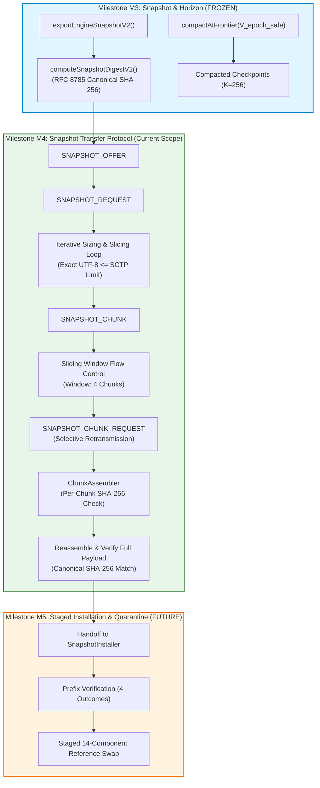
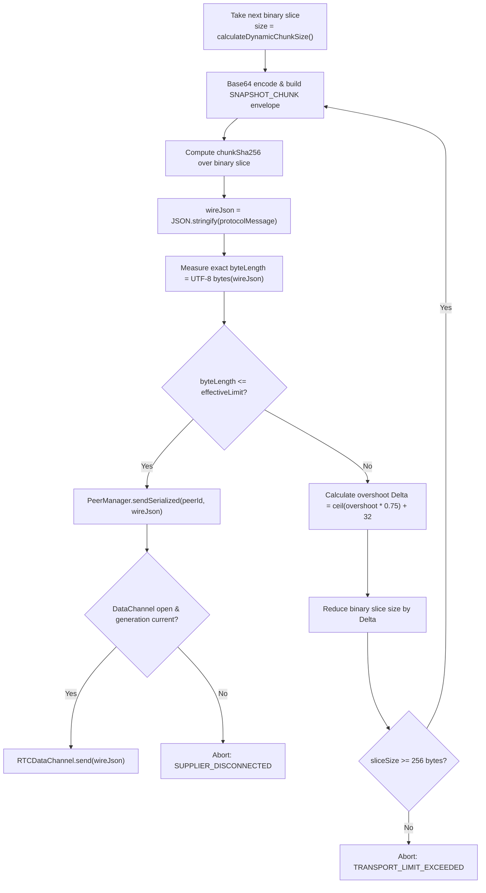

# Phase 7.5 Milestone M4 — Chunked Snapshot Transfer Architecture Specification

**Status:** APPROVED FOR PLANNING (DOCUMENTATION-ONLY)  
**Date:** 2026-11-19  
**Branch Baseline:** `main` at `6fddcf90de5d4cb0e82bd711e7e217cd570c88a4`  
**Specification Baseline:** `119da194c3feb883cfd61b6928cb81d4b200ac5d`  
**Frozen Dependencies:** Phase 7.3 (`e49b81a`), Phase 7.4 M1–M5 (`dbd5217`, `3a3d9e5`), Phase 7.5 M3 (`6fddcf9`)  

---

## 1. Executive Summary & Architectural Scope

Phase 7.5 Milestone M4 specifies the **Chunked Snapshot Transfer Protocol** for leaderless peer-to-peer state recovery over WebRTC DataChannels. When a peer detects that its missing history falls outside the active operation log compaction horizon ($V_{\text{epoch\_safe}}$), ordinary anti-entropy repair cannot fulfill the request. M4 provides the reliable, bounded, flow-controlled, and cryptographically verified transfer of complete engine snapshots up to 4 MB across bandwidth-constrained and MTU-limited WebRTC DataChannels.

### 1.1 Strict Architectural Separation of Concerns
To guarantee modularity, mathematical safety, and strict separation between transport transfer and engine execution:
- **Milestone M3 (Completed & Frozen):** Snapshot generation, canonical RFC 8785 JSON SHA-256 digest computation, compaction horizon calculation, and checkpoint retention.
- **Milestone M4 (Current Scope):** Discovery via offers, sliding-window chunk transfer, iterative wire-size enforcement at `RTCDataChannel.send()`, chunk reassembly, and full-payload digest verification.
- **Milestone M5 (Future Scope):** Quarantine buffer management, 4-outcome prefix compatibility verification, out-of-band staged engine state construction, and atomic 14-component reference swap.
- **Milestone M6 (Future Scope):** 4-state recovery coordinator (`ACTIVE`, `RECOVERING`, `RECONCILING`, `DEGRADED`), autonomous triggers, and end-to-end integration.

**M4 Non-Scope Boundary:** M4 strictly transfers bytes and verifies integrity. M4 **MUST NOT** install snapshots, touch `PlaybackState`, modify `OrderedOperationLog`, reseed logical clocks, drain quarantined events, or transition the engine state machine.



---

## 2. Resolution of Mandatory M3 Audit Limitations

The M3 correctness audit identified three specific architectural limitations. M4 planning formally resolves each:

### 2.1 Limitation A: `STATE_DIGEST` Transport Identity Binding
- **The Issue:** `TrustedTransportAdapter.handleTransportMessage()` dispatches incoming `STATE_DIGEST` payloads directly to `AntiEntropyManager.processRemoteDigest()` without verifying that `msg.payload.senderPeerId === inbound.fromPeerId`. Furthermore, `LeaderlessSyncEngine.recordPeerDigest()` is exposed on the public facade without capability gating.
- **M4 Resolution Architecture:**
  1. **Transport Wire Verification:** At the inbound boundary in `TrustedTransportAdapter.handleTransportMessage()`:
     ```typescript
     if (type === 'STATE_DIGEST' || type === 'sync:state-digest') {
       const digest = msg.payload as StateDigestPayload;
       // Strict transport sender identity binding
       if (digest.senderPeerId !== inbound.fromPeerId) {
         // Drop and reject: claimed identity does not match authenticated DataChannel peer
         return;
       }
       if (digest.connectionGeneration !== peerStatus.generation) {
         // Drop and reject: generation mismatch with active transport lifecycle
         return;
       }
       this.antiEntropyManager?.processRemoteDigest(digest);
       return;
     }
     ```
  2. **Facade Access Protection:** `LeaderlessSyncEngine.recordPeerDigest()` is restricted. External applications cannot inject arbitrary digests. Registration requires an internal capability or occurs exclusively through `TrustedTransportAdapter`.
  3. **Timing Requirement:** This correction is designated as **Milestone M4.0 (Prerequisite)** and must be implemented and tested before M4 transfer code is deployed.

### 2.2 Limitation B: Exact Historical Timestamp Lookup
- **The Issue:** `OrderedOperationLog.getOriginFrontierTimestamps(frontier)` falls back to `this.originFrontierTimestamps.get(origin)`. Because that map stores only the latest pruned timestamp without sequence indexing, querying an intermediate sequence whose checkpoint was evicted can return a later sequence's timestamp.
- **M4 Resolution Architecture:**
  1. **Strict Sequence-Specific Resolution:** `getOriginFrontierTimestamps()` must return exact timestamps only. If an origin sequence is requested:
     - Check active log `originSeqIndex` $\to$ exact match.
     - Check `compactedCheckpoints` $\to$ exact match.
     - If not found in either exact store: return `null` / `undefined`. Never substitute a later timestamp.
  2. **Snapshot Generation & Transfer Gate:**
     - If any origin in `snapshotFrontier` has an unresolved timestamp, `exportEngineSnapshotV2` or snapshot preparation fails with `EXACT_TIMESTAMP_UNAVAILABLE`.
     - In M4, suppliers reject snapshot requests if exact metadata cannot be established, and requesters reject snapshot offers that contain invalid or unresolvable timestamps.

### 2.3 Limitation C: Compaction Exception Atomicity
- **The Issue:** If a custom `reducer` throws during the second loop of `compactAtFrontier()`, operations have already been spliced from `operations`, creating partial mutation.
- **M4 Resolution Architecture:**
  1. The reducer contract is formally documented as **pure, total, and non-throwing** (satisfied by production `reduceState`).
  2. In `compactAtFrontier()`, state reduction will be computed on a candidate base state before modifying active array and index references, ensuring transactional rollback on error.

---

## 3. Protocol Message Lifecycle & Message Contracts

Snapshot transfer defines five distinct wire protocol messages conforming to `@syncplay/protocol`.

```mermaid
sequenceDiagram
    autonumber
    participant R as Requester (Lagging Peer)
    participant S as Supplier (Authoritative Peer)

    Note over R,S: Phase 7.4 Anti-Entropy: Missing history falls outside retention horizon
    R->>S: REPAIR_REQUEST (seqs outside compaction horizon)
    S-->>R: REPAIR_REJECTED (reason: OUTSIDE_HORIZON)
    
    Note over S: Phase 7.5 M4: Targeted Offer Triggered
    S->>R: SNAPSHOT_OFFER (snapshotId, frontier, totalSize, totalChunks, sha256Digest)
    Note over R: Evaluate Offer: epoch matches, frontier dominates, sha256 valid
    
    R->>S: SNAPSHOT_REQUEST (transferId, snapshotId, window=4)
    
    rect rgb(240, 248, 255)
        Note over S,R: Sliding-Window Transfer (Window = 4 Chunks)
        S->>R: SNAPSHOT_CHUNK (index 0, total 8, dataBase64, chunkSha256)
        S->>R: SNAPSHOT_CHUNK (index 1, total 8, dataBase64, chunkSha256)
        S->>R: SNAPSHOT_CHUNK (index 2, total 8, dataBase64, chunkSha256)
        S->>R: SNAPSHOT_CHUNK (index 3, total 8, dataBase64, chunkSha256)
        Note over R: Ingest chunks 0..3; verify chunkSha256; credit window
        R->>S: SNAPSHOT_CHUNK_REQUEST (missingChunkIndices: [4, 5, 6, 7])
        S->>R: SNAPSHOT_CHUNK (index 4, total 8, dataBase64, chunkSha256)
        S->>R: SNAPSHOT_CHUNK (index 5, total 8, dataBase64, chunkSha256)
        S->>R: SNAPSHOT_CHUNK (index 6, total 8, dataBase64, chunkSha256)
        S->>R: SNAPSHOT_CHUNK (index 7, total 8, dataBase64, chunkSha256)
    end

    Note over R: ChunkAssembler: All chunks [0..7] received
    Note over R: Verify Full Payload SHA-256 against offer.sha256Digest
    Note over R: Handoff verified payload & raw bytes to M5 SnapshotInstaller
```

### 3.1 Identifier and Provenance Bindings
Every transfer is uniquely identified and bound to immutable provenance:
- `transferId`: UUIDv4 generated by requester for the transfer session.
- `snapshotId`: Unique snapshot identifier generated at creation.
- `sessionId`: SyncPlay session identifier; must match active session.
- `membershipEpoch`: Active membership epoch; transfers across epoch boundaries are aborted.
- `supplierPeerId`: Authenticated Peer ID of the sending peer.
- `requesterPeerId`: Authenticated Peer ID of the receiving peer.
- `sha256Digest`: Canonical 64-character hex SHA-256 digest covering the snapshot preimage.

---

## 4. Normative Iterative Sizing and Send Boundary

Standard WebRTC SCTP message limits vary across browsers and network topologies (e.g. 64 KB in modern Chrome/Firefox, 16 KB in mobile/constrained environments, and lower on specialized links). A static 32 KB chunk size is **not** a universal transport guarantee.

### 4.1 The Normative 7-Step Send Procedure
For every outbound `SNAPSHOT_CHUNK` message, `SnapshotTransferManager` executes:

1. **Initial Estimation:** `calculateDynamicChunkSize(sctpMaxMessageSize)` estimates maximum binary slice size based on effective SCTP limit minus envelope overhead.
2. **Payload Construction:** The binary slice is Base64 encoded, and `chunkSha256` is computed over the raw binary slice. The full `ProtocolMessage<'SNAPSHOT_CHUNK'>` envelope is constructed.
3. **Serialization:** `wireJson = JSON.stringify(envelope)`.
4. **Exact UTF-8 Measurement:** `byteLength = new TextEncoder().encode(wireJson).byteLength`.
5. **Boundary Decision:**
   - If `byteLength <= effectiveLimit`: Pass `wireJson` unchanged to `PeerManager.sendSerialized()`.
   - `PeerManager` checks generation currency and `dataChannelState === 'open'` immediately before `RTCDataChannel.send()`.
6. **Iterative Reduction Loop:**
   - If `byteLength > effectiveLimit`:
     Calculate overshoot in bytes: $\text{overshoot} = \text{byteLength} - \text{effectiveLimit}$.
     Calculate required binary reduction: $\Delta = \lceil \text{overshoot} \times \frac{3}{4} \rceil + 32$.
     Reduce binary slice size by $\Delta$ bytes, slice anew from snapshot buffer, and repeat from Step 2.
7. **Terminal Failure Protection:**
   - If binary chunk size drops below `MIN_CHUNK_BYTES = 256` bytes without fitting within `effectiveLimit`:
     Synchronously abort transfer with `TRANSPORT_LIMIT_EXCEEDED` and notify application.



---

## 5. Flow Control, Windowing, and Fault Tolerance

### 5.1 Credit-Based Sliding-Window Flow Control
To prevent sender buffer overflow and DataChannel queue congestion:
- `MAX_CONCURRENT_CHUNK_REQUESTS = 4`: At most 4 chunk requests may be in flight simultaneously.
- The requester initiates transfer with `requestedChunkWindow: 4`.
- The supplier sends chunks within the granted credit window.
- As the requester receives and verifies chunks, it emits `SNAPSHOT_CHUNK_REQUEST` specifying the next missing indices, advancing the window.

### 5.2 Single Active Transfer Invariant
- A recovering node strictly permits **at most 1 active inbound transfer** at any time.
- If a subsequent `SNAPSHOT_OFFER` arrives while a transfer is in progress:
  - If the new offer has a higher epoch: the active transfer is aborted (`EPOCH_MISMATCH`), and the new offer is considered.
  - If the new offer is from the same or older epoch: it is ignored or queued.
- A supplier peer manages concurrent outbound transfers using independent per-requester contexts, bounded by transport buffer capacity.

### 5.3 Error Recovery & Retransmission Matrix

| Failure Mode | Detection Mechanism | Recovery Action | Terminal Threshold |
|:---|:---|:---|:---|
| **Packet Loss (Missing Chunk)** | Gap detected in received indices; chunk timeout (5,000ms) | Issue `SNAPSHOT_CHUNK_REQUEST` with missing chunk index | Max 3 retries per chunk $\to$ `TRANSFER_TIMEOUT` abort |
| **Out-of-Order Delivery** | `ChunkAssembler` indexes chunks by `chunkIndex` | Store in sparse array; credit window only for valid chunks | Bounded by `totalChunks` ($\le 128$) |
| **Duplicate Chunk** | `chunkIndex` already populated in `ChunkAssembler` | Idempotently drop duplicate; do not double-increment byte count | Zero side-effects |
| **Corrupted Chunk Payload** | Base64 decode failure or `computedSha256 !== chunkSha256` | Reject chunk; issue re-request for index | Max 3 retries $\to$ `CHUNK_CORRUPTED` abort |
| **Supplier Disconnect** | `PeerManager` status event (`DISCONNECTED`, `CLOSED`) | Immediately abort transfer with `SUPPLIER_DISCONNECTED` | Abort to `ACTIVE` / failover to alternate supplier |
| **Epoch Advance** | Engine signals `EPOCH_CHANGED` or incoming message has `newEpoch > transfer.epoch` | Immediately abort transfer with `EPOCH_MISMATCH` | Abort and clear buffer; await new epoch offers |
| **Reassembled Hash Mismatch** | Full payload SHA-256 does not match `offer.sha256Digest` | Discard all assembled bytes; abort with `HASH_MISMATCH` | Terminal abort $\to$ report corruption |

---

## 6. Snapshot Reassembly & Verification

`ChunkAssembler` manages the receipt, tracking, and collation of incoming chunks:

1. **Capacity Bounds:**
   - `totalChunks` strictly verified: $1 \le \text{totalChunks} \le 128$.
   - `totalSizeBytes` strictly verified: $1 \le \text{totalSizeBytes} \le 4\text{ MB}$.
   - Every chunk must satisfy: $0 \le \text{chunkIndex} < \text{totalChunks}$.
2. **Chunk Integrity:**
   - Raw binary bytes are decoded from `chunk.dataBase64`.
   - Length checked: `binary.byteLength === chunk.chunkSizeBytes`.
   - Hash checked: `sha256(binary) === chunk.chunkSha256`.
3. **Assembly Collation:**
   - Chunks are stored in pre-allocated array of length `totalChunks`.
   - When `receivedCount === totalChunks`:
     Concatenate all slices in index order $0, 1, \dots, \text{totalChunks}-1$ into a single contiguous `Uint8Array`.
4. **Full-Payload Canonical Verification:**
   - Decode contiguous bytes as UTF-8 JSON.
   - Validate against `StateSnapshotPayloadV2Schema`.
   - Compute canonical RFC 8785 JSON SHA-256 digest via `computeSnapshotDigestV2(payload)`.
   - Assert `computedDigest.toLowerCase() === offer.sha256Digest.toLowerCase()`.
   - On match: transfer completes successfully; deliver to M5 handoff.

---

## 7. M4 to M5 Handoff Contract

Upon successful reassembly and verification, `SnapshotTransferManager` delivers the result across the milestone boundary:

```typescript
export interface SnapshotTransferResult {
  readonly transferId: string;
  readonly snapshotId: string;
  readonly supplierPeerId: string;
  readonly membershipEpoch: number;
  readonly payload: StateSnapshotPayloadV2;
  readonly rawBytes: Uint8Array;
  readonly sha256Digest: string;
}

export type SnapshotTransferHandoffCallback = (
  result: SnapshotTransferResult
) => Promise<void> | void;
```

**M5 Invariant:** The receiving component in M5 is responsible for:
1. Evaluating historical compatibility across 4 prefix outcomes (`HISTORY_VERIFIED`, etc.).
2. Constructing isolated staging instances of `OrderedOperationLog`, `PlaybackState`, and replication vectors.
3. Executing the atomic 14-component synchronous reference swap.
4. Reseeding logical clock and draining quarantined events.

M4 has zero visibility into or control over engine state replacement.
