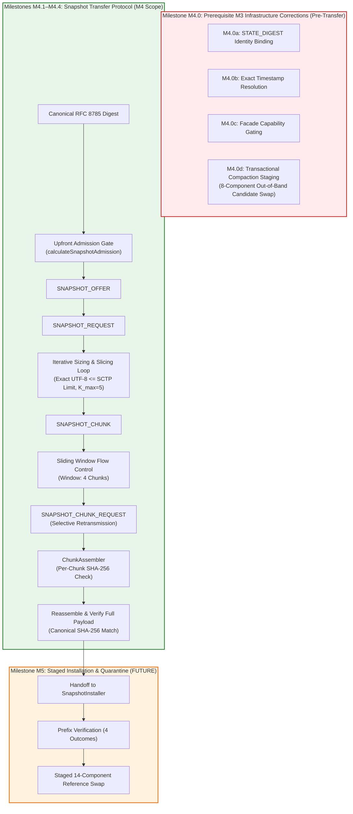
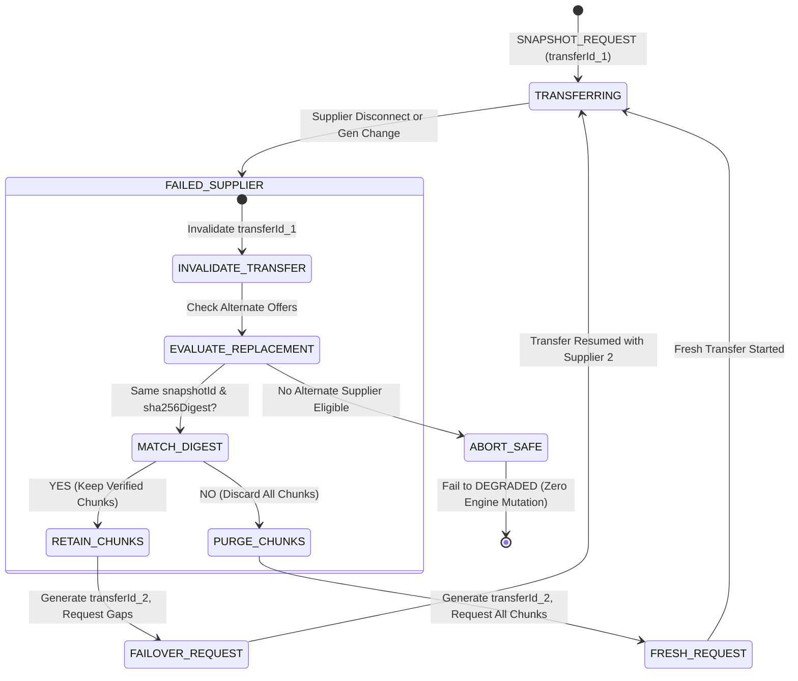

# Phase 7.5 Milestone M4 — Chunked Snapshot Transfer Architecture Specification

**Status:** APPROVED FOR PLANNING (DOCUMENTATION-ONLY)  
**Date:** 2026-11-19  
**Refinement Date:** 2026-11-19  
**Branch Baseline:** `main` at `3b90116`  
**Parent Implementation Baseline:** `6fddcf90de5d4cb0e82bd711e7e217cd570c88a4`  
**Specification Baseline:** `119da194c3feb883cfd61b6928cb81d4b200ac5d`  
**Frozen Dependencies:** Phase 7.3 (`e49b81a`), Phase 7.4 M1–M5 (`dbd5217`, `3a3d9e5`), Phase 7.5 M3 (`6fddcf9`)  

---

## 1. Executive Summary & Architectural Scope

Phase 7.5 Milestone M4 specifies the **Chunked Snapshot Transfer Protocol** for leaderless peer-to-peer state recovery across WebRTC DataChannels. When anti-entropy repair determines that missing operation history falls outside the active log compaction horizon ($V_{\text{epoch\_safe}}$), M4 provides a bounded, flow-controlled, verifiable protocol to transfer snapshots up to 4 MB across bandwidth-constrained and MTU-limited WebRTC DataChannels.

### 1.1 Strict Architectural Phasing and Scope Boundaries
To guarantee modularity, mathematical safety, and eliminate ambiguity between infrastructure prerequisites and transfer execution, the recovery architecture is partitioned into strict milestone boundaries:

1. **Milestone M4.0: Prerequisite M3 Infrastructure Corrections (Pre-Transfer Scope):**
   Addresses known correctness, security, and atomicity limitations in existing M3 components before introducing recovery wire traffic:
   - **M4.0a (`STATE_DIGEST` Identity Binding):** Enforce `senderPeerId === fromPeerId` and generation currency in `TrustedTransportAdapter`.
   - **M4.0b (Exact Timestamp Resolution):** Strict sequence-specific timestamp resolution in `OrderedOperationLog.getOriginFrontierTimestamps()`.
   - **M4.0c (Facade Gating):** Capability-authorized gating for `recordPeerDigest()`.
   - **M4.0d (Compaction Exception Atomicity):** Out-of-band transactional candidate staging across all 8 mutable fields in `OrderedOperationLog.compactAtFrontier()`.
2. **Milestones M4.1–M4.4: Snapshot Transfer Protocol Implementation ONLY (Current Milestone Scope):**
   Implements wire message contracts, upfront admission gating, chunk tracking/deduplication in `ChunkAssembler`, 7-step iterative send-boundary wire sizing, sliding-window chunk delivery, supplier failover, contiguous reassembly, and full-payload canonical RFC 8785 JSON SHA-256 digest verification.
   - **Strict M4.1–M4.4 Non-Scope Boundary:** Milestones M4.1–M4.4 strictly transfer bytes and verify cryptographic integrity. M4.1–M4.4 **MUST NOT** install snapshots, touch `PlaybackState`, modify `OrderedOperationLog`, reseed logical clocks, drain quarantined events, or transition the engine state machine.
3. **Milestone M5: Staged Installation & Live Quarantine Buffer (Future Scope):**
   Implements the live quarantine event buffer, 4-outcome prefix compatibility verification, out-of-band staged engine state construction, clock reseeding, quarantine draining, and atomic 14-component reference swap.
4. **Milestone M6: Autonomous Recovery Coordinator (Future Scope):**
   Implements the 4-state recovery coordinator (`ACTIVE`, `RECOVERING`, `RECONCILING`, `DEGRADED`), autonomous trigger conditions, and end-to-end integration.



### 1.2 Capacity Invariant, Chunk Count Ceiling, and Exact Upfront Admission Gate

A fundamental physical and protocol reality governs state recovery over WebRTC: individual snapshot capacity is fundamentally bound by the negotiated SCTP maximum message size of the transport link and the fixed maximum chunk count.

#### 1.2.1 Exact Sizing Contract, Option A Alphabet Restriction, and Envelope Ceiling Proof
The admission calculation must be completely conservative and consistent with the actual wire serialization executed by the outbound transfer pipeline. It accounts for:
1. **Complete ProtocolMessage Envelope Overhead:** The outer framing (`protocolVersion`, `sessionId`, `messageType`, `senderPeerId`, `messageId`), legitimate optional transport fields (`membershipEpoch`, `connectionGeneration`), payload object keys, UUIDs, chunk indices, total chunks, byte counts, and the 64-character hex `chunkSha256` string.
2. **Schema Character Set Strategy: Option A (Adopted):**
   - In distributed protocol implementations, identifier strings (`sessionId`, `senderPeerId`, `supplierPeerId`, `snapshotId`, `messageId`) are restricted in schemas to an explicit ASCII-safe alphabet:
     $$\text{ASCII\_IDENTIFIER\_REGEX} = \text{/}\hat{\ }[a-zA-Z0-9\_.:-]+\$\text{/}$$
   - *Why Option A is Adopted:* Under this character set, every character is an ASCII printable character between `0x20` and `0x7E` (excluding quotes and backslashes). No JSON control character escaping (`\u0000` to `\u001f`) is possible, and UTF-8 byte length is strictly identical to character count ($1\text{ char} = 1\text{ byte}$).
   - *Strict Snapshot-Chunk Wire Contract:* Under `SnapshotChunkEnvelopeSchema`, operation-specific and causal replication metadata (`causalContext`, `logicalEventId`, `originPeerId`, `logicalTimestamp`, `originSequenceNumber`) are strictly forbidden, and unknown properties are rejected via `.strict()`.
   - *Worst-Case Mathematical Serialization Proof:*
     - Outer envelope: `protocolVersion` (20 B) + `messageType` "sync:state-snapshot-chunk" (35 B) + `sessionId` 128 B + `senderPeerId` 128 B + `messageId` 128 B + optional `membershipEpoch` (25 B) + optional `connectionGeneration` (25 B)
     - Inner payload: `transferId` (UUIDv4 36 B) + `sessionId` (128 B) + `supplierPeerId` (64 B) + `snapshotId` (128 B) + `chunkSha256` (64 B) + 4 numeric fields at `Number.MAX_SAFE_INTEGER` (100 B)
     - Structural JSON syntax (keys, quotes, colons, braces, commas, `"dataBase64":""`): ~90 B
     - **Exact maximum serialized UTF-8 bytes (excluding Base64 payload):** **1,231 bytes** (or **1,270 bytes** with an extreme 64-character `messageType`).
     - Since $1,270 \le 1,800$, $\text{MAX\_ENVELOPE\_OVERHEAD\_BYTES} = 1800$ bytes is an airtight, mathematically proven upper bound with a verified $1,800 - 1,270 = \mathbf{530\text{ bytes}}$ (41.7%) safety margin.
   - *Option B (Unrestricted Character Set Evaluation):* If arbitrary Unicode and control characters were permitted in schema strings, JSON escaping could produce up to 6 bytes per code point (`\u0000`), driving envelope overhead $> 5,500$ bytes. Such an overhead would starve transfers on links $\le 8\text{ KB}$ and make transfers impossible on constrained links. Option A avoids this pathological inflation while fully supporting all UUIDs, nanoIDs, and standard SyncPlay identifiers.
3. **Base64 Expansion and Exact Sizing Formulation:**
   Every 3 binary bytes expand to 4 Base64 characters ($4 \times \lceil B / 3 \rceil$). To guarantee that the encoded data plus envelope fits within `effectiveLimit`:
   $$\text{maxBase64Bytes} = \max(0, \text{effectiveLimit} - \text{MAX\_ENVELOPE\_OVERHEAD\_BYTES})$$
   $$\text{chunkBinaryCapacity} = \begin{cases}
     0, & \text{if } \text{effectiveLimit} < \text{MIN\_TRANSPORT\_LIMIT\_CHUNK\_TRANSFER} \ (2,144\text{ B}) \\
     \min\left(\text{MAX\_CHUNK\_BYTES}, \left\lfloor \frac{\text{maxBase64Bytes}}{4} \right\rfloor \times 3\right), & \text{if } \text{effectiveLimit} \ge 2,144\text{ B}
   \end{cases}$$
   (where $\text{MAX\_CHUNK\_BYTES} = 32,768$ bytes, $\text{MIN\_RAW\_CHUNK\_BYTES} = 256$ bytes).

#### 1.2.2 Minimum Transport Size for Full 32 KB Binary Chunks and 256 B Minimum Chunks
- **Minimum Transport Limit for Chunked Transfer ($B_{\text{min}} = 256$ B):**
  - Base64 payload size: $\lceil 256 / 3 \rceil \times 4 = 86 \times 4 = \mathbf{344\text{ bytes}}$.
  - Plus proven maximum envelope budget ($1,800$ bytes):
    $$\text{MIN\_TRANSPORT\_LIMIT\_CHUNK\_TRANSFER} = 1,800 + 344 = \mathbf{2,144\text{ bytes}} \ (2.09\text{ KiB})$$
  *(Note: Any transport negotiating an effective limit strictly below 2,144 bytes cannot carry even a 256-byte chunk and is rejected upfront before allocating reassembly memory).*
- **Minimum Transport Limit for Full 32 KB Binary Chunks ($B = 32,768$ B):**
  - Base64 payload size: $\lceil 32,768 / 3 \rceil \times 4 = 10,923 \times 4 = \mathbf{43,692\text{ bytes}}$.
  - Plus proven maximum envelope budget ($1,800$ bytes):
    $$\text{MIN\_TRANSPORT\_LIMIT\_FULL\_CHUNK} = 43,692 + 1,800 = \mathbf{45,492\text{ bytes}} \ (44.43\text{ KiB})$$
  *(Note: Any transport with an effective limit strictly below 45,492 bytes cannot transmit 32,768-byte binary chunks and will dynamically size down).*

#### 1.2.3 Exact Mathematical Formulation of Admission
Before allocating reassembly memory or accepting an incoming transfer offer, both supplier and requester evaluate:
$$\text{calculatedRequiredChunks} = \left\lceil \frac{\text{totalSizeBytes}}{\text{chunkBinaryCapacity}} \right\rceil$$

#### 1.2.4 Mandatory Capacity and Consistency Invariants
$$\mathbf{\text{Invariant 1 (Transport Floor):}} \quad \text{effectiveLimit} \ge \text{MIN\_TRANSPORT\_LIMIT\_CHUNK\_TRANSFER} \ (2,144\text{ B})$$
$$\mathbf{\text{Invariant 2 (Chunk Capacity Floor):}} \quad \text{chunkBinaryCapacity} \ge \text{MIN\_RAW\_CHUNK\_BYTES} \ (256\text{ B})$$
$$\mathbf{\text{Invariant 3 (Chunk Ceiling):}} \quad \text{calculatedRequiredChunks} \le \text{MAX\_CHUNKS\_PER\_SNAPSHOT} \ (128)$$
$$\mathbf{\text{Invariant 4 (Offer Consistency):}} \quad \text{offer.totalChunks} === \text{calculatedRequiredChunks}$$

- **Admission Rejection:** If $\text{effectiveLimit} < 2,144$ or $\text{chunkBinaryCapacity} < 256$, the transfer is rejected immediately with `TRANSPORT_LIMIT_EXCEEDED` before allocating any reassembly buffer memory.
- **Chunk Count Rejection:** If $\text{calculatedRequiredChunks} > 128$, the transfer is rejected immediately with `CHUNK_COUNT_EXCEEDED` or `TRANSPORT_LIMIT_EXCEEDED`.
- **Inconsistent Offer Rejection:** If $\text{offer.totalChunks} !== \text{calculatedRequiredChunks}$, the offer is rejected immediately with `OFFER_INCONSISTENT` before allocating any assembler or reassembly buffer memory. An inconsistent offer indicates a malformed or incompatible supplier slicing contract.
- **Variable Final-Chunk Guarantee:** Chunks $0 \dots N-2$ carry exactly $\text{chunkBinaryCapacity}$ bytes. The final chunk $N-1$ carries $B_{\text{final}} = \text{totalSizeBytes} - (N-1) \times \text{chunkBinaryCapacity} \le \text{chunkBinaryCapacity}$ bytes. Because $B_{\text{final}} \le \text{chunkBinaryCapacity}$, its Base64 encoding is strictly $\le$ preceding chunks, guaranteed to fit within `effectiveLimit`.

#### 1.2.5 Transport-Dependent Snapshot Capacity Matrix
The protocol **does NOT claim universal 4 MiB snapshot transfer support over severely constrained SCTP transports**. On a 2,144-byte link, transferring a 4 MiB snapshot would require thousands of tiny chunks, vastly exceeding the 128-chunk bound. Instead, effective snapshot capacity scales with transport limits:

| Transport SCTP Limit | Envelope Overhead | Available Base64 | Chunk Binary Capacity | Max Transferable Snapshot (128 chunks) | Operational Recovery Scope |
|:---|:---:|:---:|:---:|:---:|:---|
| **65,536 B (Standard / Fallback)** | 1,800 B | 63,736 B | 32,768 B (Capped) | **4,194,304 B (4.00 MiB)** | Full 4 MiB Engine Snapshot |
| **$\ge$ 45,492 B (Full Chunk Ceiling)** | 1,800 B | $\ge$ 43,692 B | 32,768 B (Capped) | **4,194,304 B (4.00 MiB)** | Full 4 MiB Engine Snapshot |
| **32,768 B** | 1,800 B | 30,968 B | 23,226 B | **2,972,928 B (2.84 MiB)** | Admitted if $\le 2.84\text{ MiB}$; rejected otherwise |
| **16,384 B** | 1,800 B | 14,584 B | 10,938 B | **1,400,064 B (1.34 MiB)** | Admitted if $\le 1.34\text{ MiB}$; rejected otherwise |
| **8,192 B** | 1,800 B | 6,392 B | 4,794 B | **613,632 B (599 KiB)** | Admitted if $\le 599\text{ KiB}$; rejected otherwise |
| **4,096 B** | 1,800 B | 2,296 B | 1,722 B | **220,416 B (215 KiB)** | Admitted if $\le 215\text{ KiB}$; rejected otherwise |
| **2,144 B (Minimum Floor)** | 1,800 B | 344 B | 258 B ($\ge 256$ B) | **33,024 B (32.25 KiB)** | Small snapshot / constrained test support only |
| **< 2,144 B (e.g. 2,048 B)** | N/A | < 344 B | < 256 B | **0 B (Rejected Upfront)** | Below minimum chunk threshold; immediate abort (`TRANSPORT_LIMIT_EXCEEDED`) |

By evaluating the admission invariant upfront, the engine never enters a deadlocked or memory-exhausted transfer state on constrained transports.

By evaluating the admission invariant upfront, the engine never enters a deadlocked or memory-exhausted transfer state on constrained transports.

---

## 2. Snapshot Identity, Authorship, and Possession Proof

### 2.1 Disambiguation of Identifiers
A fundamental invariant of M4 is the strict separation between immutable snapshot identity and ephemeral transport transfer attempts:

| Identifier | Type & Scope | Mutability | Bound in Digest? | Definition & Semantic Purpose |
|:---|:---|:---:|:---:|:---|
| **`snapshotAuthorPeerId`** (`authorPeerId`) | Peer Identifier (string) | **Immutable** | **YES** | The peer that originally created and committed the snapshot state. Bound into `StateSnapshotPayloadV2.authorPeerId` and canonical SHA-256 digest preimage. |
| **`supplierPeerId`** | Peer Identifier (string) | **Ephemeral** | **NO** | The remote peer currently serving/forwarding chunks over an active WebRTC DataChannel. **A forwarding supplier is NEVER treated as the snapshot author.** |
| **`requesterPeerId`** | Peer Identifier (string) | **Ephemeral** | **NO** | The local peer requesting and receiving the snapshot chunks. |
| **`snapshotId`** | UUID / String | **Immutable** | **YES** | Unique identifier of the snapshot object. Bound into `StateSnapshotPayloadV2.snapshotId` and canonical SHA-256 digest preimage. |
| **`transferId`** | UUIDv4 | **Ephemeral** | **NO** | Unique identifier of a single transfer attempt between a requester and a supplier. A new `transferId` is generated on every transfer initiation and failover. |

### 2.2 Canonical Digest Binding
The cryptographic canonical digest `sha256Digest` covers exactly and only the immutable snapshot object:
- **Bound Fields (Preimage):**
  `formatVersion`, `snapshotId`, `sessionId`, `membershipEpoch`, `authorPeerId`, `snapshotFrontier`, `maxLogicalTimestamp`, `originFrontierTimestamps`, `compactedCheckpoints`, and `state`.
- **Excluded Transfer Fields:**
  `transferId`, `supplierPeerId`, `requesterPeerId`, `offerId`, `requestedChunkWindow`, `clientMaxChunkBytes`, `chunkIndex`, `totalChunks`, `chunkSizeBytes`, `chunkSha256`, and `dataBase64`.

#### 2.2.1 Verification of M3 Snapshot Digest Compatibility
To guarantee backward compatibility and prevent silent drift, the M4 design is audited directly against the frozen Milestone M3 runtime implementation at commit `6fddcf90de5d4cb0e82bd711e7e217cd570c88a4`:
- **Code Inspection Baseline:**
  - `packages/protocol/src/payloads/repair.ts` (lines 464–485, defining `StateSnapshotPayloadV2Schema`).
  - `packages/sync-engine/src/snapshot.ts` (lines 170–240, defining `computeSnapshotDigestV2`).
- **Conclusive Field Existence Verification:**
  1. `snapshotId`: **Already exists** in M3 schema (`z.string().min(1).max(128)`) and M3 canonical preimage.
  2. `authorPeerId`: **Already exists** in M3 schema (`z.string().min(1).max(64)`) and M3 canonical preimage.
  3. `originFrontierTimestamps`: **Already exists** in M3 schema (`z.record(...)`) and M3 canonical preimage.
  4. `compactedCheckpoints`: **Already exists** in M3 schema (`z.record(..., z.record(..., CompactedCheckpointSchema))`) and M3 canonical preimage.
- **Protocol Invariant:**
  Milestone M4 introduces **ZERO** schema modifications to `StateSnapshotPayloadV2`, **ZERO** modifications to `computeSnapshotDigestV2`, and **NO** format version bump (`formatVersion: 2` remains frozen). No old-snapshot migration shims or preimage re-negotiations are needed because M3 already committed to this exact structure.
- **Identity Distinction:**
  `authorPeerId` is the immutable author peer who generated the snapshot from committed engine state. `supplierPeerId` in `SNAPSHOT_OFFER` is the transport supplier serving the chunks over a WebRTC DataChannel. A forwarding supplier is never treated as the author, and changing suppliers mid-stream does not invalidate the canonical digest.

### 2.3 Supplier Possession Proof
An advertised `SNAPSHOT_OFFER` is merely an untrusted claim. A supplier demonstrates true possession of the advertised snapshot through verifiable execution:
1. **Initial Proof in Chunk 0:** The supplier must deliver chunk 0 containing valid Base64 data that decodes to raw bytes matching `chunkSha256`.
2. **Deterministic Slicing Proof:** The supplier slices the snapshot deterministically from its local buffer.
3. **Cryptographic Full-Payload Proof:** When all chunks are assembled, the reconstructed binary payload must decode as UTF-8 JSON matching `StateSnapshotPayloadV2Schema`, and its canonical RFC 8785 JSON SHA-256 digest must match `offer.sha256Digest` bit-exact.
4. **Failure to Prove Possession:** If a supplier emits invalid chunks, fails chunk SHA-256 verification, or fails full-payload digest verification, it is flagged as failing possession proof. The transfer aborts immediately with `CHUNK_CORRUPTED` or `HASH_MISMATCH`, and the supplier is blacklisted for failover selection during the active epoch.

---

## 3. Supplier Failover Lifecycle & Chunk Retention

When network conditions degrade or peers disconnect, transfer continuity is preserved without compromising safety:



### 3.1 Invalidation of Active Transfer Attempt
- If the current supplier disconnects (`PeerManager` status `DISCONNECTED`, `CLOSED`, `FAILED`) or increments its connection generation (`oldGen !== newGen`):
  - The current `transferId` becomes immediately **invalid**.
  - All pending timers and in-flight chunk requests for that `transferId` are cancelled.

### 3.2 Verified Chunk Retention Rule and Non-Destructive Failover
Already received and verified chunks in `ChunkAssembler` may be retained **if and only if** all immutable transfer identity and partition geometry fields match bit-exact:
$$\begin{aligned}
\text{candidate}.\text{sessionId} &=== \text{active}.\text{sessionId} \quad (\text{if provided}) \\
\land \quad \text{candidate}.\text{membershipEpoch} &=== \text{active}.\text{membershipEpoch} \\
\land \quad \text{candidate}.\text{snapshotId} &=== \text{active}.\text{snapshotId} \\
\land \quad \text{candidate}.\text{expectedSha256Digest} &=== \text{active}.\text{expectedSha256Digest} \\
\land \quad \text{candidate}.\text{totalSizeBytes} &=== \text{active}.\text{totalSizeBytes} \\
\land \quad \text{candidate}.\text{totalChunks} &=== \text{active}.\text{totalChunks} \\
\land \quad \text{candidate}.\text{nominalChunkSizeBytes} &=== \text{active}.\text{nominalChunkSizeBytes}
\end{aligned}$$

- **Legitimate Changes Across Failover:**
  During an authorized same-epoch supplier failover, the following fields legitimately change to track the new delivery attempt:
  - `transferId`: A fresh attempt ID to fence out late or in-flight chunks from the prior supplier.
  - `supplierPeerId`: The identity of the replacement peer supplying the chunks.
  - `connectionGeneration`: The transport generation of the replacement supplier connection.

- **Non-Destructive Candidate Rejection:**
  If a candidate fails any validation or compatibility check (mismatched epoch, mismatched snapshot ID, digest difference, partition geometry discrepancy, or invalid parameters), `prepareForFailover()` **rejects the candidate non-destructively**.
  The active transfer, its accumulated chunks, received byte counts, and memory reservation remain completely intact and undisturbed. A stale or invalid failover attempt cannot destroy an in-progress transfer.

- **Explicit Transfer Restart:**
  Discarding an existing transfer to adopt a different snapshot or start in a new membership epoch is an explicit caller decision. The caller must explicitly invoke `assembler.abortTransfer()` followed by `assembler.initTransfer()`, or call `assembler.restartTransfer(params)`. The candidate failover check never automatically restarts a transfer as a side effect.

- **Admission Authority Boundary (M4.1 vs M4.3):**
  `ChunkAssembler.initTransfer()` validates internal mathematical partition consistency and per-chunk bounds, but does not query transport SCTP limits directly. The future recovery coordinator (M4.3) is solely responsible for evaluating `calculateSnapshotAdmission()` against the actual negotiated transport limit and passing the admitted parameters into `ChunkAssembler`. Production admission enforcement belongs to the M4.3 coordinator integration.

---

## 4. Chunk Ingestion, Duplicate Handling, and Corruption Detection

`ChunkAssembler` enforces strict validation rules on every received `SNAPSHOT_CHUNK`:

### 4.1 Ingestion Matrix
1. **Transfer ID Fencing:**
   - If `chunk.transferId !== activeTransfer.transferId`: **Discard silently**. Late chunks from previous attempts or cancelled transfers are dropped with zero side effects.
2. **Epoch and Generation Fencing:**
   - If `chunk.membershipEpoch !== activeEpoch` or supplier generation has changed: **Reject immediately**.
3. **Identical Duplicate Chunk:**
   - If `assembler.hasChunk(chunk.chunkIndex)` is true:
     - Check `chunk.chunkSha256 === existing.chunkSha256`.
     - If identical: **Idempotently ignore**. Do not re-verify Base64, do not re-insert, do not increment received byte count. Memory is strictly bounded.
4. **Index Collision / Corrupt Chunk (Same Index, Different Content):**
   - If `assembler.hasChunk(chunk.chunkIndex)` is true but `chunk.chunkSha256 !== existing.chunkSha256`, or if `sha256(decode(chunk.dataBase64)) !== chunk.chunkSha256`:
     - **Immediate Abort:** Terminate transfer with reason `CHUNK_CORRUPTED`.
     - Emit `SNAPSHOT_ABORT` to supplier.
5. **Missing Chunk Index Validation:**
   - Any `SNAPSHOT_CHUNK_REQUEST` issued must validate that:
     - Every index $i$ satisfies $0 \le i < \text{totalChunks} \le 128$.
     - Indices are unique (deduplicated).
     - Array length $\le \text{MAX\_CONCURRENT\_CHUNK\_REQUESTS} = 4$.

---

## 5. Retry, Timeout Budgets, and Cancellation Lifecycle

Snapshot transfer relies on dual-level bounded retry and deadline policies to prevent infinite transfer loops:

```
+---------------------------------------------------------------------------------------------+
|                               OVERALL TRANSFER DEADLINE (60s)                               |
|                                                                                             |
|  +--------------------+  +--------------------+  +--------------------+                     |
|  | Chunk 0..3 Window  |  | Chunk 4..7 Window  |  | Chunk Retries (<=3)| ... (Total Retries) |
|  | Timeout: 5,000ms   |  | Timeout: 5,000ms   |  | Max 3 per chunk    |     Max 10 / transfer
|  +--------------------+  +--------------------+  +--------------------+                     |
+---------------------------------------------------------------------------------------------+
```

### 5.1 Retry and Timeout Specifications
- **Per-Chunk Retry Limit (`MAX_CHUNK_RETRIES = 3`):**
  - If a specific chunk index fails hash verification or times out, it may be re-requested up to 3 times.
  - Exceeding 3 retries for any single chunk triggers immediate transfer abort (`TRANSFER_TIMEOUT`).
- **Total Transfer Retransmission Budget (`MAX_TRANSFER_RETRIES = 10`):**
  - Across the entire transfer (up to 128 chunks), at most 10 cumulative retransmissions are permitted.
  - Exceeding 10 cumulative retries indicates an unviable transport link and terminates the transfer.
- **Per-Chunk Request Timer (`CHUNK_REQUEST_TIMEOUT_MS = 5000ms`):**
  - Timer resets upon the arrival and validation of any missing chunk in the active window.
  - If no chunk arrives within 5,000ms, a `SNAPSHOT_CHUNK_REQUEST` is re-issued for pending missing indices.
- **Overall Transfer Deadline (`OVERALL_TRANSFER_TIMEOUT_MS = 60000ms`):**
  - An absolute wall-clock deadline of 60 seconds is started at transfer initiation.
  - If the transfer is not complete within 60 seconds, it is unconditionally aborted with `TRANSFER_TIMEOUT`.

### 5.2 Cancellation and Late Chunks
- Upon receiving or sending `SNAPSHOT_ABORT`:
  - Active timers (`overallTimeout`, `chunkTimeout`) are cleared immediately.
  - `ChunkAssembler` memory is cleared.
  - Active `transferId` is unregistered.
  - Late chunks arriving after abort are dropped at the transport boundary without memory allocation.

---

## 6. Normative Iterative Sizing, Termination Proof, and Send Boundary

### 6.1 Source of Negotiated SCTP Maximum Message Size & Transport Behavior
WebRTC DataChannel message capacity is negotiated during the WebRTC SCTP handshake (`RTCSctpTransport.maxMessageSize`).

1. **Production Retrieval Path:**
   - The production transport retrieval path is `PeerManager.getSctpMaxMessageSize(peerId)`.
   - This method inspects the underlying active `WebRtcTransport.sctpMaxMessageSize`, which queries `(this.peerConnection as any).sctp?.maxMessageSize`.
2. **Behavior Across SCTP Negotiation States:**
   - **Case A: Available and Valid ($> 0$ and finite):**
     If `maxMessageSize` is a positive finite number:
     - If `maxMessageSize < MIN_SUPPORTED_SCTP_LIMIT` (2,048 bytes): Abort transfer immediately with `TRANSPORT_LIMIT_EXCEEDED` before allocating buffers.
     - If `maxMessageSize >= MIN_SUPPORTED_SCTP_LIMIT`: The effective message limit is capped at SyncPlay's application framing limit:
       $$\text{effectiveLimit} = \min(65536, \text{maxMessageSize})$$
   - **Case B: Not Yet Negotiated (`undefined` during ICE/DTLS/SCTP handshaking):**
     - **Normative Policy:** Transfer initiation **MUST BE DEFERRED** until connection establishment and SCTP parameter negotiation are complete (`dataChannelState === 'open' && sctpMaxMessageSize !== undefined`). Neither `SNAPSHOT_REQUEST` nor `SNAPSHOT_OFFER`/`SNAPSHOT_CHUNK` may be transmitted on speculative, un-negotiated channels.
   - **Case C: Undefined or Unavailable on Open DataChannel:**
     - **Distinction of Transport Layers:**
       1. *Local Application Framing Cap (65,536 B):* Max buffer limit configured in SyncPlay protocol constants to avoid local OOM.
       2. *Negotiated Remote SCTP Limit (`sctp.maxMessageSize`):* Exact message ceiling negotiated via SDP `a=max-message-size` (RFC 8841 / W3C WebRTC §6.2).
       3. *Synchronous Local `send()` Acceptance:* `RTCDataChannel.send()` buffering string in local user-space/kernel WebRTC queue.
       4. *Remote Application Receipt:* True end-to-end receipt and SCTP assembly at remote peer.
     - **Normative Policy (Production):** If the DataChannel is open but `sctpMaxMessageSize` is `undefined` (or unexposed by host), the sync engine **DEFERS initiation while negotiation is in progress**, and **REJECTS transfer with `TRANSPORT_UNNEGOTIATED`** if negotiation has finalized without exposing a finite positive limit. Unnegotiated 65,536 B assumption in production is unsafe because remote peers or intermediary SCTP stacks may enforce smaller MTU/buffers (e.g. 16 KB or 32 KB), silently dropping oversized frames.
     - **Documented Compatibility Exception (Mock/Testing Only):** If and only if an explicit configuration flag `allowSctpFallback: true` is enabled (strictly in unit test harnesses or headless environments lacking WebRTC SCTP support), the transport clamps outbound framing to a conservative fallback cap of `65,536` bytes (`MAX_MESSAGE_BYTES`).
   - **Case D: Zero, Negative, or Non-Finite (`<= 0`, `NaN`, `Infinity`):**
     - Zero in SCTP indicates "no messages can be sent" or an unnegotiated association.
     - Negative or non-finite values are illegal under W3C WebRTC specifications.
     - These values are treated as invalid/unnegotiated transport states; transfer initiation is deferred until a valid finite positive limit is available, or rejected upfront if negotiation has completed without a valid value.
3. **Handling of Synchronous `RTCDataChannel.send()` Failures:**
   - When `PeerManager.sendSerialized()` calls `transport.send(serializedJson)` and the underlying `RTCDataChannel.send()` throws or returns `false` (e.g. DataChannel buffer backpressure, channel abruptly closed, or peer disconnected):
     1. **Do Not Mark Unsent Chunk as Transmitted:** The chunk remains strictly un-sent. In-flight window credit is NOT consumed or acknowledged.
     2. **Do Not Lose Retry State:** The failed transmission attempt is accounted against the chunk's retry budget: $\text{chunkRetryCount}[i]$ is incremented.
     3. **Do Not Corrupt Transfer Counters:** `receivedBytes`, `sentBytes`, and progress counters remain un-incremented.
     4. **Failure Policy:**
        - If failure is due to `DataChannel not open`, `Peer not found`, or generation mismatch: Abort immediately with `SUPPLIER_DISCONNECTED`.
        - If failure is due to size exceedance or temporary transport buffer backpressure: If $\text{chunkRetryCount}[i] < \text{MAX\_CHUNK\_RETRIES}$ (3), the supplier may retry with a further reduced binary slice or back off. If retries exceed 3, the transfer cleanly aborts with `TRANSPORT_LIMIT_EXCEEDED` or `TRANSFER_TIMEOUT`.
        - **No State Corruption:** Any send failure triggers synchronous transfer cleanup without mutating engine playback state, replication vectors, or operation logs.
4. **Exact Send Boundary Invariant:**
   - The complete `ProtocolMessage` is serialized to JSON string exactly once per sizing iteration.
   - The UTF-8 byte length is calculated from that exact serialized string using `new TextEncoder().encode(serializedString).byteLength`.
   - The identical string that was measured and verified to be $\le \text{effectiveLimit}$ is passed unchanged to `PeerManager.sendSerialized()` and `RTCDataChannel.send()`.

### 6.2 Mathematical Proof of Termination and Operational Iteration Bound
Let $B_k$ be the binary slice size (in bytes) at iteration $k \ge 0$, and let $L_k$ be the exact UTF-8 byte length of `JSON.stringify(protocolMessage)`.

1. **Overshoot Definition:** If $L_k > \text{effectiveLimit}$, the overshoot is:
   $$O_k = L_k - \text{effectiveLimit} \ge 1$$
2. **Binary Reduction Step:** The algorithm reduces the binary slice by:
   $$\Delta_k = \left\lceil O_k \times \frac{3}{4} \right\rceil + 32$$
   Since $O_k \ge 1$, $\Delta_k \ge \lceil 0.75 \rceil + 32 = 33 \text{ bytes}$.
3. **Strict Monotonic Decrease:**
   $$B_{k+1} = B_k - \Delta_k \le B_k - 33$$
4. **Finite Mathematical Bound:**
   The initial binary slice is bounded: $B_0 \le \text{MAX\_CHUNK\_BYTES} = 32,768 \text{ bytes}$.
   In each unsuccessful iteration, $B$ decreases by at least 33 bytes. Therefore, the loop is mathematically proven to terminate in at most:
   $$k_{\text{theoretical}} = \left\lceil \frac{32,768}{33} \right\rceil = 993 \text{ iterations}$$
5. **Hard Operational Bound (`MAX_SIZING_ITERATIONS = 5`):**
   - In practice, because Base64 expands binary bytes by $4/3$ and envelope keys are static, $\lceil O_k \times 0.75 \rceil + 32$ compensates for overshoot with margin; convergence occurs in 1 or 2 iterations.
   - To eliminate any possibility of CPU spinning under pathological string encoding or envelope inflation edge cases, a strict operational limit is enforced:
     $$K_{\text{max}} = 5 \text{ attempts per chunk}$$
   - If after 5 iterations ($k \ge 5$) the serialized message still exceeds $\text{effectiveLimit}$, the sizing loop halts immediately and cleanly aborts the transfer with `TRANSPORT_LIMIT_EXCEEDED`.
6. **Terminal Exit Conditions:**
   - **Condition 1 (Success):** $L_k \le \text{effectiveLimit} \implies$ message is accepted and passed to transport.
   - **Condition 2 (Minimum Chunk Floor):** $B_k < \text{MIN\_CHUNK\_BYTES} = 256 \implies$ loop halts, transfer cleanly aborts with `TRANSPORT_LIMIT_EXCEEDED`.
   - **Condition 3 (Operational Iteration Cap):** $k \ge \text{MAX\_SIZING\_ITERATIONS} = 5 \implies$ loop halts, transfer cleanly aborts with `TRANSPORT_LIMIT_EXCEEDED`.
   - In all failure conditions, zero corrupted frames are transmitted, and the transfer aborts safely without mutating engine state.

---

## 7. Memory and Resource Budget

A 4 MB snapshot does **not** equate to an 8.5 MB memory budget. Serialized Base64, raw binary arrays, V8 string heap allocations, parsed object graphs, and cryptographic verification staging create significant memory expansion that must be conservatively bounded:

```
+----------------------------------------------------------------------------------------------------+
|                                RECOVERY MEMORY & RESOURCE BUDGET                                   |
+----------------------------------------------------------------------------------------------------+
| Max Raw Snapshot Payload Bytes       | 4 MB (4,194,304 bytes)                                      |
| Max Decoded Contiguous Binary Bytes   | 4 MB (4,194,304 bytes)                                      |
| Max Base64 Encoded Wire Size (Chunk) | ~43,692 bytes (~44 KB)                                      |
| Max Chunk Count per Snapshot         | 128 chunks (MAX_CHUNKS_PER_SNAPSHOT)                        |
| Max In-Flight Concurrency Window     | 4 chunks (MAX_CONCURRENT_CHUNK_REQUESTS)                    |
| Max Concurrent Transfers (Requester) | 1 active inbound transfer                                   |
| Max Concurrent Transfers (Supplier)  | 2 active outbound transfers                                 |
| Theoretical Peak Transient Memory    | ~28–32 MB (Full V8 heap, object tree, strings & crypto)     |
| Post-Transfer Retained Memory        | 0 MB (All buffers and timers dereferenced upon handoff)     |
+----------------------------------------------------------------------------------------------------+
```

### 7.1 Detailed Theoretical Memory Budget Breakdown (Max 4 MiB Snapshot)
The previous claim of an 8.5 MB peak only accounted for raw binary typed arrays, omitting JavaScript engine (V8) internal representations. Under worst-case simultaneous residency during reassembly, parsing, and canonical hashing:

1. **Sparse Decoded Binary Slices:** Up to 128 `Uint8Array` chunk slices stored during transfer: **4.0 MiB**.
2. **Contiguous Assembled Binary Buffer:** Single concatenated `Uint8Array` of length `totalSizeBytes`: **4.0 MiB**.
3. **In-Flight Base64 Strings:** Up to 4 chunks in active window $\times \approx 44\text{ KB}$: **~0.2 MiB**.
4. **Decoded JSON String in V8 Heap:** Result of `TextDecoder.decode()` (Latin-1 / UTF-16 representation in V8): **4.0–8.0 MiB**.
5. **Parsed `StateSnapshotPayloadV2` Object Graph:** V8 heap shapes, property backing stores, maps for `state`, `snapshotFrontier`, `originFrontierTimestamps`, and `compactedCheckpoints` (typically 1.5–2.0x serialized JSON): **6.0–8.0 MiB**.
6. **Canonical RFC 8785 JSON String:** Deterministic serialization string generated for SHA-256 digest verification: **~4.0 MiB**.
7. **Canonical UTF-8 Encoding Buffer:** Encoded byte buffer (`TextEncoder.encode()`) for hash calculation: **~4.0 MiB**.
8. **Transient Allocations:** Parser tokens, crypto hashing context buffers, intermediate string slices: **2.0–4.0 MiB**.

$$\mathbf{\text{Theoretical Upper Bound}} \approx 4.0 + 4.0 + 0.2 + 8.0 + 8.0 + 4.0 + 4.0 + 4.0 \approx \mathbf{32.2\text{ MiB}}$$

- **Theoretical Bound vs Implementation-Measured Peak:**
  The **~28–32 MiB** envelope represents the conservative theoretical upper bound under worst-case simultaneous residency. The actual implementation-measured peak heap usage is expected to be substantially lower (approx. 16–22 MiB) due to copy-minimizing lifecycle management, and will be measured empirically during M4 test suite benchmarks.

### 7.2 Copy-Minimizing Architecture
To maintain memory consumption well below the theoretical ceiling:
1. **Immediate Sparse Slice Dereferencing:**
   In `ChunkAssembler.finalizeAssembly()`, as soon as the contiguous `Uint8Array` is assembled from the sparse slices, `this.chunks = null` is set immediately. This drops the 4 MiB sparse array references *before* UTF-8 decoding and JSON parsing commence, preventing cumulative holding of sparse and contiguous buffers.
2. **Direct Single-Pass Decoding:**
   The contiguous `Uint8Array` is passed directly to `new TextDecoder('utf-8', { fatal: true }).decode()` without intermediate buffer cloning or slicing.
3. **Streamlined Digest Verification:**
   Canonical JSON string is encoded directly to UTF-8 bytes and streamed to SHA-256 without retaining auxiliary intermediate string fragments.

### 7.3 Explicit Disposal & Memory Dereferencing Requirements
- **Disposal Scope:** On transfer completion, timeout, cancellation (`SNAPSHOT_ABORT`), or epoch change:
  - `ChunkAssembler.dispose()` explicitly sets `this.chunks = null`, `this.assembledBuffer = null`, and `this.receivedIndices = null`.
  - `SnapshotTransferManager.dispose()` clears all active transfer descriptors, progress state, retry maps, and unregisters all peer event listeners.
  - All active timers (`overallTimeout`, `chunkTimeout`) are cancelled via `clearTimeout()`.
- **Asynchronous Garbage Collection Reality:**
  The specification explicitly documents that **JavaScript garbage collection is non-deterministic and asynchronous**. The runtime environment does not provide synchronous memory deallocation. Nullifying all references and clearing timers guarantees that all allocated structures become immediately eligible for V8 garbage collection (scavenge and mark-sweep-compact cycles), preventing lingering memory leaks.

---

## 8. Resolution of Mandatory M3 Audit Limitations

### 8.1 Limitation A: `STATE_DIGEST` Transport Identity & Generation Binding (Milestone M4.0a)
- **M3 Implementation Inspection Findings:**
  In `packages/sync-engine/src/engine/leaderless-sync-engine.ts` (`handleInboundDataChannelMessage`), while outer envelope `msg.senderPeerId === inbound.fromPeerId` and `msg.sessionId === this.engine.sessionId` are validated, the inner payload `msg.payload as StateDigestPayload` is passed directly to `this.antiEntropyManager?.processRemoteDigest()` without validating:
  1. `payload.senderPeerId === inbound.fromPeerId` (inner sender spoofing).
  2. `payload.connectionGeneration === peerStatus.generation` (stale connection generation).
  3. `payload.membershipEpoch === this.engine.epoch` (stale membership epoch).
  4. `payload.sessionId === this.engine.sessionId` (session matching).
  If an unvalidated digest payload is processed, `AntiEntropyManager.processRemoteDigest()` records peer knowledge in `RepairRequestPipeline`, and `LeaderlessSyncEngine.compareRemoteDigest()` records the digest into `CompactionManager.recordPeerDigest()`. A stale or spoofed sender could distort the local compaction frontier or trigger spurious repair requests.
- **M4.0a Normative Inbound Pipeline:**
  In `handleInboundDataChannelMessage`, before invoking `processRemoteDigest()`:
  ```typescript
  // 1. Session verification
  if (msg.sessionId !== this.engine.sessionId || payload.sessionId !== this.engine.sessionId) return;
  // 2. Sender transport verification (outer envelope & inner payload)
  if (msg.senderPeerId !== inbound.fromPeerId || payload.senderPeerId !== inbound.fromPeerId) return;
  // 3. Epoch fencing
  if (msg.membershipEpoch !== this.engine.epoch || payload.membershipEpoch !== this.engine.epoch) return;
  // 4. Connection generation currency
  if (payload.connectionGeneration !== peerStatus.generation) return;
  ```
  Any violation drops the message immediately with zero anti-entropy knowledge recording, zero compaction manager recording, and zero state mutation.
- **Required Unit Test Matrix for M4.0a:**
  1. *Test M4.0a-1 (Inner Sender Spoofing):* Inbound `STATE_DIGEST` with `payload.senderPeerId !== inbound.fromPeerId` is dropped; verifies zero knowledge recorded in `RepairRequestPipeline` and zero digest in `CompactionManager`.
  2. *Test M4.0a-2 (Stale Connection Generation):* Inbound `STATE_DIGEST` with `payload.connectionGeneration < peerStatus.generation` is dropped; verifies zero recording.
  3. *Test M4.0a-3 (Stale Membership Epoch):* Inbound `STATE_DIGEST` with `payload.membershipEpoch < currentEpoch` is dropped; verifies zero recording.
  4. *Test M4.0a-4 (Valid Current Sender):* Inbound `STATE_DIGEST` with matching sender, current generation, and current epoch is successfully processed and recorded.
- **Implementation Milestone:** **M4.0a (Prerequisite)**.

### 8.2 Limitation B: Exact Historical Timestamp Lookup and Representation Audit
- **M3 Implementation Inspection Findings:**
  1. *Exact Key Structure:* `this.originFrontierTimestamps` is declared as `Map<string, number>`. Its key is solely `originPeerId` (`string`), **NOT** `originPeerId:sequenceNumber`.
  2. *Latest vs Arbitrary Sequence:* The map preserves **only the single latest timestamp** of the most recently pruned operation for each origin (`this.originFrontierTimestamps.set(op.originPeerId, op.logicalTimestamp)`). It has no sequence indexing.
  3. *M3 Lookup Precedence:*
     - Step 1: If `seq <= 0`, returns 0.
     - Step 2: `activeOp = this.getOperationAt(origin, seq)` -> returns `activeOp.logicalTimestamp`.
     - Step 3: `cp = this.getCompactedCheckpoint(origin, seq)` -> returns `cp.logicalTimestamp`.
     - Step 4 (Loose Fallback): `tracked = this.originFrontierTimestamps.get(origin)` -> returns `tracked`.
     - Step 5: Returns 0.
  4. *Eviction Vulnerability:* When an operation at sequence $k$ is pruned and subsequently evicted from `compactedCheckpoints` (due to the 256-entry FIFO ceiling), if subsequent operations for that origin (e.g. sequence $k+10$) were also pruned, Step 4 returns sequence $k+10$'s timestamp for requested sequence $k$!
  5. *Mandatory Invariant:*
     $$\mathbf{\text{Never substitute a later sequence's Lamport timestamp for the exact timestamp of an earlier requested sequence.}}$$
  6. *Required Exact Outcomes for M4.0b:*
     - **Active operation found:** Return exact `activeOp.logicalTimestamp`.
     - **Exact compacted checkpoint found:** Return exact `checkpoint.logicalTimestamp`.
     - **Exact timestamp unavailable (evicted from checkpoints):** Return `null` / report unavailable.
     - **Sequence outside the retained horizon (`seq <= baseSnapshotFrontier[origin]` and not in `compactedCheckpoints`):** Return `null` / report unavailable.
     - **Origin unknown / zero sequence:** If `seq <= 0` or origin is unknown, return 0 (or omit).
  7. *M4.0b Data-Model Change:*
     Eliminate the Step 4 fallback to `this.originFrontierTimestamps.get(origin)` entirely from `getOriginFrontierTimestamps()`. If a requested frontier sequence cannot be resolved from `originSeqIndex` or `compactedCheckpoints`, the method returns `null` for that origin. Snapshot creation (`exportSnapshotV2`) must fail or explicitly report incomplete metadata if any required frontier timestamp cannot be verified, rather than substituting a later Lamport timestamp.
- **Implementation Milestone:** **M4.0b (Prerequisite)**.

### 8.3 Limitation C: Compaction Exception Atomicity & Reference Replacement (Milestone M4.0d)
A documented non-throwing contract is insufficient to ensure transactional safety during log compaction. If the state reducer throws while compacting operations forward into the base snapshot, any partially updated data structures would leave the sync engine in a permanently corrupt state.

#### 8.3.1 Complete Eight-Component Staged Mutation Inventory & Reconstruction Strategies
In `OrderedOperationLog.compactAtFrontier(stableFrontier)`, all mutations are performed out-of-band on a staged candidate set before any active engine reference is modified. Each of the eight mutable properties specifies an exact cloning or reconstruction strategy:

1. **`this.baseSnapshot` (`PlaybackState | undefined`):**
   - **Cloning Strategy: DEEP CLONE** via `structuredClone(this.baseSnapshot)`.
   - The candidate clone is folded forward sequentially: `candidateBaseSnapshot = this.reducer(candidateBaseSnapshot, op)`.
   - In-place mutation of the active `baseSnapshot` reference is strictly prohibited.
2. **`this.operations` (`StoredOperation[]`):**
   - **Cloning Strategy: SHALLOW ARRAY CLONE / FILTERED ARRAY** containing only the retained `StoredOperation` references strictly newer than `stableFrontier`.
   - `StoredOperation` objects are treated as immutable runtime records (TypeScript-readonly; neither their fields nor their nested `causalContext` records are mutated after instantiation).
   - In `OrderedOperationLog`, the property declaration is changed from `private readonly operations` to `private operations: StoredOperation[] = [];`, permitting complete atomic reference replacement.
3. **`this.idIndex` (`Map<string, StoredOperation>`):**
   - **Cloning Strategy: RECONSTRUCTED MAP**.
   - A new `Map<string, StoredOperation>()` is instantiated and populated solely with `op.logicalEventId -> op` for retained candidate operations, avoiding deletion on the active map.
4. **`this.originSeqIndex` (`Map<string, StoredOperation>`):**
   - **Cloning Strategy: RECONSTRUCTED MAP**.
   - A new `Map<string, StoredOperation>()` is instantiated and populated with `${op.originPeerId}:${op.originSequenceNumber} -> op` for retained candidate operations.
5. **`this.compactedCheckpoints` (`Map<string, CompactedCheckpointRecord>`):**
   - **Cloning Strategy: SHALLOW MAP CLONE WITH IMMUTABLE RECORD ADDITIONS**.
   - A new `Map<string, CompactedCheckpointRecord>(this.compactedCheckpoints)` is cloned. Newly pruned operations insert new immutable `CompactedCheckpointRecord` objects, enforcing the 256-entry FIFO eviction policy. Existing records are reused by reference. FIFO eviction preserves lookups for the most recent 256 checkpoints globally; older evicted checkpoints cleanly return `undefined`/unavailable.
6. **`this.originFrontierTimestamps` (`Map<string, number>`):**
   - **Cloning Strategy: SHALLOW MAP CLONE**.
   - A new `Map<string, number>(this.originFrontierTimestamps)` is cloned and updated with latest pruned timestamps per origin, enforcing the 64-entry FIFO eviction policy. Strictly an origin-level tracker; never used for sequence resolution.
7. **`this.baseSnapshotFrontier` (`Record<string, number>`):**
   - **Cloning Strategy: SHALLOW RECORD CLONE**.
   - A new record `{ ...this.baseSnapshotFrontier }` is copied and updated with maximum sequence numbers of folded operations.
8. **`this.hasPrunedOperations` (`boolean`):**
   - **Cloning Strategy: SCALAR BOOLEAN VALUE**.
   - Set to `true` if `toPrune.length > 0`, otherwise preserves previous value.

#### 8.3.2 Complete Candidate-Reference Replacement and Formal Failure Invariant
- **Why In-Place Array Mutation is Prohibited:**
  Mutating the existing array via `this.operations.length = 0; this.operations.push(...candidateOperations)` is unsafe: if `candidateOperations` is large, spreading arguments into `.push()` can exceed the V8 call stack argument limit and throw a `RangeError`, corrupting active state after `length = 0` already wiped retained operations.
- **Atomic Reference Assignment:**
  Because `this.operations` is private and never exposed directly (all public methods `getAllOperations()` and `getRange()` return fresh copies or slices), `this.operations` is replaced via direct reference assignment.
  In JavaScript, simple property reference assignments (`this.x = candidate.x`) **cannot throw**.
  Therefore, the final commit step executes synchronously and atomically:
  ```typescript
  this.baseSnapshot = candidateBaseSnapshot;
  this.operations = candidateOperations;
  this.idIndex = candidateIdIndex;
  this.originSeqIndex = candidateOriginSeqIndex;
  this.compactedCheckpoints = candidateCompactedCheckpoints;
  this.originFrontierTimestamps = candidateOriginFrontierTimestamps;
  this.baseSnapshotFrontier = candidateBaseSnapshotFrontier;
  this.hasPrunedOperations = candidateHasPrunedOperations;
  ```
- **Formal Failure Invariant:**
  $$\mathbf{\text{CandidateConstructionFailure}} \implies \mathbf{\text{ActiveStateAfter} \equiv \text{ActiveStateBefore}}$$
  If `this.reducer` throws during candidate folding, or if memory allocation fails during candidate staging:
  The candidate objects are discarded, the exception propagates to the caller, and **all 8 active structures remain 100% untouched** (identical references and identical content). Zero intermediate state is observable across the single-threaded event loop.
- **Reducer Purity Scope:**
  The state reducer is contracted to be a deterministic pure function with no external side effects. The sync engine cannot roll back external side effects performed by user-supplied reducers (e.g. external I/O or global variable mutation); the rollback guarantee applies strictly to `OrderedOperationLog` internal state via candidate staging.
- **Implementation Milestone:** **M4.0d (Prerequisite)**.

### 8.4 Limitation D: Facade Capability Restriction (Milestone M4.0c)
- **M3 Implementation Inspection Findings:**
  In `LeaderlessSyncEngine`:
  ```typescript
  public recordPeerDigest(digest: StateDigestPayload): void {
    this.compactionManager.recordPeerDigest(digest);
  }
  ```
  This method is currently exposed as an unguarded public API on `LeaderlessSyncEngine`. Any external consumer or script holding a reference to the engine can invoke `recordPeerDigest()` directly with arbitrary unverified payloads, bypassing the `TrustedTransportAdapter`, session verification, and transport sender validation.
- **M4.0c Custody Boundary Specification:**
  1. *API Custody Boundary Definition:* The internal registration path is restricted by requiring an internal capability token/symbol (`INTERNAL_DIGEST_ACCESS_TOKEN = Symbol('INTERNAL_DIGEST_ACCESS_TOKEN')`) or by extracting `recordPeerDigest` into an internal coordinator interface passed exclusively to `TrustedTransportAdapter` and `AntiEntropyManager`.
  2. *Not a Security Sandbox:* As this capability operates within the same JavaScript memory space, it is explicitly classified as an **in-process API custody boundary** (preventing accidental consumer misuse or architectural boundary violations), **NOT** an OS-level or hardware security sandbox.
  3. *Public Engine Facade Protection:* The public facade method on `LeaderlessSyncEngine` is either deprecated/removed or requires the internal capability token, preventing external callers from injecting unauthenticated digests. Existing internal composition and unit tests remain fully functional.
- **Implementation Milestone:** **M4.0c (Prerequisite)**.

---

## 9. Strict M4 to M5 Handoff Boundary

M4 delivers verified snapshot bytes and parsed payload across the milestone boundary:

```typescript
export interface SnapshotTransferResult {
  readonly transferId: string;
  readonly snapshotId: string;
  readonly supplierPeerId: string;
  readonly membershipEpoch: number;
  readonly payload: StateSnapshotPayloadV2;
  readonly rawBytes: Uint8Array;
  readonly sha256Digest: string;
}

export type SnapshotTransferHandoffCallback = (
  result: SnapshotTransferResult
) => Promise<void> | void;
```

**M5 Invariant:** The receiving component in M5 is responsible for out-of-band staged engine state replacement, prefix compatibility verification across the 4 outcomes, clock reseeding, and quarantine buffer draining. M4 remains 100% isolated from engine execution.
