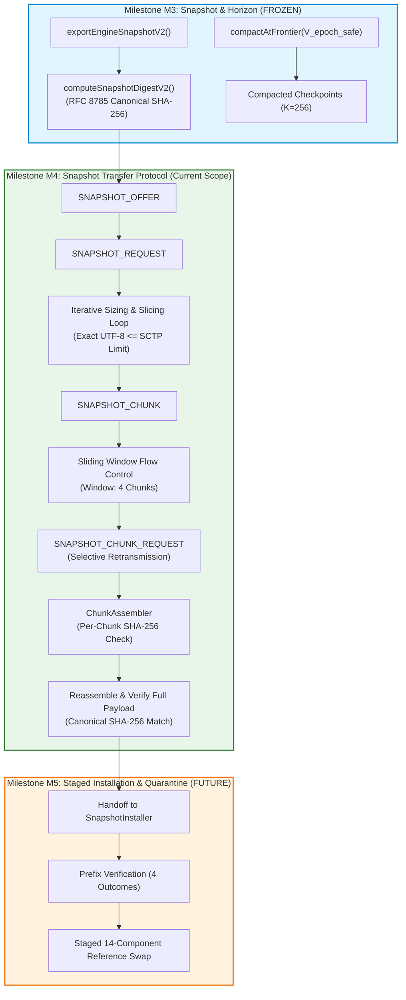
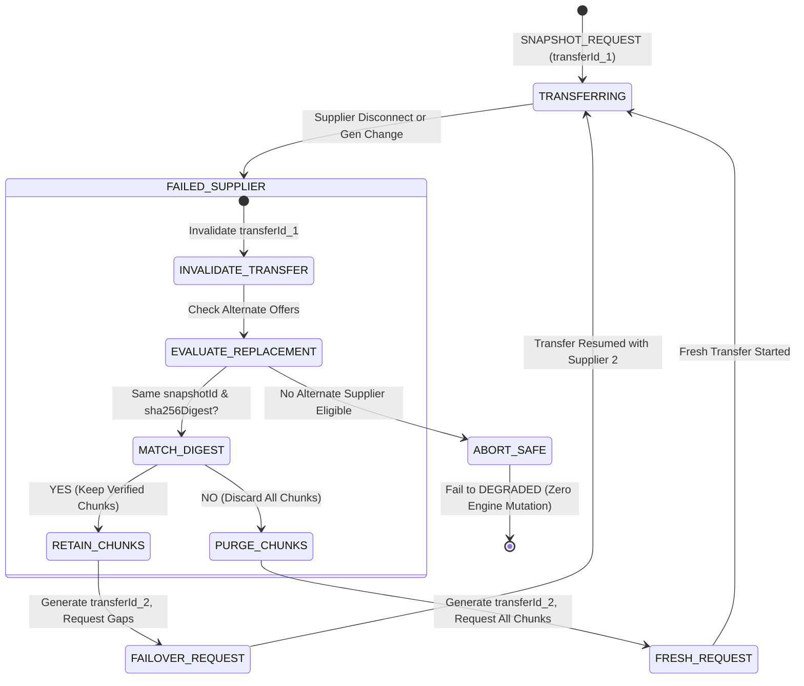

# Phase 7.5 Milestone M4 — Chunked Snapshot Transfer Architecture Specification

**Status:** APPROVED FOR PLANNING (DOCUMENTATION-ONLY)  
**Date:** 2026-11-19  
**Refinement Date:** 2026-11-19  
**Branch Baseline:** `main` at `3b90116`  
**Parent Implementation Baseline:** `6fddcf90de5d4cb0e82bd711e7e217cd570c88a4`  
**Specification Baseline:** `119da194c3feb883cfd61b6928cb81d4b200ac5d`  
**Frozen Dependencies:** Phase 7.3 (`e49b81a`), Phase 7.4 M1–M5 (`dbd5217`, `3a3d9e5`), Phase 7.5 M3 (`6fddcf9`)  

---

## 1. Executive Summary & Architectural Scope

Phase 7.5 Milestone M4 specifies the **Chunked Snapshot Transfer Protocol** for leaderless peer-to-peer state recovery across WebRTC DataChannels. When anti-entropy repair determines that missing operation history falls outside the active log compaction horizon ($V_{\text{epoch\_safe}}$), M4 provides a bounded, flow-controlled, verifiable protocol to transfer snapshots up to 4 MB across bandwidth-constrained and MTU-limited WebRTC DataChannels.

### 1.1 Strict Architectural Separation of Concerns
To guarantee modularity, mathematical safety, and strict separation between transport transfer and engine execution:
- **Milestone M3 (Completed & Frozen):** Snapshot generation, canonical RFC 8785 JSON SHA-256 digest computation, compaction horizon calculation, and checkpoint retention.
- **Milestone M4 (Current Scope):** Discovery via offers, sliding-window chunk transfer, iterative wire-size enforcement at `RTCDataChannel.send()`, chunk reassembly, and full-payload digest verification.
- **Milestone M5 (Future Scope):** Live quarantine buffer, 4-outcome prefix compatibility verification, out-of-band staged engine state construction, and atomic 14-component reference swap.
- **Milestone M6 (Future Scope):** 4-state recovery coordinator (`ACTIVE`, `RECOVERING`, `RECONCILING`, `DEGRADED`), autonomous triggers, and end-to-end integration.

**M4 Non-Scope Boundary:** M4 strictly transfers bytes and verifies cryptographic integrity. M4 **MUST NOT** install snapshots, touch `PlaybackState`, modify `OrderedOperationLog`, reseed logical clocks, drain quarantined events, or transition the engine state machine.



### 1.2 Capacity Invariant, Chunk Count Ceiling, and Upfront Admission Gate

A fundamental physical and protocol reality governs state recovery over WebRTC: individual snapshot capacity is fundamentally bound by the negotiated SCTP maximum message size of the transport link and the fixed maximum chunk count.

#### 1.2.1 Mathematical Formulation of Admission
Before allocating reassembly memory or accepting an incoming transfer offer, the protocol computes the expected chunk count:
$$\text{chunkPayloadEstimate} = \text{calculateDynamicChunkSize}(\text{effectiveLimit})$$
$$\text{requiredChunks} = \left\lceil \frac{\text{totalSizeBytes}}{\text{chunkPayloadEstimate}} \right\rceil$$

#### 1.2.2 Mandatory Capacity Invariant
$$\text{requiredChunks} \le \text{MAX\_CHUNKS\_PER\_SNAPSHOT} \quad (\text{where } \text{MAX\_CHUNKS\_PER\_SNAPSHOT} = 128)$$
$$\text{offer.totalChunks} \le \text{MAX\_CHUNKS\_PER\_SNAPSHOT} \quad (\le 128)$$

If $\text{requiredChunks} > 128$ or $\text{offer.totalChunks} > 128$, the transfer is **rejected immediately at admission** with reason `CHUNK_COUNT_EXCEEDED` or `TRANSPORT_LIMIT_EXCEEDED` before allocating any reassembly buffer or assembler structures.

#### 1.2.3 Transport-Dependent Snapshot Capacity Matrix
The protocol **does NOT claim universal 4 MiB snapshot transfer support over severely constrained 2 KiB SCTP transports**. On a 2,048-byte link, transferring a 4 MiB snapshot would require $\lceil 4,194,304 / 960 \rceil = 4,369$ chunks, vastly exceeding the 128-chunk bound. Instead, effective snapshot capacity scales with transport limits:

| Transport SCTP Limit | Envelope Overhead | Available Base64 | Chunk Payload Estimate | Max Transferable Snapshot (128 chunks) | Operational Recovery Scope |
|:---|:---:|:---:|:---:|:---:|:---|
| **65,536 B (Standard / Fallback)** | ~768 B | ~64,768 B | 32,768 B (Capped) | **4,194,304 B (4.00 MiB)** | Full 4 MiB Engine Snapshot |
| **32,768 B** | ~768 B | ~32,000 B | 24,000 B | **3,072,000 B (2.93 MiB)** | Admitted if $\le 2.93\text{ MiB}$; rejected otherwise |
| **16,384 B** | ~768 B | ~15,616 B | 11,712 B | **1,499,136 B (1.43 MiB)** | Admitted if $\le 1.43\text{ MiB}$; rejected otherwise |
| **8,192 B** | ~768 B | ~7,424 B | 5,568 B | **712,704 B (696 KiB)** | Admitted if $\le 696\text{ KiB}$; rejected otherwise |
| **2,048 B (Minimum Floor)** | ~768 B | ~1,280 B | 960 B | **122,880 B (120 KiB)** | Small snapshot / test case support only |
| **< 2,048 B** | N/A | N/A | < 256 B | **0 B (Rejected Upfront)** | Unsupported link; immediate abort |

By evaluating the admission invariant upfront, the engine never enters a deadlocked or memory-exhausted transfer state on constrained transports.

---

## 2. Snapshot Identity, Authorship, and Possession Proof

### 2.1 Disambiguation of Identifiers
A fundamental invariant of M4 is the strict separation between immutable snapshot identity and ephemeral transport transfer attempts:

| Identifier | Type & Scope | Mutability | Bound in Digest? | Definition & Semantic Purpose |
|:---|:---|:---:|:---:|:---|
| **`snapshotAuthorPeerId`** (`authorPeerId`) | Peer Identifier (string) | **Immutable** | **YES** | The peer that originally created and committed the snapshot state. Bound into `StateSnapshotPayloadV2.authorPeerId` and canonical SHA-256 digest preimage. |
| **`supplierPeerId`** | Peer Identifier (string) | **Ephemeral** | **NO** | The remote peer currently serving/forwarding chunks over an active WebRTC DataChannel. **A forwarding supplier is NEVER treated as the snapshot author.** |
| **`requesterPeerId`** | Peer Identifier (string) | **Ephemeral** | **NO** | The local peer requesting and receiving the snapshot chunks. |
| **`snapshotId`** | UUID / String | **Immutable** | **YES** | Unique identifier of the snapshot object. Bound into `StateSnapshotPayloadV2.snapshotId` and canonical SHA-256 digest preimage. |
| **`transferId`** | UUIDv4 | **Ephemeral** | **NO** | Unique identifier of a single transfer attempt between a requester and a supplier. A new `transferId` is generated on every transfer initiation and failover. |

### 2.2 Canonical Digest Binding
The cryptographic canonical digest `sha256Digest` covers exactly and only the immutable snapshot object:
- **Bound Fields (Preimage):**
  `formatVersion`, `snapshotId`, `sessionId`, `membershipEpoch`, `authorPeerId`, `snapshotFrontier`, `maxLogicalTimestamp`, `originFrontierTimestamps`, `compactedCheckpoints`, and `state`.
- **Excluded Transfer Fields:**
  `transferId`, `supplierPeerId`, `requesterPeerId`, `offerId`, `requestedChunkWindow`, `clientMaxChunkBytes`, `chunkIndex`, `totalChunks`, `chunkSizeBytes`, `chunkSha256`, and `dataBase64`.

#### 2.2.1 Verification of M3 Snapshot Digest Compatibility
To guarantee backward compatibility and prevent silent drift, the M4 design is audited directly against the frozen Milestone M3 runtime implementation at commit `6fddcf90de5d4cb0e82bd711e7e217cd570c88a4`:
- **Code Inspection Baseline:**
  - `packages/protocol/src/payloads/repair.ts` (lines 464–485, defining `StateSnapshotPayloadV2Schema`).
  - `packages/sync-engine/src/snapshot.ts` (lines 170–240, defining `computeSnapshotDigestV2`).
- **Conclusive Field Existence Verification:**
  1. `snapshotId`: **Already exists** in M3 schema (`z.string().min(1).max(128)`) and M3 canonical preimage.
  2. `authorPeerId`: **Already exists** in M3 schema (`z.string().min(1).max(64)`) and M3 canonical preimage.
  3. `originFrontierTimestamps`: **Already exists** in M3 schema (`z.record(...)`) and M3 canonical preimage.
  4. `compactedCheckpoints`: **Already exists** in M3 schema (`z.record(..., z.record(..., CompactedCheckpointSchema))`) and M3 canonical preimage.
- **Protocol Invariant:**
  Milestone M4 introduces **ZERO** schema modifications to `StateSnapshotPayloadV2`, **ZERO** modifications to `computeSnapshotDigestV2`, and **NO** format version bump (`formatVersion: 2` remains frozen). No old-snapshot migration shims or preimage re-negotiations are needed because M3 already committed to this exact structure.
- **Identity Distinction:**
  `authorPeerId` is the immutable author peer who generated the snapshot from committed engine state. `supplierPeerId` in `SNAPSHOT_OFFER` is the transport supplier serving the chunks over a WebRTC DataChannel. A forwarding supplier is never treated as the author, and changing suppliers mid-stream does not invalidate the canonical digest.

### 2.3 Supplier Possession Proof
An advertised `SNAPSHOT_OFFER` is merely an untrusted claim. A supplier demonstrates true possession of the advertised snapshot through verifiable execution:
1. **Initial Proof in Chunk 0:** The supplier must deliver chunk 0 containing valid Base64 data that decodes to raw bytes matching `chunkSha256`.
2. **Deterministic Slicing Proof:** The supplier slices the snapshot deterministically from its local buffer.
3. **Cryptographic Full-Payload Proof:** When all chunks are assembled, the reconstructed binary payload must decode as UTF-8 JSON matching `StateSnapshotPayloadV2Schema`, and its canonical RFC 8785 JSON SHA-256 digest must match `offer.sha256Digest` bit-exact.
4. **Failure to Prove Possession:** If a supplier emits invalid chunks, fails chunk SHA-256 verification, or fails full-payload digest verification, it is flagged as failing possession proof. The transfer aborts immediately with `CHUNK_CORRUPTED` or `HASH_MISMATCH`, and the supplier is blacklisted for failover selection during the active epoch.

---

## 3. Supplier Failover Lifecycle & Chunk Retention

When network conditions degrade or peers disconnect, transfer continuity is preserved without compromising safety:



### 3.1 Invalidation of Active Transfer Attempt
- If the current supplier disconnects (`PeerManager` status `DISCONNECTED`, `CLOSED`, `FAILED`) or increments its connection generation (`oldGen !== newGen`):
  - The current `transferId` becomes immediately **invalid**.
  - All pending timers and in-flight chunk requests for that `transferId` are cancelled.

### 3.2 Verified Chunk Retention Rule
Already received and verified chunks in `ChunkAssembler` may be retained **if and only if**:
$$\text{offer}_{\text{new}}.\text{snapshotId} === \text{offer}_{\text{active}}.\text{snapshotId} \quad \land \quad \text{offer}_{\text{new}}.\text{sha256Digest} === \text{offer}_{\text{active}}.\text{sha256Digest}$$
- **Exact Match:** Chunks $0 \dots k$ already verified against their `chunkSha256` remain valid. The requester issues `SNAPSHOT_REQUEST` with a new `transferId` and `missingChunkIndices = assembler.getMissingChunkIndices()`.
- **Mismatch (Different Snapshot):** If the replacement supplier offers a different snapshot ID or digest, **all previously received chunks are purged immediately**. Mixing chunks from different snapshot identities is mathematically forbidden.
- **No Eligible Supplier:** If no replacement supplier is available, the transfer terminates cleanly with `SUPPLIER_DISCONNECTED`, leaving active engine state 100% untouched.

---

## 4. Chunk Ingestion, Duplicate Handling, and Corruption Detection

`ChunkAssembler` enforces strict validation rules on every received `SNAPSHOT_CHUNK`:

### 4.1 Ingestion Matrix
1. **Transfer ID Fencing:**
   - If `chunk.transferId !== activeTransfer.transferId`: **Discard silently**. Late chunks from previous attempts or cancelled transfers are dropped with zero side effects.
2. **Epoch and Generation Fencing:**
   - If `chunk.membershipEpoch !== activeEpoch` or supplier generation has changed: **Reject immediately**.
3. **Identical Duplicate Chunk:**
   - If `assembler.hasChunk(chunk.chunkIndex)` is true:
     - Check `chunk.chunkSha256 === existing.chunkSha256`.
     - If identical: **Idempotently ignore**. Do not re-verify Base64, do not re-insert, do not increment received byte count. Memory is strictly bounded.
4. **Index Collision / Corrupt Chunk (Same Index, Different Content):**
   - If `assembler.hasChunk(chunk.chunkIndex)` is true but `chunk.chunkSha256 !== existing.chunkSha256`, or if `sha256(decode(chunk.dataBase64)) !== chunk.chunkSha256`:
     - **Immediate Abort:** Terminate transfer with reason `CHUNK_CORRUPTED`.
     - Emit `SNAPSHOT_ABORT` to supplier.
5. **Missing Chunk Index Validation:**
   - Any `SNAPSHOT_CHUNK_REQUEST` issued must validate that:
     - Every index $i$ satisfies $0 \le i < \text{totalChunks} \le 128$.
     - Indices are unique (deduplicated).
     - Array length $\le \text{MAX\_CONCURRENT\_CHUNK\_REQUESTS} = 4$.

---

## 5. Retry, Timeout Budgets, and Cancellation Lifecycle

Snapshot transfer relies on dual-level bounded retry and deadline policies to prevent infinite transfer loops:

```
+---------------------------------------------------------------------------------------------+
|                               OVERALL TRANSFER DEADLINE (60s)                               |
|                                                                                             |
|  +--------------------+  +--------------------+  +--------------------+                     |
|  | Chunk 0..3 Window  |  | Chunk 4..7 Window  |  | Chunk Retries (<=3)| ... (Total Retries) |
|  | Timeout: 5,000ms   |  | Timeout: 5,000ms   |  | Max 3 per chunk    |     Max 10 / transfer
|  +--------------------+  +--------------------+  +--------------------+                     |
+---------------------------------------------------------------------------------------------+
```

### 5.1 Retry and Timeout Specifications
- **Per-Chunk Retry Limit (`MAX_CHUNK_RETRIES = 3`):**
  - If a specific chunk index fails hash verification or times out, it may be re-requested up to 3 times.
  - Exceeding 3 retries for any single chunk triggers immediate transfer abort (`TRANSFER_TIMEOUT`).
- **Total Transfer Retransmission Budget (`MAX_TRANSFER_RETRIES = 10`):**
  - Across the entire transfer (up to 128 chunks), at most 10 cumulative retransmissions are permitted.
  - Exceeding 10 cumulative retries indicates an unviable transport link and terminates the transfer.
- **Per-Chunk Request Timer (`CHUNK_REQUEST_TIMEOUT_MS = 5000ms`):**
  - Timer resets upon the arrival and validation of any missing chunk in the active window.
  - If no chunk arrives within 5,000ms, a `SNAPSHOT_CHUNK_REQUEST` is re-issued for pending missing indices.
- **Overall Transfer Deadline (`OVERALL_TRANSFER_TIMEOUT_MS = 60000ms`):**
  - An absolute wall-clock deadline of 60 seconds is started at transfer initiation.
  - If the transfer is not complete within 60 seconds, it is unconditionally aborted with `TRANSFER_TIMEOUT`.

### 5.2 Cancellation and Late Chunks
- Upon receiving or sending `SNAPSHOT_ABORT`:
  - Active timers (`overallTimeout`, `chunkTimeout`) are cleared immediately.
  - `ChunkAssembler` memory is cleared.
  - Active `transferId` is unregistered.
  - Late chunks arriving after abort are dropped at the transport boundary without memory allocation.

---

## 6. Normative Iterative Sizing, Termination Proof, and Send Boundary

### 6.1 Source of Negotiated SCTP Maximum Message Size & Fallback Policy
WebRTC DataChannel message capacity is negotiated during the WebRTC SCTP handshake (`RTCSctpTransport.maxMessageSize`).

1. **Production Retrieval Path:**
   - The production transport retrieval path is `PeerManager.getSctpMaxMessageSize(peerId)`.
   - This method inspects the underlying active `WebRtcTransport.sctpMaxMessageSize`, which queries `(this.peerConnection as any).sctp?.maxMessageSize`.
2. **Missing or Invalid Value Handling & Fallback Policy:**
   - If `sctpMaxMessageSize` is `undefined`, `null`, $\le 0$, or non-finite (`NaN` or `Infinity`), the transport adopts a conservative fallback of `65,536` bytes (`MAX_MESSAGE_BYTES`).
   - **Crucial Clarification:** This fallback of 65,536 bytes is **strictly a conservative local implementation policy cap** in SyncPlay for outbound framing. It is **NOT** an RFC 8831 guarantee. RFC 8831 does not specify 64 KB as a universal default or minimum; WebRTC implementations negotiate SCTP message limits based on remote endpoint SCTP receive buffers (often 64 KB, 256 KB, or larger). SyncPlay deliberately chooses 65,536 bytes as a safe, conservative local outbound ceiling.
3. **Relationship Between Effective Limit and Application Cap:**
   - The effective wire limit is strictly bounded by the application-level framing cap:
     $$\text{effectiveLimit} = \min(\text{sctpMaxMessageSize} \mathbin{??} 65536, 65536)$$
   - Even if the underlying SCTP transport reports a larger negotiated limit (e.g. 262,144 bytes / 256 KB), SyncPlay's application framing policy caps individual protocol messages at 65,536 bytes to avoid data channel buffer bloat and head-of-line blocking.
4. **Meaning of the 2,048-Byte Minimum (`MIN_SUPPORTED_SCTP_LIMIT = 2048`):**
   - The protocol envelope (Base64 encoding expansion, JSON field keys, UUIDs, signatures, hash hex strings) requires $\approx 768$ bytes (`CHUNK_ENVELOPE_BUDGET_BYTES`).
   - If a negotiated SCTP limit is $< 2,048$ bytes, the remaining payload budget falls below viable operational thresholds ($< 960$ bytes), and if it drops further, chunks drop below `MIN_CHUNK_BYTES = 256`, which would cause fragmentation failure.
   - Any transport reporting an SCTP limit $< 2,048$ bytes cannot support chunked snapshot transfer; the transfer is immediately rejected/aborted upfront with `TRANSPORT_LIMIT_EXCEEDED`.
5. **Exact Send Boundary Invariant:**
   - The complete `ProtocolMessage` is serialized to JSON string exactly once per sizing iteration.
   - The UTF-8 byte length is calculated from that exact serialized string using `new TextEncoder().encode(serializedString).byteLength`.
   - The identical string that was measured and verified to be $\le \text{effectiveLimit}$ is passed unchanged to `PeerManager.sendSerialized()` and `RTCDataChannel.send()`.

### 6.2 Mathematical Proof of Termination and Operational Iteration Bound
Let $B_k$ be the binary slice size (in bytes) at iteration $k \ge 0$, and let $L_k$ be the exact UTF-8 byte length of `JSON.stringify(protocolMessage)`.

1. **Overshoot Definition:** If $L_k > \text{effectiveLimit}$, the overshoot is:
   $$O_k = L_k - \text{effectiveLimit} \ge 1$$
2. **Binary Reduction Step:** The algorithm reduces the binary slice by:
   $$\Delta_k = \left\lceil O_k \times \frac{3}{4} \right\rceil + 32$$
   Since $O_k \ge 1$, $\Delta_k \ge \lceil 0.75 \rceil + 32 = 33 \text{ bytes}$.
3. **Strict Monotonic Decrease:**
   $$B_{k+1} = B_k - \Delta_k \le B_k - 33$$
4. **Finite Mathematical Bound:**
   The initial binary slice is bounded: $B_0 \le \text{MAX\_CHUNK\_BYTES} = 32,768 \text{ bytes}$.
   In each unsuccessful iteration, $B$ decreases by at least 33 bytes. Therefore, the loop is mathematically proven to terminate in at most:
   $$k_{\text{theoretical}} = \left\lceil \frac{32,768}{33} \right\rceil = 993 \text{ iterations}$$
5. **Hard Operational Bound (`MAX_SIZING_ITERATIONS = 5`):**
   - In practice, because Base64 expands binary bytes by $4/3$ and envelope keys are static, $\lceil O_k \times 0.75 \rceil + 32$ compensates for overshoot with margin; convergence occurs in 1 or 2 iterations.
   - To eliminate any possibility of CPU spinning under pathological string encoding or envelope inflation edge cases, a strict operational limit is enforced:
     $$K_{\text{max}} = 5 \text{ attempts per chunk}$$
   - If after 5 iterations ($k \ge 5$) the serialized message still exceeds $\text{effectiveLimit}$, the sizing loop halts immediately and cleanly aborts the transfer with `TRANSPORT_LIMIT_EXCEEDED`.
6. **Terminal Exit Conditions:**
   - **Condition 1 (Success):** $L_k \le \text{effectiveLimit} \implies$ message is accepted and passed to transport.
   - **Condition 2 (Minimum Chunk Floor):** $B_k < \text{MIN\_CHUNK\_BYTES} = 256 \implies$ loop halts, transfer cleanly aborts with `TRANSPORT_LIMIT_EXCEEDED`.
   - **Condition 3 (Operational Iteration Cap):** $k \ge \text{MAX\_SIZING\_ITERATIONS} = 5 \implies$ loop halts, transfer cleanly aborts with `TRANSPORT_LIMIT_EXCEEDED`.
   - In all failure conditions, zero corrupted frames are transmitted, and the transfer aborts safely without mutating engine state.

---

## 7. Memory and Resource Budget

A 4 MB snapshot does **not** equate to an 8.5 MB memory budget. Serialized Base64, raw binary arrays, V8 string heap allocations, parsed object graphs, and cryptographic verification staging create significant memory expansion that must be conservatively bounded:

```
+----------------------------------------------------------------------------------------------------+
|                                RECOVERY MEMORY & RESOURCE BUDGET                                   |
+----------------------------------------------------------------------------------------------------+
| Max Raw Snapshot Payload Bytes       | 4 MB (4,194,304 bytes)                                      |
| Max Decoded Contiguous Binary Bytes   | 4 MB (4,194,304 bytes)                                      |
| Max Base64 Encoded Wire Size (Chunk) | ~43,692 bytes (~44 KB)                                      |
| Max Chunk Count per Snapshot         | 128 chunks (MAX_CHUNKS_PER_SNAPSHOT)                        |
| Max In-Flight Concurrency Window     | 4 chunks (MAX_CONCURRENT_CHUNK_REQUESTS)                    |
| Max Concurrent Transfers (Requester) | 1 active inbound transfer                                   |
| Max Concurrent Transfers (Supplier)  | 2 active outbound transfers                                 |
| Theoretical Peak Transient Memory    | ~28–32 MB (Full V8 heap, object tree, strings & crypto)     |
| Post-Transfer Retained Memory        | 0 MB (All buffers and timers dereferenced upon handoff)     |
+----------------------------------------------------------------------------------------------------+
```

### 7.1 Detailed Theoretical Memory Budget Breakdown (Max 4 MiB Snapshot)
The previous claim of an 8.5 MB peak only accounted for raw binary typed arrays, omitting JavaScript engine (V8) internal representations. Under worst-case simultaneous residency during reassembly, parsing, and canonical hashing:

1. **Sparse Decoded Binary Slices:** Up to 128 `Uint8Array` chunk slices stored during transfer: **4.0 MiB**.
2. **Contiguous Assembled Binary Buffer:** Single concatenated `Uint8Array` of length `totalSizeBytes`: **4.0 MiB**.
3. **In-Flight Base64 Strings:** Up to 4 chunks in active window $\times \approx 44\text{ KB}$: **~0.2 MiB**.
4. **Decoded JSON String in V8 Heap:** Result of `TextDecoder.decode()` (Latin-1 / UTF-16 representation in V8): **4.0–8.0 MiB**.
5. **Parsed `StateSnapshotPayloadV2` Object Graph:** V8 heap shapes, property backing stores, maps for `state`, `snapshotFrontier`, `originFrontierTimestamps`, and `compactedCheckpoints` (typically 1.5–2.0x serialized JSON): **6.0–8.0 MiB**.
6. **Canonical RFC 8785 JSON String:** Deterministic serialization string generated for SHA-256 digest verification: **~4.0 MiB**.
7. **Canonical UTF-8 Encoding Buffer:** Encoded byte buffer (`TextEncoder.encode()`) for hash calculation: **~4.0 MiB**.
8. **Transient Allocations:** Parser tokens, crypto hashing context buffers, intermediate string slices: **2.0–4.0 MiB**.

$$\mathbf{\text{Theoretical Upper Bound}} \approx 4.0 + 4.0 + 0.2 + 8.0 + 8.0 + 4.0 + 4.0 + 4.0 \approx \mathbf{32.2\text{ MiB}}$$

- **Theoretical Bound vs Implementation-Measured Peak:**
  The **~28–32 MiB** envelope represents the conservative theoretical upper bound under worst-case simultaneous residency. The actual implementation-measured peak heap usage is expected to be substantially lower (approx. 16–22 MiB) due to copy-minimizing lifecycle management, and will be measured empirically during M4 test suite benchmarks.

### 7.2 Copy-Minimizing Architecture
To maintain memory consumption well below the theoretical ceiling:
1. **Immediate Sparse Slice Dereferencing:**
   In `ChunkAssembler.finalizeAssembly()`, as soon as the contiguous `Uint8Array` is assembled from the sparse slices, `this.chunks = null` is set immediately. This drops the 4 MiB sparse array references *before* UTF-8 decoding and JSON parsing commence, preventing cumulative holding of sparse and contiguous buffers.
2. **Direct Single-Pass Decoding:**
   The contiguous `Uint8Array` is passed directly to `new TextDecoder('utf-8', { fatal: true }).decode()` without intermediate buffer cloning or slicing.
3. **Streamlined Digest Verification:**
   Canonical JSON string is encoded directly to UTF-8 bytes and streamed to SHA-256 without retaining auxiliary intermediate string fragments.

### 7.3 Explicit Disposal & Memory Dereferencing Requirements
- **Disposal Scope:** On transfer completion, timeout, cancellation (`SNAPSHOT_ABORT`), or epoch change:
  - `ChunkAssembler.dispose()` explicitly sets `this.chunks = null`, `this.assembledBuffer = null`, and `this.receivedIndices = null`.
  - `SnapshotTransferManager.dispose()` clears all active transfer descriptors, progress state, retry maps, and unregisters all peer event listeners.
  - All active timers (`overallTimeout`, `chunkTimeout`) are cancelled via `clearTimeout()`.
- **Asynchronous Garbage Collection Reality:**
  The specification explicitly documents that **JavaScript garbage collection is non-deterministic and asynchronous**. The runtime environment does not provide synchronous memory deallocation. Nullifying all references and clearing timers guarantees that all allocated structures become immediately eligible for V8 garbage collection (scavenge and mark-sweep-compact cycles), preventing lingering memory leaks.

---

## 8. Resolution of Mandatory M3 Audit Limitations

### 8.1 Limitation A: `STATE_DIGEST` Transport Identity Binding
- **Correction:** In `TrustedTransportAdapter`, verify `msg.payload.senderPeerId === inbound.fromPeerId` and `msg.payload.connectionGeneration === peerStatus.generation`. Mismatches are dropped.
- **Implementation Milestone:** **M4.0a (Prerequisite)**.

### 8.2 Limitation B: Exact Historical Timestamp Lookup
- **Correction:** `OrderedOperationLog.getOriginFrontierTimestamps()` is constrained to exact sequence lookups in `originSeqIndex` and `compactedCheckpoints`. Loose fallback to non-sequence-specific tracker is removed. Unresolvable sequences return `null`.
- **Implementation Milestone:** **M4.0b (Prerequisite)**.

### 8.3 Limitation C: Compaction Exception Atomicity (M4.0d Staged Mutation Inventory)
A documented non-throwing contract is insufficient to ensure transactional safety during log compaction. If the state reducer throws while compacting operations forward into the base snapshot, any partially updated data structures would leave the sync engine in a permanently corrupt state.

#### 8.3.1 Complete Staged Mutation Inventory
In `OrderedOperationLog.compactAtFrontier(stableFrontier)`, all modifications are performed out-of-band on a staged candidate set before any active engine reference is modified:

1. **Candidate `baseSnapshot`:** A deep clone of the current base snapshot (`structuredClone(this.baseSnapshot)`). Operations strictly older than or equal to `stableFrontier` are reduced into this candidate clone via `this.reducer(candidateBaseSnapshot, op)`.
2. **Candidate `operations` Array:** A shallow slice/copy containing only the retained operations strictly newer than `stableFrontier`.
3. **Candidate `idIndex`:** A newly constructed `Map<string, number>` indexing only the retained operations in the candidate `operations` array.
4. **Candidate `originSeqIndex`:** A newly constructed `Map<string, number>` indexing `originPeerId:sequenceNumber` for retained operations only.
5. **Candidate `compactedCheckpoints`:** A cloned `Map<string, Map<number, CompactedCheckpoint>>` retaining historical checkpoints at $K=256$ intervals up to the compaction horizon.
6. **Candidate `originFrontierTimestamps`:** A newly constructed `Map<string, number>` recording the exact sequence timestamps of the compacted operations at the frontier.
7. **Candidate `baseSnapshotFrontier`:** An updated replication vector record reflecting the exact causal frontier of the candidate base snapshot.
8. **Candidate Sequence Metadata:** Cloned and updated sequence boundary tracking variables (e.g. `firstRetainedSequence`, `minRetainedSequenceNumber`).

#### 8.3.2 Atomicity Invariant and Exception Rollback
- **No Mutation Before Validation:** Zero active state structures, indexes, arrays, or references are modified until all operations in the pruned range have been reduced into the candidate base snapshot without error, and all candidate metadata structures have been computed and validated.
- **Exception Rollback Guarantee:** If `this.reducer` throws an exception at any point during candidate reduction, or if any candidate validation fails, the candidate objects are discarded, the exception is propagated to the caller, and `this.baseSnapshot`, `this.operations`, `this.idIndex`, `this.originSeqIndex`, `this.compactedCheckpoints`, `this.originFrontierTimestamps`, and `this.baseSnapshotFrontier` remain 100% untouched.
- **Implementation Milestone:** **M4.0d (Prerequisite)**.

---

## 9. Strict M4 to M5 Handoff Boundary

M4 delivers verified snapshot bytes and parsed payload across the milestone boundary:

```typescript
export interface SnapshotTransferResult {
  readonly transferId: string;
  readonly snapshotId: string;
  readonly supplierPeerId: string;
  readonly membershipEpoch: number;
  readonly payload: StateSnapshotPayloadV2;
  readonly rawBytes: Uint8Array;
  readonly sha256Digest: string;
}

export type SnapshotTransferHandoffCallback = (
  result: SnapshotTransferResult
) => Promise<void> | void;
```

**M5 Invariant:** The receiving component in M5 is responsible for out-of-band staged engine state replacement, prefix compatibility verification across the 4 outcomes, clock reseeding, and quarantine buffer draining. M4 remains 100% isolated from engine execution.
