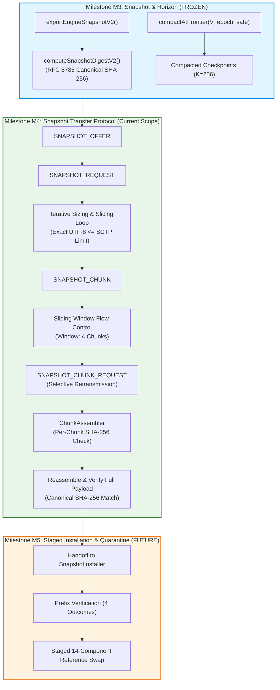
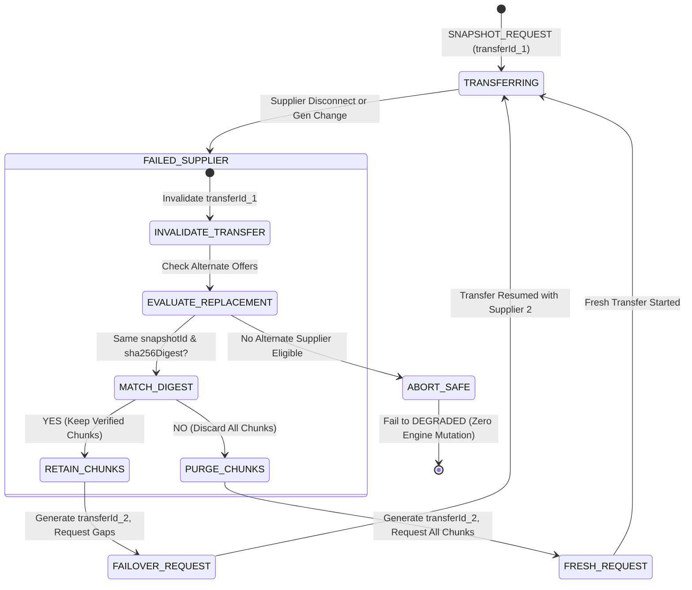

# Phase 7.5 Milestone M4 — Chunked Snapshot Transfer Architecture Specification

**Status:** APPROVED FOR PLANNING (DOCUMENTATION-ONLY)  
**Date:** 2026-11-19  
**Refinement Date:** 2026-11-19  
**Branch Baseline:** `main` at `3b90116`  
**Parent Implementation Baseline:** `6fddcf90de5d4cb0e82bd711e7e217cd570c88a4`  
**Specification Baseline:** `119da194c3feb883cfd61b6928cb81d4b200ac5d`  
**Frozen Dependencies:** Phase 7.3 (`e49b81a`), Phase 7.4 M1–M5 (`dbd5217`, `3a3d9e5`), Phase 7.5 M3 (`6fddcf9`)  

---

## 1. Executive Summary & Architectural Scope

Phase 7.5 Milestone M4 specifies the **Chunked Snapshot Transfer Protocol** for leaderless peer-to-peer state recovery across WebRTC DataChannels. When anti-entropy repair determines that missing operation history falls outside the active log compaction horizon ($V_{\text{epoch\_safe}}$), M4 provides a bounded, flow-controlled, verifiable protocol to transfer snapshots up to 4 MB across bandwidth-constrained and MTU-limited WebRTC DataChannels.

### 1.1 Strict Architectural Separation of Concerns
To guarantee modularity, mathematical safety, and strict separation between transport transfer and engine execution:
- **Milestone M3 (Completed & Frozen):** Snapshot generation, canonical RFC 8785 JSON SHA-256 digest computation, compaction horizon calculation, and checkpoint retention.
- **Milestone M4 (Current Scope):** Discovery via offers, sliding-window chunk transfer, iterative wire-size enforcement at `RTCDataChannel.send()`, chunk reassembly, and full-payload digest verification.
- **Milestone M5 (Future Scope):** Live quarantine buffer, 4-outcome prefix compatibility verification, out-of-band staged engine state construction, and atomic 14-component reference swap.
- **Milestone M6 (Future Scope):** 4-state recovery coordinator (`ACTIVE`, `RECOVERING`, `RECONCILING`, `DEGRADED`), autonomous triggers, and end-to-end integration.

**M4 Non-Scope Boundary:** M4 strictly transfers bytes and verifies cryptographic integrity. M4 **MUST NOT** install snapshots, touch `PlaybackState`, modify `OrderedOperationLog`, reseed logical clocks, drain quarantined events, or transition the engine state machine.



---

## 2. Snapshot Identity, Authorship, and Possession Proof

### 2.1 Disambiguation of Identifiers
A fundamental invariant of M4 is the strict separation between immutable snapshot identity and ephemeral transport transfer attempts:

| Identifier | Type & Scope | Mutability | Bound in Digest? | Definition & Semantic Purpose |
|:---|:---|:---:|:---:|:---|
| **`snapshotAuthorPeerId`** (`authorPeerId`) | Peer Identifier (string) | **Immutable** | **YES** | The peer that originally created and committed the snapshot state. Bound into `StateSnapshotPayloadV2.authorPeerId` and canonical SHA-256 digest preimage. |
| **`supplierPeerId`** | Peer Identifier (string) | **Ephemeral** | **NO** | The remote peer currently serving/forwarding chunks over an active WebRTC DataChannel. **A forwarding supplier is NEVER treated as the snapshot author.** |
| **`requesterPeerId`** | Peer Identifier (string) | **Ephemeral** | **NO** | The local peer requesting and receiving the snapshot chunks. |
| **`snapshotId`** | UUID / String | **Immutable** | **YES** | Unique identifier of the snapshot object. Bound into `StateSnapshotPayloadV2.snapshotId` and canonical SHA-256 digest preimage. |
| **`transferId`** | UUIDv4 | **Ephemeral** | **NO** | Unique identifier of a single transfer attempt between a requester and a supplier. A new `transferId` is generated on every transfer initiation and failover. |

### 2.2 Canonical Digest Binding
The cryptographic canonical digest `sha256Digest` covers exactly and only the immutable snapshot object:
- **Bound Fields (Preimage):**
  `formatVersion`, `snapshotId`, `sessionId`, `membershipEpoch`, `authorPeerId`, `snapshotFrontier`, `maxLogicalTimestamp`, `originFrontierTimestamps`, `compactedCheckpoints`, and `state`.
- **Excluded Transfer Fields:**
  `transferId`, `supplierPeerId`, `requesterPeerId`, `offerId`, `requestedChunkWindow`, `clientMaxChunkBytes`, `chunkIndex`, `totalChunks`, `chunkSizeBytes`, `chunkSha256`, and `dataBase64`.

### 2.3 Supplier Possession Proof
An advertised `SNAPSHOT_OFFER` is merely an untrusted claim. A supplier demonstrates true possession of the advertised snapshot through verifiable execution:
1. **Initial Proof in Chunk 0:** The supplier must deliver chunk 0 containing valid Base64 data that decodes to raw bytes matching `chunkSha256`.
2. **Deterministic Slicing Proof:** The supplier slices the snapshot deterministically from its local buffer.
3. **Cryptographic Full-Payload Proof:** When all chunks are assembled, the reconstructed binary payload must decode as UTF-8 JSON matching `StateSnapshotPayloadV2Schema`, and its canonical RFC 8785 JSON SHA-256 digest must match `offer.sha256Digest` bit-exact.
4. **Failure to Prove Possession:** If a supplier emits invalid chunks, fails chunk SHA-256 verification, or fails full-payload digest verification, it is flagged as failing possession proof. The transfer aborts immediately with `CHUNK_CORRUPTED` or `HASH_MISMATCH`, and the supplier is blacklisted for failover selection during the active epoch.

---

## 3. Supplier Failover Lifecycle & Chunk Retention

When network conditions degrade or peers disconnect, transfer continuity is preserved without compromising safety:



### 3.1 Invalidation of Active Transfer Attempt
- If the current supplier disconnects (`PeerManager` status `DISCONNECTED`, `CLOSED`, `FAILED`) or increments its connection generation (`oldGen !== newGen`):
  - The current `transferId` becomes immediately **invalid**.
  - All pending timers and in-flight chunk requests for that `transferId` are cancelled.

### 3.2 Verified Chunk Retention Rule
Already received and verified chunks in `ChunkAssembler` may be retained **if and only if**:
$$\text{offer}_{\text{new}}.\text{snapshotId} === \text{offer}_{\text{active}}.\text{snapshotId} \quad \land \quad \text{offer}_{\text{new}}.\text{sha256Digest} === \text{offer}_{\text{active}}.\text{sha256Digest}$$
- **Exact Match:** Chunks $0 \dots k$ already verified against their `chunkSha256` remain valid. The requester issues `SNAPSHOT_REQUEST` with a new `transferId` and `missingChunkIndices = assembler.getMissingChunkIndices()`.
- **Mismatch (Different Snapshot):** If the replacement supplier offers a different snapshot ID or digest, **all previously received chunks are purged immediately**. Mixing chunks from different snapshot identities is mathematically forbidden.
- **No Eligible Supplier:** If no replacement supplier is available, the transfer terminates cleanly with `SUPPLIER_DISCONNECTED`, leaving active engine state 100% untouched.

---

## 4. Chunk Ingestion, Duplicate Handling, and Corruption Detection

`ChunkAssembler` enforces strict validation rules on every received `SNAPSHOT_CHUNK`:

### 4.1 Ingestion Matrix
1. **Transfer ID Fencing:**
   - If `chunk.transferId !== activeTransfer.transferId`: **Discard silently**. Late chunks from previous attempts or cancelled transfers are dropped with zero side effects.
2. **Epoch and Generation Fencing:**
   - If `chunk.membershipEpoch !== activeEpoch` or supplier generation has changed: **Reject immediately**.
3. **Identical Duplicate Chunk:**
   - If `assembler.hasChunk(chunk.chunkIndex)` is true:
     - Check `chunk.chunkSha256 === existing.chunkSha256`.
     - If identical: **Idempotently ignore**. Do not re-verify Base64, do not re-insert, do not increment received byte count. Memory is strictly bounded.
4. **Index Collision / Corrupt Chunk (Same Index, Different Content):**
   - If `assembler.hasChunk(chunk.chunkIndex)` is true but `chunk.chunkSha256 !== existing.chunkSha256`, or if `sha256(decode(chunk.dataBase64)) !== chunk.chunkSha256`:
     - **Immediate Abort:** Terminate transfer with reason `CHUNK_CORRUPTED`.
     - Emit `SNAPSHOT_ABORT` to supplier.
5. **Missing Chunk Index Validation:**
   - Any `SNAPSHOT_CHUNK_REQUEST` issued must validate that:
     - Every index $i$ satisfies $0 \le i < \text{totalChunks} \le 128$.
     - Indices are unique (deduplicated).
     - Array length $\le \text{MAX\_CONCURRENT\_CHUNK\_REQUESTS} = 4$.

---

## 5. Retry, Timeout Budgets, and Cancellation Lifecycle

Snapshot transfer relies on dual-level bounded retry and deadline policies to prevent infinite transfer loops:

```
+---------------------------------------------------------------------------------------------+
|                               OVERALL TRANSFER DEADLINE (60s)                               |
|                                                                                             |
|  +--------------------+  +--------------------+  +--------------------+                     |
|  | Chunk 0..3 Window  |  | Chunk 4..7 Window  |  | Chunk Retries (<=3)| ... (Total Retries) |
|  | Timeout: 5,000ms   |  | Timeout: 5,000ms   |  | Max 3 per chunk    |     Max 10 / transfer
|  +--------------------+  +--------------------+  +--------------------+                     |
+---------------------------------------------------------------------------------------------+
```

### 5.1 Retry and Timeout Specifications
- **Per-Chunk Retry Limit (`MAX_CHUNK_RETRIES = 3`):**
  - If a specific chunk index fails hash verification or times out, it may be re-requested up to 3 times.
  - Exceeding 3 retries for any single chunk triggers immediate transfer abort (`TRANSFER_TIMEOUT`).
- **Total Transfer Retransmission Budget (`MAX_TRANSFER_RETRIES = 10`):**
  - Across the entire transfer (up to 128 chunks), at most 10 cumulative retransmissions are permitted.
  - Exceeding 10 cumulative retries indicates an unviable transport link and terminates the transfer.
- **Per-Chunk Request Timer (`CHUNK_REQUEST_TIMEOUT_MS = 5000ms`):**
  - Timer resets upon the arrival and validation of any missing chunk in the active window.
  - If no chunk arrives within 5,000ms, a `SNAPSHOT_CHUNK_REQUEST` is re-issued for pending missing indices.
- **Overall Transfer Deadline (`OVERALL_TRANSFER_TIMEOUT_MS = 60000ms`):**
  - An absolute wall-clock deadline of 60 seconds is started at transfer initiation.
  - If the transfer is not complete within 60 seconds, it is unconditionally aborted with `TRANSFER_TIMEOUT`.

### 5.2 Cancellation and Late Chunks
- Upon receiving or sending `SNAPSHOT_ABORT`:
  - Active timers (`overallTimeout`, `chunkTimeout`) are cleared immediately.
  - `ChunkAssembler` memory is cleared.
  - Active `transferId` is unregistered.
  - Late chunks arriving after abort are dropped at the transport boundary without memory allocation.

---

## 6. Normative Iterative Sizing, Termination Proof, and Send Boundary

### 6.1 Source of Negotiated SCTP Maximum Message Size
- WebRTC DataChannel message capacity is negotiated during the WebRTC SCTP handshake (`RTCDataChannel.maxMessageSize`).
- **Transport Boundary Retrieval:**
  `PeerManager.getPeerMaxMessageSize(peerId)` returns the actual negotiated limit.
- **Safe Fallback Policy:**
  - If `maxMessageSize` is undefined, null, $\le 0$, or non-finite: default to `65536` bytes (RFC 8831 standard).
  - If `effectiveLimit < MIN_SUPPORTED_SCTP_LIMIT = 2048` bytes: abort immediately with `TRANSPORT_LIMIT_EXCEEDED` before attempting transfer.

### 6.2 Mathematical Proof of Termination for Sizing Loop
Let $B_k$ be the binary slice size (in bytes) at iteration $k \ge 0$, and let $L_k$ be the exact UTF-8 byte length of `JSON.stringify(protocolMessage)`.

1. **Overshoot Definition:** If $L_k > \text{effectiveLimit}$, the overshoot is:
   $$O_k = L_k - \text{effectiveLimit} \ge 1$$
2. **Binary Reduction Step:** The algorithm reduces the binary slice by:
   $$\Delta_k = \left\lceil O_k \times \frac{3}{4} \right\rceil + 32$$
   Since $O_k \ge 1$, $\Delta_k \ge \lceil 0.75 \rceil + 32 = 33 \text{ bytes}$.
3. **Strict Monotonic Decrease:**
   $$B_{k+1} = B_k - \Delta_k \le B_k - 33$$
4. **Finite Bound and Termination:**
   The initial binary slice is bounded: $B_0 \le \text{MAX\_CHUNK\_BYTES} = 32,768 \text{ bytes}$.
   In each unsuccessful iteration, $B$ decreases by at least 33 bytes. Therefore, the loop terminates in at most:
   $$k_{\text{max}} = \left\lceil \frac{32,768}{33} \right\rceil = 993 \text{ iterations}$$
   (In practice, due to Base64's exact 4/3 expansion ratio plus 32-byte safety margin, convergence occurs in **at most 2 iterations**).
5. **Terminal Exit Conditions:**
   - **Condition 1 (Success):** $L_k \le \text{effectiveLimit} \implies$ message is sent.
   - **Condition 2 (Failure):** $B_k < \text{MIN\_CHUNK\_BYTES} = 256 \implies$ loop halts, transfer cleanly aborts with `TRANSPORT_LIMIT_EXCEEDED`.

---

## 7. Memory and Resource Budget

A 4 MB snapshot does **not** equate to a 4 MB memory budget. Serialized Base64, raw binary arrays, and reassembly buffers create memory multiplication that must be strictly bounded:

```
+------------------------------------------------------------------------------------+
|                         RECOVERY MEMORY & RESOURCE BUDGET                          |
+------------------------------------------------------------------------------------+
| Max Raw Snapshot Payload Bytes       | 4 MB (4,194,304 bytes)                      |
| Max Decoded Contiguous Binary Bytes   | 4 MB (4,194,304 bytes)                      |
| Max Base64 Encoded Wire Size (Chunk) | ~43,692 bytes (~44 KB)                      |
| Max Chunk Count per Snapshot         | 128 chunks                                  |
| Max In-Flight Concurrency Window     | 4 chunks (MAX_CONCURRENT_CHUNK_REQUESTS)    |
| Max Concurrent Transfers (Requester) | 1 active inbound transfer                   |
| Max Concurrent Transfers (Supplier)  | 2 active outbound transfers                 |
| Peak Transient Reassembly Memory     | ~8.5 MB (Sparse slices + contiguous buffer) |
| Post-Transfer Memory Footprint       | 0 MB (Buffers dereferenced upon handoff)    |
+------------------------------------------------------------------------------------+
```

### 7.1 Lifecycle Dereferencing
- `ChunkAssembler.dispose()` immediately dereferences all slice buffers (`this.chunks = []`) and contiguous arrays (`this.assembledBuffer = null`).
- Garbage collection is facilitated immediately upon transfer completion or cancellation.

---

## 8. Resolution of Mandatory M3 Audit Limitations

### 8.1 Limitation A: `STATE_DIGEST` Transport Identity Binding
- **Correction:** In `TrustedTransportAdapter`, verify `msg.payload.senderPeerId === inbound.fromPeerId` and `msg.payload.connectionGeneration === peerStatus.generation`. Mismatches are dropped.
- **Implementation Milestone:** **M4.0a (Prerequisite)**.

### 8.2 Limitation B: Exact Historical Timestamp Lookup
- **Correction:** `OrderedOperationLog.getOriginFrontierTimestamps()` is constrained to exact sequence lookups in `originSeqIndex` and `compactedCheckpoints`. Loose fallback to non-sequence-specific tracker is removed. Unresolvable sequences return `null`.
- **Implementation Milestone:** **M4.0b (Prerequisite)**.

### 8.3 Limitation C: Compaction Exception Atomicity
- **Correction:** A documented non-throwing contract is insufficient. `OrderedOperationLog.compactAtFrontier()` must stage candidate base state reduction on an out-of-band state clone *before* splicing `operations` or mutating `idIndex`. If reduction throws, zero mutations occur.
- **Implementation Milestone:** Pre-M5 Architecture / M5 Staging.

---

## 9. Strict M4 to M5 Handoff Boundary

M4 delivers verified snapshot bytes and parsed payload across the milestone boundary:

```typescript
export interface SnapshotTransferResult {
  readonly transferId: string;
  readonly snapshotId: string;
  readonly supplierPeerId: string;
  readonly membershipEpoch: number;
  readonly payload: StateSnapshotPayloadV2;
  readonly rawBytes: Uint8Array;
  readonly sha256Digest: string;
}

export type SnapshotTransferHandoffCallback = (
  result: SnapshotTransferResult
) => Promise<void> | void;
```

**M5 Invariant:** The receiving component in M5 is responsible for out-of-band staged engine state replacement, prefix compatibility verification across the 4 outcomes, clock reseeding, and quarantine buffer draining. M4 remains 100% isolated from engine execution.
