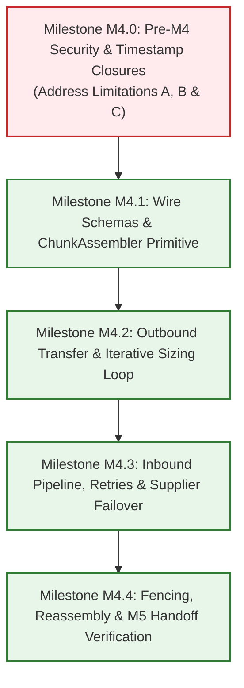

# Phase 7.5 Milestone M4 — Snapshot Transfer Implementation Roadmap

**Status:** APPROVED FOR PLANNING (DOCUMENTATION-ONLY)  
**Date:** 2026-11-19  
**Refinement Date:** 2026-11-19  
**Branch Baseline:** `main` at `3b90116`  
**Parent Implementation Baseline:** `6fddcf90de5d4cb0e82bd711e7e217cd570c88a4`  
**Specification Baseline:** `119da194c3feb883cfd61b6928cb81d4b200ac5d`  

---

## 1. Roadmap Overview & Phasing Strategy

Milestone M4 implements the chunked snapshot transfer protocol across WebRTC DataChannels. To ensure rigorous verification, risk isolation, and clean git history, M4 is partitioned into five sequential, independently testable sub-milestones (M4.0 through M4.4).

---

## 2. Sub-Milestone Breakdown

### Milestone M4.0: Pre-M4 Correctness, Security & Compaction Closures (Prerequisite)
- **Objective:** Address mandatory M3 audit limitations A, B, and C prior to introducing recovery transfer wire traffic.
- **Scope:**
  - **M4.0a (`STATE_DIGEST` Identity Binding):** In `TrustedTransportAdapter.handleTransportMessage()`, verify `msg.payload.senderPeerId === inbound.fromPeerId` and `msg.payload.connectionGeneration === peerStatus.generation`. Drop and reject any identity or generation mismatches.
  - **M4.0b (Exact Timestamp Resolution):** In `OrderedOperationLog.getOriginFrontierTimestamps()`, eliminate loose fallback to non-sequence-specific `originFrontierTimestamps`. Return exact sequence timestamps or report metadata unavailable.
  - **M4.0c (Facade Gating):** Restrict `LeaderlessSyncEngine.recordPeerDigest()` to internal/capability-authorized registration.
  - **M4.0d (Compaction Exception Staging):** In `OrderedOperationLog.compactAtFrontier()`, execute candidate base snapshot reduction before splicing operations or mutating indexes, ensuring transactional atomicity if reduction fails.
- **Deliverables:**
  - Code changes in `packages/sync-engine/src/engine/leaderless-sync-engine.ts` and `packages/sync-engine/src/log/ordered-operation-log.ts`.
  - Targeted unit tests in `packages/sync-engine/src/__tests__/closure-m4-0.test.ts`.
- **Exit Condition:** All existing 995 tests pass plus new M4.0 security tests.

---

### Milestone M4.1: Wire Protocol Schemas & Chunk Assembler Primitives
- **Objective:** Implement all recovery wire message contracts in `@syncplay/protocol` and the in-memory chunk tracking, deduplication, and failover assembly engine in `@syncplay/sync-engine`.
- **Scope:**
  - Add schemas to `@syncplay/protocol`: `SnapshotOfferPayloadSchema`, `SnapshotRequestPayloadSchema`, `SnapshotChunkPayloadSchema`, `SnapshotChunkRequestPayloadSchema`, `SnapshotAbortPayloadSchema`.
  - Export schemas and TypeScript types in `@syncplay/protocol/index.ts`.
  - Implement `calculateDynamicChunkSize(sctpLimit)` in `@syncplay/protocol`.
  - Implement `ChunkAssembler` in `packages/sync-engine/src/recovery/chunk-assembler.ts`:
    - Fixed pre-allocation for up to 128 chunks (bounded memory footprint).
    - Base64 binary decoding and per-chunk `chunkSha256` verification.
    - Idempotent duplicate chunk suppression (no re-verification or memory expansion).
    - Missing index computation (`getMissingChunkIndices`) with validation.
    - Failover chunk preservation (`prepareForFailover`): preserves verified chunks if snapshot ID and digest match bit-exact; purges all chunks on mismatch.
    - Full contiguous buffer concatenation and canonical SHA-256 digest verification.
- **Deliverables:**
  - `@syncplay/protocol` schema updates.
  - `packages/sync-engine/src/recovery/chunk-assembler.ts`.
  - Unit test suite: `packages/sync-engine/src/__tests__/chunk-assembler.test.ts`.
- **Exit Condition:** `ChunkAssembler` handles out-of-order, duplicate, corrupt, and failover-preserved chunks; 100% test pass rate.

---

### Milestone M4.2: Outbound Transfer Pipeline & Iterative Sizing Loop
- **Objective:** Implement the supplier-side transfer pipeline with normative 7-step iterative send-boundary sizing and termination guarantees.
- **Scope:**
  - Implement `SnapshotTransferManager` (Supplier Role):
    - Validate incoming `SNAPSHOT_REQUEST` against active epoch, supplier identity, and snapshot availability.
    - Slice binary snapshot into chunks using `calculateDynamicChunkSize()`.
    - Execute normative 7-step iterative sizing loop: serialize `SNAPSHOT_CHUNK`, measure exact UTF-8 bytes via `TextEncoder`, reduce binary slice by $\Delta = \lceil \text{overshoot} \times 0.75 \rceil + 32$ if exceeding negotiated SCTP limit.
    - Enforce termination condition: strictly decreasing binary slice; abort with `TRANSPORT_LIMIT_EXCEEDED` if slice $< 256$ bytes.
    - Pass valid wire string unchanged to `PeerManager.sendSerialized()`.
    - Handle `SNAPSHOT_CHUNK_REQUEST` retransmissions.
    - Bound concurrent outbound transfers to at most 2 per supplier (`MAX_SUPPLIER_CONCURRENT_TRANSFERS = 2`).
- **Deliverables:**
  - `packages/sync-engine/src/recovery/snapshot-transfer-manager.ts` (Supplier components).
  - Unit test suite: `packages/sync-engine/src/__tests__/snapshot-transfer-supplier.test.ts`.
- **Exit Condition:** Chunks generated under simulated SCTP limits of 64 KB, 32 KB, 16 KB, and 2 KB strictly never exceed the limit at `sendSerialized()`.

---

### Milestone M4.3: Inbound Transfer Pipeline, Retries & Supplier Failover
- **Objective:** Implement the requester-side transfer pipeline with pipelining, bounded retry budgets, wall-clock deadlines, and supplier failover.
- **Scope:**
  - Implement `SnapshotTransferManager` (Requester Role):
    - Enforce single active inbound transfer invariant per node.
    - Evaluate incoming `SNAPSHOT_OFFER` and generate `SNAPSHOT_REQUEST`.
    - Sliding-window flow control: pipeline up to 4 concurrent chunk requests (`MAX_CONCURRENT_CHUNK_REQUESTS = 4`).
    - Ingest incoming `SNAPSHOT_CHUNK` into `ChunkAssembler`.
    - Dual-level retry policy: max 3 retries per chunk, max 10 total transfer retransmissions.
    - Chunk request timer (5,000ms) and overall transfer wall-clock deadline (60,000ms).
    - Supplier failover: on supplier disconnect or generation change, transition to alternate eligible supplier offering the identical snapshot ID and digest, retaining verified chunks and issuing a new `transferId`.
- **Deliverables:**
  - `packages/sync-engine/src/recovery/snapshot-transfer-manager.ts` (Requester components).
  - Unit test suite: `packages/sync-engine/src/__tests__/snapshot-transfer-requester.test.ts`.
- **Exit Condition:** Transfers complete successfully under simulated 10% packet drop, reordering links, and mid-transfer supplier failover.

---

### Milestone M4.4: Fencing, Abort Lifecycle, and M5 Handoff Verification
- **Objective:** Implement lifecycle fencing, abort handling, memory dereferencing, and seamless handoff of verified snapshots to Milestone M5.
- **Scope:**
  - Wire transport status listeners:
    - On supplier peer disconnect: failover if eligible replacement exists; otherwise abort with `SUPPLIER_DISCONNECTED`.
    - On supplier generation change: abort/failover.
    - On membership epoch increment: abort with `EPOCH_MISMATCH` and purge partial buffers.
  - Handle inbound and outbound `SNAPSHOT_ABORT` messages.
  - Implement memory dereferencing on cancellation, timeout, and completion.
  - Implement `SnapshotTransferResult` handoff callback to M5 without executing snapshot installation.
  - Wire `TrustedTransportAdapter` message routing for all 5 recovery messages.
  - End-to-end integration tests between two simulated peers over WebRTC mock channels.
- **Deliverables:**
  - Complete `SnapshotTransferManager` integration.
  - End-to-end test suite: `packages/sync-engine/src/__tests__/snapshot-transfer-integration.test.ts`.
  - M4 completion report.
- **Exit Condition:** End-to-end snapshot transfer of 4 MB snapshots succeeds, aborts correctly on peer drop/epoch change, and handoff callback delivers verified payload. Zero M5 engine state modification occurs.

---

## 3. Explicit Prohibited Work in M4

To maintain architectural integrity:
- **PROHIBITED:** Calling `engine.importSnapshot()`, `engine.importSnapshotV2()`, or modifying engine state.
- **PROHIBITED:** Touching `PlaybackState`, `replicationVector`, or `OrderedOperationLog`.
- **PROHIBITED:** Reseeding the Lamport logical clock or modifying `LogicalClockManager`.
- **PROHIBITED:** Implementing quarantine event buffering or draining (deferred to M5).
- **PROHIBITED:** Transitioning recovery state machine to `ACTIVE` or `RECONCILING` (deferred to M6).
